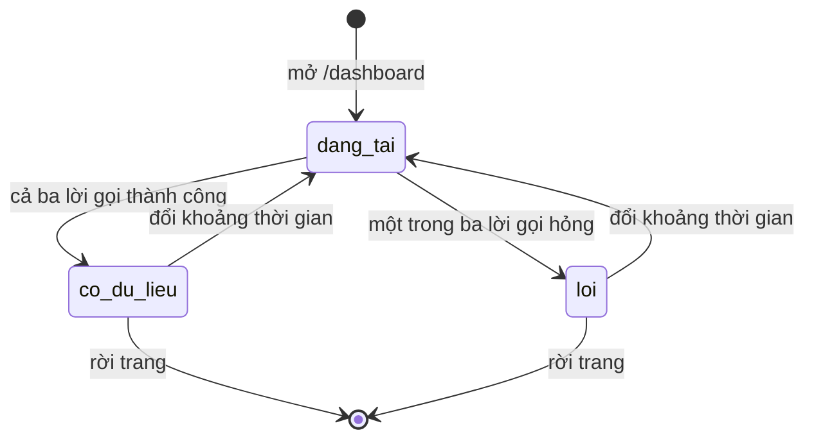

# Bảng điều khiển

## Tóm tắt

Bảng điều khiển là trang đầu tiên người quản trị thấy sau khi đăng nhập. Nó là một trang **chỉ đọc**: năm ô số ở trên, sáu biểu đồ xếp thành ba hàng đôi ở dưới, và một dải nút chọn khoảng thời gian ở góc trên bên phải. Không có gì để gõ, không có gì để lưu, không có gì để bấm vào rồi đi tiếp — không biểu đồ nào dẫn tới danh sách tương ứng.

Toàn bộ trang được nuôi bằng đúng ba lời gọi: thống kê Cung & Cầu, thống kê người dùng, thống kê thông báo. Ba lời gọi này chạy song song và **trang chỉ hiện ra khi cả ba cùng xong**. Một lời gọi hỏng làm cả trang trống.

Route là `/dashboard`, và `/` chuyển thẳng sang đây. Xem [`../nen-tang/dieu-huong-va-url.md`](../nen-tang/dieu-huong-va-url.md).

## Trường hợp đơn giản

Người quản trị đăng nhập xong và hạ cánh ở bảng điều khiển. Trong khoảnh khắc đầu, trang **trống**: chỉ có dải nút thời gian ở góc phải, phần còn lại là nền xám. Không có khung xương, không có vòng quay, không có chữ "Đang tải…".

Khi ba lời gọi trả về, cả trang hiện ra một lần:

- **Năm ô số**: Tổng Cung, Tổng Cầu, Đã công bố, Tổng User, User đang hoạt động.
- **Sáu biểu đồ**, xếp thành ba hàng, mỗi hàng hai cột trên màn hình rộng và một cột trên màn hình hẹp:
  1. *Yêu cầu hợp tác theo trạng thái* — cột đứng: nhận được, chấp nhận, từ chối.
  2. *Xu hướng Cung & Cầu theo tháng* — hai đường, một cho Cung một cho Cầu.
  3. *Cung & Cầu theo trạng thái* — cột đứng, hai nhóm: bản nháp và đã công bố.
  4. *Xu hướng User theo tháng* — một đường.
  5. *User theo vai trò* — bánh tròn hai lát: Admin và User.
  6. *Cung & Cầu theo lĩnh vực (Top 10)* — cột ngang, mười lĩnh vực nhiều nhất.

Mỗi biểu đồ nằm trong một thẻ có tiêu đề và một câu mô tả bên dưới tiêu đề.

Bấm một trong bốn nút **7 ngày · 30 ngày · 90 ngày · Tất cả** thì cả ba lời gọi chạy lại. Mặc định là **30 ngày**.

## Tương tác, sự kiện theo sự kiện

### Vào màn

Trang dựng ngay, nhưng nội dung thì chờ. Cả ba lời gọi được bắn cùng lúc với cùng một tham số khoảng thời gian, và giao diện chỉ vẽ khi **cả ba** đã về. Trong lúc chờ, phần thân trang không hiển thị gì.

Đây là một quyết định có hệ quả nhìn thấy được: trang có một cờ "đang tải" nhưng **không dùng cờ đó ở đâu cả**. Người dùng vào trang trên đường mạng chậm sẽ nhìn một trang trắng và không biết là nó đang tải hay đã hỏng.

Dải nút thời gian hiện ngay và bấm được ngay, kể cả khi dữ liệu chưa về.

### Rời đi không đổi gì

Không có gì được ghi lại. Không có bản nháp, không có lựa chọn nào được nhớ. Rời trang rồi quay lại thì khoảng thời gian trở về **30 ngày**, kể cả khi lần trước đã chọn "Tất cả".

### Bắt đầu sửa

Không có khái niệm *đã bẩn* trên trang này. Thứ duy nhất "sửa" được là khoảng thời gian, và nó là một lựa chọn hiển thị chứ không phải một giá trị được lưu ở đâu.

Dải nút là một nhóm chọn-một. Bấm vào nút đang sáng thì nhóm bỏ chọn nó, nhưng giao diện chặn trường hợp đó lại: giá trị rỗng bị bỏ qua và lựa chọn cũ giữ nguyên. Không có trạng thái "không chọn gì".

### Trong khi sửa

Đổi khoảng thời gian là một hành động **tức thì**: không có nút Áp dụng, không có độ trễ. Ba lời gọi mới chạy ngay, dải lỗi cũ (nếu có) bị xoá, và trang trở về trạng thái trống cho tới khi cả ba về.

Nghĩa là mỗi lần bấm một nút thời gian, **cả trang biến mất rồi hiện lại**. Bấm nhanh bốn nút liên tiếp bắn mười hai lời gọi, và không có gì huỷ các lời gọi cũ — phản hồi về sau cùng là phản hồi thắng, không nhất thiết là phản hồi của nút cuối cùng được bấm.

URL không đổi. Khoảng thời gian không đi vào query string.

### Gửi đi

Không có bước gửi. Trang không ghi gì lên máy chủ.

Ba lời gọi đọc là `GET /api/v1/admin/stats/intakes`, `.../users`, `.../notifications`, mỗi lời gọi mang tham số `days`. Bốn nút gửi lần lượt `7`, `30`, `90` và chuỗi `all`.

Khi một lời gọi hỏng, một dải đỏ hiện lên ngay dưới dải nút thời gian, mang thông điệp của lời gọi hỏng đầu tiên, và **toàn bộ phần thân trang biến mất** — kể cả hai lời gọi kia đã thành công. Không có cách xem phần dữ liệu đã lấy được.

> Ghi chú kỹ thuật: máy chủ nhận `days` là một số từ 1 đến 90, hoặc chuỗi `all`. Ngoài khoảng đó là lỗi kiểm tra dữ liệu 400 với một **mảng** thông điệp — xem [`../nen-tang/hop-dong-api.md`](../nen-tang/hop-dong-api.md#thân-lỗi-của-v1). Giao diện chỉ gửi bốn giá trị hợp lệ nên đường này không đi tới được từ màn hình.

## Biến thể

| Biến thể | Lúc vào màn | Trong khi sửa |
|---|---|---|
| Vai trò | Chỉ `ADMIN` tới được trang này: lớp bảo vệ chặn khách chưa đăng nhập, và ba endpoint thống kê đều từ chối vai trò khác bằng 403 `"Admin access required"`. Một token `USER` nhét thủ công vào cookie qua được lớp bảo vệ nhưng cho ra trang trống kèm dải đỏ — xem [B-18](../bug-triage.md#b-18-lớp-bảo-vệ-của-admin-không-kiểm-vai-trò). | Không ảnh hưởng. |
| Trạng thái bản ghi | Đề bài và tài sản công nghệ **đã xoá mềm không bị loại khỏi thống kê**: ba truy vấn thống kê đếm thẳng trên bảng, không lọc theo mốc xoá. Bản ghi đã xoá vẫn cộng vào Tổng Cung, Tổng Cầu và các biểu đồ. Câu chuyện và hồ sơ triển khai không xuất hiện ở đâu trên trang này. | Không ảnh hưởng. |
| Cấu hình backend | Nếu v1 đã bị dừng dịch vụ, cả ba lời gọi trả 410 và trang trống kèm một dải đỏ không giải thích được gì. `Matching:ScoringMode` và `Mail:DryRun` không ảnh hưởng — trang không đọc dữ liệu ghép cặp hay thư. | Không ảnh hưởng. |
| Phím tắt của biểu mẫu | Không có biểu mẫu. Tab đi qua bốn nút thời gian theo thứ tự. | Enter và Space kích hoạt nút thời gian đang được focus. **Escape không làm gì.** Ctrl/Cmd+Enter không được xử lý riêng. |

Đổi biến thể giữa chừng: vai trò và cấu hình máy chủ chỉ hiện ra ở bước gọi. Một tài khoản bị vô hiệu hoá trong lúc trang đang mở sẽ không biết gì cho tới lần đổi khoảng thời gian tiếp theo — trang không tự làm mới.

## Huỷ và gián đoạn

| Sự kiện | Trước khi gửi | Trong khi đang gửi |
|---|---|---|
| Bấm Huỷ hoặc nhấn Escape | Không có nút Huỷ. Escape không làm gì. | Không có cách huỷ. Ba lời gọi chạy tới khi xong hoặc hết 30 giây. |
| Đi chỗ khác trong app | Rời đi tự do, không cảnh báo. | Rời trang bỏ ba lời gọi; không có gì được ghi nên không có hậu quả. |
| Back/Forward của trình duyệt | Quay về trang trước trong ứng dụng. Bảng điều khiển không thêm mục lịch sử nào của riêng nó — đổi khoảng thời gian không tạo mục mới, nên Back **không** quay về khoảng thời gian trước. | Như trên; lời gọi bị bỏ. |
| Tải lại trang, hoặc đóng tab | Khoảng thời gian về **30 ngày**. Không có nháp nào để mất. | Ba lời gọi bị bỏ. Tải lại xong chúng chạy lại từ đầu. |
| Mất mạng, hoặc request quá hạn | Không ảnh hưởng — trang đã vẽ xong giữ nguyên số cũ, không có dấu hiệu nào cho biết số đó đã cũ. | Sau 30 giây, dải đỏ hiện thông điệp mặc định của thư viện HTTP và **toàn bộ thân trang biến mất**. Số đang hiển thị trước đó cũng mất theo. |
| Phiên hết hạn (401), hoặc v1 bị dừng (410) | Không ảnh hưởng — không có lời gọi nào đang bay. | 401 ở bất kỳ lời gọi nào trong ba làm bộ chặn xoá cookie và đẩy người dùng về `/login` ngay lập tức. 410 rơi vào nhánh lỗi chung: trang trống, dải đỏ, không có câu nào nói rằng API đã ngừng. |
| Bản ghi bị đổi bởi người khác, hoặc bị xoá | Số trên màn hình **im lặng lỗi thời**. Không có cơ chế làm mới tự động và không có dấu thời gian nói dữ liệu tính lúc nào. | Không ảnh hưởng — đây là ba lời gọi đọc, không có kiểm tra phiên bản. |
| Trình duyệt tự điền | Không ảnh hưởng — không có ô nhập nào. | Không ảnh hưởng. |

Sau bất kỳ gián đoạn nào, trang chỉ có hai hình dạng: **đầy đủ** hoặc **trống kèm dải đỏ**. Không có trạng thái nửa vời trong đó một phần biểu đồ hiện và một phần không.

## Tương tác với hệ thống khác

**Quyền và vai trò.** Ba endpoint thống kê kiểm hai lớp: lớp tương thích cũ trả 403 `"Admin access required"` cho vai trò không phải `ADMIN`, rồi bảng quyết định chính sách kiểm lần nữa với hành động đọc thống kê. Cả hai lớp phải cho qua. Xem [`../nen-tang/xac-thuc-va-vai-tro.md`](../nen-tang/xac-thuc-va-vai-tro.md).

**Kiểm tra dữ liệu và cách hiện lỗi.** Không có ô nhập nên không có kiểm tra tại chỗ. Lỗi từ máy chủ đi vào một dải đỏ duy nhất, hiển thị thông điệp của lời gọi hỏng **đầu tiên**; hai lời gọi kia hỏng thế nào cũng không hiện ra.

**Thay đổi chưa lưu.** Không có tương tác. Trang không bao giờ ở trạng thái đã bẩn theo nghĩa của [`../nen-tang/luu-va-phien-ban.md`](../nen-tang/luu-va-phien-ban.md).

**Cập nhật lạc quan và hoàn tác.** Không có tương tác. Không có gì được ghi.

**Ngoại tuyến.** Không có hàng đợi, không có bộ nhớ đệm. Mất mạng là ba lời gọi thất bại và một trang trống.

**Thông báo và toast.** Trang này không dùng toast. Mọi phản hồi đi vào dải đỏ.

**Trạng thái lọc/tìm trong URL.** Khoảng thời gian **không** nằm trong URL. Không thể gửi cho đồng nghiệp một đường dẫn mở sẵn ở "90 ngày", và Back không quay lại khoảng thời gian trước. Đây là hành vi chung của cả bảng quản trị — xem [`../nen-tang/dieu-huong-va-url.md`](../nen-tang/dieu-huong-va-url.md#cái-gì-nằm-trong-url).

**Đa ngôn ngữ.** Chữ trên trang là tiếng Việt viết thẳng trong mã. Tên tháng trên trục hoành được định dạng theo vùng `vi-VN`. Tên lĩnh vực đến từ dữ liệu; lĩnh vực không tra được tên sẽ hiện **định danh dạng chuỗi** thay vì tên. Thông điệp lỗi từ máy chủ là tiếng Anh.

**Khả năng truy cập.** Chưa rà. Các biểu đồ là SVG do thư viện vẽ; chưa xác nhận chúng có nhãn văn bản thay thế hay bảng dữ liệu tương đương không. Trang trống lúc đang tải không phát thông báo nào cho trình đọc màn hình.

**Dấu vết kiểm toán.** Ba lời gọi đọc này đi qua bảng quyết định chính sách, nên một lượt bị từ chối được ghi lại với kết quả `DENY`. Lượt đọc thành công không tạo dòng kiểm toán riêng. Người quản trị không thấy nhật ký ở đâu trong bảng quản trị vì [chưa có màn hình nhật ký kiểm toán](../moi/nhat-ky-kiem-toan.md).

## Trường hợp biên

- **Ô "Tổng User" không nghe theo bộ lọc thời gian.** Thống kê người dùng đếm **toàn bộ** bảng người dùng cho `total`, `byRole` và `byStatus`; chỉ biểu đồ theo tháng mới bị cắt theo khoảng thời gian. Thống kê Cung & Cầu thì cắt tất cả theo khoảng. Hệ quả: chọn "7 ngày" cho ra Tổng Cung nhỏ và Tổng User to, trên cùng một hàng ô số, và không có gì nói rằng hai con số đo hai phạm vi khác nhau.
- **"Đã công bố" đếm cả Cung lẫn Cầu.** Ô thứ ba cộng số đã công bố của hai loại lại làm một, trong khi hai ô đầu tách chúng ra. Ba ô đầu vì thế không cộng lại thành gì có nghĩa.
- **Bản ghi đã xoá mềm vẫn được đếm.** Xoá một đề bài trong màn quản lý không làm số trên bảng điều khiển giảm đi.
- **Biểu đồ tròn "User theo vai trò" luôn vẽ hai lát, kể cả khi một lát bằng 0.** Nhãn phần trăm khi đó hiện `0%`, và khi cả hai bằng 0 thì phần trăm là một phép chia cho 0.
- **Biểu đồ "Top 10 lĩnh vực" tự sắp xếp lại ở phía giao diện** dù máy chủ đã sắp giảm dần. Không sai, chỉ thừa. Đáng chú ý hơn: một bản ghi gắn ba lĩnh vực được đếm ba lần, nên tổng các cột lớn hơn tổng số bản ghi.
- **Biểu đồ "Cung & Cầu theo lĩnh vực" không có chú giải và tooltip của nó không gắn vào biểu đồ.** Thành phần hiện tooltip được đặt như một phần tử rời chứ không nối vào vùng vẽ, nên nhiều khả năng nó không bao giờ hiện ra khi rê chuột.
- **Hai biểu đồ đã viết xong nhưng không có trên màn hình nào.** Một biểu đồ đường "thông báo theo tháng" và một biểu đồ tròn "thông báo theo loại" tồn tại đầy đủ trong mã, gồm cả trạng thái rỗng "Chưa có dữ liệu", nhưng không trang nào vẽ chúng. Dữ liệu chúng cần (`byMonth` và tỷ lệ đã đọc của thông báo) vẫn được tải về mỗi lần vào trang rồi bị bỏ đi.
- **Tỷ lệ đã đọc thông báo được tải về nhưng không hiển thị ở đâu.** Máy chủ tính và trả một số phần trăm; trang không dùng nó.
- **Không biểu đồ nào bấm được.** Thấy một cột cao bất thường thì không có đường nào từ đó tới danh sách bản ghi tương ứng; phải tự sang màn quản lý và lọc lại bằng tay.
- **Bấm liên tiếp bốn nút thời gian có thể cho ra dữ liệu của nút không phải nút cuối cùng.** Không có cơ chế bỏ kết quả của lời gọi đã cũ.

## Câu hỏi mở và kiểm chứng

- Chưa dựng bảng quản trị trong trình duyệt. Mọi mô tả về cái hiện ra trên màn hình đọc từ mã; cần một lượt kiểm bằng tay để xác nhận, đặc biệt là trang trống lúc đang tải, và việc tooltip của biểu đồ lĩnh vực có hiện ra không.
- Chưa có dữ liệu trong cơ sở dữ liệu nên chưa đo được hình dạng thật của ba phản hồi thống kê. Chưa biết một hệ thống rỗng cho ra biểu đồ trống hay biểu đồ hỏng.
- Việc **ô "Tổng User" và "User đang hoạt động" bỏ qua bộ lọc thời gian trong khi ba ô còn lại tuân theo** đáng bị coi là lỗi hơn là một quyết định: bốn nút thời gian nằm ngay trên đầu và ngụ ý rằng mọi thứ dưới nó đều nằm trong khoảng đó. (chưa cấp mã lỗi)
- Việc **thống kê đếm cả bản ghi đã xoá mềm** cần một quyết định sản phẩm: đây có thể là chủ ý (đếm lượt nộp) hoặc là thiếu sót (bỏ quên bộ lọc mốc xoá). Mã không nói lý do. (chưa cấp mã lỗi)
- Việc **một lời gọi hỏng làm mất cả trang** đáng bị coi là lỗi: ba nguồn dữ liệu độc lập nhau và hai nguồn còn sống vẫn hiển thị được. (chưa cấp mã lỗi)
- Chưa rõ hai biểu đồ thông báo bị gỡ khỏi trang có chủ đích hay bị bỏ quên trong một lần đổi bố cục. Nếu có chủ đích thì lời gọi thống kê thông báo vẫn đang tải về nhiều hơn mức cần.
- Chưa đo hành vi khi bấm liên tiếp các nút thời gian; cần xác nhận thứ tự phản hồi có thể đảo không trên mạng thật.

Đối chiếu với SourceCode/dmst-admin-main và SourceCode/nacentech, bản chụp ngày 2026-09-04.
