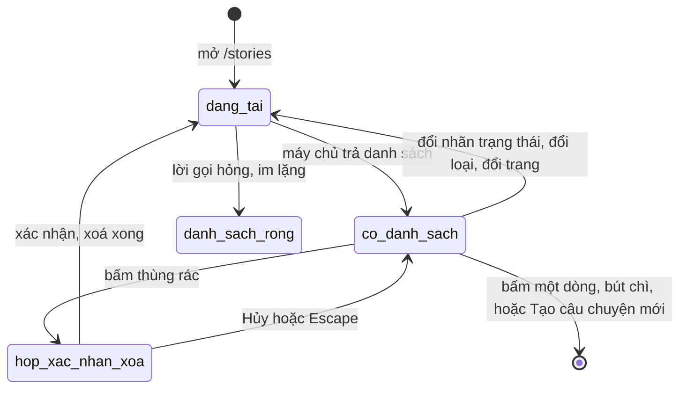
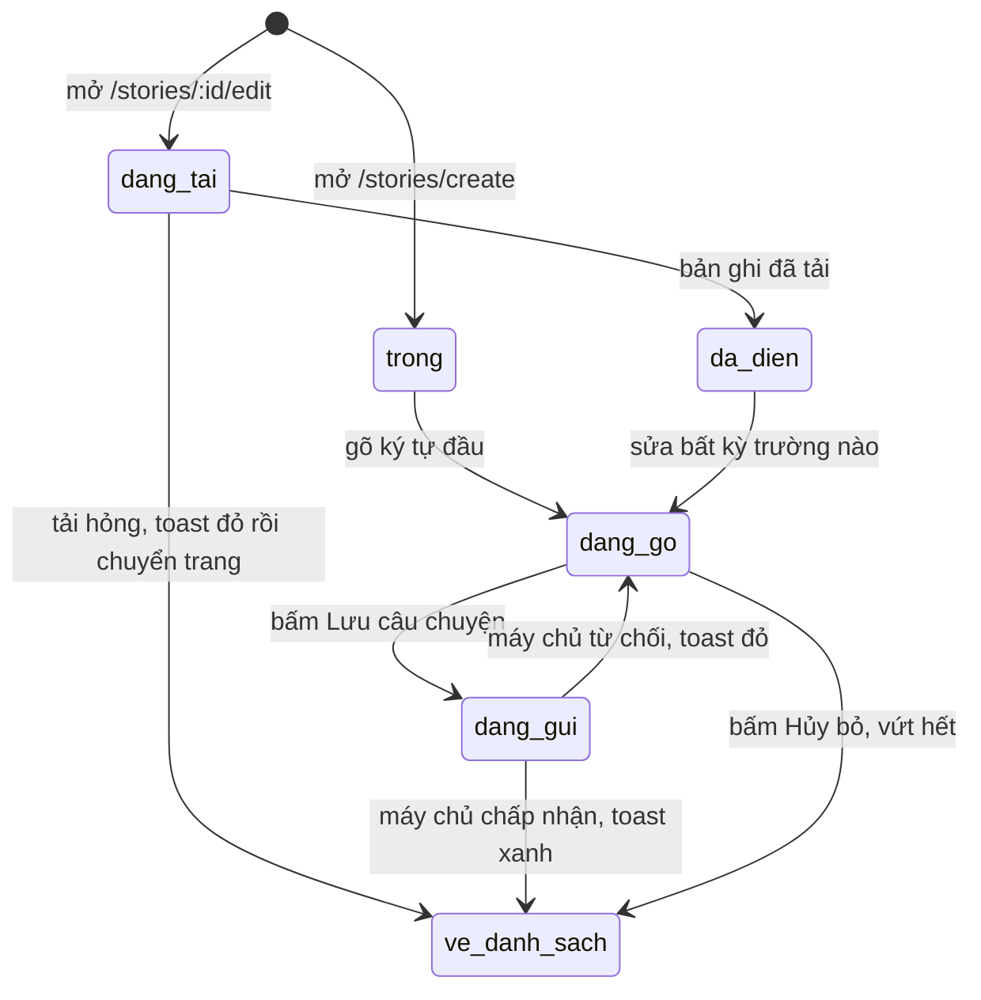

# Câu chuyện

## Tóm tắt

Khu vực `/stories` là nơi quản trị viên xem, viết, sửa và xoá **câu chuyện** — bài viết kể lại một lần thành công hoặc một lần thất bại, do người dùng cổng hoặc chính quản trị viên đăng. Đây là khu vực duy nhất của bảng quản trị dùng **tham số đường dẫn** cho màn chi tiết: `/stories/:id` và `/stories/:id/edit`, nên đường dẫn chia sẻ được.

Câu chuyện có ba trạng thái nhìn thấy được ở phía dữ liệu: bản nháp, đã xuất bản, và **đã xuất bản nhưng bị ẩn** — cờ ẩn do quản trị viên đặt, độc lập với trạng thái xuất bản. Xem [`../nen-tang/mo-hinh-du-lieu.md`](../nen-tang/mo-hinh-du-lieu.md#câu-chuyện).

Bảng quản trị **không hiển thị và không đổi được cờ ẩn**. Máy chủ có `PATCH /api/v1/admin/stories/{id}/visibility`, lớp gọi API của bảng quản trị đã viết hàm gọi nó, và không màn hình nào dùng hàm đó. Từ giao diện, việc duy nhất làm được với một câu chuyện không muốn công khai là **đưa nó về bản nháp** hoặc **xoá hẳn**.

Cũng không có bước duyệt nào. Quản trị viên viết và bấm công khai là xong; không có hàng chờ, không có trạng thái "chờ duyệt", không có ai phê duyệt ai.

## Trường hợp đơn giản

Quản trị viên bấm **Câu chuyện** trên thanh bên. Trang hiện tiêu đề *"Quản lý Câu chuyện"*, nút **Tạo câu chuyện mới**, một thanh bộ lọc, và một bảng.

Trong lúc chờ, giữa bảng là một vòng quay và chữ *"Đang tải dữ liệu…"*.

Bảng có sáu cột: số thứ tự, tiêu đề, loại (*Thành công* xanh / *Thất bại* cam), trạng thái (*Công khai* xanh dương / *Nháp* xám), ngày tạo, và một cột thao tác. Cột thao tác hiện dấu ba chấm mờ; **rê chuột vào dòng** thì dấu ba chấm biến mất và hai nút bút chì và thùng rác hiện ra.

Bấm vào một dòng sang màn chi tiết. Bấm bút chì sang biểu mẫu sửa. Bấm thùng rác mở hộp xác nhận đỏ nêu tên câu chuyện và nói rằng dữ liệu sẽ mất vĩnh viễn — câu đó **đúng**: xoá câu chuyện là xoá thật, không phải xoá mềm.

Bấm **Tạo câu chuyện mới** sang biểu mẫu: cột trái là tiêu đề và trình soạn thảo nội dung, cột phải là thẻ *Cấu hình* để chọn loại, và một thanh cố định ở đáy màn hình mang nút chọn trạng thái, nút *Hủy bỏ* và nút *Lưu câu chuyện*.

## Tương tác, sự kiện theo sự kiện

### Danh sách

### Biểu mẫu viết và sửa

### Vào màn

**Danh sách** gọi `GET /api/v1/admin/stories` với trang 1, **hai mươi dòng**, không lọc. Đây là danh sách duy nhất trong bảng quản trị dùng hai mươi dòng một trang; hai danh sách kia dùng mười.

Danh sách của quản trị viên trả về **cả bản nháp lẫn bản đã xuất bản, cả câu chuyện đang bị ẩn lẫn không bị ẩn**, của mọi tác giả.

**Biểu mẫu sửa** gọi bản ghi theo định danh trong đường dẫn. Trong lúc chờ, màn hình hiện vòng quay và chữ *"Đang tải thông tin câu chuyện…"*. Nếu lời gọi hỏng, toast đỏ *"Không thể tải câu chuyện"* rồi trang **tự chuyển về danh sách**.

**Màn chi tiết** hành xử y hệt, với cùng một toast và cùng một lần tự chuyển trang.

Biểu mẫu tạo mới bắt đầu với loại *Thành công* và trạng thái *Lưu nháp*. Không ô nào được focus sẵn ở bất kỳ màn nào.

### Rời đi không đổi gì

Không có gì được ghi lại. Bộ lọc, số trang và nội dung đang soạn đều mất khi rời trang. Định danh thì giữ được vì nó nằm trong đường dẫn.

### Bắt đầu sửa

Biểu mẫu **không có khái niệm *đã bẩn***: không có dấu hiệu nào cho biết có thay đổi chưa lưu, nút *Lưu câu chuyện* luôn bấm được từ đầu, và không có gì chặn việc rời trang.

Nút **Hủy bỏ** ở thanh đáy rời trang ngay lập tức, vứt bỏ mọi thứ đã gõ, **không hỏi lại**.

### Trong khi sửa

**Trên danh sách:**

- Ba viên nhãn trạng thái — *Tất cả*, *Bản nháp*, *Đã công khai* — không kèm số đếm, khác với [danh sách đề bài và công nghệ](de-bai-va-cong-nghe.md) vốn có.
- Ô thả xuống loại có ba lựa chọn: *Tất cả loại*, *Thành công*, *Thất bại*.
- Đổi nhãn trạng thái hoặc đổi loại đưa trang về 1.
- **Ô tìm kiếm không nối vào gì.** Nó hiện ra đầy đủ với biểu tượng kính lúp và câu gợi ý *"Tìm kiếm tiêu đề…"*, gõ vào được, nhưng không có giá trị gắn kèm và không có xử lý thay đổi. Gõ bao nhiêu cũng không lọc gì. Máy chủ cũng không nhận tham số tìm kiếm cho câu chuyện.
- Thanh phân trang chỉ hiện khi có nhiều hơn một trang.

**Trên biểu mẫu:**

- Ô tiêu đề giới hạn **255 ký tự** ngay tại chỗ; gõ thêm thì không vào.
- Chọn loại *Thất bại* làm hiện thêm một thẻ cam **"Bài học rút ra"** với một trình soạn thảo riêng. Chọn lại *Thành công* thì thẻ đó biến mất — nhưng nội dung đã gõ trong đó **vẫn còn trong bộ nhớ** và hiện lại nguyên vẹn nếu chọn *Thất bại* lần nữa.
- Thanh đáy có hai nút chọn trạng thái, *Lưu nháp* và *Công khai*. Chúng chỉ **đặt giá trị**, không gửi gì. Nút gửi thật là *Lưu câu chuyện* bên phải.
- Không có kiểm tra dữ liệu nào chạy trong lúc gõ.

URL không đổi ở bất kỳ thao tác nào.

### Gửi đi

Bấm **Lưu câu chuyện**:

1. Tiêu đề rỗng → toast đỏ *"Vui lòng nhập tiêu đề"*, dừng.
2. Nội dung rỗng → toast đỏ *"Vui lòng nhập nội dung"*, dừng.
3. Loại là *Thất bại* mà bài học rỗng → toast đỏ *"Vui lòng nhập bài học rút ra"*, dừng.
4. Nút đổi chữ thành "Đang lưu…" và bị khoá.
5. Tạo mới: `POST /api/v1/admin/stories`. Sửa: `PUT /api/v1/admin/stories/{id}`.
6. Thành công: toast xanh *"Đã tạo câu chuyện"* hoặc *"Đã cập nhật câu chuyện"*, rồi **chuyển về danh sách** — kể cả ở chế độ sửa.
7. Thất bại: toast đỏ *"Không thể tạo câu chuyện"* / *"Không thể cập nhật câu chuyện"*, mọi thứ đã gõ còn nguyên.

Thân request luôn gồm đủ năm trường: tiêu đề đã cắt khoảng trắng, loại, nội dung, bài học, trạng thái. Khi loại là *Thành công*, trường bài học được gửi là rỗng.

**Xoá** gọi `DELETE /api/v1/admin/stories/{id}` sau hộp xác nhận. Từ danh sách thì tải lại danh sách; từ màn chi tiết thì chuyển về danh sách. Máy chủ **xoá hẳn bản ghi** — không có mốc xoá mềm, không có khôi phục, không có thùng rác.

Đường thất bại cho ra một câu chung cho mọi nguyên nhân.

> Ghi chú kỹ thuật: sửa câu chuyện dùng `PUT` chứ không phải `PATCH`, nhưng phía máy chủ vẫn hiểu trường vắng mặt là "giữ nguyên" chứ không phải "đặt về rỗng". Riêng trường **bài học** có một cờ xoá riêng, và facade luôn đặt cờ đó là không — nên bài học không bao giờ bị xoá bằng lệnh sửa. Xem mục [Trường hợp biên](#trường-hợp-biên).

## Biến thể

| Biến thể | Lúc vào màn | Trong khi sửa |
|---|---|---|
| Vai trò | Chỉ `ADMIN` vào được; cả năm đường `/api/v1/admin/stories` trả 403 cho vai trò khác. Quản trị viên **sửa và xoá được câu chuyện của mọi tác giả**; khi đó việc kiểm quyền tác giả bị **bỏ qua** chứ không phải được thoả mãn — hai chuyện khác nhau khi đọc nhật ký kiểm toán. Câu chuyện do quản trị viên tạo mang chính quản trị viên đó làm tác giả, và [trang giới thiệu công khai](../landing/trang-chu-va-cau-chuyen.md) phân biệt được nguồn theo vai trò tác giả. | Không ảnh hưởng. |
| Trạng thái bản ghi | Danh sách của quản trị viên hiện **cả nháp lẫn đã công khai, cả bị ẩn lẫn không**. Cột trạng thái chỉ có hai giá trị, nên **một câu chuyện đã công khai nhưng bị ẩn trông giống hệt một câu chuyện đã công khai bình thường**. Không có cột, huy hiệu hay bộ lọc nào cho cờ ẩn. Câu chuyện không có xoá mềm nên không có bản ghi ẩn nào khác. | Trạng thái đổi bằng hai nút ở thanh đáy; cờ ẩn không đổi được. |
| Cấu hình backend | Nếu v1 đã bị dừng dịch vụ, danh sách trả 410 và bảng hiện trạng thái rỗng **không kèm thông báo nào**; biểu mẫu và màn chi tiết hiện toast đỏ rồi tự chuyển về danh sách. `Matching:ScoringMode` và `Mail:DryRun` không ảnh hưởng. | Không ảnh hưởng. |
| Phím tắt của biểu mẫu | Không ô nào được focus sẵn. Tab đi từ nút *Quay lại danh sách*, qua ô tiêu đề, vào trình soạn thảo, rồi sang thẻ *Cấu hình* và thanh đáy. | **Enter không gửi biểu mẫu** — các ô không nằm trong thẻ `form` và Enter trong trình soạn thảo là xuống dòng. **Escape không làm gì** trên biểu mẫu; nó đóng hộp xác nhận xoá trên danh sách và màn chi tiết. Ctrl/Cmd+Enter không được xử lý riêng. |

Đổi biến thể giữa chừng: một câu chuyện bị người khác xoá trong lúc biểu mẫu đang mở sẽ làm lần lưu tiếp theo trả 404 và người dùng nhận câu lỗi chung, không biết nguyên nhân thật.

## Huỷ và gián đoạn

| Sự kiện | Trước khi gửi | Trong khi đang gửi |
|---|---|---|
| Bấm Huỷ hoặc nhấn Escape | Nút **Hủy bỏ** ở thanh đáy rời trang ngay, vứt bỏ mọi thứ đã gõ, không hỏi. Mũi tên *Quay lại danh sách* ở đầu trang làm đúng như vậy. **Escape không làm gì** trên biểu mẫu. Hộp xác nhận xoá đóng bằng Escape hoặc nút *Hủy*. | Nút *Lưu câu chuyện* bị khoá; nút *Hủy bỏ* thì **không**: bấm nó giữa lúc đang gửi rời trang ngay trong khi lời gọi vẫn bay. |
| Đi chỗ khác trong app | Rời đi tự do, không cảnh báo, mọi thứ chưa lưu mất hết. | Rời trang bỏ toast nhưng không bỏ được việc ghi: máy chủ vẫn lưu xong. Người dùng không thấy kết quả. |
| Back/Forward của trình duyệt | Rời khỏi màn hình. Bấm Back sau khi lọc **không** quay lại kết quả trước. Từ chi tiết bấm Back về danh sách ở trạng thái mặc định. Từ biểu mẫu bấm Back mất hết nội dung đang soạn. | Như trên; lệnh vẫn hoàn tất ở máy chủ. |
| Tải lại trang, hoặc đóng tab | Chi tiết và sửa dựng lại đúng câu chuyện, vì định danh nằm trong đường dẫn. Nội dung đang soạn mất — không có nháp cục bộ. Bộ lọc của danh sách cũng mất. | Lời gọi bị bỏ ở phía trình duyệt. Máy chủ có thể đã ghi; tải lại sẽ thấy kết quả mà không có thông báo nào. |
| Mất mạng, hoặc request quá hạn | Không ảnh hưởng — trang đã dựng giữ nguyên. | Sau 30 giây, toast đỏ với câu chung, nút mở khoá, mọi thứ đã gõ còn nguyên. **Bấm lại là gửi lại**; với lệnh tạo, hai lần thành công tạo **hai câu chuyện trùng nhau** vì không có khoá chống lặp trên đường v1 — xem [`../nen-tang/hop-dong-api.md`](../nen-tang/hop-dong-api.md#khoá-chống-lặp). |
| Phiên hết hạn (401), hoặc v1 bị dừng (410) | Không ảnh hưởng. | 401 làm bộ chặn xoá cookie và đẩy người dùng về `/login` giữa chừng; **toàn bộ bài đang viết mất trắng**. 410 rơi vào nhánh lỗi chung và hiện ra bằng câu chung. |
| Bản ghi bị đổi bởi người khác, hoặc bị xoá | Biểu mẫu giữ nguyên dữ liệu đã tải lúc mở; không có làm mới và không có cảnh báo. | Không có kiểm tra phiên bản trên đường v1: hai người cùng sửa một câu chuyện thì người ghi sau ghi đè toàn bộ, không có 409 và không có cảnh báo. Nếu bản ghi vừa bị xoá, lời gọi trả 404 và người dùng nhận câu lỗi chung. Câu chuyện **không có phiên bản**: sửa là ghi đè thật, không tạo lịch sử — khác đề bài và tài sản công nghệ, xem [`../nen-tang/luu-va-phien-ban.md`](../nen-tang/luu-va-phien-ban.md). |
| Trình duyệt tự điền | Ô tiêu đề là ô văn bản thường, không khai báo `autocomplete`; trình duyệt có thể đề nghị giá trị đã gõ trước đó. Trình soạn thảo giàu định dạng không phải mục tiêu của tự điền. | Ô tiêu đề không bị khoá trong lúc gửi, nên tự điền vẫn ghi vào được — và giá trị đó không nằm trong lần gửi đang chạy. |

Sau bất kỳ gián đoạn nào, phía máy chủ chỉ có hai kết quả: câu chuyện đã lưu đầy đủ, hoặc chưa lưu gì. Mỗi lệnh là một giao dịch duy nhất.

## Tương tác với hệ thống khác

**Quyền và vai trò.** Cả năm đường yêu cầu `ADMIN`, kiểm hai lớp: lớp tương thích cũ trả 403 `"Admin access required"`, rồi bảng quyết định chính sách kiểm hành động tạo hoặc kiểm duyệt. Quản trị viên đi qua nhánh kiểm duyệt, tức là **bỏ qua** ràng buộc tác giả chứ không phải thoả mãn nó. Xem [`../xuyen-suot/quyen-va-vai-tro.md`](../xuyen-suot/quyen-va-vai-tro.md).

**Kiểm tra dữ liệu và cách hiện lỗi.** Kiểm tra tại chỗ có ba luật, tất cả chạy lúc bấm gửi: tiêu đề, nội dung, và bài học khi loại là *Thất bại*. Máy chủ có luật riêng — loại phải là một trong hai giá trị, trạng thái phải là một trong hai giá trị — nhưng chúng **không bao giờ hiện ra**, vì mọi lỗi bị thay bằng câu chung. Luật "bài học bắt buộc với câu chuyện thất bại" chỉ tồn tại ở phía giao diện; máy chủ nhận một câu chuyện thất bại không có bài học.

**Thay đổi chưa lưu.** Biểu mẫu có hai trình soạn thảo và không một lớp bảo vệ nào: không cảnh báo khi rời trang, không nháp cục bộ, không dấu hiệu đã bẩn, và nút *Hủy bỏ* vứt hết không hỏi. Xem [`../xuyen-suot/thay-doi-chua-luu.md`](../xuyen-suot/thay-doi-chua-luu.md).

**Cập nhật lạc quan và hoàn tác.** Không có cập nhật lạc quan: mọi thứ chờ máy chủ. Không có hoàn tác. Xoá là xoá thật và **không lấy lại được bằng bất kỳ cách nào** ngoài can thiệp cơ sở dữ liệu — đây là điểm khác biệt lớn nhất giữa câu chuyện và hai loại nội dung còn lại của bảng quản trị.

**Ngoại tuyến.** Không có hàng đợi, không có nháp cục bộ. Mất mạng giữa lúc viết một bài dài là mất bài đó nếu người dùng rời trang.

**Thông báo và toast.** Màn này dùng toast cho mọi phản hồi: ba câu kiểm tra dữ liệu, bốn câu kết quả lưu, hai câu cho xoá, hai câu cho tải hỏng. Tất cả bằng tiếng Việt. **Lỗi tải danh sách thì không có toast nào** — nó bị nuốt hoàn toàn và bảng chỉ hiện trạng thái rỗng.

**Trạng thái lọc/tìm trong URL.** Bộ lọc trạng thái, bộ lọc loại và số trang **không** nằm trong URL. Định danh câu chuyện thì có, trong đường dẫn — nên đường dẫn tới một câu chuyện cụ thể chia sẻ được và tải lại được. Xem [`../nen-tang/dieu-huong-va-url.md`](../nen-tang/dieu-huong-va-url.md).

**Đa ngôn ngữ.** Toàn bộ chữ là tiếng Việt viết thẳng trong mã. Ngày tháng dùng bộ định dạng vùng `vi-VN`. Nội dung câu chuyện là dữ liệu người dùng nhập, không có bản dịch và không có trường ngôn ngữ. Thông điệp lỗi từ máy chủ là tiếng Anh nhưng không bao giờ đến được người dùng.

**Khả năng truy cập.** Dòng bảng là thẻ `tr` gắn sự kiện bấm, không đi tới được bằng bàn phím. **Hai nút bút chì và thùng rác chỉ hiện khi rê chuột** — chúng luôn có trong cây tài liệu nên bàn phím vẫn tới được, nhưng người dùng bàn phím sẽ focus vào những nút vô hình. Ba viên nhãn trạng thái là nút thường, không khai báo vai trò tab. Thanh hành động ở đáy biểu mẫu là một dải cố định che phần dưới trang; trên màn hình thấp nó có thể che nội dung.

**Dấu vết kiểm toán.** Tạo, sửa, xoá và đổi cờ ẩn đều ghi dòng kiểm toán ở phía máy chủ trong cùng giao dịch với dữ liệu. Vì xoá là xoá thật, **dòng kiểm toán là dấu vết duy nhất còn lại** của một câu chuyện đã bị xoá. Không có màn hình nào đọc chúng: [`../moi/nhat-ky-kiem-toan.md`](../moi/nhat-ky-kiem-toan.md).

## Trường hợp biên

- **Không ẩn hoặc hiện được câu chuyện từ giao diện.** Máy chủ có đường đổi cờ ẩn, lớp gọi API của bảng quản trị có hàm gọi nó, và không màn hình nào dùng hàm đó. Cách duy nhất giấu một câu chuyện đã công khai là đưa nó về nháp — nhưng làm vậy cũng giấu nó khỏi chính tác giả trong danh sách của họ ở cổng người dùng, trong khi cờ ẩn thì không.
- **Câu chuyện bị ẩn không phân biệt được với câu chuyện bình thường.** Cột trạng thái chỉ đọc trường xuất bản. Một quản trị viên nhìn bảng không biết bài nào đang bị ẩn khỏi công chúng.
- **Ô tìm kiếm là một ô giả.** Nó hiện ra, gõ được, và không làm gì. Máy chủ cũng không có tham số tìm kiếm cho câu chuyện, nên nối nó vào sẽ cần thêm việc ở cả hai phía.
- **Không có bước duyệt, nhưng biểu mẫu nói là có.** Thẻ *Cấu hình* có một khối chữ nghiêng: *"Câu chuyện của bạn sẽ được kiểm duyệt trước khi hiển thị công khai."* Không có hàng chờ duyệt nào tồn tại; bấm *Công khai* rồi *Lưu* là bài lên ngay.
- **Bài học không xoá được.** Đổi một câu chuyện từ *Thất bại* sang *Thành công* rồi lưu: giao diện gửi trường bài học là rỗng, và máy chủ hiểu rỗng là "giữ nguyên" vì cờ xoá luôn tắt. Bài học cũ **vẫn nằm trong bản ghi và vẫn nằm trong phản hồi API**, chỉ là màn chi tiết không vẽ nó vì nó chỉ vẽ khi loại là *Thất bại*. Đổi ngược lại sang *Thất bại* thì bài học cũ hiện ra lại.
- **Tên tác giả gần như luôn không hiện.** Màn chi tiết đọc trường `name` trong khối tác giả; máy chủ trả về khối tác giả có `firstName` và `lastName` chứ không có `name`. Kết quả là ô *"Người tạo"* rơi về **tám ký tự đầu của định danh tác giả**, và ô tròn chữ cái đầu hiện chữ `A`.
- **Xoá là vĩnh viễn.** Câu chuyện là loại nội dung duy nhất trong bảng quản trị bị xoá cứng. Hộp xác nhận nói đúng điều đó, nhưng nó nói giống hệt hộp xác nhận của đề bài và công nghệ, vốn thực ra chỉ xoá mềm — hai hành vi rất khác nhau, một câu chữ.
- **Lỗi tải danh sách bị nuốt hoàn toàn.** Không toast, không dải đỏ. Lời gọi hỏng cho ra đúng màn hình *"Chưa có câu chuyện nào"* kèm nút mời tạo bài đầu tiên.
- **Số trang tính ở phía giao diện.** Máy chủ trả tổng số và số dòng một trang, giao diện tự chia; nếu hai bên hiểu số dòng khác nhau, số trang sẽ sai. Danh sách câu chuyện là danh sách duy nhất **không nhận số trang từ máy chủ**.
- **Số thứ tự tính bằng hằng số 20 viết thẳng trong dòng.** Nếu số dòng một trang đổi, cột số thứ tự sẽ lệch.
- **Sửa xong thì bị đẩy về danh sách.** Khác biểu mẫu đề bài và công nghệ, vốn ở lại trang và tải lại bản ghi. Người sửa liên tiếp nhiều lần phải mở lại bài mỗi lần.
- **Nội dung bài học vẫn giữ trong bộ nhớ khi đổi loại.** Chọn *Thành công* làm thẻ bài học biến mất nhưng không xoá nội dung; bấm *Lưu* khi đó vẫn gửi trường rỗng, nên nội dung trong bộ nhớ bị bỏ đi ở lần lưu — trừ khi đổi lại sang *Thất bại* trước.

## Câu hỏi mở và kiểm chứng

- Chưa dựng bảng quản trị trong trình duyệt. Mọi mô tả về cái hiện ra trên màn hình đọc từ mã; cần một lượt kiểm bằng tay, đặc biệt là hành vi hiện/ẩn hai nút thao tác khi rê chuột và khi đi bằng bàn phím.
- **Việc không có nút ẩn/hiện câu chuyện là một lỗi**, không phải một quyết định phạm vi: cờ ẩn tồn tại trong mô hình dữ liệu, có endpoint riêng, và hàm gọi nó đã được viết sẵn trong bảng quản trị. Nó là công cụ kiểm duyệt duy nhất của hệ thống và hiện không dùng được. (chưa cấp mã lỗi)
- **Việc ô tìm kiếm hiện ra nhưng không làm gì đáng bị coi là lỗi**: nó hứa một chức năng không có. (chưa cấp mã lỗi)
- **Việc màn chi tiết đọc sai tên trường của khối tác giả là một lỗi hiển thị**; nó biến mọi câu chuyện thành "của một ai đó không rõ". (chưa cấp mã lỗi)
- **Việc không xoá được bài học khi đổi loại câu chuyện** là hệ quả của việc facade luôn tắt cờ xoá. Dữ liệu thừa nằm lại trong bản ghi và vẫn đi ra trong phản hồi API công khai. (chưa cấp mã lỗi)
- Câu chữ *"sẽ được kiểm duyệt trước khi hiển thị công khai"* cần một quyết định sản phẩm: hoặc bỏ câu đó, hoặc xây bước duyệt thật. Hiện nó mô tả một quy trình không tồn tại.
- Chưa rõ vì sao câu chuyện bị xoá cứng trong khi đề bài và tài sản công nghệ được xoá mềm. Nếu là chủ ý thì lý do chưa được ghi ở đâu trong mã.
- Chưa xác nhận trình soạn thảo giàu định dạng lưu nội dung ở định dạng nào, và [trang giới thiệu công khai](../landing/trang-chu-va-cau-chuyen.md) hiển thị định dạng đó ra sao.
- Chưa đo điều gì hiện ra khi định danh trong đường dẫn không hợp lệ.

Đối chiếu với SourceCode/dmst-admin-main và SourceCode/nacentech, bản chụp ngày 2026-09-04.
