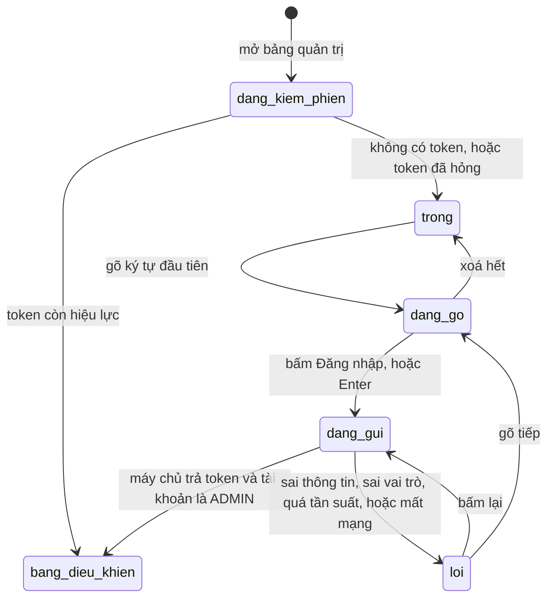

# Trang đăng nhập admin

## Tóm tắt

Trang đăng nhập là cửa duy nhất vào bảng quản trị. Nó nhận email và mật khẩu, đổi lấy một token, rồi lấy thông tin tài khoản trước khi cho vào. Chỉ tài khoản có vai trò `ADMIN` qua được; tài khoản người dùng thường nhập đúng mật khẩu vẫn bị từ chối, và bị từ chối bằng đúng câu như khi nhập sai mật khẩu.

Trang nằm ở route `/login`, là route duy nhất của bảng quản trị nằm ngoài lớp bảo vệ. Mọi route khác nằm dưới một lớp chặn: chưa đăng nhập thì bị đưa về đây. Không có liên kết "Quên mật khẩu", không có liên kết đăng ký, không có nút hiện mật khẩu. Dòng chữ dưới thẻ nói rõ: "Chỉ tài khoản được cấp quyền mới có thể truy cập."

## Trường hợp đơn giản

Người quản trị mở bảng quản trị. Nếu chưa có phiên, họ thấy trang chia đôi: nửa trái là mảng thương hiệu màu xanh với logo và ba dòng giới thiệu, nửa phải là thẻ trắng chứa biểu mẫu. Trên màn hình hẹp, mảng trái biến mất và chỉ còn logo nhỏ phía trên thẻ.

Họ gõ email vào ô đầu, mật khẩu vào ô thứ hai, rồi bấm **Đăng nhập**. Nút đổi chữ thành "Đang đăng nhập…", cả hai ô mờ đi và không gõ được nữa.

Nếu đúng, trang chuyển thẳng sang `/dashboard` và mục đăng nhập bị thay khỏi lịch sử trình duyệt — bấm Back không quay lại được trang đăng nhập. Nếu sai, một dải đỏ hiện lên phía trên hai ô, chữ trên nút trở lại "Đăng nhập", hai ô mở lại, và **mật khẩu vẫn còn nguyên trong ô**.

Lần sau mở lại bảng quản trị trong vòng bảy ngày, họ không phải đăng nhập lại — trừ khi token đã quá hạn 24 giờ, khi đó trang chớp qua "Đang tải…" rồi rơi về đúng trang đăng nhập này.

## Tương tác, sự kiện theo sự kiện

### Vào màn

Route `/login` không nằm dưới lớp bảo vệ, nên nó dựng ngay, không chờ gì.

Nhưng lớp cung cấp phiên bên trên nó thì có chờ. Khi ứng dụng khởi động, nó đọc cookie `admin_token`. Nếu cookie có, nó gọi `GET /api/v1/admin/auth/me` để xác nhận token còn dùng được. Trong lúc chờ, mọi route nằm dưới lớp bảo vệ hiển thị một màn xám với dòng "Đang tải…" ở giữa. Trang đăng nhập **không** chờ: nó vẽ ngay, và nếu lời gọi kia trả về thành công thì nó tự đẩy người dùng sang `/dashboard`.

Hệ quả nhìn thấy được: mở bảng quản trị khi đang có phiên hợp lệ thì trang đăng nhập **có thể chớp lên một nhịp** trước khi bị thay bởi bảng điều khiển.

Hai ô đều rỗng. Không ô nào được focus sẵn — người dùng phải bấm hoặc nhấn Tab. Ô email khai báo `autocomplete="email"`, ô mật khẩu khai báo `autocomplete="current-password"`, nên trình quản lý mật khẩu nhận ra biểu mẫu và đề nghị điền.

Không có gì được điền sẵn, kể cả email của lần đăng nhập trước.

### Rời đi không đổi gì

Đóng tab hoặc gõ một địa chỉ khác: **không có gì được ghi lại**. Không có bản nháp, không có lời gọi mạng, không có mục nào trong lịch sử. Trang đăng nhập không lưu gì cho tới khi người dùng bấm gửi.

Bấm Back khi đang ở trang đăng nhập sẽ rời khỏi ứng dụng — không có trang nào trước nó trong lịch sử của ứng dụng.

### Bắt đầu sửa

Không có khái niệm "đã bẩn" ở đây. Biểu mẫu không cảnh báo khi rời đi, không lưu nháp, và không đổi hình dạng khi có ký tự đầu tiên. Nút **Đăng nhập** luôn bấm được, kể cả khi cả hai ô đều rỗng.

Đó là một quyết định: việc kiểm tra "đã nhập chưa" xảy ra **lúc gửi**, không phải lúc gõ. Bấm nút với hai ô rỗng cho ra dải đỏ "Vui lòng nhập email và mật khẩu." và không có lời gọi mạng nào.

### Trong khi sửa

Không có kiểm tra dữ liệu nào chạy trong lúc gõ. Không có gợi ý định dạng email, không có thước đo độ mạnh mật khẩu, không có ô nào chuyển đỏ.

Dải đỏ của lần thử trước **vẫn đứng yên** trong lúc gõ. Nó chỉ biến mất khi bấm gửi lần nữa. Người dùng sửa email rồi nhìn lên vẫn thấy "Email hoặc mật khẩu không đúng" — thông điệp đang nói về lần thử trước, không về cái họ vừa gõ.

URL không đổi. Không có gì đi vào query string.

### Gửi đi

Bấm **Đăng nhập** hoặc nhấn Enter trong một trong hai ô đều gửi biểu mẫu.

Thứ tự xảy ra:

1. Dải đỏ được xoá.
2. Kiểm tra tại chỗ: nếu email hoặc mật khẩu rỗng sau khi cắt khoảng trắng, hiện "Vui lòng nhập email và mật khẩu." và **dừng**. Không có lời gọi mạng.
3. Nút và hai ô bị khoá; nút đổi chữ thành "Đang đăng nhập…".
4. `POST /api/v1/admin/auth/login` với email đã cắt khoảng trắng và mật khẩu **nguyên văn** (không cắt).
5. Nếu 200, token trong `accessToken` được ghi vào cookie `admin_token`, thời hạn **bảy ngày**.
6. `GET /api/v1/admin/auth/me` để lấy thông tin tài khoản. Chỉ khi lời gọi này trả về một tài khoản có cả `id` và `email` thì mới coi là đăng nhập xong.
7. Nút và hai ô mở khoá.
8. Chuyển sang `/dashboard`, thay chỗ mục hiện tại trong lịch sử.

Hai lời gọi, không phải một. Nếu bước 6 hỏng trong khi bước 4 đã thành công, token bị xoá khỏi cookie và người dùng nhận "Không thể lấy thông tin tài khoản." — họ đã đăng nhập được ở phía máy chủ nhưng không vào được.

Đường thất bại giữ nguyên mọi thứ người dùng đã gõ, **kể cả mật khẩu**. Không có bộ đếm số lần thử ở phía giao diện.

Các lý do thất bại và cái người dùng thấy:

| Máy chủ trả | Người dùng thấy |
|---|---|
| `INVALID_CREDENTIALS` — sai mật khẩu, hoặc email không tồn tại, **hoặc tài khoản không phải ADMIN** | Câu tiếng Anh từ máy chủ |
| `ACCOUNT_NOT_ACTIVATED` | Câu tiếng Anh từ máy chủ |
| `LOGIN_RATE_LIMITED` — quá 10 lần trong 300 giây cho cùng cặp IP và email | Câu tiếng Anh từ máy chủ |
| 400 — email sai định dạng, hoặc thiếu trường | Một **mảng** thông điệp, không phải một câu |
| Mất mạng, hoặc quá 30 giây | Thông điệp mặc định của thư viện HTTP |

Ba dòng đầu hiển thị `message` mà máy chủ gửi, và máy chủ gửi tiếng Anh. Dòng thứ tư là chỗ hình dạng lỗi lệch — xem [Trường hợp biên](#trường-hợp-biên).

Việc **sai vai trò cũng cho ra `INVALID_CREDENTIALS`** là cố ý, giữ từ hệ cũ: nó không tiết lộ rằng email đó có tồn tại nhưng không phải quản trị viên.

## Biến thể

| Biến thể | Lúc vào màn | Trong khi sửa |
|---|---|---|
| Vai trò | Đã có phiên `ADMIN` hợp lệ thì trang tự đẩy sang `/dashboard`. Phiên của `USER` không tồn tại ở bề mặt này: token của cổng người dùng nằm ở cookie khác và không được đọc ở đây. | Không ảnh hưởng. Vai trò chỉ được xét khi máy chủ trả lời, và trả lời của nó là `INVALID_CREDENTIALS` cho mọi vai trò không phải `ADMIN`. |
| Trạng thái bản ghi | Tài khoản chưa kích hoạt vẫn vào được trang; nó chỉ bị chặn ở bước gửi với `ACCOUNT_NOT_ACTIVATED`. Tài khoản đã bị vô hiệu hoá cũng vậy. | Không ảnh hưởng. |
| Cấu hình backend | Nếu v1 đã bị dừng dịch vụ, lời gọi `me` lúc khởi động trả 410 và người dùng ở lại trang đăng nhập. Nếu địa chỉ gốc API cấu hình sai, trang vẫn dựng bình thường và chỉ hỏng lúc bấm gửi. | Không ảnh hưởng — biểu mẫu không gọi gì cho tới lúc gửi. |
| Phím tắt của biểu mẫu | Không ô nào được focus sẵn; Tab đi từ ô email sang ô mật khẩu sang nút. | Enter trong một trong hai ô gửi biểu mẫu. **Escape không làm gì** — không có gì để đóng. Ctrl/Cmd+Enter không được xử lý riêng. |

Đổi biến thể giữa chừng: không biến thể nào ở đây đổi được trong lúc người dùng đang gõ. Vai trò và trạng thái tài khoản là thuộc tính của dữ liệu phía máy chủ và chỉ hiện ra ở bước gửi.

## Huỷ và gián đoạn

| Sự kiện | Trước khi gửi | Trong khi đang gửi |
|---|---|---|
| Bấm Huỷ hoặc nhấn Escape | Không có nút Huỷ. Escape không làm gì. | Không có cách huỷ. Không có nút Dừng, và Escape không huỷ lời gọi đang bay. |
| Đi chỗ khác trong app | Không có chỗ nào để đi — trang đăng nhập không có liên kết ra ngoài. | Không có cách đi. |
| Back/Forward của trình duyệt | Rời khỏi ứng dụng; không có gì được ghi lại. | Rời trang huỷ luôn lời gọi. Nếu máy chủ đã ghi nhận đăng nhập, phía máy chủ không có gì để hoàn tác — nó không lưu phiên. |
| Tải lại trang, hoặc đóng tab | Cả hai ô về rỗng. Không có nháp. | Lời gọi bị bỏ. Token **không** được ghi vào cookie, nên tải lại xong vẫn ở trang đăng nhập, dù máy chủ đã cấp token. |
| Mất mạng, hoặc quá hạn | Không ảnh hưởng — chưa có lời gọi nào. | Sau 30 giây, nút mở khoá và dải đỏ hiện thông điệp mặc định của thư viện HTTP, không phải câu tiếng Việt. Cả hai ô giữ nguyên nội dung. |
| Phiên hết hạn (401), hoặc v1 bị dừng (410) | Ở bước kiểm phiên lúc khởi động: cookie bị xoá và người dùng ở lại trang này. Đúng chỗ họ cần ở. | 401 ở bước `me` làm cookie bị xoá và hiện "Không thể lấy thông tin tài khoản.". 410 rơi vào nhánh lỗi chung, hiện một thông điệp không giải thích được gì. |
| Bản ghi bị đổi bởi người khác, hoặc bị xoá | Không ảnh hưởng — không có bản ghi nào đang được sửa. | Nếu tài khoản bị vô hiệu hoá giữa hai lời gọi, bước `me` trả 401 và người dùng nhận "Không thể lấy thông tin tài khoản." thay vì một câu nói rằng tài khoản đã bị khoá. |
| Trình duyệt tự điền | Trình quản lý mật khẩu điền được nhờ hai thuộc tính `autocomplete`. Giá trị điền vào được nhận bình thường. | Hai ô đang bị khoá, nên tự điền không ghi được vào. |

Sau bất kỳ gián đoạn nào, người dùng ở lại trang đăng nhập với nội dung họ đã gõ còn nguyên. Không có đường nào dẫn tới trạng thái nửa vời: hoặc có token trong cookie và có tài khoản trong bộ nhớ, hoặc không có gì cả.

> Ghi chú kỹ thuật: cookie sống **bảy ngày** nhưng token bên trong nó chỉ có hiệu lực **24 giờ**. Sáu ngày còn lại là khoảng thời gian cookie tồn tại nhưng vô dụng. Người dùng quay lại trong khoảng đó sẽ thấy màn "Đang tải…" chớp qua rồi rơi về trang đăng nhập, không có câu nào nói rằng phiên đã hết hạn. Xem [B-09](../bug-triage.md#b-09-cookie-sống-7-ngày-token-sống-24-giờ).

## Tương tác với hệ thống khác

**Quyền và vai trò.** Đây là chỗ vai trò được kiểm lần đầu và là chỗ duy nhất trong bảng quản trị mà một tài khoản không phải `ADMIN` gặp hệ thống. Máy chủ kiểm vai trò **trong chính lệnh đăng nhập**, không phải sau đó: sai vai trò thì không có token nào được cấp. Xem [`../nen-tang/xac-thuc-va-vai-tro.md`](../nen-tang/xac-thuc-va-vai-tro.md).

**Kiểm tra dữ liệu và cách hiện lỗi.** Kiểm tra tại chỗ chỉ có một luật: cả hai ô phải không rỗng. Mọi luật khác nằm ở máy chủ, và thông điệp của chúng là tiếng Anh. Một giao diện tiếng Việt hoàn toàn vì thế lộ ra tiếng Anh ngay ở màn hình đầu tiên.

**Thay đổi chưa lưu.** Không có tương tác. Biểu mẫu này không bao giờ ở trạng thái đã bẩn theo nghĩa của [`../nen-tang/luu-va-phien-ban.md`](../nen-tang/luu-va-phien-ban.md).

**Cập nhật lạc quan và hoàn tác.** Không có tương tác. Không có gì được hiển thị trước khi máy chủ xác nhận.

**Ngoại tuyến.** Không có hàng đợi. Bấm gửi khi mất mạng là một lời gọi thất bại sau 30 giây, không phải một lời gọi được hoãn.

**Thông báo và toast.** Trang này không dùng toast. Mọi phản hồi đi vào dải đỏ trong thẻ.

**Trạng thái lọc/tìm trong URL.** Không có tương tác. Không tham số nào được đọc từ URL, kể cả đích đến sau đăng nhập: lớp bảo vệ có ghi lại vị trí người dùng định tới, nhưng trang đăng nhập **không đọc** nó và luôn chuyển sang `/dashboard`.

**Đa ngôn ngữ.** Chữ trong giao diện là tiếng Việt viết thẳng trong mã. Chữ từ máy chủ là tiếng Anh. Không có bộ chuyển ngôn ngữ.

**Khả năng truy cập.** Hai ô có nhãn chữ và có `autocomplete` đúng, nên trình quản lý mật khẩu và trình đọc màn hình nhận ra chúng. Ba chỗ chưa rà: dải đỏ không được đánh dấu là vùng thông báo động, nên trình đọc màn hình có thể không đọc nó khi nó xuất hiện; không ô nào được focus khi trang mở, nên người dùng bàn phím phải nhấn Tab qua toàn bộ mảng thương hiệu bên trái trước khi tới ô email; và nút khi đang gửi chỉ đổi chữ, không có trạng thái chờ được đánh dấu. Xem [Câu hỏi mở](#câu-hỏi-mở-và-kiểm-chứng).

**Dấu vết kiểm toán.** Đăng nhập thành công và đăng nhập thất bại đều tạo dòng kiểm toán ở phía máy chủ, kèm địa chỉ IP và trình duyệt. Người dùng không thấy điều này ở đâu trong bảng quản trị, vì [chưa có màn hình nhật ký kiểm toán](../moi/nhat-ky-kiem-toan.md).

## Trường hợp biên

- **Lỗi 400 cho ra một mảng, không phải một câu.** Gõ `abc` vào ô email rồi gửi: máy chủ trả `{"statusCode":400,"message":["email must be a valid email"],"error":"Bad Request"}`. Hàm trích thông điệp của bảng quản trị lấy thẳng `message`, tức là một mảng, và đưa vào chỗ chờ một chuỗi. Xem [B-08](../bug-triage.md#b-08-thông-điệp-lỗi-nhiều-trường-là-mảng-client-đối-xử-như-chuỗi).
- **Trang chớp lên rồi biến mất.** Khi đã có phiên hợp lệ, trang đăng nhập dựng xong trước khi lời gọi kiểm phiên trả về, nên nó hiện ra một nhịp rồi bị thay.
- **Email được cắt khoảng trắng, mật khẩu thì không.** Dán một email kèm khoảng trắng ở đầu vẫn đăng nhập được. Dán một mật khẩu kèm khoảng trắng thì không — và người dùng không nhìn thấy khoảng trắng đó.
- **Mật khẩu ở lại sau lần thử hỏng.** Khác nhiều biểu mẫu đăng nhập, ô mật khẩu không bị xoá. Tiện khi gõ sai email; kém an toàn khi rời máy giữa chừng.
- **Không có giới hạn phía giao diện.** Người dùng bấm được liên tục cho tới khi máy chủ chặn ở lần thứ 11 trong 300 giây. Giao diện không đếm và không nói còn bao nhiêu lần.
- **Đăng nhập được ở máy chủ nhưng không vào được.** Nếu lời gọi thứ hai hỏng, tài khoản đã được xác thực nhưng người dùng vẫn ở ngoài, và thông điệp không nói rõ chuyện đó.
- **Token nằm trong cookie mà JavaScript đọc được, không có cờ `Secure`.** Cookie đặt `path=/; SameSite=Lax` và không có `HttpOnly` hay `Secure`. Trên HTTP nó đi qua mạng ở dạng rõ. Xem [B-10](../bug-triage.md#b-10-token-nằm-trong-cookie-không-httponly-không-secure).
- **Không có đường quên mật khẩu.** Máy chủ có `POST /api/v1/auth/forgot-password`, nhưng bảng quản trị không có liên kết tới nó. Quản trị viên quên mật khẩu phải nhờ một quản trị viên khác đặt lại.

## Câu hỏi mở và kiểm chứng

- Chưa dựng bảng quản trị trong trình duyệt. Mọi mô tả về cái hiện ra trên màn hình đọc từ mã; cần một lượt kiểm bằng tay để xác nhận, đặc biệt là nhịp chớp của trang khi đã có phiên và cách dải đỏ hiển thị một mảng thông điệp.
- Chưa xác nhận `VITE_API_BASE_URL` được đặt thế nào ở môi trường thật, nên chưa biết bảng quản trị đang gọi thẳng API hay đi qua proxy.
- Chưa xác nhận điều gì hiện ra khi `message` là mảng: có thể React ghép các phần tử lại thành một chuỗi liền, có thể hiện `[object Object]`. Cần đo.
- Việc lớp bảo vệ ghi lại vị trí người dùng định tới nhưng trang đăng nhập không dùng nó đáng bị coi là lỗi hơn là một quyết định: người dùng bấm vào một liên kết sâu, bị đưa về đăng nhập, rồi hạ cánh ở bảng điều khiển thay vì chỗ họ định tới. Xem [B-11](../bug-triage.md#b-11-đích-đến-sau-đăng-nhập-bị-ghi-lại-nhưng-không-được-dùng).
- Ba điểm khả năng truy cập nêu ở trên đọc từ mã, chưa kiểm bằng trình đọc màn hình: dải đỏ có được thông báo không, thứ tự Tab đi qua đâu, và nút khi đang gửi có trạng thái chờ được đánh dấu không.
- Cổng người dùng dùng cookie tên khác (`dmst_access_token`), nên hai bề mặt **không** giẫm lên phiên của nhau kể cả khi cùng miền. Nhưng cookie đó sống 365 ngày trong khi token sống 24 giờ — cùng dạng lệch với [B-09](../bug-triage.md#b-09-cookie-sống-7-ngày-token-sống-24-giờ), nặng hơn nhiều lần.

Đối chiếu với SourceCode/dmst-admin-main và SourceCode/nacentech, bản chụp ngày 2026-09-04.
