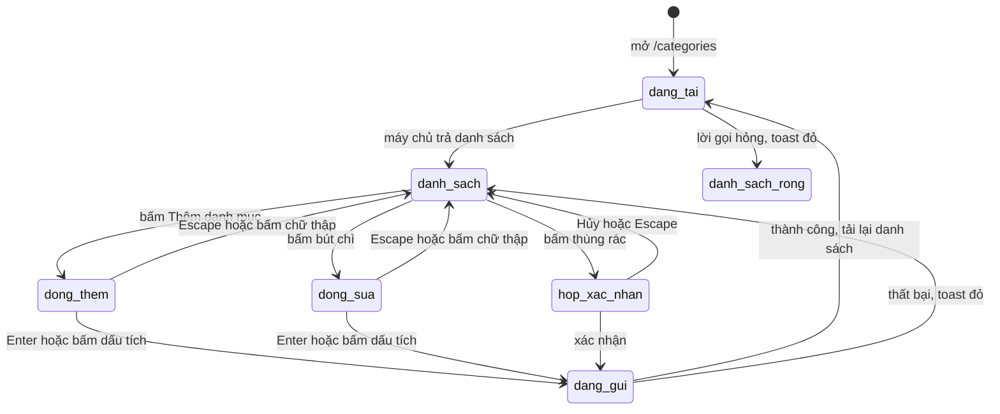

# Lĩnh vực và danh mục

## Tóm tắt

Route `/categories`, gọi trên thanh bên là **Danh mục**, là màn hình duy nhất trong bảng quản trị quản lý nhãn phân loại. Nó là một bảng hai cột — tên nhãn và nút thao tác — sửa được ngay tại dòng: bấm bút chì thì ô tên biến thành ô nhập, bấm dấu tích thì lưu, bấm chữ thập thì bỏ.

Tên màn hình nói "danh mục", và đó đúng là tất cả những gì nó quản lý. **Lĩnh vực không có màn hình nào.** Hệ thống có hai loại nhãn, `SECTOR` và `CATEGORY`, và máy chủ có bộ đường dẫn quản trị đầy đủ cho cả hai; bảng quản trị chỉ **đọc** danh sách lĩnh vực — và đọc để rồi không dùng, vì [biểu mẫu đề bài và công nghệ không có ô chọn lĩnh vực](de-bai-va-cong-nghe.md).

Trong hệ thống này, một bản ghi có **nhiều lĩnh vực** nhưng **một danh mục**. Xem [`../nen-tang/mo-hinh-du-lieu.md`](../nen-tang/mo-hinh-du-lieu.md#lĩnh-vực-và-danh-mục).

## Trường hợp đơn giản

Quản trị viên bấm **Danh mục** trên thanh bên. Trang hiện tiêu đề *"Quản lý Danh mục"*, một dòng phụ *"Danh sách danh mục dùng để phân loại Cung & Cầu"*, và một nút **Thêm danh mục** ở góc phải.

Bảng hiện chữ *"Đang tải…"* trong một dòng, rồi thay bằng danh sách nhãn, sắp theo tên.

Bấm **Thêm danh mục** chèn một dòng nền xanh nhạt lên **đầu** bảng với một ô nhập đã được focus sẵn. Gõ tên, nhấn Enter hoặc bấm dấu tích. Toast xanh *"Đã thêm danh mục"* hiện ra, dòng nhập biến mất, và danh sách được tải lại từ máy chủ — nhãn mới xuất hiện ở đúng vị trí theo thứ tự tên.

Bấm bút chì trên một dòng thì tên biến thành ô nhập chứa tên cũ, đã focus. Sửa rồi Enter hoặc bấm dấu tích: toast *"Đã cập nhật danh mục"*, danh sách tải lại.

Bấm thùng rác thì một hộp xác nhận đỏ mở ra, nêu tên nhãn. Xác nhận: toast *"Đã xóa danh mục"*, nhãn biến mất khỏi bảng.

## Tương tác, sự kiện theo sự kiện

### Vào màn

Một lời gọi duy nhất: `GET /api/v1/admin/categories`. Trong lúc chờ, bảng có đúng một dòng với chữ *"Đang tải…"* căn giữa.

Nếu lời gọi hỏng, toast đỏ *"Không thể tải danh mục"* hiện ra và bảng chuyển sang trạng thái rỗng: *"Chưa có danh mục nào"*. **Một hệ thống chưa có danh mục nào và một lời gọi hỏng trông giống hệt nhau** trong bảng; chỉ toast phân biệt được, và toast biến mất sau vài giây.

Không ô nào được focus sẵn khi vào màn. Không có ô tìm kiếm, không có bộ lọc, không có phân trang, không có nút sắp xếp.

> Ghi chú kỹ thuật: đường dẫn này trả về một **mảng thuần**, không bọc trong lớp phong bì `{success, data}` như phần lớn danh sách khác — đây là hình dạng cũ được giữ nguyên cho tương thích. Hai lệnh tạo và sửa thì lại trả về lớp phong bì. Giao diện xử lý cả hai. Xem [`../nen-tang/hop-dong-api.md`](../nen-tang/hop-dong-api.md#danh-sách-và-phân-trang).

### Rời đi không đổi gì

Không có gì được ghi lại. Dòng đang thêm hoặc đang sửa mất khi rời trang. Không có nháp, không có trạng thái nào trong URL.

### Bắt đầu sửa

Màn này có hai loại "đang sửa" và chỉ **một** loại được phép mở tại một thời điểm ở phía giao diện — nhưng không phải do có gì chặn: dòng thêm mới và dòng đang sửa là hai trạng thái riêng, và mở dòng thêm mới trong khi đang sửa một dòng khác thì **cả hai cùng mở**.

Cả hai ô nhập được focus tự động ngay khi mở. Dòng thêm mới bắt đầu rỗng; dòng sửa bắt đầu bằng tên hiện tại.

Nút dấu tích bị **vô hiệu hoá khi ô rỗng hoặc chỉ có khoảng trắng**, và trong lúc đang gửi. Đây là ràng buộc duy nhất ở phía giao diện.

Không có dấu hiệu *đã bẩn* nào khác: rời trang giữa lúc đang sửa không cảnh báo gì.

### Trong khi sửa

Không có kiểm tra dữ liệu nào chạy trong lúc gõ. Không có đếm ký tự, dù máy chủ giới hạn tên ở **255 ký tự**. Không có kiểm tra trùng tên, và máy chủ cũng không kiểm — **tạo được hai danh mục cùng tên**.

URL không đổi.

Trong lúc một lệnh đang gửi, nút dấu tích bị khoá nhưng ô nhập thì không: vẫn gõ tiếp được, và những gì gõ thêm sẽ không được gửi.

### Gửi đi

Ba lệnh, cùng một hình dạng: gửi, chờ, toast, rồi **tải lại toàn bộ danh sách từ máy chủ**.

| Thao tác | Lời gọi | Toast thành công | Toast thất bại |
|---|---|---|---|
| Thêm | `POST /api/v1/admin/categories` | "Đã thêm danh mục" | "Không thể thêm danh mục" |
| Sửa tên | `PATCH /api/v1/admin/categories/{id}` | "Đã cập nhật danh mục" | "Không thể cập nhật danh mục" |
| Xoá | `DELETE /api/v1/admin/categories/{id}` | "Đã xóa danh mục" | "Không thể xóa danh mục" |

Tên được cắt khoảng trắng trước khi gửi.

Đường thành công của **thêm** đóng dòng nhập và xoá ô. Đường thất bại **giữ dòng nhập mở với nội dung nguyên vẹn** — người dùng thử lại được.

Đường thành công của **sửa** đóng ô nhập. Đường thất bại thì không: ô vẫn mở với nội dung đã gõ.

Ba câu lỗi là câu chung cho mọi nguyên nhân. Tên quá 255 ký tự, tên rỗng ở phía máy chủ, hết phiên, mất mạng — tất cả cho ra cùng một câu.

**Xoá không phải là xoá.** Máy chủ **vô hiệu hoá** nhãn: bản ghi ở lại trong cơ sở dữ liệu với cờ hiệu lực tắt đi. Bản ghi đã gắn nhãn đó vẫn tra được tên nhãn và vẫn hiển thị nó ở màn xem. Xem [`../nen-tang/luu-va-phien-ban.md`](../nen-tang/luu-va-phien-ban.md#xoá-là-xoá-mềm).

Nhưng danh sách của màn này chỉ lấy nhãn **còn hiệu lực**, nên sau khi xoá, nhãn biến mất khỏi bảng và **không có đường nào bật nó lại**: không có bộ lọc "hiện cả nhãn đã tắt", không có nút khôi phục, và không có endpoint bật lại. Từ phía người dùng, xoá là một chiều và không hoàn tác được.

## Biến thể

| Biến thể | Lúc vào màn | Trong khi sửa |
|---|---|---|
| Vai trò | Chỉ `ADMIN` vào được; cả bốn đường `/api/v1/admin/categories` trả 403 cho vai trò khác. Có một đường công khai `GET /api/v1/categories` không cần đăng nhập, dùng cho cổng người dùng, và nó cũng chỉ trả nhãn còn hiệu lực. | Không ảnh hưởng. |
| Trạng thái bản ghi | Nhãn có đúng một bit trạng thái: còn hiệu lực hay không. **Nhãn đã tắt không bao giờ xuất hiện trên màn hình này** — không hiện mờ, không hiện trong một mục riêng, không hiện gì. Danh sách trả về có mang cờ hiệu lực nhưng bảng không dùng nó vì mọi dòng nhận được đều đang bật. Lĩnh vực (`SECTOR`) không có màn hình nào, dù dữ liệu và endpoint đều đầy đủ. | Không ảnh hưởng. |
| Cấu hình backend | Nếu v1 đã bị dừng dịch vụ, lời gọi trả 410 và màn hình hiện toast đỏ rồi bảng rỗng — trông y hệt một hệ thống chưa có danh mục. `Matching:ScoringMode` và `Mail:DryRun` không ảnh hưởng. | Không ảnh hưởng. |
| Phím tắt của biểu mẫu | Không ô nào được focus khi vào màn. Ô nhập của dòng thêm mới và dòng sửa **tự được focus** ngay khi mở — đây là chỗ duy nhất trong bảng quản trị làm việc đó. | **Enter lưu** và **Escape huỷ** trong cả hai ô nhập. Đây là màn hình duy nhất trong bảng quản trị mà Escape làm đúng việc người dùng mong đợi. Escape cũng đóng hộp xác nhận xoá. Ctrl/Cmd+Enter không được xử lý riêng. Tab đi từ ô nhập sang nút dấu tích sang nút chữ thập. |

Đổi biến thể giữa chừng: nếu một nhãn bị người khác xoá trong lúc màn hình đang mở, dòng vẫn hiển thị cho tới lần tải lại kế tiếp; sửa nó khi đó vẫn thành công vì máy chủ tìm nhãn không quan tâm cờ hiệu lực — nghĩa là **sửa được tên một nhãn đã bị tắt**, chỉ là không thấy kết quả ở đâu.

## Huỷ và gián đoạn

| Sự kiện | Trước khi gửi | Trong khi đang gửi |
|---|---|---|
| Bấm Huỷ hoặc nhấn Escape | Nút chữ thập và phím Escape đóng dòng đang thêm hoặc dòng đang sửa, vứt bỏ nội dung đã gõ, không hỏi lại. Hộp xác nhận xoá đóng bằng Escape hoặc nút *Hủy*. | Nút dấu tích bị khoá, nhưng nút chữ thập thì **không**: bấm nó giữa lúc đang gửi đóng ô nhập trong khi lời gọi vẫn bay. Lệnh vẫn hoàn tất và danh sách vẫn tải lại. |
| Đi chỗ khác trong app | Rời đi tự do, không cảnh báo. Nội dung đang gõ mất. | Rời trang bỏ toast nhưng không bỏ được việc ghi: máy chủ vẫn lưu xong. |
| Back/Forward của trình duyệt | Rời khỏi màn hình; không có gì được ghi lại. Màn này không thêm mục lịch sử nào của riêng nó. | Như trên; lệnh vẫn hoàn tất. |
| Tải lại trang, hoặc đóng tab | Bảng dựng lại từ đầu. Dòng đang thêm hoặc đang sửa mất. Không có nháp. | Lời gọi bị bỏ ở phía trình duyệt; máy chủ có thể đã ghi. Tải lại xong sẽ thấy kết quả mà không có thông báo nào. |
| Mất mạng, hoặc request quá hạn | Không ảnh hưởng — bảng đang hiển thị giữ nguyên. | Sau 30 giây, toast đỏ với câu chung, ô nhập vẫn mở và nội dung còn nguyên. Bấm lại là gửi lại; với lệnh **thêm**, hai lần bấm thành công có thể tạo **hai nhãn trùng tên** vì không có khoá chống lặp trên đường v1 và không có kiểm tra trùng ở máy chủ. |
| Phiên hết hạn (401), hoặc v1 bị dừng (410) | Không ảnh hưởng. | 401 làm bộ chặn xoá cookie và đẩy người dùng về `/login` giữa chừng; tên đang gõ mất. 410 rơi vào nhánh lỗi chung và hiện ra bằng một trong ba câu chung. |
| Bản ghi bị đổi bởi người khác, hoặc bị xoá | Bảng im lặng lỗi thời; không có làm mới tự động. | Không có kiểm tra phiên bản trên đường v1: hai quản trị viên cùng đổi tên một nhãn thì người ghi sau thắng, không có 409. Sửa một nhãn vừa bị người khác xoá vẫn thành công nhưng nhãn không hiện lại. Xoá một nhãn đã bị xoá cũng thành công và không báo gì. |
| Trình duyệt tự điền | Ô nhập tên là ô văn bản thường, không khai báo `autocomplete`; trình duyệt có thể đề nghị các giá trị đã gõ trước đó ở các ô cùng tên. Vì ô không có thuộc tính `name`, khả năng này thấp. | Ô nhập không bị khoá trong lúc gửi, nên tự điền vẫn ghi vào được — và giá trị đó không nằm trong lần gửi đang chạy. |

Sau bất kỳ gián đoạn nào, bảng chỉ có ba hình dạng: "Đang tải…", danh sách nhãn, hoặc "Chưa có danh mục nào". Không có trạng thái nửa vời — mỗi lệnh là một giao dịch duy nhất ở phía máy chủ.

## Tương tác với hệ thống khác

**Quyền và vai trò.** Cả bốn đường yêu cầu `ADMIN`, kiểm hai lớp: lớp tương thích cũ trả 403 `"Admin access required"`, rồi bảng quyết định chính sách kiểm hành động quản lý phân loại. Xem [`../nen-tang/xac-thuc-va-vai-tro.md`](../nen-tang/xac-thuc-va-vai-tro.md).

**Kiểm tra dữ liệu và cách hiện lỗi.** Kiểm tra tại chỗ chỉ có một luật: tên không rỗng sau khi cắt khoảng trắng, và nó được thể hiện bằng cách khoá nút chứ không bằng một thông điệp. Hai luật của máy chủ — tên không rỗng và không quá 255 ký tự — **không bao giờ hiện ra**, vì mọi lỗi bị thay bằng một câu chung. Không luật nào ngăn trùng tên ở cả hai phía.

**Thay đổi chưa lưu.** Một ô nhập một dòng là thứ duy nhất có thể bẩn, và nó không được bảo vệ: bấm chữ thập, nhấn Escape hoặc rời trang đều vứt bỏ không hỏi. Rủi ro thấp, nhưng hành vi thống nhất với phần còn lại của bảng quản trị — xem [`../xuyen-suot/thay-doi-chua-luu.md`](../xuyen-suot/thay-doi-chua-luu.md).

**Cập nhật lạc quan và hoàn tác.** Không có cập nhật lạc quan: cả ba lệnh chờ máy chủ rồi tải lại toàn bộ danh sách. Không có hoàn tác. Xoá nhầm một nhãn thì cách duy nhất lấy lại là tạo một nhãn mới cùng tên — nhưng nhãn mới có định danh mới, nên **các bản ghi cũ vẫn trỏ vào nhãn đã tắt**, và trên màn hình xem chúng vẫn hiện tên nhãn cũ. Hai nhãn cùng tên khi đó cùng tồn tại: một tắt và một bật.

**Ngoại tuyến.** Không có hàng đợi. Mất mạng là một lời gọi thất bại sau 30 giây, không phải một lời gọi được hoãn.

**Thông báo và toast.** Màn này dùng toast cho toàn bộ phản hồi: bảy câu, tất cả bằng tiếng Việt. Không có dải lỗi tại chỗ. Toast không sống qua một lần điều hướng.

**Trạng thái lọc/tìm trong URL.** Không có tương tác: màn hình không có bộ lọc, không có tìm kiếm và không có phân trang, nên không có gì để đưa vào URL.

**Đa ngôn ngữ.** Toàn bộ chữ là tiếng Việt viết thẳng trong mã. Tên nhãn là dữ liệu người dùng nhập, không có bản dịch. Thông điệp lỗi từ máy chủ là tiếng Anh nhưng không bao giờ đến được người dùng.

**Khả năng truy cập.** Bốn nút thao tác trên mỗi dòng chỉ có biểu tượng và **không có nhãn văn bản, không có thuộc tính `title`, không có nhãn cho trình đọc màn hình** — bút chì, thùng rác, dấu tích và chữ thập đều là những nút không tên. Ô nhập không có nhãn gắn kèm. Việc tự focus khi mở ô nhập là điểm sáng duy nhất.

**Dấu vết kiểm toán.** Tạo, đổi tên và vô hiệu hoá đều ghi dòng kiểm toán ở phía máy chủ trong cùng giao dịch với dữ liệu. Lượt bị từ chối cũng được ghi. Không có gì trong bảng quản trị hiển thị chúng: [`../moi/nhat-ky-kiem-toan.md`](../moi/nhat-ky-kiem-toan.md).

## Trường hợp biên

- **Lĩnh vực không có màn hình.** Máy chủ có `GET`, `POST`, `PATCH`, `DELETE` trên `/api/v1/admin/sectors`, y hệt danh mục. Bảng quản trị chỉ gọi `GET`, và gọi từ biểu mẫu đề bài chứ không từ một màn quản lý. Không có cách nào thêm, sửa hay tắt một lĩnh vực từ giao diện.
- **Hộp xác nhận xoá nói sai về hậu quả.** Câu mô tả nói *"Các Cung/Cầu thuộc danh mục này sẽ không còn danh mục."* Thực tế: nhãn chỉ bị vô hiệu hoá, các bản ghi vẫn giữ nguyên liên kết, và màn xem chi tiết vẫn hiển thị tên nhãn đó bình thường. Cái mất đi là khả năng **chọn** nhãn cho bản ghi mới.
- **Xoá là một chiều từ phía giao diện.** Dữ liệu vẫn còn nhưng không có nút nào, không có bộ lọc nào và không có endpoint nào bật lại nhãn đã tắt.
- **Tạo được hai danh mục trùng tên.** Không có kiểm tra ở cả hai phía. Hai dòng giống hệt nhau trong bảng chỉ khác nhau ở định danh mà người dùng không nhìn thấy.
- **Không thấy nhãn đang được dùng bao nhiêu lần.** Bảng không có cột đếm, và không có endpoint nào trả về con số đó. Quản trị viên xoá một nhãn mà không biết nó đang gắn vào bao nhiêu bản ghi.
- **Lời gọi hỏng trông giống danh sách rỗng.** Cả hai cho ra dòng *"Chưa có danh mục nào"*; chỉ có toast phân biệt và toast biến mất.
- **Cờ "đang tải" không bao giờ được bật lại.** Nó chỉ tắt sau lần tải đầu tiên; những lần tải lại sau mỗi thao tác không hiện chữ "Đang tải…" nào, nên bảng đứng im một nhịp rồi đổi.
- **Mở dòng thêm mới trong khi đang sửa một dòng khác thì cả hai cùng mở.** Hai ô nhập cùng lúc, và ô được focus là ô mở sau. Không có gì sai ở phía máy chủ, nhưng màn hình không nói rõ ô nào sẽ lưu cái gì.
- **Danh sách rỗng vẫn hiện dòng "Chưa có danh mục nào" ngay cả khi dòng thêm mới đang mở** — không, đúng hơn: dòng thông báo rỗng bị ẩn khi dòng thêm mới đang mở, nên bảng chỉ có một dòng nhập trống. Đây là chi tiết duy nhất của màn hình được xử lý cẩn thận.
- **Máy chủ sắp xếp theo tên, giao diện không sắp lại.** Thứ tự vì thế là thứ tự chuỗi thô, không phải thứ tự bảng chữ cái tiếng Việt có dấu.

## Câu hỏi mở và kiểm chứng

- Chưa dựng bảng quản trị trong trình duyệt. Mọi mô tả về cái hiện ra trên màn hình đọc từ mã; cần một lượt kiểm bằng tay, đặc biệt là hành vi khi mở đồng thời dòng thêm mới và dòng sửa.
- **Việc không có màn hình quản lý lĩnh vực trong khi backend đã có đủ endpoint đáng bị coi là một khoảng trống chức năng**, không phải một quyết định phạm vi: lĩnh vực là thứ thu hẹp phạm vi ghép cặp và là trục của một biểu đồ trên [bảng điều khiển](bang-dieu-khien.md), nhưng không ai thêm hay sửa được nó. (chưa cấp mã lỗi)
- **Câu chữ của hộp xác nhận xoá mô tả sai hậu quả** và nên được sửa lại cho khớp với hành vi vô hiệu hoá. (chưa cấp mã lỗi)
- **Việc không có đường bật lại một nhãn đã tắt** là cùng một khoảng trống với việc không có đường khôi phục bản ghi đã xoá mềm — dữ liệu đã được giữ lại rồi, chỉ thiếu một nút. Xem [B-16](../bug-triage.md#b-16-xoá-mềm-nhưng-không-có-đường-khôi-phục).
- Chưa rõ có ràng buộc duy nhất nào trên tên nhãn ở tầng cơ sở dữ liệu không. Đọc mã tầng dịch vụ thì không có kiểm tra nào; cần xác nhận trên lược đồ thật trước khi kết luận là tạo trùng tên được.
- Chưa đo điều gì hiện ra khi tên vượt 255 ký tự: máy chủ ném lỗi kiểm tra dữ liệu, nhưng chưa biết nó đi qua nhánh nào và giao diện có nuốt nó không.
- Chưa xác nhận thứ tự sắp xếp trên dữ liệu tiếng Việt có dấu trông thế nào trên bản chạy.

Đối chiếu với SourceCode/dmst-admin-main và SourceCode/nacentech, bản chụp ngày 2026-09-04.
