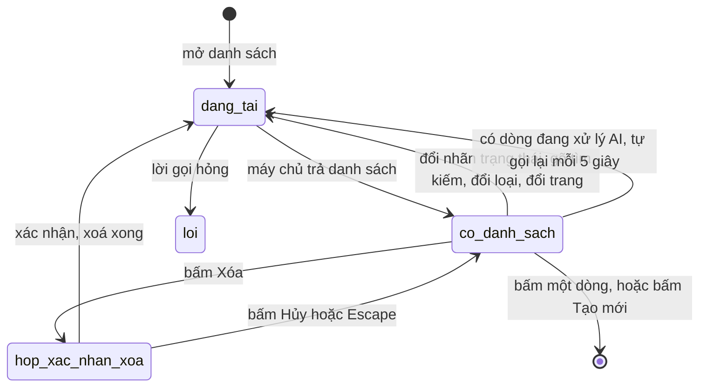
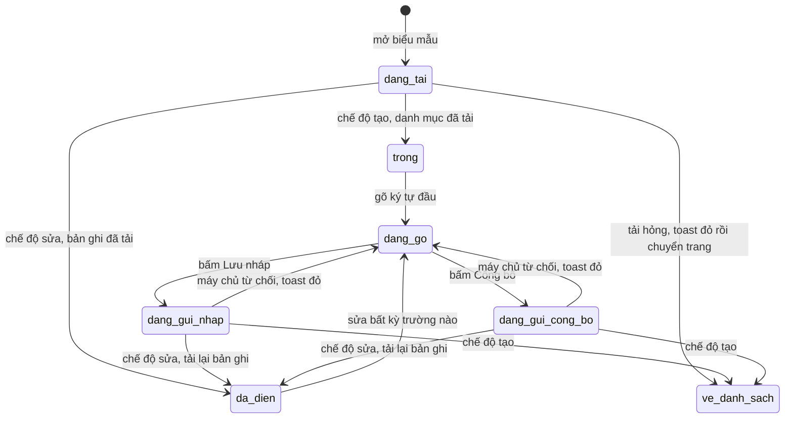

# Đề bài và tài sản công nghệ

## Tóm tắt

Bảng quản trị gọi hai loại nội dung này là **Cung** (tài sản công nghệ, `ip`) và **Cầu** (đề bài, `challenge`), và quản lý chúng bằng **một** bộ màn hình dùng chung, được gọi ba lần với ba tham số khác nhau:

| Nhóm route | Màn hình | Vào từ đâu |
|---|---|---|
| `/ips`, `/ips/create`, `/ips/detail`, `/ips/edit` | Chỉ Cung | Thanh bên, mục *Quản lý Cung* |
| `/challenges`, `/challenges/create`, `/challenges/detail`, `/challenges/edit` | Chỉ Cầu | Thanh bên, mục *Quản lý Cầu* |
| `/intakes`, `/intakes/create`, `/intakes/detail`, `/intakes/edit` | Cung và Cầu gộp, có thêm ô lọc loại | **Không có mục nào trên thanh bên** |

Bốn route `/intakes/*` tồn tại đầy đủ và chạy được, nhưng không có đường nào dẫn tới chúng từ giao diện; phải gõ thẳng vào thanh địa chỉ.

Mỗi nhóm có ba màn: danh sách, chi tiết, và một biểu mẫu dùng chung cho tạo và sửa. Biểu mẫu chia nội dung làm ba tab theo mức mật, mỗi tab có một trình soạn thảo giàu định dạng và một khu tải tệp riêng.

Hai năng lực mà tiêu đề của khu vực này ngụ ý — **để AI viết lại nội dung** và **tính lại ghép cặp** — có endpoint dành riêng cho quản trị viên ở phía máy chủ nhưng **không có nút nào trong bảng quản trị gọi chúng**.

## Trường hợp đơn giản

Quản trị viên bấm *Quản lý Cung* trên thanh bên. Trang hiện tiêu đề **"Quản lý Cung"**, một nút **Tạo mới**, một khối bộ lọc, và một bảng.

Khối bộ lọc có ba viên nhãn đếm số — *Tất cả (n)*, *Nháp (n)*, *Đã công bố (n)* — và một ô tìm kiếm. Trên `/intakes` có thêm một ô thả xuống chọn loại với ba lựa chọn *Tất cả loại*, *IP*, *Challenge*, mỗi lựa chọn kèm một chấm màu.

Bảng có tám cột: số thứ tự, ảnh đại diện, tiêu đề, loại, trạng thái AI, trạng thái xuất bản, ngày tạo, và một nút ba chấm mở menu *Chỉnh sửa* / *Xóa*.

Bấm vào một dòng sang màn chi tiết. Bấm *Chỉnh sửa* sang biểu mẫu. Bấm *Xóa* mở hộp xác nhận đỏ.

Bấm **Tạo mới** sang biểu mẫu rỗng: cột trái là thanh bên của biểu mẫu (ảnh đại diện, tiêu đề, danh mục, hai nút lưu), phần còn lại là ba tab nội dung. Gõ tiêu đề, gõ nội dung công khai, bấm **Công bố**. Toast xanh hiện *"Đã công bố thông tin thành công. Đang chờ AI xử lý nội dung."* và trang quay về danh sách.

## Tương tác, sự kiện theo sự kiện

### Danh sách

### Biểu mẫu tạo và sửa

### Vào màn

**Danh sách** gọi `GET /api/v1/admin/intakes` với trang 1, mười dòng, không từ khoá, và tham số loại nếu route ép loại. Trong lúc chờ, bảng hiện một khung xương năm dòng tám cột. Ba viên nhãn đếm số hiện 0 cho tới khi phản hồi về.

**Biểu mẫu** gọi song song danh sách lĩnh vực và danh sách danh mục; ở chế độ sửa gọi thêm bản ghi theo định danh lấy từ query string. Trong lúc chờ, toàn màn hình hiện một vòng quay và chữ "Đang tải…". Nếu bất kỳ lời gọi nào hỏng, toast đỏ *"Có lỗi khi tải dữ liệu"* hiện ra và trang **tự chuyển về danh sách** — người dùng không có cơ hội thử lại tại chỗ.

Ở chế độ sửa, mọi ô được điền từ bản ghi, kể cả nội dung ba mức mật. Tệp đính kèm được chia về ba tab theo mức mật của từng tệp.

**Màn chi tiết** đọc định danh từ query string và gọi bản ghi. Nếu query string không có định danh, lời gọi không chạy và trang hiện *"Không tìm thấy thông tin tiếp nhận"* kèm một liên kết quay lại.

Không ô nào được focus sẵn ở bất kỳ màn nào.

### Rời đi không đổi gì

Danh sách không ghi gì. Bộ lọc, từ khoá và số trang không đi vào URL và mất khi rời trang.

Biểu mẫu không ghi gì **nếu chưa bấm lưu** — trừ một ngoại lệ quan trọng: **xoá một tệp đính kèm đã có là một lệnh ghi tức thì**. Vào biểu mẫu sửa, bỏ một tệp, rồi rời đi mà không lưu, tệp đó vẫn đã bị xoá vĩnh viễn ở phía máy chủ.

### Bắt đầu sửa

Biểu mẫu **không có khái niệm *đã bẩn*** theo nghĩa của [`../nen-tang/luu-va-phien-ban.md`](../nen-tang/luu-va-phien-ban.md): không có dấu hiệu nào cho biết có thay đổi chưa lưu, hai nút lưu luôn bấm được từ đầu, và không có gì chặn việc rời trang.

Không có nút **Hủy**. Chỉ có mũi tên **Quay lại** ở đầu thanh bên của biểu mẫu, và nó rời trang ngay lập tức, vứt bỏ mọi thứ đã gõ mà không hỏi.

### Trong khi sửa

**Trên danh sách:**

- Ô tìm kiếm có độ trễ **500 mili giây**; nó chỉ gửi khi người dùng ngừng gõ. Khác với [danh sách người dùng](nguoi-dung.md), vốn gửi theo từng ký tự.
- Đổi nhãn trạng thái, đổi loại hoặc đổi từ khoá đều đưa trang về 1.
- Nếu bất kỳ dòng nào trên trang đang ở trạng thái xử lý AI, danh sách **tự gọi lại mỗi 5 giây** cho tới khi không còn dòng nào như vậy. Dòng đang xử lý bị làm mờ và **không bấm vào được**.
- Thanh phân trang chỉ hiện khi có nhiều hơn một trang.

**Trên biểu mẫu:**

- Ba tab nội dung — *Thông tin công khai*, *Bảo mật mức 2*, *Bảo mật mức 3* — giữ nguyên nội dung khi chuyển qua lại; chuyển tab không mất gì.
- Ô **"Nội dung sau xử lý"** trong mỗi tab chỉ hiện ở chế độ sửa, hoặc khi trạng thái xử lý AI đã hoàn tất. Ở chế độ tạo nó không có.
- Chọn ảnh đại diện: chỉ nhận tệp ảnh, tối đa **5 MB**. Sai kiểu hoặc quá cỡ cho ra toast đỏ ngay tại chỗ và tệp bị bỏ.
- Chọn tệp đính kèm: hộp chọn tệp lọc theo ảnh, video, PDF, DOC, DOCX. Không có giới hạn kích thước ở phía giao diện, và không có thanh tiến trình.
- Gỡ một tệp **mới chọn** chỉ bỏ nó khỏi hàng đợi. Gỡ một tệp **đã có** gọi `DELETE` ngay. Cả hai đi qua cùng một hộp xác nhận với cùng một câu *"Bạn có chắc muốn xóa file này?"*, nên người dùng không phân biệt được hai hành vi rất khác nhau.
- Không có kiểm tra dữ liệu nào chạy trong lúc gõ. Không ô nào chuyển đỏ, không có đếm ký tự.

URL không đổi ở bất kỳ thao tác nào.

### Gửi đi

Biểu mẫu có **hai** nút gửi và chúng khác nhau đúng ở một chỗ: trạng thái được gửi kèm, và luật kiểm tra.

**Lưu nháp** yêu cầu tiêu đề không rỗng. **Công bố** yêu cầu tiêu đề *và* nội dung công khai không rỗng. Thiếu thì toast đỏ và dừng, không có lời gọi mạng.

Cả hai nút gửi **toàn bộ biểu mẫu** dưới dạng multipart: tiêu đề, nội dung, nội dung sau xử lý, nội dung mật mức 2 và mức 3 cùng bản đã xử lý của chúng, loại, trạng thái, danh mục, ảnh đại diện mới nếu có, và mọi tệp mới của cả ba mức.

Thứ tự ở phía máy chủ:

1. Tạo hoặc cập nhật bản ghi.
2. Lưu ảnh đại diện mới nếu có — **ảnh cũ bị xoá thật**, không giữ lịch sử.
3. Lưu tệp mới: tệp của tab công khai vào mức `Public`, tệp tab mức 2 vào `Confidential`, tệp tab mức 3 vào `HighlyConfidential`.
4. Ghi bốn đoạn nội dung mật vào phòng dữ liệu.

Trong lúc chờ, hai nút bị khoá và đổi chữ thành "Đang lưu…" / "Đang công bố…". Ba tab nội dung **không bị khoá** — vẫn gõ tiếp được, và những gì gõ thêm sẽ không được gửi.

Đường thành công khác nhau theo chế độ:

- **Tạo**: toast xanh rồi chuyển về danh sách.
- **Sửa**: toast xanh rồi **tải lại bản ghi từ máy chủ và điền lại toàn bộ biểu mẫu**. Người dùng ở lại trang. Đây đúng nghĩa *đã lưu* theo [`../nen-tang/luu-va-phien-ban.md`](../nen-tang/luu-va-phien-ban.md): cái đang hiển thị đến từ phản hồi của máy chủ.

Đường thất bại cho ra đúng một câu cho mọi loại lỗi: *"Có lỗi xảy ra, vui lòng thử lại"*. Mọi thứ đã gõ còn nguyên, hai nút mở khoá.

**Xoá** một bản ghi gọi `DELETE /api/v1/admin/intakes/{id}` sau một hộp xác nhận. Từ danh sách thì tải lại danh sách; từ màn chi tiết thì chuyển về danh sách.

> Ghi chú kỹ thuật: máy chủ **chỉ tạo phiên bản mới khi tiêu đề hoặc nội dung chính thực sự đổi giá trị**. Đổi danh mục, đổi trạng thái hay thêm tệp không tạo phiên bản. Vì biểu mẫu luôn gửi lại toàn bộ, số phiên bản vẫn chỉ tăng khi có thay đổi thật. Không màn hình nào hiển thị số phiên bản đó.

## Biến thể

| Biến thể | Lúc vào màn | Trong khi sửa |
|---|---|---|
| Vai trò | Chỉ `ADMIN` vào được cả ba màn; mọi đường `/api/v1/admin/intakes/*` trả 403 cho vai trò khác. Quản trị viên tạo bản ghi mới thì **bản ghi thuộc về chính quản trị viên đó**, không thuộc về người dùng nào khác — không có ô chọn chủ sở hữu. Quản trị viên sửa và xoá được bản ghi của mọi người; khi đó việc kiểm quyền tác giả bị **bỏ qua** chứ không phải được thoả mãn. | Không ảnh hưởng. |
| Trạng thái bản ghi | Chỉ hai trạng thái xuất bản: *Nháp* và *Đã công bố*, hiện bằng huy hiệu vàng và xanh. Bản ghi **đã xoá mềm không xuất hiện** trong danh sách. Màn chi tiết thì **có** lấy cả bản đã xoá mềm — mở lại một đường dẫn cũ sau khi xoá vẫn thấy nội dung, không có dấu hiệu nào nói rằng bản ghi đã bị xoá. *Mức chất lượng* của tài sản công nghệ không xuất hiện ở đâu: mọi bản ghi đứng yên ở mức thấp nhất và không màn hình nào hiển thị hay đổi được nó — xem [`../nen-tang/mo-hinh-du-lieu.md`](../nen-tang/mo-hinh-du-lieu.md#mức-chất-lượng-của-tài-sản-công-nghệ). Bản ghi đang xử lý AI bị làm mờ và không mở được. | Đổi trạng thái xảy ra bằng cách chọn nút lưu nào, không bằng một ô riêng. Không có đường nào đưa một bản đã công bố về nháp ngoài việc bấm *Lưu nháp*. |
| Cấu hình backend | Nếu v1 đã bị dừng dịch vụ, mọi màn trả 410: danh sách hiện bảng rỗng, biểu mẫu hiện toast đỏ rồi tự chuyển về danh sách, và vòng lặp đó có thể lặp lại. `Matching:ScoringMode` không ảnh hưởng tới màn hình vì không màn nào hiển thị kết quả ghép cặp. `Mail:DryRun` không ảnh hưởng. Nếu địa chỉ công khai của kho tệp cấu hình lệch, mọi liên kết tệp và mọi ảnh trên ba màn đều hỏng — ảnh trong bảng rơi về ảnh thay thế, còn tệp thì tải về không được. | Không ảnh hưởng. |
| Phím tắt của biểu mẫu | Không ô nào được focus sẵn. Tab đi qua thanh bên của biểu mẫu trước, rồi tới ba tab nội dung. | **Enter không gửi biểu mẫu** — các ô không nằm trong thẻ `form`, và Enter trong trình soạn thảo là xuống dòng. **Escape đóng hộp xác nhận xoá** và đóng hộp xem ảnh phóng to; nó **không** đóng biểu mẫu và không huỷ gì. Ctrl/Cmd+Enter không được xử lý riêng. Trình soạn thảo nhận `/` để mở bảng chèn khối. |

Đổi biến thể giữa chừng: một bản ghi bị người khác xoá trong lúc biểu mẫu đang mở vẫn lưu được nếu định danh còn — máy chủ tìm bản ghi **không tính bản đã xoá**, nên lần lưu tiếp theo trả 404 và người dùng nhận câu lỗi chung.

## Huỷ và gián đoạn

| Sự kiện | Trước khi gửi | Trong khi đang gửi |
|---|---|---|
| Bấm Huỷ hoặc nhấn Escape | **Không có nút Huỷ trên biểu mẫu.** Mũi tên *Quay lại* rời trang ngay, vứt hết, không hỏi. Escape đóng hộp xác nhận xoá và hộp xem ảnh; ở biểu mẫu nó không làm gì. Trên danh sách, hộp xác nhận xoá đóng bằng Escape hoặc nút *Hủy*. | Hai nút lưu bị khoá nhưng mũi tên *Quay lại* thì không: bấm nó giữa lúc đang gửi rời trang ngay trong khi lời gọi vẫn bay. |
| Đi chỗ khác trong app | Rời đi tự do, không cảnh báo, mọi thứ chưa lưu mất hết. Tệp đính kèm đã gỡ thì **không lấy lại được** — chúng đã bị xoá ở máy chủ từ lúc bấm xác nhận. | Rời trang bỏ toast nhưng không bỏ được việc ghi: máy chủ vẫn lưu xong. Người dùng không thấy kết quả. |
| Back/Forward của trình duyệt | Rời khỏi màn hình. Bấm Back sau khi lọc **không** quay lại kết quả trước. Từ chi tiết bấm Back về danh sách ở trạng thái mặc định. Từ biểu mẫu bấm Back mất hết nội dung đang gõ. | Như trên; lời gọi vẫn hoàn tất ở máy chủ. |
| Tải lại trang, hoặc đóng tab | **Chi tiết và sửa tải lại được**: định danh nằm trong query string nên trang dựng lại đúng bản ghi. Nội dung đang gõ thì mất — không có nháp cục bộ. Bộ lọc của danh sách cũng mất. | Lời gọi bị bỏ ở phía trình duyệt. Máy chủ có thể đã ghi xong; tải lại sẽ thấy kết quả mà không có thông báo nào. |
| Mất mạng, hoặc request quá hạn | Không ảnh hưởng — trang đã dựng giữ nguyên. | Sau 30 giây, toast đỏ *"Có lỗi xảy ra, vui lòng thử lại"*, nút mở khoá, mọi thứ đã gõ còn nguyên. **Bấm lại là gửi lại toàn bộ**, gồm cả những tệp đã lên thành công ở lần trước nếu lần đó chỉ hỏng nửa chừng — không có khoá chống lặp trên đường v1, xem [`../nen-tang/hop-dong-api.md`](../nen-tang/hop-dong-api.md#khoá-chống-lặp). |
| Phiên hết hạn (401), hoặc v1 bị dừng (410) | Không ảnh hưởng. | 401 làm bộ chặn xoá cookie và đẩy người dùng về `/login` giữa chừng; **toàn bộ nội dung đang soạn mất trắng**, kể cả nội dung mật vừa gõ. 410 rơi vào nhánh lỗi chung và hiện ra như một lỗi lạ. |
| Bản ghi bị đổi bởi người khác, hoặc bị xoá | Biểu mẫu giữ nguyên dữ liệu đã tải lúc mở; không có làm mới và không có cảnh báo. | Không có kiểm tra phiên bản trên đường v1: hai người cùng sửa một bản ghi thì người ghi sau thắng và ghi đè nội dung của người kia thành một phiên bản mới. Không có 409, không có cảnh báo. Nếu bản ghi vừa bị xoá, lời gọi trả 404 và người dùng nhận câu lỗi chung. |
| Trình duyệt tự điền | Ô tiêu đề là ô văn bản thường, không khai báo `autocomplete`; trình duyệt có thể đề nghị các giá trị đã gõ trước đó. Trình soạn thảo giàu định dạng không phải mục tiêu của tự điền. | Ô tiêu đề không bị khoá trong lúc gửi, nên tự điền vẫn ghi vào được — và giá trị đó sẽ không nằm trong lần gửi đang chạy. |

Sau bất kỳ gián đoạn nào, phía máy chủ chỉ có hai kết quả: bản ghi đã lưu đầy đủ, hoặc chưa lưu gì. Bốn bước của lệnh lưu chạy tuần tự nhưng mỗi bước là một giao dịch riêng, nên **một lỗi ở bước tệp có thể để lại bản ghi đã lưu mà tệp thì chưa** — người dùng nhận câu lỗi chung và không biết phần nào đã vào.

## Tương tác với hệ thống khác

**Quyền và vai trò.** Mọi đường yêu cầu `ADMIN`, kiểm hai lớp: lớp tương thích cũ trả 403 `"Admin access required"`, rồi bảng quyết định chính sách kiểm hành động tạo, sửa hoặc xoá. Tệp đính kèm mật đi qua phòng dữ liệu, nhưng màn chi tiết của quản trị viên yêu cầu hiển thị **toàn bộ** nội dung mật và được cho phép. Xem [`../xuyen-suot/quyen-va-vai-tro.md`](../xuyen-suot/quyen-va-vai-tro.md).

**Kiểm tra dữ liệu và cách hiện lỗi.** Kiểm tra tại chỗ chỉ có ba luật: tiêu đề không rỗng, nội dung không rỗng khi công bố, và ảnh đại diện phải là ảnh dưới 5 MB. Mọi luật của máy chủ — độ dài tiêu đề, kiểu tệp hợp lệ, cỡ tệp — **không bao giờ hiện ra**: mọi lỗi bị thay bằng một câu chung. Một tệp 11 MB bị từ chối ở tầng lưu trữ và một tệp 13 MB bị từ chối ở tầng HTTP cho ra cùng một câu.

**Thay đổi chưa lưu.** Biểu mẫu này là chỗ mất mát lớn nhất trong bảng quản trị: ba trình soạn thảo, ba khu tệp, và **không một lớp bảo vệ nào**. Không cảnh báo khi rời trang, không nháp cục bộ, không dấu hiệu đã bẩn. Xem [`../xuyen-suot/thay-doi-chua-luu.md`](../xuyen-suot/thay-doi-chua-luu.md).

**Cập nhật lạc quan và hoàn tác.** Không có cập nhật lạc quan: mọi thứ chờ máy chủ. Không có hoàn tác ở bất kỳ đâu. Xoá là xoá mềm ở phía máy chủ nhưng **không có nút khôi phục và không có endpoint khôi phục** — xem [B-16](../bug-triage.md#b-16-xoá-mềm-nhưng-không-có-đường-khôi-phục). Xoá một tệp đính kèm thì là xoá thật, không khôi phục được bằng bất cứ cách nào.

**Ngoại tuyến.** Không có hàng đợi, không có nháp cục bộ. Mất mạng giữa lúc soạn một nội dung dài là mất nội dung đó nếu người dùng rời trang.

**Thông báo và toast.** Màn này dùng toast cho mọi phản hồi: hai câu thành công (lưu nháp, công bố), một câu lỗi chung, một câu cho xoá tệp, một câu cho xoá bản ghi. Tất cả bằng tiếng Việt. Toast không sống qua một lần điều hướng, nên toast của lệnh lưu ở chế độ tạo hiện ra rồi trang chuyển ngay — nó có thể bị cắt.

**Trạng thái lọc/tìm trong URL.** Bộ lọc, từ khoá và số trang **không** nằm trong URL. Định danh bản ghi thì có, nhưng trong query string chứ không trong đường dẫn: `/ips/detail?id=…`, `/challenges/edit?id=…`. Đường dẫn vì thế chia sẻ được và tải lại được, khác với những gì hình dạng route gợi ý. Xem [B-17](../bug-triage.md#b-17-route-chi-tiết-không-có-định-danh-trong-đường-dẫn) và [`../nen-tang/dieu-huong-va-url.md`](../nen-tang/dieu-huong-va-url.md).

**Đa ngôn ngữ.** Giao diện tiếng Việt viết thẳng trong mã. Hai từ **IP** và **Challenge** giữ nguyên tiếng Anh trên huy hiệu loại và trong ô lọc, trong khi cùng khái niệm đó được gọi là *Cung* và *Cầu* ở tiêu đề trang, ở thanh bên và trong hộp xác nhận xoá — bốn từ cho hai khái niệm, trên cùng một màn hình. Thông điệp lỗi từ máy chủ là tiếng Anh nhưng không bao giờ đến được người dùng.

**Khả năng truy cập.** Dòng bảng là thẻ `tr` gắn sự kiện bấm, không đi tới được bằng bàn phím. Dòng đang xử lý AI chỉ bị làm mờ bằng lớp trình bày, không có thuộc tính vô hiệu hoá thật. Khu tải tệp là một nhãn bọc ô nhập tệp ẩn — vào được bằng bàn phím nhưng không có mô tả. Ảnh đại diện là một khối `div` bắt sự kiện bấm chứ không phải nút. Trình soạn thảo giàu định dạng chưa được rà.

**Dấu vết kiểm toán.** Tạo, sửa, xoá bản ghi và mọi thao tác tệp đều ghi dòng kiểm toán ở phía máy chủ trong cùng giao dịch với dữ liệu, kèm số phiên bản của đối tượng tại thời điểm đó. Không có gì trong bảng quản trị hiển thị chúng: [`../moi/nhat-ky-kiem-toan.md`](../moi/nhat-ky-kiem-toan.md).

## Trường hợp biên

- **Không chọn được lĩnh vực.** Biểu mẫu tải danh sách lĩnh vực về, giữ nó trong bộ nhớ, truyền nó xuống thanh bên cùng với hàm xử lý chọn — và **thanh bên không vẽ ô chọn nào**. Bản ghi tạo từ bảng quản trị vì thế luôn không có lĩnh vực, trong khi lĩnh vực là thứ thu hẹp phạm vi ghép cặp và là trục của biểu đồ "Top 10 lĩnh vực" trên [bảng điều khiển](bang-dieu-khien.md).
- **Không bỏ được danh mục.** Ô chọn có mục *"-- Chọn danh mục --"*, nhưng khi giá trị rỗng, trường danh mục **không được gửi lên**, và máy chủ hiểu "không gửi" là "giữ nguyên". Đã gán một danh mục thì không gỡ ra được từ giao diện.
- **Không gỡ được ảnh đại diện.** Nút chữ thập trên ảnh chỉ xoá ảnh khỏi màn hình; không có trường nào báo cho máy chủ, và không có endpoint xoá ảnh đại diện. Lưu xong, tải lại, ảnh cũ hiện lại.
- **Xoá tệp đính kèm là tức thì và vĩnh viễn.** Nó không chờ nút Lưu, không hoàn tác được, và hộp xác nhận không nói rằng nó khác với việc gỡ một tệp vừa chọn.
- **Hộp xác nhận xoá nói sai về hậu quả.** Câu mô tả nói hành động "sẽ xóa tất cả các tệp đính kèm liên quan". Xoá đề bài và tài sản công nghệ là **xoá mềm** và **tệp đính kèm ở lại nguyên vẹn** — đây là một trong bảy thay đổi có chủ đích so với hệ cũ, và câu chữ trên màn hình vẫn mô tả hành vi cũ.
- **Phân trang sai khi xem gộp cả hai loại.** Trên `/intakes` với ô lọc để *Tất cả loại*, máy chủ truy vấn hai nguồn bằng **cùng một số trang**, trộn kết quả rồi cắt lại còn mười dòng. Trang 1 đúng; từ trang 2 trở đi, bản ghi bị bỏ sót một cách im lặng. Tổng số dòng thì vẫn đúng, nên người dùng không có dấu hiệu nào.
- **Không có nút nào gọi "để AI viết lại".** Máy chủ có `POST /api/v1/admin/intakes/{id}/beautify` dành riêng cho quản trị viên: nó gọi mô hình, ghi kết quả vào hai trường AI, và **không đụng tới nội dung gốc do người dùng nhập**. Bảng quản trị không gọi nó ở đâu. Ô "Nội dung sau xử lý" trên biểu mẫu vì thế chỉ điền được bằng tay.
- **Không có nút nào gọi "tính lại ghép cặp".** Máy chủ có `POST /api/v1/admin/intakes/{id}/compute-matches`, và nó từ chối bằng 422 nếu bản ghi chưa công bố hoặc chưa có nội dung. Bảng quản trị không gọi nó, và cũng không có màn hình nào hiển thị kết quả ghép cặp.
- **Sửa nội dung của một bản ghi đã qua AI không kích hoạt lại việc cắt đoạn.** Máy chủ chỉ chạy lại chuỗi xử lý khi nội dung đổi **và** người gọi không tự gửi kèm bản đã xử lý. Biểu mẫu luôn gửi lại ô "Nội dung sau xử lý" khi ô đó không rỗng, nên sửa nội dung gốc của một bản ghi đã xử lý sẽ để chỉ mục tìm kiếm ở trạng thái cũ mà không ai biết.
- **Màn chi tiết vứt đi một phần phản hồi.** Phản hồi chi tiết dành cho quản trị viên có kèm thông tin người đăng và **năm ứng viên ghép cặp hàng đầu**. Màn hình không vẽ cả hai.
- **Màn chi tiết mở được bản ghi đã xoá mềm.** Nó hỏi máy chủ ở chế độ tính cả bản đã xoá, và không hiển thị bất kỳ dấu hiệu nào về việc đó.
- **Trạng thái AI được kiểm bằng cả chữ thường lẫn chữ hoa.** Giao diện chấp nhận cả `processing` lẫn `PROCESSING`, và cả trường hợp giá trị là một đối tượng có khoá `status`. Ba hình dạng cho một trường là dấu vết của ba đời API khác nhau.
- **Ô tìm kiếm chỉ tìm trong phiên bản hiện hành.** Máy chủ so khớp tiêu đề và nội dung của phiên bản đang là hiện hành; nội dung ở phiên bản cũ không tìm được.
- **Ảnh đại diện của bản ghi rơi về một ảnh thay thế cố định** khi liên kết hỏng, nên một cấu hình kho tệp sai trông giống hệt một bản ghi chưa có ảnh.
- **Bốn route `/intakes/*` không có lối vào.** Chúng là bộ màn hình duy nhất cho phép lọc theo loại và tạo bản ghi mà không bị ép loại trước.

## Câu hỏi mở và kiểm chứng

- Chưa dựng bảng quản trị trong trình duyệt. Mọi mô tả về cái hiện ra trên màn hình đọc từ mã; cần một lượt kiểm bằng tay, đặc biệt là hành vi của trình soạn thảo giàu định dạng, việc tải tệp lớn, và vòng gọi lại mỗi 5 giây khi có bản ghi đang xử lý AI.
- **Việc thanh bên của biểu mẫu nhận danh sách lĩnh vực nhưng không vẽ ô chọn là một lỗi**, không phải một quyết định: hàm xử lý chọn lĩnh vực vẫn được truyền xuống và vẫn được khai báo trong hợp đồng của thành phần. (chưa cấp mã lỗi)
- **Việc không gỡ được danh mục và không gỡ được ảnh đại diện là hai lỗi riêng**, cùng một nguyên nhân: biểu mẫu không phân biệt được "không đổi" với "đặt về rỗng". Máy chủ **có** cờ xoá danh mục nhưng facade luôn đặt nó là không. (chưa cấp mã lỗi)
- **Câu chữ của hộp xác nhận xoá mô tả sai hậu quả** và nên được sửa cùng lúc với việc quyết định xem có thêm đường khôi phục hay không. (chưa cấp mã lỗi)
- **Việc phân trang trộn hai nguồn bỏ sót bản ghi từ trang 2 trở đi** là lỗi ở phía máy chủ, trong chính facade. Nó chỉ lộ ra trên `/intakes`, tức là bộ màn hình không có lối vào — nên nó có thể chưa bao giờ được ai gặp. (chưa cấp mã lỗi)
- Chưa xác nhận danh sách lĩnh vực gửi lên có được máy chủ nhận đúng không. Giao diện gửi khoá dạng `sectorIds[]`, một quy ước của hệ NestJS cũ; bộ gắn dữ liệu của ASP.NET Core thường mong `SectorIds` hoặc `SectorIds[0]`. Nếu khoá này không gắn được, trường lĩnh vực luôn là rỗng ở phía máy chủ và **các lĩnh vực đã có của bản ghi vẫn được giữ nguyên** vì máy chủ hiểu rỗng là "không đổi" — nghĩa là lỗi này hiện đang bị che bởi lỗi thiếu ô chọn. Cần đo bằng một lần gửi thật.
- Chưa đo điều gì xảy ra khi bốn bước của lệnh lưu hỏng ở giữa. Cần một lần thử với tệp quá cỡ để xem bản ghi có bị để lại ở trạng thái đã lưu một phần không.
- Chưa rõ vì sao hai endpoint *beautify* và *compute-matches* dành cho quản trị viên được viết mà không có nút gọi. Nếu là do màn hình chưa kịp làm, đây là hai nút nhỏ mở ra hai năng lực đã sẵn sàng.
- Chưa xác nhận cách trình duyệt xử lý một lần gửi multipart lớn bị ngắt giữa chừng, và người dùng thấy gì.

Đối chiếu với SourceCode/dmst-admin-main và SourceCode/nacentech, bản chụp ngày 2026-09-04.
