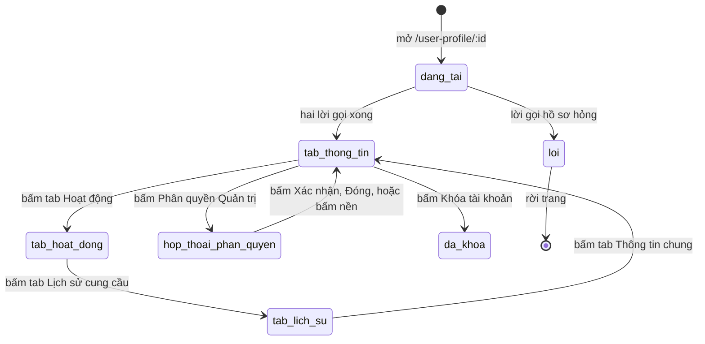

# Hồ sơ một người dùng

## Tóm tắt

Trang `/user-profile/:id` là màn chi tiết của một tài khoản. Nó có một dải đầu trang mang tên, vai trò, trạng thái và thông tin liên hệ; ba nút hành động ở góc phải; và một dải tab bên dưới.

Đây là màn hình duy nhất trong bảng quản trị có **định danh bản ghi nằm trong đường dẫn** cùng với câu chuyện — mọi màn chi tiết khác đưa định danh vào query string. Xem [`../nen-tang/dieu-huong-va-url.md`](../nen-tang/dieu-huong-va-url.md).

Trang được xây cho **năm tab**, và năm tab đó tồn tại đầy đủ trong mã. **Ba tab được nối vào màn hình**: Thông tin chung, Hoạt động, Lịch sử cung cầu. Hai tab còn lại — Bảo mật và một bảng riêng cho phần Cầu — đã viết xong nhưng không có nút nào mở chúng.

Trong ba nút hành động, một nút chạy, một nút không làm gì, một nút mở hộp thoại rồi đóng hộp thoại.

## Trường hợp đơn giản

Quản trị viên bấm một dòng trong [danh sách người dùng](nguoi-dung.md) và sang trang này. Toàn màn hình hiện chữ **"Đang tải…"** ở giữa cho tới khi hai lời gọi cùng xong.

Sau đó trang hiện ra:

- **Dải đầu trang**: một ô vuông màu thương hiệu mang chữ cái đầu của tên hiển thị, tên hiển thị cỡ lớn, một huy hiệu vai trò (*Quản trị viên* hoặc *Người dùng*), một huy hiệu trạng thái (*✓ Đang hoạt động* xanh, hoặc *Đã khóa* đỏ), rồi email và — nếu có — số điện thoại.
- **Ba nút**: *Khóa tài khoản*, *Đặt lại mật khẩu*, *Phân quyền Quản trị*.
- **Ba tab**: *Thông tin chung*, *Hoạt động (n)*, *Lịch sử cung cầu (n)*. Hai tab sau mang số đếm trong ngoặc.

Tab mặc định là *Thông tin chung*: một thẻ trắng tiêu đề **"Thông tin tổ chức"** với bảy ô hai cột.

Bấm *Hoạt động* thì thấy bảng gộp Cung và Cầu của người này, mới nhất trước, mười dòng một trang. Bấm *Lịch sử cung cầu* thì thấy bảng lời mời hợp tác đã gửi và đã nhận.

Bấm **Quay lại Quản lý Người dùng** ở góc trên trái để về danh sách.

## Tương tác, sự kiện theo sự kiện

Sơ đồ này bỏ qua *Đặt lại mật khẩu*: nút đó không dẫn tới trạng thái nào.

### Vào màn

Định danh được lấy từ đường dẫn. Hai lời gọi chạy song song:

- `GET /api/v1/admin/users/{id}/profile` — trả về hồ sơ, danh sách Cung và danh sách Cầu của người đó trong **một** phản hồi.
- `GET /api/v1/admin/users/{id}/collaboration-history` — trả về mọi lời mời hợp tác liên quan.

Lời gọi thứ hai được bọc: nếu nó hỏng, nó lặng lẽ trở thành danh sách rỗng và trang vẫn dựng. Lời gọi thứ nhất hỏng thì trang thay bằng một dòng chữ đỏ giữa màn hình.

Trong lúc chờ, toàn màn hình chỉ có chữ "Đang tải…" — không khung xương, không dải đầu trang.

Tab đang mở luôn là *Thông tin chung*. Không có gì được điền sẵn, không có gì được nhớ từ lần trước.

> Ghi chú kỹ thuật: lời gọi hồ sơ lấy tối đa **một nghìn** đề bài và một nghìn tài sản công nghệ của người đó trong một phản hồi, không phân trang ở phía máy chủ. Lời gọi lịch sử hợp tác không có phân trang gì cả — nó trả về toàn bộ. Một tài khoản hoạt động nhiều năm vì thế tải về một phản hồi rất lớn ngay khi mở trang, và người dùng chỉ thấy chữ "Đang tải…".

### Rời đi không đổi gì

Không có gì được ghi lại. Tab đang mở, số trang trong bảng và trạng thái hộp thoại đều là trạng thái trong bộ nhớ và mất khi rời trang.

Đường dẫn thì giữ được: sao chép URL và dán vào tab khác cho ra đúng người này.

### Bắt đầu sửa

Trên trang này **không có biểu mẫu nào ghi được**. Không ô nào sửa được thông tin của người dùng: tên, điện thoại, tổ chức đều chỉ đọc, dù máy chủ có đường sửa chúng.

Hộp thoại *Phân quyền Quản trị* có hai ô chọn và chúng đổi được, nên hộp thoại có thể ở trạng thái *đã bẩn* theo nghĩa hình thức — nhưng không có gì để mất, vì hộp thoại không gửi gì đi.

### Trong khi sửa

Đổi tab là tức thì và không gọi mạng: cả ba tab dùng dữ liệu đã tải sẵn lúc vào màn. Số đếm trong ngoặc của hai tab sau tính từ chính dữ liệu đó.

Phân trang trong hai bảng cũng chạy hoàn toàn ở phía trình duyệt: mười dòng một trang, cắt từ mảng đã có. Không có lời gọi nào khi đổi trang.

Đổi tab **không** đặt lại số trang của tab kia. Đang ở trang 3 của *Hoạt động*, sang *Lịch sử cung cầu* rồi quay lại, vẫn ở trang 3.

Trong hộp thoại phân quyền, chọn *Admin Tỉnh/Sở* làm hiện thêm một khối tím với ô chọn tỉnh/thành phố gồm 63 mục viết cứng, và một hộp tóm tắt xuất hiện khi đã chọn đủ. Chọn lại *User thường* thì tỉnh đã chọn bị xoá.

URL không đổi ở bất kỳ thao tác nào ngoài lần vào màn.

### Gửi đi

Đúng **một** thao tác trên trang này chạm tới máy chủ.

**Khóa tài khoản.** Bấm nút gọi `PATCH /api/v1/admin/users/{id}` với cờ hoạt động tắt đi. Không có hộp xác nhận. Không có trạng thái "đang gửi": nút không đổi chữ và không bị khoá. Khi lời gọi xong, huy hiệu trạng thái ở dải đầu trang đổi sang *Đã khóa* nhờ một lần cập nhật cục bộ.

Không có toast, không có thông báo nào. Nếu lời gọi hỏng, **không có gì hiện ra** — lỗi bị bỏ qua hoàn toàn, và huy hiệu trạng thái cũng không đổi, nên dấu hiệu duy nhất là "bấm mà không thấy gì".

Nút này **không đổi thành "Mở khóa"** khi tài khoản đã khoá. Bấm nó lần nữa trên một tài khoản đã khoá chỉ gửi lại đúng lệnh đó. Muốn mở khoá phải quay về danh sách.

Đáng chú ý: nút cùng tên ở màn danh sách gọi một đường khác và [đường đó trả 405](nguoi-dung.md). Ở đây thì chạy. Cùng một nhãn, hai hành vi.

**Đặt lại mật khẩu.** Nút không có bất kỳ xử lý nào gắn vào. Bấm nó không xảy ra gì: không lời gọi, không hộp thoại, không thông báo. Hàm đặt lại mật khẩu đã được viết ở lớp dữ liệu của trang và máy chủ đã có đường `POST /api/v1/admin/users/{id}/reset-password`; hai đầu đều sẵn sàng và không có gì nối chúng lại. Cũng không có ô nào để nhập mật khẩu mới.

**Phân quyền Quản trị.** Bấm nút mở một hộp thoại lớn có dải đầu gradient tím-xanh, một khối cảnh báo màu hổ phách nói rằng "việc cấp quyền quản trị sẽ cho phép người dùng này quản lý toàn bộ dữ liệu và hoạt động trong phạm vi được chỉ định", hai ô chọn, và một hộp tóm tắt. Bấm nút xác nhận ở cuối hộp thoại **chỉ đóng hộp thoại**. Không có lời gọi mạng, không có gì được lưu, không có thông báo.

Toàn bộ hộp thoại là một *vỏ* theo nghĩa của [`../glossary.md`](../glossary.md): nó vẽ ra một mô hình quyền theo địa bàn — "Admin Tỉnh/Sở" phụ trách một tỉnh — mà **không có gì tương ứng ở phía máy chủ**. Vai trò nền tảng chỉ có bốn giá trị và không có khái niệm phạm vi địa lý; xem [`../nen-tang/xac-thuc-va-vai-tro.md`](../nen-tang/xac-thuc-va-vai-tro.md#vai-trò). Không có endpoint nào đổi vai trò của một tài khoản, kể cả không theo địa bàn.

Tên hiển thị trong hộp thoại lấy từ họ và tên của người dùng; nếu họ không có tên, hộp thoại nói *"Phân quyền cho tài khoản —"*.

## Biến thể

| Biến thể | Lúc vào màn | Trong khi sửa |
|---|---|---|
| Vai trò | Chỉ `ADMIN` mở được trang; cả hai lời gọi trả 403 cho vai trò khác. Trang mở được cho **bất kỳ tài khoản nào**, gồm cả tài khoản quản trị viên khác và chính người đang đăng nhập — không có gì chặn quản trị viên tự khoá mình từ màn này. | Không ảnh hưởng. Máy chủ kiểm vai trò ở mỗi lời gọi. |
| Trạng thái bản ghi | Tài khoản đã khoá vẫn mở hồ sơ được, chỉ khác huy hiệu. Không có trạng thái "chưa kích hoạt" trên màn hình. Đề bài và tài sản công nghệ **đã xoá mềm không xuất hiện** trong tab Hoạt động: truy vấn phía máy chủ loại chúng ra. Lời mời hợp tác thì hiện đủ bốn trạng thái. | Không ảnh hưởng. |
| Cấu hình backend | Nếu v1 đã bị dừng dịch vụ, lời gọi hồ sơ trả 410 và trang hiện dòng chữ đỏ mang thông điệp thô. Lời gọi lịch sử hợp tác hỏng thì tab *Lịch sử cung cầu* hiện *(0)* và "Chưa có dữ liệu" — **không phân biệt được với một người thật sự chưa có lời mời nào**. | Không ảnh hưởng. |
| Phím tắt của biểu mẫu | Không ô nào được focus sẵn. Tab đi từ nút Quay lại, qua ba nút hành động, rồi vào dải tab. | Enter và Space kích hoạt nút đang được focus, gồm cả *Khóa tài khoản* — không có xác nhận nào chặn lại. **Escape không đóng hộp thoại phân quyền.** Ctrl/Cmd+Enter không được xử lý riêng. |

Đổi biến thể giữa chừng: nếu tài khoản đang xem bị người khác khoá trong lúc trang đang mở, màn hình không biết — không có làm mới tự động và không có lời gọi định kỳ.

## Huỷ và gián đoạn

| Sự kiện | Trước khi gửi | Trong khi đang gửi |
|---|---|---|
| Bấm Huỷ hoặc nhấn Escape | Không có nút Huỷ trên trang. Hộp thoại phân quyền đóng bằng dấu X hoặc bấm nền tối; **Escape không làm gì**. Vì hộp thoại không lưu gì, đóng nó không mất gì có ý nghĩa. | Không có cách huỷ lời gọi khoá tài khoản đang bay. |
| Đi chỗ khác trong app | Rời đi tự do, không cảnh báo. Tab đang mở và số trang mất. | Rời trang bỏ lời gọi. Việc khoá có thể đã hoàn tất ở máy chủ mà người dùng không thấy dấu hiệu nào. |
| Back/Forward của trình duyệt | Quay về danh sách người dùng ở trạng thái mặc định — bộ lọc và số trang của danh sách đã mất. Forward quay lại đúng hồ sơ này vì định danh nằm trong đường dẫn. | Như trên; lời gọi bị bỏ. |
| Tải lại trang, hoặc đóng tab | Trang dựng lại đúng người đó, vì định danh nằm trong đường dẫn. Tab về *Thông tin chung*, số trang về 1. | Lời gọi bị bỏ. Tải lại xong sẽ thấy trạng thái thật, không có thông báo. |
| Mất mạng, hoặc request quá hạn | Không ảnh hưởng — trang đã dựng giữ nguyên dữ liệu cũ, không có dấu hiệu nào cho biết nó đã cũ. | Sau 30 giây, lời gọi khoá thất bại **trong im lặng**: không toast, không dải đỏ, không đổi huy hiệu. Người dùng không biết là đã hỏng. |
| Phiên hết hạn (401), hoặc v1 bị dừng (410) | Không ảnh hưởng. | 401 làm bộ chặn xoá cookie và đẩy người dùng về `/login` ngay giữa chừng. 410 ở lời gọi khoá bị nuốt như mọi lỗi khác; 410 ở lời gọi hồ sơ hiện ra như một dòng chữ đỏ khó hiểu. |
| Bản ghi bị đổi bởi người khác, hoặc bị xoá | Trang im lặng lỗi thời. Tài khoản không xoá được nên không có trường hợp "bản ghi biến mất"; nhưng nếu người khác vừa mở khoá tài khoản này thì huy hiệu trên màn hình vẫn hiện *Đã khóa*. | Không có kiểm tra phiên bản trên đường v1: hai quản trị viên cùng sửa một tài khoản thì người ghi sau thắng, không có 409. Xem [`../nen-tang/hop-dong-api.md`](../nen-tang/hop-dong-api.md#phiên-bản-lạc-quan). |
| Trình duyệt tự điền | Không ảnh hưởng — trang không có ô nhập văn bản nào. Hai ô chọn trong hộp thoại phân quyền không phải mục tiêu của trình quản lý mật khẩu. | Không ảnh hưởng. |

Sau bất kỳ gián đoạn nào, trang chỉ có ba hình dạng: chữ "Đang tải…", trang đầy đủ, hoặc một dòng chữ đỏ. Không có trạng thái nửa vời.

## Tương tác với hệ thống khác

**Quyền và vai trò.** Cả hai lời gọi và lệnh khoá đều yêu cầu `ADMIN`, kiểm hai lớp: lớp tương thích cũ và bảng quyết định chính sách. Trang **không đổi được vai trò** của ai, bất chấp có một nút và một hộp thoại đầy đủ cho việc đó. Xem [`../nen-tang/xac-thuc-va-vai-tro.md`](../nen-tang/xac-thuc-va-vai-tro.md) và [`../xuyen-suot/quyen-va-vai-tro.md`](../xuyen-suot/quyen-va-vai-tro.md).

**Kiểm tra dữ liệu và cách hiện lỗi.** Không có ô nhập nên không có kiểm tra tại chỗ. Lỗi tải hồ sơ hiện thẳng thông điệp thô của máy chủ, bằng tiếng Anh, giữa một màn hình trắng. Lỗi của lệnh khoá **không hiện ở đâu**.

**Thay đổi chưa lưu.** Không có tương tác thật: không biểu mẫu nào trên trang lưu được gì, nên không có gì để mất. Hộp thoại phân quyền là ngoại lệ hình thức — nó nhận lựa chọn rồi vứt đi, kể cả khi người dùng bấm nút xác nhận.

**Cập nhật lạc quan và hoàn tác.** Lệnh khoá **cập nhật giao diện sau khi máy chủ trả lời**, không phải trước, nhưng nó cập nhật *cục bộ* thay vì tải lại hồ sơ — nghĩa là huy hiệu đổi mà mọi thứ khác trên trang vẫn là dữ liệu cũ. Không có hoàn tác: mở khoá phải làm từ màn danh sách.

**Ngoại tuyến.** Không có hàng đợi, không có bộ nhớ đệm. Mất mạng lúc mở trang cho ra dòng chữ đỏ; mất mạng lúc bấm khoá cho ra không gì cả.

**Thông báo và toast.** Trang này **không dùng toast ở đâu cả** — khác hẳn màn danh sách người dùng, vốn dùng toast cho mọi thao tác. Thành công và thất bại đều im lặng.

**Trạng thái lọc/tìm trong URL.** Chỉ định danh người dùng nằm trong URL. Tab đang mở, số trang của hai bảng, và trạng thái hộp thoại đều không. Không thể gửi cho đồng nghiệp một đường dẫn mở sẵn ở tab *Lịch sử cung cầu*.

**Đa ngôn ngữ.** Toàn bộ chữ trên trang là tiếng Việt viết thẳng trong mã, gồm cả 63 tên tỉnh thành trong hộp thoại phân quyền. Thông điệp lỗi từ máy chủ là tiếng Anh. Ngày tháng được định dạng theo kiểu ngày/tháng/năm bằng phép nối chuỗi thủ công chứ không qua bộ định dạng vùng.

**Khả năng truy cập.** Dải tab là ba nút thường, không khai báo vai trò tab và không có quan hệ với vùng nội dung, nên trình đọc màn hình không biết đây là một bộ tab. Hộp thoại phân quyền là lớp phủ tự dựng: không bẫy focus, không đóng bằng Escape, không thông báo khi mở. Ô vuông chữ cái đầu ở dải đầu trang không có văn bản thay thế.

**Dấu vết kiểm toán.** Lệnh khoá tài khoản ghi một dòng kiểm toán ở phía máy chủ trong cùng giao dịch với dữ liệu. Tab *Bảo mật* chưa được nối vào màn hình có một khối **"Lịch sử đăng nhập"** ba dòng, nhưng ba dòng đó là dữ liệu giả viết cứng — xem mục dưới. Nhật ký kiểm toán thật chưa có màn hình nào: [`../moi/nhat-ky-kiem-toan.md`](../moi/nhat-ky-kiem-toan.md).

## Trường hợp biên

- **Bốn trong bảy ô của tab "Thông tin chung" luôn là dấu gạch ngang.** Mã số thuế, địa chỉ trụ sở, năm thành lập và website được gán cứng giá trị `—` vì mô hình người dùng không có các trường đó. Chúng vẫn được vẽ ra như những ô dữ liệu thật.
- **Ô Website là một liên kết tới `https://—`.** Ô này bọc giá trị trong thẻ liên kết không điều kiện, nên nó luôn bấm được và luôn dẫn tới một địa chỉ vô nghĩa.
- **Tiêu đề tab là "Thông tin tổ chức" nhưng dữ liệu là của một người.** Tên hiển thị ở dải đầu trang cũng ưu tiên tên tổ chức trước họ tên: một cá nhân đã điền tổ chức sẽ hiện ra dưới tên tổ chức đó.
- **Nút "Đặt lại mật khẩu" không có xử lý.** Bấm không xảy ra gì, và không có dấu hiệu nào cho biết nút bị vô hiệu hoá.
- **Nút "Khóa tài khoản" không đổi thành "Mở khóa".** Trên một tài khoản đã khoá, nút vẫn nói "Khóa tài khoản" và vẫn gửi đúng lệnh khoá.
- **Lệnh khoá nuốt mọi lỗi.** Không có nhánh bắt lỗi nào; một lần khoá thất bại trông y hệt một lần khoá thành công cho tới khi nhìn kỹ huy hiệu.
- **Hộp thoại phân quyền mô tả một mô hình quyền không tồn tại.** "Admin Tỉnh/Sở" phụ trách một tỉnh không có ở đâu trong backend. Người dùng bấm xác nhận sẽ tin rằng mình vừa cấp quyền cho ai đó.
- **Hai tab đã viết xong nhưng không có trên màn hình.** Một tab *Bảo mật* gom ba hành động (đặt lại mật khẩu, khoá tài khoản, phân quyền) và một khối *Lịch sử đăng nhập*; một tab thứ hai là bảng riêng cho phần Cầu, năm dòng một trang. Cả hai được xuất ra từ chỉ mục của thư mục nhưng không trang nào dựng chúng.
- **"Lịch sử đăng nhập" trong tab chưa nối là dữ liệu giả.** Ba dòng với địa chỉ IP `192.168.1.101`, `10.0.0.45`, `172.16.0.8`, trình duyệt, thành phố và mốc thời gian "10 phút trước" đều viết cứng. Nếu tab này được bật lên mà không thay dữ liệu, quản trị viên sẽ đọc ba dòng bịa như thể là nhật ký thật.
- **Số đếm trên tab đếm dữ liệu đã tải, không phải tổng thật.** Nếu một người có hơn một nghìn đề bài, số trong ngoặc sẽ dừng ở giới hạn của lời gọi chứ không phải số thật, và không có gì báo rằng danh sách đã bị cắt.
- **Lịch sử hợp tác hỏng trông giống lịch sử rỗng.** Lời gọi thứ hai được bọc để nuốt lỗi, nên tab hiện *(0)* và "Chưa có dữ liệu" trong cả hai trường hợp.
- **Cột "Đối tác" hiện dấu gạch ngang khi không tra được người đối diện**, và cột "Tiêu đề liên quan" cũng vậy khi bản ghi đối diện đã bị xoá.
- **Không sửa được gì.** Máy chủ có đường sửa hồ sơ người dùng và trang danh sách cũng dùng nó để mở khoá, nhưng trang hồ sơ — nơi tự nhiên nhất để sửa tên hay số điện thoại — không có ô nào.

## Câu hỏi mở và kiểm chứng

- Chưa dựng bảng quản trị trong trình duyệt. Mọi mô tả về cái hiện ra trên màn hình đọc từ mã; cần một lượt kiểm bằng tay, đặc biệt là hành vi của nút *Khóa tài khoản* khi lời gọi hỏng, và việc hộp thoại phân quyền có bẫy focus không.
- **Việc nút "Đặt lại mật khẩu" không có xử lý là một lỗi.** Cả máy chủ lẫn lớp dữ liệu của trang đều đã sẵn sàng; chỉ thiếu phần nối và một ô nhập mật khẩu mới. Hiện tại quản trị viên **không có đường nào đặt lại mật khẩu cho người dùng** từ giao diện. (chưa cấp mã lỗi)
- **Việc hộp thoại "Phân quyền Quản trị" không gửi gì đáng bị coi là lỗi nghiêm trọng hơn một vỏ thông thường**, vì nó có nút xác nhận, có khối cảnh báo và có hộp tóm tắt — mọi dấu hiệu của một thao tác đã hoàn tất. Người dùng không có cách nào biết rằng không có gì xảy ra. (chưa cấp mã lỗi)
- **Việc lệnh khoá tài khoản nuốt lỗi hoàn toàn** đáng bị coi là lỗi: một thao tác an ninh thất bại trong im lặng là chỗ tệ nhất để im lặng. (chưa cấp mã lỗi)
- **Việc bốn ô của tab "Thông tin chung" luôn rỗng** cần một quyết định sản phẩm: hoặc thêm các trường đó vào mô hình người dùng, hoặc bỏ chúng khỏi màn hình. Để nguyên thì màn hình trông như dữ liệu bị mất. (chưa cấp mã lỗi)
- Chưa rõ hai tab chưa nối là bị gỡ có chủ đích hay bị bỏ quên. Nếu định bật lại, khối "Lịch sử đăng nhập" phải được nối vào nhật ký kiểm toán thật trước, nếu không nó sẽ phát tán dữ liệu bịa.
- Chưa đo thời gian tải của một tài khoản có nhiều bản ghi. Với giới hạn một nghìn mục cho mỗi loại và lịch sử hợp tác không phân trang, đây là lời gọi nặng nhất trong bảng quản trị.
- Chưa xác nhận điều gì hiện ra khi định danh trong đường dẫn không phải một định danh hợp lệ: máy chủ trả 404 với câu `"User not found"`, nhưng chưa đo giao diện hiển thị nó thế nào.

Đối chiếu với SourceCode/dmst-admin-main và SourceCode/nacentech, bản chụp ngày 2026-09-04.
