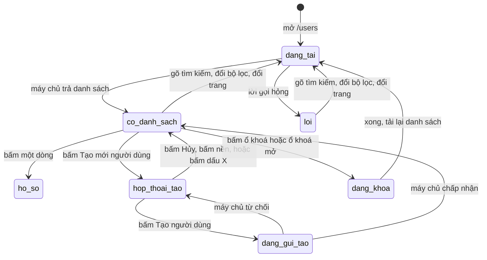

# Danh sách người dùng

## Tóm tắt

Màn hình `/users` là nơi duy nhất trong bảng quản trị mà quản trị viên nhìn thấy toàn bộ tài khoản của hệ thống. Nó có một ô tìm kiếm, một bộ lọc trạng thái, một bảng mười dòng một trang, một nút **Tạo mới người dùng** mở hộp thoại, và trên mỗi dòng một nút khoá hoặc mở khoá tài khoản.

Ba trong số các thao tác đó không làm được việc của chúng:

- **Tạo người dùng luôn thất bại**, vì hộp thoại không có ô mật khẩu còn máy chủ bắt buộc phải có mật khẩu.
- **Khoá tài khoản từ danh sách luôn thất bại**, vì nút khoá gọi lệnh xoá người dùng và lệnh đó trả 405.
- **Đặt lại mật khẩu không có đường vào**, dù cả máy chủ lẫn giao diện đều đã viết xong phần việc của mình.

Mở khoá tài khoản, tìm kiếm, lọc và phân trang thì chạy.

Trang chi tiết của một người dùng nằm ở tài liệu riêng: [`ho-so-nguoi-dung.md`](ho-so-nguoi-dung.md).

## Trường hợp đơn giản

Quản trị viên bấm **Quản lý người dùng** trên thanh bên. Trang hiện ngay với một khung xương mười dòng, rồi bảng thật thay chỗ nó.

Mỗi dòng có bảy cột: một ô vuông màu thương hiệu mang chữ cái đầu của tên, họ và tên, email, số điện thoại, tổ chức, ngày tạo theo định dạng Việt Nam, một huy hiệu trạng thái, và một nút hành động. Người không có cả họ lẫn tên hiện dấu gạch ngang, và ô vuông khi đó mang dấu gạch ngang đó.

Huy hiệu trạng thái chỉ có hai giá trị thật: **Đang hoạt động** màu xanh và **Đã khóa** màu đỏ.

Gõ vào ô tìm kiếm thì bảng lọc theo họ, tên, email hoặc tổ chức. Chọn trạng thái trong ô thả xuống thì bảng lọc thêm. Dòng chữ dưới bộ lọc cập nhật số kết quả và thêm chữ *(đã lọc)* khi có bộ lọc đang bật.

Bấm vào bất kỳ chỗ nào trên một dòng — trừ nút hành động — thì sang trang hồ sơ của người đó.

Bấm nút ổ khoá mở trên một dòng đã khoá thì tài khoản được mở lại, bảng tải lại, và một toast xanh hiện: *"Account has been activated"*.

## Tương tác, sự kiện theo sự kiện

### Vào màn

Route nằm dưới lớp bảo vệ chung, nên trước khi trang này dựng, lớp phiên phải xác nhận xong token. Sau đó danh sách được gọi ngay với trang 1, mười dòng, từ khoá rỗng và trạng thái `all`.

Trong lúc chờ, bảng hiện một **khung xương mười dòng bảy cột**. Đây là màn hình duy nhất trong bảng quản trị có khung xương đúng nghĩa.

Ô tìm kiếm rỗng và không được focus sẵn. Bộ lọc trạng thái ở **Tất cả**. Không có gì được điền sẵn từ lần trước.

Bấm vào ô tìm kiếm khi nó còn rỗng làm hiện một danh sách **"Lịch sử tìm kiếm"** ba dòng: *Công ty ABC*, *Viện XYZ*, `0123456789`. Ba giá trị đó là hằng số viết cứng trong mã, không phải lịch sử thật của ai. Bấm vào một dòng sẽ điền nó vào ô tìm kiếm và chạy tìm thật.

### Rời đi không đổi gì

Không có gì được ghi lại. Bộ lọc và số trang không đi vào URL, không vào lưu trữ cục bộ, không vào bộ nhớ phiên. Rời trang rồi quay lại thì mọi thứ về mặc định: trang 1, không lọc, không từ khoá.

Xem [`../nen-tang/dieu-huong-va-url.md`](../nen-tang/dieu-huong-va-url.md#cái-gì-nằm-trong-url).

### Bắt đầu sửa

Trên chính danh sách không có khái niệm *đã bẩn*: ô tìm kiếm và bộ lọc là trạng thái hiển thị chứ không phải dữ liệu chờ lưu.

Trong hộp thoại tạo người dùng thì có, nhưng không được đối xử như vậy: gõ vào bất kỳ ô nào rồi bấm ra ngoài hộp thoại sẽ **đóng hộp thoại và vứt hết**, không hỏi lại.

### Trong khi sửa

**Ô tìm kiếm không có độ trễ.** Mỗi ký tự gõ vào là một lời gọi mạng mới, và mỗi lời gọi đưa trang về 1. Gõ một chuỗi mười ký tự bắn mười lời gọi. Bảng nhấp nháy giữa khung xương và kết quả trong suốt lúc gõ.

> Ghi chú kỹ thuật: bảng quản trị **có** một ô tìm kiếm dùng chung với độ trễ 400–500 mili giây, và màn quản lý Cung & Cầu dùng nó. Màn người dùng thì không — nó dùng một thẻ `input` viết riêng, gọi thẳng vào hàm đặt từ khoá. Hai màn danh sách vì thế hành xử khác nhau ở cùng một thao tác.

**Đổi bộ lọc trạng thái** đưa trang về 1 và gọi lại ngay.

**Đổi trang** giữ nguyên từ khoá và bộ lọc.

Không có kiểm tra dữ liệu nào chạy trên danh sách. Từ khoá được cắt khoảng trắng trước khi gửi.

URL không đổi ở bất kỳ thao tác nào.

### Gửi đi

Danh sách chỉ đọc. Ba thao tác ghi xuất phát từ màn hình này:

**Tạo người dùng.** Hộp thoại có năm ô: Email (bắt buộc, có dấu sao), Họ, Tên, Số điện thoại, Tên tổ chức. Bấm **Tạo người dùng** thì:

1. Nếu email rỗng: toast đỏ *"Vui lòng điền email"*, dừng.
2. Nếu email sai định dạng: dòng chữ đỏ dưới ô email, dừng. Không có lời gọi mạng.
3. Nút đổi chữ thành "Đang tạo…", cả hai nút bị khoá.
4. `POST /api/v1/admin/users` với email đã cắt khoảng trắng; bốn trường còn lại được cắt khoảng trắng và **bỏ đi nếu rỗng**.
5. Thành công: toast xanh *"Người dùng đã được tạo thành công"*, hộp thoại đóng và xoá sạch, danh sách tải lại.
6. Thất bại: toast đỏ *"Tạo người dùng thất bại. Email có thể đã được sử dụng."* — **cùng một câu cho mọi loại lỗi**. Hộp thoại vẫn mở, mọi thứ đã gõ còn nguyên.

Đường thành công ở bước 5 **không đi tới được**. Máy chủ bắt buộc phải có mật khẩu khi quản trị viên tạo tài khoản, và hộp thoại không có ô mật khẩu, không gửi trường mật khẩu, không có cách nào đặt nó. Mọi lần bấm đều rơi vào bước 6, và câu người dùng đọc được đổ lỗi cho email trùng.

> Ghi chú kỹ thuật: việc bắt buộc mật khẩu là một trong bảy thay đổi có chủ đích so với NacenTwin, vốn mặc định gán `12345678` khi không nhập. Máy chủ trả 400 với thông điệp `"password is required"`. Giao diện chưa được cập nhật theo — xem [`../nen-tang/xac-thuc-va-vai-tro.md`](../nen-tang/xac-thuc-va-vai-tro.md#vòng-đời-một-tài-khoản).

**Khoá tài khoản.** Bấm ổ khoá trên một dòng đang hoạt động gọi thẳng `DELETE /api/v1/admin/users/{id}`, **không có hộp xác nhận**. Đường dẫn đó không tồn tại trong facade v1 và trả **405**. Người dùng nhận toast đỏ *"Failed to lock account"* và dòng không đổi gì. Xem [B-02](../bug-triage.md#b-02-xóa-người-dùng-trong-admin-trả-405).

Điều đáng chú ý không chỉ là mã 405: hàm nội bộ gọi là "vô hiệu hoá người dùng" nhưng nó gọi lệnh **xoá**. Nếu đường xoá được thêm vào facade đúng như tên gọi, bấm ổ khoá sẽ xoá tài khoản thay vì khoá nó.

**Mở khoá tài khoản.** Bấm ổ khoá mở trên một dòng đã khoá gọi `PATCH /api/v1/admin/users/{id}` với cờ hoạt động bật lên, cũng không có hộp xác nhận. Lệnh này chạy. Danh sách tải lại và toast xanh *"Account has been activated"* hiện ra.

Hai thao tác đối xứng nhau trên màn hình lại đi hai đường khác nhau, và chỉ một đường sống.

Cả ba câu toast của khoá và mở khoá đều là **tiếng Anh**, trên một màn hình còn lại toàn tiếng Việt.

## Biến thể

| Biến thể | Lúc vào màn | Trong khi sửa |
|---|---|---|
| Vai trò | Chỉ `ADMIN` vào được. Danh sách trả về **gồm cả tài khoản quản trị viên**, kể cả chính người đang đăng nhập; không có bộ lọc theo vai trò và cột vai trò không có trên bảng, nên nhìn danh sách không phân biệt được ai là quản trị viên. Khách chưa đăng nhập bị lớp bảo vệ đưa về `/login`. | Không ảnh hưởng. Máy chủ kiểm vai trò ở mỗi lời gọi; mất quyền giữa chừng cho ra 403 chứ không phải một thông báo dễ hiểu. |
| Trạng thái bản ghi | Bộ lọc có ba giá trị: Tất cả, Đang hoạt động, Đã khóa. Không có trạng thái "chưa kích hoạt" trên màn hình, dù tài khoản tự đăng ký ở cổng người dùng vẫn ở trạng thái đó cho tới khi bấm liên kết trong thư. Giao diện có sẵn một huy hiệu vàng *"Chờ duyệt"* nhưng **không đường nào gán được giá trị đó**: mọi dòng được suy ra từ đúng một bit hoạt động/không hoạt động. Tài khoản không bao giờ bị xoá khỏi hệ thống, nên danh sách chỉ dài thêm. | Không ảnh hưởng. |
| Cấu hình backend | Nếu v1 đã bị dừng dịch vụ, danh sách trả 410 và trang hiện một dải đỏ mang thông điệp lỗi thô. `Matching:ScoringMode` và `Mail:DryRun` không ảnh hưởng — màn này không gửi thư và không chạm ghép cặp. | Không ảnh hưởng. |
| Phím tắt của biểu mẫu | Không ô nào được focus sẵn. Tab đi từ ô tìm kiếm sang ô lọc trạng thái sang nút Xóa bộ lọc rồi vào bảng. | Trong ô tìm kiếm, **Enter chỉ đóng danh sách gợi ý** — nó không gửi gì, vì mỗi ký tự đã tự gửi rồi. Trong hộp thoại tạo người dùng, **Enter không gửi biểu mẫu** (các ô không nằm trong thẻ `form`) và **Escape không đóng hộp thoại**. Cách đóng duy nhất là bấm dấu X, bấm Hủy, hoặc bấm ra nền tối. Ctrl/Cmd+Enter không được xử lý riêng. |

Đổi biến thể giữa chừng: một tài khoản bị chính quản trị viên này khoá không biến mất khỏi danh sách; nó chỉ đổi huy hiệu sau khi danh sách tải lại. Nếu quản trị viên tự khoá tài khoản của chính mình, lời gọi kế tiếp trả 401 và họ bị đẩy về trang đăng nhập ngay giữa chừng.

## Huỷ và gián đoạn

| Sự kiện | Trước khi gửi | Trong khi đang gửi |
|---|---|---|
| Bấm Huỷ hoặc nhấn Escape | Trên danh sách: không có nút Huỷ; nút **Xóa bộ lọc** đưa từ khoá về rỗng, trạng thái về Tất cả và trang về 1. Trong hộp thoại tạo: bấm **Hủy** hoặc dấu X vứt bỏ mọi thứ đã gõ, không hỏi lại. **Escape không làm gì** ở cả hai chỗ. | Nút Hủy trong hộp thoại bị khoá trong lúc gửi. Không có cách huỷ lời gọi đang bay. |
| Đi chỗ khác trong app | Rời đi tự do. Bộ lọc và số trang mất hoàn toàn. | Rời trang bỏ lời gọi. Nếu máy chủ đã ghi xong việc tạo hoặc đổi trạng thái, thay đổi vẫn có hiệu lực nhưng người dùng không thấy toast nào. |
| Back/Forward của trình duyệt | Rời khỏi màn hình. Bấm Back sau khi lọc **không** quay lại kết quả trước — lọc không tạo mục lịch sử. Bấm Back từ trang hồ sơ quay lại danh sách ở trạng thái mặc định, không phải trạng thái đã lọc. | Như trên; lời gọi bị bỏ. |
| Tải lại trang, hoặc đóng tab | Bộ lọc, trang và nội dung hộp thoại về rỗng. Không có nháp. | Lời gọi bị bỏ. Việc tạo hoặc đổi trạng thái có thể đã hoàn tất ở phía máy chủ; tải lại xong sẽ thấy kết quả mà không có thông báo nào. |
| Mất mạng, hoặc request quá hạn | Không ảnh hưởng — bảng đang hiển thị giữ nguyên. | Sau 30 giây, danh sách hiện dải đỏ mang thông điệp mặc định của thư viện HTTP và **bảng về rỗng**. Trong hộp thoại tạo, toast đỏ hiện câu về email trùng, sai hẳn nguyên nhân. |
| Phiên hết hạn (401), hoặc v1 bị dừng (410) | Không ảnh hưởng. | 401 làm bộ chặn xoá cookie, phát sự kiện, và người dùng bị đẩy về `/login` ngay lập tức. Nội dung hộp thoại tạo người dùng **mất hết**, không có cảnh báo. 410 rơi vào nhánh lỗi chung và hiện ra như một lỗi lạ. |
| Bản ghi bị đổi bởi người khác, hoặc bị xoá | Danh sách im lặng lỗi thời cho tới lần gọi kế tiếp. Không có làm mới tự động. | Không có kiểm tra phiên bản trên đường v1: hai quản trị viên cùng sửa một tài khoản thì người ghi sau thắng, không có 409 và không có cảnh báo. Xem [`../nen-tang/hop-dong-api.md`](../nen-tang/hop-dong-api.md#phiên-bản-lạc-quan). Tài khoản không xoá được nên không có trường hợp "bản ghi biến mất". |
| Trình duyệt tự điền | Hộp thoại tạo người dùng **không khai báo thuộc tính `autocomplete` nào**, và ô email dùng kiểu `email`. Trình quản lý mật khẩu có thể đề nghị điền email đăng nhập của chính quản trị viên vào đây. | Các ô bị khoá trong lúc gửi nên tự điền không ghi được vào. |

Sau bất kỳ gián đoạn nào, danh sách chỉ có ba hình dạng: khung xương, bảng có dữ liệu, hoặc bảng rỗng kèm dải đỏ. Hộp thoại tạo người dùng thì hoặc đóng và sạch, hoặc mở với đúng nội dung đã gõ.

## Tương tác với hệ thống khác

**Quyền và vai trò.** Mọi đường trong màn này yêu cầu `ADMIN`, kiểm hai lớp: lớp tương thích cũ trả 403 `"Admin access required"`, rồi bảng quyết định chính sách kiểm hành động quản trị người dùng. Màn hình **không** đổi được vai trò nền tảng của ai: không có endpoint nào nâng một tài khoản lên `ADMIN` hay hạ xuống `USER`. Nút *Phân quyền Quản trị* nằm ở trang hồ sơ và cũng không gọi gì — xem [`ho-so-nguoi-dung.md`](ho-so-nguoi-dung.md). Xem thêm [`../nen-tang/xac-thuc-va-vai-tro.md`](../nen-tang/xac-thuc-va-vai-tro.md).

**Kiểm tra dữ liệu và cách hiện lỗi.** Kiểm tra tại chỗ chỉ có một luật: email phải khớp một biểu thức đơn giản. Mọi luật khác nằm ở máy chủ và **không có luật nào của máy chủ hiện ra**: mọi lỗi tạo người dùng bị nuốt và thay bằng đúng một câu về email trùng. Người dùng vì thế không bao giờ đọc được câu `"password is required"` đang chặn họ. Lỗi của danh sách thì ngược lại — nó hiện thẳng thông điệp thô từ máy chủ, bằng tiếng Anh.

**Thay đổi chưa lưu.** Hộp thoại tạo người dùng là chỗ duy nhất trong màn này có thể ở trạng thái *đã bẩn*, và nó **không được bảo vệ**: bấm nhầm ra nền tối là mất hết. Không có xác nhận, không có nháp. Xem [`../xuyen-suot/thay-doi-chua-luu.md`](../xuyen-suot/thay-doi-chua-luu.md).

**Cập nhật lạc quan và hoàn tác.** Không có cập nhật lạc quan trên danh sách: khoá và mở khoá đều chờ máy chủ rồi tải lại cả trang. Không có hoàn tác cho bất kỳ thao tác nào; khoá nhầm một tài khoản thì phải mở khoá lại bằng tay.

**Ngoại tuyến.** Không có hàng đợi. Bấm khoá khi mất mạng là một lời gọi thất bại sau 30 giây, không phải một lời gọi được hoãn.

**Thông báo và toast.** Đây là màn hình dùng toast nhiều nhất trong bảng quản trị: bốn câu cho tạo người dùng (hai câu tiếng Việt) và hai câu cho khoá/mở khoá (cả hai tiếng Anh). Toast không sống qua một lần điều hướng. Lỗi của danh sách thì không dùng toast mà dùng một dải đỏ tại chỗ.

**Trạng thái lọc/tìm trong URL.** Không có gì trong URL: từ khoá, trạng thái và số trang đều là trạng thái trong bộ nhớ. Không chia sẻ được một danh sách đã lọc, và tải lại trang mất bộ lọc.

**Đa ngôn ngữ.** Giao diện tiếng Việt, trừ hai toast của khoá/mở khoá và mọi thông điệp lỗi từ máy chủ, đều tiếng Anh. Ngày tạo được định dạng theo vùng `vi-VN`. Không có bộ chuyển ngôn ngữ.

**Khả năng truy cập.** Dòng của bảng là thẻ `tr` gắn sự kiện bấm chứ không phải liên kết, nên không đi tới được bằng bàn phím và không mở được trong tab mới. Hai nút hành động chỉ có biểu tượng, phân biệt bằng thuộc tính `title` (*Khóa tài khoản* / *Mở khóa tài khoản*). Hộp thoại tạo người dùng là một lớp phủ tự dựng, không phải hộp thoại chuẩn: nó không bẫy focus, không đóng bằng Escape và không thông báo cho trình đọc màn hình khi mở.

**Dấu vết kiểm toán.** Tạo, sửa và đặt lại mật khẩu đều ghi dòng kiểm toán ở phía máy chủ, trong cùng giao dịch với dữ liệu. Lượt bị từ chối vì chính sách cũng được ghi với kết quả `DENY`. Không có gì trong bảng quản trị hiển thị các dòng đó, vì [chưa có màn hình nhật ký kiểm toán](../moi/nhat-ky-kiem-toan.md).

## Trường hợp biên

- **Tạo người dùng không bao giờ thành công.** Hộp thoại thiếu ô mật khẩu; máy chủ bắt buộc có mật khẩu. Đây là con đường duy nhất tạo tài khoản `ADMIN` trong toàn hệ thống, nên trên thực tế **không tạo được quản trị viên mới qua giao diện**.
- **Nút khoá gọi lệnh xoá.** Trả 405 hôm nay. Nếu đường xoá được viết đúng như tên gọi, nút này sẽ xoá tài khoản chứ không khoá.
- **Không có hộp xác nhận cho khoá hay mở khoá.** Bảng quản trị có sẵn một hộp xác nhận dùng chung và các màn khác đều dùng nó trước khi xoá; màn này không dùng.
- **"Lịch sử tìm kiếm" là dữ liệu giả.** Ba dòng gợi ý là hằng số trong mã và không bao giờ đổi, kể cả sau khi người dùng tìm hàng chục lần.
- **Ô tìm kiếm gọi mạng theo từng ký tự.** Không có độ trễ, không có huỷ lời gọi cũ. Trên mạng chậm, kết quả hiện ra có thể là kết quả của một tiền tố cũ hơn chuỗi đang hiển thị trong ô.
- **Bộ lọc trạng thái và huy hiệu trạng thái dùng hai bộ từ khác nhau.** Ô lọc gửi giá trị "không hoạt động"; dòng trong bảng mang giá trị "đã khoá". Hai giá trị được ánh xạ qua lại ở một chỗ, và ánh xạ đó phụ thuộc vào việc giá trị nào lọt qua nhánh nào — một chỗ mỏng dễ vỡ khi thêm trạng thái thứ ba.
- **Trạng thái "Chờ duyệt" không đạt tới được.** Huy hiệu vàng đã có mã và có nhãn, nhưng không đường nào gán nó.
- **Số dòng một trang là 10 ở giao diện.** Máy chủ mặc định cũng 10 cho đường này, nhưng **cho phép tới 1000** — khác trần 100 của mọi danh sách khác. Giao diện không dùng khoảng đó.
- **Tài khoản đang đăng nhập nằm trong danh sách và khoá được.** Không có gì chặn quản trị viên tự khoá mình; hậu quả là bị đẩy ra ở lời gọi kế tiếp.
- **Không có cột vai trò.** Quản trị viên và người dùng thường trông giống hệt nhau trong bảng; chỉ mở trang hồ sơ mới thấy huy hiệu *Quản trị viên*.
- **Cùng một câu lỗi cho mọi thất bại khi tạo.** Mật khẩu thiếu, email sai định dạng ở phía máy chủ, hết phiên, mất mạng — tất cả cho ra câu *"Email có thể đã được sử dụng."*
- **Mục "Đổi mật khẩu" trong thanh bên dẫn tới một route không tồn tại.** Menu tài khoản ở cuối thanh bên có mục *Đổi mật khẩu* chuyển tới `/change-password`; route đó không có trong bộ định tuyến, nên nó rơi vào nhánh bắt-tất-cả và hiện trang không tìm thấy.

## Câu hỏi mở và kiểm chứng

- Chưa dựng bảng quản trị trong trình duyệt. Mọi mô tả về cái hiện ra trên màn hình đọc từ mã; cần một lượt kiểm bằng tay, đặc biệt là hành vi nhấp nháy của bảng khi gõ tìm kiếm và việc hộp thoại tạo người dùng có bẫy focus không.
- **Việc hộp thoại tạo người dùng không có ô mật khẩu là một lỗi, không phải một quyết định.** Máy chủ đã đổi hợp đồng có chủ đích và ghi lý do; giao diện chưa theo. Đây là lỗi chặn hoàn toàn một chức năng quản trị. (chưa cấp mã lỗi)
- **Việc nút "Khóa tài khoản" gọi lệnh xoá thay vì lệnh cập nhật là một lỗi riêng, độc lập với 405.** Sửa facade để có đường xoá sẽ làm nút này trở nên nguy hiểm chứ không trở nên đúng. Mã 405 đã được ghi ở [B-02](../bug-triage.md#b-02-xóa-người-dùng-trong-admin-trả-405); việc gọi nhầm lệnh thì chưa. (chưa cấp mã lỗi)
- **Việc nuốt mọi lỗi tạo người dùng và thay bằng một câu về email trùng đáng bị coi là lỗi**: nó làm cho lỗi thật không bao giờ chẩn đoán được từ giao diện. (chưa cấp mã lỗi)
- **Việc khoá và mở khoá không có hộp xác nhận** trong khi mọi thao tác xoá khác đều có, đáng đặt lại thành câu hỏi thiết kế. (chưa cấp mã lỗi)
- Chưa xác nhận máy chủ trả mã trạng thái nào cho `POST /api/v1/admin/users` khi thiếu mật khẩu: đọc mã thì là 400 với thông điệp một chuỗi, nhưng chưa đo trên bản chạy.
- Chưa rõ vì sao giới hạn số dòng của danh sách người dùng được đặt tới 1000 trong khi mọi danh sách khác dừng ở 100. Nếu là chủ ý thì lý do chưa được ghi ở đâu.
- Chưa rõ đường nào tạo ra quản trị viên đầu tiên của một môi trường mới, khi màn tạo người dùng không dùng được và không có đường tự đăng ký thành `ADMIN`.
- Chưa xác nhận trình quản lý mật khẩu có tự điền vào ô email của hộp thoại tạo người dùng không, và điều đó có tạo ra tài khoản sai không.

Đối chiếu với SourceCode/dmst-admin-main và SourceCode/nacentech, bản chụp ngày 2026-09-04.
