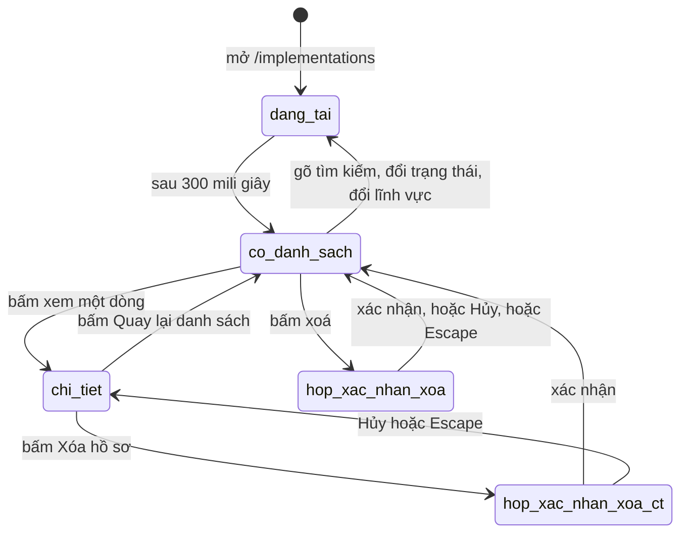
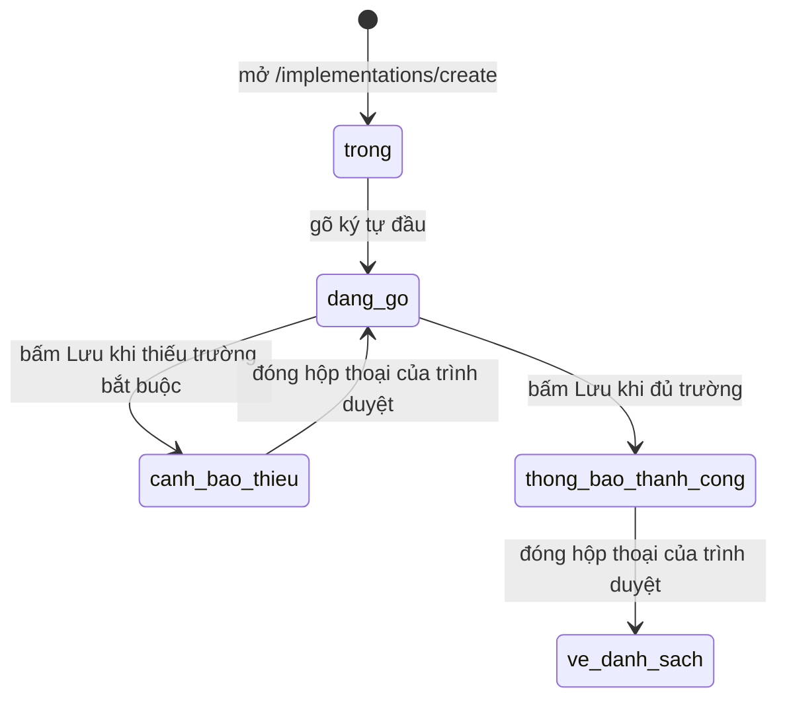

# Hồ sơ triển khai

## Tóm tắt

Khu vực `/implementations` ghi lại một lần triển khai thật: bài toán ban đầu, giải pháp công nghệ được chọn, bốn giai đoạn thi công, và kết quả đo được. Nó có ba màn hình đầy đủ — danh sách có bộ lọc, biểu mẫu tạo bốn phần, và trang chi tiết bốn khối — với tổng cộng gần hai nghìn dòng giao diện.

Không màn nào trong ba màn đó chạm tới máy chủ.

Đây là một **vỏ** theo đúng nghĩa của [`../glossary.md`](../glossary.md): có trang, có biểu mẫu, có điều hướng, và **không một tệp nào gọi API**. Danh sách được nuôi bằng sáu bản ghi viết cứng trong mã; trang chi tiết luôn hiển thị đúng một bản ghi viết cứng bất kể mở từ dòng nào; biểu mẫu tạo dựng xong một đối tượng dữ liệu rồi bỏ đi và hiện một hộp thoại của trình duyệt nói rằng đã tạo thành công.

Backend .NET **không có module nào tương ứng**. Không có bảng, không có dịch vụ, không có đường dẫn `/api/v1/*` nào mang chữ triển khai. Không phải là nó bị bỏ quên trong quá trình cutover — nó chưa từng tồn tại ở phía máy chủ.

Khu vực này cũng **không có mục nào trên thanh bên**. Ba route chỉ vào được bằng cách gõ thẳng địa chỉ.

## Trường hợp đơn giản

Người gõ `/implementations` vào thanh địa chỉ thấy tiêu đề *"Danh sách Hồ sơ triển khai"*, dòng phụ *"Tổng hợp các bài toán đã triển khai cùng giải pháp công nghệ và kết quả thực tế."*, và nút **Tạo mới Hồ sơ triển khai**.

Sau khoảng ba phần mười giây, bảng hiện sáu dòng: robot phẫu thuật thần kinh, tưới tiêu IoT, robot kho vận, lọc khí thải, học tập cá nhân hoá, quản lý năng lượng. Mỗi dòng có tên bài toán, doanh nghiệp, giải pháp, đơn vị cung cấp, khoảng thời gian triển khai, một huy hiệu kết quả và một lĩnh vực.

Dưới bảng là một dòng tổng kết: *"Hiển thị n hồ sơ"* bên trái, và ba chấm màu bên phải — *Thành công: 3*, *Một phần: 2*, *Không thành công: 1*.

Gõ vào ô tìm kiếm thì bảng lọc ngay. Chọn một trạng thái hoặc một lĩnh vực trong hai ô thả xuống thì bảng lọc thêm. Không có lời gọi mạng nào; mọi thứ chạy trên sáu bản ghi trong bộ nhớ.

Bấm xem một dòng sang `/implementations/detail?id=…`. Trang chi tiết hiện bốn khối: thông tin bài toán, giải pháp, tiến trình bốn giai đoạn, và kết quả với các chỉ số, bài học và khuyến nghị. Nội dung là hồ sơ robot phẫu thuật — **bất kể đã bấm dòng nào**.

## Tương tác, sự kiện theo sự kiện

### Danh sách và chi tiết

Hai nhánh xác nhận xoá dẫn về đúng chỗ chúng dẫn về hôm nay: **không có gì bị xoá**. Từ danh sách, xác nhận đóng hộp thoại và bảng không đổi. Từ chi tiết, xác nhận chuyển về danh sách và bảng vẫn đủ sáu dòng.

### Biểu mẫu tạo

Không có trạng thái "đang gửi" vì không có gì được gửi.

### Vào màn

**Danh sách** không gọi mạng. Nó chờ **300 mili giây giả lập** rồi lọc sáu bản ghi trong bộ nhớ và hiện ra. Trong lúc chờ, bảng hiện một khung xương.

Bộ lọc mặc định: từ khoá rỗng, trạng thái *Tất cả*, lĩnh vực *Tất cả*.

Ô thả xuống lĩnh vực lấy giá trị từ một danh sách chín mục viết cứng: *Tất cả*, Y tế, Nông nghiệp, Logistics, Môi trường, Giáo dục, Năng lượng, CNTT, Cơ khí. Danh sách này **không liên quan gì** tới lĩnh vực thật của hệ thống, vốn được quản lý ở [`danh-muc.md`](danh-muc.md) — hay đúng hơn, vốn **không** được quản lý ở đâu cả.

**Trang chi tiết** đọc định danh từ query string và dùng nó **đúng một chỗ**: gán vào trường định danh của bản ghi giả. Mọi trường còn lại là hằng số. Không có trạng thái tải, không có trạng thái lỗi, không có trường hợp "không tìm thấy".

**Biểu mẫu tạo** dựng ngay, không chờ gì. Tiến trình được điền sẵn bốn giai đoạn — *Phân tích*, *Thử nghiệm*, *Triển khai*, *Đánh giá* — với tên cố định và các ô còn lại rỗng. Bảng chỉ số bắt đầu với một dòng rỗng; hai danh sách bài học và khuyến nghị mỗi cái một dòng rỗng.

Không ô nào được focus sẵn ở bất kỳ màn nào.

### Rời đi không đổi gì

Không có gì được ghi lại ở bất kỳ đâu, kể cả trong bộ nhớ trình duyệt. Rời trang rồi quay lại thì bộ lọc về mặc định và biểu mẫu về rỗng.

### Bắt đầu sửa

Biểu mẫu tạo **không có khái niệm *đã bẩn***: không dấu hiệu, không cảnh báo khi rời trang, không nháp.

Nút **Quay lại danh sách** ở đầu trang rời đi ngay, vứt bỏ mọi thứ, không hỏi.

### Trong khi sửa

**Trên danh sách:** ô tìm kiếm không có độ trễ và không gọi mạng — nó lọc lại sáu bản ghi ở mỗi ký tự. Nó so khớp trên ba trường: tên bài toán, giải pháp, và doanh nghiệp; **không** so khớp đơn vị cung cấp hay lĩnh vực. Đổi bộ lọc không đặt lại gì vì màn này không có phân trang.

**Trên biểu mẫu:** ba phần có danh sách động — vấn đề gặp phải của mỗi giai đoạn, chỉ số đo được, bài học và khuyến nghị. Mỗi danh sách có nút thêm dòng và nút xoá dòng, và mọi thao tác chỉ đụng tới bộ nhớ.

Tệp đính kèm chọn được và tên tệp hiện ra, nhưng **không có gì tải chúng lên**: khi gửi, chỉ tên tệp được ghi vào đối tượng dữ liệu, và đối tượng đó cũng bị bỏ đi.

Không có kiểm tra dữ liệu nào chạy trong lúc gõ. URL không đổi.

### Gửi đi

Bấm **Lưu hồ sơ** ở cuối biểu mẫu:

1. Bốn ô bắt buộc — tên bài toán, lĩnh vực, doanh nghiệp, ngân sách — mang thuộc tính `required` của HTML và nằm trong một thẻ `form` thật, nên **trình duyệt tự chặn trước**: nó hiện bong bóng "Vui lòng điền vào trường này" bên cạnh ô rỗng đầu tiên và không gọi xử lý gửi.
2. Nếu bằng cách nào đó qua được bước trên, mã kiểm lại đúng bốn trường đó và hiện một **hộp thoại `alert` của trình duyệt** với câu *"Vui lòng điền đầy đủ thông tin bắt buộc"*, rồi dừng. Trên thực tế nhánh này gần như không đi tới được.
3. Nếu đủ, một đối tượng dữ liệu được dựng từ toàn bộ biểu mẫu — gồm cả tên tệp đính kèm và các danh sách đã lọc bỏ dòng rỗng.
4. Đối tượng đó **không được dùng vào việc gì**.
5. Một hộp thoại `alert` hiện câu *"Hồ sơ triển khai đã được tạo thành công!"*.
6. Trang chuyển về danh sách, và danh sách vẫn đúng sáu bản ghi cũ.

Đây là hai chỗ duy nhất trong toàn bộ bảng quản trị dùng hộp thoại `alert` của trình duyệt thay vì toast; mọi màn khác dùng toast.

Trên trang chi tiết, ba nút hành động: **Chỉnh sửa** không có xử lý, **Xuất PDF** không có xử lý, **Xóa hồ sơ** mở hộp xác nhận rồi chỉ chuyển về danh sách.

## Biến thể

| Biến thể | Lúc vào màn | Trong khi sửa |
|---|---|---|
| Vai trò | Ba route nằm dưới lớp bảo vệ chung, nên phải đăng nhập mới vào được. Nhưng lớp bảo vệ chỉ kiểm "đã đăng nhập chưa", không kiểm vai trò — xem [B-18](../bug-triage.md#b-18-lớp-bảo-vệ-của-admin-không-kiểm-vai-trò) — và vì màn hình không gọi API nào, **một tài khoản không phải `ADMIN` lọt được vào cookie sẽ thấy toàn bộ khu vực này hoạt động bình thường**. Đây là khu vực duy nhất của bảng quản trị mà vai trò không bao giờ bị kiểm ở phía máy chủ. | Không ảnh hưởng. |
| Trạng thái bản ghi | "Trạng thái" ở đây là **kết quả triển khai**, không phải trạng thái xuất bản: *Thành công*, *Thành công một phần*, *Không thành công*. Ba giá trị này không có ở đâu trong mô hình dữ liệu backend. Không có nháp, không có xuất bản, không có xoá mềm, không có phiên bản. | Kết quả chọn bằng ba nút trong phần *Kết quả*; nó chỉ ảnh hưởng tới cái được ghi vào một đối tượng bị bỏ đi. |
| Cấu hình backend | **Không ảnh hưởng gì cả.** Đây là khác biệt lớn nhất giữa khu vực này và mọi khu vực khác: v1 bị dừng dịch vụ, khoá ký đổi, cơ sở dữ liệu sập — ba màn này vẫn chạy y hệt. Chỉ lớp phiên ở trên chúng là phụ thuộc backend. | Không ảnh hưởng. |
| Phím tắt của biểu mẫu | Không ô nào được focus sẵn. Tab đi tuần tự qua bốn phần của biểu mẫu. | Biểu mẫu tạo **là một thẻ `form` thật**, nên **Enter trong một ô văn bản gửi biểu mẫu** — khác mọi biểu mẫu khác của bảng quản trị. Với bốn ô bắt buộc còn rỗng, kết quả là bong bóng kiểm tra dữ liệu của chính trình duyệt bật ra giữa lúc đang gõ, bằng ngôn ngữ của trình duyệt chứ không phải của ứng dụng. **Escape không làm gì** trên biểu mẫu; nó đóng hộp xác nhận xoá. Ctrl/Cmd+Enter không được xử lý riêng. |

Đổi biến thể giữa chừng: không biến thể nào ở đây đổi được trong lúc người dùng đang thao tác, vì không có gì phụ thuộc vào trạng thái bên ngoài.

## Huỷ và gián đoạn

| Sự kiện | Trước khi gửi | Trong khi đang gửi |
|---|---|---|
| Bấm Huỷ hoặc nhấn Escape | Không có nút Huỷ trên biểu mẫu; chỉ có **Quay lại danh sách**, và nó rời trang ngay, vứt hết, không hỏi. Escape đóng hộp xác nhận xoá; trên biểu mẫu nó không làm gì. | Không có pha "đang gửi". Hộp thoại `alert` chặn toàn bộ trang cho tới khi người dùng đóng nó. |
| Đi chỗ khác trong app | Rời đi tự do, không cảnh báo. Mọi thứ đã gõ mất hết — và vì không có gì từng được lưu, đây là mất mát toàn phần. | Không có gì đang bay để mất. |
| Back/Forward của trình duyệt | Rời khỏi màn hình. Bộ lọc mất. Từ chi tiết bấm Back về danh sách ở trạng thái mặc định. Từ biểu mẫu bấm Back mất hết. | Không áp dụng. |
| Tải lại trang, hoặc đóng tab | Danh sách dựng lại với đúng sáu bản ghi cũ. Trang chi tiết **tải lại được** vì định danh nằm trong query string — dù nó không dùng định danh đó vào việc gì. Biểu mẫu về rỗng. | Không áp dụng. |
| Mất mạng, hoặc request quá hạn | **Không ảnh hưởng.** Ba màn này chạy hoàn toàn trong trình duyệt. Nếu ứng dụng đã tải xong và phiên đã được xác nhận, người dùng thao tác được đầy đủ khi mất mạng — và sẽ tin rằng mình vừa tạo được một hồ sơ. | Không áp dụng. |
| Phiên hết hạn (401), hoặc v1 bị dừng (410) | Ba màn này không gọi API nên **không bao giờ nhận 401**, và người dùng không bao giờ bị đẩy ra từ đây. Họ chỉ bị đẩy ra khi chuyển sang một khu vực khác. Lớp phiên lúc khởi động thì vẫn kiểm như thường: mở thẳng `/implementations` khi token đã hết hạn sẽ bị đưa về `/login`. | Không áp dụng. |
| Bản ghi bị đổi bởi người khác, hoặc bị xoá | Không có tương tác: sáu bản ghi là hằng số trong mã, giống nhau ở mọi máy và mọi phiên. Hai người mở cùng lúc thấy y hệt nhau và không ai đổi được gì. | Không áp dụng. |
| Trình duyệt tự điền | Biểu mẫu tạo có nhiều ô văn bản không khai báo `autocomplete`; trình duyệt có thể đề nghị các giá trị đã gõ trước đó. Vì biểu mẫu là một thẻ `form` thật, khả năng tự điền cao hơn các biểu mẫu khác của bảng quản trị. | Không áp dụng. |

Sau bất kỳ gián đoạn nào, trạng thái của hệ thống không đổi — vì trạng thái của hệ thống chưa bao giờ bị màn hình này đụng tới.

## Tương tác với hệ thống khác

**Quyền và vai trò.** Không có tương tác ở phía máy chủ: không lời gọi nào được kiểm quyền. Ở phía giao diện, chỉ có lớp bảo vệ chung yêu cầu đã đăng nhập. Xem [`../xuyen-suot/quyen-va-vai-tro.md`](../xuyen-suot/quyen-va-vai-tro.md).

**Kiểm tra dữ liệu và cách hiện lỗi.** Có đúng một luật: bốn ô — tên bài toán, lĩnh vực, doanh nghiệp, ngân sách — phải không rỗng. Luật đó được viết **hai lần**: một lần bằng thuộc tính `required` của HTML, một lần bằng mã chạy lúc bấm gửi. Bản HTML luôn thắng, nên thứ người dùng thấy là bong bóng của trình duyệt bên cạnh ô rỗng đầu tiên; câu tiếng Việt *"Vui lòng điền đầy đủ thông tin bắt buộc"* trong hộp thoại `alert` gần như không bao giờ hiện ra. Không có toast, không có dải đỏ, không có chữ đỏ dưới ô. Bốn nhãn có dấu sao đỏ và bốn ô đó đúng là bốn ô bị kiểm; các ô còn lại — khoảng thời gian, mô tả ban đầu, và toàn bộ ba phần sau của biểu mẫu — không có ràng buộc nào.

**Thay đổi chưa lưu.** Không có lớp bảo vệ nào, và ở đây hậu quả nặng hơn mọi màn khác: người dùng có thể gõ một hồ sơ dài — bốn giai đoạn, nhiều chỉ số, nhiều bài học — rồi bấm lưu, đọc câu "đã được tạo thành công", và không có gì được lưu ở đâu. Xem [`../xuyen-suot/thay-doi-chua-luu.md`](../xuyen-suot/thay-doi-chua-luu.md).

**Cập nhật lạc quan và hoàn tác.** Không có tương tác. Không có gì được ghi nên không có gì để hoàn tác. Hộp xác nhận xoá là một cập nhật lạc quan không bao giờ được xác nhận: nó điều hướng như thể đã xoá.

**Ngoại tuyến.** Khu vực duy nhất của bảng quản trị **chạy đầy đủ khi mất mạng**. Đây không phải là một tính năng; nó là hệ quả của việc không có backend.

**Thông báo và toast.** Khu vực duy nhất **không dùng toast**. Hai thông điệp của biểu mẫu tạo đi qua hộp thoại `alert` của trình duyệt, chặn toàn bộ trang và mang tiêu đề của trình duyệt chứ không phải của ứng dụng.

**Trạng thái lọc/tìm trong URL.** Từ khoá, trạng thái và lĩnh vực đều không nằm trong URL. Định danh hồ sơ có nằm trong query string ở màn chi tiết, nhưng nó vô nghĩa vì trang không dùng nó. Xem [`../nen-tang/dieu-huong-va-url.md`](../nen-tang/dieu-huong-va-url.md).

**Đa ngôn ngữ.** Toàn bộ chữ là tiếng Việt viết thẳng trong mã, gồm cả sáu bản ghi mẫu và hồ sơ chi tiết mẫu. Bên trong dữ liệu mẫu có xen tiếng Anh — *"AI-Powered Learning Platform"*, *"hands-on practice"*, *"technical support on-site"*, *"uptime 99.9%"* — vì chúng được viết như văn bản minh hoạ chứ không phải như dữ liệu thật.

**Khả năng truy cập.** Chưa rà kỹ. Bảng dùng nút xem/sửa/xoá riêng thay vì dòng bấm được, nên đi bằng bàn phím tốt hơn hai danh sách kia. Hộp thoại `alert` thì luôn được trình đọc màn hình đọc — đây là chỗ hiếm hoi mà một lựa chọn kém về mặt trải nghiệm lại tốt hơn về mặt truy cập.

**Dấu vết kiểm toán.** Không có tương tác. Không thao tác nào ở đây sinh sự kiện kiểm toán, vì không thao tác nào chạm tới máy chủ. Một quản trị viên "tạo" mười hồ sơ triển khai không để lại dấu vết nào ở đâu.

## Trường hợp biên

- **Bấm Lưu cho ra một câu khẳng định sai.** Câu *"Hồ sơ triển khai đã được tạo thành công!"* là điều nguy hiểm nhất trong khu vực này: nó khẳng định một việc không xảy ra, bằng một hộp thoại của trình duyệt, và ngay sau đó chuyển trang về một danh sách không có hồ sơ vừa "tạo". Người dùng sẽ kết luận rằng danh sách bị lỗi, không phải rằng hồ sơ chưa được lưu.
- **Trang chi tiết luôn là một hồ sơ.** Bấm dòng thứ sáu — "quản lý năng lượng thông minh", kết quả *Không thành công* — vẫn mở ra hồ sơ robot phẫu thuật với kết quả thành công. Không có gì báo hiệu.
- **Ba chấm màu ở chân danh sách không nghe theo bộ lọc.** Chúng đếm trên toàn bộ sáu bản ghi gốc, trong khi dòng *"Hiển thị n hồ sơ"* ngay bên trái đếm trên kết quả đã lọc. Lọc tới chỉ còn một dòng thì hai bên vẫn nói *1* và *3 / 2 / 1*.
- **Nút "Chỉnh sửa" ở cả hai màn đều không có xử lý.** Trên danh sách nó là một hàm rỗng có chú thích; trên chi tiết nó là một hàm rỗng. Không có route sửa nào tồn tại — chỉ có ba route: danh sách, tạo, chi tiết.
- **Nút "Xuất PDF" không có xử lý.**
- **Xác nhận xoá điều hướng như thể đã xoá.** Từ trang chi tiết, xác nhận đưa về danh sách ngay; người dùng sẽ tìm bản ghi vừa xoá trong danh sách và thấy nó vẫn còn.
- **Danh sách lĩnh vực trong bộ lọc là một danh sách thứ hai, không liên quan gì tới lĩnh vực thật.** Chín tên viết cứng, không lấy từ `GET /api/v1/sectors`.
- **Biểu mẫu vẽ ra những khái niệm không có ở backend**: mức TRL của giải pháp tại thời điểm triển khai, ngân sách, các chỉ số đo được với cột mục tiêu và cột đạt được, số ảnh và số video. Kiến trúc đích có nhắc tới đánh giá, thi công và kết quả, nhưng bản phát hành này cố ý chưa mở chúng — xem [`../nen-tang/mo-hinh-du-lieu.md`](../nen-tang/mo-hinh-du-lieu.md#cái-chưa-có-trong-mã).
- **Tệp đính kèm chọn được nhưng không đi đâu.** Chỉ tên tệp được ghi vào đối tượng bị bỏ đi.
- **Bốn tên giai đoạn cố định.** Không thêm, không bớt, không đổi tên được. Mọi hồ sơ triển khai sẽ có đúng bốn giai đoạn đó.
- **Enter trong ô văn bản gửi biểu mẫu.** Đây là biểu mẫu duy nhất của bảng quản trị làm vậy, và với bốn ô bắt buộc thường còn rỗng lúc đầu, kết quả là bong bóng kiểm tra dữ liệu của trình duyệt bật ra bất ngờ — bằng ngôn ngữ hệ điều hành, không phải tiếng Việt của ứng dụng.
- **Cùng một luật kiểm tra được viết hai lần và một bản không bao giờ chạy.** Câu tiếng Việt duy nhất về trường thiếu nằm ở bản không chạy.
- **Khu vực không có lối vào.** Thanh bên có sáu mục và không mục nào dẫn tới đây.
- **Không có phân trang.** Với sáu bản ghi thì không cần; với dữ liệu thật thì đây là một thành phần còn thiếu.

## Câu hỏi mở và kiểm chứng

- Chưa dựng bảng quản trị trong trình duyệt. Mọi mô tả về cái hiện ra trên màn hình đọc từ mã; cần một lượt kiểm bằng tay, đặc biệt là hai hộp thoại `alert` và hành vi của Enter trong biểu mẫu.
- **Việc biểu mẫu tạo khẳng định "đã được tạo thành công" khi không có gì được lưu là lỗi nghiêm trọng nhất của khu vực này**, và nó nghiêm trọng hơn bản thân việc thiếu backend: một vỏ nói rõ mình là vỏ thì vô hại, một vỏ nói dối thì không. (chưa cấp mã lỗi)
- **Việc trang chi tiết bỏ qua định danh và luôn hiện cùng một hồ sơ** là lỗi thứ hai cùng loại: nó trình bày dữ liệu bịa như dữ liệu thật của bản ghi người dùng vừa chọn. (chưa cấp mã lỗi)
- **Việc xác nhận xoá điều hướng như thể đã xoá** cũng vậy. (chưa cấp mã lỗi)
- Cần một quyết định phạm vi rõ ràng cho khu vực này, và có ba lựa chọn: **ẩn nó** như cổng người dùng đã làm với bốn khu vực chưa sẵn sàng — xem [`../nen-tang/dieu-huong-va-url.md`](../nen-tang/dieu-huong-va-url.md#bốn-khu-vực-bị-gỡ-khỏi-định-tuyến); **gắn nhãn nguyên mẫu** rõ ràng trên cả ba màn; hoặc **xây backend**. Việc nó vừa không có lối vào, vừa không được gắn nhãn, vừa khẳng định thành công là tổ hợp tệ nhất trong ba lựa chọn.
- Chưa rõ mô hình dữ liệu ở đây được thiết kế từ đâu. Ngân sách, mức TRL, chỉ số đo được và bốn giai đoạn cố định không khớp với bất kỳ khái niệm nào trong backend; cần đối chiếu với kiến trúc đích trước khi xây, để không tạo ra một mô hình thứ ba song song với hồ sơ vụ việc — xem [`../moi/console-ho-so-vu-viec.md`](../moi/console-ho-so-vu-viec.md).
- Chưa rõ khu vực này có phải là tiền thân giao diện của giai đoạn thi công và xác minh kết quả trong hồ sơ vụ việc hay không. Nếu đúng, phần lớn màn hình ở đây dùng lại được và nên được quy về cùng một mô hình.
- Chưa xác nhận có bảng dữ liệu nào cho hồ sơ triển khai trong cơ sở dữ liệu của hệ cũ NacenTwin không. Nếu có, cần một đường di trú; nếu không, đây là dữ liệu chưa từng tồn tại.

Đối chiếu với SourceCode/dmst-admin-main và SourceCode/nacentech, bản chụp ngày 2026-09-04.
