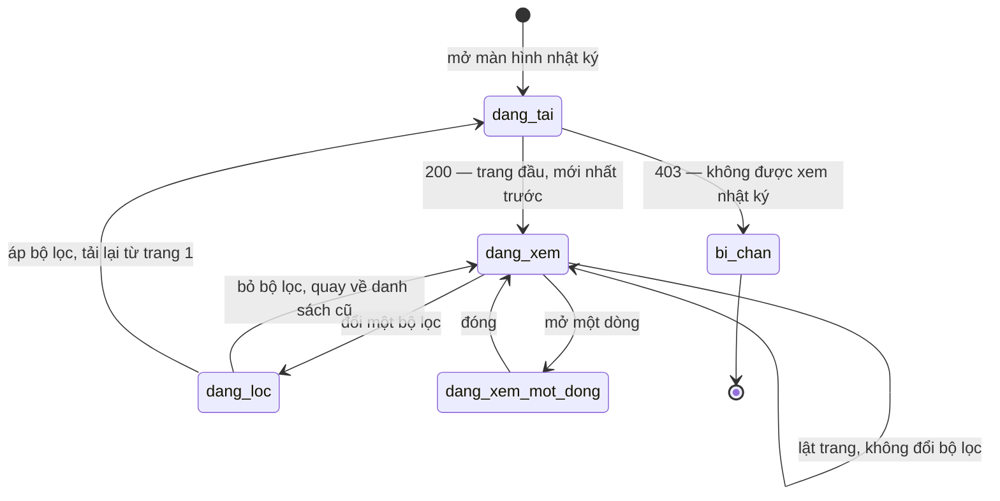

# Nhật ký kiểm toán

## Tóm tắt

Nhật ký kiểm toán trả lời một câu duy nhất: **ai đã làm gì, trên cái gì, và có được phép không**. Mỗi dòng ghi người thực hiện, vai trò của họ, hành động, đối tượng, mục đích, kết quả `ALLOW` / `DENY` (cửa phân quyền: được phép hay không) hay `SUCCESS` (tầng lệnh: việc đã xảy ra — [ADR-0006](../../../04-technical/adr/0006-kiem-toan-o-duong-thanh-cong.md)), mã quy tắc đã ra quyết định, và mã tương quan để nối dòng đó với đúng request đã sinh ra nó.

Nhật ký là **chỉ ghi thêm**. Không có phương thức sửa, không có phương thức xoá, ở bất kỳ tầng nào: bản ghi không có thao tác nào đổi được nội dung sau khi tạo, và interface truy vấn chỉ có một phương thức đọc. Đây không phải một quy ước tự nguyện mà là hình dạng của mã.

Phần có giá trị nhất trong nhật ký là **các lượt bị từ chối**. Chúng đã được ghi đầy đủ, kèm mã quy tắc đã chặn. Và **hiện không ai xem được**: tầng truy vấn có mã chạy được, không có cửa HTTP, và không controller nào trong `apps/api/` tham chiếu tới nó.

Nhóm endpoint này và [`dataroom-va-cap-quyen.md`](dataroom-va-cap-quyen.md) là một cặp. Cấp quyền đọc dữ liệu mật mà không tra được ai đã đọc gì thì không ai dám bật cơ chế đó.

## Bề mặt cần có

| Phương thức | Đường dẫn | Việc |
|---|---|---|
| `GET` | `/api/v2/audit-events` | Tra nhật ký, lọc theo người thực hiện / loại đối tượng / định danh đối tượng / kết quả |
| `GET` | `/api/v2/audit-events/{id}` | Một dòng đầy đủ, gồm phần chi tiết và dấu vết thiết bị nếu còn hạn |
| — | *(không phơi ra HTTP)* | Cắt địa chỉ IP và trình duyệt đã hết hạn lưu; chạy từ một nghĩa vụ định kỳ |

Dòng đầu phủ đúng phương thức truy vấn của tầng dịch vụ. Dòng thứ ba phủ phương thức còn lại và **cố ý không có đường dẫn**: cắt dấu vết thiết bị là một nghĩa vụ định kỳ của hệ thống, không phải một nút bấm. Đặt nó sau một endpoint sẽ biến một chính sách lưu trữ thành một hành động tuỳ hứng, và tạo ra đúng thứ mà nhật ký chỉ-ghi-thêm sinh ra để chặn: một cách xoá dữ liệu theo yêu cầu.

Dòng thứ hai **chưa có phương thức nào ở tầng dịch vụ**. Truy vấn hiện trả một danh sách rút gọn không chứa phần chi tiết; muốn xem đầy đủ một dòng thì phải bổ sung một phương thức.

## Ai gọi được và bị từ chối khi nào

| Endpoint | Ai gọi được | Từ chối với mã | Ghi lại |
|---|---|---|---|
| `GET /audit-events` | Người qua được quy tắc đọc thống kê — trên thực tế là quản trị viên | `403 FORBIDDEN` kèm `ruleId` | **Có** — chính lượt tra nhật ký cũng sinh một dòng, vì nó đi qua bảng quyết định |
| `GET /audit-events/{id}` | Như trên | `403 FORBIDDEN`; `404 NOT_FOUND` | Như trên |

Đây là chỗ duy nhất trong hệ thống mà **một endpoint chỉ đọc lại sinh dòng kiểm toán ở lượt được phép** — không phải vì luật đọc-tài-liệu-mật, mà vì cách bảng quyết định làm việc: mọi lượt bị từ chối đều được ghi, và lượt tra nhật ký bị từ chối cũng vậy. Hệ quả có ích: ai đã mở nhật ký của người khác là một câu hỏi trả lời được, ngay trong chính nhật ký.

Hai endpoint dùng chung **hành động đọc thống kê** trong bảng quyết định. Nhật ký kiểm toán không có hành động riêng. Nghĩa là ai xem được bảng điều khiển thống kê thì cũng xem được toàn bộ nhật ký, kể cả các dòng nói về chính họ. Đây là một quyết định cần xem lại trước khi viết endpoint — xem [Câu hỏi mở](#câu-hỏi-mở-và-kiểm-chứng).

## Trường hợp đơn giản

Một quản trị viên nghi một tài liệu mật đã bị xem sai người. Họ mở nhật ký, lọc theo loại đối tượng là tài liệu và định danh của tài liệu đó, rồi đọc từ trên xuống — mới nhất trước.

Danh sách có bốn dòng: ba dòng `ALLOW` với mục đích thẩm định, và một dòng `DENY` với mã quy tắc là quy tắc mặc định từ chối. Dòng cuối cho biết một người đã thử mở tài liệu mà không có phiếu, và bị chặn.

Họ đổi bộ lọc sang mã người thực hiện của dòng `DENY` đó, bỏ bộ lọc đối tượng, và thấy toàn bộ những gì người đó đã làm trong hệ thống. Mã tương quan của từng dòng cho phép nối một lượt bị từ chối với đúng lời gọi mà người dùng đã báo lỗi.

## Tương tác, sự kiện theo sự kiện

Đơn vị tương tác ở đây không phải một biểu mẫu ghi dữ liệu mà là **một lượt tra cứu**: đặt bộ lọc, đọc kết quả, lần theo một dòng. Nó vẫn đi qua đủ năm pha, chỉ khác ở chỗ pha "gửi đi" không ghi gì vào dữ liệu nghiệp vụ.

### Vào màn

`GET /api/v2/audit-events` trả trang đầu, **sắp theo thời điểm giảm dần** — mới nhất trước — và dùng [hình dạng phân trang chung](README.md#phân-trang).

Mỗi dòng trả về gồm: mã người thực hiện, vai trò nền tảng, hành động, loại đối tượng, định danh đối tượng, phiên bản đối tượng, mục đích, kết quả, mã quy tắc, mã tương quan, thời điểm, và phần chi tiết.

Ba trường trong đó cần giao diện làm việc thêm trước khi hiển thị:

- **Mã quy tắc** được lưu ở dạng ghép: phiên bản bộ quy tắc và mã quy tắc, nối bằng dấu hai chấm. Giao diện phải tách hai phần, vì phiên bản bộ quy tắc là thứ trả lời "lúc đó luật là gì" còn mã quy tắc là thứ trả lời "quy tắc nào đã quyết".
- **Phiên bản đối tượng** để trống ở mọi dòng do bảng quyết định ghi ra — tức là gần như mọi dòng. Nó chỉ có giá trị ở những dòng do tầng nghiệp vụ ghi trực tiếp. Cột này vì thế trống phần lớn thời gian; giao diện không nên dành chỗ cố định cho nó.
- **Mã người thực hiện** là một mã, không phải một cái tên. Xem mục riêng bên dưới.

Địa chỉ IP và trình duyệt **không nằm trong danh sách**. Chúng chỉ xuất hiện ở đường xem một dòng, và chỉ khi còn trong hạn lưu.

### Rời đi không đổi gì

Người dùng mở nhật ký rồi đóng lại mà không lọc gì. Lượt đó **đã sinh một dòng** — dòng ghi lại chính việc họ mở nhật ký. Không có cách mở nhật ký mà không để lại dấu vết, và đó là chủ ý.

Giao diện nên nói rõ điều này ở đâu đó trên màn hình. Người dùng cần biết rằng việc tra cứu của họ cũng được ghi, vì đó là điều họ sẽ muốn biết nếu ở phía bên kia.

### Bắt đầu sửa

"Sửa" ở đây là đổi bộ lọc. Có đúng bốn bộ lọc, và không có bộ lọc nào khác:

| Bộ lọc | Nhận gì | Ghép với nhau thế nào |
|---|---|---|
| Người thực hiện | Một mã người thực hiện | Và |
| Loại đối tượng | Một chuỗi, ví dụ `Document`, `CommercializationCase`, `Assignment` | Và |
| Định danh đối tượng | Một định danh cụ thể | Và |
| Kết quả | `ALLOW` hoặc `DENY` | Và |

Bốn bộ lọc ghép bằng "và"; bỏ trống một cái nghĩa là không lọc theo chiều đó. Không có "hoặc", không có phủ định, không có tìm toàn văn.

Bộ lọc kết quả là bộ lọc quan trọng nhất trên màn hình. **Lọc `DENY` là cách duy nhất thấy được những gì hệ thống đã chặn**, và đó là thông tin không có ở bất kỳ chỗ nào khác trong sản phẩm. Giao diện nên đưa nó thành một nút riêng, không chôn trong một ô chọn.

**Không có bộ lọc theo khoảng thời gian.** Đây là khoảng trống nghiêm trọng nhất của tầng truy vấn: mọi câu hỏi kiểm toán thật đều có dạng "trong tháng vừa rồi", và cách duy nhất hiện nay là lật trang cho tới khi qua khỏi mốc cần tìm. Bảng dữ liệu đã có chỉ mục theo thời điểm, nên đây là việc thêm hai tham số chứ không phải một cuộc thiết kế lại. Cũng thiếu bộ lọc theo **hành động**, theo **mã quy tắc** và theo **mã tương quan** — cái cuối là thứ bộ phận hỗ trợ cần khi người dùng đọc cho họ một mã lỗi. (chưa cấp mã lỗi)

### Trong khi sửa

Không có kiểm tra nào ở máy chủ trong lúc đổi bộ lọc, và không có gợi ý nào: máy chủ không trả danh sách các loại đối tượng đang có, cũng không trả danh sách hành động đang có. Giao diện phải tự dựng hai danh sách đó từ danh mục cố định trong mã.

Bộ lọc phải nằm trong URL. Một màn hình kiểm toán mà không gửi được liên kết cho đồng nghiệp là một màn hình dùng một mình.

### Gửi đi

Áp bộ lọc là một lời gọi đọc mới, quay về trang 1. Không có gì được ghi vào dữ liệu nghiệp vụ; một dòng kiểm toán mới được sinh cho chính lượt tra.

Không có đường xuất dữ liệu. Một cuộc kiểm toán thật thường kết thúc bằng một tệp gửi cho người khác, và hiện không có gì để gửi ngoài ảnh chụp màn hình. Xuất dữ liệu là một năng lực cần quyết định riêng: nó tạo ra một bản sao của nhật ký nằm ngoài hệ thống, và bản sao đó không còn chỉ-ghi-thêm nữa.

## Mã người thực hiện không phải tên người

Trường người thực hiện là một **mã**, không phải thông tin cá nhân: không có tên, không có email, không có tổ chức. Đây là chủ ý — nhật ký kiểm toán sống lâu hơn nhiều so với dữ liệu nhân sự, và một dòng ghi năm 2026 không nên mang họ tên của một người vào năm 2034.

Nhưng người đọc nhật ký cần thấy tên. Nếu không, mọi cuộc điều tra dừng lại ở một chuỗi ký tự.

Yêu cầu cho v2, và đây là chỗ dễ làm sai nhất:

- **Endpoint nhật ký không bao giờ trả tên người.** Nó trả mã, và chỉ mã.
- Giao diện đổi mã thành tên bằng **một lời gọi riêng** sang nhóm endpoint người dùng, gom nhiều mã một lần: `POST /api/v2/people:resolve` với danh sách mã, trả về tên hiển thị cho những mã người gọi được phép biết.
- Lời gọi đó **có quyền riêng**. Ai không được phép biết tên thì nhận lại chính mã đó, và giao diện hiện mã rút gọn. Màn hình vẫn dùng được: lần theo hành vi của "cùng một người" không cần biết người đó là ai.
- Lời gọi đổi mã thành tên **cũng ghi một dòng kiểm toán**. Việc một người tra ra danh tính đứng sau các mã trong nhật ký là một hành động cần dấu vết, chứ không phải một chi tiết hiển thị.

Ai được phép đổi mã thành tên là một quyết định sản phẩm chưa có câu trả lời. Nó không phải cùng một quyết định với "ai được đọc nhật ký": đọc được chuỗi hành vi ẩn danh và biết được đó là ai là hai mức tiết lộ khác nhau.

> Ghi chú kỹ thuật: mã người thực hiện hiện chính là định danh của bản ghi người dùng, không phải một mã ẩn danh sinh riêng. Nó là bút danh — không đọc ra được tên nếu không tra bảng người dùng — nhưng nó **không** ngắt liên kết: ai đọc được cả hai nguồn thì ghép được ngay. Nếu yêu cầu là ngắt liên kết thật, cần một bảng ánh xạ riêng và một quyết định về việc ai giữ bảng đó.

## Dấu vết thiết bị có thời hạn riêng

Mỗi dòng kiểm toán lưu kèm địa chỉ IP và chuỗi nhận dạng trình duyệt. Hai trường này có **thời hạn lưu riêng, ngắn hơn thời hạn của bản thân sự kiện**.

Hết hạn thì hai trường bị cắt về rỗng; **dòng kiểm toán ở lại nguyên vẹn**. Ai làm gì, khi nào, có được phép không — tất cả vẫn còn. Chỉ dấu vết thiết bị mất đi.

Việc cắt chạy từ một **nghĩa vụ định kỳ**, cùng cơ chế với các mốc rà soát dài hạn khác của hệ thống. Nó không phải một endpoint và không được trở thành một endpoint.

Hệ quả cho giao diện: **hai trường này trống không có nghĩa là không có dữ liệu**. Một dòng cũ không có IP là một dòng đã qua hạn lưu, không phải một dòng thiếu thông tin. Màn hình phải phân biệt hai chuyện đó bằng chữ, không bằng một ô trống: "đã hết hạn lưu" khác "không ghi nhận".

Ba thứ chưa tồn tại và phải có trước khi cơ chế này chạy được:

1. **Thời hạn lưu chưa được cấu hình ở đâu cả.** Phương thức cắt nhận một mốc thời gian làm tham số; không có cấu hình nào nói mốc đó là bao lâu.
2. **Không có xử lý nào được đăng ký cho bất kỳ loại nghĩa vụ định kỳ nào.** Bộ chạy nền có, hàng đợi nghĩa vụ có, nhưng không có mã nào nhận loại nghĩa vụ rà soát lưu trữ. Nghĩa là **việc cắt hiện không bao giờ chạy**, và mọi dòng kiểm toán giữ IP với trình duyệt vô thời hạn — đúng ngược với điều tài liệu này mô tả. (chưa cấp mã lỗi)
3. **Không có ai xếp nghĩa vụ đó vào lịch.** Kể cả khi có xử lý, không có gì tạo ra mục lịch định kỳ.

## Biến thể

| Biến thể | Lúc vào màn | Trong khi đổi bộ lọc |
|---|---|---|
| Vai trò | Chỉ người qua được quy tắc đọc thống kê vào được; người khác nhận 403 kèm `ruleId`, và **lượt bị từ chối đó được ghi vào chính nhật ký họ vừa xin đọc**. Vai trò cũng quyết định họ có đổi được mã người thực hiện thành tên hay không. | Không đổi. Bộ lọc không mở rộng quyền: lọc theo một người khác vẫn chỉ trả những dòng người gọi đã được phép thấy. |
| Trạng thái bản ghi | Dòng kiểm toán không có trạng thái và không bị xoá mềm. Thứ duy nhất đổi theo thời gian là dấu vết thiết bị: còn hạn thì có, hết hạn thì trống. | Không ảnh hưởng. |
| Cấu hình backend | Phiên bản bộ quy tắc đang nạp quyết định mã quy tắc nào xuất hiện trên các dòng **mới**. Dòng cũ giữ phiên bản cũ, nên một màn hình có thể hiện nhiều phiên bản bộ quy tắc cùng lúc — đúng như thiết kế. | Không ảnh hưởng. |
| Phím tắt của biểu mẫu | Focus vào ô lọc đầu tiên khi mở màn hình. | Escape xoá bộ lọc đang gõ và quay về kết quả trước đó. Enter áp bộ lọc — ở đây Enter gửi được, vì lượt gửi không ghi gì và lặp lại vô hại. |

Đổi biến thể giữa chừng: dữ liệu mới được ghi liên tục trong lúc người dùng đọc. Trang 2 tải sau vài phút có thể lệch vì các dòng mới đã đẩy mọi thứ xuống. Với danh sách sắp theo thời gian giảm dần, đây là chuyện sẽ xảy ra thường xuyên chứ không phải trường hợp hiếm.

## Huỷ và gián đoạn

| Sự kiện | Trước khi gửi | Trong khi đang gửi |
|---|---|---|
| Bấm Huỷ hoặc nhấn Escape | Bộ lọc đang gõ bị bỏ, danh sách giữ nguyên kết quả cũ. Không có gì được ghi. | Huỷ ở trình duyệt chỉ bỏ việc chờ phản hồi. Lượt tra vẫn chạy tới cùng ở máy chủ, nhưng **không để lại dấu vết nào** — một lượt tra được phép không sinh dòng kiểm toán. |
| Đi chỗ khác trong app | Bộ lọc mất nếu không nằm trong URL. Nằm trong URL thì khôi phục được. | Kết quả không tới giao diện. Dòng ghi lại lượt tra vẫn còn. |
| Back/Forward của trình duyệt | Nếu bộ lọc nằm trong URL, Back quay lại đúng bộ lọc trước và tải lại — dữ liệu có thể đã khác vì nhật ký luôn dài thêm. | Như trên. |
| Tải lại trang, hoặc đóng tab | Bộ lọc trong URL sống sót; bộ lọc ngoài URL mất. | Như trên. Không có gì hỏng: lượt tra là lệnh chỉ đọc, lặp lại vô hại. |
| Mất mạng, hoặc request quá hạn | Không ảnh hưởng — chưa gọi gì. | Thử lại tự do. Không cần giữ khoá chống lặp, vì đây là lệnh `GET` và khoá chống lặp không áp cho lệnh đọc. |
| Phiên hết hạn (401), hoặc v1 bị dừng (410) | Người dùng bị đẩy về đăng nhập, mất bộ lọc ngoài URL. | 401 giữa chừng nghĩa là lượt tra bị chặn trước tầng nghiệp vụ; **không** sinh dòng kiểm toán, vì bảng quyết định chưa được hỏi. |
| Bản ghi bị đổi bởi người khác hoặc bị xoá | Không áp dụng. Dòng kiểm toán không đổi và không bị xoá; nó chỉ có thể bị cắt hai trường dấu vết thiết bị. | Không áp dụng. Không có 409 ở nhóm endpoint này vì không có lệnh ghi nào. |
| Trình duyệt tự điền | Ô lọc mã người thực hiện có thể bị trình duyệt gợi ý một giá trị cũ. Nó là một mã, không phải dữ liệu cá nhân, nên hậu quả là một bộ lọc sai chứ không phải một rò rỉ. | Không áp dụng. |

Sau bất kỳ gián đoạn nào, người dùng ở lại màn hình nhật ký. Thứ duy nhất đáng giữ là **bộ lọc**, và cách giữ đúng là đặt nó trong URL ngay từ đầu chứ không khôi phục từ bộ nhớ tạm.

## Tương tác với hệ thống khác

**Quyền và vai trò.** Nhật ký dùng chung hành động với đọc thống kê, nên không tách được hai quyền. Ngoài ra bảng quyết định **không nhận chiều "chủ dữ liệu"**, nên không có cách nào diễn đạt luật "người này được xem các dòng nói về dữ liệu của chính họ" — muốn có luật đó phải thêm một chiều vào bảng. Xem [`../xuyen-suot/quyen-va-vai-tro.md`](../xuyen-suot/quyen-va-vai-tro.md).

**Kiểm tra dữ liệu và cách hiện lỗi.** Bốn bộ lọc đều đơn giản và khó gõ sai; lỗi thực tế duy nhất là một định danh sai định dạng, trả `400`. Cái khó không phải hiện lỗi mà là hiện **kết quả rỗng**: người dùng lọc ra 0 dòng không biết là "không có gì xảy ra" hay "tôi lọc sai". Màn hình phải nói rõ bộ lọc nào đang áp ngay cạnh kết quả rỗng.

**Thay đổi chưa lưu.** Không có tương tác. Màn hình này không ghi gì, nên không bao giờ bẩn.

**Cập nhật lạc quan và hoàn tác.** Không có tương tác. Không có gì để cập nhật lạc quan và không có gì để hoàn tác — đó là toàn bộ ý nghĩa của "chỉ ghi thêm".

**Ngoại tuyến.** Không có tương tác. Không lưu bộ nhớ đệm ngoại tuyến cho nhật ký: một bản sao nhật ký nằm trong trình duyệt là một bản sao nằm ngoài tầm kiểm soát.

**Thông báo và toast.** Không có tương tác hôm nay. Nhưng đây là chỗ một loại thông báo mới sẽ có ích: một chuỗi dài các lượt `DENY` từ cùng một người là tín hiệu đáng báo ngay chứ không đáng đợi ai đó mở màn hình này ra xem. Đó là một năng lực riêng, chưa có gì trong mã.

**Trạng thái lọc/tìm trong URL.** Bốn bộ lọc, số trang và số dòng mỗi trang **phải** nằm trong URL. Đây là màn hình mà việc gửi một liên kết cho người khác là thao tác chính, không phải tiện ích.

**Đa ngôn ngữ.** Hai giá trị kết quả, danh sách hành động, danh sách loại đối tượng và **23 mục đích** đều là chuỗi tiếng Anh viết hoa. Mục đích phải dịch **giống hệt** cách [hộp thoại cấp quyền đọc](dataroom-va-cap-quyen.md) dịch chúng; hai màn hình dịch lệch nhau sẽ làm người dùng tưởng là hai thứ khác nhau. Mã quy tắc thì **không dịch** — nó là định danh, và người đọc cần chính chuỗi đó để tra bộ quy tắc.

**Khả năng truy cập.** Kết quả `ALLOW` và `DENY` không được phân biệt chỉ bằng màu; mỗi dòng cần một nhãn chữ. Bảng nhật ký phải là bảng có ngữ nghĩa với tiêu đề cột thật, vì người dùng sẽ điều hướng nó bằng bàn phím trong những phiên dài.

**Dấu vết kiểm toán.** Bản thân màn hình này sinh ra dấu vết kiểm toán: mỗi lượt tra là một dòng mới. Nhật ký ghi lại chính việc đọc nhật ký, và điều đó phải được nói rõ với người dùng.

## Trường hợp biên

- **Không lọc được theo khoảng thời gian.** Câu hỏi kiểm toán thường gặp nhất không trả lời được trực tiếp.
- **Không lọc được theo hành động, theo mã quy tắc, hay theo mã tương quan.** Cái cuối là thứ bộ phận hỗ trợ cần khi người dùng đọc cho họ một mã lỗi.
- **Phiên bản đối tượng trống ở gần như mọi dòng**, vì các dòng do bảng quyết định ghi không mang số phiên bản. Không nối được một lượt từ chối với đúng phiên bản của bản ghi lúc đó.
- **Việc cắt dấu vết thiết bị chưa bao giờ chạy**, vì không có xử lý nào đăng ký cho loại nghĩa vụ đó và không có thời hạn nào được cấu hình.
- **Nhật ký ghi lại cả lượt đọc nhật ký**, nên tra cứu nhiều làm nhật ký dài thêm bằng chính hoạt động tra cứu. Với bộ lọc theo hành động — chưa có — người ta lọc bỏ chúng ra được; hiện thì không.
- **Không có đường xuất dữ liệu**, nên kết quả của một cuộc kiểm toán không rời khỏi màn hình được.
- **Mã quy tắc là một chuỗi ghép** phiên bản bộ quy tắc và mã quy tắc. Giao diện hiện thẳng chuỗi đó sẽ cho ra một cột khó đọc.
- **Một dòng `DENY` không cho biết người đó đã cố làm gì với dữ liệu nào ngoài loại và định danh đối tượng.** Phần chi tiết là trường tự do và phần lớn thời gian để trống.
- **Không có giới hạn tần suất riêng** cho việc tra nhật ký. Một lượt quét toàn bộ nhật ký bằng cách lật trang liên tục không bị chặn và không khác gì một lượt tra bình thường trong dữ liệu.

## Câu hỏi mở và kiểm chứng

- **Ai được đọc nhật ký kiểm toán?** Đây là câu hỏi sản phẩm lớn nhất của tài liệu này, và mã hiện trả lời nó bằng một mặc định không ai chọn: cùng quyền với đọc thống kê. Hai lựa chọn cần cân nhắc, và chúng không loại trừ nhau: (a) **chỉ quản trị viên**, đơn giản và chặt, nhưng biến nhật ký thành công cụ của một nhóm nhỏ; (b) **chủ dữ liệu xem được các dòng nói về dữ liệu của mình** — chủ một đề bài thấy được ai đã đọc tài liệu mật của họ, vì mục đích gì. Lựa chọn (b) là thứ khiến cơ chế cấp quyền đọc trở nên đáng tin với người đăng nội dung, và nó cần một chiều mới trong bảng quyết định. Cần một quyết định.
- **Ai được đổi mã người thực hiện thành tên người?** Là quyết định riêng, không đi kèm quyền đọc nhật ký. Cần chốt trước khi viết màn hình, vì nó đổi hình dạng của mọi cột "người thực hiện".
- **Thời hạn lưu của dấu vết thiết bị là bao lâu?** Chưa có con số ở bất kỳ đâu. Và thời hạn của bản thân sự kiện kiểm toán là bao lâu — hay là vĩnh viễn? Cả hai đều chưa được quyết.
- **Có cho xuất dữ liệu không?** Nếu có, ai được xuất, xuất được bao nhiêu dòng một lần, và bản xuất có bị ghi lại như một lượt đọc lớn không.
- ~~**Lượt tra nhật ký có nên được ghi vào chính nhật ký không?**~~ Đã quyết 2026-09-05 ([ADR-0006](../../../04-technical/adr/0006-kiem-toan-o-duong-thanh-cong.md)): **có**. Mỗi lượt tra thành công ghi một dòng `SUCCESS`, hành động `stats.read`, đối tượng `AuditEvent`, bộ lọc đã dùng trong phần chi tiết; ghi sau khi truy vấn chạy để lượt xem hiện tại không tự xuất hiện trong kết quả của nó. Trước đó **không**: Đọc lại cửa phân quyền cho thấy nó chỉ ghi ở hai trường hợp: mọi lượt bị **từ chối**, và lượt được phép **đọc tài liệu mật** (khi yêu cầu mang mức mật khác `PUBLIC`). Một lượt tra nhật ký được phép không thuộc trường hợp nào, nên nó không để lại dấu vết gì. Đây là câu hỏi "ai canh người canh gác", và nó cần một quyết định có ý thức chứ không phải một mặc định. Tài liệu này **sở hữu** sự thật đó; [`../moi/nhat-ky-kiem-toan.md`](../moi/nhat-ky-kiem-toan.md) liên kết tới đây thay vì phát biểu lại.
- **Nhật ký ghi bằng một giao dịch riêng, không phải cùng giao dịch với dữ liệu.** Mã có ghi lý do và lý do đó vững: một lượt bị từ chối luôn kết thúc bằng lỗi, nên nếu dòng kiểm toán nằm trong giao dịch của lệnh thì nó bị huỷ cùng — hệ thống sẽ im lặng đúng ở tình huống cần dấu vết nhất. Nhưng hệ quả phải được nói ra: một lệnh ghi **thất bại ở bước sau** vẫn để lại dòng kiểm toán nói rằng nó được phép. Điều này khác với cách [`../nen-tang/hop-dong-api.md`](../nen-tang/hop-dong-api.md) và [`../glossary.md`](../glossary.md) đang phát biểu, và cần một lượt rà để hai bên nói cùng một chuyện. (chưa cấp mã lỗi)
- Chưa xác nhận bảng quyết định cho phép vai trò nào chạy hành động đọc thống kê; cần đọc bộ quy tắc đang nạp.
- Chưa đo được hành vi thật của bất kỳ đường nào vì chưa có endpoint và chưa có dữ liệu trong bảng nhật ký.

Đặc tả — chưa có mã. Dựa trên SourceCode/nacentech, bản chụp ngày 2026-09-04.
