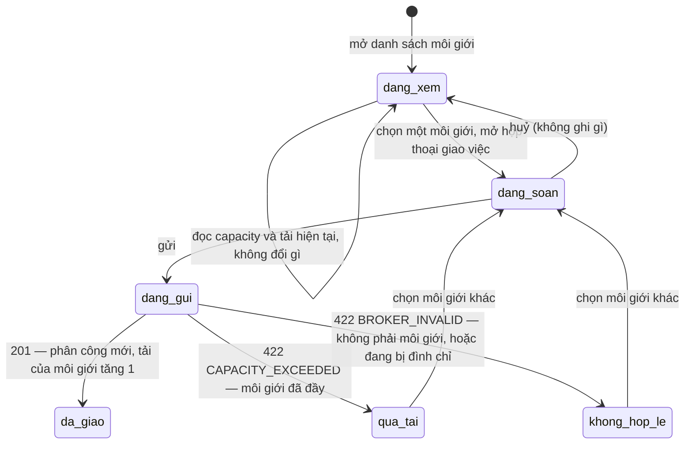

# Hồ sơ môi giới, phân công và capacity

## Tóm tắt

Môi giới là người chịu trách nhiệm đưa một [hồ sơ vụ việc](case-va-quyet-dinh.md) đi tới kết quả. Nhóm endpoint này trả lời ba câu: ai là môi giới, mỗi người đang gánh bao nhiêu hồ sơ, và giao thêm một hồ sơ nữa thì được hay không.

Câu thứ ba là lý do module này tồn tại. Mỗi môi giới có một *capacity* — số hồ sơ đang hoạt động tối đa. Khi đã đầy, lệnh giao thêm bị **từ chối thẳng** với mã `CAPACITY_EXCEEDED`, chứ không im lặng nhận rồi bỏ rơi. Quá tải phải hiện ra thành một hàng đợi có người chịu trách nhiệm, không thành một hồ sơ nằm im trong danh sách của một người không còn thời gian.

Tầng dịch vụ đã có đủ sáu phương thức và đã áp luật capacity. **Không phương thức nào có cửa HTTP**, và không controller nào trong `apps/api/` tham chiếu tới nó — module này chưa từng được gọi từ bên ngoài lần nào.

## Bề mặt cần có

| Phương thức | Đường dẫn | Việc |
|---|---|---|
| `GET` | `/api/v2/brokers` | Danh sách hồ sơ môi giới, kèm capacity và số phân công đang hoạt động |
| `POST` | `/api/v2/brokers` | Lập hồ sơ môi giới cho một người |
| `GET` | `/api/v2/brokers/by-person/{personId}` | Tra hồ sơ môi giới của một người |
| `GET` | `/api/v2/cases/{caseId}/assignments` | Danh sách phân công của một hồ sơ, gồm cả phân công đã kết thúc |
| `POST` | `/api/v2/cases/{caseId}/assignments` | Giao một hồ sơ cho một môi giới |
| `POST` | `/api/v2/assignments/{assignmentId}/end` | Kết thúc một phân công |

Sáu endpoint phủ đúng sáu phương thức của tầng dịch vụ. Kết thúc phân công dùng một đường dẫn riêng chứ không phải `DELETE`: phân công không bị xoá, nó chuyển sang `ENDED` và ở lại lịch sử.

Ba năng lực nữa **chưa có phương thức nào ở tầng dịch vụ** và vì thế chưa có endpoint: đình chỉ môi giới, kích hoạt lại, và đổi capacity. Xem [Trạng thái môi giới và năng lực còn thiếu](#trạng-thái-môi-giới-và-năng-lực-còn-thiếu).

## Ai gọi được và bị từ chối khi nào

| Endpoint | Ai gọi được | Từ chối với mã |
|---|---|---|
| `GET /brokers` | Người qua được quy tắc `case.assign_broker` — trên thực tế là quản trị viên | `403 FORBIDDEN` kèm `ruleId` |
| `POST /brokers` | Như trên | `403 FORBIDDEN`; `400 VALIDATION_FAILED` khi capacity ≤ 0; `409` khi người đó đã có hồ sơ môi giới (chưa cấp mã lỗi) |
| `GET /brokers/by-person/{personId}` | Như trên, cộng chính người đó | `404 NOT_FOUND` khi người đó không có hồ sơ môi giới |
| `GET /cases/{caseId}/assignments` | Người đọc được hồ sơ vụ việc đó | `404 NOT_FOUND` khi không đọc được hồ sơ |
| `POST /cases/{caseId}/assignments` | Như `POST /brokers` | `422 BROKER_INVALID`; `422 CAPACITY_EXCEEDED`; `403 FORBIDDEN` |
| `POST /assignments/{id}/end` | Như trên | `404 NOT_FOUND`; `403 FORBIDDEN` |

Mọi lệnh ghi ở đây ghi một dòng kiểm toán với hành động `case.assign_broker`, loại đối tượng `Assignment` hoặc `BrokerProfile`, và định danh hồ sơ vụ việc. Lượt bị chính sách từ chối ghi kết quả `DENY` kèm mã quy tắc. Ba endpoint chỉ đọc **không ghi gì**.

> Ghi chú kỹ thuật: cả sáu phương thức dùng chung đúng một hành động trong bảng quyết định. Lập hồ sơ môi giới, giao việc và kết thúc phân công vì thế không tách quyền được: ai giao việc được thì cũng lập được hồ sơ môi giới mới. Tách chúng thành ba hành động là việc phải làm cùng lúc với endpoint.

## Trường hợp đơn giản

Quản trị viên lập hồ sơ môi giới cho một người: đặt capacity là 5 và chọn ba lĩnh vực phụ trách. Hồ sơ ra đời ở trạng thái `ACTIVE`, số phân công đang hoạt động bằng 0.

Sau đó họ mở một hồ sơ vụ việc và giao nó cho môi giới này với vai trò `LEAD`, kèm hạn cam kết là 7 ngày nữa. Phân công ra đời ở trạng thái `ACTIVE`. Số phân công đang hoạt động của môi giới lên 1.

Khi hồ sơ đóng, quản trị viên kết thúc phân công. Nó chuyển sang `ENDED`, được đánh mốc thời điểm kết thúc, và ở lại danh sách của hồ sơ. Số phân công đang hoạt động của môi giới về 0, và ô capacity của người đó lại trống một chỗ.

## Tương tác, sự kiện theo sự kiện

Đơn vị tương tác là **một lệnh giao việc**: chọn hồ sơ, chọn môi giới, chọn vai trò, đặt hạn cam kết, gửi.

### Vào màn

`GET /api/v2/brokers` trả danh sách kèm hai con số quyết định mọi thứ: **capacity** và **số phân công đang hoạt động**. Giao diện phải hiện chúng cạnh nhau ở dạng `3/5`, vì đó là thông tin duy nhất giúp người dùng chọn đúng người ngay từ đầu thay vì bị từ chối sau khi gửi.

Danh sách sắp theo thời điểm lập hồ sơ giảm dần và dùng [hình dạng phân trang chung](README.md#phân-trang). Không có bộ lọc nào ở tầng dịch vụ: không lọc theo trạng thái, không lọc theo lĩnh vực phụ trách, không lọc theo còn chỗ trống hay không. Một màn hình giao việc cần cả ba — xem [Câu hỏi mở](#câu-hỏi-mở-và-kiểm-chứng).

Số phân công đang hoạt động được đếm **tại thời điểm đọc**, nên nó cũ đi ngay khi người khác giao việc. Giao diện không được coi nó là bảo đảm.

### Rời đi không đổi gì

Đọc danh sách môi giới và đọc phân công của một hồ sơ không ghi gì — không dòng kiểm toán, không dấu vết.

### Bắt đầu sửa

Người dùng chọn một môi giới rồi mở hộp thoại giao việc. Ba trường:

- **Vai trò** — `LEAD` (chính) hoặc `CO` (phối hợp). Đây là hai giá trị hợp lệ duy nhất. Tầng dịch vụ **không kiểm** giá trị này, nên endpoint phải tự kiểm và trả `400 VALIDATION_FAILED` cho giá trị khác.
- **Hạn cam kết** — tuỳ chọn, một mốc thời gian.
- Không có trường nào khác. Không có ghi chú, không có lý do.

Giao diện nên chặn ngay ở bước này khi môi giới đã đầy: nút giao việc mờ đi, kèm câu nói rõ người đó đang gánh mấy hồ sơ trên tổng bao nhiêu. Để người dùng bấm rồi nhận 422 là đẩy một luật đã biết trước sang phía người dùng.

### Trong khi sửa

Không có kiểm tra nào chạy ở máy chủ trong lúc soạn. Không có endpoint xem trước, không có đường hỏi "người này còn nhận thêm được không" ngoài việc đọc lại danh sách.

Vì vậy giao diện tự áp hai luật: vai trò thuộc hai giá trị hợp lệ, và tải hiện tại nhỏ hơn capacity. Luật thứ hai chỉ đúng tại thời điểm tải danh sách; máy chủ mới là nơi quyết định.

### Gửi đi

`POST /api/v2/cases/{caseId}/assignments` với định danh môi giới, vai trò và hạn cam kết. Thứ tự kiểm ở máy chủ, đúng thứ tự này:

1. **Quyền.** Không đủ → `403` kèm `ruleId`.
2. **Người đó có hồ sơ môi giới không.** Không → **422**, `code: "BROKER_INVALID"`.
3. **Hồ sơ môi giới có đang `ACTIVE` không.** Không → **422**, cũng `BROKER_INVALID`.
4. **Capacity.** Số phân công `ACTIVE` của người đó ≥ capacity → **422**, `code: "CAPACITY_EXCEEDED"`.

Hai tình huống rất khác nhau — "người này không phải môi giới" và "người này đang bị đình chỉ" — trả **cùng một mã**. Giao diện không phân biệt được, và câu tiếng Việt hiện ra sẽ sai một nửa số lần. Đây là chỗ cần một mã thứ hai; xem [Câu hỏi mở](#câu-hỏi-mở-và-kiểm-chứng).

Thành công trả **201** kèm bản phân công. Giao diện tải lại danh sách môi giới để lấy số tải mới chứ đừng tự cộng một.

Máy chủ **không kiểm hồ sơ vụ việc có tồn tại không** trước khi tạo phân công. Một định danh hồ sơ sai tạo ra một phân công treo lơ lửng, tính vào capacity của môi giới, và không hiện ở bất kỳ hồ sơ nào. Endpoint v2 phải kiểm sự tồn tại và trả `404` trước khi chạm tới luật capacity.

## Hai đường gán môi giới

Đây là vấn đề nặng nhất của nhóm endpoint này, và nó phải được giải **trước** khi endpoint được viết.

Có hai đường độc lập để một người trở thành môi giới của một hồ sơ:

| Đường | Ở đâu | Kiểm capacity | Ghi vào đâu |
|---|---|---|---|
| Gán môi giới chính | [`POST /api/v2/cases/{id}/lead-broker`](case-va-quyet-dinh.md#gán-môi-giới-chính) | **Không** | Trường môi giới chính của hồ sơ, và danh sách bên tham gia |
| Giao việc | `POST /api/v2/cases/{caseId}/assignments` | **Có** | Bảng phân công của module môi giới |

Hai đường không nói chuyện với nhau. Hệ quả cụ thể:

- Một hồ sơ **có môi giới chính mà không có bản phân công nào**. Người đó không xuất hiện trong tải công việc của mình, và capacity của họ không phản ánh hồ sơ đó.
- Ngược lại, một người **có phân công `LEAD` mà không phải môi giới chính** của hồ sơ đó, vì lệnh giao việc không đụng tới trường môi giới chính.
- Luật "vào `QUALIFICATION` bắt buộc có môi giới chính" đọc trường của hồ sơ, không đọc bảng phân công. Nên một hồ sơ đi qua được cổng đó bằng một người đã quá tải.
- Lệnh tạo hồ sơ cũng nhận thẳng định danh môi giới chính, nên có **ba** đường đặt môi giới chính và chỉ **một** đường kiểm capacity.

Ba cách giải, cần một quyết định sản phẩm chọn một:

1. **Gán môi giới chính gọi luôn đường giao việc**, nghĩa là nó cũng bị `CAPACITY_EXCEEDED` chặn. Đúng nhất về nghiệp vụ, nhưng làm lệnh gán có thể thất bại vì một lý do người dùng không đoán được, và làm hai module phụ thuộc nhau.
2. **Giao việc là đường duy nhất**, còn trường môi giới chính của hồ sơ trở thành thứ suy ra từ phân công `LEAD` đang hoạt động. Sạch nhất, nhưng phải sửa dữ liệu đã có và sửa luật cổng `QUALIFICATION`.
3. **Giữ hai đường, thêm một phép đối chiếu** báo ra hồ sơ nào lệch. Rẻ nhất và tệ nhất: nó biến một luật thành một báo cáo.

Cho tới khi quyết định được chốt, tài liệu này yêu cầu ít nhất một điều: hai màn hình **không được hiển thị hai con số khác nhau cho cùng một câu hỏi**. Nếu console hồ sơ nói "môi giới chính: A" mà màn hình phân công nói A đang gánh 0 hồ sơ, người dùng sẽ tin cái nào tiện hơn.

## Trạng thái môi giới và năng lực còn thiếu

Hồ sơ môi giới có hai trạng thái: `ACTIVE` và `SUSPENDED`. Môi giới `SUSPENDED` không nhận được phân công mới — đó là toàn bộ tác dụng của trạng thái này.

**Không có phương thức nào ở tầng dịch vụ đổi trạng thái đó.** Mô hình miền có sẵn ba thao tác — đình chỉ, kích hoạt lại, đổi capacity — nhưng interface dịch vụ không phơi ra cái nào, nên không có gì để viết endpoint lên trên. Hệ quả: mọi hồ sơ môi giới sinh ra ở `ACTIVE` và **đứng yên ở đó vĩnh viễn**; giá trị `SUSPENDED` không bao giờ xuất hiện trong dữ liệu thật, và nhánh kiểm nó ở lệnh giao việc là mã chết.

Ba endpoint cần có, và cả ba cần một phương thức mới ở tầng dịch vụ trước:

- `POST /api/v2/brokers/{id}/suspend` — đình chỉ, kèm lý do.
- `POST /api/v2/brokers/{id}/reactivate` — kích hoạt lại.
- `PATCH /api/v2/brokers/{id}` — đổi capacity và danh sách lĩnh vực phụ trách.

Đình chỉ đặt ra một câu hỏi mà mã chưa trả lời: **các phân công đang hoạt động của người bị đình chỉ thì sao?** Chúng ở lại hay bị kết thúc hàng loạt? Đây là quyết định sản phẩm, không phải chi tiết kỹ thuật — xem [Câu hỏi mở](#câu-hỏi-mở-và-kiểm-chứng).

Hồ sơ môi giới mang một số phiên bản và nằm trong [bốn bản ghi cần ghi có điều kiện](README.md#phiên-bản-và-ghi-có-điều-kiện). Nhưng hiện **không lệnh nào nhận số phiên bản kỳ vọng**, đơn giản vì không có lệnh sửa nào. Ba endpoint ở trên là chỗ đầu tiên cần nó.

## Hạn cam kết

Mỗi phân công có một hạn cam kết tuỳ chọn. Nó được ghi lúc giao việc và **không có gì đọc nó**: không có nhắc nhở, không có thông báo, không có bộ lọc "quá hạn", không có nghĩa vụ định kỳ nào theo dõi nó.

Yêu cầu tối thiểu cho v2: danh sách phân công phải trả hạn cam kết cùng một cờ đã-quá-hạn tính ở máy chủ, để mọi màn hình cùng một cách hiểu về "quá hạn" thay vì mỗi giao diện tự so đồng hồ của trình duyệt.

Việc phát cảnh báo khi sắp tới hạn là một năng lực riêng, cần một nghĩa vụ định kỳ và một loại thông báo mới. Cả hai đều chưa tồn tại.

## Biến thể

| Biến thể | Lúc vào màn | Trong khi soạn lệnh giao việc |
|---|---|---|
| Vai trò | Chỉ người qua được quy tắc `case.assign_broker` thấy danh sách môi giới; người khác nhận 403. Danh sách phân công của một hồ sơ đi theo quyền đọc hồ sơ đó: không đọc được hồ sơ thì nhận 404. | Vai trò quyết định lệnh có qua bước 1 không. Không đủ quyền nhận 403 kèm `ruleId`. |
| Trạng thái bản ghi | Trạng thái môi giới (`ACTIVE`/`SUSPENDED`) và tải hiện tại so với capacity quyết định người nào chọn được. Phân công `ENDED` vẫn hiện trong danh sách của hồ sơ, phải vẽ khác phân công `ACTIVE`. | Tải của môi giới **đổi được bởi người khác** trong lúc soạn. Đó là toàn bộ lý do luật capacity phải nằm ở máy chủ. |
| Cấu hình backend | Không ảnh hưởng. Không cờ cấu hình nào đổi hành vi môi giới; capacity là dữ liệu của từng người, không phải cấu hình hệ thống. | Không ảnh hưởng. |
| Phím tắt của biểu mẫu | Hộp thoại giao việc nên focus vào ô chọn môi giới khi mở. | Escape đóng hộp thoại và vứt bỏ lựa chọn. Enter trong ô chọn xác nhận lựa chọn, không gửi biểu mẫu. |

Đổi biến thể giữa chừng: tải của môi giới và trạng thái hồ sơ môi giới đổi được bởi người khác. Không có số phiên bản nào bảo vệ lệnh giao việc — luật capacity ở máy chủ là cái bắt được.

## Huỷ và gián đoạn

| Sự kiện | Trước khi gửi | Trong khi đang gửi |
|---|---|---|
| Bấm Huỷ hoặc nhấn Escape | Hộp thoại đóng, lựa chọn bị vứt bỏ. Không có gì được ghi. | Không có cách huỷ. Lệnh giao việc là một giao dịch ngắn; huỷ ở trình duyệt chỉ bỏ việc chờ phản hồi. |
| Đi chỗ khác trong app | Lựa chọn mất. Không có bản nháp. | Kết quả không tới giao diện, phân công vẫn được tạo. Người dùng quay lại thấy tải của môi giới đã tăng. |
| Back/Forward của trình duyệt | Như trên. | Như trên. |
| Tải lại trang, hoặc đóng tab | Lựa chọn mất. | Giao dịch hoàn tất, giao diện không biết. Khoá chống lặp cứu ở đây: thử lại cùng khoá phát lại phản hồi cũ thay vì tạo phân công thứ hai. |
| Mất mạng, hoặc request quá hạn | Không ảnh hưởng — chưa gọi gì. | Giao diện không biết lệnh đã tới máy chủ chưa. **Phải giữ nguyên khoá chống lặp cho lần thử lại**; sinh khoá mới sẽ tạo hai phân công và ăn hai ô capacity. |
| Phiên hết hạn (401), hoặc v1 bị dừng (410) | Người dùng bị đẩy về đăng nhập, mất lựa chọn. | 401 giữa chừng nghĩa là lệnh bị từ chối trước khi vào tầng nghiệp vụ; không có gì được ghi. |
| Bản ghi bị đổi bởi người khác hoặc bị xoá | Tải hiển thị đã cũ; giao diện không biết cho tới khi gửi. | Không có 409 ở đây — luật capacity trả **422 `CAPACITY_EXCEEDED`** thay vì lệch phiên bản. Giao diện phải tải lại danh sách và nói rõ người đó vừa đầy chỗ. |
| Trình duyệt tự điền | Không áp dụng — không trường nào là email hay mật khẩu. | Không áp dụng. |

Sau bất kỳ gián đoạn nào, người dùng ở lại màn hình phân công. Không có gì đáng giữ lại trong biểu mẫu: ba trường đều là lựa chọn ngắn, chọn lại rẻ hơn khôi phục.

## Tương tác với hệ thống khác

**Quyền và vai trò.** Sáu endpoint dùng chung một hành động trong bảng quyết định, nên hiện không tách được người lập hồ sơ môi giới với người giao việc. Danh sách phân công của một hồ sơ phải đi theo quyền đọc hồ sơ đó, không theo quyền giao việc — nếu không, một bên tham gia sẽ không thấy được ai đang phụ trách hồ sơ của chính mình. Xem [`../xuyen-suot/quyen-va-vai-tro.md`](../xuyen-suot/quyen-va-vai-tro.md).

**Kiểm tra dữ liệu và cách hiện lỗi.** `CAPACITY_EXCEEDED` phải hiện thành một câu nói rõ *phải làm gì tiếp*: "Môi giới này đang phụ trách 5/5 hồ sơ. Chọn người khác, hoặc kết thúc một phân công đang mở." `BROKER_INVALID` khó hơn vì nó gộp hai nguyên nhân; cho tới khi có mã thứ hai, câu hiển thị phải nói cả hai khả năng.

**Thay đổi chưa lưu.** Hộp thoại giao việc là chỗ duy nhất có thể bẩn, và nó chỉ chứa ba lựa chọn ngắn. Không cần cảnh báo khi rời trang.

**Cập nhật lạc quan và hoàn tác.** Không cập nhật lạc quan: tỉ lệ bị từ chối vì capacity không nhỏ, và hiện một phân công rồi rút lại làm người dùng mất niềm tin vào con số tải. Có một đường lùi thật: kết thúc phân công vừa tạo. Nó không xoá gì — phân công chuyển sang `ENDED` và ở lại lịch sử, nên "hoàn tác" ở đây là một hành động mới có dấu vết, không phải một phép xoá.

**Ngoại tuyến.** Không có tương tác. Không xếp hàng lệnh giao việc khi ngoại tuyến — một lệnh gửi sau vài phút có thể đã sai vì capacity đã đầy.

**Thông báo và toast.** Môi giới **không được báo** khi nhận thêm một hồ sơ. Bốn loại thông báo đang tồn tại đều thuộc ghép cặp và lời mời hợp tác. Giao việc mà người nhận không biết là một lỗ hổng lớn hơn nó trông có vẻ: hạn cam kết bắt đầu chạy từ lúc giao.

**Trạng thái lọc/tìm trong URL.** Bộ lọc của danh sách môi giới — trạng thái, lĩnh vực phụ trách, còn chỗ trống — nên nằm trong URL để người dùng gửi được cho nhau một danh sách đã lọc. Ba bộ lọc này hiện chưa tồn tại ở tầng dịch vụ.

**Đa ngôn ngữ.** Hai trạng thái môi giới, hai vai trò phân công và hai trạng thái phân công lưu bằng chuỗi tiếng Anh viết hoa — sáu chuỗi cần bảng dịch ở giao diện. Thông điệp của `CAPACITY_EXCEEDED` ở tầng dịch vụ đã là tiếng Việt.

**Khả năng truy cập.** Con số `3/5` phải có nhãn đọc được: "đang phụ trách 3 trên 5 hồ sơ". Không được dùng riêng màu để báo môi giới đã đầy.

**Dấu vết kiểm toán.** Ba lệnh ghi đều ghi một dòng qua bảng quyết định, nên có `correlationId` và mã quy tắc. Nhưng dòng đó **không mang số phiên bản của hồ sơ môi giới** — trường phiên bản đối tượng để trống ở mọi dòng do bảng quyết định ghi. Tra ngược một thay đổi capacity về đúng bản ghi vì thế không làm được. Xem [`audit.md`](audit.md).

## Trường hợp biên

- **Lệnh giao việc không kiểm hồ sơ vụ việc có tồn tại không.** Một định danh sai tạo phân công treo, ăn một ô capacity, và không hiện ở hồ sơ nào.
- **Không có ràng buộc duy nhất trên cặp (hồ sơ, môi giới).** Giao cùng một người cho cùng một hồ sơ hai lần tạo hai phân công và ăn hai ô capacity.
- **Không có luật nào cấm hai phân công `LEAD` trên một hồ sơ.** Vai trò là một chuỗi tự do ở tầng dịch vụ.
- **Kết thúc một phân công đã kết thúc không báo lỗi** — nó ghi đè mốc kết thúc bằng thời điểm hiện tại. Lịch sử "kết thúc lúc nào" bị viết lại im lặng.
- **Kiểm quyền chạy *sau* khi tra bản ghi ở lệnh kết thúc phân công.** Người không đủ quyền nhận 404 cho định danh không tồn tại và 403 cho định danh có thật, nên họ dò được phân công nào tồn tại. Trái với [luật không tồn tại và không được biết](README.md#không-tồn-tại-và-không-được-biết).
- **Capacity đếm phân công `ACTIVE` trên mọi hồ sơ**, kể cả hồ sơ đã đóng mà phân công chưa được kết thúc. Quên kết thúc một phân công là một ô capacity mất vĩnh viễn.
- **Capacity phải lớn hơn 0.** Không có cách đặt capacity 0 để tạm khoá một người; đường đúng là đình chỉ, mà đình chỉ thì chưa có endpoint.
- **`SUSPENDED` không bao giờ xuất hiện** trong dữ liệu vì không có đường đặt nó.

## Câu hỏi mở và kiểm chứng

- **Hai đường gán môi giới phải hợp nhất.** Ba cách giải ở [mục trên](#hai-đường-gán-môi-giới); cần chọn một. Đây là quyết định sản phẩm, không phải quyết định kỹ thuật, vì nó đổi câu trả lời cho "capacity nghĩa là gì". (chưa cấp mã lỗi)
- **`BROKER_INVALID` gộp hai nguyên nhân.** "Không phải môi giới" và "đang bị đình chỉ" cần hai mã khác nhau để giao diện nói đúng câu. (chưa cấp mã lỗi)
- **Đình chỉ một môi giới thì các phân công đang mở của họ ra sao?** Giữ nguyên, hay kết thúc hàng loạt, hay chuyển sang người khác. Chưa có câu trả lời trong mã và không suy ra được.
- **Ai được đình chỉ và ai được đổi capacity?** Nếu dùng chung hành động `case.assign_broker` như hiện nay thì bất kỳ ai giao việc được cũng đổi được capacity của chính người mình đang giao việc — gần như chắc chắn không phải điều mong muốn.
- **Hạn cam kết dùng để làm gì?** Nó được ghi nhưng không ai đọc. Cần quyết định nó sinh ra thông báo gì, cho ai, và trước hạn bao lâu — trước khi màn hình hiển thị nó như một cam kết.
- **Môi giới có được thấy danh sách hồ sơ của chính mình không?** Hiện không có đường nào liệt kê phân công theo môi giới, chỉ có theo hồ sơ. Một màn hình "việc của tôi" cần `GET /api/v2/brokers/{id}/assignments`, và nó chưa có phương thức ở tầng dịch vụ.
- Chưa xác nhận bảng quyết định cho phép vai trò nào chạy `case.assign_broker`; cần đọc tệp cấu hình bảng ở `packages/policy-engine` và bộ quy tắc đang nạp.
- Chưa chạy được bộ test nào cho luật capacity vì chưa có dữ liệu; luật đọc từ mã, chưa đo trên bản chạy.

Đặc tả — chưa có mã. Dựa trên SourceCode/nacentech, bản chụp ngày 2026-09-04.
