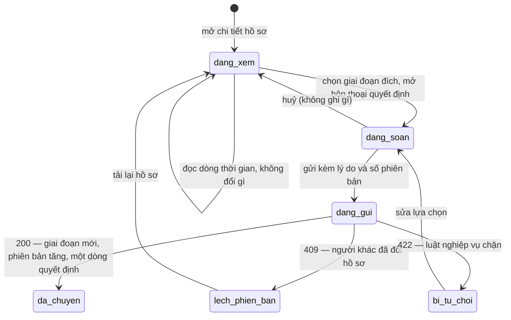

# Hồ sơ vụ việc và bản ghi quyết định

## Tóm tắt

Hồ sơ vụ việc là đơn vị công việc của môi giới: một nỗ lực đưa một đề bài tới kết quả thương mại hoá, đi qua [12 giai đoạn](../nen-tang/mo-hinh-du-lieu.md#mười-hai-giai-đoạn) theo một ma trận chuyển cố định. Đây là lõi của kiến trúc V2 và là phần có tầng dịch vụ hoàn chỉnh nhất trong toàn hệ thống — bao gồm ma trận chuyển, bản ghi quyết định chỉ-ghi-thêm, khoá tạm, ảnh chụp chính sách bất biến và kiểm tra phiên bản lạc quan.

Nó cũng là phần **không có một endpoint nào**. Toàn bộ năng lực này hiện chỉ gọi được từ mã .NET khác.

Nhóm endpoint này là phần khó nhất của việc xây v2, vì tầng dịch vụ đã áp bảy luật từ chối riêng biệt và giao diện phải hiểu đủ bảy để nói cho người dùng biết vì sao nút của họ không bấm được.

## Bề mặt cần có

| Phương thức | Đường dẫn | Việc |
|---|---|---|
| `GET` | `/api/v2/cases` | Danh sách, lọc theo môi giới, chủ bài toán, giai đoạn |
| `POST` | `/api/v2/cases` | Tạo hồ sơ |
| `GET` | `/api/v2/cases/{id}` | Chi tiết một hồ sơ |
| `POST` | `/api/v2/cases/{id}/transition` | Chuyển giai đoạn |
| `POST` | `/api/v2/cases/{id}/lead-broker` | Gán môi giới chính |
| `GET` | `/api/v2/cases/{id}/timeline` | Dòng thời gian các bản ghi quyết định |
| `POST` | `/api/v2/cases/{id}/holds` | Mở một khoá tạm |
| `POST` | `/api/v2/cases/{id}/holds/{holdId}/release` | Gỡ khoá tạm |

Tám endpoint này phủ đúng tám phương thức mà tầng dịch vụ đã cung cấp. Không phương thức nào của tầng dịch vụ bị bỏ lại, và không endpoint nào cần logic mới ở tầng dưới.

## Trường hợp đơn giản

Một quản trị viên tạo hồ sơ từ một đề bài đã có. Hồ sơ ra đời ở giai đoạn `DISCOVERY`, mang mã dạng `NT-2026-000001`, và chủ bài toán được thêm vào danh sách bên tham gia ngay.

Quản trị viên gán một môi giới chính. Sau đó họ chuyển hồ sơ sang `QUALIFICATION` kèm quyết định `APPROVE` và một câu diễn giải. Ở đúng thời điểm đó, ảnh chụp chính sách được chốt và gắn vào hồ sơ vĩnh viễn.

Mỗi lần chuyển ghi một dòng vào dòng thời gian. Hồ sơ đi tiếp `MATCHING`, `DUE_DILIGENCE`, `DEAL_DESIGN`, `EXECUTION`, `OUTCOME_VERIFICATION`, rồi `CLOSED`. Không bước nào xoá bước trước; dòng thời gian giữ đủ.

## Tương tác, sự kiện theo sự kiện

Đơn vị tương tác ở đây là **một lệnh chuyển giai đoạn**, không phải một biểu mẫu dài. Nó ngắn, nhưng nó có đủ năm pha.

### Vào màn

`GET /api/v2/cases/{id}` trả hồ sơ kèm `version` và danh sách bên tham gia đang hoạt động. `GET /api/v2/cases/{id}/timeline` trả dòng thời gian, sắp theo thời điểm quyết định tăng dần.

Cả hai đều kiểm quyền theo **vai trò trong hồ sơ**, không theo vai trò nền tảng: máy chủ tra vai trò của người gọi trong danh sách bên tham gia đang hoạt động và đưa vai trò đó vào bảng quyết định. Người không có vai trò nào trong hồ sơ nhận **404**, không phải 403 — họ không được biết hồ sơ đó tồn tại.

Danh sách `GET /api/v2/cases` áp đúng luật đó ở dạng bộ lọc: người không phải quản trị viên **chỉ thấy hồ sơ mà mình đang là một bên tham gia**. Lọc này chạy ở tầng truy vấn, nên `total` cũng phản ánh đúng số hồ sơ họ thấy được.

Cái giao diện phải nhận từ bước này để bước gửi hoạt động: **số `version`**. Không có nó thì mọi lệnh chuyển đều hỏng.

### Rời đi không đổi gì

Đọc hồ sơ và đọc dòng thời gian **không ghi gì** — không dòng kiểm toán, không dấu vết. Đây là ngoại lệ ngược với phòng dữ liệu, nơi đọc tài liệu mật có ghi lại.

Nếu hồ sơ chứa tài liệu mật, việc mở các tài liệu đó là một hành động riêng, đi qua [`dataroom-va-cap-quyen.md`](dataroom-va-cap-quyen.md), và hành động đó **có** ghi lại.

### Bắt đầu sửa

Người dùng chọn một giai đoạn đích. Đây là lúc giao diện phải làm việc mà máy chủ không làm hộ: **chỉ hiện những giai đoạn hợp lệ**.

Ma trận chuyển là dữ liệu thuần và không đổi theo hồ sơ. Giao diện biết trước hồ sơ đang ở `EXECUTION` thì chỉ có hai đường ra: `OUTCOME_VERIFICATION` và `CANCELLED`. Hiện đủ 11 giai đoạn rồi để máy chủ từ chối 9 cái là đẩy việc học luật sang người dùng.

Chọn giai đoạn đích **quyết định luôn loại quyết định được phép**, và đây là chỗ luật khắt khe nhất:

| Loại chuyển | Quyết định bắt buộc |
|---|---|
| Tiến (và không phải sang `REJECTED`) | `APPROVE` hoặc `WAIVE` |
| Lùi | **chỉ** `RETURN_FOR_REWORK` |
| Sang `REJECTED` | **chỉ** `REJECT` |

Nghĩa là ô chọn quyết định không nên là một danh sách bốn lựa chọn cố định. Với đa số đích, nó chỉ còn một hoặc hai lựa chọn hợp lệ.

**Diễn giải là bắt buộc và không được rỗng.** Đây là luật đầu tiên được kiểm, trước cả kiểm khoá tạm. Nút gửi nên tắt cho tới khi ô diễn giải có nội dung.

### Trong khi sửa

Không có kiểm tra nào chạy ở máy chủ trong lúc soạn — không có endpoint xem trước. Mọi luật chỉ hiện ra ở bước gửi.

Vì vậy giao diện phải tự áp bốn luật kiểm được ở phía trình duyệt: ma trận chuyển, loại quyết định theo hướng chuyển, diễn giải không rỗng, và **có khoá tạm mở hay không** (trường `hasOpenHold` đã có sẵn trong hồ sơ). Ba luật còn lại chỉ máy chủ biết.

### Gửi đi

`POST /api/v2/cases/{id}/transition` với: giai đoạn đích, quyết định, danh sách mã lý do, diễn giải, tham chiếu uỷ quyền (tuỳ chọn), và số phiên bản kỳ vọng.

Thứ tự kiểm ở máy chủ, đúng thứ tự này:

1. **Quyền.** Vai trò trong hồ sơ đưa vào bảng quyết định. Không đủ → 403 kèm `ruleId`.
2. **Phiên bản.** Lệch → **409**, `code: "VERSION_CONFLICT"`, kèm `currentVersion` và câu nói rõ giai đoạn hiện tại. **Không bản ghi quyết định nào được tạo.**
3. **Ảnh chụp chính sách.** Nếu đích là `QUALIFICATION` và hồ sơ chưa có ảnh chụp, ảnh chụp được chốt ngay tại đây.
4. **Diễn giải không rỗng.** → 400.
5. **Khoá tạm.** Còn khoá mở → **422**, `code: "CASE_ON_HOLD"`.
6. **Ma trận.** Ô không có trong bảng → **422**, `code: "TRANSITION_NOT_ALLOWED"`.
7. **Loại quyết định theo hướng chuyển.** → **422**, một trong `REWORK_DECISION_REQUIRED`, `REJECT_DECISION_REQUIRED`, `WITHDRAW_DECISION_REQUIRED`, `CANCEL_DECISION_REQUIRED`, `FORWARD_DECISION_REQUIRED`. Hai mã giữa là mới theo [ADR-0008](../../../04-technical/adr/0008-loai-quyet-dinh-cho-rut-lui-va-huy.md): mỗi giai đoạn kết thúc đòi đúng loại quyết định của nó.
8. **Môi giới chính khi vào `QUALIFICATION`.** Chưa có → **422**, `code: "CASE_01_LEAD_BROKER_REQUIRED"`.

Thành công thì **một giao dịch duy nhất** ghi: giai đoạn mới, số phiên bản tăng, một bản ghi quyết định, và một dòng kiểm toán. Không có đường nào ghi giai đoạn ngoài đường này — kể cả việc chạy nền cũng không đổi được giai đoạn.

Phản hồi trả hồ sơ đã cập nhật, gồm `version` mới. Giao diện thay chỗ dữ liệu cũ bằng phản hồi này chứ đừng tự đoán số phiên bản mới.

> Ghi chú kỹ thuật: bước 3 chạy **sau** bước 2 nhưng **trước** các bước 5–8. Nghĩa là một lệnh chuyển sang `QUALIFICATION` bị từ chối ở bước 8 vẫn có thể đã chốt ảnh chụp chính sách. Ảnh chụp là bất biến một khi đã gán, nên lần thử lại sau đó dùng lại chính ảnh chụp đó. Đây là hành vi đúng nhưng dễ gây ngạc nhiên: một thao tác thất bại vẫn để lại dấu vết. Xem [Câu hỏi mở](#câu-hỏi-mở-và-kiểm-chứng).

## Khoá tạm

`POST /api/v2/cases/{id}/holds` với một lý do. Từ lúc đó, **mọi lệnh chuyển bị chặn** cho tới khi khoá được gỡ.

Khoá tạm là công cụ duy nhất để nói "dừng lại, có gì đó không ổn" mà không phải từ chối hay huỷ hồ sơ. Không có đường vòng — quản trị viên cũng không chuyển được.

`POST /api/v2/cases/{id}/holds/{holdId}/release` với một diễn giải. Gỡ khoá **tạo một bản ghi quyết định** với quyết định `WAIVE`, mã lý do `HOLD_RELEASED`, và giai đoạn đi–đến bằng nhau. Đây là chủ ý: gỡ khoá là một quyết định có người chịu trách nhiệm, nên nó phải nằm trong dòng thời gian.

Hệ quả cho giao diện: dòng thời gian có những mục mà giai đoạn không đổi. Hiển thị chúng như một mũi tên `A → A` sẽ khó hiểu; chúng nên được vẽ khác đi.

Gỡ một khoá đã gỡ, hoặc một khoá không tồn tại, trả **404**.

Mở nhiều khoá cùng lúc là **được phép** — tầng dịch vụ không chặn. Hồ sơ bị chặn cho tới khi gỡ hết. Từ 2026-09-05, hồ sơ trả **danh sách khoá** trong trường `holds` (định danh, lý do, ai mở, lúc nào, đã gỡ chưa, và mã bản ghi quyết định đã gỡ nó) bên cạnh cờ `hasOpenHold`. Khoá đã gỡ vẫn nằm trong danh sách — nó là lịch sử. Trước đó hồ sơ chỉ trả cờ, và giao diện không có định danh nào để gọi lệnh gỡ; [console](../moi/console-ho-so-vu-viec.md) đã ghi đó là lỗ hổng cần lấp trước khi xây, và nó được lấp cùng lúc xây.

## Gán môi giới chính

`POST /api/v2/cases/{id}/lead-broker` với định danh môi giới và số phiên bản kỳ vọng.

Gán một môi giới mới **kết thúc vai trò của môi giới cũ** thay vì xoá nó: bên tham gia cũ được đánh mốc kết thúc và ở lại danh sách. Lịch sử ai từng phụ trách hồ sơ không mất.

Lệnh này **không** tạo bản ghi quyết định, khác với gỡ khoá tạm. Nó cũng **không** kiểm khoá tạm — gán được môi giới cho hồ sơ đang bị khoá.

Nó cũng **không** kiểm capacity của môi giới. Capacity được kiểm ở đường phân công của module môi giới, là một đường khác. Một hồ sơ có thể có môi giới chính mà môi giới đó chưa có bản phân công tương ứng. Xem [`brokerage.md`](brokerage.md).

## Mã hồ sơ

Dạng `NT-{năm}-{số thứ tự 6 chữ số}`, ví dụ `NT-2026-000001`. Số thứ tự tính bằng cách đếm hồ sơ đã có trong năm rồi cộng một.

Cách này có đua: hai lệnh tạo cùng lúc có thể tính ra cùng một số. Ràng buộc duy nhất ở cơ sở dữ liệu sẽ bắt được và một trong hai lệnh hỏng — cố ý, để va chạm nổi lên thay vì âm thầm. Nhưng người dùng thứ hai thấy một lỗi 500 khó hiểu.

Với khoá chống lặp, thử lại lệnh tạo bằng **cùng khoá** sau lỗi này sẽ thực sự thực thi lại, vì phản hồi 5xx không được ghi lại. Đó là hành vi mong muốn.

## Biến thể

| Biến thể | Lúc vào màn | Trong khi soạn lệnh chuyển |
|---|---|---|
| Vai trò | Quản trị viên thấy mọi hồ sơ. Vai trò khác chỉ thấy hồ sơ mình đang là bên tham gia đang hoạt động; hồ sơ khác trả 404. Vai trò trong hồ sơ (chủ bài toán, môi giới chính, bên đánh giá…) quyết định đọc được gì và chuyển được không — không phải vai trò nền tảng. | Vai trò quyết định lệnh có qua bước 1 không. Người đọc được hồ sơ nhưng không chuyển được nhận 403 kèm `ruleId`. |
| Trạng thái bản ghi | Giai đoạn hiện tại quyết định danh sách đích hợp lệ. Bốn giai đoạn kết thúc không có đích nào — giao diện phải ẩn hẳn nút chuyển, không chỉ làm mờ. Cờ khoá tạm quyết định mọi lệnh chuyển bị chặn hay không. | Không đổi được giữa chừng ở phía người dùng, nhưng **đổi được ở phía người khác** — đó chính là chuyện mà kiểm tra phiên bản bắt. |
| Cấu hình backend | Không ảnh hưởng. Không cờ cấu hình nào đổi hành vi hồ sơ vụ việc. | Không ảnh hưởng. |
| Phím tắt của biểu mẫu | Hộp thoại quyết định nên focus vào ô diễn giải khi mở, vì đó là trường bắt buộc duy nhất. | Escape đóng hộp thoại và **vứt bỏ** lựa chọn. Enter trong ô diễn giải nhiều dòng phải xuống dòng, không phải gửi — gửi là một hành động cần chủ ý. |

Đổi biến thể giữa chừng: giai đoạn và cờ khoá tạm đổi được bởi người khác trong lúc người dùng đang soạn. Đó là toàn bộ lý do tồn tại của số phiên bản.

## Huỷ và gián đoạn

| Sự kiện | Trước khi gửi | Trong khi đang gửi |
|---|---|---|
| Bấm Huỷ hoặc nhấn Escape | Hộp thoại đóng, lựa chọn và diễn giải bị vứt bỏ. Không có gì được ghi. | Không có cách huỷ. Lệnh chuyển là một giao dịch ngắn ở máy chủ; huỷ ở phía trình duyệt chỉ bỏ việc chờ phản hồi, không dừng giao dịch. |
| Đi chỗ khác trong app | Lựa chọn mất. Không có bản nháp. | Kết quả không bao giờ tới giao diện. Giao dịch ở máy chủ vẫn hoàn tất. Người dùng quay lại thấy hồ sơ đã chuyển mà không nhớ mình đã gửi. |
| Back/Forward của trình duyệt | Như trên. | Như trên. |
| Tải lại trang, hoặc đóng tab | Lựa chọn mất. | Như trên: giao dịch hoàn tất, giao diện không biết. Đây là chỗ khoá chống lặp cứu: thử lại cùng khoá trả về phát lại thay vì chuyển hai lần. |
| Mất mạng, hoặc quá hạn | Không ảnh hưởng — chưa gọi gì. | Giao diện không biết lệnh đã tới máy chủ hay chưa. **Phải giữ nguyên khoá chống lặp cho lần thử lại**; sinh khoá mới sẽ chuyển giai đoạn hai lần. |
| Phiên hết hạn (401), hoặc v1 bị dừng (410) | Người dùng bị đẩy về đăng nhập, mất lựa chọn. | 401 giữa chừng nghĩa là lệnh bị từ chối trước khi vào tầng nghiệp vụ; không có gì được ghi. |
| Bản ghi bị đổi bởi người khác | Giai đoạn hiển thị đã cũ. Giao diện không biết cho tới khi gửi. | **409 kèm `currentVersion` và giai đoạn hiện tại.** Đây là đường chính, không phải đường biên. Giao diện phải tải lại hồ sơ và **giữ lại diễn giải người dùng đã gõ** — nó thường vẫn dùng được sau khi chọn lại đích. |
| Trình duyệt tự điền | Không áp dụng — không trường nào là email hay mật khẩu. | Không áp dụng. |

Sau bất kỳ gián đoạn nào, người dùng ở lại trang chi tiết hồ sơ. Cái duy nhất đáng giữ là **ô diễn giải**: người dùng thường viết vài câu, và bắt họ viết lại sau một lần 409 là cách chắc chắn khiến họ viết ngắn đi.

## Tương tác với hệ thống khác

**Quyền và vai trò.** Đây là chỗ duy nhất trong hệ thống mà quyền được quyết bởi **vai trò trong một bản ghi cụ thể**, không phải bởi vai trò nền tảng. Bảng quyết định nhận cả hai và mặc định từ chối. Xem [`../xuyen-suot/quyen-va-vai-tro.md`](../xuyen-suot/quyen-va-vai-tro.md).

**Kiểm tra dữ liệu và cách hiện lỗi.** Bảy mã từ chối riêng của module này phải được dịch thành câu tiếng Việt nói rõ *phải làm gì tiếp*, không chỉ nói *cái gì sai*: `CASE_01_LEAD_BROKER_REQUIRED` nên hiện thành "Cần gán môi giới chính trước khi chuyển sang giai đoạn thẩm định" kèm một nút gán ngay.

**Thay đổi chưa lưu.** Hộp thoại quyết định là chỗ duy nhất có thể bẩn, và nội dung đáng giữ nhất trong đó là ô diễn giải.

**Cập nhật lạc quan và hoàn tác.** **Không được cập nhật lạc quan ở đây.** Bảy luật từ chối nghĩa là tỉ lệ thất bại không nhỏ, và hiện giai đoạn mới rồi rút lại sẽ làm người dùng mất niềm tin vào cái họ đang nhìn. Không có hoàn tác: chuyển nhầm thì phải chuyển lùi, và chuyển lùi bắt buộc là `RETURN_FOR_REWORK` — nó để lại vết trong dòng thời gian, đúng như thiết kế.

**Ngoại tuyến.** Không có tương tác. Không xếp hàng lệnh chuyển khi ngoại tuyến — một lệnh chuyển gửi sau vài phút có thể đã sai vì hồ sơ đã đổi.

**Thông báo và toast.** **Hiện chưa có loại thông báo nào cho hồ sơ vụ việc.** Bốn loại đang tồn tại đều thuộc ghép cặp và lời mời hợp tác. Một hồ sơ chuyển giai đoạn không báo cho ai. Đây là thiếu sót cần lấp cùng lúc với endpoint.

**Trạng thái lọc/tìm trong URL.** Ba bộ lọc của danh sách (môi giới, chủ bài toán, giai đoạn) nên nằm trong URL. Đây là màn hình đầu tiên nên làm đúng chuyện này, vì [không màn hình nào hiện nay làm](../nen-tang/dieu-huong-va-url.md#cái-gì-nằm-trong-url).

**Đa ngôn ngữ.** 12 giai đoạn, 3 tuyến, 7 vai trò trong hồ sơ, 4 loại quyết định và 6 tình trạng ngân sách đều lưu bằng chuỗi tiếng Anh viết hoa. Đó là 32 chuỗi cần bảng dịch ở phía giao diện, và chúng xuất hiện ở mọi màn hình liên quan tới hồ sơ.

**Khả năng truy cập.** Dòng thời gian nên là một danh sách có ngữ nghĩa, không phải một chuỗi thẻ trang trí.

**Dấu vết kiểm toán.** Mọi lệnh ghi ở đây ghi một dòng kèm **số phiên bản của hồ sơ** tại thời điểm đó, nên tra ngược được dòng kiểm toán về đúng bản ghi quyết định. Lượt bị từ chối ở bước 1 ghi kết quả `DENY` kèm mã quy tắc; lượt bị từ chối ở bước 5–8 là lỗi nghiệp vụ, **không** phải từ chối vì chính sách, nên chúng không mang mã quy tắc.

## Trường hợp biên

- **Không có quyết định nào tên là "rút lui" hay "huỷ".** Bốn loại quyết định là `APPROVE`, `REJECT`, `RETURN_FOR_REWORK`, `WAIVE`. Chuyển sang `WITHDRAWN` hoặc `CANCELLED` là chuyển tiến và không phải sang `REJECTED`, nên theo luật nó **bắt buộc mang `APPROVE` hoặc `WAIVE`**. Người dùng sẽ phải chọn "Chấp thuận" để rút lui một hồ sơ. Xem [Câu hỏi mở](#câu-hỏi-mở-và-kiểm-chứng).
- **Ảnh chụp chính sách bị chốt bởi một lệnh thất bại.** Xem ghi chú kỹ thuật ở mục Gửi đi.
- **Gán môi giới chính không bị khoá tạm chặn**, trong khi chuyển giai đoạn thì bị. Hai lệnh cùng đổi hồ sơ, hai luật khác nhau.
- **Nhiều khoá tạm mở cùng lúc** hiển thị được từ 2026-09-05 qua trường `holds`; trước đó hồ sơ chỉ trả một cờ.
- **Gỡ khoá tạo mục dòng thời gian có giai đoạn đi và đến bằng nhau.**
- **Mã hồ sơ có đua.** Hai lệnh tạo đồng thời có thể cho một lỗi 500 ở lệnh thứ hai.
- **Hồ sơ ghim số phiên bản của đề bài.** Đề bài sửa sau đó không đổi cái hồ sơ đang xử lý. Màn hình phải nói rõ "đang xem phiên bản 3 của đề bài, hiện đã có phiên bản 5".
- **`RoleOf` chỉ nhìn bên tham gia đang hoạt động.** Một người từng là môi giới chính và đã bị thay sẽ **mất quyền đọc hồ sơ** ngay lập tức, kể cả những hồ sơ họ đã làm nhiều tháng.
- **Bốn giai đoạn kết thúc là một chiều tuyệt đối.** Không có đường mở lại.

## Câu hỏi mở và kiểm chứng

- **Không có quyết định nào ứng với rút lui và huỷ.** Đây đáng bị coi là một thiếu sót của mô hình hơn là một hành vi cần tài liệu hoá: bắt người dùng chọn "Chấp thuận" để rút lui làm dòng thời gian đọc sai nghĩa. Cần một quyết định sản phẩm: thêm hai loại quyết định, hay nới luật cho hai giai đoạn đó. (chưa cấp mã lỗi)
- **Ảnh chụp chính sách được chốt trước khi lệnh chuyển qua hết các luật.** Một lệnh thất bại vẫn để lại ảnh chụp. Vì ảnh chụp là bất biến, lần thử lại dùng lại nó — có thể đúng, có thể không, tuỳ chính sách có đổi giữa hai lần thử không. Cần xác nhận đây là chủ ý. (chưa cấp mã lỗi)
- ~~**Không có endpoint liệt kê khoá tạm.**~~ Đã lấp 2026-09-05 bằng trường `holds` **trong chính hồ sơ**, không phải một endpoint riêng: khoá là một phần của hồ sơ (cùng aggregate), danh sách ngắn, và giao diện cần nó ngay lúc vẽ phần đầu — một lời gọi thứ ba chỉ thêm một chỗ lệch.
- **Người rời vai trò mất quyền đọc lịch sử.** Cần một quyết định sản phẩm: người từng tham gia có được đọc tiếp hồ sơ cũ không.
- **Không có thông báo nào cho hồ sơ vụ việc.** Cần quyết định loại thông báo nào phát ra ở giai đoạn nào, cùng lúc với việc xây endpoint.
- Chưa chạy bộ test bất biến, nơi ma trận chuyển được phủ hết mọi ô hợp lệ và ô bị cấm. Chạy nó là cách rẻ nhất để xác nhận bảng ma trận và bảy luật ở trên.
- Chưa xác nhận bảng quyết định trả `ruleId` nào cho từng hành động của module này; cần đọc `packages/policy-engine` và cấu hình bảng.
- Chưa rõ ai được mở khoá tạm và ai được gỡ. Cả hai đi qua cùng một hành động trong bảng quyết định như lệnh chuyển, nghĩa là ai chuyển được thì khoá được — có thể không phải điều mong muốn.

Đặc tả — chưa có mã. Dựa trên SourceCode/nacentech, bản chụp ngày 2026-09-04.
