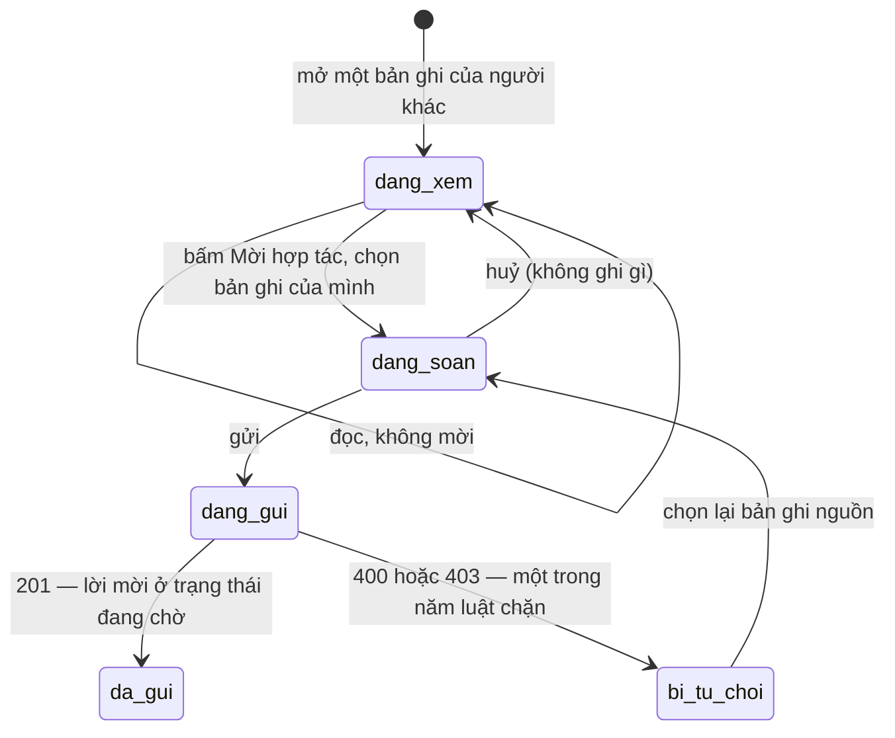

# Câu chuyện, lời mời hợp tác và thông báo

## Tóm tắt

Ba năng lực hướng ra người dùng cuối, gộp làm một tài liệu vì chúng chia chung một sự thật: **cả ba đã có bản v1 chạy được**, nên việc của v2 là chuyển đường chứ không phải mở khoá.

*Câu chuyện* là bài viết kể lại một lần thành công hoặc thất bại; nó là toàn bộ bề mặt dữ liệu của trang giới thiệu. *Lời mời hợp tác* là cách một chủ đề bài và một chủ tài sản công nghệ tìm đến nhau. *Thông báo* là khay tin trong ứng dụng, và nó tồn tại gần như chỉ để phục vụ hai thứ kia.

Vì đã có bản chạy được, nhóm này xếp cuối trong thứ tự xây. Nhưng nó không phải một lần chép nguyên: bốn chỗ phải sửa, và một câu hỏi sản phẩm lớn phải trả lời — một lời mời được chấp nhận rồi thì đi đâu.

## Bề mặt cần có

**Câu chuyện**

| Phương thức | Đường dẫn | Việc |
|---|---|---|
| `GET` | `/api/v2/stories` | Danh sách, lọc theo tác giả, kiểu, trạng thái, vai trò tác giả |
| `GET` | `/api/v2/stories/{id}` | Chi tiết một câu chuyện |
| `POST` | `/api/v2/stories` | Viết một câu chuyện |
| `PATCH` | `/api/v2/stories/{id}` | Sửa câu chuyện |
| `DELETE` | `/api/v2/stories/{id}` | Xoá câu chuyện |
| `POST` | `/api/v2/stories/{id}/visibility` | Quản trị viên ẩn hoặc hiện lại một câu chuyện |

**Lời mời hợp tác**

| Phương thức | Đường dẫn | Việc |
|---|---|---|
| `GET` | `/api/v2/invitations` | Danh sách, lọc theo chiều gửi/nhận, theo người, hoặc toàn bộ |
| `POST` | `/api/v2/invitations` | Gửi một lời mời |
| `GET` | `/api/v2/invitations/{id}` | Chi tiết một lời mời |
| `POST` | `/api/v2/invitations/{id}/accept` | Bên nhận chấp nhận |
| `POST` | `/api/v2/invitations/{id}/decline` | Bên nhận từ chối |
| `DELETE` | `/api/v2/invitations/{id}` | Bên gửi rút lại |

**Thông báo**

| Phương thức | Đường dẫn | Việc |
|---|---|---|
| `GET` | `/api/v2/notifications` | Khay thông báo, lọc theo đã đọc và theo loại |
| `GET` | `/api/v2/notifications/unread-count` | Số thông báo chưa đọc |
| `POST` | `/api/v2/notifications/{id}/read` | Đánh dấu một thông báo đã đọc |
| `POST` | `/api/v2/notifications/read-all` | Đánh dấu tất cả đã đọc |
| `DELETE` | `/api/v2/notifications/{id}` | Xoá một thông báo |
| `DELETE` | `/api/v2/notifications` | Xoá tất cả thông báo của mình |

Mười tám endpoint phủ hết 22 phương thức của ba tầng dịch vụ. Bốn phương thức không có endpoint riêng vì chúng gộp vào một endpoint khác hoặc cố ý ở lại bên trong:

- Ba phương thức liệt kê lời mời — đã gửi, đã nhận, và toàn bộ — gộp thành **một** endpoint với một tham số chiều. Ba đường dẫn cho ba lát cắt của cùng một danh sách là ba chỗ để lệch nhau.
- Phương thức liệt kê lời mời **theo một người bất kỳ**, dùng cho trang lịch sử hợp tác của quản trị viên, là cùng endpoint đó với một tham số người.
- Phương thức **tạo thông báo** cố ý không có endpoint. Thông báo chỉ ra đời từ một sự kiện nghiệp vụ đi qua hàng đợi; mở một đường HTTP tạo thông báo sẽ cho phép ghi vào khay tin của người khác mà không có sự kiện nào đứng sau.

## Trường hợp đơn giản

Một người dùng có một đề bài đã xuất bản. Họ xem kết quả ghép cặp, thấy một tài sản công nghệ phù hợp, và gửi một lời mời kèm vài dòng.

Chủ tài sản công nghệ nhận một thông báo trong khay và một email. Họ mở lời mời, đọc đề bài, và bấm chấp nhận.

Người gửi nhận một thông báo báo lời mời đã được chấp nhận. Cả hai bên thấy lời mời chuyển sang trạng thái đã chấp nhận.

Rồi không có gì nữa xảy ra. Không hồ sơ vụ việc nào được tạo, không kênh trao đổi nào mở ra, không lời mời đang chờ nào khác bị loại. Hai người phải tự tìm cách liên lạc ngoài hệ thống.

## Tương tác, sự kiện theo sự kiện

Đơn vị tương tác là **gửi một lời mời hợp tác**. Nó là biểu mẫu ngắn nhất trong hệ thống — một ô lời nhắn — nhưng có nhiều luật từ chối nhất trên mỗi trường.

### Vào màn

Người dùng đang xem một đề bài hoặc một tài sản công nghệ **đã xuất bản** của người khác. Nút mời hợp tác chỉ có nghĩa ở đây: bản ghi chưa xuất bản không nhận được lời mời, và bản ghi của chính mình thì không.

Giao diện phải nạp thêm một thứ trước khi nút bấm được: **danh sách bản ghi đã xuất bản của chính người dùng, thuộc kiểu ngược lại**. Đứng ở một tài sản công nghệ thì chỉ chọn được đề bài của mình, và ngược lại. Không nạp danh sách này thì người dùng chỉ biết mình chọn sai sau khi bị từ chối.

`GET /api/v2/invitations` trả danh sách lời mời của người gọi. Tham số chiều quyết định lát cắt: đã gửi, đã nhận, hoặc — chỉ với quản trị viên — toàn bộ hệ thống. Người dùng thường xin lát cắt toàn bộ nhận **404**.

Đọc không ghi kiểm toán.

### Rời đi không đổi gì

Không ghi gì, không giữ gì. Mở hộp thoại mời rồi đóng lại không để lại dấu vết nào.

### Bắt đầu sửa

Hai lựa chọn duy nhất: **bản ghi nguồn của mình** và **lời nhắn**. Bản ghi đích đã cố định — nó là trang người dùng đang đứng.

Lời nhắn không bắt buộc và tối đa 1000 ký tự. Nó là thứ duy nhất người nhận đọc trước khi quyết định, nên giao diện nên khuyến khích viết chứ không nên để nó trông như một trường phụ.

### Trong khi sửa

Không có endpoint xem trước. Cả năm luật chỉ hiện ra ở bước gửi.

Giao diện tự áp được ba trong năm: chỉ hiện bản ghi của chính mình trong ô chọn, chỉ hiện bản ghi đã xuất bản, và chỉ hiện bản ghi khác kiểu với bản ghi đích. Hai luật còn lại — không tự mời mình và không trùng lời mời đang chờ — chỉ máy chủ biết, vì cả hai phụ thuộc vào dữ liệu mà giao diện không có sẵn.

### Gửi đi

`POST /api/v2/invitations` với bản ghi nguồn, bản ghi đích và lời nhắn.

Thứ tự kiểm ở máy chủ, đúng thứ tự này:

1. **Quyền tạo lời mời.** Phải đăng nhập. Không đủ → **403** kèm `ruleId`.
2. **Hai bản ghi tồn tại.** Thiếu một trong hai → **404**.
3. **Sở hữu bản ghi nguồn.** Không phải của mình → **403**, `code: "FORBIDDEN"`.
4. **Bản ghi đích có chủ.** Không có chủ → **422**, `code: "UNPROCESSABLE"`.
5. **Không tự mời mình.** Hai bản ghi cùng một chủ → **400**.
6. **Cả hai đã xuất bản.** Một trong hai còn là nháp → **400**.
7. **Hai bản ghi khác kiểu.** Cùng là đề bài, hoặc cùng là tài sản công nghệ → **400**.
8. **Không trùng lời mời đang chờ.** Đã có một lời mời đang chờ giữa đúng hai bản ghi này, **theo bất kỳ chiều nào** → **400**.

Luật thứ tám là luật hai chiều: nếu bên kia đã mời mình trước và lời mời đó còn đang chờ, thì mình không mời ngược lại được. Giao diện nên phát hiện tình huống này và đổi nút thành "trả lời lời mời đang chờ" thay vì để người dùng gửi rồi nhận 400.

Bốn luật ở bước 5 tới bước 8 trả **cùng một mã** `VALIDATION_FAILED` và chỉ khác nhau ở câu chữ. Giao diện phân nhánh theo mã chứ không theo câu chữ, nên hôm nay nó không phân biệt được bốn tình huống này. Đây là chỗ v2 phải cấp bốn mã riêng — xem [Câu hỏi mở](#câu-hỏi-mở-và-kiểm-chứng).

Thành công thì một giao dịch duy nhất ghi: lời mời ở trạng thái đang chờ, một sự kiện, và một dòng kiểm toán. Sự kiện làm hai việc ở bước sau: thêm một thông báo vào khay của người nhận, và xếp hàng một email.

## Ba trạng thái nhìn thấy được của một câu chuyện

Một câu chuyện có hai thuộc tính độc lập: trạng thái (nháp hoặc đã xuất bản) và một cờ **bị ẩn** do quản trị viên đặt. Hai thuộc tính đó cho ra **ba** trạng thái mà người dùng phân biệt được, không phải hai:

| Trạng thái | Tác giả thấy | Công chúng thấy | Quản trị viên thấy |
|---|---|---|---|
| Nháp | Có | Không | Có |
| Đã xuất bản | Có | Có | Có |
| Đã xuất bản nhưng bị ẩn | **Có** | Không | Có |

Trạng thái thứ ba là trạng thái quan trọng nhất và là trạng thái duy nhất giao diện hiện chưa thể hiện. Tác giả vẫn thấy câu chuyện của mình trong danh sách "của tôi", vẫn thấy nó ghi là đã xuất bản, nhưng không ai khác thấy nó. Không có gì nói cho họ biết vì sao.

v2 phải trả cờ bị ẩn ra cho tác giả và giao diện phải hiện nó thành một trạng thái riêng, không phải một thuộc tính ẩn. Việc kiểm duyệt im lặng làm tác giả kết luận sai rằng hệ thống hỏng.

Ba màn hình dùng ba lát cắt khác nhau, và cả ba đều là cùng một endpoint danh sách với tham số khác nhau:

- **Trang giới thiệu** xin: chỉ câu chuyện đã xuất bản và không bị ẩn, lọc thêm theo **vai trò tác giả**. Đây là cách nó phân biệt câu chuyện do người dùng viết với câu chuyện do quản trị viên đăng, và nó là bộ lọc duy nhất trong toàn hệ thống chạy trên vai trò của một người khác. Không cần đăng nhập.
- **Danh sách của tôi** xin: mọi câu chuyện của chính người gọi, ở mọi trạng thái, kể cả bị ẩn.
- **Danh sách quản trị** xin: mọi câu chuyện của mọi người, ở mọi trạng thái.

> Ghi chú kỹ thuật: bộ lọc theo vai trò tác giả không phải một điều kiện trong câu truy vấn. Máy chủ lấy danh sách tác giả của kết quả, tra vai trò của từng người ở module định danh, rồi lọc lại theo danh sách định danh đã tra. Với vài chục câu chuyện thì không sao; với vài nghìn thì nó đọc toàn bộ bảng trước khi phân trang. Trang giới thiệu là bề mặt duy nhất dùng bộ lọc này và nó lấy tối đa 50 dòng một trang, nên vấn đề chưa lộ ra.

Đọc một câu chuyện theo định danh hiện **không kiểm quyền gì cả**: bất kỳ ai biết định danh đều đọc được một bản nháp hoặc một câu chuyện đã bị ẩn. Đây đáng bị coi là một lỗi, và v2 phải áp đúng ba luật ở bảng trên cho đường đọc một bản ghi, không chỉ cho đường danh sách. Người không được đọc nhận **404**.

Một khác biệt nữa đáng nói vì nó ngược với phần còn lại của hệ thống: **xoá một câu chuyện là xoá thật.** Đề bài và tài sản công nghệ xoá mềm; câu chuyện thì biến mất khỏi cơ sở dữ liệu. Không có đường khôi phục và không có gì cảnh báo rằng lệnh này khác lệnh xoá ở những chỗ khác.

## Chấp nhận một lời mời thì được gì

Chấp nhận đổi trạng thái lời mời sang đã chấp nhận, ghi thời điểm trả lời, phát một sự kiện, và **dừng ở đó**.

Hai thứ cố ý **không** xảy ra:

- **Không tự loại các lời mời đang chờ khác.** Hệ cũ tự từ chối mọi lời mời còn lại của cùng bản ghi khi một lời mời được chấp nhận. Hệ mới không làm vậy, và đây là một trong bảy thay đổi có chủ đích: tính độc quyền phải là một quyết định có người ký tên, không phải một suy diễn từ một lần bấm nút. Hệ quả cho giao diện: một bản ghi có thể có một lời mời đã chấp nhận **và** ba lời mời đang chờ cùng lúc, và cả bốn đều hợp lệ. Danh sách phải hiện được tình huống đó mà không làm người dùng tưởng là lỗi.
- **Không tạo hồ sơ vụ việc.** Không có gì nối một lời mời đã chấp nhận với đơn vị công việc của môi giới. Hai bên đồng ý hợp tác, và hệ thống không có bước tiếp theo nào cho họ.

Ba lệnh trả lời — chấp nhận, từ chối, rút lại — chia chung một luật: chúng **chỉ chạy trên lời mời đang chờ**. Lời mời đã trả lời rồi thì mọi lệnh đều bị từ chối với **400**, kèm câu nhắc trạng thái hiện tại. Mã trả về là `VALIDATION_FAILED`, nhưng đây là một xung đột trạng thái chứ không phải một lỗi dữ liệu; v2 nên trả **409** với `code: "CONFLICT"` để giao diện phân biệt được "bạn gửi sai dữ liệu" với "người kia đã trả lời trước bạn".

Ai làm được gì:

| Lệnh | Ai |
|---|---|
| Chấp nhận | Chỉ bên nhận. Bên gửi → **403** |
| Từ chối | Chỉ bên nhận. Bên gửi → **403** |
| Rút lại | Chỉ bên gửi. Bên nhận → **403** |
| Đọc chi tiết | Cả hai bên. Người ngoài → **403** |

Ba trong bốn dòng trên trả 403 cho người ngoài cuộc, và điều đó xác nhận rằng lời mời đó tồn tại. Theo luật chung của v2, người không phải một trong hai bên phải nhận **404**.

Chấp nhận và từ chối phát sự kiện, nên chúng sinh thông báo và email cho bên gửi. **Rút lại không phát sự kiện gì**: bên nhận không được báo rằng lời mời họ đang cân nhắc đã biến mất. Họ mở khay thông báo, bấm vào lời mời, và thấy nó ở trạng thái đã rút. Đây là một lỗ hổng nhỏ nhưng dễ lấp.

## Bốn loại thông báo

Đúng bốn loại tồn tại:

| Loại | Phát khi | Cho ai |
|---|---|---|
| Tìm được ứng viên | Một vòng ghép cặp kết thúc với ít nhất một ứng viên | Chủ bản ghi |
| Nhận lời mời | Một lời mời được gửi | Bên nhận |
| Lời mời được chấp nhận | Bên nhận chấp nhận | Bên gửi |
| Lời mời bị từ chối | Bên nhận từ chối | Bên gửi |

**Không có loại nào cho hồ sơ vụ việc.** Hồ sơ vụ việc là lõi của kiến trúc V2, đi qua 12 giai đoạn với một bản ghi quyết định mỗi lần chuyển, và không lần chuyển nào báo cho ai. Điều này phải được lấp cùng lúc với việc xây endpoint hồ sơ vụ việc, không phải sau đó — xem [`case-va-quyet-dinh.md`](case-va-quyet-dinh.md).

Cũng không có loại nào cho: câu chuyện bị quản trị viên ẩn, mức chất lượng của tài sản công nghệ đổi, tài khoản bị vô hiệu hoá, hay bản ghi bị quản trị viên sửa. Bốn loại hiện có đều thuộc đúng hai luồng.

Thông báo là **của riêng một người**. Mọi lệnh đọc và ghi đều kiểm rằng người gọi là chủ của thông báo đó; quản trị viên có một đường riêng để xem toàn bộ. Không ai đánh dấu đã đọc hay xoá thông báo của người khác được.

Nội dung thông báo là một khối dữ liệu tự do gồm câu hiển thị và một đường dẫn điều hướng. **Câu hiển thị được sinh ở máy chủ, bằng tiếng Anh, và lưu cứng vào bản ghi.** Đổi ngôn ngữ giao diện không đổi được câu đã lưu, và một thông báo sinh hôm nay sẽ đọc bằng tiếng Anh mãi mãi. Đường dẫn điều hướng cũng lưu cứng, nên đổi cấu trúc route của cổng người dùng sẽ làm mọi thông báo cũ trỏ sai.

## Biến thể

| Biến thể | Lúc vào màn | Trong khi sửa |
|---|---|---|
| Vai trò | `ADMIN` thấy mọi câu chuyện, mọi lời mời và mọi thông báo. `USER` thấy câu chuyện đã xuất bản không bị ẩn của mọi người cộng toàn bộ câu chuyện của mình, chỉ thấy lời mời mà mình là một trong hai bên, và chỉ thấy thông báo của mình. Khách chưa đăng nhập chỉ đọc được danh sách câu chuyện công khai; mọi đường lời mời và thông báo trả 401. | `ADMIN` sửa và xoá được câu chuyện của người khác, và là vai trò duy nhất ẩn hoặc hiện lại được một câu chuyện. `USER` chỉ sửa và xoá được câu chuyện của chính mình. Không vai trò nào trả lời hộ một lời mời của người khác. |
| Trạng thái bản ghi | Ba trạng thái của câu chuyện quyết định ai thấy nó. Bốn trạng thái của lời mời — đang chờ, đã chấp nhận, đã từ chối, đã rút — quyết định còn nút nào bấm được; ba trạng thái sau không có nút nào. Trạng thái xuất bản của **cả hai** bản ghi quyết định lời mời gửi được hay không. | Ẩn một câu chuyện đang xuất bản có hiệu lực ngay ở lời gọi công khai tiếp theo. Một lời mời có thể được bên kia trả lời trong lúc người dùng đang mở nó; lệnh gửi sau đó bị từ chối vì lời mời không còn đang chờ. |
| Cấu hình backend | `Mail:DryRun` quyết định email lời mời có thực sự gửi hay chỉ ghi log. Thông báo trong ứng dụng **không** phụ thuộc cờ này, nên ở chế độ chỉ ghi log người dùng vẫn thấy tin trong khay mà không nhận được thư. | Không ảnh hưởng. |
| Phím tắt của biểu mẫu | Hộp thoại mời focus vào ô chọn bản ghi nguồn, không phải ô lời nhắn — chọn sai bản ghi là lỗi thường gặp nhất ở đây. Biểu mẫu viết câu chuyện focus vào ô tiêu đề. | Ctrl/Cmd+Enter gửi lời mời. Enter trong ô lời nhắn xuống dòng. Escape đóng hộp thoại mời và vứt bỏ lời nhắn. Biểu mẫu câu chuyện dài nên Escape **không** được đóng nó mà không hỏi. |

Đổi biến thể giữa chừng: một bản ghi có thể bị gỡ xuất bản bởi chính chủ của nó trong lúc người dùng đang soạn lời mời, và khi đó lệnh gửi bị từ chối ở bước 6.

## Huỷ và gián đoạn

| Sự kiện | Trước khi gửi | Trong khi đang gửi |
|---|---|---|
| Bấm Huỷ hoặc nhấn Escape | Lời nhắn và lựa chọn bị vứt bỏ. Không có gì được ghi. Với biểu mẫu câu chuyện, huỷ phải hỏi lại. | Không có cách huỷ. Các lệnh ở nhóm này là giao dịch ngắn. |
| Đi chỗ khác trong app | Lời nhắn mất. Nội dung câu chuyện chưa lưu cũng mất — không có bản nháp phía trình duyệt, và trạng thái nháp của câu chuyện là một thứ khác hẳn. | Kết quả không tới giao diện; giao dịch vẫn hoàn tất. Người dùng quay lại thấy lời mời đã gửi mà không nhớ mình đã bấm. |
| Back/Forward của trình duyệt | Như trên. | Như trên. |
| Tải lại trang, hoặc đóng tab | Lời nhắn mất. Nội dung câu chuyện đang viết mất, và đây là mất mát đáng kể vì câu chuyện thường dài. | Giao dịch hoàn tất, giao diện không biết. Thử lại **cùng khoá chống lặp** trả phát lại thay vì gửi hai lời mời. |
| Mất mạng, hoặc quá hạn | Không ảnh hưởng — chưa gọi gì. | **Phải giữ nguyên khoá chống lặp cho lần thử lại.** Với lời mời thì sinh khoá mới ít hại hơn nơi khác, vì luật chống trùng lời mời đang chờ sẽ chặn lần thứ hai bằng 400 — nhưng người dùng sẽ thấy một lỗi khó hiểu thay vì một lời mời đã gửi. |
| Phiên hết hạn (401), hoặc v1 bị dừng (410) | Người dùng bị đẩy về đăng nhập và mất cái đang gõ. Ở cổng người dùng hiện không có xử lý 401 nào, nên thay vì bị đẩy ra họ thấy một lỗi lạ và ở lại trang. | 401 giữa chừng nghĩa là lệnh bị từ chối trước khi vào tầng nghiệp vụ; không có gì được ghi. |
| Bản ghi bị đổi bởi người khác | Trạng thái lời mời hiển thị đã cũ; bên kia có thể đã trả lời. Giao diện không biết cho tới khi gửi. | Không có 409 và không có số phiên bản ở nhóm này. Lời mời đã được trả lời trả **400** kèm câu nhắc trạng thái hiện tại; giao diện phải nạp lại lời mời và hiện trạng thái mới thay vì hiện một lỗi kiểm tra dữ liệu. Câu chuyện bị người khác xoá trả **404**, và vì xoá là xoá thật nên không có gì để quay lại. |
| Trình duyệt tự điền | Không áp dụng — không trường nào là email hay mật khẩu. | Không áp dụng. |

Sau bất kỳ gián đoạn nào, người dùng ở lại trang họ đang đứng. Cái đáng giữ nhất là **nội dung câu chuyện đang viết**; lời nhắn của lời mời ngắn hơn nhưng cũng nên giữ.

## Tương tác với hệ thống khác

**Quyền và vai trò.** Sáu hành động chạm tới nhóm này: tạo câu chuyện, sửa câu chuyện của mình, kiểm duyệt câu chuyện, tạo lời mời, trả lời lời mời, đọc lời mời, cộng hai hành động cho thông báo. Quyền của lời mời và thông báo dựa trên quan hệ **sở hữu** chứ không trên vai trò nền tảng, giống câu chuyện và khác hẳn hồ sơ vụ việc. Xem [`../xuyen-suot/quyen-va-vai-tro.md`](../xuyen-suot/quyen-va-vai-tro.md).

**Kiểm tra dữ liệu và cách hiện lỗi.** Đây là nhóm có nhiều luật từ chối nhất trên mỗi trường và ít mã lỗi riêng nhất: tám luật của lệnh tạo lời mời gộp vào ba mã. Câu chữ hiện là tiếng Anh nguyên văn từ hệ cũ và phải đổi sang tiếng Việt, nói rõ *phải làm gì tiếp*: "Đề bài của bạn phải được xuất bản trước khi gửi lời mời" kèm một nút xuất bản ngay.

**Thay đổi chưa lưu.** Biểu mẫu viết câu chuyện là chỗ có nhiều thay đổi chưa lưu nhất trong nhóm này và phải hỏi lại ở mọi đường rời trang. Hộp thoại mời thì ngắn, nhưng lời nhắn vẫn nên được giữ khi lệnh gửi thất bại.

**Cập nhật lạc quan và hoàn tác.** Cập nhật lạc quan chấp nhận được cho việc đánh dấu thông báo đã đọc — hệ quả nhỏ, tỉ lệ thất bại thấp, và rút lại chỉ là một chấm xanh hiện lại. **Không cập nhật lạc quan cho lệnh gửi lời mời**, vì tám luật nghĩa là tỉ lệ thất bại không nhỏ. Không có hoàn tác cho bất kỳ lệnh nào: chấp nhận nhầm một lời mời là một chiều, và xoá một câu chuyện là xoá thật.

**Ngoại tuyến.** Không có tương tác. Không xếp hàng lệnh nào khi ngoại tuyến — một lời mời gửi sau vài phút có thể đã trùng với lời mời của người khác, và một lệnh trả lời gửi muộn có thể va vào một lời mời không còn đang chờ.

**Thông báo và toast.** Đây là nhóm sở hữu chính khay thông báo. Hai điều phải nói rõ với người xây giao diện: số chưa đọc là một endpoint riêng và phải được nạp lại sau mỗi lệnh đánh dấu đã đọc, và **không có cơ chế đẩy** — khay chỉ đổi khi giao diện hỏi lại. Một thông báo sinh ra trong lúc người dùng đang mở trang sẽ không xuất hiện cho tới lần nạp sau.

**Trạng thái lọc/tìm trong URL.** Chiều của danh sách lời mời (đã gửi hay đã nhận) phải nằm trong URL, vì đó là hai tab mà người dùng chuyển qua lại thường xuyên và gửi cho nhau. Bộ lọc của danh sách câu chuyện và cờ chỉ hiện chưa đọc của khay thông báo cũng nên nằm trong URL.

**Đa ngôn ngữ.** Hai kiểu câu chuyện, hai trạng thái câu chuyện, bốn trạng thái lời mời và bốn loại thông báo lưu bằng chuỗi tiếng Anh viết hoa và cần bảng dịch. Nhưng chỗ khó nhất không phải chúng: **câu hiển thị của thông báo được sinh ở máy chủ bằng tiếng Anh và lưu cứng vào bản ghi**, nên không bảng dịch nào ở giao diện chạm tới được. Muốn thông báo tiếng Việt thì phải lưu mã loại cộng tham số thay vì lưu câu đã dựng — và đó là một thay đổi mô hình dữ liệu, không phải một thay đổi giao diện.

**Khả năng truy cập.** Khay thông báo phải thông báo được số chưa đọc khi nó đổi, không chỉ hiện một chấm màu. Trạng thái lời mời phải phân biệt được bằng chữ, không chỉ bằng màu — bốn trạng thái với bốn màu là chỗ điển hình để mắc lỗi này.

**Dấu vết kiểm toán.** Mọi lệnh ghi ở đây ghi một dòng trong cùng giao dịch, gồm cả bốn lệnh xoá và đánh dấu đã đọc của thông báo. Lệnh ẩn một câu chuyện phải ghi rõ ai ẩn và khi nào; đây là hành động kiểm duyệt duy nhất trong hệ thống và nó phải tra ngược được. Lệnh xoá câu chuyện xoá thật bản ghi, nên dòng kiểm toán là **thứ duy nhất còn lại** — nó phải đủ để trả lời câu "cái gì đã bị xoá", không chỉ "có cái gì đó đã bị xoá".

## Trường hợp biên

- **Đọc một câu chuyện theo định danh không kiểm quyền gì.** Bất kỳ ai biết định danh đọc được bản nháp và câu chuyện đã bị ẩn.
- **Xoá câu chuyện là xoá thật**, ngược với đề bài và tài sản công nghệ. Không có đường khôi phục.
- **Tác giả không biết câu chuyện của mình bị ẩn.** Nó vẫn hiện trong danh sách của họ và vẫn ghi là đã xuất bản.
- **Quản trị viên viết câu chuyện thì tác giả là chính quản trị viên đó.** Không có cách nào đăng hộ một người dùng khác, và trang giới thiệu phân biệt hai nguồn này bằng vai trò tác giả — nên một câu chuyện do quản trị viên nhập hộ sẽ hiện ở nhóm sai.
- **Bốn luật của lệnh tạo lời mời trả cùng một mã lỗi.** Giao diện không phân nhánh được.
- **Ba lệnh trả lời lời mời trả 400 thay vì 409** khi lời mời không còn đang chờ.
- **Người ngoài cuộc nhận 403 chứ không phải 404** khi đọc một lời mời không phải của mình, nên họ xác nhận được lời mời đó tồn tại.
- **Rút lại lời mời không báo cho bên nhận.**
- **Chấp nhận lời mời không dẫn tới đâu.** Không hồ sơ vụ việc, không kênh trao đổi, không bước tiếp theo.
- **Một bản ghi có thể có một lời mời đã chấp nhận và nhiều lời mời đang chờ cùng lúc.**
- **Câu hiển thị của thông báo lưu cứng bằng tiếng Anh**, cùng với một đường dẫn điều hướng lưu cứng theo cấu trúc route hiện tại.
- **Xoá tất cả thông báo là xoá thật và không hỏi lại ở tầng API.** Không có thùng rác và không có hoàn tác.
- **Bộ lọc theo vai trò tác giả đọc toàn bộ kết quả trước khi phân trang.**

## Câu hỏi mở và kiểm chứng

- **Một lời mời được chấp nhận có nên biến thành một hồ sơ vụ việc không?** Đây là câu hỏi lớn nhất của nhóm này. Hôm nay chấp nhận là điểm cuối: hai bên đồng ý và hệ thống không đưa họ đi đâu nữa, trong khi đơn vị công việc để đưa một sự hợp tác tới kết quả — hồ sơ vụ việc — đã có đầy đủ ở tầng dịch vụ. Ba lựa chọn: tự động tạo hồ sơ khi chấp nhận; thêm một hành động riêng cho quản trị viên biến một lời mời đã chấp nhận thành hồ sơ; hoặc giữ hai thứ tách rời và nói rõ lời mời chỉ là một lời giới thiệu. Lựa chọn đầu mâu thuẫn với tinh thần "không suy diễn từ một lần bấm nút" đã dẫn tới việc bỏ cơ chế tự loại lời mời khác. (chưa cấp mã lỗi)
- **Bốn luật của lệnh tạo lời mời cần bốn mã lỗi riêng.** Không có chúng thì giao diện không nói được câu đúng cho từng tình huống, và tình huống "bên kia đã mời bạn rồi" cần một câu rất khác với "bạn chưa xuất bản đề bài". (chưa cấp mã lỗi)
- **Trả lời một lời mời không còn đang chờ nên trả 409 hay 400?** Nó là xung đột trạng thái, không phải lỗi dữ liệu.
- **Rút lại lời mời có nên báo cho bên nhận không?** Ba lệnh trả lời thì hai phát sự kiện, một không. Chưa rõ đây là chủ ý hay bỏ sót.
- **Tác giả có nên được cho biết câu chuyện của mình bị ẩn không?** Nếu có thì cần một loại thông báo thứ năm và một chỗ hiển thị lý do — mà lý do hiện không được lưu ở đâu cả.
- **Xoá câu chuyện có nên là xoá mềm không?** Mọi loại nội dung khác trong hệ thống đều xoá mềm. Chưa thấy chỗ nào ghi lý do câu chuyện là ngoại lệ.
- **Thông báo có nên lưu mã loại cộng tham số thay vì câu đã dựng không?** Không có thay đổi này thì khay thông báo vĩnh viễn bằng tiếng Anh. Đây là một thay đổi mô hình dữ liệu và cần một bước di trú cho các thông báo đã có.
- **Có cần cơ chế đẩy cho khay thông báo không?** Hiện không có, nên một lời mời vừa đến không hiện ra cho tới lần nạp trang sau.
- Chưa xác nhận email lời mời gửi được trên bản chạy; cấu hình mặc định bật chế độ chỉ ghi log.
- Chưa chạy bộ test cho tám luật của lệnh tạo lời mời, đặc biệt luật chống trùng hai chiều.
- Chưa đo hành vi của bộ lọc theo vai trò tác giả trên dữ liệu lớn.

Đặc tả — chưa có mã. Dựa trên SourceCode/nacentech, bản chụp ngày 2026-09-04.
