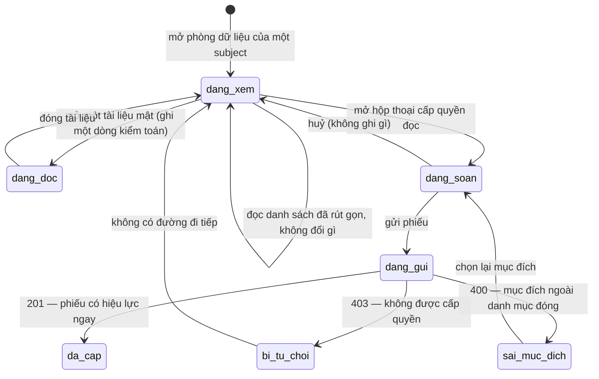

# Phòng dữ liệu và cấp quyền đọc

## Tóm tắt

Phòng dữ liệu là nơi mọi tệp và mọi đoạn nội dung mật của hệ thống được lưu. Tài liệu treo vào một [subject](../nen-tang/mo-hinh-du-lieu.md#subject) — một đề bài, một tài sản công nghệ, một hồ sơ vụ việc hoặc một người — và mang một trong [bốn mức mật](../nen-tang/mo-hinh-du-lieu.md#mức-mật).

Luật trung tâm: từ `Confidential` trở lên, **không ai đọc được nếu không có một phiếu cấp quyền đọc còn hiệu lực**, trừ chủ sở hữu tài liệu. Phiếu ghi bốn thứ: cho ai, vì mục đích gì, tới mức mật nào, và trong khoảng thời gian nào. Phiếu thu hồi được.

Đây là thay đổi có hệ quả lớn nhất trong bảy thay đổi có chủ đích so với hệ cũ. Hệ cũ có một cột đánh dấu mức mật và **không kiểm soát ai đọc**: nội dung mật đi thẳng tới chủ sở hữu và quản trị viên, không qua phiếu nào và không để lại dấu vết nào. Cơ chế mới đã có mã chạy được; **chưa có endpoint nào, và chưa có màn hình nào cấp phiếu**.

Nhóm endpoint này và [`audit.md`](audit.md) là một cặp không tách rời. Cấp quyền đọc mà không tra được ai đã đọc gì thì không ai dám bật nó.

## Bề mặt cần có

| Phương thức | Đường dẫn | Việc |
|---|---|---|
| `GET` | `/api/v2/subjects/{kind}/{id}/documents` | Danh sách tài liệu **người gọi đọc được** của một subject |
| `POST` | `/api/v2/subjects/{kind}/{id}/documents` | Tải lên một tệp, kèm mức mật |
| `PUT` | `/api/v2/subjects/{kind}/{id}/profile-picture` | Đặt ảnh đại diện (ảnh cũ bị xoá) |
| `PUT` | `/api/v2/subjects/{kind}/{id}/text-sections/{sectionCode}` | Đặt hoặc gỡ một đoạn văn bản mật |
| `GET` | `/api/v2/documents/{id}` | Thông tin một tài liệu (không kèm nội dung) |
| `GET` | `/api/v2/documents/{id}/content` | Mở nội dung tệp |
| `DELETE` | `/api/v2/documents/{id}` | Xoá một tài liệu |
| `GET` | `/api/v2/subjects/{kind}/{id}/access-grants` | Danh sách phiếu cấp quyền đọc của một subject |
| `POST` | `/api/v2/subjects/{kind}/{id}/access-grants` | Cấp một phiếu đọc |
| `POST` | `/api/v2/access-grants/{id}/revoke` | Thu hồi một phiếu |

Bảy phương thức nữa của tầng dịch vụ **không được phơi ra HTTP**, có chủ ý: liệt kê tài liệu không lọc quyền (hai biến thể, dùng cho chiếu nội bộ), tra tài liệu theo khoá lưu trữ (dùng bởi đường tải tệp), xoá toàn bộ tài liệu của một subject (dây chuyền khi subject bị xoá), và kiểm một người có phiếu hiệu lực không (một vị từ, không phải một câu trả lời cho người dùng). Phơi cái đầu tiên ra ngoài sẽ mở thẳng một cửa hậu đọc mọi tài liệu mật.

**`GET /api/v2/subjects/{kind}/{id}/access-grants` chưa có phương thức nào ở tầng dịch vụ.** Cấp và thu hồi đã có; **liệt kê thì không**. Không có đường nào trả lời "hiện ai đang đọc được tài liệu mật của hồ sơ này" — nghĩa là phiếu cấp được nhưng không rà được và không biết cái nào cần thu hồi. Phải bổ sung một phương thức truy vấn ở tầng dịch vụ trước khi viết endpoint này, và cần thêm một đường theo người: `GET /api/v2/people/{id}/access-grants`, cho câu hỏi ngược lại — "người này đang đọc được những gì".

## Ai gọi được và bị từ chối khi nào

| Endpoint | Ai gọi được | Từ chối với mã | Ghi lại |
|---|---|---|---|
| `GET .../documents` | Bất kỳ ai đọc được subject | Không từ chối — danh sách chỉ **rút gọn lại** | Không ghi, trừ khi kết quả có tài liệu mật (xem dưới) |
| `POST .../documents` | Chủ sở hữu subject; quản trị viên | `403 FORBIDDEN` kèm `ruleId`; `400 VALIDATION_FAILED` khi kiểu tệp hoặc phần mở rộng bị chặn | Một dòng ghi, hành động `document.write` |
| `PUT .../profile-picture` | Như trên | Như trên | Như trên |
| `PUT .../text-sections/{code}` | Như trên | Như trên | Như trên |
| `GET /documents/{id}` | Người đọc được tài liệu đó | `404 NOT_FOUND` khi không tồn tại **hoặc không được đọc** | Một dòng nếu tài liệu là mật |
| `GET /documents/{id}/content` | Chủ sở hữu tài liệu; người có phiếu tới mức của tài liệu | `404 NOT_FOUND` khi không đọc được | **Một dòng kèm mục đích** — ngoại lệ duy nhất của luật đọc-không-ghi |
| `DELETE /documents/{id}` | Chủ sở hữu tài liệu; quản trị viên | `403 FORBIDDEN`; `404 NOT_FOUND` | Một dòng, hành động `document.delete` |
| `GET .../access-grants` | Chủ sở hữu subject; quản trị viên | `403 FORBIDDEN` | Không ghi |
| `POST .../access-grants` | Người qua được quy tắc `access_grant.issue` | `400 VALIDATION_FAILED` khi mục đích ngoài danh mục đóng; `403 FORBIDDEN` | Một dòng kèm mục đích |
| `POST /access-grants/{id}/revoke` | Như trên | `404 NOT_FOUND`; `403 FORBIDDEN` | Một dòng kèm mục đích của phiếu |

Hai luật phải đúng ở mọi endpoint trên:

**Không đọc được thì trả 404, không phải 403.** Trả 403 cho một tài liệu mật là nói với người hỏi rằng tài liệu đó tồn tại — đủ để dò ra một hồ sơ đang có tài liệu thẩm định. Tầng dịch vụ hiện ném lỗi 403 ở đường mở nội dung; endpoint v2 phải đổi nó thành 404 trước khi trả ra ngoài, và **vẫn phải ghi dòng `DENY`** với mã quy tắc thật.

**Không đọc được thì không hiện trong danh sách.** Xem mục tiếp theo.

## Danh sách rút gọn, không phải danh sách báo lỗi

Đây là quyết định thiết kế quan trọng nhất của nhóm endpoint này.

`GET /api/v2/subjects/{kind}/{id}/documents` trả về **chỉ những tài liệu người gọi thực sự đọc được**. Tài liệu mật mà họ không có phiếu **không có trong kết quả** — không phải hiện ra một dòng xám rồi báo lỗi khi bấm.

Lý do: một dòng xám tên "Báo cáo thẩm định tài chính Q3" đã tiết lộ gần hết những gì cần giấu. Tên tệp là dữ liệu, không phải nhãn trang trí.

Hệ quả cho giao diện, và đây là chỗ dễ làm sai:

- **Không được hiển thị số lượng tài liệu thật.** "Đang xem 3 trong 8 tài liệu" là cùng một rò rỉ ở dạng khác.
- Nếu cần cho người dùng biết có nội dung họ chưa được đọc, đó phải là một câu **không đếm và không mô tả**: "Hồ sơ này có tài liệu mật. Xin cấp quyền đọc để xem." Việc có nên nói câu đó hay không là một quyết định sản phẩm — xem [Câu hỏi mở](#câu-hỏi-mở-và-kiểm-chứng).
- Người dùng thấy danh sách rỗng không phân biệt được "không có tài liệu nào" với "có nhưng tôi không được xem". Đó là chủ ý.

Luật hiện tại của tầng dịch vụ, đúng thứ tự: tài liệu **không mật** vào thẳng danh sách; tài liệu mật mà người xem là **chủ sở hữu** vào thẳng; còn lại phải có **phiếu hiệu lực tới đúng mức đó** rồi mới đưa qua bảng quyết định.

~~Một lỗ hổng phải lấp trước khi viết endpoint~~ (đã lấp 2026-09-05 bằng cách bỏ mức này — [ADR-0007](../../../04-technical/adr/0007-muc-mat-internal.md)): mức `Internal` **không được coi là mật**, nên tài liệu `Internal` hiện đi thẳng vào danh sách của **mọi người, kể cả khách chưa đăng nhập**. Bốn mức mật trên thực tế chỉ hành xử như hai nhóm. Hoặc `Internal` phải đòi đăng nhập và một quan hệ với subject, hoặc mức này phải bị bỏ khỏi mô hình — không có lựa chọn thứ ba. (chưa cấp mã lỗi)

## Trường hợp đơn giản

Một môi giới cần đọc phần tài chính trong hồ sơ của một đề bài. Họ mở hồ sơ và thấy ba tài liệu công khai; phần tài chính không có trong danh sách.

Quản trị viên cấp cho họ một phiếu: subject là đề bài đó, mục đích `DUE_DILIGENCE`, mức trần `Confidential`, hiệu lực 30 ngày.

Môi giới tải lại trang. Bây giờ danh sách có bốn tài liệu. Họ mở tài liệu tài chính; nội dung hiện ra, và **một dòng kiểm toán được ghi** với hành động `document.read`, kết quả `PERMIT` và mục đích `DUE_DILIGENCE`.

Ba mươi ngày sau, phiếu hết hiệu lực. Tài liệu thứ tư biến khỏi danh sách của họ. Dòng kiểm toán vẫn còn, và câu hỏi "tại sao người này xem được cái đó, hồi tháng trước" vẫn có câu trả lời.

## Tương tác, sự kiện theo sự kiện

Đơn vị tương tác là **một lần cấp phiếu đọc**. Đây là hành động có hệ quả nặng nhất trong nhóm: nó mở cửa dữ liệu mật cho một người khác.

### Vào màn

`GET /api/v2/subjects/{kind}/{id}/documents` trả danh sách đã rút gọn. `GET /api/v2/subjects/{kind}/{id}/access-grants` trả các phiếu đang có hiệu lực trên subject đó — cho ai, mục đích gì, tới mức nào, còn hiệu lực tới bao giờ.

Mỗi tài liệu trong danh sách mang mức mật của nó. Giao diện phải hiển thị mức mật **ngay trên từng dòng**, không giấu trong menu phụ: người dùng cần biết cái họ sắp mở là công khai hay mật trước khi mở, vì mở tài liệu mật để lại dấu vết mang tên họ.

Danh sách phiếu là thứ chưa có ở tầng dịch vụ. Cho tới khi nó có, màn hình phòng dữ liệu chỉ cấp quyền được chứ không rà được — và một quyền không rà được là một quyền không thu hồi được.

### Rời đi không đổi gì

Đọc danh sách tài liệu **không ghi gì** nếu danh sách chỉ có tài liệu công khai.

Đọc một tài liệu mật **có ghi**. Đây là ngoại lệ duy nhất của luật "[endpoint chỉ đọc không ghi kiểm toán](README.md#dòng-kiểm-toán)", và nó là ngoại lệ có chủ đích: phòng dữ liệu là chỗ duy nhất mà câu hỏi "ai đã xem cái này" bắt buộc phải có câu trả lời.

Dòng được ghi mang: ai, vai trò nền tảng, hành động `document.read`, định danh tài liệu, mục đích, kết quả `PERMIT`, mã quy tắc đã cho phép, mã tương quan, thời điểm, cộng địa chỉ IP và trình duyệt.

Yêu cầu chưa được đáp ứng: **mục đích phải là mục đích của phiếu đã dùng để mở cửa**. Đường mở tài liệu hiện không truyền mục đích nào vào bảng quyết định, nên trường mục đích của dòng kiểm toán **để trống**. Một dòng kiểm toán ghi "người này đã đọc tài liệu mật" mà không nói vì sao thì mất đúng phần có giá trị nhất. Endpoint v2 phải tra phiếu đang dùng và chép mục đích của nó vào dòng ghi. (chưa cấp mã lỗi)

Yêu cầu thứ hai: **lượt bị từ chối ở danh sách cũng phải được ghi**. Hiện đường lọc danh sách chỉ hỏi bảng quyết định mà không đi qua cửa ghi, nên một người bị loại khỏi danh sách không để lại dòng nào — trong khi cùng người đó bấm thẳng vào tài liệu thì có. Chú thích của mã nói lượt `DENY` được ghi; thực tế thì không. (chưa cấp mã lỗi)

### Bắt đầu sửa

Hộp thoại cấp quyền đọc có bốn trường, và cả bốn đều bắt buộc trong tinh thần kể cả khi tầng dưới cho phép để trống:

| Trường | Luật |
|---|---|
| Cho ai | Một người trong hệ thống. Máy chủ **không kiểm** người đó có tồn tại không — endpoint phải kiểm. |
| Mục đích | Một giá trị trong **danh mục đóng 23 mục đích**. Không phải ô chữ tự do. Sai giá trị → `400`. |
| Mức trần | `Confidential` hoặc `HighlyConfidential`. Phiếu cho đọc mọi tài liệu **tới mức đó**, không phải đúng mức đó. |
| Hiệu lực tới | Một mốc thời gian. **Để trống nghĩa là phiếu không bao giờ hết hạn.** |

Trường cuối là chỗ dễ gây hậu quả nhất. Một phiếu vô thời hạn nhìn giống hệt một phiếu 30 ngày trong biểu mẫu, và khác nhau hoàn toàn sau sáu tháng. Giao diện phải điền sẵn một thời hạn mặc định và bắt người dùng chủ động chọn "không giới hạn" nếu họ thực sự muốn thế; xem [Câu hỏi mở](#câu-hỏi-mở-và-kiểm-chứng) về việc có nên cho phép thế không.

Mục đích **không do người xin khai** — nó là thuộc tính của phiếu, do người cấp đặt. Đây là điểm khác biệt với hệ cũ, nơi không có khái niệm này.

### Trong khi sửa

Không có kiểm tra nào chạy ở máy chủ trong lúc soạn. Danh mục 23 mục đích là dữ liệu tĩnh, nên giao diện áp được luật đó ngay tại chỗ bằng một ô chọn thay vì một ô nhập.

Giao diện nên hiện, ngay trong hộp thoại, những phiếu **người đó đã có** trên subject này. Cấp chồng một phiếu thứ hai cho cùng một người là hoàn toàn hợp lệ và không có gì cảnh báo, nên một subject có thể tích tụ nhiều phiếu trùng nhau mà thu hồi một cái không có tác dụng gì.

### Gửi đi

`POST /api/v2/subjects/{kind}/{id}/access-grants`. Thứ tự kiểm ở máy chủ:

1. **Mục đích thuộc danh mục đóng.** Không → **400**, `VALIDATION_FAILED`.
2. **Quyền.** Bảng quyết định nhận cả hành động lẫn mục đích, nên một quy tắc có thể cho phép cấp phiếu vì mục đích này mà cấm vì mục đích khác. Không đủ → **403** kèm `ruleId`.

Thành công trả **201** và phiếu có hiệu lực **ngay lập tức** — mốc hiệu lực từ là thời điểm cấp, không lùi được và không đặt trước được.

Thu hồi: `POST /api/v2/access-grants/{id}/revoke`. Nó đánh mốc thu hồi; phiếu ở lại dữ liệu. Tài liệu biến khỏi danh sách của người kia **ở lần tải trang tiếp theo** — không có cơ chế đẩy, nên một tab đang mở vẫn hiện danh sách cũ cho tới khi tải lại. Nội dung thì không mở được nữa, vì mỗi lần mở đều kiểm lại phiếu.

Thu hồi dùng **cùng một hành động** trong bảng quyết định với cấp phiếu, nên không tách được người cấp với người thu hồi. Nếu chính sách muốn "ai cũng thu hồi được, chỉ ít người cấp được" — một lựa chọn hợp lý — thì cần một hành động thứ hai.

## Ba loại tài liệu

| Loại | Là gì | Luật riêng |
|---|---|---|
| `FILE` | Tệp tải lên | Mức mật do người tải lên đặt. Có lịch sử phiên bản. |
| `PROFILE_PICTURE` | Ảnh đại diện | **Đặt ảnh mới xoá ảnh cũ.** Không có lịch sử. Luôn ở mức `Public`. |
| `TEXT_SECTION` | Một đoạn nội dung mật lưu dưới dạng văn bản | **Mức mật suy ra từ mã đoạn**, người đặt không chọn được. |

**Ảnh đại diện là loại duy nhất không có lịch sử.** Đặt ảnh mới xoá hẳn bản ghi cũ. Đây là hành vi giữ nguyên từ hệ cũ và là chủ ý, nhưng nó khiến ảnh đại diện là ngoại lệ của mọi luật phiên bản trong hệ thống. Giao diện không được hứa "khôi phục ảnh cũ".

**Đoạn văn bản có bốn mã**, giữ nguyên tên từ hệ cũ: nội dung mức 2, bản do AI xử lý của mức 2, nội dung mức 3, bản do AI xử lý của mức 3. Hai mã đầu cho ra `Confidential`, hai mã sau cho ra `HighlyConfidential`. Người đặt **không chọn mức mật** — điều này đúng, vì mức mật của một đoạn là thuộc tính của chỗ nó nằm, không phải của người gõ vào.

Nhưng luật đó có một lỗ: **một mã đoạn không nằm trong bốn mã trên cho ra mức `Public`**, im lặng. Gửi lên một mã viết sai chính tả là tạo một đoạn nội dung mật ở mức công khai mà không có cảnh báo nào. Endpoint v2 phải từ chối mã đoạn không thuộc danh sách bằng `400` thay vì hạ mức. (chưa cấp mã lỗi)

**Gỡ một đoạn văn bản không xoá nó.** Gửi nội dung rỗng tạo một **phiên bản mới rỗng** chồng lên phiên bản cũ. Lịch sử còn nguyên, và nội dung cũ vẫn đọc được qua lịch sử phiên bản. Hệ quả cho người dùng phải nói rõ trên giao diện: **gỡ không phải xoá**. Ai gỡ một đoạn vì đưa nhầm thông tin cần biết rằng thông tin đó vẫn nằm trong hệ thống.

Không có endpoint nào đọc lịch sử phiên bản của một tài liệu. Nó tồn tại trong dữ liệu và không tới được ai — cùng một khoảng trống với [lịch sử phiên bản của đề bài](demand-va-technology.md).

## Giới hạn kích thước tệp

Hai giới hạn, lệch nhau:

| Tầng | Giới hạn | Chuyện gì xảy ra khi vượt |
|---|---|---|
| HTTP | **12 MB** cho toàn bộ thân request | Request bị chặn trước khi tới mã nghiệp vụ |
| Lưu trữ | **10 MB** cho một tệp | Ghi được một phần rồi bị huỷ, trả lỗi kiểm tra dữ liệu |

Một tệp **11 MB đi qua tầng HTTP rồi mới bị từ chối ở tầng dưới**. Người dùng thấy hai thông điệp khác nhau cho hai tệp chỉ khác nhau vài trăm kilobyte, và tệp ở giữa mất thời gian tải lên toàn bộ trước khi bị từ chối. Với đường mạng lên chậm, đó là vài phút chờ để nhận một lỗi.

Yêu cầu cho v2: **một giới hạn duy nhất, và nó phải nằm trong phản hồi của máy chủ** để giao diện chặn tại chỗ trước khi bắt đầu tải lên. Chọn con số nào là quyết định vận hành; chọn *một* con số thì không phải.

Ngoài kích thước còn hai luật nữa, cả hai trả `400`: danh sách kiểu tệp được phép (ảnh, PDF, Word, Excel, văn bản thuần, ZIP, RAR) và danh sách phần mở rộng bị chặn vì lý do an toàn. Thông điệp của cả hai hiện bằng **tiếng Anh**, viết theo văn phong của thư viện cũ; v2 [không có nghĩa vụ đó](README.md#cái-v2-phải-sửa-so-với-v1) và phải trả tiếng Việt.

## Biến thể

| Biến thể | Lúc vào màn | Trong khi soạn phiếu |
|---|---|---|
| Vai trò | Khách chưa đăng nhập chỉ thấy tài liệu không mật (mức `Internal` không còn tồn tại). Người đã đăng nhập thấy thêm tài liệu mật mình sở hữu và tài liệu có phiếu. Quản trị viên **không tự động thấy hết**: quyền của họ đến từ bảng quyết định, không từ vai trò. | Vai trò và **mục đích** cùng quyết định lệnh cấp phiếu có qua không. Cùng một người có thể cấp được phiếu vì mục đích này và bị chặn vì mục đích khác. |
| Trạng thái bản ghi | Mức mật của từng tài liệu quyết định nó có trong danh sách không. Phiếu đã thu hồi hoặc đã hết hạn không còn tác dụng, và tài liệu tương ứng biến mất ở lần tải sau. | Không đổi được giữa chừng ở phía người dùng. Phiếu của người khác trên cùng subject **đổi được** trong lúc soạn; không có gì cảnh báo. |
| Cấu hình backend | Địa chỉ công khai của tệp dựng từ cấu hình lưu trữ. Cấu hình lệch làm mọi liên kết tệp trỏ sai, và lệch đó chỉ lộ ra khi có người bấm vào. | Không ảnh hưởng. |
| Phím tắt của biểu mẫu | Hộp thoại cấp quyền nên focus vào ô chọn người khi mở. | Escape đóng hộp thoại và vứt bỏ phiếu đang soạn. Enter trong ô chọn mục đích xác nhận lựa chọn, không gửi — cấp quyền đọc dữ liệu mật là hành động cần một cú bấm có chủ ý. |

Đổi biến thể giữa chừng: phiếu của chính người đang thao tác có thể bị thu hồi trong lúc họ đang mở một tài liệu. Nội dung đã tải về trình duyệt thì không rút lại được; lần mở tiếp theo bị chặn.

## Huỷ và gián đoạn

| Sự kiện | Trước khi gửi | Trong khi đang gửi |
|---|---|---|
| Bấm Huỷ hoặc nhấn Escape | Hộp thoại đóng, phiếu đang soạn bị vứt bỏ. Không có gì được ghi. | Không có cách huỷ. Với lệnh tải tệp lên, huỷ ở trình duyệt dừng luồng gửi — tệp có thể đã ghi một phần ở tầng lưu trữ và không có bản ghi tài liệu nào trỏ tới nó. |
| Đi chỗ khác trong app | Phiếu đang soạn mất. Tệp đang tải lên bị **huỷ giữa chừng**; không có hàng đợi nền. | Kết quả không tới giao diện; phiếu vẫn được cấp. Người dùng quay lại thấy một phiếu mình không nhớ đã cấp. |
| Back/Forward của trình duyệt | Như trên. | Như trên. |
| Tải lại trang, hoặc đóng tab | Phiếu đang soạn mất; tệp đang tải mất. | Giao dịch hoàn tất, giao diện không biết. Khoá chống lặp cứu: thử lại cùng khoá phát lại phản hồi cũ thay vì cấp hai phiếu. |
| Mất mạng, hoặc request quá hạn | Không ảnh hưởng — chưa gọi gì. | **Phải giữ nguyên khoá chống lặp cho lần thử lại.** Khoá mới sẽ cấp phiếu hai lần, và thu hồi một phiếu không làm phiếu kia mất hiệu lực. |
| Phiên hết hạn (401), hoặc v1 bị dừng (410) | Người dùng bị đẩy về đăng nhập, mất phiếu đang soạn. | 401 giữa chừng nghĩa là lệnh bị từ chối trước tầng nghiệp vụ; không có gì được ghi. Một tệp đang tải lên bị mất toàn bộ. |
| Bản ghi bị đổi bởi người khác hoặc bị xoá | Danh sách tài liệu đã cũ: một tài liệu vừa bị xoá vẫn hiện, một phiếu vừa bị thu hồi vẫn tính là còn. | Tài liệu và phiếu **không mang số phiên bản**, nên không có 409 ở đây. Cấp phiếu cho một subject vừa bị xoá vẫn thành công và tạo một phiếu treo. |
| Trình duyệt tự điền | Không áp dụng — không trường nào là email hay mật khẩu. Ô chọn người có thể bị trình duyệt gợi ý sai; nó là ô chọn, không phải ô nhập tự do. | Không áp dụng. |

Sau bất kỳ gián đoạn nào, người dùng ở lại phòng dữ liệu của subject đó. Thứ duy nhất đáng khôi phục là **tệp đang chọn để tải lên**: chọn lại một tệp trong máy là thao tác tốn công nhất trong cả luồng.

## Tương tác với hệ thống khác

**Quyền và vai trò.** Đây là chỗ duy nhất trong hệ thống có **hai tầng quyền**: bảng quyết định trả lời "vai trò này có được đọc tài liệu mức này không", và phiếu cấp quyền trả lời "người cụ thể này có được đọc subject cụ thể này không". Phải qua **cả hai**. Chủ sở hữu tài liệu đi tắt qua tầng phiếu nhưng vẫn qua bảng quyết định. Xem [`../xuyen-suot/quyen-va-vai-tro.md`](../xuyen-suot/quyen-va-vai-tro.md).

**Kiểm tra dữ liệu và cách hiện lỗi.** Ba lỗi kiểm tra dữ liệu ở đây hiện bằng tiếng Anh và phải được dịch: kiểu tệp không được phép, phần mở rộng bị chặn, tệp quá lớn. Lỗi mục đích ngoài danh mục đóng không nên tới được người dùng — nếu ô chọn được dựng đúng, nó không xảy ra.

**Thay đổi chưa lưu.** Hai chỗ bẩn được: hộp thoại cấp phiếu, và ô soạn đoạn văn bản mật. Ô thứ hai nguy hiểm hơn — người dùng gõ vài đoạn nội dung mật rồi rời trang là mất hết, và không có bản nháp nào ở phía máy chủ.

**Cập nhật lạc quan và hoàn tác.** Không cập nhật lạc quan cho lệnh cấp phiếu: hiện một quyền chưa được cấp là nói dối về một thứ liên quan tới bảo mật. Có một đường lùi cho phiếu — thu hồi — nhưng nó **không phải hoàn tác**: nếu người kia đã đọc trong khoảng thời gian phiếu còn hiệu lực, việc đọc đó đã xảy ra và đã được ghi. Gỡ một đoạn văn bản cũng không phải hoàn tác, nó là một phiên bản mới rỗng.

**Ngoại tuyến.** Không có tương tác. Không có hàng đợi tải tệp lên khi ngoại tuyến; mất mạng giữa chừng là mất toàn bộ lượt tải.

**Thông báo và toast.** **Người được cấp phiếu không được báo.** Họ chỉ phát hiện ra bằng cách mở lại subject và thấy có thêm tài liệu. Người bị thu hồi cũng không được báo. Với một cơ chế mà cả giá trị lẫn rủi ro đều nằm ở chỗ "ai đang đọc được gì", việc không có thông báo nào là một thiếu sót cần lấp cùng lúc với endpoint.

**Trạng thái lọc/tìm trong URL.** Bộ lọc theo mức mật và theo loại tài liệu nên nằm trong URL. Nhưng **không được đưa định danh tài liệu mật vào URL của trang chia sẻ được**: một liên kết dán vào tin nhắn nhóm là một rò rỉ tên tài liệu, kể cả khi người nhận không mở được nội dung.

**Đa ngôn ngữ.** Bốn mức mật, ba loại tài liệu, bốn mã đoạn văn bản và **23 mục đích** đều lưu bằng chuỗi tiếng Anh viết hoa. Riêng 23 mục đích là một bảng dịch đáng kể, và chúng xuất hiện ở cả hộp thoại cấp phiếu lẫn màn hình nhật ký kiểm toán — hai chỗ phải dịch giống hệt nhau.

**Khả năng truy cập.** Mức mật của một tài liệu không được truyền đạt chỉ bằng màu. Mỗi dòng cần một nhãn chữ. Hộp thoại cấp quyền nên có một câu tóm tắt đọc được trước nút gửi: "Cấp cho {tên} quyền đọc tài liệu tới mức Mật của {subject}, vì mục đích Thẩm định, tới ngày {ngày}."

**Dấu vết kiểm toán.** Phòng dữ liệu là nguồn sinh dòng kiểm toán dày nhất trong hệ thống, và là chỗ duy nhất mà **đọc cũng ghi**. Mọi dòng ở đây phải mang mục đích; hiện chúng không mang. Xem [`audit.md`](audit.md).

## Trường hợp biên

- ~~**Tài liệu `Internal` hiện ra cho tất cả**~~ — đã đóng 2026-09-05: mức `Internal` bị bỏ khỏi mô hình ([ADR-0007](../../../04-technical/adr/0007-muc-mat-internal.md)).
- **Mã đoạn văn bản lạ cho ra mức `Public`** thay vì bị từ chối.
- **Đường xem thông tin một tài liệu không kiểm quyền ở tầng dịch vụ.** Nếu endpoint không tự kiểm, nó trả tên tệp, kích thước và mức mật của bất kỳ tài liệu nào cho bất kỳ ai biết định danh.
- **Một tài liệu mật không có chủ sở hữu** — trường chủ sở hữu để trống được — thì không ai đi tắt được, và chỉ mở được bằng phiếu.
- **Phiếu không kiểm người nhận có tồn tại không.** Cấp cho một định danh sai tạo một phiếu không bao giờ dùng được và không bao giờ hết hạn.
- **Phiếu không có hạn là hợp lệ.** Để trống ô thời hạn tạo một quyền đọc vĩnh viễn.
- **Cấp chồng nhiều phiếu cho cùng một người trên cùng một subject là hợp lệ.** Thu hồi một cái không cắt được quyền nếu còn cái khác.
- **Thu hồi và cấp dùng chung một hành động** trong bảng quyết định.
- **Xoá ảnh đại diện cũ chỉ xoá bản ghi**; tệp cũ ở tầng lưu trữ không bị dọn. Nó không còn liên kết nào trỏ tới nhưng vẫn nằm đó.
- **Không có đường đọc lịch sử phiên bản của tài liệu**, dù mọi phiên bản đều được giữ.
- **Đường tải tệp về công khai đi qua khoá lưu trữ, không qua định danh tài liệu.** Ai có khoá thì vào được đúng đường kiểm quyền — nhưng khoá đó xuất hiện trong mọi phản hồi có tài liệu.
- **Giới hạn 12 MB và 10 MB lệch nhau.**

## Câu hỏi mở và kiểm chứng

- **Không có đường liệt kê phiếu cấp quyền.** Đây là khoảng trống nặng nhất của nhóm này: quyền cấp được nhưng không rà được, và không ai biết cái nào cần thu hồi. Cần một phương thức truy vấn ở tầng dịch vụ trước, rồi hai endpoint — theo subject và theo người. (chưa cấp mã lỗi)
- **Mục đích không được chép vào dòng kiểm toán khi đọc tài liệu mật.** Trường mục đích để trống, làm mất phần có giá trị nhất của dòng ghi. (chưa cấp mã lỗi)
- **Lượt bị loại khỏi danh sách không được ghi.** Chỉ lượt bấm thẳng vào tài liệu mới sinh dòng `DENY`. (chưa cấp mã lỗi)
- ~~**Mức `Internal` không có tác dụng bảo vệ nào.**~~ Đã quyết 2026-09-05: **bỏ khỏi mô hình** ([ADR-0007](../../../04-technical/adr/0007-muc-mat-internal.md)). Lý do quyết định nằm ở một phát hiện bản đề xuất chưa nêu — bảng quyết định không có luật nào cho `INTERNAL`, nên đường liệt kê hiện nó còn đường mở từ chối nó.
- **Phiếu vô thời hạn có nên được phép không?** Nếu có, cần một cơ chế rà định kỳ. Nếu không, cần một thời hạn tối đa và một giá trị mặc định. Đây là quyết định sản phẩm.
- **Người dùng có nên biết rằng có tài liệu họ không được xem không?** Một câu "hồ sơ này có tài liệu mật" giúp họ biết đường đi xin quyền, nhưng cũng tiết lộ một điều. Cần chọn, và chọn một lần cho mọi màn hình.
- **Ai được cấp phiếu cho subject của người khác?** Bảng quyết định nhận hành động và mục đích nhưng **không nhận quan hệ giữa người cấp và subject**. Nghĩa là quyền cấp phiếu hiện là quyền toàn cục, không phải quyền trên từng hồ sơ.
- **Thu hồi có cần lý do không?** Cấp phiếu có mục đích; thu hồi không có gì. Một phiếu bị thu hồi vì hết việc và một phiếu bị thu hồi vì lạm dụng trông giống hệt nhau trong dữ liệu.
- Chưa xác nhận bảng quyết định định nghĩa quy tắc nào cho `document.read`, `document.write`, `document.delete` và `access_grant.issue`, và quy tắc nào đòi phiếu đã kiểm; cần đọc bộ quy tắc đang nạp.
- Chưa đo được hành vi thật của bất kỳ đường nào vì chưa có endpoint và chưa có dữ liệu.

Đặc tả — chưa có mã. Dựa trên SourceCode/nacentech, bản chụp ngày 2026-09-04.
