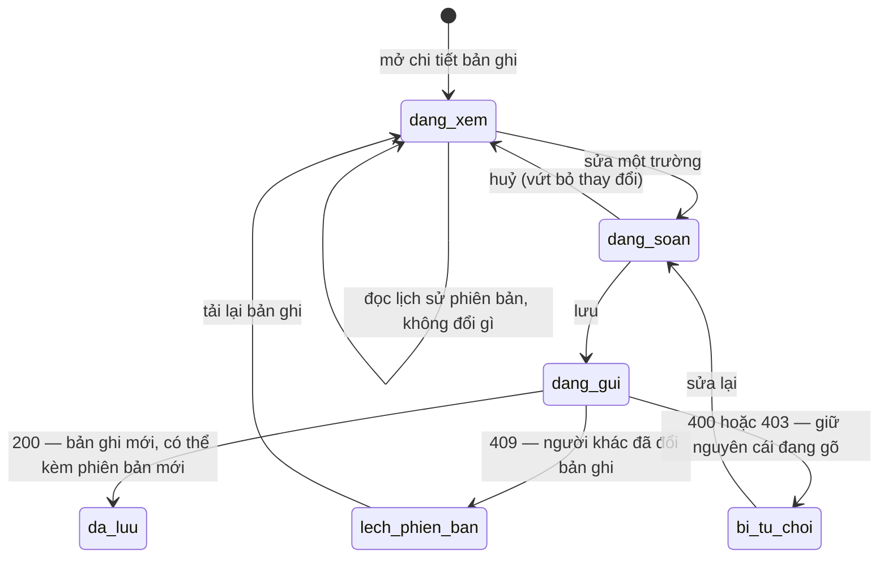

# Đề bài và tài sản công nghệ

## Tóm tắt

Hai loại nội dung chính mà người dùng đăng: *đề bài* là một bài toán do bên có nhu cầu nêu ra, *tài sản công nghệ* là một công nghệ hoặc giải pháp do bên cung đăng. Hệ cũ gộp cả hai vào một bảng và phân biệt bằng một cột; hệ mới tách thành hai module, nhưng facade v1 vẫn trình bày chúng như một loại duy nhất tên là "intake" để giao diện cũ không phải sửa.

v2 tách hẳn hai đường dẫn. Đây không phải một thay đổi thẩm mỹ: tài sản công nghệ có một thuộc tính mà đề bài không có — *mức chất lượng* — và nó cần một endpoint riêng mà đề bài không cần.

Ba năng lực trong nhóm này có dữ liệu đầy đủ nhưng **không có đường ra**: lịch sử phiên bản, cổng chất lượng, và khôi phục bản ghi đã xoá mềm. Hai cái đầu là lỗ hổng rõ ràng; cái thứ ba là một quyết định sản phẩm chưa ai ra.

## Bề mặt cần có

Mười một dòng dưới đây tồn tại **hai lần**: một lần dưới `/api/v2/demand-briefs`, một lần dưới `/api/v2/technology-assets`. Hình dạng giống nhau, luật giống nhau, chỉ tên trường nội dung khác (đề bài có *phần mô tả bài toán*, tài sản công nghệ có *phần mô tả*).

| Phương thức | Đường dẫn | Việc |
|---|---|---|
| `GET` | `/api/v2/{bộ sưu tập}` | Danh sách, lọc theo chủ sở hữu, trạng thái, lĩnh vực, danh mục, từ khoá |
| `GET` | `/api/v2/{bộ sưu tập}/status-counts` | Đếm theo trạng thái trên cùng bộ lọc |
| `POST` | `/api/v2/{bộ sưu tập}` | Tạo mới |
| `GET` | `/api/v2/{bộ sưu tập}/{id}` | Chi tiết một bản ghi |
| `PATCH` | `/api/v2/{bộ sưu tập}/{id}` | Sửa nội dung, nhãn, danh mục hoặc trạng thái xuất bản |
| `DELETE` | `/api/v2/{bộ sưu tập}/{id}` | Xoá mềm |
| `POST` | `/api/v2/{bộ sưu tập}/{id}/restore` | **Năng lực mới** — khôi phục bản ghi đã xoá mềm |
| `GET` | `/api/v2/{bộ sưu tập}/{id}/versions` | **Năng lực mới** — lịch sử phiên bản nội dung |
| `GET` | `/api/v2/{bộ sưu tập}/{id}/versions/{no}` | **Năng lực mới** — nội dung của một phiên bản cụ thể |
| `POST` | `/api/v2/{bộ sưu tập}/{id}/ai-rewrite` | Chạy lại bước AI viết lại tiêu đề và nội dung |
| `POST` | `/api/v2/{bộ sưu tập}/{id}/match-computations` | Xếp hàng một vòng ghép cặp |

**Đã mở 2026-09-05, chỉ một đường và chỉ cho đề bài:** `GET /api/v2/demand-briefs/{id}` (kèm `ETag`), vì console hồ sơ vụ việc cần `currentVersionNo` để cảnh báo "đề bài đã có bản mới hơn bản hồ sơ đang ghim". Phần còn lại của bộ sưu tập vẫn chưa mở.

Một dòng nữa **chỉ có ở tài sản công nghệ**:

| Phương thức | Đường dẫn | Việc |
|---|---|---|
| `POST` | `/api/v2/technology-assets/{id}/quality-level` | **Năng lực mới** — đổi mức chất lượng |

Tầng dịch vụ của mỗi module có mười phương thức. Bảng trên phủ tám: tạo, đọc một bản ghi có kiểm quyền, liệt kê, đếm theo trạng thái, sửa, xoá mềm, ghi kết quả AI, đặt trạng thái AI. Hai phương thức còn lại — tìm một bản ghi **không** kiểm quyền và tra nhiều bản ghi một lượt — cố ý không có endpoint: chúng là lối tra cứu nội bộ cho module khác, và mở ra HTTP sẽ tạo một đường đọc vòng qua bảng quyết định.

Bốn dòng đánh dấu **năng lực mới** cần mã mới ở tầng dịch vụ, không chỉ một controller bọc quanh cái đã có.

## Trường hợp đơn giản

Một người dùng tạo một đề bài ở trạng thái nháp: tiêu đề, phần mô tả bài toán, vài lĩnh vực, một danh mục. Bản ghi ra đời với phiên bản nội dung số 1, và vì có nội dung nên hàng đợi cắt đoạn cho tìm kiếm được kích hoạt ngay.

Họ sửa lại phần mô tả cho rõ hơn. Một phiên bản số 2 ra đời; phiên bản 1 vẫn còn nguyên. Họ đổi danh mục — không phiên bản nào ra đời, vì danh mục không phải nội dung.

Họ chuyển sang xuất bản. Từ lúc đó bản ghi vào chỉ mục tìm kiếm, xuất hiện ở chợ giao dịch, và nhận được lời mời hợp tác. Vài ngày sau một vòng ghép cặp chạy xong và họ nhận thông báo có ứng viên.

Họ xoá bản ghi. Nó biến khỏi mọi danh sách nhưng dữ liệu và tệp đính kèm vẫn còn.

## Tương tác, sự kiện theo sự kiện

Đơn vị tương tác là **một lần sửa một bản ghi**. Nó là biểu mẫu dài nhất trong hệ thống và là chỗ duy nhất mà một thao tác của người dùng sinh ra hai loại hệ quả rất khác nhau: một phiên bản bất biến, và một sự kiện đi ra ngoài module.



### Vào màn

`GET /api/v2/{bộ sưu tập}/{id}` trả bản ghi kèm số phiên bản nội dung hiện tại và số phiên bản lạc quan của bản ghi.

Quyền đọc có ba nhánh, và nhánh thứ ba là chỗ v2 phải khác v1:

- **Chủ sở hữu** đọc được bản ghi của mình ở mọi trạng thái.
- **Bất kỳ ai** đọc được bản ghi đã xuất bản, kể cả khách chưa đăng nhập.
- **Người khác đọc bản ghi chưa xuất bản** không có quy tắc nào cho phép, nên rơi vào mặc định từ chối. v2 phải trả **404**, không phải 403 — trả 403 sẽ xác nhận rằng có một bản nháp mang định danh đó.

Quản trị viên đọc được mọi bản ghi ở mọi trạng thái.

Bản ghi **đã xoá mềm** không nằm trong kết quả mặc định. Chỉ quản trị viên xin được nhìn thấy chúng, và chúng phải hiện ra kèm dấu hiệu rõ ràng là đã xoá — không phải trộn lẫn vào danh sách thường.

Đọc không ghi kiểm toán.

Cái giao diện phải nhận từ bước này để bước gửi hoạt động: **số phiên bản của bản ghi**. Xem mục [Kiểm tra lệch phiên bản](#kiểm-tra-lệch-phiên-bản).

### Rời đi không đổi gì

Không ghi gì, không giữ gì. Đọc lịch sử phiên bản cũng không ghi gì — nó chỉ là nội dung công khai của chính bản ghi ở các thời điểm trước.

### Bắt đầu sửa

Lần sửa đầu tiên làm biểu mẫu thành *đã bẩn*. Đây là chỗ giao diện phải nói cho người dùng một luật mà máy chủ không nói: **sửa trường nào thì tạo phiên bản mới, sửa trường nào thì không.**

| Trường | Tạo phiên bản mới? |
|---|---|
| Tiêu đề | **Có** |
| Phần nội dung chính | **Có** |
| Lĩnh vực | Không |
| Danh mục | Không |
| Trạng thái xuất bản | Không |
| Nội dung do AI xử lý | Không |

Luật này không tuỳ tiện: phiên bản là bản chụp bất biến của **nội dung công khai**, thứ mà một hồ sơ vụ việc ghim lại và một vòng ghép cặp đã chấm điểm. Nhãn và trạng thái không thuộc về nội dung, nên đổi chúng không làm sai bất kỳ bản chụp nào.

Hệ quả cho giao diện: hai nhóm trường nên tách nhau về mặt thị giác, và nhóm tạo phiên bản nên nói rõ điều đó trước khi người dùng gõ, không phải sau khi đã lưu.

Một luật nữa: **sửa về đúng giá trị cũ không tạo phiên bản.** Máy chủ so sánh giá trị gửi lên với giá trị hiện tại, nên gõ đi gõ lại rồi trả về nguyên trạng chỉ tốn một lần lưu, không tốn một số phiên bản.

### Trong khi sửa

Không có endpoint xem trước. Kiểm tra duy nhất chạy ở máy chủ là tiêu đề không được rỗng, và nó chỉ chạy ở lệnh tạo.

Giao diện tự áp được ba luật ở phía trình duyệt: tiêu đề không rỗng, chỉ chọn được nhãn còn hiệu lực (xem [`policy-va-taxonomy.md`](policy-va-taxonomy.md)), và một bản ghi chỉ có **một** danh mục nhưng **nhiều** lĩnh vực.

Trường không gửi nghĩa là không đổi. Để bỏ danh mục thì phải gửi một cờ xoá riêng, vì gửi giá trị rỗng không phân biệt được với không gửi.

### Gửi đi

`PATCH /api/v2/{bộ sưu tập}/{id}` với các trường đã đổi và số phiên bản kỳ vọng.

Thứ tự kiểm ở máy chủ:

1. **Tồn tại.** Không có, hoặc đã xoá mềm → **404**. Sửa một bản ghi đã xoá mềm là không thể; phải khôi phục trước.
2. **Quyền.** Chủ sở hữu hoặc quản trị viên. Không đủ → **403** kèm `ruleId`, hoặc **404** nếu người gọi không được biết bản ghi tồn tại.
3. **Phiên bản.** Lệch → **409**, `code: "VERSION_CONFLICT"`, kèm `currentVersion`.

Thành công thì một giao dịch duy nhất ghi: bản ghi đã cập nhật, một phiên bản nội dung mới nếu tiêu đề hoặc nội dung đổi, các sự kiện phát ra, và một dòng kiểm toán.

Phản hồi trả bản ghi đã cập nhật. Giao diện thay chỗ dữ liệu cũ bằng phản hồi này chứ đừng tự đoán số phiên bản mới.

## Hai sự kiện khác nhau

Một lệnh sửa có thể phát ra hai loại sự kiện, và chúng **không** giống nhau:

| Sự kiện | Phát khi | Ai nghe |
|---|---|---|
| Nội dung công khai đã đổi | Phần nội dung chính đổi, và người gọi không tự cung cấp bản do AI xử lý | Ghép cặp: cắt lại đoạn văn bản và tính lại vector |
| Đã xuất bản | Trạng thái chuyển sang xuất bản | Chỉ mục tìm kiếm: đưa bản ghi vào; lời mời hợp tác: mở khoá |

Chúng độc lập nhau. Sửa nội dung một bản nháp phát sự kiện thứ nhất mà không phát sự kiện thứ hai — bản ghi được cắt đoạn lại nhưng vẫn không ai tìm thấy. Xuất bản mà không đổi nội dung phát sự kiện thứ hai mà không phát sự kiện thứ nhất — bản ghi hiện ra với các đoạn văn bản đã có từ trước.

Có một sự kiện thứ ba, đối xứng với cái thứ hai: **đã gỡ xuất bản**, phát khi trạng thái chuyển ngược về nháp.

Hệ quả cho giao diện: trạng thái xử lý AI của một bản ghi có thể chạy trong lúc người dùng đang xem, và nó chạy vì một lý do khác với việc bản ghi có xuất hiện công khai hay không. Hai chỉ báo này nên tách nhau, không gộp thành một chữ "đang xử lý".

> Ghi chú kỹ thuật: hàng đợi việc nền nằm trong cùng cơ sở dữ liệu và việc đưa vào hàng đợi nằm trong **cùng giao dịch** với việc ghi dữ liệu. Không có trường hợp bản ghi được lưu mà việc cắt đoạn bị mất, và cũng không có trường hợp ngược lại.

## Lịch sử phiên bản

Dữ liệu phiên bản đã đầy đủ từ ngày cutover: mỗi phiên bản có số thứ tự, tiêu đề, phần nội dung, ai tạo và thời điểm tạo. **Không có endpoint nào đọc nó.** Giao diện chỉ thấy được số phiên bản hiện tại, tức là một con số tăng dần mà không tra được nó đại diện cho cái gì.

`GET /api/v2/{bộ sưu tập}/{id}/versions` trả danh sách phiên bản, sắp theo số thứ tự giảm dần, phân trang như mọi danh sách khác. Mỗi dòng đủ để hiển thị một danh sách chọn: số, thời điểm, người tạo, và tiêu đề tại phiên bản đó.

`GET /api/v2/{bộ sưu tập}/{id}/versions/{no}` trả đầy đủ nội dung của một phiên bản.

Quyền đọc lịch sử **bằng đúng quyền đọc bản ghi**, không rộng hơn và không hẹp hơn. Một bản ghi đã xuất bản có lịch sử đọc được công khai — kể cả những phiên bản được viết khi nó còn là nháp. Đây là một hệ quả cần được xác nhận là chủ ý, không phải một tác dụng phụ; xem [Câu hỏi mở](#câu-hỏi-mở-và-kiểm-chứng).

Phiên bản là **bất biến và chỉ ghi thêm**. Không có đường sửa và không có đường xoá một phiên bản. Quay lại một phiên bản cũ nghĩa là gửi nội dung cũ đó qua lệnh sửa, và điều đó tạo thêm một phiên bản nữa.

Ai cần lịch sử này: một hồ sơ vụ việc ghim số phiên bản của đề bài tại thời điểm nó bắt đầu xử lý, nên màn hình hồ sơ phải nói được "đang xem phiên bản 3, hiện đã có phiên bản 5" và cho mở phiên bản 3 ra đọc. Không có endpoint này thì câu đó không nói được.

## Cổng chất lượng của tài sản công nghệ

Mức chất lượng có bốn bậc và **chỉ tài sản công nghệ mới có**:

```
UNREVIEWED → SELF_DECLARED → REVIEWED → TRANSACTION_READY
```

Mọi tài sản tạo mới ở `UNREVIEWED`. Mọi tài sản di trú từ hệ cũ cũng ở `UNREVIEWED` — bản ETL gán cứng giá trị này bất kể dữ liệu nguồn có gì. **Không có đường nào đổi nó.** Không phương thức nào ở tầng dịch vụ, không endpoint nào ở facade, không màn hình nào ở ba frontend. Hệ quả hôm nay: mọi tài sản công nghệ trong hệ thống đứng yên ở bậc thấp nhất và không ai nhìn thấy điều đó.

`POST /api/v2/technology-assets/{id}/quality-level` là năng lực mới, và nó phải mang hình dạng của một **quyết định có người chịu trách nhiệm**, không phải một phép gán:

- Nó nhận mức đích, một mã lý do, và một diễn giải bắt buộc không rỗng.
- Nó nhận số phiên bản kỳ vọng, vì nó là một lệnh ghi lên một bản ghi có tranh chấp.
- Nó ghi một dòng kiểm toán kèm mức cũ, mức mới và diễn giải.
- Nó **không** được phép chạy tự động. Kiến trúc nói rõ không bản ghi nào được tự gán `TRANSACTION_READY`; luật đó phải được áp ở endpoint chứ không chỉ ở lời hứa.

Ba câu hỏi mà endpoint này không tự trả lời được — ai được đổi, đổi được mấy bậc một lần, và có xuống bậc được không — là quyết định sản phẩm. Xem [Câu hỏi mở](#câu-hỏi-mở-và-kiểm-chứng).

## Xoá mềm và khôi phục

Xoá là **xoá mềm**: bản ghi chỉ được đánh dấu thời điểm xoá, dữ liệu và tệp đính kèm vẫn còn. Hệ cũ xoá cứng cả tệp; đây là một trong bảy thay đổi có chủ đích.

Xoá phát một sự kiện để chỉ mục tìm kiếm gỡ bản ghi ra. Xoá hai lần không phát sự kiện hai lần — lệnh thứ hai không làm gì và vẫn trả thành công.

Cái chưa có: **đường về**. Dữ liệu đủ để khôi phục — chỉ cần xoá dấu thời gian — nhưng không phương thức nào làm việc đó, và không ai quyết định là nên có hay không. Nếu có, `POST /api/v2/{bộ sưu tập}/{id}/restore` phải trả lời được ba câu: ai gọi được, bản ghi quay về trạng thái nào (nháp hay đúng trạng thái lúc bị xoá), và chỉ mục tìm kiếm được nạp lại bằng cách nào. Xem [Câu hỏi mở](#câu-hỏi-mở-và-kiểm-chứng).

## Kiểm tra lệch phiên bản

Đề bài và tài sản công nghệ nằm trong bốn bản ghi cần kiểm tra phiên bản lạc quan. Nhưng **tầng dịch vụ hiện không kiểm**: lệnh sửa không nhận số phiên bản kỳ vọng và không có nhánh nào ném lệch phiên bản. Hôm nay hai người sửa cùng một bản ghi thì người lưu sau thắng, im lặng, và người lưu trước không biết gì.

v2 phải thêm việc kiểm này **ở tầng dịch vụ**, không chỉ ở host. Ba lệnh cần nó: sửa, xoá, và đổi mức chất lượng. Lệch trả **409** kèm `code: "VERSION_CONFLICT"` và `currentVersion`.

## Biến thể

| Biến thể | Lúc vào màn | Trong khi sửa |
|---|---|---|
| Vai trò | `ADMIN` thấy mọi bản ghi ở mọi trạng thái, và xin được thấy cả bản ghi đã xoá mềm. `USER` thấy bản ghi của mình ở mọi trạng thái, cộng bản ghi đã xuất bản của người khác; bản nháp của người khác trả 404. Khách chưa đăng nhập chỉ thấy bản ghi đã xuất bản. | Chủ sở hữu và quản trị viên sửa được. Người khác nhận 403 kèm `ruleId` nếu bản ghi đã xuất bản, 404 nếu chưa. Không ai ngoài hai nhóm đó đổi được mức chất lượng. |
| Trạng thái bản ghi | Nháp hay đã xuất bản quyết định ai đọc được. Đã xoá mềm nghĩa là không đọc được bằng đường thường, kể cả với chủ sở hữu. Mức chất lượng hiện tại quyết định những bậc nào là đích hợp lệ. | Chuyển sang xuất bản mở khoá lời mời hợp tác và ghép cặp; chuyển ngược về nháp đóng chúng lại và gỡ bản ghi khỏi chỉ mục. Sửa một bản ghi đã xoá mềm là không thể — 404, không phải 403. |
| Cấu hình backend | `Matching:ScoringMode` đổi cách chấm điểm của vòng ghép cặp nhưng không đổi gì ở màn hình này. | Không ảnh hưởng. |
| Phím tắt của biểu mẫu | Biểu mẫu focus vào ô tiêu đề khi tạo mới, và không focus vào đâu khi mở một bản ghi đã có — con trỏ nhảy vào ô tiêu đề của một bản ghi đang đọc là một cách mời gõ nhầm. | Ctrl/Cmd+Enter gửi biểu mẫu. Enter trong ô nội dung nhiều dòng phải xuống dòng. Escape **không** được đóng biểu mẫu dài này mà không hỏi — nó là biểu mẫu chứa nhiều công sức nhất trong hệ thống. |

Đổi biến thể giữa chừng: trạng thái xuất bản và mức chất lượng đổi được bởi người khác trong lúc người dùng đang soạn. Đó là lý do số phiên bản phải có.

## Huỷ và gián đoạn

| Sự kiện | Trước khi gửi | Trong khi đang gửi |
|---|---|---|
| Bấm Huỷ hoặc nhấn Escape | Thay đổi bị vứt bỏ và biểu mẫu về giá trị vừa tải. Không có gì được ghi. Với biểu mẫu dài này, huỷ phải hỏi lại. | Không có cách huỷ. Lệnh sửa là một giao dịch ngắn ở máy chủ. |
| Đi chỗ khác trong app | Thay đổi mất. Không có bản nháp phía máy chủ — trạng thái nháp của bản ghi là một thứ khác hẳn với nội dung chưa lưu trong biểu mẫu. | Kết quả không tới giao diện; giao dịch vẫn hoàn tất. Người dùng quay lại thấy một phiên bản mới mà không nhớ mình đã tạo ra nó. |
| Back/Forward của trình duyệt | Như trên. | Như trên. |
| Tải lại trang, hoặc đóng tab | Thay đổi mất. Đây là chỗ mất mát lớn nhất trong hệ thống, vì phần nội dung chính thường dài. | Giao dịch hoàn tất, giao diện không biết. Thử lại **cùng khoá chống lặp** trả phát lại thay vì tạo hai phiên bản. |
| Mất mạng, hoặc quá hạn | Không ảnh hưởng — chưa gọi gì. | **Phải giữ nguyên khoá chống lặp cho lần thử lại.** Sinh khoá mới sẽ tạo hai phiên bản nội dung giống hệt nhau, và hai phiên bản đó không xoá được. |
| Phiên hết hạn (401), hoặc v1 bị dừng (410) | Người dùng bị đẩy về đăng nhập và mất toàn bộ nội dung đã gõ. | 401 giữa chừng nghĩa là lệnh bị từ chối trước khi vào tầng nghiệp vụ; không phiên bản nào được tạo. |
| Bản ghi bị đổi bởi người khác | Nội dung hiển thị đã cũ. Giao diện không biết cho tới khi gửi. | **409 kèm `currentVersion`.** Giao diện phải tải lại bản ghi và **giữ nguyên cái người dùng đã gõ**, rồi cho họ so sánh với nội dung mới. Vứt bỏ vài trăm chữ vì một lần 409 là cách chắc chắn khiến người dùng ngừng dùng biểu mẫu này. Nếu bản ghi đã bị xoá mềm trong lúc đó, lệnh trả **404**. |
| Trình duyệt tự điền | Không áp dụng — không trường nào là email hay mật khẩu. | Không áp dụng. |

Sau bất kỳ gián đoạn nào, người dùng ở lại trang chi tiết bản ghi. Cái đáng giữ là **toàn bộ nội dung đã gõ**, không phải chỉ trường cuối cùng họ chạm vào.

## Tương tác với hệ thống khác

**Quyền và vai trò.** Ba quy tắc chạm tới nhóm này: một quy tắc cho phép chủ sở hữu làm mọi việc trên bản ghi của mình, một quy tắc cho phép bất kỳ ai đọc bản ghi đã xuất bản, và một quy tắc cho phép quản trị viên đọc và sửa mọi bản ghi. Không quy tắc nào phủ **mức chất lượng** — hành động đó chưa tồn tại trong bảng quyết định và phải được thêm cùng lúc với endpoint. Xem [`../xuyen-suot/quyen-va-vai-tro.md`](../xuyen-suot/quyen-va-vai-tro.md).

**Kiểm tra dữ liệu và cách hiện lỗi.** Chỉ một luật chạy ở máy chủ: tiêu đề không rỗng, và chỉ ở lệnh tạo. Thông điệp hiện là tiếng Anh theo văn phong thư viện cũ; v2 phải trả tiếng Việt. Lỗi lệch phiên bản cần một câu nói rõ *phải làm gì tiếp* chứ không chỉ *cái gì sai*.

**Thay đổi chưa lưu.** Biểu mẫu này là chỗ có nhiều thay đổi chưa lưu nhất trong hệ thống. Mọi đường rời trang phải hỏi lại.

**Cập nhật lạc quan và hoàn tác.** Cập nhật lạc quan chấp nhận được cho việc đổi nhãn và danh mục, vì tỉ lệ thất bại thấp và hệ quả nhỏ. **Không cập nhật lạc quan cho việc đổi trạng thái xuất bản và đổi mức chất lượng** — cả hai đổi thứ người khác nhìn thấy. Không có hoàn tác cho bất kỳ lệnh nào; quay lại một phiên bản cũ là ghi thêm một phiên bản.

**Ngoại tuyến.** Không có tương tác. Không xếp hàng lệnh sửa khi ngoại tuyến — một lệnh gửi sau vài phút có thể va vào một phiên bản mới hơn và chỉ tạo ra một 409 muộn.

**Thông báo và toast.** Một loại thông báo tồn tại và liên quan tới nhóm này: *tìm được ứng viên*, phát cho chủ sở hữu khi một vòng ghép cặp kết thúc với ít nhất một ứng viên. Không có thông báo nào cho việc xuất bản, cho việc đổi mức chất lượng, hay cho việc quản trị viên sửa bản ghi của người khác.

**Trạng thái lọc/tìm trong URL.** Năm bộ lọc của danh sách (chủ sở hữu, trạng thái, lĩnh vực, danh mục, từ khoá) cùng số trang nên nằm trong URL.

**Đa ngôn ngữ.** Hai trạng thái xuất bản, bốn mức chất lượng và ba trạng thái xử lý AI lưu bằng chuỗi tiếng Anh viết hoa. Đó là chín chuỗi cần bảng dịch, và chúng xuất hiện ở mọi màn hình liên quan tới nội dung.

**Khả năng truy cập.** Danh sách phiên bản nên là một danh sách có ngữ nghĩa với số phiên bản đọc được, không phải một dải thẻ. Chỉ báo trạng thái xử lý AI phải thông báo được khi nó đổi, không chỉ đổi màu.

**Dấu vết kiểm toán.** Mọi lệnh ghi ở đây ghi một dòng trong cùng giao dịch. Lệnh sửa nên ghi kèm **số phiên bản nội dung mới** khi có, để tra ngược được dòng kiểm toán về đúng phiên bản. Lệnh đổi mức chất lượng phải ghi cả mức cũ lẫn mức mới; không có dữ liệu này thì câu "ai đã cho cái này qua cổng" không có câu trả lời.

## Trường hợp biên

- **Không có đường xem lịch sử phiên bản** dù dữ liệu đủ. Số phiên bản hiện ra như một con số không tra được.
- **Không có đường đổi mức chất lượng.** Mọi tài sản công nghệ đứng yên ở bậc thấp nhất, gồm cả những bản đã được thẩm định ngoài hệ thống.
- **Không có đường khôi phục** bản ghi đã xoá mềm. Xoá nhầm là một chiều với người dùng, dù dữ liệu vẫn còn.
- **Sửa về đúng giá trị cũ không tạo phiên bản**, nhưng vẫn ghi một dòng kiểm toán và vẫn tăng số phiên bản lạc quan của bản ghi. Hai bộ đếm này không đi cùng nhau.
- **Xuất bản không đổi nội dung không kích hoạt lại pipeline AI.** Một bản ghi xuất bản với các đoạn văn bản cũ vẫn được ghép cặp bằng dữ liệu cũ đó.
- **Nội dung do AI xử lý ghi đè được từ phía người gọi.** Gửi kèm bản đã xử lý sẽ chặn việc chạy lại pipeline, kể cả khi nội dung gốc đổi.
- **Bản ghi không có chủ sở hữu là hợp lệ.** Dữ liệu di trú có thể để trống chủ sở hữu, và khi đó không ai là chủ, nên chỉ quản trị viên sửa được.
- **Xoá mềm không xoá tệp đính kèm.** Tệp vẫn tải được nếu ai đó còn giữ đường dẫn, vì đường tải tệp không kiểm bản ghi cha.
- **Đề bài và tài sản công nghệ dùng chung một câu lỗi không tìm thấy** nhắc tới từ "intake" của hệ cũ. Câu đó phải đổi ở v2, nếu không giao diện tiếng Việt sẽ hiện một từ không có trong từ vựng sản phẩm.

## Câu hỏi mở và kiểm chứng

- **Khôi phục bản ghi đã xoá mềm: có hay không?** Nếu có, phải trả lời ba câu — ai gọi được (chỉ quản trị viên, hay cả chủ sở hữu trong một khoảng thời gian), bản ghi quay về trạng thái nào (luôn về nháp, hay về đúng trạng thái lúc bị xoá — nếu về đã-xuất-bản thì nó lập tức hiện lại công khai), và chỉ mục tìm kiếm được nạp lại bằng cách nào. Nếu không, phải nói rõ để giao diện thôi gợi ý rằng dữ liệu còn cứu được. (chưa cấp mã lỗi)
- **Ai được đổi mức chất lượng, và đổi thế nào?** Ba câu chưa có lời đáp: chỉ quản trị viên hay có một vai trò thẩm định riêng; đổi được nhiều bậc một lần hay chỉ một bậc; và có xuống bậc được không — một tài sản đã ở `TRANSACTION_READY` mà phát hiện có vấn đề thì hạ xuống bằng cách nào. Bốn bậc gợi ý một con đường một chiều, nhưng không có chỗ nào nói nó một chiều. (chưa cấp mã lỗi)
- **Lịch sử phiên bản của một bản ghi đã xuất bản có công khai không?** Đọc lịch sử bằng quyền đọc bản ghi nghĩa là những phiên bản viết khi còn là nháp cũng đọc được sau khi xuất bản. Cần xác nhận đây là chủ ý; nếu không, cần một luật cắt lịch sử tại phiên bản đầu tiên được xuất bản.
- **Kiểm tra lệch phiên bản chưa tồn tại ở tầng dịch vụ** cho hai module này, dù kiến trúc liệt kê chúng là hai trong bốn bản ghi cần nó. Đây đáng bị coi là một thiếu sót hơn là một quyết định.
- **Đổi mức chất lượng có nên tạo bản ghi quyết định không?** Nếu nó là một cổng có người chịu trách nhiệm, nó giống lệnh chuyển giai đoạn của hồ sơ vụ việc hơn là giống lệnh sửa nội dung. Nhưng bản ghi quyết định hiện chỉ gắn được vào hồ sơ vụ việc.
- Chưa chạy bộ test bất biến để xác nhận luật "sửa nội dung tạo phiên bản, sửa nhãn thì không" đúng ở mọi tổ hợp trường.
- Chưa xác nhận bảng quyết định trả `ruleId` nào cho từng hành động của nhóm này khi bị từ chối.
- Chưa đo hành vi của pipeline AI trên bản chạy: chưa biết một bản ghi mắc kẹt ở trạng thái đang cắt đoạn thì biểu hiện ra sao và có đường nào chạy lại không.

Đặc tả — chưa có mã. Dựa trên SourceCode/nacentech, bản chụp ngày 2026-09-04.
