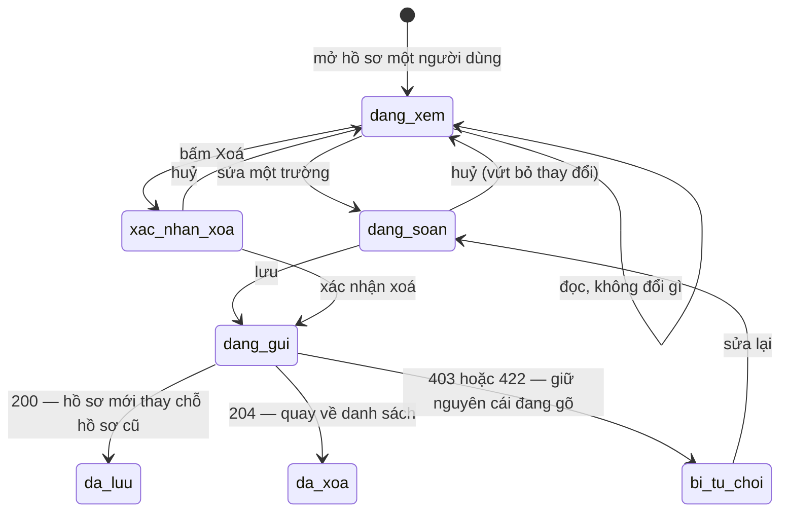

# Định danh và quản trị người dùng

## Tóm tắt

Mọi endpoint khác của v2 cần biết ai đang gọi, nên nhóm này phải ra đời trước. Nó phủ ba việc: đổi email và mật khẩu lấy token, tự sửa hồ sơ của mình, và quản trị viên quản lý tài khoản của người khác.

Khác với các nhóm còn lại của thư mục này, đây là phần **đã có bản v1 chạy được gần đủ**. Việc của v2 vì thế không phải mở một năng lực bị nhốt, mà là ba việc hẹp hơn: bù một đường còn thiếu (`DELETE` người dùng), hợp nhất ba luật mật khẩu đang mâu thuẫn, và chuyển hình dạng lỗi sang problem details mà không làm mất ba câu trả lời cố ý mơ hồ.

Con số về token, vai trò, giới hạn tần suất và vòng đời tài khoản thuộc [`../nen-tang/xac-thuc-va-vai-tro.md`](../nen-tang/xac-thuc-va-vai-tro.md). Tài liệu này không nhắc lại chúng, chỉ nói endpoint nào áp cái nào.

## Bề mặt cần có

| Phương thức | Đường dẫn | Việc |
|---|---|---|
| `POST` | `/api/v2/auth/login` | Đăng nhập vai trò `USER` |
| `POST` | `/api/v2/admin/auth/login` | Đăng nhập vai trò `ADMIN` |
| `POST` | `/api/v2/auth/register` | Tự đăng ký tài khoản `USER` chưa kích hoạt |
| `POST` | `/api/v2/auth/activate` | Kích hoạt bằng token trong email |
| `POST` | `/api/v2/auth/resend-activation` | Gửi lại thư kích hoạt |
| `POST` | `/api/v2/auth/change-password` | Đổi mật khẩu khi đang đăng nhập |
| `POST` | `/api/v2/auth/forgot-password` | Yêu cầu thư đặt lại mật khẩu |
| `POST` | `/api/v2/auth/reset-password` | Đặt lại mật khẩu bằng token trong email |
| `GET` | `/api/v2/users/me` | Hồ sơ của chính người gọi |
| `PATCH` | `/api/v2/users/me` | Sửa hồ sơ của chính mình |
| `GET` | `/api/v2/users/me/preferences` | Tuỳ chọn cá nhân (hiện chỉ cờ tự động ghép cặp) |
| `PATCH` | `/api/v2/users/me/preferences` | Đổi tuỳ chọn cá nhân |
| `GET` | `/api/v2/users` | Danh sách người dùng, lọc theo từ khoá và trạng thái |
| `POST` | `/api/v2/users` | Quản trị viên tạo tài khoản |
| `GET` | `/api/v2/users/{id}` | Chi tiết một người dùng |
| `PATCH` | `/api/v2/users/{id}` | Quản trị viên sửa hồ sơ, bật/tắt tài khoản |
| `POST` | `/api/v2/users/{id}/password-reset` | Quản trị viên đặt lại mật khẩu cho người khác |
| `DELETE` | `/api/v2/users/{id}` | **Năng lực mới** — xoá người dùng |

Bảy đường `/auth/*` mang động từ trong đường dẫn. Đây là ngoại lệ có lý do giống ngoại lệ của lệnh chuyển giai đoạn: chúng là chuyển trạng thái của một tài khoản chứ không phải phép gán lên một tài nguyên, và không cái nào map được vào một động từ HTTP mà không mất nghĩa.

Bốn phương thức của tầng dịch vụ **cố ý không có endpoint**, vì chúng là tra cứu nội bộ cho module khác dùng và mở ra HTTP sẽ tạo một đường dò email: tìm theo định danh không kiểm quyền, tìm theo email, tra nhiều người một lượt, và kiểm tài khoản còn hoạt động. Cái cuối cùng chạy ở mỗi request như một phần của việc kiểm token, không phải như một endpoint.

## Trường hợp đơn giản

Một người đăng ký ở cổng. Tài khoản ra đời ở trạng thái chưa kích hoạt, một thư kích hoạt được xếp hàng gửi. Họ bấm liên kết trong thư, tài khoản chuyển sang hoạt động, một thư chào mừng được xếp hàng.

Họ đăng nhập và nhận một token. Từ đó mọi lời gọi mang token đó. Họ mở trang hồ sơ, sửa số điện thoại, lưu. Máy chủ trả hồ sơ đã cập nhật.

Một quản trị viên mở danh sách người dùng, tìm theo email, mở hồ sơ người đó, tắt tài khoản. Ở lời gọi tiếp theo của người đó, token vẫn còn hạn nhưng bị từ chối.

## Tương tác, sự kiện theo sự kiện

Đơn vị tương tác là **màn hình chi tiết một người dùng ở bảng quản trị**, vì đó là chỗ tập trung đủ năm pha và là chỗ duy nhất có một hành động phá huỷ.

### Vào màn

`GET /api/v2/users/{id}` trả hồ sơ. Chỉ **quản trị viên** đọc được hồ sơ của người khác; chính chủ đọc được hồ sơ của mình qua `/api/v2/users/me`.

Người gọi không phải quản trị viên và không phải chính chủ nhận **404**, không phải 403. Đây là chỗ v2 phải khác tầng dịch vụ hiện tại: tầng dịch vụ ném từ chối vì chính sách, và nếu host dịch thẳng thành 403 thì một người dùng thường dò được định danh nào là một tài khoản có thật.

> Ghi chú kỹ thuật: bảng quyết định không có quy tắc nào cho phép vai trò `USER` thực hiện `person.admin_manage`, nên lượt đó rơi vào mặc định từ chối với `ruleId: "DEFAULT_DENY"`. Host của v2 phải chuyển từ chối-vì-không-được-đọc thành 404 **trước khi** dựng thân lỗi, nếu không `ruleId` sẽ rò rỉ chính thứ mà 404 đang giấu.

Danh sách `GET /api/v2/users` chỉ quản trị viên gọi được, và luôn trả 404 cho mọi vai trò khác. Nó nhận từ khoá tìm và trạng thái (`active`, `inactive`, hoặc tất cả) — tìm theo họ, tên, email và tên tổ chức, không phân biệt hoa thường.

Đọc **không ghi kiểm toán**.

### Rời đi không đổi gì

Không có gì được ghi và không có gì được giữ. Mở hồ sơ một người dùng rồi bỏ đi để lại đúng trạng thái ban đầu.

### Bắt đầu sửa

Lần sửa đầu tiên làm biểu mẫu thành *đã bẩn* và bật nút Lưu. Ba nhóm trường có luật khác nhau, và giao diện phải phân biệt:

- **Hồ sơ** (họ, tên, điện thoại, tổ chức) — sửa tự do, không luật nào ngoài độ dài.
- **Cờ đang hoạt động** — một công tắc có hệ quả tức thì ở lời gọi kế tiếp của người đó, không phải sau khi token hết hạn. Giao diện phải nói rõ điều này ngay tại công tắc.
- **Mật khẩu** — không sửa cùng biểu mẫu hồ sơ. Đặt lại mật khẩu là một hành động riêng, đi qua một đường riêng, và không nhận mật khẩu hiện tại của người bị đặt lại.

**Email không sửa được.** Không phương thức nào ở tầng dịch vụ đổi email của một tài khoản đã tồn tại. Ô email phải ở dạng chỉ đọc, không phải một ô nhập bị vô hiệu hoá trông như sẽ mở ra.

### Trong khi sửa

Không có endpoint xem trước và không có kiểm tra nào chạy ở máy chủ trong lúc soạn. Kiểm tra trùng email chỉ xảy ra ở bước gửi của lệnh **tạo**, không phải lệnh sửa.

Giao diện tự kiểm được ba thứ: độ dài các trường hồ sơ, định dạng email khi tạo, và luật mật khẩu. Luật mật khẩu là chỗ đáng chú ý nhất — xem mục dưới.

### Gửi đi

Lệnh sửa gửi các trường đã đổi. Trường không gửi nghĩa là không đổi, không phải xoá về rỗng.

Thứ tự kiểm ở máy chủ cho lệnh tạo:

1. **Quyền.** Không phải quản trị viên → 404 với danh sách, 403 với `ruleId` nếu người gọi được biết bản ghi tồn tại.
2. **Mật khẩu bắt buộc.** Bỏ trống → **400**, `code: "VALIDATION_FAILED"`. Đây là một trong bảy thay đổi có chủ đích: hệ cũ mặc định `12345678` khi không nhập, v2 không có mặc định nào.
3. **Email trùng.** → **409**, `code: "EMAIL_ALREADY_IN_USE"`.

Thành công trả hồ sơ mới. Giao diện thay chỗ dữ liệu cũ bằng phản hồi này.

Mọi lệnh ghi ở nhóm này ghi một dòng kiểm toán trong cùng giao dịch, gồm cả lượt bị chính sách từ chối. Đăng nhập, đổi mật khẩu và đặt lại mật khẩu ghi kèm địa chỉ IP và trình duyệt.

## Xoá người dùng

`DELETE /api/v2/users/{id}` là **năng lực mới ở cả hai tầng**, không phải một endpoint bọc quanh mã đã có.

Bảng quản trị đang gọi `DELETE /api/v1/admin/users/{id}` và nhận **405** vì facade v1 không có đường đó ([B-02](../bug-triage.md#b-02-xóa-người-dùng-trong-admin-trả-405)). Nhưng lấp lỗ hổng này không phải là viết một controller: **tầng dịch vụ .NET cũng không có phương thức nào xoá người dùng.** Giao diện quản trị vẽ ra một năng lực mà không tầng nào bên dưới có.

Vì vậy công việc là hai phần, và phần khó nằm ở phần đầu:

1. **Quyết định xoá nghĩa là gì.** Đây là một quyết định sản phẩm chưa có ai ra — xem [Câu hỏi mở](#câu-hỏi-mở-và-kiểm-chứng).
2. Viết phương thức ở tầng dịch vụ theo quyết định đó, rồi mở endpoint.

Cái đã biết chắc, bất kể quyết định nào được chọn:

- Chỉ quản trị viên gọi được. Vai trò khác nhận **404**.
- Quản trị viên **không xoá được chính mình**. Chưa có mã lỗi cho luật này (chưa cấp mã lỗi).
- Lệnh này bắt buộc mang `Idempotency-Key` như mọi lệnh ghi của v2. Bấm hai lần trên cùng một khoá trả lại đúng phản hồi cũ chứ không xoá hai lần.
- Nó ghi một dòng kiểm toán, và dòng đó phải sống lâu hơn bản ghi bị xoá — đây là ràng buộc quyết định phần lớn thiết kế bên dưới.
- Nó **không** vô hiệu hoá token đã cấp cho người bị xoá. Kiểm tra tài khoản còn hoạt động ở mỗi request là thứ chặn họ, nên hành vi đúng phụ thuộc vào việc bản ghi có còn để tra hay không.

Giao diện phải hỏi xác nhận và phải nói đúng hệ quả của lựa chọn đã chốt. Một hộp thoại nói "Xoá người dùng này?" trong khi hệ thống chỉ vô hiệu hoá vĩnh viễn là một câu nói dối nhỏ mà người dùng sẽ phát hiện.

## Ba luật mật khẩu

Cùng một trường, ba đường vào, ba luật khác nhau:

| Đường | Luật hiện tại |
|---|---|
| Đăng ký | Tối thiểu 8 ký tự |
| Đặt lại mật khẩu bằng token | Tối thiểu 8 ký tự, tối đa 128 |
| **Đổi mật khẩu khi đang đăng nhập** | Tối thiểu 8 ký tự **và** đủ chữ thường, chữ hoa, chữ số, ký tự đặc biệt |

Hệ quả: một người đặt được `12345678` lúc đăng ký, rồi không đổi được sang `abcdefgh`. Đường lỏng nhất và đường chặt nhất dẫn tới cùng một cột dữ liệu.

Đổi mật khẩu còn có hai luật mà hai đường kia không có: mật khẩu mới không được trùng mật khẩu hiện tại, và không được trùng mật khẩu ngay trước đó. Cả hai trả **400** với `code: "VALIDATION_FAILED"`.

v2 phải chọn một trong hai: hợp nhất về một luật duy nhất cho cả ba đường, hoặc giữ ba luật và nói rõ lý do. Đây là quyết định sản phẩm, không phải quyết định kỹ thuật — xem [Câu hỏi mở](#câu-hỏi-mở-và-kiểm-chứng).

**Đổi mật khẩu thành công không vô hiệu hoá token cũ.** Máy chủ trả một câu bảo người dùng đăng nhập lại nhưng không làm gì để bắt buộc điều đó; token đã cấp vẫn dùng được tới hết hạn. Nếu lý do đổi mật khẩu là nghi ngờ bị lộ, thao tác này không đạt mục đích của nó. v2 nên coi đây là một lỗi cần sửa cùng lúc với việc mở endpoint, chứ không phải một hành vi cần chép sang.

## Ba câu trả lời cố ý mơ hồ

Ba đường không tiết lộ tài khoản có tồn tại hay không. **v2 giữ nguyên cả ba**, vì chúng là quyết định bảo mật chứ không phải nợ kế thừa:

- **Đăng nhập sai vai trò** trả `INVALID_CREDENTIALS` (401), không phải 403. Một tài khoản `USER` gõ đúng mật khẩu ở đường đăng nhập quản trị nhận đúng câu như khi gõ sai mật khẩu.
- **Quên mật khẩu** luôn trả 200 kèm câu "nếu email tồn tại trong hệ thống…". Thư chỉ được gửi khi tài khoản có thật. Không có mã lỗi nào cho email không tồn tại, vì không có lỗi nào được trả.
- **Gửi lại thư kích hoạt** trả 200 cho mọi email đã qua giới hạn tần suất.

Câu thứ ba có một chỗ rò: tài khoản đã kích hoạt nhận một câu khác với mọi trường hợp còn lại, nên nó phân biệt được "email này đã có và đã kích hoạt" với phần còn lại ([B-13](../bug-triage.md#b-13-gửi-lại-thư-kích-hoạt-phân-biệt-được-ba-trạng-thái-tài-khoản)). v2 phải trả **cùng một câu cho mọi trường hợp**; giữ sự mơ hồ nghĩa là giữ nó cho cả ba nhánh, không phải hai.

Lưu ý một chỗ mơ hồ **không** được giữ: gửi lại thư kích hoạt cho một email không tồn tại hiện trả `ACCOUNT_NOT_FOUND` (404), tức là nó tiết lộ thẳng điều mà câu trả lời chung đang cố giấu. Hai hành vi này mâu thuẫn nhau trong cùng một endpoint.

## Biến thể

| Biến thể | Lúc vào màn | Trong khi sửa |
|---|---|---|
| Vai trò | `ADMIN` đọc được mọi hồ sơ và danh sách. `USER` chỉ đọc được hồ sơ của chính mình; mọi hồ sơ khác trả 404, danh sách trả 404. Khách chưa đăng nhập chỉ gọi được bảy đường `/auth/*` không cần token; mọi đường còn lại trả 401. | `ADMIN` sửa được hồ sơ người khác, bật/tắt tài khoản, đặt lại mật khẩu, xoá. `USER` chỉ sửa được hồ sơ và tuỳ chọn của chính mình; không đường nào cho họ đổi cờ hoạt động của bất kỳ ai, kể cả của chính họ. |
| Trạng thái bản ghi | Tài khoản chưa kích hoạt và tài khoản đã vô hiệu hoá hiện ra khác nhau trong danh sách, và lọc theo trạng thái chỉ phân biệt được `active` / `inactive` — **không phân biệt được "chưa kích hoạt" với "đã bị tắt"**, vì cả hai cùng là một bit. | Bật một tài khoản chưa từng kích hoạt sẽ cho nó vào thẳng trạng thái hoạt động mà không cần bấm liên kết trong thư. Giao diện phải nói rõ điều đó, vì nó là một đường vòng qua bước kích hoạt. |
| Cấu hình backend | `Mail:DryRun` quyết định thư kích hoạt và thư đặt lại mật khẩu có thực sự gửi hay chỉ ghi log. Ở chế độ chỉ ghi log, luồng đăng ký **trông như** thành công nhưng không ai nhận được gì. | Không ảnh hưởng. |
| Phím tắt của biểu mẫu | Biểu mẫu đăng nhập focus vào ô email khi mở. Biểu mẫu hồ sơ focus vào trường đầu tiên có thể sửa, không phải ô email chỉ đọc. | Enter trong biểu mẫu một dòng gửi đi. Escape trong hộp thoại xác nhận xoá là **huỷ**, không phải xác nhận — hộp thoại phá huỷ không được để nút xác nhận nhận Enter mặc định. |

Đổi biến thể giữa chừng: một quản trị viên có thể bị chính quản trị viên khác tắt tài khoản trong lúc đang soạn. Lệnh gửi sau đó trả 401, không phải 403.

## Huỷ và gián đoạn

| Sự kiện | Trước khi gửi | Trong khi đang gửi |
|---|---|---|
| Bấm Huỷ hoặc nhấn Escape | Thay đổi bị vứt bỏ, biểu mẫu về giá trị vừa tải. Không có gì được ghi. Với hộp thoại xoá, huỷ đóng hộp thoại và không gọi gì. | Không có cách huỷ. Các lệnh ở nhóm này đều là giao dịch ngắn; huỷ ở phía trình duyệt chỉ bỏ việc chờ phản hồi. |
| Đi chỗ khác trong app | Thay đổi mất. Không có bản nháp. Giao diện nên chặn lại và hỏi khi biểu mẫu đã bẩn. | Kết quả không tới giao diện; giao dịch ở máy chủ vẫn hoàn tất. Người dùng quay lại thấy hồ sơ đã đổi mà không nhớ mình đã lưu. |
| Back/Forward của trình duyệt | Như trên. | Như trên. |
| Tải lại trang, hoặc đóng tab | Thay đổi mất. | Giao dịch hoàn tất, giao diện không biết. Thử lại **cùng khoá chống lặp** trả phát lại thay vì ghi hai lần. |
| Mất mạng, hoặc quá hạn | Không ảnh hưởng — chưa gọi gì. | Giao diện không biết lệnh đã tới máy chủ chưa. **Phải giữ nguyên khoá chống lặp cho lần thử lại**; sinh khoá mới cho lệnh xoá có thể xoá hai lần và làm lần thứ hai trả 404 khó hiểu. |
| Phiên hết hạn (401), hoặc v1 bị dừng (410) | Người dùng bị đẩy về đăng nhập và mất cái đang gõ. Đây là chỗ đau nhất của nhóm này, vì phiên hết hạn ngay giữa lúc quản trị viên đang sửa là chuyện thường. | 401 giữa chừng nghĩa là lệnh bị từ chối trước khi vào tầng nghiệp vụ; không có gì được ghi. Đổi mật khẩu là ngoại lệ đáng chú ý: nó **không** làm phiên hiện tại hết hạn, nên người dùng ở lại đăng nhập sau khi đổi. |
| Bản ghi bị đổi bởi người khác | Hồ sơ hiển thị đã cũ. Giao diện không biết cho tới khi gửi, và với nhóm này thì **không bao giờ biết**: hồ sơ người dùng không mang số phiên bản và không có kiểm tra lệch phiên bản. Hai quản trị viên sửa cùng lúc thì người lưu sau thắng, im lặng. | Không có 409. Xem [Câu hỏi mở](#câu-hỏi-mở-và-kiểm-chứng). Nếu bản ghi đã bị xoá trong lúc đó, lệnh trả **404**. |
| Trình duyệt tự điền | Áp dụng ở đăng nhập, đăng ký và đổi mật khẩu. Trình quản lý mật khẩu ghi vào ô mà không phát sự kiện sửa, nên biểu mẫu có thể trông như chưa bẩn trong khi đã có nội dung. Nút gửi phải đọc giá trị thật của ô chứ không dựa vào cờ đã bẩn. | Không áp dụng. |

Sau bất kỳ gián đoạn nào, người dùng ở lại trang họ đang đứng. Cái đáng giữ là các trường hồ sơ đã gõ; ô mật khẩu thì không — sau một gián đoạn, mật khẩu nên bị xoá và gõ lại.

## Tương tác với hệ thống khác

**Quyền và vai trò.** Nhóm này là chỗ vai trò nền tảng được cấp phát, nên nó là gốc của mọi kiểm quyền khác. Ba quy tắc chạm tới nó: một quy tắc cho phép người dùng đọc và sửa hồ sơ của chính mình, một quy tắc cho phép quản trị viên quản lý mọi hồ sơ, và mặc định từ chối cho phần còn lại. Xem [`../xuyen-suot/quyen-va-vai-tro.md`](../xuyen-suot/quyen-va-vai-tro.md).

**Kiểm tra dữ liệu và cách hiện lỗi.** 16 mã của nhóm xác thực đã có tên ổn định và giao diện đã phân nhánh theo chúng; v2 giữ nguyên tên mã, chỉ đổi chỗ chứa câu hiển thị từ `message` sang `detail`. Câu kiểm tra dữ liệu phải đổi sang tiếng Việt: hiện chúng là nguyên văn thông điệp của thư viện NestJS cũ.

**Thay đổi chưa lưu.** Biểu mẫu hồ sơ là chỗ duy nhất có thể bẩn lâu. Ô mật khẩu không được coi là thay đổi chưa lưu đáng giữ.

**Cập nhật lạc quan và hoàn tác.** Không cập nhật lạc quan ở lệnh xoá và ở công tắc bật/tắt tài khoản — cả hai có hệ quả tức thì lên người khác. Không có hoàn tác cho bất kỳ lệnh nào ở đây; bật lại một tài khoản vừa tắt là một lệnh mới, và nó để lại hai dòng kiểm toán.

**Ngoại tuyến.** Không có tương tác. Không xác thực được khi ngoại tuyến, và không lệnh nào ở đây được xếp hàng để gửi sau.

**Thông báo và toast.** Không có loại thông báo trong ứng dụng nào cho nhóm này. Bốn loại đang tồn tại đều thuộc ghép cặp và lời mời hợp tác. Các sự kiện vòng đời tài khoản đi bằng **email**, không bằng khay thông báo: thư kích hoạt, thư chào mừng, thư báo đã đổi mật khẩu, thư đặt lại mật khẩu.

**Trạng thái lọc/tìm trong URL.** Hai bộ lọc của danh sách người dùng (từ khoá và trạng thái) cùng số trang nên nằm trong URL, để một quản trị viên gửi được đường dẫn tới đúng kết quả tìm cho người khác.

**Đa ngôn ngữ.** Bốn vai trò nền tảng lưu bằng chuỗi tiếng Anh viết hoa và cần bảng dịch ở giao diện. Thông điệp xác thực từ máy chủ hiện toàn tiếng Anh, kể cả trên giao diện tiếng Việt hoàn toàn.

**Khả năng truy cập.** Ô mật khẩu phải có nhãn thật, không chỉ chữ mờ gợi ý. Hộp thoại xác nhận xoá phải giữ focus và trả focus về nút đã mở nó khi đóng.

**Dấu vết kiểm toán.** Đăng nhập, đổi mật khẩu và đặt lại mật khẩu ghi dòng kiểm toán kèm địa chỉ IP và trình duyệt; hai trường đó có thời hạn lưu ngắn hơn bản thân dòng kiểm toán. Lệnh xoá người dùng phải ghi một dòng **tồn tại lâu hơn bản ghi bị xoá**, và dòng đó không được chứa thông tin cá nhân của người bị xoá — nếu không, việc xoá không đạt mục đích của nó.

## Trường hợp biên

- **Bảng quản trị đang gọi một đường không tồn tại.** Nút Xoá trong danh sách người dùng gửi `DELETE` và nhận 405. Đây không phải một lỗi cấu hình route mà là một năng lực chưa được xây ở bất kỳ tầng nào.
- **Ba luật mật khẩu mâu thuẫn.** Một mật khẩu hợp lệ lúc đăng ký có thể không hợp lệ lúc đổi.
- **Đổi mật khẩu không vô hiệu hoá token cũ.**
- **Email không đổi được** nhưng cũng không có thông điệp nào nói vì sao.
- **Trạng thái tài khoản chỉ có một bit.** "Chưa kích hoạt" và "đã bị quản trị viên tắt" là cùng một giá trị trong dữ liệu, nhưng đăng nhập vào hai trạng thái đó trả hai câu khác nhau — câu phân biệt được nằm ở chỗ người gọi đăng nhập bằng đường quản trị hay đường cổng, không phải ở trạng thái thật.
- **Hồ sơ người dùng không có số phiên bản.** Hai quản trị viên sửa cùng lúc thì người lưu sau ghi đè, không có 409.
- **Vai trò `SYSTEM` không có định danh người.** Bất kỳ đường nào chạy dưới vai trò đó mà cần một người cụ thể sẽ hỏng thay vì âm thầm gán sai người.
- **Không có đường nào đổi vai trò của một tài khoản.** Không phương thức nào ở tầng dịch vụ nâng một `USER` lên `ADMIN` hay hạ ngược lại. Tài khoản quản trị đầu tiên phải ra đời bằng con đường khác API.

## Câu hỏi mở và kiểm chứng

- **Xoá người dùng nghĩa là gì?** Ba lựa chọn cho ra ba lượng công việc và ba hệ quả pháp lý khác nhau, và chưa cái nào được chọn: **(a) vô hiệu hoá vĩnh viễn** — bản ghi ở lại, email vẫn bị chiếm, mọi nội dung họ đăng vẫn trỏ về một cái tên đọc được; **(b) ẩn danh hoá** — bản ghi ở lại nhưng họ tên, email và điện thoại bị thay bằng giá trị vô nghĩa, nội dung họ đăng mất tác giả, email được giải phóng để đăng ký lại; **(c) xoá thật** — bản ghi biến mất, và mọi thứ trỏ tới nó (đề bài, tài sản công nghệ, câu chuyện, lời mời, thông báo, dòng kiểm toán) phải có câu trả lời cho việc trỏ vào khoảng không. Quyết định này phải có **trước** khi viết phương thức ở tầng dịch vụ, vì nó quyết định cả lược đồ dữ liệu lẫn câu chữ trên hộp thoại xác nhận. (chưa cấp mã lỗi)
- **Ba luật mật khẩu: hợp nhất hay giữ?** Nếu hợp nhất thì hợp nhất về luật chặt hay luật lỏng — luật chặt làm mọi mật khẩu cũ hợp lệ trở thành không đổi được bằng chính nó, luật lỏng hạ tiêu chuẩn của đường đang chặt nhất. Nếu giữ ba luật thì phải nói được vì sao đường tự phục vụ lại lỏng hơn đường đang đăng nhập.
- **Đổi mật khẩu có nên vô hiệu hoá token cũ không?** Hành vi hiện tại kế thừa từ hệ cũ và chưa thấy chỗ nào ghi lý do giữ. Nếu có, nó cần một cơ chế thu hồi token mà hiện chưa tồn tại — không có phiên phía máy chủ, không có refresh token, không có danh sách đen.
- **Hồ sơ người dùng có cần kiểm tra lệch phiên bản không?** Bốn bản ghi được liệt kê là cần cơ chế này không gồm người dùng. Cần xác nhận đó là chủ ý chứ không phải bỏ sót, vì màn hình quản trị người dùng là màn hình có nhiều người cùng sửa nhất trong bảng quản trị.
- **Có cần một đường đổi vai trò không?** Nếu không, cần nói rõ tài khoản quản trị được tạo bằng cách nào ở môi trường thật.
- Chưa xác nhận thư kích hoạt và thư đặt lại mật khẩu gửi được trên bản chạy; cấu hình mặc định bật chế độ chỉ ghi log.
- Chưa đo giới hạn tần suất trên bản chạy, và chưa biết bộ đếm có sống qua lần khởi động lại của API không.
- Chưa rà xem còn endpoint nào của nhóm này lệch hình dạng phản hồi so với phần còn lại; phản hồi đăng nhập đã lệch một lần rồi.

Đặc tả — chưa có mã. Dựa trên SourceCode/nacentech, bản chụp ngày 2026-09-04.
