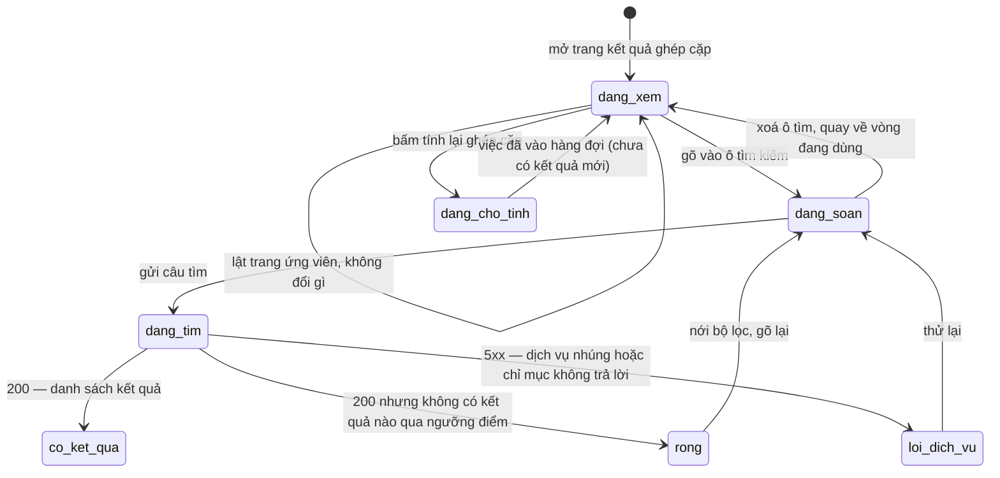

# Ghép cặp, vòng tính và tìm kiếm lai

## Tóm tắt

Ghép cặp là việc tìm ra những đối tác có thể có: với một đề bài thì tìm tài sản công nghệ, với một tài sản công nghệ thì tìm đề bài. Kết quả không phải một danh sách trôi nổi mà là một **vòng ghép cặp** — một lần tính, có mốc thời gian, ghi lại đã tính bằng công cụ nào, mô hình nhúng nào và chế độ chấm điểm nào.

Vòng cũ **chỉ đọc**. Tính lại tạo một vòng mới; vòng trước bị hạ khỏi vị trí đang dùng nhưng ở nguyên đó cùng toàn bộ ứng viên và điểm số của nó. Nhờ vậy một câu hỏi trả lời được: kết quả tháng này khác tháng trước là vì dữ liệu đã đổi, hay vì thuật toán đã đổi.

Toàn bộ thông tin đó có trong dữ liệu và **không tới được người dùng**: facade v1 chỉ trả một danh sách ứng viên phẳng — định danh hai bên, điểm thô, đoạn văn bản khớp, thời điểm — không có vòng nào, chế độ nào, phiên bản nào. Người dùng nhìn một con số điểm mà không biết nó được tính bằng cách gì.

## Ranh giới phạm vi

**Chỉ mục tìm kiếm nằm trong PostgreSQL từ 2026-09-05** ([ADR-0010](../../../04-technical/adr/0010-bo-elasticsearch-chi-muc-trong-postgresql.md)): bảng chiếu `matching.search_chunks` với `pgvector` (cosine, HNSW) cho kênh dense và `tsvector` qua `unaccent` cho kênh từ khoá — "cong nghe sinh hoc" khớp "công nghệ sinh học". Elasticsearch đã gỡ khỏi mã, cấu hình và `docker-compose`. Hai chế độ chấm điểm và bất biến "một engine cho mỗi vòng" giữ nguyên; nhãn engine mới là `postgres-16/pgvector-legacy` và `postgres-16/pgvector-rrf`. Dịch vụ ngoài duy nhất còn lại của nhóm này là sidecar nhúng BGE-M3. Từ cùng ngày: kênh **sparse** (`Matching:UseSparse`, cột `sparsevec`), kênh **exact/trigram** (số hiệu, tên tổ chức), kênh từ khoá theo **cụm âm tiết** với **hai trường** có dấu / không dấu, chuẩn hoá NFC + một kiểu đặt dấu, **cross-encoder rerank** (`Matching:UseRerank`, hậu tố engine `-rerank`), ngưỡng điểm **theo chế độ** (`MatchMinScoreCorrected`, B-45), và job dựng lại bản chiếu từ `content_chunks` cho dữ liệu di trú. Nhãn engine: `postgres-16/pgvector-legacy`, `postgres-16/pgvector-rrf`, `postgres-16/pgvector-rrf3`, thêm `-rerank` khi bật. Tám ca §26.6.6 đo 10/10 trên mô hình thật (`verification/anh-chup/verify-search-cases.mjs`).

Hai thư mục mã nguồn **nằm ngoài bộ tài liệu này**: `dmst-rag-master` và `search-bench`.

Cái thứ nhất là dịch vụ sinh véc-tơ nhúng; cái thứ hai là bộ đo chất lượng tìm kiếm. Chúng ảnh hưởng tới **chất lượng** của kết quả ghép cặp — kết quả nào lên trước, điểm bao nhiêu — chứ không ảnh hưởng tới **hành vi** của bất kỳ màn hình nào. Một thay đổi trong đó làm danh sách ứng viên đổi thứ tự; nó không làm một nút bấm được hay không bấm được, không thêm một mã lỗi nào, không đổi một luật quyền nào.

Ranh giới thực dụng: bộ tài liệu này mô tả tới **hợp đồng** với hai thứ đó và dừng lại ở đấy. Cụ thể, hai điều sau thuộc phạm vi và phải được đặc tả:

- Vòng ghép cặp **ghi lại phiên bản mô hình nhúng** đã dùng, và endpoint phải lộ giá trị đó ra.
- Dịch vụ nhúng không trả lời được thì lượt tính thất bại, và **người dùng phải biết** thay vì thấy một danh sách rỗng.

Còn mô hình nào tốt hơn mô hình nào, ngưỡng điểm nên đặt ở đâu, bộ đo cho ra con số gì — nằm ngoài. Tài liệu này không nhắc lại chúng và không đưa ra khuyến nghị nào về chúng.

## Bề mặt cần có

| Phương thức | Đường dẫn | Việc |
|---|---|---|
| `GET` | `/api/v2/subjects/{kind}/{id}/match-rounds` | Danh sách các vòng đã tính cho một subject |
| `GET` | `/api/v2/subjects/{kind}/{id}/match-rounds/latest` | Vòng đang dùng, kèm phiên bản công cụ, mô hình và chế độ chấm điểm |
| `GET` | `/api/v2/subjects/{kind}/{id}/match-candidates` | Ứng viên của vòng đang dùng, có phân trang |
| `GET` | `/api/v2/subjects/{kind}/{id}/match-candidates/top` | N ứng viên đầu, cho thẻ tóm tắt trên trang chi tiết |
| `GET` | `/api/v2/match-rounds/{roundId}` | Một vòng theo định danh (từ 2026-09-05). Đường tuyệt đối vì định danh vòng là toàn cục; quyền đọc vẫn là quyền đọc subject của vòng |
| `GET` | `/api/v2/match-rounds/{roundId}/candidates` | Ứng viên của **một vòng cụ thể**, theo hạng tăng dần — để so hai vòng |
| `POST` | `/api/v2/subjects/{kind}/{id}/match-rounds` | Yêu cầu tính một vòng mới — **mở 2026-09-05**: 202 xếp việc; 403 kèm `ruleId`; 422 `SUBJECT_NOT_PUBLISHED` / `SUBJECT_NO_CONTENT`; 428 thiếu khoá chống lặp |
| `POST` | `/api/v2/subjects/{kind}/{id}/index-jobs` | Yêu cầu cắt đoạn và lập chỉ mục lại một subject — **mở 2026-09-05**, cùng luật với dòng trên |
| `GET` | `/api/v2/search` | Tìm kiếm lai trên chỉ mục |
| — | *(chạy trong việc nền)* | Tính vòng mới; cắt đoạn, nhúng và lập chỉ mục; gỡ một subject khỏi chỉ mục |

Bảy đường dẫn phủ sáu phương thức đọc và yêu cầu của tầng dịch vụ; dòng cuối phủ ba phương thức còn lại, và cả ba **cố ý không có cửa HTTP**: chúng chạy hàng chục giây, gọi ra hai dịch vụ ngoài, và đã có hai đường xếp hàng ở trên. Phơi chúng ra là mời người dùng giữ một tab mở trong hai phút để chờ một việc nền.

~~**`GET /api/v2/subjects/{kind}/{id}/match-rounds` chưa có phương thức nào ở tầng dịch vụ.**~~ Đã có từ 2026-09-05: `ListRoundsAsync` (mới nhất trước, lọc theo chế độ chấm điểm và phiên bản công cụ, **không** lọc theo điểm), `GetRoundAsync`, và `ListRoundCandidatesAsync` — ứng viên **của một vòng cụ thể** theo hạng, chứ không chỉ của vòng đang dùng. Hai đường HTTP đi kèm ở dưới. `MatchRoundDto` thêm `queryText` (`null` ở vòng nhập từ hệ cũ) và `isAuthoritative`. Trang so sánh hai vòng — mục đích chính của việc lưu vòng cũ — dựng được từ lúc đó.

**Tìm kiếm phải là `GET`, không phải `POST`.** Ở v1 nó là `POST /api/v1/search` với thân request. Trên `/api/v2`, mọi `POST` [bắt buộc mang khoá chống lặp](README.md#cái-gì-đã-có-sẵn-và-không-phải-xây-lại), và cùng khoá cùng thân sẽ **phát lại kết quả cũ thay vì tìm lại**. Một ô tìm kiếm mà gõ lại đúng câu cũ thì trả về kết quả đóng băng của lần trước là hành vi sai. Tìm kiếm là một lệnh đọc và phải mang hình dạng của một lệnh đọc.

## Ai gọi được và bị từ chối khi nào

| Endpoint | Ai gọi được | Từ chối với mã | Ghi lại |
|---|---|---|---|
| `GET .../match-rounds` | Người đọc được subject | `404 NOT_FOUND` khi không đọc được subject | Không ghi |
| `GET .../match-rounds/latest` | Như trên | Như trên | Không ghi |
| `GET .../match-candidates` | Như trên | Như trên | Không ghi |
| `GET .../match-candidates/top` | Như trên | Như trên | Không ghi |
| `GET /match-rounds/{roundId}` và `.../candidates` | Người đọc được **subject của vòng** | `404 NOT_FOUND` khi vòng không có **hoặc** subject không đọc được — không tách hai trường hợp, vì tách là xác nhận vòng tồn tại | Không ghi |
| `POST .../match-rounds` | Chủ sở hữu subject; quản trị viên | `403 FORBIDDEN` kèm `ruleId`; `422` khi subject chưa xuất bản hoặc chưa có nội dung (chưa cấp mã lỗi) | Một dòng ghi; một việc nền được xếp hàng |
| `POST .../index-jobs` | Như trên | Như trên | Như trên |
| `GET /search` | Người qua được quy tắc `search.query` | `403 FORBIDDEN`; `400 VALIDATION_FAILED` khi truy vấn rỗng | **Một dòng vào nhật ký truy vấn tìm kiếm** |

~~Bốn đường đọc đầu **hiện không kiểm quyền ở tầng dịch vụ**.~~ Từ sprint 1 cửa HTTP v2 gọi `match_round.read` **và** hỏi quyền đọc subject (đo: MATCH-01). Đoạn còn lại giữ để nhớ vì sao: bảng quyết định từng có hành động này mà không chỗ nào gọi. Ai biết định danh của một subject thì đọc được toàn bộ ứng viên, điểm số và đoạn văn bản khớp của subject đó, kể cả subject của người khác và kể cả subject chưa xuất bản. Endpoint v2 phải cắm kiểm quyền vào trước khi mở bốn đường này ra ngoài — đây là điều kiện bắt buộc, không phải cải tiến. (chưa cấp mã lỗi)

## Trường hợp đơn giản

Một người dùng xuất bản một đề bài. Việc xuất bản phát ra một sự kiện; hệ thống xếp hàng một việc nền cắt nội dung thành đoạn, gọi dịch vụ nhúng, và đẩy các đoạn lên chỉ mục tìm kiếm.

Nếu người đó bật *tự động ghép cặp*, việc lập chỉ mục xong sẽ xếp tiếp một việc tính ghép cặp. Việc đó lấy tiêu đề cộng phần đầu nội dung làm truy vấn, tìm trên chỉ mục trong nhóm ngược lại — đề bài thì tìm công nghệ — giới hạn trong các lĩnh vực của đề bài, chỉ lấy bản đã xuất bản, và loại chính chủ sở hữu ra.

Kết quả tạo một **vòng mới**. Vòng trước đó của cùng subject bị hạ khỏi vị trí đang dùng. Ứng viên được xếp hạng theo điểm giảm dần, và mỗi ứng viên giữ lại đoạn văn bản đã khớp.

Người dùng mở trang kết quả và thấy danh sách, kèm một dòng nói vòng này tính lúc nào, bằng chế độ chấm điểm nào và mô hình nhúng nào.

## Tương tác, sự kiện theo sự kiện

Đơn vị tương tác là **một lượt tìm đối tác**: gõ câu tìm, chọn bộ lọc, xem kết quả.

### Vào màn

`GET /api/v2/subjects/{kind}/{id}/match-rounds/latest` trả vòng đang dùng. Đây là chỗ v2 phải khác v1 một cách rõ ràng: **bốn thông tin về vòng phải lộ ra**, và giao diện phải hiển thị chúng chứ không cất đi.

| Trường | Vì sao người dùng cần |
|---|---|
| Thời điểm tính | Kết quả cũ ba tháng là kết quả tính trên nội dung đã đổi |
| Phiên bản công cụ tìm kiếm | Phân biệt kết quả tính mới với kết quả **nhập từ hệ cũ** |
| Phiên bản mô hình nhúng | Đổi mô hình làm điểm số không so sánh được với vòng trước |
| Chế độ chấm điểm | Hai chế độ cho ra hai bộ kết quả khác nhau trên cùng dữ liệu |

`GET .../match-candidates` trả ứng viên của vòng đang dùng, sắp theo điểm giảm dần, dùng [hình dạng phân trang chung](README.md#phân-trang).

**Điểm là điểm thô, không phải phần trăm.** Nó là số do công cụ tìm kiếm trả về, và nó không có trần: hai chế độ chấm điểm cho ra hai thang khác nhau, và hai vòng dùng hai mô hình nhúng khác nhau không so được với nhau. Giao diện **không được** chuẩn hoá nó thành phần trăm hay thành số sao — làm thế là bịa ra một thang đo không tồn tại. Cách đúng là hiển thị thứ hạng và đoạn văn bản đã khớp, còn điểm thô để ở dạng phụ.

Nếu subject chưa có vòng nào, mọi đường trên trả danh sách rỗng chứ không trả lỗi. Giao diện phải phân biệt ba trạng thái rất khác nhau: **chưa tính bao giờ**, **đã tính và không tìm thấy ai**, và **đang tính**. Hiện chỉ có hai trạng thái đầu phân biệt được, và cả hai đều trông như một danh sách rỗng.

### Rời đi không đổi gì

Đọc vòng và đọc ứng viên **không ghi gì**. Chúng là dữ liệu đã tính sẵn, không chạm tới chỉ mục và không gọi dịch vụ ngoài.

Tìm kiếm thì khác: nó **luôn ghi một dòng vào nhật ký truy vấn tìm kiếm**, kể cả khi không có kết quả nào. Dòng đó gồm câu tìm nguyên văn, người tìm, các bộ lọc, ngưỡng điểm, chế độ chấm điểm, phiên bản công cụ, danh sách định danh kết quả và thời gian chạy.

Đây không phải nhật ký kiểm toán — nó là dữ liệu để dựng bộ đo chất lượng tìm kiếm, và nó ghi **cả những lượt tìm không ra gì**, vì đó chính là những lượt đáng học nhất. Nhưng nó chứa câu tìm nguyên văn gắn với người tìm, và câu tìm là thứ người ta gõ vào khi không biết phải gõ gì. Nó cần một thời hạn lưu và một luật về ai đọc được; hiện chưa có cái nào.

### Bắt đầu sửa

Ô tìm kiếm có một trường bắt buộc và bốn trường tuỳ chọn:

| Trường | Luật |
|---|---|
| Câu tìm | Bắt buộc, không rỗng |
| Số kết quả | Mặc định 10, tối đa 50 |
| Nhóm đối tượng | Đề bài hoặc tài sản công nghệ; bỏ trống là tìm cả hai |
| Lĩnh vực | Nhiều giá trị; thu hẹp phạm vi |
| Ngưỡng điểm | Chặn kết quả yếu |

Ngưỡng điểm là trường nguy hiểm nhất và **không nên hiện ra cho người dùng cuối**. Nó là một con số trên một thang không có ý nghĩa trực quan, đổi theo chế độ chấm điểm, và đặt sai một chút là ra danh sách rỗng. Facade v1 đặt mặc định là 2.0 còn việc tính ghép cặp nền đặt 1.0 — hai đường cùng đi qua một hàm tìm kiếm với hai ngưỡng khác nhau, nên cùng một cặp có thể xuất hiện ở ghép cặp tự động mà không xuất hiện khi tìm tay. Nếu ngưỡng phải hiện ra, nó phải là ba lựa chọn có tên ("chặt", "vừa", "rộng"), không phải một ô số.

**`GET /api/v2/search` phải mặc định chỉ tìm nội dung đã xuất bản.** Đường tìm kiếm ở v1 gọi xuống với cờ "chỉ đã xuất bản" **tắt**, nên nó trả cả bản nháp của người khác, kèm đoạn văn bản đã khớp. Đây là một rò rỉ đang tồn tại và v2 không được chép lại. (chưa cấp mã lỗi)

### Trong khi sửa

Không có gợi ý tự động, không có tìm khi đang gõ, không có đếm số kết quả trước. Mỗi lượt tìm gọi dịch vụ nhúng cho câu tìm rồi mới gọi chỉ mục, nên nó tốn hơn một truy vấn cơ sở dữ liệu thông thường nhiều lần.

Hệ quả trực tiếp: **không gọi tìm kiếm ở mỗi phím gõ**. Lượt tìm phải do người dùng chủ động gửi.

### Gửi đi

`GET /api/v2/search` với câu tìm và các bộ lọc trên chuỗi truy vấn. Thứ tự ở máy chủ:

1. **Quyền.** Không đủ → `403` kèm `ruleId`.
2. Sinh véc-tơ cho câu tìm bằng dịch vụ nhúng.
3. Bảo đảm chỉ mục tồn tại, rồi truy vấn chỉ mục theo **chế độ chấm điểm đang cấu hình**.
4. Gộp các đoạn của cùng một subject, giữ đoạn điểm cao nhất.
5. Lọc theo ngưỡng điểm, cắt xuống số kết quả yêu cầu.
6. Ghi một dòng vào nhật ký truy vấn tìm kiếm.

Bước 2 và 3 gọi ra hai dịch vụ ngoài. Cả hai hỏng đều cho ra **500** với một mã tương quan và không có chi tiết. Người dùng thấy một lỗi chung cho một nguyên nhân rất cụ thể là "công cụ tìm kiếm chưa dựng xong". Yêu cầu cho v2: hai tình huống này phải trả **503** với một mã ổn định riêng, để giao diện nói được "chức năng tìm kiếm đang tạm ngưng" thay vì "đã có lỗi xảy ra". (chưa cấp mã lỗi)

## Hai chế độ chấm điểm

Hệ thống có hai cách chấm điểm, và chúng cho ra hai bộ kết quả khác nhau trên cùng một dữ liệu.

| | `LEGACY_SCORING` | `CORRECTED_SCORING` |
|---|---|---|
| Lọc cứng | **Sau** khi đã cắt top-K | **Trước** khi thu hồi |
| Hai kênh | Điểm véc-tơ và điểm từ khoá **cộng lại** thành một số | Hai kênh thu hồi **riêng biệt** |
| Hợp nhất | Không có; xếp theo tổng | Hợp nhất theo thứ hạng của từng kênh |
| Dùng để | Tái tạo đúng hành vi của hệ NestJS cũ, để đo đường cơ sở | Chạy thật |

Điểm khác nhau có hệ quả người dùng thấy được: ở chế độ cũ, việc lọc "chỉ lấy bản đã xuất bản" và "bỏ nội dung của chính mình" chạy **sau** khi danh sách đã bị cắt. Xin 10 kết quả thì có thể nhận về 4, vì 6 cái đã bị loại sau khi cắt. Danh sách ngắn hơn số đã xin **không phải lỗi** ở chế độ này; nó là hành vi được giữ nguyên có chủ đích để so sánh với hệ cũ.

**Chế độ là một cờ vận hành, không phải một lựa chọn của người dùng.** Nó nằm trong cấu hình máy chủ, đổi được mà không deploy lại giao diện, và không có tham số nào ở bất kỳ endpoint nào cho phép chọn nó cho một lượt gọi. Điều này phải giữ nguyên ở v2: hai chế độ tồn tại để so sánh có kiểm soát, và cho người dùng bật tắt sẽ phá đúng cái nó sinh ra để làm.

Nhưng chế độ **phải lộ ra ở phần đọc**. Người xem một vòng cần biết nó tính bằng chế độ nào, vì hai vòng khác chế độ không so được với nhau. Ghi vào vòng thì đã có sẵn; việc còn lại là trả nó ra và hiển thị.

## Ba giá trị phiên bản công cụ

Vòng ghép cặp ghi lại công cụ đã tính ra nó. Có đúng ba giá trị, và giá trị thứ ba là giá trị quan trọng nhất với người đọc:

| Giá trị | Nghĩa |
|---|---|
| Công cụ tìm kiếm, chấm điểm kiểu cũ | Vòng tính bằng chế độ `LEGACY_SCORING` |
| Công cụ tìm kiếm, chấm điểm đã sửa | Vòng tính bằng chế độ `CORRECTED_SCORING` |
| **Nhập từ hệ cũ** | Vòng **không được tính lại** — nó là dữ liệu di trú từ bảng match của hệ NestJS |

Vòng nhập từ hệ cũ giữ nguyên điểm thô và nhãn thuật toán của hệ cũ, **không chuẩn hoá thành phần trăm**, và không có câu truy vấn nào kèm theo vì hệ cũ không lưu.

Giao diện phải phân biệt nó rõ ràng, vì nó khác về bản chất với hai loại kia: nó là **dữ liệu lịch sử**, không phải một lần tính của hệ thống hiện tại. Một người so hai vòng mà không biết một trong hai là dữ liệu nhập sẽ kết luận sai về việc thuật toán đã đổi thế nào.

Đổi mô hình nhúng cũng là một ranh giới tương tự: chỉ mục cố định số chiều véc-tơ, nên đổi mô hình bắt buộc phải dựng chỉ mục mới và lập chỉ mục lại toàn bộ. Vòng cũ vẫn đọc được — chúng giữ điểm và đoạn văn bản khớp ngay trong ứng viên, không cần hỏi lại chỉ mục.

## Chỉ mục không chứa nội dung mật

Chỉ mục tìm kiếm chứa **nội dung công khai và siêu dữ liệu**: đoạn văn bản, véc-tơ nhúng, tiêu đề, tiêu đề do AI viết lại, lĩnh vực, chủ sở hữu, cờ đã xuất bản. Không có gì từ [phòng dữ liệu](dataroom-va-cap-quyen.md) đi vào đây — không đoạn văn bản mật, không nội dung tệp.

Đây là một ranh giới có chủ đích và nó phải giữ được khi endpoint được viết. Hai điều nó bảo đảm:

- Một kết quả tìm kiếm **không bao giờ lộ nội dung mật**, kể cả khi máy chủ quên kiểm quyền ở một chỗ nào đó.
- Ngược lại, một tài liệu mật **không làm tăng khả năng được tìm thấy** của subject chứa nó. Ai đưa nội dung tốt nhất vào phần mật thì subject của họ khó được ghép cặp hơn. Đó là đánh đổi có ý thức, không phải một lỗi, nhưng người dùng cần biết trước khi họ chọn chỗ đặt nội dung.

Chỉ mục **có** chứa bản nháp — đoạn văn bản của bản chưa xuất bản vẫn nằm đó, phân biệt bằng một cờ. Vì thế cờ "chỉ lấy bản đã xuất bản" là ranh giới bảo vệ duy nhất, và nó phải bật mặc định ở mọi đường đọc.

## Yêu cầu tính lại

`POST /api/v2/subjects/{kind}/{id}/match-rounds` **không tính ngay**. Nó xếp một việc vào hàng đợi và trả về ngay lập tức. Việc đưa vào hàng đợi nằm trong cùng giao dịch với dữ liệu, nên nó không mất khi máy chủ khởi động lại.

Hai điều giao diện phải xử lý:

- **Phản hồi không có kết quả.** Nó chỉ xác nhận đã nhận yêu cầu. Giao diện không được hiện "đang tính, chờ chút" rồi tự đoán thời gian; nó phải hỏi lại vòng mới nhất sau một khoảng và so thời điểm tính.
- **Không có gì báo khi xong.** Có một loại thông báo cho việc tìm được ứng viên, nhưng không có gì trong nhóm endpoint này bảo đảm nó được phát. Người dùng bấm tính lại rồi ngồi nhìn một màn hình không đổi.

Hàng đợi khử trùng lặp theo subject, nên bấm mười lần chỉ chạy một lần — nhưng người dùng không thấy điều đó và sẽ bấm lại. Nút phải chuyển sang trạng thái "đã yêu cầu" và ở đó cho tới khi có vòng mới.

**Nếu lượt tính không tìm được ứng viên nào, không có vòng mới nào được tạo.** Vòng cũ giữ nguyên vị trí đang dùng. Người dùng bấm tính lại, chờ, tải lại trang, và thấy **đúng danh sách cũ** — không có cách nào phân biệt "đã tính lại và không có gì mới" với "việc chưa chạy". Đây là chỗ cần một vòng rỗng được ghi lại thay vì không ghi gì. (chưa cấp mã lỗi)

## Biến thể

| Biến thể | Lúc vào màn | Trong khi soạn câu tìm |
|---|---|---|
| Vai trò | Bốn đường đọc hiện **không kiểm quyền**; v2 phải kiểm theo quyền đọc subject. Tìm kiếm đi qua bảng quyết định, nên khách chưa đăng nhập bị chặn hay không là do bộ quy tắc quyết định, không do endpoint. | Vai trò quyết định lượt tìm có qua bước 1 không. Không đủ quyền nhận 403 kèm `ruleId`. |
| Trạng thái bản ghi | Subject chưa xuất bản hoặc chưa có nội dung thì không có vòng nào. Subject đã xoá mềm bị gỡ khỏi chỉ mục, nên nó biến khỏi kết quả của người khác — nhưng các vòng **đã tính** vẫn giữ nó làm ứng viên, kèm điểm cũ. | Không đổi được giữa chừng ở phía người dùng. Chỉ mục **đổi liên tục** ở phía sau: cùng một câu tìm gửi hai lần cách nhau vài phút cho ra hai kết quả khác nhau, và đó là hành vi đúng. |
| Cấu hình backend | **Chế độ chấm điểm** quyết định kết quả và quyết định giá trị phiên bản công cụ ghi vào vòng mới. Đổi cờ này không đổi vòng cũ. Địa chỉ dịch vụ nhúng và địa chỉ chỉ mục cũng là cấu hình; sai một trong hai thì tìm kiếm hỏng hoàn toàn còn phần đọc vòng cũ vẫn chạy. | Không ảnh hưởng. Người dùng không chọn được chế độ và không nên biết cờ đó tồn tại ở mức thao tác. |
| Phím tắt của biểu mẫu | Focus vào ô tìm kiếm khi mở màn hình. | Enter gửi lượt tìm — ở đây Enter gửi được, vì lượt tìm là lệnh đọc và lặp lại vô hại. Escape xoá ô tìm và quay về vòng đang dùng. |

Đổi biến thể giữa chừng: chế độ chấm điểm đổi được ở máy chủ trong lúc người dùng đang xem. Vòng họ đang nhìn không đổi; lượt tìm tiếp theo thì đổi. Vì mỗi vòng ghi lại chế độ của chính nó, việc này không làm hỏng dữ liệu — nhưng nó làm hai màn hình cạnh nhau hiện hai kiểu kết quả, và chỉ có dòng "tính bằng chế độ nào" giải thích được.

## Huỷ và gián đoạn

| Sự kiện | Trước khi gửi | Trong khi đang gửi |
|---|---|---|
| Bấm Huỷ hoặc nhấn Escape | Ô tìm bị xoá, danh sách quay về vòng đang dùng. Không có gì được ghi. | Huỷ ở trình duyệt bỏ việc chờ phản hồi. Lượt tìm đã tới máy chủ vẫn chạy hết và vẫn ghi một dòng vào nhật ký truy vấn. |
| Đi chỗ khác trong app | Câu tìm mất nếu không nằm trong URL. | Kết quả không tới giao diện. Với lệnh yêu cầu tính lại, việc nền vẫn được xếp hàng và vẫn chạy. |
| Back/Forward của trình duyệt | Câu tìm trong URL khôi phục được và **nên** khôi phục được; lượt tìm chạy lại và có thể ra kết quả khác vì chỉ mục đã đổi. | Như trên. |
| Tải lại trang, hoặc đóng tab | Câu tìm ngoài URL mất. | Với lượt tìm: vô hại, chạy lại. Với lệnh tính lại: việc đã vào hàng đợi và vẫn chạy; khoá chống lặp bảo đảm bấm lại không xếp hai việc. |
| Mất mạng, hoặc request quá hạn | Không ảnh hưởng — chưa gọi gì. | Lượt tìm thử lại tự do, không cần khoá chống lặp vì nó là lệnh đọc. Lệnh tính lại **phải giữ nguyên khoá chống lặp**, dù hàng đợi cũng khử trùng lặp theo subject. |
| Phiên hết hạn (401), hoặc v1 bị dừng (410) | Người dùng bị đẩy về đăng nhập, mất câu tìm ngoài URL. | 401 giữa chừng nghĩa là lượt gọi bị chặn trước tầng nghiệp vụ; không ghi gì và không xếp việc nào. |
| Bản ghi bị đổi bởi người khác hoặc bị xoá | Vòng đang xem có thể đã bị một vòng mới thay thế; giao diện không biết cho tới khi tải lại. Một ứng viên trong danh sách có thể đã bị xoá mềm — nó vẫn hiện, và bấm vào cho ra 404. | Vòng và ứng viên **không mang số phiên bản**, nên không có 409 ở nhóm endpoint này. Lệnh tính lại không bao giờ xung đột: nó luôn tạo vòng mới thay vì sửa vòng cũ. |
| Trình duyệt tự điền | Ô tìm kiếm có thể bị trình duyệt gợi ý các câu tìm cũ. Vô hại, nhưng chúng là lịch sử tìm kiếm của người dùng nằm trong trình duyệt — nếu điều đó không mong muốn thì phải tắt gợi ý ở chính ô đó. | Không áp dụng. |

Sau bất kỳ gián đoạn nào, người dùng ở lại trang kết quả. Thứ đáng giữ là **câu tìm và bộ lọc**, và cách giữ đúng là đặt chúng trong URL.

## Tương tác với hệ thống khác

**Quyền và vai trò.** Bốn đường đọc hiện không kiểm gì; đây là lỗ hổng phải lấp trước khi mở endpoint. Tìm kiếm có kiểm, nhưng nó chỉ hỏi "vai trò này có được tìm không", **không** hỏi "được thấy những gì" — việc giới hạn kết quả hoàn toàn dựa vào cờ đã xuất bản trong chỉ mục. Xem [`../xuyen-suot/quyen-va-vai-tro.md`](../xuyen-suot/quyen-va-vai-tro.md).

**Kiểm tra dữ liệu và cách hiện lỗi.** Ba lỗi người dùng gặp thật: câu tìm rỗng (400), số kết quả ngoài khoảng cho phép (400), và dịch vụ ngoài không trả lời (hiện là 500, phải thành 503 có mã riêng). Cái thứ ba là cái hay gặp nhất khi hệ thống chưa dựng xong hạ tầng tìm kiếm, và nó đang hiện ra như một lỗi không giải thích được.

**Thay đổi chưa lưu.** Không có tương tác. Ô tìm kiếm không phải dữ liệu cần lưu, và không có biểu mẫu nào ở nhóm này ghi dữ liệu người dùng nhập.

**Cập nhật lạc quan và hoàn tác.** Không có tương tác. Không có gì để cập nhật lạc quan; kết quả tìm kiếm đến từ máy chủ hoặc không tồn tại. Không có hoàn tác: tính lại không xoá vòng cũ, nó thêm một vòng mới — nên "quay lại kết quả trước" là một hành động đọc, không phải một hành động hoàn tác. Đó chính là lợi ích của việc vòng cũ chỉ đọc.

**Ngoại tuyến.** Không có tương tác. Không xếp hàng lượt tìm khi ngoại tuyến: một câu tìm gửi sau vài phút chạy trên một chỉ mục đã khác.

**Thông báo và toast.** Một trong bốn loại thông báo đang tồn tại là "tìm được ứng viên". Nó là loại thông báo duy nhất trong hệ thống gắn với nhóm endpoint này, và nó phát ra từ việc nền chứ không từ một lượt gọi của người dùng — nên nó tới **sau** khi người dùng đã rời trang. Giao diện phải xử lý được việc đó thay vì giả định người dùng vẫn đang nhìn.

**Trạng thái lọc/tìm trong URL.** Câu tìm, nhóm đối tượng, lĩnh vực và số trang **phải** nằm trong URL. Một kết quả tìm kiếm gửi được cho người khác là yêu cầu cơ bản của màn hình này. Định danh vòng cũng nên nằm trong URL khi người dùng đang xem một vòng cũ, nếu không họ không gửi được thứ họ đang nhìn.

**Đa ngôn ngữ.** Hai chế độ chấm điểm, ba giá trị phiên bản công cụ, nhãn thuật toán trên từng ứng viên và tên mô hình nhúng đều là chuỗi kỹ thuật tiếng Anh. Chúng **không nên dịch** — dịch một định danh kỹ thuật làm nó hết tra được. Cách đúng là hiện chúng nguyên văn kèm một câu giải thích bằng tiếng Việt, chứ không đổi chuỗi.

**Khả năng truy cập.** Đoạn văn bản khớp thường được tô sáng phần trùng; phần tô sáng phải có ngữ nghĩa chứ không chỉ là màu nền. Danh sách ứng viên là một danh sách có thứ hạng, và thứ hạng phải đọc được thành lời chứ không chỉ là vị trí trên màn hình.

**Dấu vết kiểm toán.** Bốn đường đọc **không ghi kiểm toán**, đúng theo luật chung. Tìm kiếm ghi vào **nhật ký truy vấn tìm kiếm**, là một bảng riêng, khác [nhật ký kiểm toán](audit.md) và có mục đích khác: một cái để dựng bộ đo chất lượng, một cái để trả lời ai đã làm gì. Hai lượt bị từ chối ở tìm kiếm thì ghi vào nhật ký kiểm toán như mọi lượt bị chính sách chặn.

## Trường hợp biên

- **Bốn đường đọc không kiểm quyền.** Ai biết định danh subject thì đọc được ứng viên, điểm và đoạn văn bản khớp của nó.
- **Tìm kiếm ở v1 trả cả bản chưa xuất bản** vì cờ "chỉ đã xuất bản" bị tắt ở đường gọi.
- **Số kết quả trả về ít hơn số đã xin** ở chế độ chấm điểm cũ, vì việc lọc chạy sau khi cắt.
- **Hai ngưỡng điểm mặc định khác nhau** giữa đường tìm tay và đường tính ghép cặp nền, nên hai đường cho ra hai bộ kết quả trên cùng dữ liệu.
- **Lượt tính không ra kết quả không tạo vòng nào**, nên không phân biệt được với việc chưa chạy.
- **Số ứng viên trong phần tóm tắt của một vòng có thể trả về 0** dù vòng đó có ứng viên, vì con số được đếm từ một danh sách không được nạp cùng bản ghi. Endpoint phải đếm bằng một truy vấn riêng.
- **Vòng nhập từ hệ cũ không có câu truy vấn kèm theo**, nên màn hình so sánh không hiện được "đã tìm bằng gì" cho vòng đó.
- **Một hàng match của hệ cũ xuất hiện ở vòng của cả hai phía**, vì hệ cũ lưu một hàng cho một cặp. Đếm tổng số ứng viên trên toàn hệ thống sẽ ra con số gấp đôi số cặp thật.
- **Ứng viên đã bị xoá mềm vẫn nằm trong vòng cũ.** Vòng là bản ghi bất biến, nên nó giữ cả những thứ đã biến mất. Giao diện phải xử lý một ứng viên bấm vào ra 404.
- **Chỉ mục được bảo đảm tồn tại ở mỗi lượt tìm.** Lượt tìm đầu tiên sau khi chỉ mục bị xoá sẽ tạo lại một chỉ mục rỗng và trả về không kết quả, thay vì báo rằng chỉ mục vừa mất.
- **Đổi mô hình nhúng cần dựng lại chỉ mục.** Số chiều véc-tơ cố định trong khai báo chỉ mục.

## Câu hỏi mở và kiểm chứng

- **Bốn đường đọc phải được cắm kiểm quyền.** Bảng quyết định đã có sẵn một hành động cho việc này và chưa chỗ nào gọi nó. Đây là điều kiện bắt buộc trước khi mở endpoint. (chưa cấp mã lỗi)
- **Tìm kiếm phải mặc định chỉ trả nội dung đã xuất bản.** Hành vi hiện tại ở v1 là một rò rỉ. (chưa cấp mã lỗi)
- **Người dùng có được xem các vòng cũ không, hay chỉ quản trị viên?** So sánh hai vòng là một công cụ chẩn đoán; nó cũng lộ ra rằng kết quả của họ từng khác. Cần một quyết định sản phẩm, vì nó quyết định `GET .../match-rounds` phục vụ ai.
- **Nhật ký truy vấn tìm kiếm lưu bao lâu, và ai đọc được?** Nó chứa câu tìm nguyên văn gắn với người tìm. Chưa có thời hạn lưu, chưa có luật quyền, và chưa có đường đọc nào.
- **Điểm thô có nên hiện cho người dùng cuối không?** Nó là số không có thang chung, đổi theo chế độ và theo mô hình. Ẩn nó đi làm kết quả khó chất vấn hơn; hiện nó ra mời người dùng so hai con số không so được. Cần chọn một.
- **Lượt tính không ra kết quả có nên tạo một vòng rỗng không?** Tạo thì phân biệt được "đã tính, không có gì" với "chưa tính", và làm dày dữ liệu. Không tạo thì giữ nguyên tình trạng hiện nay.
- **Ngưỡng điểm nên nằm ở đâu?** Hai giá trị mặc định khác nhau đang tồn tại ở hai đường; cần một nguồn duy nhất, và cần quyết định người dùng có chạm được vào nó không.
- Chưa dựng được công cụ tìm kiếm và dịch vụ nhúng nên **chưa đo được hành vi thật của bất kỳ đường nào** trong tài liệu này; toàn bộ đọc từ mã.
- Chưa xác nhận bảng quyết định cho phép vai trò nào chạy `search.query`, và có quy tắc nào cho hành động đọc vòng ghép cặp không.

Đặc tả — chưa có mã. Dựa trên SourceCode/nacentech, bản chụp ngày 2026-09-04.
