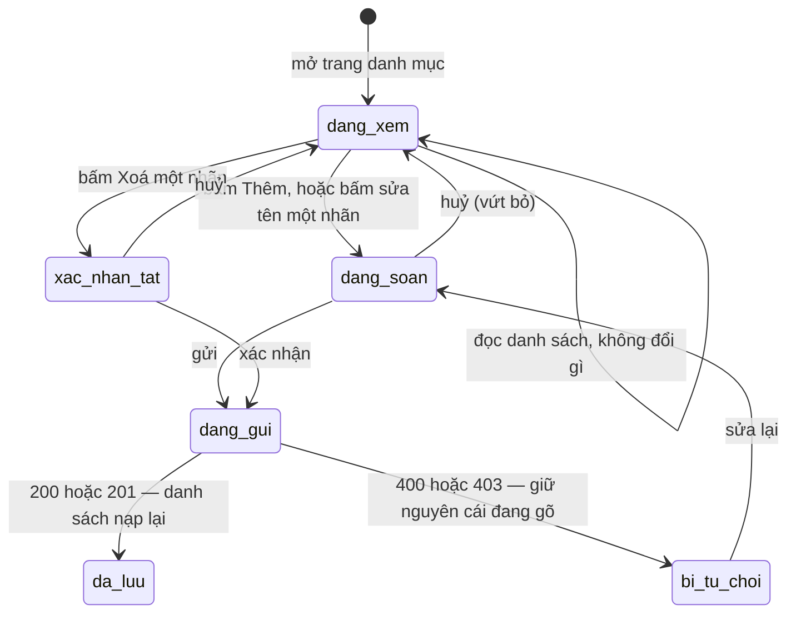

# Lĩnh vực, danh mục và ảnh chụp chính sách

## Tóm tắt

Hai thứ rất khác nhau nằm trong cùng một module vì cùng trả lời câu "luật và cách phân loại của nền tảng là gì".

*Lĩnh vực* và *danh mục* là hai loại nhãn phân loại, dùng để lọc danh sách và để thu hẹp phạm vi ghép cặp. Chúng là dữ liệu tra cứu của gần như mọi màn hình, nên nhóm này phải được xây sớm.

*Ảnh chụp chính sách* là bản đóng băng của bộ quy tắc áp lên một hồ sơ vụ việc, chốt tại thời điểm hồ sơ vào giai đoạn thẩm định. Nó là thứ trả lời câu "lúc đó luật là gì" sau nhiều tháng.

Khoảng cách giữa hai nửa rất lớn và cần nói thẳng: **nhãn phân loại đã có bốn cặp endpoint ở v1 và đang chạy; ảnh chụp chính sách không có endpoint nào.** Toàn bộ năng lực thứ hai chỉ gọi được từ mã .NET khác, và nó được gọi đúng một chỗ — bên trong lệnh chuyển giai đoạn.

## Bề mặt cần có

| Phương thức | Đường dẫn | Việc |
|---|---|---|
| `GET` | `/api/v2/taxonomy-terms` | Danh sách nhãn theo loại, có hoặc không lọc nhãn còn hiệu lực |
| `GET` | `/api/v2/taxonomy-terms/{id}` | Một nhãn, kể cả nhãn đã tắt |
| `POST` | `/api/v2/taxonomy-terms` | Tạo nhãn mới |
| `PATCH` | `/api/v2/taxonomy-terms/{id}` | Đổi tên nhãn |
| `DELETE` | `/api/v2/taxonomy-terms/{id}` | Vô hiệu hoá nhãn |
| `POST` | `/api/v2/taxonomy-terms/{id}/reactivate` | **Năng lực mới** — bật lại nhãn đã tắt |
| `GET` | `/api/v2/policy-snapshots/{id}` | **Năng lực mới ở tầng HTTP** — đọc một ảnh chụp chính sách |

Sáu dòng đầu thay cho tám endpoint của v1, vốn chia đôi thành `/sectors` và `/categories` với hai bộ controller giống hệt nhau. **v2 dùng một bộ sưu tập duy nhất và một tham số loại**, vì hai loại nhãn dùng chung một bảng, một tập luật và một hành động trong bảng quyết định. Tham số loại là **bắt buộc** ở danh sách: không có "tất cả nhãn", vì một danh sách trộn lĩnh vực với danh mục không dùng được vào việc gì.

Tầng dịch vụ nhãn phân loại có sáu phương thức. Bảng trên phủ năm; phương thức thứ sáu — tra nhiều nhãn một lượt để đổi định danh thành tên — cố ý không có endpoint, vì nó phục vụ việc dựng phản hồi của module khác chứ không phục vụ một màn hình.

Tầng dịch vụ ảnh chụp chính sách có hai phương thức. Bảng trên phủ một: đọc theo định danh. Phương thức còn lại — chốt ảnh chụp cho một hồ sơ — **cố ý không có endpoint**, và đây là một quyết định thiết kế chứ không phải một lỗ hổng: xem [Ảnh chụp chính sách](#ảnh-chụp-chính-sách).

Một dòng đánh dấu **năng lực mới** cần mã mới ở tầng dịch vụ. Dòng cuối cần mã mới ở tầng HTTP nhưng dùng lại phương thức đã có.

## Trường hợp đơn giản

Một quản trị viên mở trang danh mục. Hai danh sách hiện ra: lĩnh vực và danh mục, mỗi cái sắp theo tên.

Họ thêm một lĩnh vực mới. Nó xuất hiện ngay trong danh sách và ngay lập tức chọn được ở mọi biểu mẫu đề bài và tài sản công nghệ.

Họ đổi tên một lĩnh vực gõ sai. Mọi bản ghi đang gắn nhãn đó hiển thị tên mới — không có bản sao tên nào bị bỏ lại.

Họ xoá một lĩnh vực không dùng nữa. Nó biến khỏi danh sách chọn ở các biểu mẫu, nhưng những bản ghi cũ đã gắn nhãn đó vẫn hiển thị đúng tên nhãn.

## Tương tác, sự kiện theo sự kiện

Đơn vị tương tác là **trang quản trị nhãn phân loại**: một danh sách với việc thêm, sửa tên và tắt xảy ra ngay tại chỗ, không có trang chi tiết riêng.

### Vào màn

`GET /api/v2/taxonomy-terms?kind=…` trả danh sách nhãn của một loại, sắp theo tên tăng dần. Danh sách này **không phân trang**: số nhãn là hàng chục, không phải hàng nghìn, và mọi màn hình dùng nó đều cần trọn bộ để dựng ô chọn.

Đọc **không cần đăng nhập và không kiểm quyền**. Nhãn phân loại là dữ liệu công khai; trang giới thiệu và mọi bộ lọc công khai đều cần nó.

Tham số lọc nhãn còn hiệu lực quyết định danh sách gồm gì, và nó là chỗ hai loại người gọi cần hai câu trả lời khác nhau:

- **Biểu mẫu chọn nhãn** cần *chỉ nhãn còn hiệu lực*. Cho người dùng chọn một nhãn đã tắt là tạo dữ liệu mới bằng một phân loại đã bỏ.
- **Trang quản trị** cần *cả nhãn đã tắt*, nếu không quản trị viên không thấy được cái mình vừa tắt và không có đường nào bật lại.

Hôm nay v1 chỉ phục vụ câu trả lời thứ nhất: cả bốn endpoint danh sách, kể cả hai endpoint dành cho quản trị viên, đều lọc cứng chỉ lấy nhãn còn hiệu lực. Hệ quả là **một nhãn đã tắt biến mất hoàn toàn khỏi mọi giao diện** và không có cách nào nhìn thấy nó nữa. v2 phải mở tham số này ra, và mặc định của nó là *chỉ nhãn còn hiệu lực* để mọi ô chọn hưởng đúng hành vi đang đúng.

`GET /api/v2/taxonomy-terms/{id}` trả một nhãn **kể cả khi nó đã tắt**, vì đó chính là cách một bản ghi cũ hiển thị được tên nhãn của nó.

Đọc không ghi kiểm toán.

### Rời đi không đổi gì

Không ghi gì, không giữ gì.

### Bắt đầu sửa

Chỉ có hai trường trong toàn bộ nhóm này: **loại** và **tên**. Loại chỉ đặt được lúc tạo và không đổi được sau đó — không phương thức nào đổi một lĩnh vực thành một danh mục.

Ô nhập tên nên là một ô sửa ngay tại dòng, không phải một hộp thoại, vì thao tác sửa tên là thao tác thường gặp nhất ở trang này.

### Trong khi sửa

Không có kiểm tra nào chạy ở máy chủ trong lúc soạn. Ba luật mà giao diện tự áp được:

- Loại phải là lĩnh vực hoặc danh mục; không có giá trị thứ ba.
- Tên không được rỗng, và khoảng trắng hai đầu bị cắt trước khi lưu.
- Tên không dài quá 255 ký tự.

Một luật **không** tồn tại và giao diện đừng giả vờ là có: **tên nhãn không cần duy nhất.** Không có ràng buộc nào chặn hai lĩnh vực cùng tên, và không có mã lỗi nào cho tình huống đó. Hai nhãn trùng tên sẽ hiện ra cạnh nhau trong ô chọn và không phân biệt được bằng mắt.

### Gửi đi

Thứ tự kiểm ở máy chủ:

1. **Dữ liệu.** Loại sai, tên rỗng, hoặc tên quá dài → **400**, `code: "VALIDATION_FAILED"`. Ba luật này chạy **trước** kiểm quyền, nên một người dùng thường gửi một tên rỗng sẽ nhận 400 chứ không nhận 404 — và qua đó biết endpoint tồn tại.
2. **Tồn tại.** Với lệnh sửa tên và lệnh tắt: nhãn không có → **404**.
3. **Quyền.** Chỉ quản trị viên. Không đủ → **403** kèm `ruleId`.

Thành công trả nhãn đã cập nhật và ghi một dòng kiểm toán trong cùng giao dịch.

Không lệnh nào ở nhóm này cần số phiên bản kỳ vọng. Nhãn phân loại không phải bản ghi có tranh chấp: hai quản trị viên đổi tên cùng một nhãn cùng lúc thì người sau thắng, và hậu quả là một cái tên, không phải một quyết định.

> Ghi chú kỹ thuật: thứ tự "kiểm dữ liệu trước, kiểm quyền sau" ở lệnh tạo và lệnh sửa tên là hành vi có sẵn ở tầng dịch vụ. Nó rò rỉ sự tồn tại của endpoint cho người gọi không có quyền. Với nhóm này thì rò rỉ đó vô hại vì danh sách nhãn vốn công khai, nhưng nó là một khuôn mẫu không nên chép sang các nhóm khác.

## Xoá là vô hiệu hoá

Không có xoá thật trong nhóm này. `DELETE` đặt cờ còn hiệu lực về sai và giữ nguyên mọi thứ khác.

Lý do nằm ở chỗ nhãn được tham chiếu từ hai module khác: mỗi đề bài và mỗi tài sản công nghệ giữ một danh sách định danh lĩnh vực và một định danh danh mục. Xoá thật một nhãn sẽ biến các định danh đó thành những con trỏ trỏ vào khoảng không, và một bản ghi ba năm tuổi sẽ mất phân loại của nó.

Hai hệ quả mà giao diện phải xử lý:

- **Nhãn đã tắt vẫn hiện tên ở màn hình xem, nhưng không chọn được ở màn hình sửa.** Người dùng mở một bản ghi cũ, thấy nhãn "Vật liệu mới", bấm Sửa, và nhãn đó không có trong danh sách. Giao diện phải nói rõ nhãn này đã ngừng dùng thay vì im lặng bỏ nó ra khỏi ô chọn.
- **Sửa một bản ghi cũ có thể vô tình gỡ nhãn đã tắt.** Lệnh sửa thay toàn bộ danh sách lĩnh vực bằng danh sách gửi lên. Nếu ô chọn không giữ lại nhãn đã tắt đang gắn, lần lưu tiếp theo sẽ gỡ nó ra vĩnh viễn.

Câu chữ trên nút cũng phải đổi. Nút hiện ghi "Xoá" và thông điệp thành công ghi "đã xoá", trong khi việc thực sự xảy ra là ngừng sử dụng. Đó là một câu nói dối nhỏ mà quản trị viên sẽ phát hiện lần đầu họ thấy nhãn "đã xoá" vẫn hiện trên một bản ghi cũ.

**Không có đường bật lại.** Tầng dịch vụ không có phương thức nào đảo cờ trở lại, và danh sách quản trị không hiện nhãn đã tắt, nên một nhãn tắt nhầm là mất hẳn. Đây là hai lỗ hổng phải lấp cùng nhau: có endpoint bật lại mà không nhìn thấy nhãn đã tắt thì cũng không dùng được.

## Ảnh chụp chính sách

Một ảnh chụp gồm: hồ sơ vụ việc nào, chốt lúc nào, phiên bản chính sách nền tảng, phiên bản chính sách của tuyến, **toàn văn bộ quy tắc đã chốt**, một mã băm của toàn văn đó, và tham chiếu tới ảnh chụp mà nó thay thế nếu có.

Nội dung bên trong là những thứ mà một người đọc hồ sơ cần biết: điều kiện phải thoả để vào từng giai đoạn, các quy tắc xung đột lợi ích, và nhóm thời hạn lưu trữ áp lên hồ sơ.

Ba tính chất chịu lực:

- **Bất biến.** Đã ghi thì không sửa. Không có phương thức nào đổi nội dung một ảnh chụp.
- **Chốt tại một thời điểm duy nhất.** Ảnh chụp được chốt khi hồ sơ vào giai đoạn thẩm định, bên trong chính giao dịch của lệnh chuyển. Không có đường nào khác chốt nó.
- **Đổi phải tạo bản mới.** Muốn áp một bộ quy tắc khác lên một hồ sơ, phải tạo một ảnh chụp mới trỏ về ảnh chụp cũ và đánh dấu ảnh chụp cũ là không còn hiện hành. Bản cũ ở lại vĩnh viễn.

Vì ba tính chất đó, **không có endpoint tạo ảnh chụp và cũng không nên có.** Một đường HTTP tạo ảnh chụp sẽ cho phép chốt luật cho một hồ sơ ngoài luồng chuyển giai đoạn, và điều đó phá đúng cái tính chất làm ảnh chụp có giá trị. Việc chốt ở lại nơi nó đang ở: bên trong lệnh chuyển giai đoạn, xem [`case-va-quyet-dinh.md`](case-va-quyet-dinh.md).

Cái phải có là **đường đọc**. `GET /api/v2/policy-snapshots/{id}` trả toàn bộ ảnh chụp.

Ai gọi được: người có quyền đọc **hồ sơ vụ việc mà ảnh chụp thuộc về**, không phải một quyền riêng. Một ảnh chụp không có ý nghĩa tách khỏi hồ sơ của nó, nên quyền của nó cũng không tách. Người không đọc được hồ sơ nhận **404** — không phải 403, vì định danh ảnh chụp trỏ về sự tồn tại của một hồ sơ.

Đọc ảnh chụp **không ghi kiểm toán**. Nó không phải tài liệu mật; nó là bản chụp của luật, và luật thì không bí mật.

Ảnh chụp không có số phiên bản lạc quan và không cần: nó không sửa được nên không có gì để tranh chấp.

Một thứ chưa tồn tại ở bất kỳ tầng nào: **đường tạo một ảnh chụp thay thế**. Trường trỏ về ảnh chụp cũ và cờ hiện hành đã có trong dữ liệu, và mô hình nói rõ việc thay thế phải kèm một bản ghi quyết định riêng — nhưng không phương thức nào làm việc đó. Hôm nay một hồ sơ đã chốt ảnh chụp thì mang nó vĩnh viễn.

## Biến thể

| Biến thể | Lúc vào màn | Trong khi sửa |
|---|---|---|
| Vai trò | Nhãn phân loại đọc được bởi mọi vai trò kể cả khách chưa đăng nhập. Ảnh chụp chính sách chỉ đọc được bởi người có quyền đọc hồ sơ tương ứng; mọi người khác nhận 404. Trang quản trị nhãn chỉ `ADMIN` vào được. | Chỉ `ADMIN` tạo, đổi tên, tắt và bật lại nhãn. `USER` nhận 403 kèm `ruleId`. Không vai trò nào sửa được ảnh chụp chính sách, kể cả `ADMIN` — nó bất biến với tất cả. |
| Trạng thái bản ghi | Nhãn còn hiệu lực hay đã tắt quyết định nó có trong ô chọn hay không. Ảnh chụp hiện hành hay đã bị thay thế quyết định nó có đang áp lên hồ sơ hay chỉ còn là lịch sử. | Tắt một nhãn đang được dùng **không** bị chặn: không có kiểm tra nào đếm số bản ghi đang gắn nhãn đó. Quản trị viên tắt một nhãn đang dùng ở hàng trăm bản ghi mà không có cảnh báo nào. |
| Cấu hình backend | Không ảnh hưởng. Không cờ cấu hình nào đổi hành vi của nhóm này. | Không ảnh hưởng. |
| Phím tắt của biểu mẫu | Ô thêm nhãn mới được focus khi mở trang, vì đó là việc chính ở trang này. | Enter trong ô tên gửi đi — đây là biểu mẫu một trường, nên Enter là hành vi đúng. Escape huỷ việc sửa tên tại chỗ và trả về tên cũ. |

Đổi biến thể giữa chừng: một nhãn có thể bị quản trị viên khác tắt trong lúc người dùng đang mở một biểu mẫu đề bài. Biểu mẫu đó vẫn gửi được nhãn đã tắt, vì lệnh sửa không kiểm nhãn còn hiệu lực hay không.

## Huỷ và gián đoạn

| Sự kiện | Trước khi gửi | Trong khi đang gửi |
|---|---|---|
| Bấm Huỷ hoặc nhấn Escape | Tên đang gõ bị vứt bỏ, dòng trở về tên cũ. Không có gì được ghi. | Không có cách huỷ. Các lệnh ở nhóm này là giao dịch rất ngắn. |
| Đi chỗ khác trong app | Tên đang gõ mất. Với một biểu mẫu một trường thì không cần hỏi lại. | Kết quả không tới giao diện; giao dịch vẫn hoàn tất. Quay lại thấy nhãn đã đổi tên. |
| Back/Forward của trình duyệt | Như trên. | Như trên. |
| Tải lại trang, hoặc đóng tab | Tên đang gõ mất. | Giao dịch hoàn tất, giao diện không biết. Thử lại **cùng khoá chống lặp** trả phát lại thay vì tạo hai nhãn trùng tên — và vì tên nhãn không cần duy nhất, đây là chỗ khoá chống lặp là hàng phòng thủ duy nhất. |
| Mất mạng, hoặc quá hạn | Không ảnh hưởng — chưa gọi gì. | **Phải giữ nguyên khoá chống lặp cho lần thử lại.** Sinh khoá mới cho lệnh tạo sẽ tạo hai nhãn giống hệt nhau, và không có đường xoá thật để dọn. |
| Phiên hết hạn (401), hoặc v1 bị dừng (410) | Người dùng bị đẩy về đăng nhập, mất tên đang gõ. | 401 giữa chừng nghĩa là lệnh bị từ chối trước khi vào tầng nghiệp vụ; không có gì được ghi. |
| Bản ghi bị đổi bởi người khác | Danh sách hiển thị đã cũ. Không có cách nào biết cho tới lần nạp lại. | Không có 409 — nhãn phân loại không mang số phiên bản. Người lưu sau thắng, im lặng. Nếu nhãn đã bị tắt trong lúc đó, lệnh đổi tên **vẫn thành công**: đổi tên một nhãn đã tắt là hợp lệ. Nếu nhãn không tồn tại, lệnh trả 404. |
| Trình duyệt tự điền | Không áp dụng — không trường nào là email hay mật khẩu. | Không áp dụng. |

Ảnh chụp chính sách chỉ đọc, nên bảng trên không áp cho nửa sau của tài liệu này: không có gì để huỷ và không có gì để mất.

## Tương tác với hệ thống khác

**Quyền và vai trò.** Một hành động duy nhất phủ cả bốn lệnh ghi của nhãn phân loại, và chỉ vai trò `ADMIN` có quy tắc cho phép nó. Đọc nhãn **không đi qua bảng quyết định** — không có kiểm quyền nào ở đường đọc, kể cả cho nhãn đã tắt. Ảnh chụp chính sách chưa có hành động nào trong bảng quyết định; nó phải mượn hành động đọc hồ sơ vụ việc, và điều đó cần được ghi vào cấu hình bảng chứ không chỉ vào tài liệu này. Xem [`../xuyen-suot/quyen-va-vai-tro.md`](../xuyen-suot/quyen-va-vai-tro.md).

**Kiểm tra dữ liệu và cách hiện lỗi.** Ba luật ở máy chủ, tất cả về hình dạng tên và loại. Thông điệp hiện là hỗn hợp: câu về loại bằng tiếng Việt, hai câu về tên bằng tiếng Anh theo văn phong thư viện cũ. v2 phải thống nhất về tiếng Việt.

**Thay đổi chưa lưu.** Chỉ một ô tên, nên không có gì đáng giữ. Đây là nhóm duy nhất trong thư mục này mà việc rời trang giữa chừng không cần hỏi lại.

**Cập nhật lạc quan và hoàn tác.** Cập nhật lạc quan chấp nhận được cho việc đổi tên: một trường, tỉ lệ thất bại thấp, và rút lại chỉ mất một cái tên. **Không cập nhật lạc quan cho việc tắt nhãn**, vì hiện chưa có đường bật lại nên hiện trước rồi rút lại sẽ khiến quản trị viên tưởng mình đã tắt nhầm. Không có hoàn tác cho bất kỳ lệnh nào.

**Ngoại tuyến.** Không có tương tác. Danh sách nhãn nên được nhớ tạm ở phía trình duyệt vì nó đổi rất hiếm, nhưng bộ nhớ tạm đó phải bị xoá ngay sau mỗi lệnh ghi ở trang quản trị — nếu không quản trị viên sẽ không thấy nhãn mình vừa thêm.

**Thông báo và toast.** Không có loại thông báo nào cho nhóm này. Đổi một nhãn không báo cho ai, kể cả những người đang có bản ghi gắn nhãn đó.

**Trạng thái lọc/tìm trong URL.** Loại nhãn đang xem và cờ có hiện nhãn đã tắt hay không nên nằm trong URL, để quản trị viên gửi được đường dẫn tới đúng danh sách.

**Đa ngôn ngữ.** Tên nhãn là **dữ liệu do người nhập**, không phải chuỗi giao diện, nên không có bảng dịch nào cho chúng. Một nền tảng phục vụ hai ngôn ngữ sẽ cần hai tên cho mỗi nhãn, và mô hình hiện tại chỉ có một cột tên. Nội dung của ảnh chụp chính sách cũng vậy: tên các điều kiện vào giai đoạn lưu bằng chuỗi tiếng Anh viết hoa và cần bảng dịch ở giao diện.

**Khả năng truy cập.** Ô chọn nhiều lĩnh vực là thành phần khó nhất trong hệ thống về mặt này; nó phải thao tác được bằng bàn phím và phải đọc ra được số nhãn đã chọn. Nhãn đã tắt hiện trên bản ghi cũ phải phân biệt được bằng chữ, không chỉ bằng màu nhạt.

**Dấu vết kiểm toán.** Bốn lệnh ghi của nhãn phân loại ghi một dòng trong cùng giao dịch. Lệnh tắt nhãn nên ghi kèm **số bản ghi đang gắn nhãn đó tại thời điểm tắt**; không có con số này thì không đánh giá được hậu quả của một lần tắt nhầm. Việc chốt ảnh chụp chính sách ghi một dòng kiểm toán như một phần của lệnh chuyển giai đoạn, không phải như một sự kiện riêng.

## Trường hợp biên

- **Nhãn đã tắt biến mất khỏi mọi giao diện.** Cả bốn endpoint danh sách của v1, kể cả hai endpoint quản trị, đều lọc cứng chỉ lấy nhãn còn hiệu lực. Quản trị viên tắt một nhãn rồi không bao giờ thấy lại nó.
- **Không có đường bật lại nhãn đã tắt** ở bất kỳ tầng nào.
- **Tên nhãn không cần duy nhất.** Hai lĩnh vực cùng tên tồn tại được và không phân biệt được trong ô chọn.
- **Tắt một nhãn đang được dùng không bị chặn và không cảnh báo.**
- **Sửa một bản ghi cũ có thể vô tình gỡ nhãn đã tắt**, vì lệnh sửa thay toàn bộ danh sách lĩnh vực.
- **Kiểm dữ liệu chạy trước kiểm quyền** ở lệnh tạo và lệnh đổi tên.
- **Loại nhãn không đổi được** sau khi tạo, và không có thông điệp nào nói vì sao.
- **Ảnh chụp chính sách được chốt bởi một lệnh chuyển có thể thất bại sau đó.** Việc chốt xảy ra trước một số luật khác trong lệnh chuyển, nên một lệnh bị từ chối vẫn có thể đã để lại ảnh chụp. Chi tiết thuộc [`case-va-quyet-dinh.md`](case-va-quyet-dinh.md).
- **Không có đường liệt kê ảnh chụp của một hồ sơ.** Chỉ tra được theo định danh, nên khi một hồ sơ đã có nhiều ảnh chụp nối tiếp nhau thì không đọc được chuỗi đó nếu không biết trước từng định danh.
- **Phiên bản chính sách nền tảng là một hằng số trong mã.** Nó chưa bao giờ đổi, nên chưa có ảnh chụp nào thực sự khác ảnh chụp nào ngoài tuyến và thời điểm.

## Câu hỏi mở và kiểm chứng

- **Bật lại nhãn đã tắt: có hay không?** Nếu có thì cần cả endpoint lẫn một danh sách nhìn thấy được nhãn đã tắt — thiếu một trong hai thì cái còn lại vô dụng. Nếu không thì phải nói rõ tắt là một chiều, và câu chữ trên nút phải nói đúng điều đó. (chưa cấp mã lỗi)
- **Tắt một nhãn đang được dùng có nên bị chặn không?** Ba lựa chọn: chặn thẳng, cho phép nhưng cảnh báo kèm số bản ghi bị ảnh hưởng, hoặc cho phép im lặng như hiện nay. Lựa chọn thứ hai cần một truy vấn đếm xuyên hai module khác, và đó không phải việc nhỏ.
- **Tên nhãn có cần duy nhất trong cùng một loại không?** Nếu có thì cần một ràng buộc ở cơ sở dữ liệu và một mã lỗi mới cho trường hợp trùng. (chưa cấp mã lỗi)
- **Có cần đường tạo ảnh chụp chính sách thay thế không?** Dữ liệu đã sẵn sàng cho việc này và mô hình nói rõ nó phải kèm một bản ghi quyết định, nhưng không phương thức nào làm được. Chưa rõ đây là "chưa cần trong bản này" hay "đã quên". Nếu cần, nó là một lệnh trên **hồ sơ vụ việc**, không phải trên ảnh chụp. (chưa cấp mã lỗi)
- **Có cần đường liệt kê ảnh chụp của một hồ sơ không?** Chỉ có ý nghĩa nếu câu hỏi trên được trả lời là có.
- **Một nền tảng hai ngôn ngữ cần hai tên cho mỗi nhãn.** Mô hình hiện có một cột tên. Cần quyết định trước khi số nhãn tăng lên, vì di trú tên là việc làm một lần.
- Chưa xác nhận bảng quyết định trả `ruleId` nào khi một người dùng thường thử tạo nhãn; cần đọc cấu hình bảng.
- Chưa đo hành vi thật của việc tắt một nhãn đang được dùng trên bản chạy, vì chưa có dữ liệu trong cơ sở dữ liệu.
- Chưa xác nhận nội dung của một ảnh chụp trên dữ liệu thật; toàn bộ mô tả ở trên đọc từ hàm dựng tài liệu trong mã.

Đặc tả — chưa có mã. Dựa trên SourceCode/nacentech, bản chụp ngày 2026-09-04.
