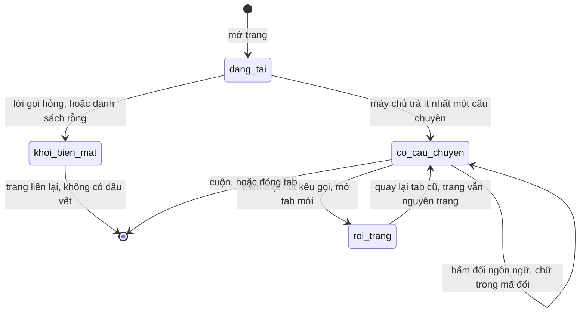
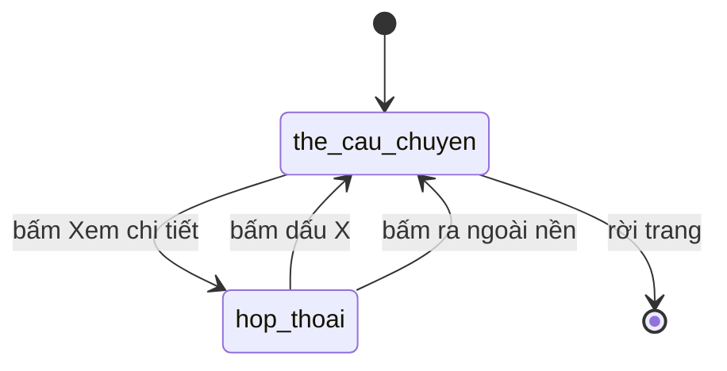

# Trang giới thiệu và câu chuyện thành công

## Tóm tắt

Trang giới thiệu là bề mặt công khai duy nhất của sản phẩm: không cần đăng nhập, không có tài khoản, không có gì để lưu. Nó là **một trang duy nhất**, cuộn theo mục, **không có bộ định tuyến** — không route nào, không tham số nào, không trạng thái nào nằm trong URL ngoài neo mục.

Nó có đúng **một bề mặt API**: một tệp, một hàm, một lời gọi đọc `GET /api/v1/public/stories`. Mọi thứ khác trên trang — chữ, số liệu, ba nhóm đối tượng, ba bước quy trình, các gói ưu đãi — là nội dung viết thẳng trong mã.

Nó có một **bộ chuyển ngôn ngữ** giữa tiếng Việt và tiếng Anh. Lựa chọn ngôn ngữ **không nằm trong URL** và không được lưu ở đâu: tải lại trang là về tiếng Việt.

Và nó có một khối duy nhất chạm tới dữ liệu thật — **câu chuyện thành công**. Khối đó có một hành vi đáng nói ngay ở đầu tài liệu: khi lời gọi hỏng, hoặc khi không có câu chuyện nào, **cả khối biến mất khỏi trang**. Không có thông báo lỗi, không có khối rỗng, không có dấu vết. Trang liền lại như thể mục đó chưa từng được thiết kế.

## Trường hợp đơn giản

Khách mở địa chỉ trang giới thiệu. Thanh đầu trang trong suốt nằm đè lên phần mở đầu; cuộn quá 20 điểm ảnh thì nó chuyển sang nền trắng mờ có viền dưới và co lại. Thanh có logo, bốn mục điều hướng, một nút đổi ngôn ngữ hiện chữ **VI**, và một nút chính.

Trang cuộn qua các mục theo thứ tự cố định: phần mở đầu với ba số liệu, ba nhóm đối tượng và bài toán của họ, ba bước quy trình, các dịch vụ lõi, **câu chuyện thành công**, các gói ưu đãi, phần giới thiệu người quen, lời kêu gọi cuối, rồi chân trang.

Ở mục câu chuyện, khách thấy một lưới ba thẻ. Mỗi thẻ có một dấu ngoặc kép, một nhãn **Thành công** xanh hoặc **Thất bại** cam, tiêu đề, tên tác giả, một đoạn trích nội dung dạng chữ thuần, và — với câu chuyện thất bại — một khối **Bài học**. Cuối thẻ là liên kết **Xem chi tiết →**.

Bấm vào đó mở một hộp thoại lớn: nhãn loại, tiêu đề, tên tác giả, rồi toàn văn câu chuyện được dựng lại thành nội dung có định dạng. Bấm ra ngoài nền hoặc bấm dấu X thì đóng.

Bấm nút đổi ngôn ngữ, mọi chữ viết trong mã chuyển sang tiếng Anh và nút hiện chữ **EN**. Tiêu đề và nội dung câu chuyện **không đổi** — chúng đến từ máy chủ và chỉ có một bản.

Bấm nút chính ở thanh đầu trang, hoặc bất kỳ nút kêu gọi nào trên trang, thì một tab mới mở ra ở địa chỉ `https://twin.nacentech.vn/`.

## Tương tác, sự kiện theo sự kiện

Hai tương tác chính: nạp trang cùng khối câu chuyện, và mở một câu chuyện.

### Nạp trang

### Xem một câu chuyện

### Vào màn

Toàn bộ ứng dụng dựng một lần. Không có lớp bảo vệ, không có kiểm phiên, không có màn chờ toàn trang. Mọi mục ngoài câu chuyện hiện ra ngay.

Khối câu chuyện phát **đúng một lời gọi** khi dựng, xin **6 câu chuyện**. Trong lúc chờ, nó hiện ba thẻ xám nhấp nháy. Khi có kết quả:

- có ít nhất một câu chuyện → lưới ba cột, các thẻ hiện dần theo hiệu ứng cuộn tới;
- danh sách rỗng, hoặc lời gọi hỏng → **cả mục bị gỡ khỏi trang**, gồm cả tiêu đề mục, phần mô tả và liên kết "xem thêm". Mục ưu đãi nối thẳng vào mục dịch vụ lõi và không có gì cho biết đã thiếu một mục.

Ba lý do khác nhau cho ra cùng một kết quả trống đó, và không lý do nào để lại dấu vết trên màn hình: chưa có câu chuyện nào được xuất bản; máy chủ không với tới được; hoặc **địa chỉ API chưa được cấu hình**.

> Ghi chú kỹ thuật: địa chỉ gốc API đọc từ biến môi trường lúc dựng gói. Thiếu biến đó thì hàm gọi **ném lỗi ngay trước khi phát request** — không có địa chỉ mặc định, không có đường dự phòng. Một bản dựng sai cấu hình vì thế không hỏng ồn ào; nó phát hành một trang giới thiệu thiếu hẳn một mục, và trông hoàn toàn bình thường.

Số câu chuyện xin về là 6 và lưới là ba cột, nên **ba câu chuyện nằm ở hàng thứ hai** khi có đủ. Máy chủ mặc định trả 10 và cho tối đa 50; con số 6 là lựa chọn của phía trang.

Nguồn câu chuyện cũng đọc từ biến môi trường, ba giá trị: *chỉ người dùng*, *chỉ quản trị viên*, *tất cả*. Mặc định là tất cả. Giá trị sai chính tả không bị bắt ở phía trang — nó được gửi thẳng lên và máy chủ trả lỗi kiểm tra dữ liệu, tức là **mục biến mất**, cùng cách như mọi lỗi khác.

### Rời đi không đổi gì

**Không có gì được ghi lại.** Trang giới thiệu không có tài khoản, không có biểu mẫu, không có cookie do ứng dụng đặt, không có mục nào ở lưu trữ cục bộ hay bộ nhớ phiên. Mở trang, cuộn hết, đổi ngôn ngữ, mở vài câu chuyện rồi đóng tab để lại **đúng không dấu vết nào** ở phía trình duyệt.

Phía máy chủ, lời gọi đọc có sinh sự kiện kiểm toán; nó ghi một lượt đọc ẩn danh và không ảnh hưởng gì tới trang.

### Bắt đầu sửa

**Không có gì để sửa.** Trang giới thiệu không có một ô nhập nào — không ô tìm kiếm, không ô đăng ký nhận tin, không biểu mẫu liên hệ. Khái niệm *đã bẩn* không áp dụng, và không có trạng thái nào cần cảnh báo khi rời trang.

Ba điều khiển duy nhất là nút đổi ngôn ngữ, nút mở hộp thoại câu chuyện, và các liên kết neo mục.

### Trong khi sửa

Thứ gần nhất với "sửa" là đổi ngôn ngữ, và nó có ba hệ quả đáng ghi:

1. **Mọi chữ viết trong mã đổi tức thì**, không có lời gọi mạng, không có nạp lại. Bộ dịch là một đối tượng hai nhánh nằm sẵn trong gói.
2. **Nội dung đến từ máy chủ không đổi.** Tiêu đề, nội dung và bài học của câu chuyện chỉ có một bản, bằng ngôn ngữ tác giả đã viết. Một trang tiếng Anh hoàn chỉnh vì thế hiện ba thẻ tiếng Việt ở giữa.
3. **Hai nhãn loại câu chuyện cũng không đổi.** Chữ "Thành công" và "Thất bại" trên thẻ và trong hộp thoại là chuỗi tiếng Việt viết thẳng, không đi qua bộ dịch.

Bốn mục điều hướng ở thanh đầu trang lấy nhãn từ bộ dịch nhưng lấy **đích đến từ khoá của chính chúng**, nên đổi ngôn ngữ không làm hỏng liên kết. Bốn khoá đó khớp đúng với bốn neo mục có thật trên trang.

URL không đổi khi đổi ngôn ngữ. Nó chỉ đổi khi bấm một mục điều hướng, và khi đó phần neo được thêm vào.

### Gửi đi

**Không gửi đi đâu cả. Không có gì được ghi lại.** Trang giới thiệu không có một lệnh ghi nào và không có một ô nhập nào; không có gì để gửi.

Thứ duy nhất đưa người dùng ra khỏi trạng thái đọc là các nút kêu gọi. Có **năm** nút như vậy — một ở thanh đầu trang, hai ở phần mở đầu, hai ở lời kêu gọi cuối — và **cả năm trỏ tới cùng một địa chỉ ngoài: `https://twin.nacentech.vn/`**, mở trong tab mới.

Đó là địa chỉ của NacenTwin, hệ thống cũ. Backend đã được thay **một lần** sang .NET và token do hệ cũ phát hành **không còn hợp lệ** vì khác khoá ký — xem [`../nen-tang/xac-thuc-va-vai-tro.md`](../nen-tang/xac-thuc-va-vai-tro.md). Toàn bộ đường vào sản phẩm từ bề mặt công khai vì thế đang trỏ ra ngoài kiến trúc hiện tại. Xem [Câu hỏi mở](#câu-hỏi-mở-và-kiểm-chứng).

Liên kết "xem thêm câu chuyện" bên cạnh tiêu đề mục trỏ tới `#` — bấm vào chỉ nhảy về đầu trang. Bốn biểu tượng mạng xã hội ở chân trang và ba liên kết pháp lý cũng vậy.

## Biến thể

| Biến thể | Lúc vào màn | Trong khi sửa |
|---|---|---|
| Vai trò | Chỉ có một vai trò ở đây: **khách chưa đăng nhập**. Trang không đọc cookie nào, không gửi token nào, và đường API nó gọi là đường công khai duy nhất trong toàn bộ facade v1. Một quản trị viên đang có phiên ở bề mặt khác vẫn thấy đúng trang này. | Không ảnh hưởng. |
| Trạng thái bản ghi | Chỉ câu chuyện **đã xuất bản và chưa bị ẩn** ra tới đây; máy chủ áp cả hai điều kiện, không phải phía trang. Một câu chuyện bị quản trị viên ẩn biến mất khỏi trang ở lần tải tiếp theo, còn tác giả của nó [vẫn thấy chữ "Công khai"](../portal/cau-chuyen.md) ở cổng người dùng. Cấu hình nguồn còn lọc thêm **theo vai trò của tác giả**, nên một bản dựng đặt nguồn là *chỉ quản trị viên* sẽ giấu mọi câu chuyện do người dùng viết. | Không ảnh hưởng. Danh sách chỉ được lấy một lần lúc dựng; nó không tự làm mới. |
| Cấu hình backend | Ba biến quyết định mục câu chuyện có tồn tại hay không: **địa chỉ API**, **nguồn câu chuyện**, và cờ tương thích v1 ở phía máy chủ. Sai bất kỳ cái nào — hoặc v1 đã bị dừng dịch vụ và trả 410 — đều cho ra cùng một kết quả: mục biến mất, trang trông bình thường. | Không ảnh hưởng — không có lời gọi nào sau lần đầu. |
| Phím tắt của biểu mẫu | Không có biểu mẫu. Không ô nào được focus sẵn. Tab đi qua logo, bốn mục điều hướng, nút đổi ngôn ngữ, nút chính, rồi vào nội dung. | Không có biểu mẫu để gửi, nên **Enter chỉ kích hoạt nút đang được focus**. **Escape không đóng hộp thoại câu chuyện** — hộp thoại là một lớp phủ tự dựng, không bắt phím. Ctrl/Cmd+Enter không được xử lý riêng. |

Đổi biến thể giữa chừng: chỉ trạng thái bản ghi đổi được, và nó đổi ở phía máy chủ mà không có tín hiệu nào ở đây. Trang không tự làm mới, nên một tab để mở lâu vẫn hiện câu chuyện đã bị gỡ xuống.

## Huỷ và gián đoạn

| Sự kiện | Trước khi gửi | Trong khi đang gửi |
|---|---|---|
| Bấm Huỷ hoặc nhấn Escape | Không có nút Huỷ ở đâu. **Escape không làm gì**, kể cả khi hộp thoại câu chuyện đang mở — chỉ dấu X hoặc bấm ra ngoài nền mới đóng được. | Không có lệnh gửi nào để huỷ. |
| Đi chỗ khác trong app | Không có "trong app" để đi: một trang, không có bộ định tuyến. Bấm một mục điều hướng chỉ cuộn tới một neo. **Không có gì được ghi lại.** | Không ảnh hưởng. |
| Back/Forward của trình duyệt | Nếu đã bấm mục điều hướng, Back đi ngược qua các neo và cuộn về vị trí trước. Nếu chưa, Back rời khỏi trang. **Ngôn ngữ đã chọn không được khôi phục** khi quay lại từ một trang ngoài — trang dựng lại từ đầu và về tiếng Việt. | Không ảnh hưởng. |
| Tải lại trang, hoặc đóng tab | Ngôn ngữ về tiếng Việt. Vị trí cuộn do trình duyệt quyết định. Lời gọi câu chuyện chạy lại từ đầu, nên một mục vừa biến mất có thể hiện lại nếu máy chủ đã sống. | Lời gọi bị bỏ. Tải lại xong nó chạy lại. Không có hậu quả nào vì đây là lệnh đọc. |
| Mất mạng, hoặc request quá hạn | Trang vẫn dựng đủ mọi mục viết trong mã. **Mục câu chuyện không hiện ra**, và không có gì nói vì sao. Không có nút thử lại, không có thử lại tự động: nối mạng lại rồi vẫn phải tải lại trang bằng tay. | Cùng kết quả. Ba thẻ xám bị thay bằng khoảng trống, rồi bằng không có gì. |
| Phiên hết hạn (401), hoặc v1 bị dừng (410 Gone) | Không có phiên nên không có 401. Nếu v1 bị dừng, đường công khai cũng trả **410 Gone** như mọi đường v1 khác — xem [`../nen-tang/hop-dong-api.md`](../nen-tang/hop-dong-api.md). Trang xử lý nó như mọi lỗi: **mục biến mất**. Ngày dừng dịch vụ tới sẽ làm trang giới thiệu lặng lẽ mất một mục mà không ai được báo. | Cùng kết quả. |
| Bản ghi bị đổi bởi tab khác hoặc người khác (409 khi `If-Match` lệch), hoặc bị xoá | Không có tương tác. Trang chỉ đọc, không gửi `If-Match`, không giữ số phiên bản. Một câu chuyện bị sửa hoặc bị xoá trong lúc tab đang mở thì tab tiếp tục hiện bản cũ **vô thời hạn** — kể cả nội dung đã bị tác giả gỡ xuống. | Không ảnh hưởng. |
| Trình duyệt tự điền | **Không ảnh hưởng.** Không có ô nhập nào trên toàn trang, nên không có gì để tự điền và không có gì cho trình quản lý mật khẩu nhận ra. | Không ảnh hưởng. |

Sau mọi gián đoạn, trạng thái duy nhất có thể mất là ngôn ngữ đã chọn và vị trí cuộn. Không có dữ liệu nào của người dùng tồn tại để mất.

## Tương tác với hệ thống khác

**Quyền và vai trò.** Đây là bề mặt duy nhất chạy hoàn toàn ở vai trò khách. Đường API nó gọi **không yêu cầu xác thực** và trang không gửi token nào. Việc lọc — chỉ đã xuất bản, chưa bị ẩn, và tuỳ chọn theo vai trò tác giả — nằm hết ở máy chủ. Xem [`../xuyen-suot/quyen-va-vai-tro.md`](../xuyen-suot/quyen-va-vai-tro.md).

**Kiểm tra dữ liệu và cách hiện lỗi.** Không có gì để kiểm — không có ô nhập. Cách hiện lỗi là **không hiện gì cả**: mọi lỗi, từ sai cấu hình tới máy chủ chết tới dịch vụ đã dừng, đều cho ra cùng một mục trống. Đây là hành vi mạnh nhất và đáng ngờ nhất của trang.

**Thay đổi chưa lưu.** Không có tương tác. Không có gì để lưu.

**Cập nhật lạc quan và hoàn tác.** Không có tương tác. Không có gì được hiển thị trước khi máy chủ trả lời, và không có gì để hoàn tác.

**Ngoại tuyến.** Không có bộ nhớ đệm ở tầng ứng dụng và không có hàng đợi. Mở trang khi mất mạng cho ra một trang giới thiệu đầy đủ trừ một mục.

**Thông báo và toast.** Trang không dùng toast và không có khay thông báo. Nó chưa bao giờ nói gì với người dùng ngoài nội dung của chính nó.

**Trạng thái lọc/tìm trong URL.** Không có bộ lọc, không có tìm kiếm, không có phân trang. Thứ duy nhất trong URL là neo mục. **Ngôn ngữ không nằm trong URL**, nên không gửi được đường dẫn tới bản tiếng Anh cho ai. Câu chuyện đang mở cũng không nằm trong URL, nên không gửi được đường dẫn tới một câu chuyện. Xem [`../nen-tang/dieu-huong-va-url.md`](../nen-tang/dieu-huong-va-url.md).

**Đa ngôn ngữ.** Đây là bề mặt duy nhất trong ba bề mặt có bộ chuyển ngôn ngữ, và nó phủ **chỉ chữ viết trong mã**. Ba khoảng trống: nội dung từ máy chủ chỉ có một bản; hai nhãn loại câu chuyện là chuỗi tiếng Việt cứng; và ba liên kết pháp lý ở chân trang — "Chính Sách Bảo Mật", "Điều Khoản Dịch Vụ", "Chính Sách Cookie" — là một mảng tiếng Việt viết thẳng ngay tại chỗ, không đi qua bộ dịch. Bản tiếng Anh vì thế có ba dòng tiếng Việt ở chân trang.

**Khả năng truy cập.** Chưa rà, và có ít nhất bốn vấn đề thấy được từ mã: hộp thoại câu chuyện là lớp phủ tự dựng không có vai trò `dialog`, không bẫy focus và không đóng bằng Escape; nút đổi ngôn ngữ chỉ có biểu tượng và hai chữ cái, không có nhãn nói nó làm gì; các thẻ dùng hiệu ứng hiện dần theo cuộn mà không tôn trọng cài đặt giảm chuyển động; và ba thẻ xám lúc đang tải không thông báo gì cho trình đọc màn hình.

**Dấu vết kiểm toán.** Lượt đọc công khai vẫn sinh sự kiện kiểm toán ở phía máy chủ, ghi một chủ thể ẩn danh. Người xem không thấy gì và không bị hỏi gì.

## Trường hợp biên

- **Mục câu chuyện biến mất thay vì báo lỗi.** Một mục của trang giới thiệu công khai biến mất im lặng khi máy chủ không với tới được, khi cấu hình sai, hoặc khi v1 bị dừng dịch vụ. Người vận hành không có tín hiệu nào và có thể không biết trong nhiều tuần. (chưa cấp mã lỗi)
- **Đường API công khai trả email và số điện thoại của tác giả.** Phản hồi của `GET /api/v1/public/stories` gói thông tin tác giả bằng cùng một bộ chuyển đổi dùng cho khu vực quản trị, nên mỗi câu chuyện kèm theo **email, số điện thoại, tổ chức, vai trò và cờ hoạt động** của người viết. Trang giới thiệu chỉ hiển thị tên và tổ chức, nhưng dữ liệu kia nằm nguyên trong phản hồi và ai cũng gọi được, không cần đăng nhập. (chưa cấp mã lỗi)
- **Mục tên là "câu chuyện thành công" nhưng hiện cả câu chuyện thất bại.** Lời gọi không lọc theo loại, nên một câu chuyện thất bại nằm giữa lưới với nhãn cam "Thất bại" và một khối "Bài học". Đó có thể là chủ ý — kể cả thất bại là một quyết định sản phẩm hợp lý — nhưng tiêu đề mục và bộ dịch đều không nói vậy.
- **Trang có thể trắng nếu một câu chuyện không tra được tác giả.** Kiểu dữ liệu ở phía trang khai báo tác giả là **luôn có**, còn máy chủ trả về `null` khi không tra được người viết trong danh bạ. Gặp trường hợp đó, thẻ câu chuyện ném lỗi lúc dựng và **kéo cả trang xuống** vì không có lớp bắt lỗi nào. Trang giới thiệu công khai sẽ trắng. (chưa cấp mã lỗi)
- **Năm nút kêu gọi trỏ về hệ thống cũ.** `https://twin.nacentech.vn/` là NacenTwin. Backend đã thay một lần và không chạy song song. (chưa cấp mã lỗi)
- **Liên kết "xem thêm" không đi đâu.** Nó nằm cạnh tiêu đề mục, chỉ hiện khi có câu chuyện, và trỏ tới `#`. Không có trang danh sách câu chuyện công khai nào tồn tại.
- **Ba liên kết pháp lý và bốn biểu tượng mạng xã hội đều trỏ tới `#`.** Chân trang của một sản phẩm thuộc cơ quan nhà nước đang trưng ba nhãn chính sách không dẫn tới văn bản nào.
- **Ngôn ngữ mất sau mỗi lần tải lại.** Người dùng tiếng Anh phải bấm lại nút mỗi lần vào trang, và không gửi được đường dẫn tiếng Anh cho ai.
- **Nội dung câu chuyện đi qua hai lần biến đổi trước khi hiển thị.** Thẻ bóc mọi thẻ đánh dấu ra thành chữ thuần để cắt sáu dòng; hộp thoại thì đổi thẻ HTML thành cú pháp Markdown rồi đưa vào một trình soạn thảo đặt chế độ chỉ đọc. Nội dung do người dùng viết ở cổng đi qua một trình soạn thảo khác, nên hai bên phải khớp nhau về định dạng — chưa có gì bảo đảm điều đó.
- **Bài học hiện dưới dạng chữ thuần trong cả thẻ và hộp thoại.** Nếu tác giả định dạng phần bài học, định dạng đó mất; nếu họ viết bằng HTML, thẻ hiện ra nguyên văn.
- **Thanh đầu trang gắn một bộ lắng nghe cuộn không giảm tần suất.** Nó chạy ở mọi khung hình cuộn để đổi một cờ.

## Câu hỏi mở và kiểm chứng

- Chưa dựng trang giới thiệu trong trình duyệt. Mọi mô tả đọc từ mã. Tuyên bố kiểm được rẻ nhất: dựng trang mà **không** đặt biến địa chỉ API và xác nhận trang vẫn hiện đầy đủ, thiếu đúng một mục, không có lỗi nào trên màn hình.
- **Việc mọi lỗi đều cho ra một mục trống đáng bị coi là lỗi**, không phải một cách xử lý lỗi. Ít nhất cần phân biệt "không có câu chuyện nào" với "không lấy được câu chuyện", và cái thứ hai cần để lại dấu vết ở đâu đó cho người vận hành. Cần nộp vào [`../bug-triage.md`](../bug-triage.md). (chưa cấp mã lỗi)
- **Việc đường công khai trả email và điện thoại của tác giả cần được đo trên bản chạy rồi nộp.** Nếu đúng như đọc từ mã, đây là rò rỉ thông tin cá nhân qua một đường không cần xác thực, và cách sửa nằm ở phía máy chủ — một bộ chuyển đổi riêng cho đường công khai — chứ không ở phía trang.
- **Quyết định sản phẩm còn bỏ ngỏ: năm nút kêu gọi nên trỏ đi đâu.** Cổng người dùng có `/register` và `/login`. Cần xác nhận đây là một địa chỉ tạm chưa được cập nhật sau đợt thay backend, hay `twin.nacentech.vn` vẫn là địa chỉ phục vụ thật của bản .NET. Không tự chọn hộ ở đây.
- **Quyết định sản phẩm còn bỏ ngỏ: có nên hiện câu chuyện thất bại ở mục "thành công" không**, và nếu có thì tiêu đề mục nên đổi thế nào ở cả hai ngôn ngữ.
- Chưa xác nhận giá trị thật của biến nguồn câu chuyện ở môi trường phát hành, nên chưa biết trang đang hiện câu chuyện của người dùng, của quản trị viên, hay của cả hai.
- Chưa xác nhận hai định dạng nội dung khớp nhau: cổng người dùng lưu bằng một trình soạn thảo, trang giới thiệu đọc bằng một trình khác. Cần một lượt kiểm với một câu chuyện có ảnh, có bảng và có liên kết.
- Chưa rõ ai sở hữu thông tin liên hệ ở chân trang. Nó khác với thông tin ở [trang liên hệ của cổng](../portal/khu-vuc-chua-co-backend.md#trường-hợp-biên) về cả địa chỉ, điện thoại lẫn email.

Đối chiếu với SourceCode/dmst-landing-page-main và SourceCode/nacentech, bản chụp ngày 2026-09-04.
