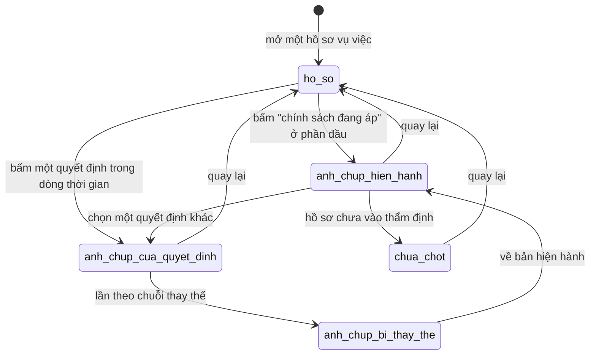

# Ảnh chụp chính sách

## Tóm tắt

Ảnh chụp chính sách là bản đóng băng của bộ quy tắc áp lên một hồ sơ vụ việc, chốt tại thời điểm hồ sơ vào giai đoạn `QUALIFICATION`. Màn hình này cho người dùng đọc nó: bộ luật gì, phiên bản nào, chốt lúc nào, và quan trọng nhất — **quyết định nào trong hồ sơ đã áp bản nào**.

Nó tồn tại để trả lời đúng một câu hỏi: *lúc đó luật là gì*. Câu hỏi này chỉ có nghĩa khi hỏi về một thời điểm cụ thể, nên màn hình không được chỉ hiện ảnh chụp hiện hành. Mỗi bản ghi quyết định trong dòng thời gian mang theo định danh ảnh chụp mà nó áp; màn hình phải mở được ảnh chụp *của quyết định đó*, kể cả khi ảnh chụp ấy đã bị thay thế.

Ảnh chụp là **bất biến**. Gán một lần cho một hồ sơ; muốn đổi thì tạo một bản mới **thay thế** bản cũ, không ghi đè. Bản cũ ở lại và vẫn đọc được, vì các quyết định đã ra dựa trên nó vẫn trỏ vào nó.

Màn hình sống ở bảng quản trị, mở từ hai chỗ trong [console hồ sơ vụ việc](console-ho-so-vu-viec.md): từ phần đầu hồ sơ (bản đang áp) và từ từng mục trong dòng thời gian (bản mà quyết định đó đã áp). Nó **chỉ đọc** — không có trường nào sửa được và không được có nút lưu.

Nó phụ thuộc hoàn toàn vào [`../api-v2/policy-va-taxonomy.md`](../api-v2/policy-va-taxonomy.md), chưa tồn tại. **Không có endpoint nào đọc ảnh chụp** — đây là phụ thuộc chặn, không phải một điểm hoàn thiện sau.

## Trường hợp đơn giản

Môi giới đang đọc dòng thời gian của một hồ sơ. Một quyết định từ tháng trước ghi *chấp thuận, chuyển sang thẩm định*. Họ muốn biết luật nào đang có hiệu lực khi quyết định đó được ra.

Họ bấm vào dòng "chính sách đang áp" ngay dưới quyết định. Một trang mở ra, chia bốn phần: định danh bản chính sách; cổng theo từng giai đoạn; quy tắc xung đột lợi ích; và hash cùng dấu hiệu toàn vẹn.

Phần đầu nói bản chính sách nền tảng, bản chính sách theo tuyến, thời điểm chốt, và một dòng cho biết bản này còn là bản hiện hành hay đã bị thay thế. Phần cổng liệt kê từng giai đoạn kèm các điều kiện mà giai đoạn đó đặt ra. Phần cuối hiện chuỗi hash cùng phiên bản chuẩn hoá, kèm một câu giải thích hash dùng để làm gì.

Họ đọc xong, bấm quay lại. Không có gì thay đổi và không có gì được ghi.

## Tương tác, sự kiện theo sự kiện

### Vào màn

Một lời gọi: đọc ảnh chụp theo định danh. Trang không cần tải hồ sơ lại, nhưng cần biết mã hồ sơ để hiện tiêu đề, nên nó nhận mã đó từ trang gọi nó.

Ba trạng thái vào màn, và giao diện phải phân biệt cả ba bằng câu chữ khác nhau:

1. **Hồ sơ đã có ảnh chụp.** Hiện đầy đủ.
2. **Hồ sơ chưa có ảnh chụp.** Đây là trạng thái thường của mọi hồ sơ chưa từng vào `QUALIFICATION`. Câu phải nói rõ chính sách sẽ được chốt khi nào, chứ không phải "không tìm thấy dữ liệu".
3. **Quyết định không mang ảnh chụp nào.** Mọi quyết định ra trước khi hồ sơ vào thẩm định đều không có ảnh chụp — trường đó rỗng theo thiết kế, không phải do lỗi. Câu phải là "quyết định này ra trước khi chính sách được chốt", không phải một ô trống.

Bốn thứ phải hiện ngay, không giấu sau tab:

- **Tuyến của hồ sơ.** Tuyến quyết định bộ chính sách, nên nó là ngữ cảnh đọc mọi thứ còn lại.
- **Hai số phiên bản chính sách**: bản nền tảng và bản theo tuyến. Hai bản này độc lập nhau; đổi một cái không đổi cái kia.
- **Thời điểm chốt.** Xem mục "Trường hợp biên" — nó không nhất thiết là thời điểm hồ sơ vào thẩm định.
- **Bản này còn hiện hành hay đã bị thay thế.** Nếu đã bị thay thế, hiện luôn đường sang bản thay nó.

Không focus gì. Đây là trang đọc.

### Rời đi không đổi gì

Đọc ảnh chụp **không ghi gì**: không dòng kiểm toán, không dấu vết, không đổi số phiên bản hồ sơ. Đây là một tuyên bố kiểm được — mở trang, đóng trang, rồi tra [nhật ký kiểm toán](nhat-ky-kiem-toan.md) cho hồ sơ đó: số dòng không tăng.

Ngoại lệ duy nhất trong toàn hệ thống là đọc tài liệu mật trong phòng dữ liệu, và ảnh chụp chính sách không phải tài liệu mật. Nội dung của nó là quy tắc, không phải dữ liệu của một bên nào.

### Bắt đầu sửa

**Không có gì sửa được.** Ảnh chụp bất biến; màn hình không có trường nhập, không có nút lưu, và không được có.

Ba thao tác duy nhất, và không thao tác nào là một lệnh ghi: mở/thu gọn một nhóm cổng, chép hash vào bộ nhớ tạm, và chuyển sang một ảnh chụp khác trong chuỗi thay thế.

Việc **tạo một ảnh chụp thay thế** là một hành động của hồ sơ vụ việc, không phải của màn hình này: nó cần một bản ghi quyết định riêng đứng tên người ra lệnh. Nếu hành động đó được xây, nó thuộc console hồ sơ vụ việc và màn hình này chỉ hiển thị kết quả. Hiện chưa có đường nào tạo ảnh chụp thay thế — xem "Câu hỏi mở".

### Trong khi sửa

Không áp dụng theo nghĩa biểu mẫu. Thứ duy nhất đổi trong lúc người dùng ở lại trang là *đang xem ảnh chụp nào* và *nhóm nào đang mở*.

Ảnh chụp đang xem **phải nằm trong URL**. Người dùng lần theo chuỗi thay thế ba bước rồi gửi đường dẫn cho đồng nghiệp thì đồng nghiệp phải mở đúng bản đó. Trạng thái mở/thu gọn của các nhóm cổng thì không cần vào URL.

### Gửi đi

**Không có gì được gửi và không có gì được ghi lại.**

Đây là một tuyên bố kiểm được, không phải một lời trấn an: sau một lượt xem đầy đủ — mở trang, lần theo chuỗi thay thế, chép hash, quay lại — số phiên bản của hồ sơ không đổi, số dòng kiểm toán của hồ sơ không đổi, và không bản ghi nào trong module chính sách được tạo hay sửa.

Hệ quả cho thiết kế: màn hình không cần khoá chống lặp, không cần số phiên bản, không có đường 409, và không có trạng thái "đang gửi".

## Nội dung của một ảnh chụp

Ảnh chụp không phải một chuỗi cấu hình mờ. Nó là một tài liệu có cấu trúc, và màn hình phải trình bày nó như tài liệu chứ không phải như JSON thô.

**Cổng theo giai đoạn.** Mỗi giai đoạn có một danh sách điều kiện phải thoả trước khi hồ sơ đi qua. Bảy giai đoạn có cổng: thẩm định (chủ bài toán, môi giới chính, phiên bản đề bài đang hiệu lực, đường ngân sách), ghép cặp (lọc cứng, lý do cho từng ứng viên), thẩm tra (bắt buộc có đánh giá), thiết kế thương vụ (điều khoản, định nghĩa kết quả và thoả thuận phí đều đóng băng), thi công (thoả thuận có hiệu lực, kế hoạch thi công đóng băng), xác minh kết quả (người xác minh độc lập), và đóng (không còn nghĩa vụ mở).

Năm giai đoạn còn lại **không có mục nào** trong tài liệu. Giao diện phải nói rõ điều đó nghĩa là "bộ chính sách này không đặt cổng cho giai đoạn đó", chứ không phải "chưa tải xong".

**Quy tắc xung đột lợi ích.** Ba điều kiện: người xác minh không được đồng thời là bên cung, không được là môi giới chính, không được là bên hưởng lợi. Ba điều này ảnh hưởng tới việc ai được thêm vào hồ sơ ở vai trò nào, nên chúng đáng đứng thành một khối riêng, không lẫn vào danh sách cổng.

**Lớp lưu trữ.** Một giá trị nói hồ sơ này theo chính sách giữ dữ liệu nào.

> Ghi chú kỹ thuật: bảy nhóm cổng ở trên được ghi vào tài liệu ảnh chụp nhưng **hiện chưa có mã nào đọc chúng để chặn một lệnh chuyển giai đoạn**. Lệnh chuyển chỉ kiểm ma trận chuyển và bốn luật ngoài ma trận. Vì vậy màn hình không được dùng chữ khiến người đọc tin rằng các cổng này đã được máy kiểm; chúng là *bộ luật đã ghi lại*, chưa phải *bộ luật đã thi hành*.

## Hash và ý nghĩa của nó

Ảnh chụp mang một chuỗi hash tính trên bản chuẩn hoá của tài liệu, kèm một mã phiên bản chuẩn hoá.

Với người dùng, hash không phải một chuỗi để nhìn. Nó là **bằng chứng nội dung không bị sửa**: bất kỳ ai — kiểm toán viên, luật sư, đối tác — chuẩn hoá lại tài liệu theo đúng quy tắc mà mã phiên bản chỉ ra rồi tính lại hash; nếu khớp, tài liệu đang đọc đúng là tài liệu đã áp lúc đó, không ai chèn thêm hay bớt đi một dòng. Nếu lệch, đã có người sửa.

Ba yêu cầu cho màn hình:

1. Hiện hash **cùng mã phiên bản chuẩn hoá**. Hash không có mã phiên bản thì không tính lại được sau nhiều năm, vì không biết đã chuẩn hoá theo quy tắc nào.
2. Cho **chép được bản chuẩn hoá** đúng nguyên văn, không chỉ chép hash. Không có bản chuẩn hoá thì không ai kiểm được gì.
3. Kèm **một câu tiếng Việt nói hash dùng để làm gì**. Một chuỗi 64 ký tự không có chú thích chỉ làm màn hình trông kỹ thuật hơn chứ không giúp ai.

Màn hình **không** tự tuyên bố "đã kiểm tra toàn vẹn" trừ khi nó thật sự tính lại hash tại chỗ. Việc có nên tính lại ở giao diện hay không là một quyết định chưa chốt — xem "Câu hỏi mở".

## Ảnh chụp có từ đâu

Đây là phần khó nhất của màn hình, và là phần không được bỏ.

Ảnh chụp được chốt **trước** khi lệnh chuyển giai đoạn đi qua hết các luật. Trình tự trong một lệnh chuyển sang thẩm định là: kiểm quyền → kiểm số phiên bản → **chốt ảnh chụp và ghi nó xuống** → rồi mới kiểm khoá tạm, ma trận chuyển, loại quyết định, và điều kiện môi giới chính.

Hệ quả: **một lệnh chuyển thất bại vẫn để lại một ảnh chụp.** Người dùng bấm chuyển sang thẩm định khi chưa gán môi giới chính, lệnh bị từ chối, giao diện báo lỗi — nhưng ảnh chụp đã nằm trong cơ sở dữ liệu với thời điểm chốt là *lúc bấm hụt*. Hồ sơ vẫn hiện là chưa có ảnh chụp, vì việc gắn ảnh chụp vào hồ sơ nằm trong phần bị huỷ bỏ.

Lần chuyển thành công sau đó **không tạo ảnh chụp mới**; nó nhận lại đúng ảnh chụp cũ. Vì vậy thời điểm chốt của một ảnh chụp có thể sớm hơn nhiều ngày so với thời điểm hồ sơ thật sự vào thẩm định.

Ba yêu cầu rút ra:

- Nhãn của trường thời gian phải là **"chốt lúc"**, không phải "vào thẩm định lúc". Hai mốc này khác nhau và màn hình không được trộn chúng.
- Khi thời điểm chốt sớm hơn quyết định đầu tiên áp ảnh chụp này, màn hình phải **hiện cả hai mốc cạnh nhau** kèm một câu giải thích, thay vì để người đọc tự phát hiện một khoảng trống họ không giải thích được.
- Tồn tại những ảnh chụp gắn với hồ sơ **chưa bao giờ vào thẩm định**. Nếu màn hình có danh sách ảnh chụp, chúng phải hiện trong danh sách đó với đúng tình trạng, không bị lọc đi cho gọn.

## Biến thể

| Biến thể | Lúc vào màn | Trong khi đọc |
|---|---|---|
| Vai trò | Ảnh chụp không có quyền riêng: ai đọc được hồ sơ thì đọc được ảnh chụp của hồ sơ đó. Quản trị viên đọc mọi hồ sơ; người khác chỉ đọc hồ sơ mình đang là bên tham gia đang hoạt động. Hồ sơ ngoài phạm vi trả 404 và giao diện hiện "không tìm thấy" — **không** hiện "bạn không có quyền", vì câu đó tiết lộ hồ sơ tồn tại. Khách chưa đăng nhập không vào được bảng quản trị. | Nếu người dùng bị gỡ khỏi hồ sơ trong lúc đang đọc, trang đang mở vẫn hiển thị nội dung đã tải; mọi lần tải lại sau đó trả 404. Không có kênh đẩy nên giao diện không tự biết. |
| Trạng thái bản ghi | Ba trạng thái cho ra ba màn khác nhau: hồ sơ chưa có ảnh chụp; ảnh chụp hiện hành; ảnh chụp đã bị thay thế. Bản đã bị thay thế phải mang dấu hiệu thị giác rõ và một đường sang bản thay nó. Bốn giai đoạn kết thúc không đổi gì ở đây — hồ sơ đóng vẫn giữ nguyên ảnh chụp. Khoá tạm không ảnh hưởng: khoá chặn lệnh chuyển, không chặn đọc. | Không ảnh hưởng. Ảnh chụp bất biến, nên nội dung đang đọc không thể đổi dưới chân người đọc. Thứ có thể đổi là *bản nào đang hiện hành*, và điều đó chỉ đổi khi có người tạo bản thay thế. |
| Cấu hình backend | Không ảnh hưởng. Không cờ nào trong bốn cờ đổi hành vi ảnh chụp. Số phiên bản chính sách nền tảng là hằng số trong mã, không phải cấu hình — đổi nó là một lần phát hành, không phải một lần bật cờ. `Api:V1CompatEnabled` không liên quan vì v1 chưa từng có đường nào tới ảnh chụp. | Không ảnh hưởng. |
| Phím tắt của biểu mẫu | Không có biểu mẫu. Tab đi qua các nhóm cổng theo thứ tự đọc, rồi tới nút chép hash, rồi tới đường sang bản thay thế. | Escape đóng trang nếu nó mở dạng ngăn phủ, và không có gì để vứt bỏ nên không hỏi lại. Enter mở/thu gọn nhóm cổng đang được chọn. Ctrl/Cmd+Enter không gắn với gì — màn hình không có lệnh gửi. |

## Huỷ và gián đoạn

| Sự kiện | Trước khi gửi | Trong khi đang gửi |
|---|---|---|
| Bấm Huỷ hoặc nhấn Escape | Trang đóng. Không có gì để vứt bỏ và **không hỏi lại** — hỏi lại một trang đọc là làm phiền. | Không có lệnh gửi. |
| Đi chỗ khác trong app | Rời trang. Không mất gì. | Không có lệnh gửi. |
| Back/Forward của trình duyệt | Ảnh chụp đang xem nằm trong URL, nên Back đi ngược đúng chuỗi thay thế mà người dùng đã lần theo. Đây là hành vi bắt buộc, không phải tuỳ chọn. | Không có lệnh gửi. |
| Tải lại trang, hoặc đóng tab | Tải lại cho ra đúng nội dung cũ — ảnh chụp bất biến. Không có bản nháp nào để mất. | Không có lệnh gửi. |
| Mất mạng, hoặc quá hạn | Lời gọi đọc thất bại. Hiện lỗi kèm nút thử lại; thử lại an toàn vô hạn vì đây là lệnh đọc. | Không có lệnh gửi. |
| Phiên hết hạn (401), hoặc v1 bị dừng (410) | 401 đẩy người dùng về đăng nhập; **không mất gì**, vì không có gì đang gõ. Sau khi đăng nhập lại nên quay đúng ảnh chụp đang xem — URL đã đủ để làm việc đó. 410 không áp dụng: màn hình này chỉ sống trên v2. | Không có lệnh gửi. |
| Bản ghi bị đổi bởi người khác | Ảnh chụp không đổi được. Thứ đổi được là **bản nào đang hiện hành**: người khác tạo một bản thay thế trong lúc này thì bản đang đọc lặng lẽ trở thành bản cũ. Không có kênh đẩy, nên chỉ tải lại mới biết. Nội dung đang đọc vẫn đúng — nó vẫn là luật đã áp cho các quyết định trỏ vào nó. | Không có lệnh gửi. |
| Trình duyệt tự điền | Không áp dụng — không trường nhập nào tồn tại, nên trình quản lý mật khẩu không có chỗ ghi vào. | Không áp dụng. |

Sau bất kỳ gián đoạn nào, người dùng quay lại đúng ảnh chụp đang xem. Không có gì đáng cứu vì không có gì bị mất.

## Tương tác với hệ thống khác

**Quyền và vai trò.** Ảnh chụp thừa kế quyền đọc của hồ sơ; nó không có bảng quyết định riêng. Một người là bên tham gia hồ sơ A và không là gì trong hồ sơ B đọc được ảnh chụp của A và nhận 404 với B. Giao diện không được cache quyết định quyền giữa hai hồ sơ.

**Kiểm tra dữ liệu và cách hiện lỗi.** Không có dữ liệu gửi lên nên không có lỗi kiểm tra. Ba lỗi đọc cần câu riêng: 404 hồ sơ (không tìm thấy), 404 ảnh chụp (chính sách chưa được chốt cho hồ sơ này), và lỗi mạng (thử lại được). Ba câu này khác nhau về nghĩa và không được gộp thành một.

**Thay đổi chưa lưu.** Không có tương tác. Màn hình không có trạng thái *đã bẩn*.

**Cập nhật lạc quan và hoàn tác.** Không có tương tác — không có lệnh ghi để lạc quan. Ở tầng dữ liệu thì cũng không có hoàn tác: đổi chính sách của một hồ sơ nghĩa là ghi thêm một ảnh chụp mới thay thế bản cũ, và bản cũ ở lại vĩnh viễn.

**Ngoại tuyến.** Không xếp hàng gì. Một trang đọc mất mạng là một lời gọi thất bại, thử lại là xong.

**Thông báo và toast.** Không có loại thông báo nào cho chính sách. Việc một ảnh chụp bị thay thế **không báo cho ai**, kể cả các bên tham gia hồ sơ đó. Nếu tính năng thay thế được xây, câu hỏi ai cần biết phải được trả lời cùng lúc.

**Trạng thái lọc/tìm trong URL.** Định danh ảnh chụp đang xem nằm trong URL. Đây là yêu cầu bắt buộc: một đường dẫn tới "luật lúc đó" phải gửi được cho người khác, nếu không màn hình mất phần lớn giá trị của nó.

**Đa ngôn ngữ.** Nội dung ảnh chụp lưu bằng chuỗi tiếng Anh viết hoa: mã cổng, tên giai đoạn, lớp lưu trữ. Riêng nhóm mã cổng là **bộ chuỗi mới**, chưa xuất hiện ở màn hình nào khác — cần bổ sung vào bảng dịch dùng chung cùng lúc với 32 chuỗi mà console hồ sơ vụ việc đã cần. Hash và mã phiên bản chuẩn hoá **không dịch**.

**Khả năng truy cập.** Các nhóm cổng là một danh sách mô tả có tiêu đề, không phải một bảng trang trí. Khối hash phải đọc được bằng trình đọc màn hình theo từng cụm ký tự, và nút chép phải thông báo kết quả chép chứ không im lặng. Dấu hiệu "đã bị thay thế" không được chỉ dựa vào màu.

**Dấu vết kiểm toán.** Đọc ảnh chụp không ghi dòng nào. Ngược lại, ảnh chụp **là** thứ làm nhật ký kiểm toán đọc được: một dòng kiểm toán nói "từ chối theo quy tắc X" chỉ có nghĩa khi tra được X thuộc bộ luật nào, và ảnh chụp là chỗ tra. [Màn hình nhật ký](nhat-ky-kiem-toan.md) nên trỏ được sang đây.

## Trường hợp biên

- **Lệnh chuyển thất bại vẫn để lại ảnh chụp**, với thời điểm chốt là lúc bấm hụt. Đây là chỗ dễ hiểu nhầm nhất của màn hình và phải được giải thích ngay trên màn hình, không giấu trong tài liệu.
- **Tồn tại ảnh chụp của hồ sơ chưa bao giờ vào thẩm định**, sinh ra từ đúng tình huống trên. Chúng không sai dữ liệu; chúng chỉ chưa được dùng.
- **Quyết định ra trước khi vào thẩm định không mang ảnh chụp.** Trường rỗng là đúng thiết kế. Câu chữ phải là "ra trước khi chính sách được chốt", không phải một ô trống hay một dấu gạch ngang.
- **Hai quyết định trong cùng một hồ sơ có thể áp hai ảnh chụp khác nhau** nếu ảnh chụp đã bị thay thế giữa chừng. Dòng thời gian vì thế không có "một" chính sách, và màn hình không được nói như thể có.
- **Gỡ khoá tạm cũng tạo một bản ghi quyết định**, và bản ghi đó cũng mang ảnh chụp đang áp. Nghĩa là chuỗi ảnh chụp phải mở được từ cả những mục dòng thời gian không phải chuyển giai đoạn.
- **Bảy nhóm cổng trong tài liệu chưa được mã nào thi hành.** Màn hình mô tả luật đã ghi, không phải luật đã kiểm.
- **Năm giai đoạn không có cổng nào.** Trống ở đây nghĩa là "không đặt cổng", không phải "thiếu dữ liệu".
- **Số phiên bản chính sách nền tảng là hằng số trong mã.** Mọi ảnh chụp hôm nay mang cùng một giá trị, nên trường "phiên bản" trông như trang trí cho tới khi có bản thứ hai. Màn hình vẫn phải hiện nó, vì nó là thứ duy nhất phân biệt được hai đời chính sách khi đời thứ hai xuất hiện.

## Câu hỏi mở và kiểm chứng

- **Không có endpoint đọc ảnh chụp.** Tầng dịch vụ có sẵn hàm tìm theo định danh nhưng không controller nào gọi nó, nên không có đường HTTP nào tới dữ liệu này. Màn hình không xây được cho tới khi hợp đồng API có nó. Đây là phụ thuộc chặn. (chưa cấp mã lỗi)
- **Không có đường tạo ảnh chụp thay thế.** Dữ liệu đã có đủ chỗ cho chuỗi thay thế — định danh bản bị thay, định danh quyết định ra lệnh thay, cờ hiện hành — nhưng không hàm nào tạo bản thứ hai. Cần quyết định sản phẩm: ai được ra lệnh thay chính sách của một hồ sơ, và trong tình huống nào.
- **Việc lệnh chuyển thất bại vẫn để lại ảnh chụp đáng bị coi là lỗi**, không phải một chi tiết cần giải thích. Cách sửa rẻ nhất là chốt ảnh chụp sau khi mọi luật đã qua. Nếu quyết định là không sửa, màn hình phải mang gánh nặng giải thích vĩnh viễn. (chưa cấp mã lỗi)
- **Giao diện có nên tự tính lại hash không?** Tính lại tại chỗ cho phép nói "đã kiểm, khớp"; không tính lại thì hash chỉ là thứ để chép ra ngoài kiểm. Chưa chốt. Nếu chọn tính lại, phải chốt luôn việc chuẩn hoá ở giao diện có bắt buộc trùng khít với chuẩn hoá ở máy chủ hay không.
- **Ai được đọc ảnh chụp ngoài các bên tham gia hồ sơ?** Nội dung của nó là quy tắc chung, không phải dữ liệu riêng của ai. Nếu kiểm toán viên hoặc cơ quan quản lý cần đọc mà không phải là bên tham gia, quyền hiện tại không cho họ đường nào.
- **Có cần một danh sách toàn bộ ảnh chụp không?** Hôm nay chỉ mở được từ một hồ sơ. Một danh sách xem được "những hồ sơ nào đang chạy theo bộ luật nào" là thứ khác hẳn về mục đích, và chưa ai yêu cầu.
- **Bảy nhóm cổng có được đưa vào thi hành trong bản phát hành này không?** Nếu có, màn hình phải đổi giọng từ "luật đã ghi" sang "luật đã kiểm", và cần thêm chỗ hiện cổng nào đã thoả, cổng nào chưa.
- Chưa đọc được ảnh chụp thật nào vì chưa có hồ sơ nào trong cơ sở dữ liệu và chưa có đường HTTP. Toàn bộ mô tả nội dung ở trên đọc từ khai báo tài liệu trong mã.

Đặc tả — chưa có mã. Dựa trên SourceCode/nacentech, bản chụp ngày 2026-09-04.
