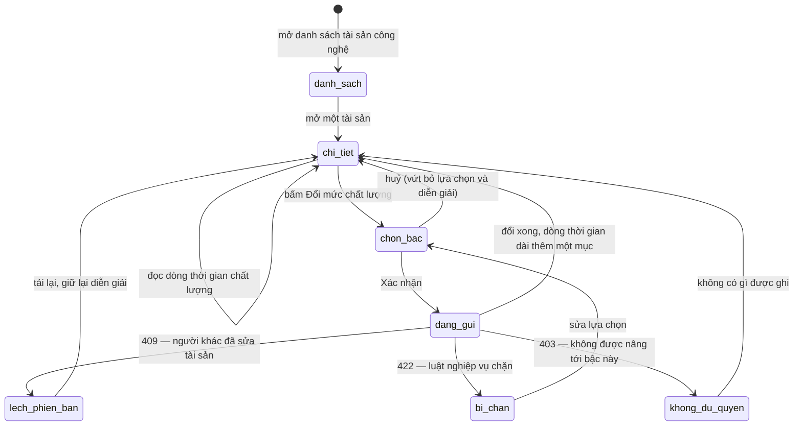

# Cổng chất lượng của tài sản công nghệ

## Tóm tắt

Mỗi tài sản công nghệ mang một **mức chất lượng**, bốn bậc theo thứ tự:

```
UNREVIEWED → SELF_DECLARED → REVIEWED → TRANSACTION_READY
```

Mọi tài sản **tạo mới** và mọi tài sản **di trú từ hệ cũ** đều ở `UNREVIEWED`. Không đường nào tự động gán `TRANSACTION_READY`; nó phải đi qua một cổng có người quyết định. Cổng đó là màn hình này.

Hệ quả hôm nay đáng nói thẳng: **mọi tài sản công nghệ trong hệ thống đều ở bậc thấp nhất, và không ai nhìn thấy điều đó**, vì không giao diện nào hiển thị trường này. Bậc chất lượng không xuất hiện ở danh sách admin, ở trang chi tiết, ở chợ giao dịch, hay ở bất kỳ kết quả tìm kiếm nào. Nó là một trường thật, được lưu, được ràng buộc ở tầng cơ sở dữ liệu, và hoàn toàn vô hình.

Màn hình sống ở bảng quản trị và có hai phần: **hiển thị** bậc ở mọi chỗ tài sản công nghệ xuất hiện, và **một cổng** để đổi bậc kèm lý do. Nó phụ thuộc vào [`../api-v2/demand-va-technology.md`](../api-v2/demand-va-technology.md), chưa tồn tại.

**Không có endpoint nào đổi mức chất lượng** — và sâu hơn thế, **không có thao tác nào ở tầng nghiệp vụ** làm việc đó. Trường này chỉ được gán một lần lúc tạo và một lần lúc di trú, cả hai đều gán cứng bậc thấp nhất. Đây là phụ thuộc chặn, và nó lớn hơn một endpoint còn thiếu: phải viết cả thao tác lẫn cửa cho nó.

## Trường hợp đơn giản

Quản trị viên mở danh sách tài sản công nghệ. Cột **Mức chất lượng** hiện bên cạnh cột trạng thái xuất bản; hôm nay mọi dòng đều ghi *Chưa thẩm định*, vì chưa có đường nào đổi bậc. Họ lọc theo bậc thấp nhất và theo lĩnh vực để lấy ra nhóm cần xử lý.

Họ mở một tài sản. Phần đầu trang hiện bậc hiện tại và một dòng nói bậc này nghĩa là gì. Bên cạnh là nút **Đổi mức chất lượng**.

Hộp thoại mở ra. Nó liệt kê bốn bậc, đánh dấu bậc hiện tại, và cho chọn bậc đích. Ô diễn giải được focus. Họ chọn *Đã thẩm định*, chọn một mã lý do từ danh sách, viết vài câu về căn cứ, bấm **Xác nhận**.

Trang cập nhật: bậc ở phần đầu đổi, và một mục mới xuất hiện trong dòng thời gian chất lượng của tài sản — ai đổi, từ bậc nào sang bậc nào, mã lý do gì, diễn giải ra sao, lúc nào.

## Tương tác, sự kiện theo sự kiện



### Vào màn

**Danh sách.** Cột mức chất lượng nằm cạnh cột trạng thái xuất bản, và một bộ lọc theo bậc nằm trong URL. Hai trường này dễ bị nhầm là một, nên nhãn phải rõ: *đã xuất bản* nói bản ghi có công khai không, *mức chất lượng* nói nội dung đã được ai thẩm định tới đâu. Một tài sản đã xuất bản vẫn có thể ở bậc thấp nhất, và hôm nay tất cả đều thế.

**Chi tiết.** Hai lời gọi: tài sản (mang số phiên bản lạc quan — **giao diện phải giữ nó**) và dòng thời gian chất lượng.

Ba thứ phải hiện ở phần đầu:

1. **Bậc hiện tại, viết bằng tiếng Việt**, kèm một câu nói bậc đó nghĩa là gì. Bốn mã tiếng Anh không tự giải thích được cho người đọc.
2. **Bậc này đến từ đâu**: gán mặc định lúc tạo, gán mặc định lúc di trú, hay do một quyết định của người. Ba nguồn này khác nhau về mức tin cậy và người dùng cần phân biệt.
3. **Nút đổi bậc**, hoặc lý do vì sao nó không có với người đang xem.

Không focus gì ở trang chi tiết; nó là trang đọc.

### Rời đi không đổi gì

Đọc bậc và đọc dòng thời gian chất lượng **không ghi gì**: không dòng kiểm toán, không đổi số phiên bản, không dấu vết. Người dùng mở một tài sản rồi đóng lại không để lại vết nào.

### Bắt đầu sửa

Bấm **Đổi mức chất lượng** mở hộp thoại. Đây là lúc giao diện phải làm ba việc.

**Một: hiện đủ bốn bậc, đánh dấu bậc hiện tại.** Khác với chuyển giai đoạn hồ sơ vụ việc, ở đây không có ma trận nào giới hạn đích, nên giấu bớt bậc là giao diện tự bịa ra luật. Nếu sau này có luật giới hạn — không nhảy cóc, không hạ bậc — giao diện phải phản ánh đúng luật đó chứ không tự đặt ra.

**Hai: bắt buộc một mã lý do và một diễn giải.** Đây là mô hình mà hệ thống đã có ở hồ sơ vụ việc và màn hình này dùng lại chứ không phát minh lại: một quyết định gồm **loại quyết định + mã lý do + diễn giải + người quyết + thời điểm**, chỉ ghi thêm, không sửa không xoá. Xem mục "Dùng lại mô hình đã có".

**Ba: đổi chữ trên nút theo hướng đi.** Nâng bậc và hạ bậc là hai hành động khác nhau về nghĩa nghiệp vụ, và một nút "Lưu" đứng giữa cả hai là sai ngôn ngữ. Nút phải nói *Nâng lên {bậc}* hoặc *Hạ xuống {bậc}*.

Nút Xác nhận tắt cho tới khi có bậc đích khác bậc hiện tại, có mã lý do, và ô diễn giải có nội dung.

### Trong khi sửa

Không có endpoint xem trước. Giao diện tự áp được ba luật: bậc đích khác bậc hiện tại, mã lý do bắt buộc, diễn giải không rỗng. Mọi luật khác — ai được nâng tới bậc nào, có cần bằng chứng không — chỉ máy chủ biết, và hôm nay máy chủ chưa biết luật nào cả vì chưa có luật nào được viết.

URL không đổi khi hộp thoại mở. Hộp thoại không phải một route.

### Gửi đi

Một lời gọi, một giao dịch ở máy chủ: đổi bậc, ghi bản ghi quyết định chất lượng, ghi dòng kiểm toán, tăng số phiên bản. Lời gọi mang số phiên bản lạc quan và một khoá chống lặp sinh một lần cho mỗi lần bấm.

Trong lúc chờ, nút Xác nhận khoá và đổi chữ; hộp thoại **không đóng** cho tới khi có kết quả, vì kết quả có thể là một lỗi cần sửa ngay trong hộp thoại đó.

Thành công: hộp thoại đóng, phần đầu và dòng thời gian cập nhật **từ phản hồi**. Không tự đoán bậc mới và không tự đoán số phiên bản mới.

Ba đường thất bại:

| Kết quả | Người dùng thấy | Cái gì được giữ |
|---|---|---|
| **409 lệch phiên bản** | "Tài sản vừa được cập nhật. Đang tải lại." kèm bậc hiện tại từ phản hồi. | **Giữ ô diễn giải.** Người dùng thường viết vài câu về căn cứ; bắt viết lại là cách chắc chắn khiến lần sau họ viết ngắn đi. |
| **422 luật nghiệp vụ** | Câu tiếng Việt nói *phải làm gì tiếp*, không chỉ nói cái gì sai. Bộ mã lý do và bộ mã lỗi của cổng này chưa được định nghĩa — xem "Câu hỏi mở". | Giữ toàn bộ hộp thoại. |
| **403 không đủ quyền** | Câu nói rõ vai trò nào mới nâng được tới bậc này. | Giữ, nhưng nút Xác nhận tắt hẳn — thử lại sẽ hỏng y hệt. |

## Dùng lại mô hình đã có

Hệ thống đã có một mô hình cho "một người ra một quyết định có hậu quả, và sáu tháng sau phải giải thích được": **bản ghi quyết định** của hồ sơ vụ việc. Nó gồm giai đoạn đi, giai đoạn đến, loại quyết định, danh sách mã lý do, diễn giải bắt buộc, người quyết, tham chiếu uỷ quyền, ảnh chụp chính sách đang áp, thời điểm — và nó **chỉ ghi thêm**: sửa một quyết định nghĩa là ghi một quyết định mới thay thế nó, bản cũ vẫn còn.

Cổng chất lượng cần đúng những thứ đó, chỉ đổi hai trục:

| Bản ghi quyết định của hồ sơ | Tương ứng ở cổng chất lượng |
|---|---|
| Giai đoạn đi → giai đoạn đến | Bậc chất lượng đi → bậc chất lượng đến |
| Loại quyết định (`APPROVE`, `REJECT`, `RETURN_FOR_REWORK`, `WAIVE`) | Chưa có bộ tương ứng — xem "Câu hỏi mở" |
| Mã lý do | Cần một bộ mã lý do riêng cho chất lượng |
| Diễn giải bắt buộc | Giữ nguyên, bắt buộc |
| Người quyết, thời điểm | Giữ nguyên |
| Tham chiếu bằng chứng | Đã có chỗ trong mô hình hồ sơ vụ việc nhưng **chưa dùng bao giờ**; cổng chất lượng là chỗ nó có ý nghĩa rõ nhất |
| Chỉ ghi thêm | Giữ nguyên |

Ba lý do dùng lại thay vì phát minh lại:

1. **Người dùng đã học một lần.** Môi giới đọc dòng thời gian hồ sơ vụ việc sẽ đọc được dòng thời gian chất lượng mà không phải học lại cách đọc.
2. **Câu hỏi kiểm toán giống hệt nhau.** "Ai quyết, dựa vào gì, lúc nào, theo luật nào" là cùng một câu hỏi ở cả hai chỗ.
3. **Cùng một cách sai.** Một bậc gán nhầm không được xoá; nó bị một quyết định mới thay thế, và cả hai đều còn. Điều này khớp với nguyên tắc [không có hoàn tác](../nen-tang/luu-va-phien-ban.md#không-có-hoàn-tác) đã áp cho toàn hệ thống.

Cái **không** nên chép sang: ma trận chuyển. Bốn bậc chất lượng chưa có ràng buộc thứ tự nào trong mã, và bịa ra một ma trận ở tầng giao diện sẽ tạo ra một luật không ai quyết định.

## Bốn bậc nghĩa là gì

Bốn mã tồn tại trong mã nguồn nhưng **không chỗ nào định nghĩa chúng bằng lời**. Màn hình phải mang định nghĩa đó, vì người bấm nút cần biết mình đang khẳng định điều gì.

Bộ chữ dưới đây là **đề xuất, chưa được chốt**:

| Bậc | Nghĩa đề xuất |
|---|---|
| `UNREVIEWED` | Chưa ai nhìn. Mặc định của mọi bản ghi mới và mọi bản ghi di trú. |
| `SELF_DECLARED` | Chủ sở hữu đã tự khai đầy đủ và tự chịu trách nhiệm; nền tảng chưa kiểm. |
| `REVIEWED` | Đã có người của nền tảng hoặc chuyên gia được chỉ định xem và xác nhận nội dung khớp hồ sơ. |
| `TRANSACTION_READY` | Đủ điều kiện đưa vào một thương vụ: quyền sở hữu rõ, tài liệu đủ, không vướng tranh chấp đã biết. |

Việc chốt bốn câu này là một **quyết định sản phẩm**, không phải một việc viết nội dung. Bậc cao nhất đặc biệt: nó là lời hứa của nền tảng với bên mua, và định nghĩa của nó quyết định nền tảng chịu trách nhiệm tới đâu.

## Biến thể

| Biến thể | Lúc vào màn | Trong khi soạn lệnh đổi bậc |
|---|---|---|
| Vai trò | Cổng thuộc bảng quản trị, chỉ vai trò `ADMIN` vào được. **Chủ sở hữu ở cổng người dùng không có màn hình này** — xem "Câu hỏi mở" về việc họ có được tự khai bậc thứ hai hay không. Việc *hiển thị* bậc thì rộng hơn việc *đổi* bậc: nó cần có mặt ở danh sách admin, ở trang chi tiết, và có thể ở chợ giao dịch cho người mua. Khách chưa đăng nhập không đổi được gì. | Vai trò không đổi giữa chừng ở phía người dùng. Mất vai trò quản trị viên trong lúc soạn thì lệnh gửi trả 403 và toàn bộ bảng quản trị đóng lại. |
| Trạng thái bản ghi | Trạng thái xuất bản và mức chất lượng **độc lập nhau**, và giao diện phải trình bày chúng như hai trục chứ không phải một thang. Bản ghi **đã xoá mềm** không nên đổi bậc được; nút phải tắt kèm lý do. Bản ghi ở bậc cao nhất vẫn hiện nút đổi, vì hạ bậc — nếu được phép — là một hành động hợp lệ. **Đề bài không có mức chất lượng**; màn hình này chỉ áp cho tài sản công nghệ, và giao diện không được hiện cột rỗng ở danh sách đề bài. | Đổi được **bởi người khác**: một lần sửa nội dung song song sẽ tăng số phiên bản và làm lệnh đổi bậc trả 409. |
| Cấu hình backend | Không ảnh hưởng. Không cờ nào trong bốn cờ đổi hành vi mức chất lượng. Đáng nói vì đây là chỗ dễ tưởng có cờ: mức chất lượng **không tham gia** vào việc lọc ứng viên ghép cặp ở cả hai chế độ chấm điểm — xem [`vong-ghep-cap.md`](vong-ghep-cap.md). | Không ảnh hưởng. |
| Phím tắt của biểu mẫu | Trang chi tiết là trang đọc; không focus gì. Danh sách nên hỗ trợ Tab qua các dòng và qua bộ lọc bậc. | Hộp thoại focus ô diễn giải khi mở. Escape đóng và **vứt bỏ**; nên hỏi lại nếu ô diễn giải đã có nội dung. Enter trong ô diễn giải phải xuống dòng, **không** gửi — đổi bậc là hành động cần chủ ý. Ctrl/Cmd+Enter gửi. Mũi tên lên/xuống di chuyển giữa bốn bậc trong nhóm chọn. |

## Huỷ và gián đoạn

| Sự kiện | Trước khi gửi | Trong khi đang gửi |
|---|---|---|
| Bấm Huỷ hoặc nhấn Escape | Hộp thoại đóng, lựa chọn bậc, mã lý do và diễn giải bị vứt bỏ. Không có gì được ghi. **Nên hỏi lại** nếu ô diễn giải đã có nội dung. | Không có cách huỷ. Nút Xác nhận đã khoá và không có nút Dừng. Giao dịch ở máy chủ ngắn và không dừng được từ trình duyệt. |
| Đi chỗ khác trong app | Hộp thoại đóng, mất lựa chọn và diễn giải. | Kết quả không tới giao diện. **Giao dịch ở máy chủ vẫn hoàn tất.** Người dùng quay lại thấy bậc đã đổi mà không nhớ mình đã gửi. |
| Back/Forward của trình duyệt | Hộp thoại không phải một route, nên Back rời khỏi trang chi tiết chứ không đóng hộp thoại. Đây là hành vi đáng sửa: hộp thoại nên đẩy một mục vào lịch sử. | Như trên: giao dịch hoàn tất, giao diện không biết. |
| Tải lại trang, hoặc đóng tab | Mất lựa chọn và diễn giải. Không có bản nháp. | Giao dịch hoàn tất. Thử lại **cùng khoá chống lặp** trả phát lại phản hồi cũ thay vì đổi bậc hai lần và tạo hai bản ghi quyết định. |
| Mất mạng, hoặc quá hạn | Không ảnh hưởng — chưa gọi gì. | Giao diện không biết lệnh đã tới máy chủ chưa. **Phải giữ nguyên khoá chống lặp cho lần thử lại**; sinh khoá mới sẽ ghi hai quyết định chất lượng cho cùng một lần bấm, và vì bản ghi chỉ ghi thêm nên không xoá được cái thừa. |
| Phiên hết hạn (401), hoặc v1 bị dừng (410) | Người dùng bị đẩy về đăng nhập và **mất diễn giải đã viết**. Đây là mất mát thật; xem [`../xuyen-suot/thay-doi-chua-luu.md`](../xuyen-suot/thay-doi-chua-luu.md). 410 không áp dụng: cổng này chỉ sống trên v2. | 401 giữa chừng nghĩa là lệnh bị từ chối trước tầng nghiệp vụ; không có gì được ghi. |
| Bản ghi bị đổi bởi người khác | Bậc hiển thị đã cũ và giao diện không biết — không có kênh đẩy. Tài sản bị xoá mềm giữa chừng thì lần tải lại sau vẫn mở được với quản trị viên nhưng nút đổi bậc phải tắt. | **409 kèm số phiên bản hiện tại.** Tải lại tài sản, **giữ ô diễn giải**, và hiện rõ bậc đã đổi từ gì sang gì — nếu người khác vừa nâng bậc rồi, quyết định đang soạn có thể không còn cần thiết. |
| Trình duyệt tự điền | Không áp dụng — không trường nào là email hay mật khẩu. Ô diễn giải là văn bản tự do và trình quản lý mật khẩu không nhận ra nó. | Không áp dụng. |

Sau bất kỳ gián đoạn nào, người dùng ở lại trang chi tiết tài sản. Thứ duy nhất đáng cứu là ô diễn giải.

## Tương tác với hệ thống khác

**Quyền và vai trò.** Quyền ở đây là quyền nền tảng: quản trị viên đổi được, người khác không. Đây là điểm khác với [console hồ sơ vụ việc](console-ho-so-vu-viec.md), nơi quyền do vai trò trong từng bản ghi quyết định. Nếu bậc `SELF_DECLARED` được mở cho chủ sở hữu, mô hình quyền thành hai tầng và phải được thiết kế lại chứ không chắp thêm.

**Kiểm tra dữ liệu và cách hiện lỗi.** Ba luật giao diện tự áp: bậc đích khác bậc hiện tại, mã lý do bắt buộc, diễn giải không rỗng. Bộ mã lỗi 422 của cổng chưa tồn tại và phải được định nghĩa cùng lúc với luật — mã lỗi đặt tên theo luật bị vi phạm, không theo tầng kỹ thuật.

**Thay đổi chưa lưu.** Ô diễn giải là chỗ duy nhất bẩn được, và là chỗ đáng giữ nhất qua mọi gián đoạn.

**Cập nhật lạc quan và hoàn tác.** **Không được cập nhật lạc quan.** Bậc chất lượng là một khẳng định có hậu quả pháp lý tiềm tàng; hiện bậc mới rồi rút lại là điều tệ nhất màn hình có thể làm. **Không có hoàn tác**: đổi nhầm phải đổi lại, và lần đổi lại để lại thêm một bản ghi quyết định — đúng như thiết kế, giống hệt cách hồ sơ vụ việc xử lý một lần chuyển nhầm.

**Ngoại tuyến.** Không xếp hàng lệnh đổi bậc. Một lệnh gửi sau vài phút có thể đã sai vì nội dung tài sản đã đổi.

**Thông báo và toast.** Hiện **không có loại thông báo nào** cho mức chất lượng. Chủ sở hữu không được báo khi tài sản của họ được nâng hay bị hạ bậc — kể cả khi việc hạ bậc gỡ tài sản khỏi một chỗ nào đó. Đây là thiếu sót phải lấp cùng lúc với việc xây cổng, nếu không chủ sở hữu sẽ thấy trạng thái của mình đổi mà không hiểu vì sao.

**Trạng thái lọc/tìm trong URL.** Bộ lọc theo bậc ở danh sách phải nằm trong URL. Đây là bộ lọc mà người vận hành dùng hằng ngày để lấy hàng chờ xử lý; không có nó trong URL thì không chia việc được cho nhau.

**Đa ngôn ngữ.** Bốn tên bậc lưu bằng chuỗi tiếng Anh viết hoa và cần bốn nhãn tiếng Việt cùng bốn câu định nghĩa. Bộ mã lý do — khi được định nghĩa — cũng cần dịch. Bảng dịch nên nằm chung một chỗ với 32 chuỗi mà console hồ sơ vụ việc đã cần, không rải trong từng component.

**Khả năng truy cập.** Nhóm chọn bậc là một nhóm nút chọn có nhãn nhóm, không phải bốn nút rời. Bậc hiện tại phải được thông báo là *đã chọn*, không chỉ tô màu. Hộp thoại phải bẫy focus và trả focus về nút đã mở nó khi đóng.

**Dấu vết kiểm toán.** Mỗi lần đổi bậc ghi một dòng kèm **số phiên bản của tài sản** tại thời điểm đó, nên tra ngược được về đúng bản ghi quyết định và đúng phiên bản nội dung đang được thẩm định. Lượt bị từ chối vì quyền ghi kết quả `DENY` kèm mã quy tắc; lượt bị từ chối vì luật nghiệp vụ thì không — hai loại từ chối khác nhau và [màn hình nhật ký](nhat-ky-kiem-toan.md) phải phân biệt được.

## Trường hợp biên

- **Mọi tài sản trong hệ thống đang ở bậc thấp nhất.** Khi màn hình ra mắt, cột mức chất lượng sẽ đồng loạt hiện *Chưa thẩm định*, và một cột chỉ có một giá trị trông như một cột hỏng. Giao diện nên nói rõ đây là trạng thái thật, không phải lỗi tải.
- **Bậc hiện tại không có nguồn gốc ghi lại.** Không dòng dữ liệu nào cho biết một tài sản ở bậc thấp nhất là vì mới tạo, vì mới di trú, hay vì bị hạ xuống. Sau khi cổng có dòng thời gian, ba trường hợp mới phân biệt được — nhưng chỉ với các thay đổi sau khi cổng ra đời. Toàn bộ dữ liệu hiện có sẽ mãi mãi không có nguồn gốc.
- **Di trú từ hệ cũ gán cứng bậc thấp nhất**, kể cả khi hệ cũ có dữ liệu gợi ý điều ngược lại. Đây là quyết định có chủ đích: không dựng lịch sử giả, và không hứa hộ hệ cũ.
- **Sửa nội dung không đụng tới bậc.** Một tài sản đã ở bậc *đã thẩm định* có thể bị chủ sở hữu viết lại toàn bộ phần mô tả ngay sau đó, và bậc vẫn nguyên. Nghĩa là bậc đang chứng nhận cho một nội dung có thể không còn tồn tại. Xem "Câu hỏi mở".
- **Đề bài không có mức chất lượng.** Hai loại nội dung trông giống nhau ở giao diện nhưng khác nhau ở điểm này, và facade v1 còn trình bày chúng như một. Màn hình phải tránh gợi ý rằng đề bài cũng có bậc.
- **Mức chất lượng không ảnh hưởng tới ghép cặp.** Một tài sản ở bậc thấp nhất vẫn xuất hiện làm ứng viên cho mọi đề bài. Nếu điều đó là ngoài ý muốn, nó là một quyết định sản phẩm chưa được ra, không phải một lỗi cấu hình.
- **Hạ bậc chưa được định nghĩa.** Mô hình dữ liệu cho phép mọi hướng; chưa có luật nào nói hạ được hay không, và ai hạ được.
- **Nhảy cóc chưa được định nghĩa.** Không có gì chặn một lệnh đưa thẳng từ bậc thấp nhất lên bậc cao nhất trong một lần.

## Câu hỏi mở và kiểm chứng

Bảy câu dưới đây là **quyết định sản phẩm chưa ai ra**. Không câu nào chọn hộ được ở tầng giao diện, và mỗi câu đổi hình dạng màn hình.

- **Ai được nâng bậc?** Chỉ quản trị viên, hay có một vai trò thẩm định riêng? Bậc *tự khai* về nghĩa thì thuộc chủ sở hữu, nhưng chủ sở hữu không có màn hình nào ở cổng người dùng và mở cho họ nghĩa là mô hình quyền thành hai tầng.
- **Có cần bằng chứng đính kèm không?** Mô hình bản ghi quyết định đã có chỗ cho tham chiếu bằng chứng và chỗ đó chưa từng được dùng. Nếu bậc cao nhất cần tài liệu chứng minh, tài liệu đó nằm trong phòng dữ liệu và cổng phải nối sang [`phong-du-lieu-va-cap-quyen.md`](phong-du-lieu-va-cap-quyen.md).
- **Hạ bậc được không?** Nếu được, ai được hạ, và bậc bị hạ có mang dấu hiệu khác với bậc chưa bao giờ được nâng không? Hai thứ đó trông giống hệt nhau trong dữ liệu hiện tại.
- **Nâng bậc có ghi bản ghi quyết định như hồ sơ vụ việc không?** Tài liệu này giả định là **có** và dựng toàn bộ thiết kế trên giả định đó, vì đó là mô hình duy nhất hệ thống đã có cho loại việc này. Nếu câu trả lời là không — chỉ đổi một trường, không ghi lý do — thì màn hình đơn giản đi rất nhiều và câu hỏi "ai nâng cái này lên, dựa vào gì" sẽ vĩnh viễn không có câu trả lời.
- **Mức chất lượng có nên hiện công khai ở chợ giao dịch không?** Hiện nó ra là cho người mua một tín hiệu thật; cũng là đặt nền tảng vào vị trí bảo chứng. Không hiện thì bậc chỉ là công cụ nội bộ và phần lớn giá trị của nó mất đi. Câu này quyết định cả cách viết bốn định nghĩa bậc ở trên.
- **Bốn bậc có ràng buộc thứ tự không?** Nhảy cóc từ bậc thấp nhất lên bậc cao nhất có hợp lệ không, và nếu không thì đó là luật ở tầng nào — mô hình dữ liệu, tầng dịch vụ, hay chỉ giao diện.
- **Sửa nội dung có làm bậc rơi lại không?** Hai đường: bậc **ghim một số phiên bản** như cách hồ sơ vụ việc ghim phiên bản đề bài, và mọi phiên bản mới làm bậc thành "đã thẩm định cho phiên bản 3, nội dung hiện tại là phiên bản 5"; hoặc bậc tự rơi về bậc thấp nhất khi nội dung đổi. Đường thứ nhất giữ được lịch sử và cần đường tra ngược mà [`lich-su-phien-ban.md`](lich-su-phien-ban.md) cũng đang cần; đường thứ hai đơn giản nhưng làm mất công thẩm định mỗi lần sửa một dấu phẩy.

Ngoài bảy câu trên:

- **Không có endpoint và không có thao tác nghiệp vụ nào đổi mức chất lượng.** Trường này chỉ được gán lúc tạo và lúc di trú. Phải viết cả thao tác lẫn cửa; đây là phụ thuộc chặn lớn hơn các màn hình khác trong nhóm này. (chưa cấp mã lỗi)
- **Bộ mã lý do cho cổng chất lượng chưa tồn tại.** Hồ sơ vụ việc có mã lý do đi kèm mỗi quyết định; cổng chất lượng cần bộ của riêng nó, và bộ đó phải được chốt trước khi hộp thoại được viết, vì nó quyết định ô chọn có bao nhiêu mục.
- **Việc mọi tài sản đứng yên ở bậc thấp nhất mà không ai nhìn thấy đáng bị coi là lỗi**, không phải một tính năng chưa mở: một trường có ràng buộc ở tầng cơ sở dữ liệu, có bốn giá trị hợp lệ, và không có đường nào đọc lẫn ghi. (chưa cấp mã lỗi)
- Chưa quan sát được bậc của bất kỳ tài sản nào trên bản chạy vì cơ sở dữ liệu rỗng và không có endpoint nào trả trường này. Toàn bộ tài liệu đọc từ khai báo kiểu và chú thích trong mã.
- Chưa chạy bộ test bất biến để xác nhận rằng không đường nào gán bậc cao nhất. Đó là việc rẻ nhất nên làm trước khi khẳng định điều đó với người dùng.

Đặc tả — chưa có mã. Dựa trên SourceCode/nacentech, bản chụp ngày 2026-09-04.
