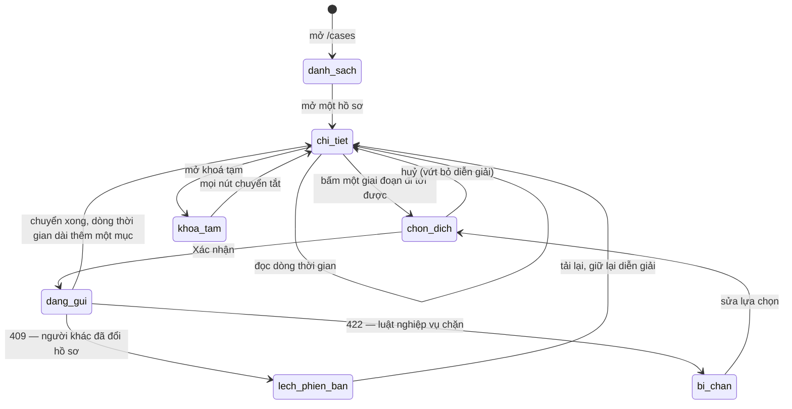

# Console hồ sơ vụ việc

## Tóm tắt

Console hồ sơ vụ việc là màn hình mà môi giới sống trong đó. Nó liệt kê các hồ sơ họ phụ trách, mở từng hồ sơ ra thành một trang chi tiết có dòng thời gian đầy đủ, và là chỗ duy nhất trong toàn hệ thống mà một hồ sơ đổi giai đoạn.

Đây là màn hình quan trọng nhất trong số các màn hình còn thiếu, vì nó là mặt tiền của lõi kiến trúc V2: [12 giai đoạn, ma trận chuyển, bản ghi quyết định chỉ-ghi-thêm, khoá tạm và ảnh chụp chính sách](../nen-tang/mo-hinh-du-lieu.md#hồ-sơ-vụ-việc). Toàn bộ cơ chế đó đã có mã chạy được và **không ai chạm tới được**.

Console sống ở bảng quản trị, dưới hai route mới: `/cases` và `/cases/:id`. Nó cũng cần một phiên bản rút gọn ở cổng người dùng cho chủ bài toán, nhưng bản đó nằm ngoài phạm vi tài liệu này.

Nó phụ thuộc hoàn toàn vào [`../api-v2/case-va-quyet-dinh.md`](../api-v2/case-va-quyet-dinh.md), chưa tồn tại.

## Trường hợp đơn giản

Môi giới mở `/cases`. Họ thấy danh sách hồ sơ mình đang phụ trách, mỗi dòng gồm mã hồ sơ, tiêu đề, giai đoạn hiện tại, chủ bài toán, hạn ra quyết định, và một dấu hiệu nếu hồ sơ đang bị khoá tạm.

Họ mở một hồ sơ. Trang chi tiết chia ba phần: phần đầu là thông tin hồ sơ và thanh giai đoạn; phần giữa là dòng thời gian các quyết định, cũ nhất trên cùng; phần cuối là danh sách bên tham gia.

Trên thanh giai đoạn, chỉ những giai đoạn hồ sơ đi tới được là bấm được. Bấm một trong số đó mở hộp thoại quyết định. Hộp thoại đã chọn sẵn loại quyết định hợp lệ duy nhất cho hướng chuyển đó, và ô diễn giải được focus.

Họ viết vài câu, bấm **Xác nhận**. Trang cập nhật: thanh giai đoạn nhích sang ô mới, một mục mới xuất hiện ở cuối dòng thời gian, và nếu vừa vào giai đoạn thẩm định thì một dòng nữa hiện ra nói rằng chính sách đã được chốt cho hồ sơ này.

## Tương tác, sự kiện theo sự kiện

### Vào màn

**Danh sách.** Ba bộ lọc: môi giới, chủ bài toán, giai đoạn. Cả ba nên nằm trong URL — đây là màn hình đầu tiên của hệ thống nên làm đúng chuyện đó, vì [không màn hình nào hiện nay làm](../nen-tang/dieu-huong-va-url.md#cái-gì-nằm-trong-url).

Máy chủ đã lọc theo quyền: người không phải quản trị viên chỉ nhận hồ sơ mà mình đang là bên tham gia đang hoạt động. Giao diện không cần lọc lại, và **không nên** hiển thị con số nào gợi ý rằng còn hồ sơ khác họ không thấy.

Trạng thái rỗng có hai nghĩa khác nhau và giao diện phải phân biệt: chưa có hồ sơ nào trong hệ thống, và có nhưng người này không tham gia hồ sơ nào. Câu chữ cho hai trường hợp phải khác.

**Chi tiết.** Hai lời gọi: hồ sơ và dòng thời gian. Hồ sơ mang số phiên bản — **giao diện phải giữ nó**, vì mọi lệnh ghi đều cần.

Ba thứ phải hiện ngay ở phần đầu, không giấu sau tab:

1. **Giai đoạn hiện tại**, và nếu là một trong bốn giai đoạn kết thúc thì nói rõ hồ sơ đã đóng và không đi đâu được nữa.
2. **Cờ khoá tạm**, nếu có. Nó chặn mọi lệnh chuyển, nên giấu nó đi là làm người dùng bấm vào một nút không bao giờ hoạt động.
3. **Phiên bản đề bài mà hồ sơ đang ghim**, kèm cảnh báo nếu đề bài đã có phiên bản mới hơn. Đây là chỗ dễ hiểu nhầm nhất trong hệ thống: hai người mở cùng một đề bài từ hai chỗ khác nhau có thể đọc hai nội dung khác nhau.

Không có gì được focus sẵn ở trang chi tiết; nó là trang đọc.

### Rời đi không đổi gì

Đọc hồ sơ và đọc dòng thời gian **không ghi gì** — không dòng kiểm toán, không dấu vết. Người dùng mở một hồ sơ rồi đóng lại không để lại vết nào.

Ngoại lệ duy nhất: nếu hồ sơ có tài liệu mật và người dùng mở một tài liệu, hành động đó **có** ghi lại, kèm mục đích. Xem [`phong-du-lieu-va-cap-quyen.md`](phong-du-lieu-va-cap-quyen.md).

### Bắt đầu sửa

Bấm một giai đoạn trên thanh giai đoạn mở hộp thoại quyết định. Đây là lúc giao diện phải làm ba việc mà máy chủ không làm hộ.

**Một: chỉ hiện giai đoạn đi tới được.** Ma trận chuyển là dữ liệu cố định, không đổi theo hồ sơ. Hồ sơ ở `EXECUTION` có đúng hai đường ra. Hiện đủ 11 giai đoạn rồi để máy chủ từ chối 9 cái là bắt người dùng học luật bằng cách bị từ chối.

**Hai: chọn sẵn loại quyết định.** Hướng chuyển quyết định loại quyết định hợp lệ:

| Đích | Quyết định |
|---|---|
| Tiến, không phải `REJECTED` | `APPROVE` hoặc `WAIVE` — hai lựa chọn |
| Lùi | `RETURN_FOR_REWORK` — một lựa chọn, không cần hỏi |
| `REJECTED` | `REJECT` — một lựa chọn, không cần hỏi |

Với hai hàng dưới, ô chọn quyết định không nên tồn tại. Hiện một danh sách một phần tử là hỏi một câu chỉ có một câu trả lời.

**Ba: đổi chữ trên nút theo giai đoạn.** Từ chối chỉ có tới hết `DUE_DILIGENCE`. Từ `DEAL_DESIGN` trở đi, đường ra là *rút lui* hoặc *huỷ*. Một nút "Từ chối" đứng ở giai đoạn thi công là sai ngôn ngữ nghiệp vụ.

**Diễn giải là bắt buộc.** Nút Xác nhận tắt cho tới khi ô diễn giải có nội dung. Đây là luật đầu tiên máy chủ kiểm, nên chặn ở giao diện tiết kiệm một vòng gọi.

### Trong khi sửa

Không có endpoint xem trước. Mọi luật khác chỉ hiện ra ở bước gửi.

Giao diện tự áp được bốn luật: ma trận chuyển, loại quyết định theo hướng, diễn giải không rỗng, và cờ khoá tạm. Bốn luật còn lại chỉ máy chủ biết — quyền, phiên bản, môi giới chính khi vào thẩm định, và trạng thái thật của hồ sơ tại thời điểm gửi.

URL không đổi khi hộp thoại mở. Hộp thoại không phải một route.

### Gửi đi

Một lời gọi, một giao dịch ở máy chủ. Trong lúc chờ, nút Xác nhận khoá và đổi chữ; hộp thoại **không đóng** cho tới khi có kết quả, vì kết quả có thể là một lỗi cần sửa ngay trong hộp thoại đó.

Thành công: hộp thoại đóng, phần đầu và dòng thời gian cập nhật từ phản hồi. **Không tự đoán số phiên bản mới** — lấy từ phản hồi.

Ba đường thất bại, và chúng cần ba cách xử lý khác nhau:

| Kết quả | Người dùng thấy | Cái gì được giữ |
|---|---|---|
| **409 lệch phiên bản** | "Hồ sơ vừa được người khác cập nhật. Đang tải lại." kèm giai đoạn hiện tại từ phản hồi. | **Giữ ô diễn giải.** Người dùng thường viết vài câu; bắt viết lại là cách chắc chắn khiến lần sau họ viết ngắn đi. |
| **422 luật nghiệp vụ** | Câu tiếng Việt nói *phải làm gì tiếp*, không chỉ nói cái gì sai. Xem bảng dưới. | Giữ toàn bộ hộp thoại. |
| **403 không đủ quyền** | Câu nói rõ vai trò nào mới làm được việc này. | Giữ, nhưng nút Xác nhận nên tắt hẳn — thử lại sẽ hỏng y hệt. |

Sáu mã 422 và câu tương ứng:

| Mã | Câu, và hành động kèm theo |
|---|---|
| `CASE_ON_HOLD` | "Hồ sơ đang bị khoá. Gỡ khoá trước khi chuyển giai đoạn." + nút gỡ khoá |
| `TRANSITION_NOT_ALLOWED` | Không nên xảy ra — nếu xảy ra nghĩa là giao diện hiện sai danh sách đích. Ghi lại và hiện câu chung. |
| `REWORK_DECISION_REQUIRED` | Như trên — giao diện lẽ ra đã chọn sẵn. |
| `REJECT_DECISION_REQUIRED` | Như trên. |
| `FORWARD_DECISION_REQUIRED` | Như trên. |
| `CASE_01_LEAD_BROKER_REQUIRED` | "Cần gán môi giới chính trước khi chuyển sang thẩm định." + **nút gán ngay trong hộp thoại** |

Bốn mã ở giữa chỉ xuất hiện khi giao diện và máy chủ bất đồng về ma trận. Chúng là tín hiệu lỗi lập trình, không phải hướng dẫn cho người dùng.

## Khoá tạm

Nút **Khoá hồ sơ** nằm ở phần đầu, cần một lý do. Từ lúc đó, mọi nút chuyển giai đoạn tắt, và một dải hiện ở đầu trang nói hồ sơ đang bị khoá.

Gỡ khoá cần một diễn giải riêng, và nó **tạo một mục trong dòng thời gian** với giai đoạn đi và đến bằng nhau. Dòng thời gian vì thế có hai loại mục và chúng phải trông khác nhau:

- **Chuyển giai đoạn**: `A → B`, vẽ như một bước tiến hoặc lùi.
- **Gỡ khoá**: giai đoạn không đổi, vẽ như một ghi chú có người ký, không phải một mũi tên vòng.

Mở nhiều khoá cùng lúc là được phép, và hồ sơ bị chặn cho tới khi gỡ hết. Trước 2026-09-05 hồ sơ chỉ trả **một cờ đúng/sai**, không trả danh sách khoá; nay có thêm trường `holds`. Giao diện vì thế nói được "đang bị khoá" nhưng không nói được "có ba khoá, đây là lý do từng cái, đây là nút gỡ từng cái". Đây là một lỗ hổng trong hợp đồng API cần lấp trước khi xây màn hình này — xem [`../api-v2/case-va-quyet-dinh.md`](../api-v2/case-va-quyet-dinh.md#câu-hỏi-mở-và-kiểm-chứng).

## Dòng thời gian

Sắp theo thời điểm quyết định tăng dần. Mỗi mục hiển thị: giai đoạn đi và đến, loại quyết định, mã lý do, diễn giải, ai quyết, thời điểm, và tham chiếu uỷ quyền nếu có.

Ba điều dòng thời gian phải nói rõ mà dữ liệu thô không tự nói:

1. **Không có gì bị xoá.** Một quyết định sai không biến mất; nó bị thay thế bởi một quyết định mới, và cả hai đều còn. Giao diện nên vẽ quan hệ thay thế đó, không giấu bản cũ.
2. **Ai quyết là một mã ẩn danh**, không phải tên. Đổi mã thành tên là một lời gọi riêng, và ai được phép đổi là một quyết định chưa chốt.
3. **Ảnh chụp chính sách gắn với từng quyết định.** Hai quyết định trong cùng một hồ sơ có thể áp hai ảnh chụp khác nhau nếu ảnh chụp đã bị thay thế. Xem [`anh-chup-chinh-sach.md`](anh-chup-chinh-sach.md).

## Biến thể

| Biến thể | Lúc vào màn | Trong khi soạn lệnh chuyển |
|---|---|---|
| Vai trò | Quản trị viên thấy mọi hồ sơ; người khác chỉ thấy hồ sơ mình đang là bên tham gia đang hoạt động. Hồ sơ không thuộc phạm vi trả 404 — giao diện phải hiện "không tìm thấy", **không** hiện "bạn không có quyền", vì câu thứ hai tiết lộ hồ sơ tồn tại. Vai trò trong hồ sơ, không phải vai trò nền tảng, quyết định chuyển được hay không. | Vai trò không đổi giữa chừng ở phía người dùng. Nếu bị gỡ khỏi hồ sơ trong lúc đang soạn, lệnh gửi trả 403 và lần tải lại sau đó trả 404 — người dùng mất quyền đọc chính hồ sơ họ vừa nhìn. |
| Trạng thái bản ghi | Giai đoạn quyết định danh sách đích. Bốn giai đoạn kết thúc: **ẩn hẳn** thanh nút chuyển, đừng làm mờ — hồ sơ đã đóng vĩnh viễn, một nút mờ gợi ý sai rằng có điều kiện nào đó mở được nó. Cờ khoá tạm tắt mọi nút chuyển. | Đổi được **bởi người khác**. Đó chính là chuyện mà số phiên bản bắt. |
| Cấu hình backend | Không ảnh hưởng. Không cờ nào đổi hành vi hồ sơ vụ việc. | Không ảnh hưởng. |
| Phím tắt của biểu mẫu | Trang chi tiết là trang đọc; không focus gì. Danh sách nên hỗ trợ Tab qua các dòng. | Hộp thoại focus ô diễn giải khi mở. Escape đóng và **vứt bỏ**. Enter trong ô diễn giải phải xuống dòng, **không** gửi — chuyển giai đoạn là hành động cần chủ ý. Ctrl/Cmd+Enter gửi. |

## Huỷ và gián đoạn

| Sự kiện | Trước khi gửi | Trong khi đang gửi |
|---|---|---|
| Bấm Huỷ hoặc nhấn Escape | Hộp thoại đóng, lựa chọn và diễn giải bị vứt bỏ. Không có gì được ghi. **Nên hỏi lại** nếu ô diễn giải đã có nội dung. | Không có cách huỷ. Nút Xác nhận đã khoá và không có nút Dừng. Giao dịch ở máy chủ ngắn và không dừng được từ trình duyệt. |
| Đi chỗ khác trong app | Hộp thoại đóng, mất lựa chọn. | Kết quả không tới giao diện. **Giao dịch ở máy chủ vẫn hoàn tất.** Người dùng quay lại thấy hồ sơ đã chuyển mà không nhớ mình đã gửi. |
| Back/Forward của trình duyệt | Hộp thoại không phải một route, nên Back rời khỏi trang chi tiết chứ không đóng hộp thoại. Đây là hành vi đáng sửa: hộp thoại nên đẩy một mục vào lịch sử. | Như trên: giao dịch hoàn tất, giao diện không biết. |
| Tải lại trang, hoặc đóng tab | Mất lựa chọn. Không có bản nháp. | Giao dịch hoàn tất. Đây là chỗ khoá chống lặp cứu: thử lại **cùng khoá** trả phát lại thay vì chuyển hai lần. |
| Mất mạng, hoặc quá hạn | Không ảnh hưởng — chưa gọi gì. | Giao diện không biết lệnh đã tới máy chủ chưa. **Phải giữ nguyên khoá chống lặp cho lần thử lại**; sinh khoá mới sẽ chuyển giai đoạn hai lần. Đây là lý do khoá phải sinh một lần cho mỗi lần bấm, không phải cho mỗi lần gọi. |
| Phiên hết hạn (401), hoặc v1 bị dừng (410) | Người dùng bị đẩy về đăng nhập và **mất diễn giải đã viết**. Đây là mất mát thật; xem [`../xuyen-suot/thay-doi-chua-luu.md`](../xuyen-suot/thay-doi-chua-luu.md). | 401 giữa chừng nghĩa là lệnh bị từ chối trước tầng nghiệp vụ; không có gì được ghi. |
| Bản ghi bị đổi bởi người khác | Giai đoạn hiển thị đã cũ và giao diện không biết. Không có kênh đẩy; chỉ tải lại mới thấy. | **409 kèm số phiên bản và giai đoạn hiện tại.** Đây là đường chính, không phải đường biên — hai môi giới cùng làm một hồ sơ là chuyện thường. Tải lại hồ sơ, giữ ô diễn giải, hiện rõ giai đoạn đã đổi từ gì sang gì. |
| Trình duyệt tự điền | Không áp dụng — không trường nào là email hay mật khẩu. | Không áp dụng. |

Sau bất kỳ gián đoạn nào, người dùng ở lại trang chi tiết hồ sơ. Thứ duy nhất đáng cứu là ô diễn giải.

## Tương tác với hệ thống khác

**Quyền và vai trò.** Đây là màn hình duy nhất mà quyền do **vai trò trong một bản ghi cụ thể** quyết định. Một người là môi giới chính của hồ sơ A và không là gì trong hồ sơ B; hai hồ sơ cho hai bộ nút khác nhau. Giao diện không được cache quyết định quyền giữa hai hồ sơ.

**Kiểm tra dữ liệu và cách hiện lỗi.** Sáu mã 422 phải dịch thành câu nói *phải làm gì tiếp*. Hai trong sáu mã đi kèm một nút hành động ngay trong hộp thoại.

**Thay đổi chưa lưu.** Ô diễn giải là chỗ duy nhất bẩn được, và là chỗ đáng giữ nhất qua mọi gián đoạn.

**Cập nhật lạc quan và hoàn tác.** **Không được cập nhật lạc quan.** Sáu luật từ chối nghĩa là tỉ lệ thất bại không nhỏ; hiện giai đoạn mới rồi rút lại làm người dùng mất niềm tin vào cái họ nhìn. Không có hoàn tác: chuyển nhầm phải chuyển lùi, và chuyển lùi bắt buộc là `RETURN_FOR_REWORK`, để lại vết trong dòng thời gian — đúng như thiết kế.

**Ngoại tuyến.** Không xếp hàng lệnh chuyển. Một lệnh gửi sau vài phút có thể đã sai vì hồ sơ đã đổi.

**Thông báo và toast.** **Hiện không có loại thông báo nào cho hồ sơ vụ việc.** Bốn loại đang tồn tại đều thuộc ghép cặp và lời mời hợp tác. Một hồ sơ chuyển giai đoạn không báo cho ai — kể cả chủ bài toán đang chờ. Đây là thiếu sót phải lấp cùng lúc với việc xây màn hình này, nếu không console sẽ là một màn hình phải mở ra mới biết có gì mới.

**Trạng thái lọc/tìm trong URL.** Ba bộ lọc của danh sách phải nằm trong URL. Đây là màn hình đầu tiên nên làm đúng.

**Đa ngôn ngữ.** 32 chuỗi cần dịch: 12 giai đoạn, 3 tuyến, 7 vai trò trong hồ sơ, 4 loại quyết định, 6 tình trạng ngân sách. Chúng lưu bằng tiếng Anh viết hoa và xuất hiện ở mọi màn hình liên quan tới hồ sơ. Bảng dịch nên nằm một chỗ dùng chung, không rải trong từng component.

**Khả năng truy cập.** Thanh giai đoạn không phải một hàng nút trang trí: nó là trạng thái hiện tại cộng một tập hành động. Dòng thời gian là một danh sách có thứ tự. Hộp thoại quyết định phải bẫy focus và trả focus về nút đã mở nó khi đóng.

**Dấu vết kiểm toán.** Mọi lệnh ghi ghi một dòng kèm số phiên bản hồ sơ, nên tra ngược được về đúng bản ghi quyết định. Lượt bị từ chối vì quyền ghi kết quả `DENY` kèm mã quy tắc; lượt bị từ chối vì luật nghiệp vụ thì không — hai loại từ chối khác nhau và [màn hình nhật ký](nhat-ky-kiem-toan.md) phải phân biệt được.

## Trường hợp biên

- **Không có quyết định nào tên là "rút lui" hay "huỷ".** Chuyển sang `WITHDRAWN` hoặc `CANCELLED` là chuyển tiến, nên theo luật bắt buộc mang `APPROVE` hoặc `WAIVE`. Người dùng phải chọn "Chấp thuận" để rút lui một hồ sơ. Giao diện không che được chuyện này bằng cách đổi nhãn, vì nhãn sai sẽ ghi vào dòng thời gian và người đọc sáu tháng sau thấy một quyết định "Chấp thuận" ở mục rút lui.
- **Gán môi giới chính không bị khoá tạm chặn**, trong khi chuyển giai đoạn thì bị. Nút gán vẫn hoạt động khi hồ sơ bị khoá; dải cảnh báo "hồ sơ đang bị khoá" vì thế không được nói "mọi thao tác đã bị chặn".
- **Người rời vai trò mất quyền đọc ngay.** Môi giới bị thay không đọc được hồ sơ họ vừa làm nhiều tháng — kể cả để bàn giao.
- **Hai loại mục trong dòng thời gian.** Mục gỡ khoá có giai đoạn đi bằng giai đoạn đến.
- **Đề bài đã có phiên bản mới hơn phiên bản hồ sơ ghim.** Phải cảnh báo, không im lặng.
- **Bốn giai đoạn kết thúc.** Ẩn hẳn nút chuyển, không làm mờ.
- **Mã hồ sơ có thể va chạm** khi hai lệnh tạo chạy đồng thời; lệnh thứ hai cho một lỗi 500 khó hiểu. Giao diện nên bắt riêng trường hợp này và mời thử lại, thay vì hiện lỗi hệ thống.
- **Trạng thái rỗng có hai nghĩa.** "Chưa có hồ sơ nào" khác "bạn chưa tham gia hồ sơ nào".

## Câu hỏi mở và kiểm chứng

- ~~**Không có endpoint liệt kê khoá tạm.** Màn hình này không xây được đầy đủ cho tới khi hợp đồng API có nó. Đây là phụ thuộc chặn, không phải một điểm hoàn thiện sau. (chưa cấp mã lỗi)~~ **Đã lấp 2026-09-05** bằng trường `holds` ngay trong hồ sơ (`GET /api/v2/cases/{id}`): định danh, lý do, ai mở, lúc nào, đã gỡ chưa. Console dựng với danh sách từng khoá và nút gỡ từng cái.
- **Không có thông báo nào cho hồ sơ vụ việc.** Cần quyết định sản phẩm: giai đoạn nào phát thông báo, cho ai. Nếu câu trả lời là "không có", console phải được thiết kế như một màn hình người ta chủ động mở, và cần một chỉ báo "có gì mới từ lần bạn xem cuối".
- **Ai đổi được mã ẩn danh trong dòng thời gian thành tên người?** Chưa chốt. Nếu chỉ quản trị viên, dòng thời gian sẽ đọc rất khác nhau tuỳ người xem.
- **Người từng tham gia có được đọc tiếp hồ sơ cũ không?** Chưa chốt. Hiện là không.
- **Console có cần bản cho cổng người dùng không?** Chủ bài toán là một bên tham gia và có quyền đọc, nhưng cổng người dùng không có màn hình nào cho hồ sơ vụ việc. Nếu không làm, chủ bài toán không bao giờ thấy tiến độ hồ sơ của chính mình.
- **`deal-room` ở cổng người dùng là tiền thân UI của chính thứ này.** Nó đã có thiết kế chat, mời thành viên, đổi bước, ghi kết quả thử nghiệm — nhưng chưa nối API và route đã bị gỡ. Trước khi thiết kế console từ đầu, nên đối chiếu với nó. Xem [`../portal/phong-thuong-thao.md`](../portal/phong-thuong-thao.md).
- Chưa chạy bộ test bất biến để xác nhận ma trận chuyển và sáu luật từ chối. Đó là việc rẻ nhất nên làm trước khi bắt đầu code.

Đặc tả; **mã đã có 2026-09-05** (`dmst-admin-main/src/features/cases/`). Dựa trên SourceCode/nacentech, bản chụp ngày 2026-09-05.
