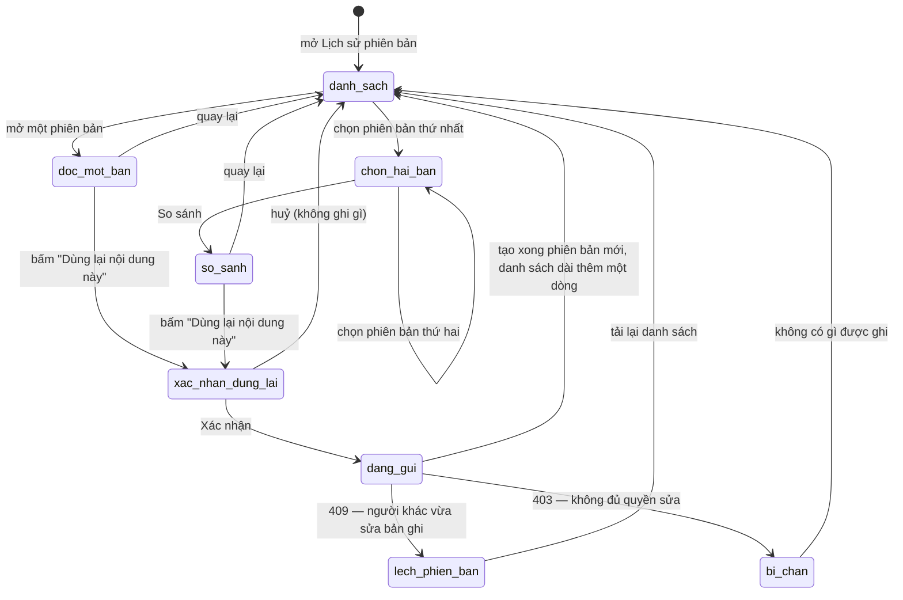

# Lịch sử phiên bản

## Tóm tắt

Đề bài và tài sản công nghệ giữ nội dung trong các phiên bản bất biến: sửa tiêu đề hoặc phần nội dung chính tạo một phiên bản mới chứ không ghi đè. Dữ liệu đó **đã có đủ** — mỗi phiên bản mang số thứ tự, tiêu đề, nội dung, người tạo và thời điểm tạo. Cái thiếu là **đường ra và màn hình**: không endpoint nào trả về danh sách phiên bản, và không giao diện nào hiển thị dù chỉ một số phiên bản.

Màn hình này lấp chỗ đó. Nó liệt kê các phiên bản của một bản ghi, cho đọc lại từng bản, cho **so sánh hai bản**, và chỉ ra **phiên bản nào đang bị hồ sơ vụ việc nào ghim**.

Nó có mặt ở **cả hai bề mặt**. Ở bảng quản trị, quản trị viên xem lịch sử của mọi bản ghi. Ở cổng người dùng, chủ sở hữu xem lịch sử nội dung của chính mình — đây là bề mặt quan trọng hơn, vì chính chủ sở hữu là người sửa nội dung và là người bất ngờ nhất khi số phiên bản không khớp với số lần họ bấm Lưu.

Nó phụ thuộc vào [`../api-v2/demand-va-technology.md`](../api-v2/demand-va-technology.md), chưa tồn tại.

## Trường hợp đơn giản

Chủ một đề bài mở đề bài của mình và bấm **Lịch sử phiên bản**.

Danh sách hiện năm phiên bản, mới nhất trên cùng. Mỗi dòng gồm số phiên bản, tiêu đề tại thời điểm đó, ai tạo, thời điểm tạo, và một dòng tóm tắt cái gì đã đổi so với bản liền trước.

Phiên bản 3 mang một huy hiệu: **đang bị một hồ sơ vụ việc ghim**. Bên cạnh là cảnh báo rằng đề bài hiện đã ở phiên bản 5, nên hồ sơ đó đang xử lý một nội dung cũ hơn hai đời.

Họ chọn phiên bản 3 và phiên bản 5, bấm **So sánh**. Trang so sánh mở ra: tiêu đề đổi hoàn toàn, và phần mô tả bài toán đổi ở ba khối văn bản — một khối thêm, một khối bỏ, một khối sửa. Các khối không đổi hiển thị mờ đi.

Họ đọc xong, quay lại. Không có gì thay đổi và không có gì được ghi.

## Tương tác, sự kiện theo sự kiện

### Vào màn

Hai lời gọi: bản ghi (để lấy số phiên bản hiện hành, trạng thái xuất bản và số phiên bản lạc quan) và danh sách phiên bản (phân trang, mới nhất trước).

Ba thứ phải hiện ngay ở phần đầu:

1. **Số phiên bản hiện hành**, và một câu giải thích số này nghĩa là gì. Xem mục "Số phiên bản không phải số lần bấm Lưu".
2. **Bản ghi có đang bị hồ sơ vụ việc nào ghim không**, và ghim ở phiên bản nào.
3. **Trạng thái xuất bản hiện tại**, vì nó không nằm trong phiên bản nào cả và người đọc dễ đi tìm nó trong lịch sử.

Danh sách không focus gì. Đây là trang đọc cho tới khi người dùng chủ động chọn dùng lại một nội dung cũ.

Trạng thái rỗng **không tồn tại**: mọi bản ghi luôn có ít nhất một phiên bản, tạo cùng lúc với bản ghi. Nếu danh sách trả về rỗng thì đó là lỗi tải, không phải trạng thái hợp lệ, và câu chữ phải nói đúng như vậy.

### Rời đi không đổi gì

Đọc danh sách phiên bản, đọc một phiên bản, và so sánh hai phiên bản **không ghi gì**: không phiên bản mới, không dòng kiểm toán, không đổi số phiên bản lạc quan của bản ghi.

Ngoại lệ: nếu người dùng mở một **đoạn văn bản mật** trong phần lịch sử của phòng dữ liệu, hành động đó **có** được ghi lại kèm mục đích. Xem [`phong-du-lieu-va-cap-quyen.md`](phong-du-lieu-va-cap-quyen.md).

### Bắt đầu sửa

Màn hình có đúng **một** hành động ghi: **Dùng lại nội dung này**.

Nó không phải hoàn tác và giao diện không được gọi nó là hoàn tác. Nó lấy tiêu đề và nội dung của một phiên bản cũ rồi gửi đi như một lần sửa bình thường, tạo ra **một phiên bản mới nữa** mang nội dung đó. Phiên bản cũ vẫn ở nguyên chỗ, và lịch sử dài thêm một dòng.

Ba yêu cầu cho hộp thoại xác nhận:

- Nói rõ **số phiên bản sẽ được tạo**: "sẽ tạo phiên bản 6 mang nội dung của phiên bản 3". Không dùng chữ *khôi phục*, *quay lại*, hay *hoàn tác*.
- Nói rõ **cái gì không được mang theo**: nhãn lĩnh vực, danh mục và trạng thái xuất bản hiện tại giữ nguyên, vì chúng không thuộc phiên bản.
- Nếu bản ghi đang bị một hồ sơ vụ việc ghim, cảnh báo rằng hồ sơ đó **vẫn giữ phiên bản cũ** và không tự đổi theo.

Ở cổng người dùng, hành động này chỉ hiện với chủ sở hữu. Ở bảng quản trị, nó hiện với quản trị viên trên mọi bản ghi.

### Trong khi sửa

Không có trường nào để gõ. Người dùng chọn một phiên bản, đọc, rồi xác nhận hoặc huỷ.

Không có endpoint xem trước. Luật duy nhất giao diện tự áp được là: **không cho dùng lại chính phiên bản hiện hành** — nó sẽ không tạo phiên bản nào, vì hệ thống chỉ tạo phiên bản khi tiêu đề hoặc nội dung thật sự khác bản hiện hành. Một lần bấm không tạo ra gì mà vẫn báo thành công là cách chắc chắn làm người dùng mất niềm tin vào con số phiên bản.

Hai vòng đang so và phiên bản đang đọc **phải nằm trong URL**. Hộp thoại xác nhận thì không phải một route.

### Gửi đi

Một lời gọi: cập nhật bản ghi với tiêu đề và nội dung của phiên bản đã chọn, kèm số phiên bản lạc quan mà giao diện đang giữ và một khoá chống lặp sinh một lần cho mỗi lần bấm.

Trong lúc chờ, nút Xác nhận khoá và đổi chữ; hộp thoại **không đóng** cho tới khi có kết quả.

Thành công: hộp thoại đóng, phần đầu và danh sách cập nhật **từ phản hồi**, không tự đoán. Một dòng mới xuất hiện ở đầu danh sách.

Ba đường thất bại:

| Kết quả | Người dùng thấy | Cái gì được giữ |
|---|---|---|
| **409 lệch phiên bản** | "Bản ghi vừa được cập nhật. Đang tải lại lịch sử." Sau khi tải lại, phiên bản người dùng định dùng lại vẫn còn và vẫn chọn được — nó bất biến. | Giữ lựa chọn phiên bản. Không có ô văn bản nào để mất. |
| **403 không đủ quyền** | Câu nói rõ chỉ chủ sở hữu hoặc quản trị viên mới sửa được nội dung này. | Nút Xác nhận tắt hẳn; thử lại sẽ hỏng y hệt. |
| **Mất mạng hoặc quá hạn** | Không biết lệnh đã tới máy chủ chưa. Thử lại **phải dùng lại đúng khoá chống lặp**; sinh khoá mới sẽ tạo hai phiên bản giống nhau. | Giữ lựa chọn và giữ khoá. |

## Số phiên bản không phải số lần bấm Lưu

Đây là điều màn hình bắt buộc phải giải thích, và là lý do chính khiến nó tồn tại ở cổng người dùng.

**Tạo phiên bản mới:** sửa tiêu đề, hoặc sửa phần mô tả bài toán (với đề bài) / phần mô tả (với tài sản công nghệ).

**Không tạo phiên bản mới:** đổi nhãn lĩnh vực, đổi danh mục, đổi trạng thái xuất bản, đổi bản nội dung do AI xử lý, tải lên hay xoá tệp đính kèm, đổi ảnh đại diện.

Một người đổi nhãn mười lần rồi sửa tiêu đề một lần sẽ có **hai** phiên bản, không phải mười một. Không có phiên bản nào bị mất; chín lần kia không tạo phiên bản nào cả.

Hai yêu cầu:

- Phần đầu màn hình mang **một câu tiếng Việt** nói phiên bản được tạo bởi cái gì, đặt ngay cạnh con số, không giấu trong trợ giúp.
- Mỗi dòng trong danh sách nói **cái gì đã đổi** so với bản liền trước: chỉ tiêu đề, chỉ nội dung, hay cả hai. Không có dòng nào trong danh sách được để trống phần này, vì một dòng không nói gì đã đổi trông y như một dòng thừa.

Lịch sử này **không** ghi lại các lần đổi nhãn và đổi trạng thái xuất bản. Nếu người dùng cần biết "ai đã gỡ xuất bản bản ghi này và lúc nào", câu trả lời nằm ở [nhật ký kiểm toán](nhat-ky-kiem-toan.md), không nằm ở đây. Màn hình nên nói ra điều đó thay vì để người dùng tìm mãi không thấy.

## So sánh hai phiên bản

Đây là quyết định thiết kế chính của màn hình, và nó phải được chốt trước khi viết mã.

**Tiêu đề so ở mức cả trường.** Tiêu đề là một dòng ngắn; tách nó thành từ rồi tô màu từng chữ làm nó khó đọc hơn chứ không dễ hơn. Hiện hai tiêu đề đầy đủ, cạnh nhau, kèm nhãn *đã đổi* hoặc *không đổi*.

**Phần nội dung so ở mức khối văn bản, không ở mức dòng và không ở mức ký tự.** Nội dung là văn bản có định dạng, soạn bằng trình soạn thảo giàu định dạng, nên nó được lưu kèm thẻ đánh dấu. Ba hệ quả:

- So theo **dòng** của văn bản gốc là so theo dòng của mã đánh dấu. Một lần xuống dòng trong trình soạn thảo có thể đổi cả một dòng mã dài, và bản so sánh sẽ đầy khác biệt mà người đọc không nhận ra là gì.
- So theo **ký tự** trên văn bản có định dạng cho ra một bản so sánh rối và chậm với nội dung dài.
- So theo **khối** — đoạn văn, mục danh sách, tiêu đề con — sau khi bỏ thẻ định dạng cho ra kết quả người đọc hiểu ngay: khối này thêm, khối kia bỏ, khối nọ sửa.

**Cái giá của lựa chọn này phải được nói ra trên màn hình:** một thay đổi **chỉ về định dạng** — in đậm một cụm từ, đổi kiểu danh sách — sẽ hiện ra là *không đổi*, trong khi hệ thống thật sự đã tạo một phiên bản mới. Người đọc thấy hai phiên bản khác nhau nhưng bản so sánh nói giống nhau, và họ sẽ nghĩ màn hình hỏng.

Vì vậy khi bản so sánh không tìm ra khác biệt nào ở mức khối, nó **không được hiện "hai phiên bản giống nhau"**. Nó phải nói: "không có khác biệt về nội dung chữ; hai phiên bản khác nhau ở định dạng." Việc có cần thêm một chế độ so mã đánh dấu cho người cần soi kỹ hay không là câu hỏi chưa chốt.

**So sánh không so nhãn, danh mục và trạng thái xuất bản**, vì chúng không thuộc phiên bản. Màn hình phải nói rõ phạm vi so sánh, nếu không người dùng sẽ dùng nó để trả lời một câu hỏi nó không trả lời được.

## Hồ sơ vụ việc ghim một phiên bản

Một hồ sơ vụ việc ghim **một số phiên bản cụ thể** của đề bài, không phải chỉ định danh của đề bài. Đề bài sửa sau đó không đổi cái mà hồ sơ đang xử lý.

Đây là chỗ dễ hiểu nhầm nhất trong toàn hệ thống: hai người mở cùng một đề bài từ hai chỗ khác nhau có thể đang đọc hai nội dung khác nhau.

Ba yêu cầu:

1. **Dòng phiên bản bị ghim mang một dấu hiệu rõ**, kèm mã hồ sơ đang ghim nó. Nhiều hồ sơ ghim cùng một phiên bản thì liệt kê hết.
2. **Cảnh báo khi đã có phiên bản mới hơn** phiên bản bị ghim, đặt ở phần đầu chứ không chỉ ở dòng đó — người dùng có thể không cuộn xuống tới nó.
3. **Cảnh báo không được nói dối về cách khắc phục.** Không có nút nào đẩy hồ sơ sang phiên bản mới; việc đó — nếu được phép — là một hành động của hồ sơ vụ việc và có ràng buộc riêng. Màn hình chỉ báo, không hứa.

Ở cổng người dùng, chủ bài toán cần thấy điều này nhất: họ vừa sửa đề bài và cần biết rằng bên đang xử lý hồ sơ **chưa** thấy sửa đổi đó.

> Ghi chú kỹ thuật: hiện không có truy vấn nào tìm hồ sơ vụ việc theo định danh đề bài. Danh sách hồ sơ chỉ lọc được theo môi giới, chủ bài toán và giai đoạn. Để hiện được huy hiệu "đang bị ghim", hợp đồng API phải bổ sung một đường tra ngược. Đây là phụ thuộc chặn của riêng phần này, không chặn phần còn lại của màn hình.

## Đoạn văn bản mật trong lịch sử

Ngoài phiên bản nội dung công khai, một bản ghi còn có thể mang các **đoạn văn bản mật**: nội dung mức 2, mức 3, và bản do AI xử lý của từng mức. Chúng có lịch sử phiên bản riêng, sống trong phòng dữ liệu, và cần một cấp quyền đọc để mở.

Màn hình trình bày chúng như một nhánh thứ hai của lịch sử, tách khỏi nhánh nội dung công khai. Ba luật:

- **Người không có cấp quyền đọc không thấy nhánh này**, kể cả tên đoạn. Không hiện một dòng bị khoá — hiện một dòng bị khoá đã là tiết lộ rằng đoạn đó tồn tại.
- **Gỡ một đoạn tạo một phiên bản rỗng**, không xoá lịch sử. Màn hình phải phân biệt hai thứ trông giống nhau và có nghĩa hoàn toàn khác:

| Cái người dùng thấy | Nghĩa | Câu phải hiện |
|---|---|---|
| Có đoạn, phiên bản mới nhất rỗng | Đã từng có nội dung, đã bị gỡ | "Đã gỡ lúc {thời điểm}" kèm đường mở phiên bản trước đó |
| Không có đoạn nào | Chưa bao giờ nhập | "Chưa nhập" |

- **Mở nội dung một phiên bản mật ghi một dòng kiểm toán** kèm mục đích, kể cả khi đó là phiên bản cũ. Đọc lịch sử phiên bản mật không rẻ như đọc lịch sử công khai, và giao diện nên nói trước điều đó thay vì để người dùng phát hiện qua nhật ký.

## Biến thể

| Biến thể | Lúc vào màn | Trong khi dùng lại một phiên bản |
|---|---|---|
| Vai trò | **Quản trị viên** xem lịch sử mọi bản ghi, kể cả bản đã xoá mềm. **Chủ sở hữu** ở cổng người dùng xem lịch sử bản ghi của chính mình; bản ghi của người khác trả 404, và giao diện hiện "không tìm thấy" chứ không hiện "bạn không có quyền". **Khách chưa đăng nhập** không có màn hình này: trang công khai và chợ giao dịch chỉ hiện nội dung hiện hành, không hiện lịch sử. Nhánh đoạn văn bản mật phụ thuộc cấp quyền đọc, không phụ thuộc vai trò nền tảng. | Chủ sở hữu và quản trị viên đều dùng lại được. Nếu quyền bị gỡ giữa chừng, lệnh gửi trả 403 và không có gì được ghi. Quản trị viên sửa nội dung của người khác thì việc kiểm quyền tác giả bị **bỏ qua**, không phải được thoả mãn — hai chuyện khác nhau khi đọc nhật ký kiểm toán. |
| Trạng thái bản ghi | Trạng thái xuất bản không đổi hình dạng lịch sử, nhưng phải hiện ở phần đầu vì nó không nằm trong bất kỳ phiên bản nào. Bản ghi **đã xoá mềm** vẫn giữ đủ lịch sử; chỉ quản trị viên mở được, và màn hình phải nói rõ bản ghi đã xoá. **Mức chất lượng** của tài sản công nghệ không liên quan tới phiên bản và không hiện ở đây — xem [`cong-chat-luong-cong-nghe.md`](cong-chat-luong-cong-nghe.md). Bản ghi **di trú từ hệ cũ** luôn chỉ có một phiên bản; xem "Trường hợp biên". | Không dùng lại được nếu bản ghi đã xoá mềm — không có đường sửa bản ghi đã xoá, và nút phải tắt hẳn kèm lý do. Trạng thái xuất bản không chặn việc tạo phiên bản mới; một bản đã xuất bản được sửa vẫn ở trạng thái đã xuất bản và nội dung mới ra công chúng ngay. |
| Cấu hình backend | Không ảnh hưởng. Không cờ nào trong bốn cờ đổi hành vi phiên bản. | Không ảnh hưởng trực tiếp. Gián tiếp: tạo phiên bản mới với nội dung khác sẽ kích hoạt cắt đoạn và tính lại ứng viên, và `Matching:ScoringMode` quyết định vòng ghép cặp mới dùng chế độ nào — xem [`vong-ghep-cap.md`](vong-ghep-cap.md). |
| Phím tắt của biểu mẫu | Không có biểu mẫu ở danh sách. Tab đi qua từng dòng phiên bản; Space chọn/bỏ chọn để so sánh; Enter mở phiên bản đang chọn. Nút So sánh tắt cho tới khi đúng hai phiên bản được chọn. | Hộp thoại xác nhận focus nút Huỷ, **không** focus nút Xác nhận — hành động này tạo một phiên bản không xoá được, nên mặc định phải là không làm gì. Escape đóng và huỷ. Enter kích hoạt nút đang được focus. Ctrl/Cmd+Enter xác nhận. |

## Huỷ và gián đoạn

| Sự kiện | Trước khi gửi | Trong khi đang gửi |
|---|---|---|
| Bấm Huỷ hoặc nhấn Escape | Hộp thoại đóng, lựa chọn phiên bản giữ nguyên. Không có gì được ghi và **không hỏi lại** — không có ô văn bản nào để mất. | Không có cách huỷ. Nút Xác nhận đã khoá và không có nút Dừng. |
| Đi chỗ khác trong app | Hộp thoại đóng. Lựa chọn phiên bản mất nếu chưa vào URL — đó là lý do nó phải vào URL. | Kết quả không tới giao diện nhưng **phiên bản mới vẫn được tạo**. Người dùng quay lại thấy lịch sử dài thêm một dòng mà không nhớ mình đã xác nhận. |
| Back/Forward của trình duyệt | Phiên bản đang đọc và cặp đang so nằm trong URL nên Back đi ngược đúng đường. Hộp thoại xác nhận không phải một route, nên Back rời khỏi màn hình chứ không đóng hộp thoại — hộp thoại nên đẩy một mục vào lịch sử để sửa việc này. | Như trên: phiên bản mới vẫn được tạo. |
| Tải lại trang, hoặc đóng tab | Mất lựa chọn nếu nó không ở URL. Không có bản nháp. | Phiên bản mới vẫn được tạo. Thử lại **cùng khoá chống lặp** trả phát lại phản hồi cũ thay vì tạo phiên bản thứ hai. |
| Mất mạng, hoặc quá hạn | Không ảnh hưởng — chưa gọi gì. Lời gọi đọc thất bại thì thử lại an toàn vô hạn. | Giao diện không biết lệnh đã tới máy chủ chưa. **Phải giữ nguyên khoá chống lặp cho lần thử lại**; sinh khoá mới sẽ tạo hai phiên bản giống hệt nhau và lịch sử có hai dòng không phân biệt được. |
| Phiên hết hạn (401), hoặc v1 bị dừng (410) | Người dùng bị đẩy về đăng nhập. **Không mất gì** vì không có nội dung đang gõ; sau khi vào lại, URL đủ để quay đúng chỗ. 410 không áp dụng: màn hình này chỉ sống trên v2. | 401 giữa chừng nghĩa là lệnh bị từ chối trước tầng nghiệp vụ; không có phiên bản nào được tạo. |
| Bản ghi bị đổi bởi người khác | Lịch sử hiển thị đã cũ và giao diện không biết — không có kênh đẩy. Phiên bản đã có thì bất biến, nên cái cũ là *số phiên bản hiện hành* và *danh sách có đủ dòng chưa*. Bản ghi bị xoá mềm giữa chừng thì lần tải lại sau trả về bản ghi đã xoá với quản trị viên và 404 với chủ sở hữu. | **409 kèm số phiên bản hiện tại.** Tải lại danh sách, giữ nguyên lựa chọn phiên bản cần dùng lại — nó bất biến nên vẫn dùng được — và hiện rõ rằng bản ghi đã có thêm phiên bản mới trong lúc chờ. |
| Trình duyệt tự điền | Không áp dụng — không trường nào là email hay mật khẩu, và màn hình không có ô văn bản tự do. | Không áp dụng. |

Sau bất kỳ gián đoạn nào, người dùng ở lại danh sách phiên bản của cùng bản ghi. Không có gì đáng cứu ngoài lựa chọn phiên bản, và lựa chọn đó đã nằm trong URL.

## Tương tác với hệ thống khác

**Quyền và vai trò.** Đọc lịch sử đi theo quyền đọc bản ghi: chủ sở hữu và quản trị viên. Nhánh đoạn văn bản mật đi theo **cấp quyền đọc**, không theo vai trò nền tảng — một quản trị viên không có phiếu vẫn không đọc được đoạn mật. Hai hệ quyền này chạy song song trên cùng một màn hình và giao diện không được trộn chúng thành một.

**Kiểm tra dữ liệu và cách hiện lỗi.** Không có dữ liệu người dùng nhập, nên không có lỗi kiểm tra dữ liệu ở đường ghi. Bốn lỗi cần câu riêng: bản ghi không tồn tại, không đủ quyền sửa, lệch phiên bản, và một lần dùng lại không tạo ra phiên bản nào vì nội dung trùng bản hiện hành — trường hợp cuối phải bị chặn ở giao diện trước khi gửi.

**Thay đổi chưa lưu.** Màn hình không có trạng thái *đã bẩn*: không có ô nào để gõ. Đây là điểm khác biệt với biểu mẫu sửa nội dung, và là lý do lịch sử phiên bản an toàn để mở giữa chừng một phiên làm việc.

**Cập nhật lạc quan và hoàn tác.** **Không được cập nhật lạc quan** ở hành động dùng lại: số phiên bản mới do máy chủ quyết, và đoán trước rồi sửa lại làm hỏng đúng con số mà màn hình này tồn tại để giải thích. **Không có hoàn tác** ở bất kỳ đâu — đó là toàn bộ nội dung của mục "Bắt đầu sửa".

**Ngoại tuyến.** Không xếp hàng lệnh. Không có bản nháp cục bộ.

**Thông báo và toast.** Không có loại thông báo nào cho việc tạo phiên bản. Một hồ sơ vụ việc đang ghim phiên bản cũ **không được báo** khi đề bài có phiên bản mới — không ai được báo, và màn hình này là chỗ duy nhất phát hiện ra. Đó là một thiếu sót đáng đặt lại thành câu hỏi sản phẩm, không phải một quyết định.

**Trạng thái lọc/tìm trong URL.** Phiên bản đang đọc và cặp đang so đều phải nằm trong URL. Một đường dẫn tới "nội dung lúc đó" phải gửi được cho người khác.

**Đa ngôn ngữ.** Nội dung phiên bản là văn bản người dùng viết, không dịch. Cái cần dịch là nhãn của màn hình và **ba câu giải thích chịu lực**: phiên bản được tạo bởi cái gì, dùng lại nghĩa là gì, và phiên bản rỗng nghĩa là đã gỡ. Ba câu này là phần lớn giá trị của màn hình; dịch chúng cẩu thả sẽ làm hỏng cả màn hình.

**Khả năng truy cập.** Danh sách phiên bản là một danh sách có thứ tự. Bản so sánh là hai vùng nội dung song song, và khác biệt **không được chỉ dựa vào màu** — mỗi khối đã đổi cần một nhãn chữ. Hộp thoại xác nhận phải bẫy focus và trả focus về nút đã mở nó.

**Dấu vết kiểm toán.** Mỗi lần dùng lại ghi một dòng kèm **số phiên bản của bản ghi** tại thời điểm đó, nên tra ngược được về đúng phiên bản nội dung. Đọc lịch sử công khai không ghi gì; đọc một phiên bản đoạn văn bản mật thì có ghi, kèm mục đích.

## Trường hợp biên

- **Bản ghi di trú từ hệ cũ luôn chỉ có đúng một phiên bản**, mang thời điểm tạo của hệ cũ. Hệ cũ sửa bằng cách ghi đè nên lịch sử trước cutover không tồn tại; bản .NET cố ý **không dựng lịch sử giả**. Màn hình phải nói rõ phiên bản 1 của một bản ghi di trú là *trạng thái tại thời điểm chuyển hệ*, không phải bản viết đầu tiên.
- **Người tạo của phiên bản 1 ở bản ghi di trú là chủ sở hữu**, không phải người thật sự sửa lần cuối ở hệ cũ. Trường này không tin cậy được cho bản ghi di trú và không nên hiện như thể tin cậy được.
- **Người tạo có thể rỗng.** Bản ghi do hệ thống hoặc do dữ liệu mồi tạo ra không có người đứng sau. Ô trống phải đọc là "không có người thao tác", không phải "chưa tải xong".
- **Sửa qua bảng quản trị và sửa qua cổng người dùng đi cùng một đường** và tạo phiên bản như nhau. Lịch sử không phân biệt được hai bề mặt; nhật ký kiểm toán mới phân biệt được.
- **Một lần sửa chỉ đổi định dạng vẫn tạo phiên bản mới** nhưng bản so sánh ở mức khối sẽ báo không có khác biệt. Đây là hệ quả đã biết của lựa chọn thiết kế, không phải lỗi hiển thị.
- **Gỡ một đoạn văn bản mật hai lần liên tiếp tạo hai phiên bản rỗng.** Hệ thống không kiểm tra rằng bản hiện hành đã rỗng trước khi thêm bản rỗng nữa, nên lịch sử của một đoạn có thể có nhiều dòng rỗng liền nhau. Màn hình nên gộp chúng lại về mặt hiển thị và nói rõ là đã gộp.
- **Sửa một bản ghi bằng biểu mẫu không gửi kèm các đoạn văn bản mật sẽ gỡ chúng.** Đường sửa hiện tại ghi đè cả bốn đoạn mật theo đúng cái mà biểu mẫu gửi lên, nên một biểu mẫu bỏ trống chúng tạo bốn phiên bản rỗng. Người dùng sửa tiêu đề và mất toàn bộ nội dung mật mà không được cảnh báo. Xem "Câu hỏi mở".
- **Dùng lại chính phiên bản hiện hành không tạo gì.** Giao diện phải chặn trước; nếu lọt xuống máy chủ, phản hồi vẫn là thành công và số phiên bản không tăng.
- **Số phiên bản chỉ đi lên.** Dùng lại nội dung của phiên bản 3 khi đang ở 5 cho ra phiên bản 6, không cho ra phiên bản 3 lần nữa. Không có chỗ nào trong dữ liệu ghi rằng phiên bản 6 "là bản sao của phiên bản 3" — mối liên hệ đó chỉ tồn tại nếu màn hình tự ghi vào đâu đó, và hiện không có chỗ để ghi.

## Câu hỏi mở và kiểm chứng

- **Không có endpoint liệt kê phiên bản.** Dữ liệu đã đủ và bất biến, chỉ thiếu đường ra. Đây là phụ thuộc chặn của cả màn hình. (chưa cấp mã lỗi)
- **Không có đường tra ngược từ một đề bài sang các hồ sơ vụ việc đang ghim nó.** Huy hiệu "đang bị ghim" và cảnh báo "đã có phiên bản mới hơn" không dựng được nếu thiếu nó. (chưa cấp mã lỗi)
- **Màn hình có nên có hành động "Dùng lại nội dung này" không?** Nó không phải hoàn tác, và đặt nó ở đây khiến một số người tin rằng có hoàn tác. Nếu câu trả lời là không, màn hình thành chỉ đọc hoàn toàn và người dùng phải tự chép nội dung sang biểu mẫu sửa. Chưa chốt.
- **Chế độ so mã đánh dấu có cần không?** So ở mức khối bỏ sót thay đổi định dạng. Ai cần thấy thay đổi định dạng, và họ cần thấy nó ở đâu — chưa chốt.
- **Phiên bản 6 tạo từ nội dung phiên bản 3 có nên ghi lại nguồn không?** Dữ liệu hiện không có chỗ cho quan hệ đó. Nếu có, lịch sử đọc được rõ hơn nhiều; nếu không, người đọc sáu tháng sau chỉ thấy hai phiên bản trùng nội dung mà không hiểu vì sao.
- **Việc sửa một bản ghi qua biểu mẫu hiện tại gỡ mất các đoạn văn bản mật đáng bị coi là lỗi**, không phải một chi tiết cần giải thích ở màn hình lịch sử. Lịch sử phiên bản chỉ là chỗ nó lộ ra. (chưa cấp mã lỗi)
- **Chủ sở hữu có được thấy tên người sửa không, khi người sửa là quản trị viên?** Trường người tạo là một mã ẩn danh; đổi nó thành tên là một lời gọi riêng và ai được phép đổi vẫn chưa chốt — cùng một câu hỏi với dòng thời gian của [console hồ sơ vụ việc](console-ho-so-vu-viec.md).
- **Lịch sử phiên bản có cần cho câu chuyện không?** Câu chuyện không có phiên bản; sửa là ghi đè. Nếu sau này nó có, màn hình này nên được dùng lại chứ không nên có bản thứ hai.
- Chưa đo được việc tạo phiên bản trên bản chạy vì cơ sở dữ liệu rỗng. Danh sách trường nào tính là "nội dung" ở trên đọc từ mã cập nhật, chưa xác nhận bằng tay.
- Chưa chạy bộ test bất biến để xác nhận rằng đổi nhãn thật sự không tạo phiên bản. Đó là việc rẻ nhất nên làm trước khi hứa điều đó với người dùng trên màn hình.

Đặc tả — chưa có mã. Dựa trên SourceCode/nacentech, bản chụp ngày 2026-09-04.
