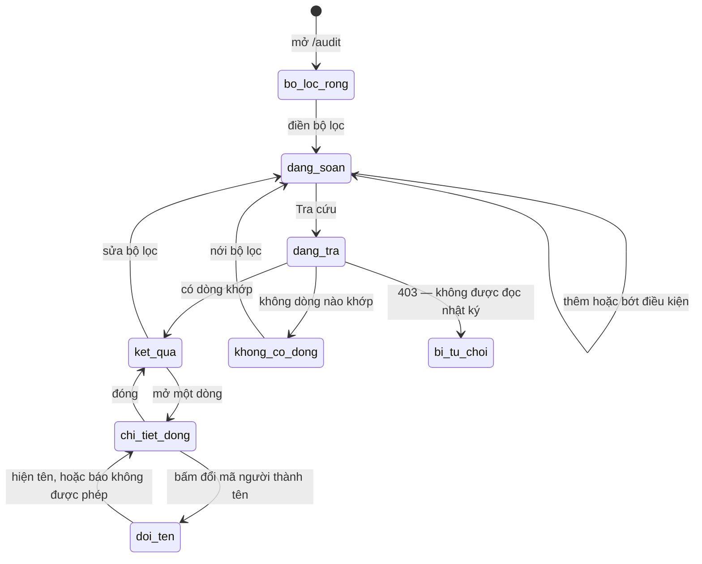

# Nhật ký kiểm toán

## Tóm tắt

Nhật ký kiểm toán là chỗ trả lời câu "ai đã làm gì" — và quan trọng hơn, câu "**vì sao người này không làm được việc kia**".

Dữ liệu đã có: mỗi lượt bị chính sách từ chối để lại một dòng kèm mã quy tắc đã chặn, và mỗi lượt đọc tài liệu mật để lại một dòng kèm mức mật. [Toàn bộ cơ chế](../nen-tang/mo-hinh-du-lieu.md#sự-kiện-kiểm-toán) đã chạy và **không ai xem được**: không endpoint, không route, không component. Hôm nay một người bị từ chối truy cập chỉ nhận một câu tiếng Việt; bộ phận hỗ trợ không có cách nào biết quy tắc nào đã chặn họ.

Màn hình sống ở bảng quản trị dưới một route mới: `/audit`.

Một điều phải nói ngay, và phải nói cả trên màn hình: **đây không phải nhật ký hoạt động**. Nó không ghi mọi việc người dùng làm. Nó ghi hai loại sự kiện và chỉ hai loại — lượt bị chính sách từ chối, và lượt truy cập tài liệu mật. Tạo một hồ sơ, chuyển giai đoạn, giao việc cho môi giới, cấp một phiếu quyền: **không loại nào để lại dòng nào khi thành công**. Một màn hình đặt tên là "nhật ký" mà người dùng tưởng nó ghi tất cả sẽ dẫn tới kết luận sai ở đúng lúc quan trọng nhất.

Nó phụ thuộc hoàn toàn vào [`../api-v2/audit.md`](../api-v2/audit.md), chưa tồn tại. Nó là điều kiện để phát hành [`phong-du-lieu-va-cap-quyen.md`](phong-du-lieu-va-cap-quyen.md): cấp quyền đọc mà không tra được ai đã đọc gì thì không ai dám bật.

## Trường hợp đơn giản

Một môi giới báo rằng họ không mở được hồ sơ kỹ thuật của một đề bài. Quản trị viên mở `/audit`.

Họ điền hai ô: người thao tác, và khoảng thời gian là hôm nay. Bấm **Tra cứu**.

Kết quả trả về một dòng: lúc 09:14, người đó thử đọc một tài liệu, kết quả **Từ chối**, quy tắc `DENY_CONFIDENTIAL_WITHOUT_GRANT` của bộ quy tắc `authz-v1`. Bên cạnh mã quy tắc là một câu tiếng Việt: "Không có phiếu quyền còn hiệu lực cho tài liệu mật."

Quản trị viên bấm vào dòng đó. Ngăn chi tiết mở ra: đầy đủ người thao tác, vai trò lúc đó, hành động, loại đối tượng và định danh đối tượng, mục đích, kết quả, mã quy tắc, mã tương quan, thời điểm. Có một liên kết sang chính tài liệu đó, và một liên kết sang màn hình cấp quyền để xử lý.

Câu hỏi được trả lời trong ba mươi giây, và câu trả lời chỉ đúng một chỗ: người này chưa có phiếu.

## Tương tác, sự kiện theo sự kiện

### Vào màn

Màn hình mở ra với **bộ lọc rỗng và không có kết quả**. Nó không tự tải trang đầu của toàn bộ nhật ký.

Lý do: nhật ký là bảng lớn nhất trong hệ thống và mọi dòng trong đó đều là dữ liệu nhạy cảm. Đổ 20 dòng gần nhất ra màn hình cho bất kỳ ai mở route là biến một công cụ điều tra thành một bảng tin.

Ngoại lệ: nếu người dùng tới đây từ một liên kết sâu — chẳng hạn từ một tài liệu, một hồ sơ, hay một mã tương quan trong báo lỗi — bộ lọc điền sẵn từ URL và truy vấn chạy ngay.

Năm ô lọc, tất cả nằm trong URL:

| Ô lọc | Yêu cầu |
|---|---|
| **Người thao tác** | Chọn một người. Ô nhận cả mã lẫn tên; nếu người dùng dán một mã, giao diện đổi nó thành tên ngay trong ô. |
| **Loại đối tượng** | Danh sách chọn, không phải ô gõ tự do. Người dùng không đoán được `CommercializationCase` viết thế nào. |
| **Định danh đối tượng** | Ô dán mã. Thường được điền sẵn từ liên kết sâu. |
| **Kết quả** | Cho phép · Từ chối · cả hai. Mặc định là **Từ chối** — xem [Giá trị lớn nhất](#giá-trị-lớn-nhất-nằm-ở-các-dòng-từ-chối). |
| **Khoảng thời gian** | Bắt buộc có, với một mặc định ngắn. Một truy vấn không giới hạn thời gian trên bảng lớn nhất hệ thống là một truy vấn không nên chạy. |

> Ghi chú kỹ thuật: hàm tra cứu hiện chỉ nhận bốn tham số — người thao tác, loại đối tượng, định danh đối tượng, kết quả — cộng phân trang. **Không có tham số khoảng thời gian**, dù bảng có chỉ mục theo thời điểm và theo cặp người-thời điểm. Không có tham số hành động và không có tham số mã tương quan. Bốn ô lọc thiếu này là năng lực phải thêm vào hợp đồng API. Kết quả sắp xếp theo thời điểm giảm dần, mới nhất trước.

Một dải thường trực ở đầu màn hình nói hai điều, và nó không được giấu sau một biểu tượng trợ giúp:

1. **Nhật ký chỉ ghi thêm.** Không có nút sửa, không có nút xoá, ở bất kỳ tầng nào — không ở màn hình này, không ở API, không ở tầng dữ liệu. Điều duy nhất từng bị đổi sau khi ghi là hai trường thiết bị, và chúng bị **cắt**, không bị sửa.
2. **Nhật ký không ghi mọi thứ.** Nói rõ hai loại sự kiện nó có, để người đọc không kết luận từ một dòng trống rằng "việc đó đã không xảy ra".

Không có gì được focus sẵn ngoài ô lọc đầu tiên.

### Rời đi không đổi gì

Mở màn hình và đóng lại **không ghi gì**.

> Ghi chú kỹ thuật: việc đọc nhật ký kiểm toán không tự sinh một dòng kiểm toán. Chỉ lượt **bị từ chối** đọc nhật ký mới để lại vết. Nghĩa là câu hỏi "ai đã tra cứu nhật ký" hiện không có câu trả lời — xem [Câu hỏi mở](#câu-hỏi-mở-và-kiểm-chứng).

### Bắt đầu sửa

Thứ duy nhất "sửa" được ở màn hình này là **bộ lọc**. Không có bản ghi nào tạo được, sửa được hay xoá được từ đây; đó là điểm của màn hình.

Lần chạm đầu tiên vào một ô lọc làm nút **Tra cứu** sáng lên và làm kết quả cũ (nếu có) chuyển sang trạng thái mờ đi kèm nhãn "kết quả của bộ lọc trước". Kết quả cũ **không bị xoá khỏi màn hình** cho tới khi kết quả mới về — người đang điều tra thường cần đọc lại cái vừa thấy trong lúc gõ điều kiện mới.

### Trong khi sửa

Giao diện tự áp được ba luật: khoảng thời gian phải hợp lệ, định danh đối tượng phải đúng định dạng, và ít nhất một điều kiện phải có mặt ngoài khoảng thời gian.

URL cập nhật theo bộ lọc **ngay khi sửa**, không đợi tới lúc bấm Tra cứu. Đây là màn hình mà việc gửi một đường dẫn cho đồng nghiệp là thao tác thường xuyên nhất.

### Gửi đi

Bấm Tra cứu chạy một truy vấn đọc. Trong lúc chờ, nút khoá và kết quả cũ giữ nguyên trạng thái mờ.

Thành công: bảng kết quả thay chỗ, kèm tổng số dòng khớp và bộ phân trang. Tổng số dòng là con số đáng tin và nên hiện — khác với [phòng dữ liệu](phong-du-lieu-va-cap-quyen.md#vào-màn), ở đây không có gì bị ẩn khỏi người đã được phép đọc.

Hai đường thất bại:

| Kết quả | Người dùng thấy |
|---|---|
| **403 `FORBIDDEN`** kèm mã quy tắc | Câu nói rõ vai trò nào đọc được nhật ký. Nút Tra cứu tắt hẳn; thử lại sẽ hỏng y hệt. Lượt từ chối này **tự nó là một dòng trong nhật ký**. |
| **Không có dòng nào khớp** | Không phải lỗi, nhưng là kết quả dễ hiểu sai nhất ở màn hình này. Xem dưới. |

**Trạng thái rỗng phải nói ba điều**, không phải một:

1. Không có dòng nào khớp bộ lọc này.
2. Nhật ký chỉ chứa lượt bị chính sách từ chối và lượt truy cập tài liệu mật. Nếu bạn đang tìm một hành động thành công khác, nó **không có ở đây và chưa bao giờ có**.
3. Nếu bạn đang tìm một lượt bị từ chối vì luật nghiệp vụ, xem mục dưới — nó cũng không có ở đây.

## Giá trị lớn nhất nằm ở các dòng từ chối

Một dòng **Cho phép** nói rằng một việc đã xảy ra. Một dòng **Từ chối** nói rằng một việc đã *không* xảy ra, và nói cả **vì sao** — bằng một mã quy tắc ổn định.

Đây là thứ duy nhất trong hệ thống trả lời được câu "vì sao người này không làm được việc kia", và hiện không ai xem được nó. Vì vậy:

- Bộ lọc kết quả **mặc định ở Từ chối**, không phải "cả hai".
- Mã quy tắc là một cột hạng nhất trong bảng, không phải một trường giấu trong ngăn chi tiết.
- Mỗi mã quy tắc đi kèm **một câu tiếng Việt giải thích quy tắc đó chặn cái gì**. Mã `DEFAULT_DENY` cần một câu riêng: không quy tắc nào khớp, nên hệ thống từ chối theo mặc định — nghĩa là chuyện này chưa từng được cho phép, không phải bị cấm.

> Ghi chú kỹ thuật: mã quy tắc lưu dưới dạng ghép **phiên bản bộ quy tắc và mã quy tắc**, ví dụ `authz-v1:DENY_CONFIDENTIAL_WITHOUT_GRANT`. Giao diện phải tách hai phần: phiên bản đi vào ngăn chi tiết, mã quy tắc lên cột. Hai dòng cùng mã quy tắc nhưng khác phiên bản bộ quy tắc là hai quyết định khác nhau và không được gộp.

## Hai loại từ chối, và chỉ một loại nằm ở đây

Hệ thống từ chối một thao tác vì hai lý do hoàn toàn khác nhau, và người dùng không phân biệt được chúng từ thông điệp lỗi.

| | Từ chối vì **chính sách** | Từ chối vì **luật nghiệp vụ** |
|---|---|---|
| Ví dụ | Đọc tài liệu mật không có phiếu quyền; giao việc khi không phải quản trị viên | Giao thêm hồ sơ khi môi giới đã đầy capacity; chuyển giai đoạn khi hồ sơ đang bị khoá |
| Mã trạng thái | **403** | **422** |
| Có mã quy tắc | **Có** | **Không** |
| Có mã lỗi nghiệp vụ | Không | **Có** — `CAPACITY_EXCEEDED`, `CASE_ON_HOLD`… |
| Câu hỏi nó trả lời | "Bạn không được phép" | "Bạn được phép, nhưng bây giờ thì không" |
| Có trong nhật ký | **Có** | **Không** |

Màn hình phải phân biệt hai loại này, và cách phân biệt trung thực nhất là **nói thẳng rằng chỉ một loại nằm ở đây**:

1. Mọi dòng Từ chối trong bảng đều là từ chối vì chính sách. Cột mã quy tắc luôn có giá trị. Giao diện gắn nhãn chúng là **Chính sách**.
2. Từ chối vì luật nghiệp vụ **không sinh dòng nào**. Chúng không có mã quy tắc để mà hiện, và chúng chưa bao giờ tới bảng này. Trạng thái rỗng và phần chú thích của bảng phải nói điều đó bằng chữ.

Nếu hợp đồng API sau này bổ sung việc ghi các lượt bị từ chối vì luật nghiệp vụ, chúng phải mang một nhãn khác (**Nghiệp vụ**), một cột mã lỗi riêng, và cột mã quy tắc để trống. Trộn hai loại vào một cột là làm mất chính sự khác biệt mà màn hình tồn tại để hiện ra.

## Mã người, không phải tên người

Trường "ai" trong mỗi dòng là một **mã**, không phải tên. Nó được thiết kế như vậy có chủ ý: nhật ký không chứa thông tin cá nhân.

Giao diện đổi mã thành tên bằng một **lời gọi riêng**, không phải bằng cách máy chủ trả sẵn tên trong kết quả tra cứu. Ba yêu cầu:

1. Việc đổi tên là một hành động **có chủ ý**, bấm vào từng dòng hoặc bật một công tắc cho cả bảng — không tự động. Một bảng nhật ký mở ra đã đầy tên người là một bảng nhật ký đã đánh mất lý do tồn tại của cột mã.
2. Ai được phép đổi mã thành tên là **một quyết định phân quyền riêng**, không đi kèm quyền đọc nhật ký. Có thể đọc được nhật ký mà không được biết tên.
3. Khi không được phép, dòng vẫn hiện đầy đủ với mã ở nguyên chỗ. Không ẩn dòng, không hiện "***".

Ba trường hợp đặc biệt của cột này:

- **Không có mã** — hành động do tiến trình nền hoặc tác vụ hệ thống thực hiện, không có người thật đứng sau. Hiện là "Hệ thống", không phải một ô trống.
- **Mã trỏ tới người đã bị xoá** — mã vẫn đúng, tên không tra được. Hiện mã kèm ghi chú, không hiện "không tìm thấy".
- **Vai trò ghi trong dòng là vai trò lúc đó**, không phải vai trò hiện nay. Một người từng là quản trị viên và nay không còn thì dòng cũ vẫn ghi quản trị viên. Giao diện không được tra vai trò hiện tại rồi hiện đè lên.

## Thiết bị: chưa từng ghi khác đã bị cắt

Địa chỉ IP và trình duyệt được ghi kèm sự kiện nhưng có **thời hạn lưu riêng, ngắn hơn sự kiện**. Khi hết hạn, một tác vụ nền đặt hai trường đó về rỗng; **dòng kiểm toán vẫn nguyên vẹn**, chuỗi hành động không đứt.

Hệ quả: một ô trống ở cột IP có hai nghĩa hoàn toàn khác nhau, và giao diện phải phân biệt được:

| Trạng thái | Nghĩa | Giao diện hiện |
|---|---|---|
| **Chưa từng ghi** | Hành động không đến từ một trình duyệt — tác vụ nền, tiến trình hệ thống. | "Không áp dụng" |
| **Đã hết hạn và bị cắt** | Có ghi, đã quá thời hạn lưu thiết bị, đã bị xoá theo chính sách. | "Đã hết hạn lưu" kèm ngày mốc |
| **Còn trong hạn** | Giá trị thật. | Địa chỉ IP và chuỗi trình duyệt |

Một ô trống không nhãn gộp cả ba trường hợp thành một, và đó là chỗ một cuộc điều tra đi sai hướng: người đọc kết luận "không có thiết bị nào" trong khi sự thật là "đã có, đã hết hạn".

Giao diện **không tự suy ra** trạng thái này từ giá trị rỗng. Nó cần máy chủ nói rõ, hoặc bằng một cờ riêng, hoặc bằng mốc thời hạn lưu để so với thời điểm sự kiện.

> Ghi chú kỹ thuật: kết quả tra cứu hiện **không trả về hai trường thiết bị chút nào** — chúng có trong dữ liệu nhưng không có trong hình dạng kết quả đọc. Nghĩa là hôm nay màn hình không hiện được IP dù nó tồn tại. Hợp đồng API phải đưa hai trường này vào, cộng một cách phân biệt "chưa từng ghi" với "đã bị cắt".

## Chỉ ghi thêm

Không có đường sửa và không có đường xoá một dòng kiểm toán, ở bất kỳ tầng nào: không ở màn hình, không ở API, không ở tầng dịch vụ. Đây không phải một hạn chế của giao diện mà là một tính chất của dữ liệu, và **màn hình phải nói ra**.

Ba chỗ nói:

1. Dải thường trực ở đầu màn hình.
2. Ngăn chi tiết của mỗi dòng, ở cuối, cùng chỗ với mã tương quan.
3. Chỗ mà người dùng tìm nút xoá — nghĩa là không có nút nào ở đó, và một câu giải thích thay vào.

Thao tác duy nhất từng đụng vào dòng đã ghi là việc cắt hai trường thiết bị đã hết hạn lưu. Nó không phải sửa nội dung sự kiện, và nó chạy tự động theo chính sách lưu trữ chứ không do ai bấm.

> Ghi chú kỹ thuật: tác vụ cắt dữ liệu thiết bị hiện **không đi qua cổng phân quyền nào** và **không ghi lại việc nó đã chạy**. Nghĩa là không có dấu vết của việc dữ liệu thiết bị đã bị cắt lúc nào và bởi cái gì.

## Biến thể

| Biến thể | Lúc vào màn | Trong khi sửa |
|---|---|---|
| Vai trò | Quyền đọc nhật ký hiện dùng chung với quyền đọc thống kê của bảng điều khiển, và quy tắc đó chỉ khớp với `ADMIN`. Nghĩa là: ai xem được bảng điều khiển thì xem được toàn bộ nhật ký kiểm toán, và không có mức trung gian nào. `USER` bị từ chối với 403 kèm mã quy tắc. Khách chưa đăng nhập không vào được bảng quản trị. Không có bản nào của màn hình này ở cổng người dùng. | Vai trò không đổi giữa chừng ở phía người dùng. Nếu quyền bị gỡ trong lúc đang tra, truy vấn tiếp theo trả 403 và kết quả đang hiện trên màn hình vẫn còn — giao diện nên xoá nó đi khi gặp 403, không để dữ liệu nhạy cảm ở lại trên một màn hình đã mất quyền. |
| Trạng thái bản ghi | Dòng kiểm toán không có trạng thái: nó được ghi một lần và không đổi. Thứ duy nhất đổi là hai trường thiết bị bị cắt khi hết hạn lưu. Đối tượng mà dòng trỏ tới **có thể đã bị xoá**; liên kết sang đối tượng phải chịu được 404 và hiện "đối tượng không còn" thay vì một trang lỗi. | Không ảnh hưởng. Không có bản ghi nào bị sửa từ màn hình này. |
| Cấu hình backend | Thời hạn lưu dữ liệu thiết bị là một tham số vận hành; đổi nó đổi mốc mà cột IP trống đi. Màn hình phải đọc mốc đó từ máy chủ, không viết cứng. Phiên bản bộ quy tắc đang áp cũng đổi được, và dòng cũ giữ nguyên phiên bản cũ. | Không ảnh hưởng. |
| Phím tắt của biểu mẫu | Focus vào ô lọc đầu tiên khi mở. Tab đi qua năm ô lọc theo thứ tự đọc rồi tới nút Tra cứu. | Enter trong bất kỳ ô lọc nào **chạy truy vấn** — đây là màn hình đọc, một truy vấn thừa không gây hại. Escape xoá ô đang gõ chứ không rời màn hình. Escape trong ngăn chi tiết đóng ngăn và trả focus về dòng đã mở nó. |

## Huỷ và gián đoạn

| Sự kiện | Trước khi gửi | Trong khi đang gửi |
|---|---|---|
| Bấm Huỷ hoặc nhấn Escape | Không có nút Huỷ — không có gì để huỷ. Escape xoá nội dung ô đang gõ. Bộ lọc không mất. | Nút **Dừng** nên có: đây là màn hình duy nhất mà lệnh đang chạy là một truy vấn đọc, dừng được mà không để lại hậu quả. Dừng trả màn hình về kết quả cũ. |
| Đi chỗ khác trong app | Bộ lọc nằm trong URL nên nó không mất; quay lại đúng đường dẫn cho lại đúng bộ lọc và chạy lại truy vấn. | Kết quả không tới giao diện. **Không có hậu quả nào ở máy chủ** — đây là lệnh đọc. |
| Back/Forward của trình duyệt | Hoạt động đúng như mong đợi vì bộ lọc nằm trong URL: Back quay về bộ lọc trước và chạy lại. Đây là màn hình đầu tiên trong hệ thống làm đúng chuyện đó. Ngăn chi tiết của một dòng **nên** là một mục trong lịch sử, để Back đóng ngăn thay vì rời màn hình. | Kết quả bị bỏ. Không hậu quả. |
| Tải lại trang, hoặc đóng tab | Bộ lọc khôi phục từ URL. Kết quả không được cache; truy vấn chạy lại. | Truy vấn bị bỏ giữa chừng. Không hậu quả. |
| Mất mạng, hoặc quá hạn | Không ảnh hưởng — chưa gọi gì. | Hiện lỗi kèm nút Thử lại. **Không cần khoá chống lặp**: lệnh đọc không dùng khoá chống lặp và chạy lại bao nhiêu lần cũng vô hại. Đây là màn hình duy nhất trong nhóm này không phải lo chuyện đó. |
| Phiên hết hạn (401), hoặc v1 bị dừng (410) | Người dùng bị đẩy về đăng nhập. Bộ lọc nằm trong URL nên nó sống sót — nhưng [đích đến sau đăng nhập không được dùng](../nen-tang/dieu-huong-va-url.md#bảng-quản-trị), nên thực tế họ hạ cánh ở bảng điều khiển và mất bộ lọc. Đây là một lý do nữa để sửa chuyện đó. | 401 giữa chừng: kết quả không về, không hậu quả. |
| Bản ghi bị đổi bởi người khác | **Không xảy ra.** Dòng kiểm toán không sửa được. Thứ duy nhất đổi là hai trường thiết bị bị cắt khi hết hạn lưu — một dòng đã mở trong ngăn chi tiết có thể hiện IP mà lần tra sau đã không còn. Điều ngược lại thì có: **dòng mới liên tục được thêm vào**, nên cùng một bộ lọc chạy hai lần cho hai kết quả khác nhau. Bảng phải hiện thời điểm truy vấn, không chỉ hiện dữ liệu. | Không có 409 ở màn hình này. Không có lệnh ghi nào. |
| Trình duyệt tự điền | Ô người thao tác có thể nhận email; nó phải tắt tự điền để trình quản lý mật khẩu không ghi email của người đang đăng nhập vào ô lọc và cho ra một kết quả trông có vẻ đúng. | Không áp dụng. |

Sau bất kỳ gián đoạn nào, người dùng ở lại `/audit` với bộ lọc trong URL. Không có gì bẩn và không có gì đáng cứu ngoài chính bộ lọc — mà URL đã cứu rồi.

## Tương tác với hệ thống khác

**Quyền và vai trò.** Đây là màn hình có quyền đọc rộng nhất và ít được kiểm soát nhất trong hệ thống: một quyền duy nhất, dùng chung với thống kê bảng điều khiển, mở toàn bộ nhật ký của mọi người và mọi đối tượng. Không có phạm vi theo subject, không có phạm vi theo hồ sơ, không có mức "chỉ xem dòng liên quan tới dữ liệu của tôi".

**Kiểm tra dữ liệu và cách hiện lỗi.** Không có lệnh ghi nên không có lỗi nghiệp vụ. Kiểm tra dữ liệu duy nhất là ở bộ lọc: khoảng thời gian hợp lệ và định danh đúng định dạng. Cả hai chặn ở giao diện.

**Thay đổi chưa lưu.** Không có gì bẩn. Bộ lọc không phải một bản nháp; nó nằm trong URL và không cần lưu.

**Cập nhật lạc quan và hoàn tác.** Không áp dụng. Không có lệnh ghi, không có gì để hoàn tác. Đây là màn hình mà từ "hoàn tác" không được xuất hiện ở bất kỳ đâu.

**Ngoại tuyến.** Không cache kết quả tra cứu ở trình duyệt và không lưu chúng vào bộ nhớ ngoại tuyến. Nội dung nhật ký không được ở lại trên máy sau khi đóng tab.

**Thông báo và toast.** Không có thông báo nào cho nhật ký kiểm toán, và **cần có một loại**: một chuỗi lượt bị từ chối liên tiếp trên cùng một đối tượng là tín hiệu duy nhất mà hệ thống có để nói rằng có chuyện bất thường. Hiện không ai được báo và không ai đang xem.

**Trạng thái lọc/tìm trong URL.** Năm ô lọc, số trang, và dòng đang mở đều nằm trong URL. Đây là màn hình mà việc gửi đường dẫn cho đồng nghiệp là thao tác chính, nên đây cũng là màn hình phải làm đúng nhất.

**Đa ngôn ngữ.** Ba nhóm chuỗi cần dịch, và nhóm thứ ba là nhóm khó: 2 giá trị kết quả, khoảng 40 tên hành động, và **một câu giải thích cho từng mã quy tắc**. Nhóm cuối không phải dịch mà là viết mới — mã quy tắc trong dữ liệu không kèm câu tiếng Việt nào. Nếu không viết, cột giá trị nhất của màn hình chỉ hiện chuỗi viết hoa.

**Khả năng truy cập.** Bảng kết quả là một bảng dữ liệu thật, cần tiêu đề cột đọc được và quan hệ hàng-cột đúng. Kết quả Cho phép và Từ chối không được phân biệt chỉ bằng màu. Ngăn chi tiết phải bẫy focus và trả focus về dòng đã mở nó.

**Dấu vết kiểm toán.** Màn hình này *là* dấu vết kiểm toán, nhưng nó không tự ghi lại chính mình: một lượt tra cứu thành công không để lại dòng nào. Chỉ lượt bị từ chối đọc nhật ký mới có vết.

## Trường hợp biên

- **Nhật ký không ghi hành động thành công.** Tạo hồ sơ, chuyển giai đoạn, giao việc, cấp quyền, thu hồi quyền: không việc nào để lại dòng khi thành công. Ngoại lệ duy nhất là truy cập tài liệu mật. Đây là trường hợp biên quan trọng nhất của cả tài liệu, và nó cũng là [câu hỏi mở](#câu-hỏi-mở-và-kiểm-chứng) lớn nhất.
- **Giá trị kết quả trong dữ liệu là `PERMIT` và `DENY`**, trong khi từ vựng của bộ tài liệu này và của bộ lọc nói `ALLOW` và `DENY`. Giao diện lọc theo giá trị thật trong dữ liệu; nếu nó gửi `ALLOW`, truy vấn trả về rỗng mà không báo lỗi.
- **Trường phiên bản đối tượng luôn rỗng.** Hình dạng dòng có chỗ cho số phiên bản của đối tượng nhưng chỗ đó không bao giờ được điền. Nghĩa là không tra ngược được một dòng kiểm toán về đúng phiên bản của bản ghi tại thời điểm đó.
- **Trường mục đích gần như luôn rỗng.** Nó chỉ có giá trị khi lời gọi mang theo một mục đích — hiện chỉ có lượt cấp và thu hồi phiếu quyền làm vậy. **Lượt đọc tài liệu mật không truyền mục đích**, đúng chỗ mà thiết kế nói nó phải có. Xem [`phong-du-lieu-va-cap-quyen.md`](phong-du-lieu-va-cap-quyen.md#nói-trước-không-nói-sau).
- **Hai trường thiết bị không có trong kết quả đọc.** Chúng nằm trong dữ liệu nhưng không tới được màn hình.
- **Không lọc được theo hành động và theo mã tương quan.** Mã tương quan là thứ người dùng đọc cho bộ phận hỗ trợ khi báo lỗi; không lọc được theo nó nghĩa là con số đó chỉ dùng được nếu có ai đó truy thẳng vào dữ liệu.
- **Dòng kiểm toán được ghi bằng một giao dịch riêng**, không đi cùng giao dịch của lệnh. Đây là quyết định đúng và có lý do: một lượt bị từ chối luôn kết thúc bằng ngoại lệ, nên nếu dòng kiểm toán nằm trong giao dịch của lệnh thì nó bị huỷ theo, và hệ thống im lặng đúng lúc cần dấu vết nhất. Hệ quả phải nói ra: một dòng kiểm toán **có thể tồn tại cho một lệnh sau đó thất bại vì lý do khác**. Nhật ký và dữ liệu không đảm bảo khớp nhau tuyệt đối.
- **Trường chi tiết dài tối đa 4000 ký tự** và bị cắt im lặng khi vượt. Giao diện phải hiện dấu hiệu cắt, không hiện một đoạn văn cụt.
- **Kết quả sắp theo thời điểm giảm dần và không đổi được.** Không có sắp xếp theo người, theo đối tượng hay theo quy tắc.

## Câu hỏi mở và kiểm chứng

- **Ai được đọc nhật ký?** Chưa chốt, và đây là quyết định sản phẩm lớn nhất của màn hình này. Hai câu trả lời cho hai sản phẩm khác nhau: (a) chỉ quản trị viên, và nhật ký là công cụ nội bộ; (b) chủ dữ liệu cũng xem được **ai đã đọc dữ liệu của mình**, và nhật ký thành một cam kết với người dùng. Lựa chọn (b) cần một mức quyền chưa tồn tại — quyền đọc nhật ký giới hạn theo subject — và cần một màn hình rút gọn ở cổng người dùng. Hiện mã chỉ hỗ trợ (a), và hỗ trợ nó bằng cách dùng chung quyền với thống kê bảng điều khiển.
- **Quyền đọc nhật ký dùng chung với quyền đọc thống kê.** Điều này đáng bị coi là lỗi hơn là một quyết định: hai loại dữ liệu này khác hẳn nhau về mức nhạy cảm. Cần một hành động phân quyền riêng. (chưa cấp mã lỗi)
- **Hành động thành công có phải ghi kiểm toán không?** Chưa chốt. Nếu có, phạm vi ghi phải được định nghĩa — ghi mọi lệnh ghi, hay chỉ những lệnh chạm dữ liệu nhạy cảm — và khối lượng dữ liệu sinh ra phải được ước lượng trước.
- **Lượt bị từ chối vì luật nghiệp vụ có phải ghi kiểm toán không?** Chưa chốt. Nếu có, chúng cần một loại kết quả thứ ba và một cột mã lỗi riêng, và toàn bộ mục [Hai loại từ chối](#hai-loại-từ-chối-và-chỉ-một-loại-nằm-ở-đây) phải viết lại.
- **Lượt tra cứu nhật ký có phải ghi kiểm toán không?** Hiện **không** — một lượt tra được phép không để lại dấu vết. Sự thật này thuộc [`../api-v2/audit.md`](../api-v2/audit.md#câu-hỏi-mở-và-kiểm-chứng), cùng với lý do; quyết định có đổi nó hay không vẫn còn bỏ ngỏ.
- **Ai được đổi mã người thành tên?** Chưa chốt. Nếu chỉ quản trị viên, và nếu chỉ quản trị viên đọc được nhật ký, thì hai quyền này trùng nhau và cột mã mất tác dụng bảo vệ.
- **Thời hạn lưu dữ liệu thiết bị là bao lâu, và thời hạn lưu sự kiện là bao lâu?** Chưa xác định được từ mã; cả hai đến từ cấu hình vận hành. Màn hình cần cả hai con số để nói đúng về cột IP và để nói cho người dùng biết nhật ký lùi được tới đâu.
- **Nhật ký có xuất được ra tệp không?** Chưa chốt. Nếu có, việc xuất tự nó là một hành động nhạy cảm và phải được ghi lại.
- Chưa chạy bộ test tích hợp xác nhận rằng lượt bị từ chối để lại dòng kiểm toán dù lệnh thất bại. Bài test đó đã có sẵn; chạy nó là việc rẻ nhất nên làm trước khi bắt đầu code.
- Chưa có dữ liệu thật trong bảng kiểm toán, nên chưa đo được khối lượng dòng và chưa biết bộ lọc nào cần chỉ mục thêm.

Đặc tả — chưa có mã. Dựa trên SourceCode/nacentech, bản chụp ngày 2026-09-04.
