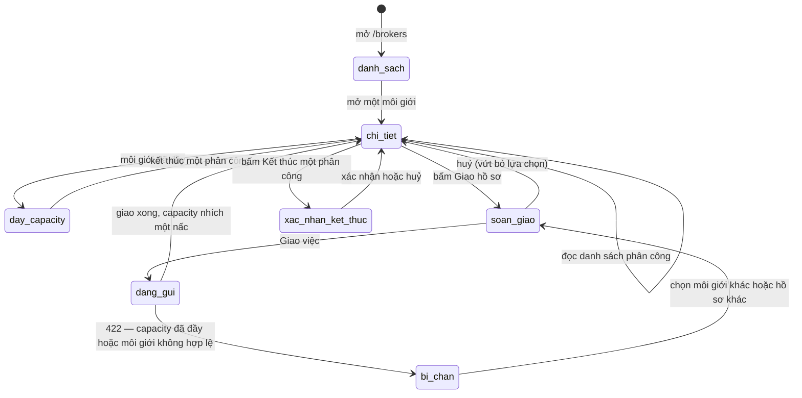

# Phân công môi giới

## Tóm tắt

Màn hình phân công môi giới là chỗ duy nhất trong hệ thống mà **capacity** của một môi giới hiện ra trước khi có người giao thêm việc cho họ. Nó liệt kê hồ sơ môi giới, mở từng người thành một trang chi tiết có danh sách phân công, và là chỗ một hồ sơ vụ việc được giao cho một môi giới với vai trò `LEAD` hoặc `CO`, kèm một hạn cam kết.

Toàn bộ [dữ liệu môi giới và phân công](../nen-tang/mo-hinh-du-lieu.md#môi-giới-và-phân-công) đã có mã chạy được và **không ai chạm tới được**: không endpoint, không route, không component.

Màn hình sống ở bảng quản trị, dưới hai route mới: `/brokers` và `/brokers/:id`.

Nó có một nhiệm vụ mà không màn hình nào khác làm được: **phát hiện sự lệch giữa hai đường gán môi giới**. Hệ thống có hai đường, chúng không nói chuyện với nhau, và chỉ màn hình này đứng ở vị trí nhìn thấy cả hai. Xem [Hai đường gán, một sự thật](#hai-đường-gán-một-sự-thật).

Nó phụ thuộc hoàn toàn vào [`../api-v2/brokerage.md`](../api-v2/brokerage.md), chưa tồn tại.

## Trường hợp đơn giản

Quản trị viên mở `/brokers`. Họ thấy một bảng: tên người, trạng thái môi giới, **mức dùng capacity viết dạng "4 / 6"**, các lĩnh vực phụ trách, và một chỉ báo nếu người đó có phân công quá hạn cam kết.

Họ mở một môi giới. Trang chi tiết chia ba phần: phần đầu là hồ sơ môi giới và thanh capacity; phần giữa là danh sách phân công đang hoạt động; phần cuối là danh sách phân công đã kết thúc, giữ nguyên để tra lịch sử.

Trên phần đầu có nút **Giao hồ sơ**. Nếu môi giới đã đầy capacity, nút đó **tắt** và một câu ngay cạnh nói vì sao. Nếu còn chỗ, bấm vào mở hộp thoại: chọn hồ sơ vụ việc, chọn vai trò `LEAD` hay `CO`, đặt hạn cam kết.

Họ bấm **Giao việc**. Trang cập nhật: thanh capacity nhích lên một nấc, một dòng mới xuất hiện ở đầu danh sách phân công đang hoạt động.

## Tương tác, sự kiện theo sự kiện

### Vào màn

**Danh sách.** Ba bộ lọc: trạng thái môi giới, lĩnh vực phụ trách, và một công tắc "chỉ hiện người còn chỗ". Cả ba phải nằm trong URL — xem [`../nen-tang/dieu-huong-va-url.md`](../nen-tang/dieu-huong-va-url.md#cái-gì-nằm-trong-url).

Cả ba bộ lọc này **phải chạy ở máy chủ**, không phải lọc lại ở trình duyệt trên một trang 20 dòng.

> Ghi chú kỹ thuật: hàm liệt kê hồ sơ môi giới hiện chỉ nhận tham số phân trang — không có tham số trạng thái, lĩnh vực hay mức dùng capacity, và không có sắp xếp nào ngoài "mới tạo trước". Ba bộ lọc trên là năng lực phải thêm vào hợp đồng API, không phải thứ giao diện tự xoay xở được.

Mỗi dòng phải mang **số phân công đang hoạt động và capacity cùng lúc**, không phải chỉ một trong hai. Một cột "capacity 6" không nói lên điều gì; một cột "4 / 6" nói lên tất cả.

**Chi tiết.** Hai lời gọi: hồ sơ môi giới và danh sách phân công của người đó. Hồ sơ mang số phiên bản — giao diện phải giữ nó cho các lệnh ghi lên chính hồ sơ môi giới.

> Ghi chú kỹ thuật: hiện **không có** hàm nào liệt kê phân công theo môi giới. Chỉ có hàm liệt kê phân công theo hồ sơ vụ việc. Trang chi tiết môi giới vì thế không dựng được cho tới khi hợp đồng API có đường đọc đó. Đây là phụ thuộc chặn.

Ba thứ phải hiện ngay ở phần đầu, không giấu sau tab:

1. **Thanh capacity**, dạng "4 / 6" cộng một thanh trực quan. Khi bằng nhau, thanh chuyển sang trạng thái đầy và nút Giao hồ sơ tắt.
2. **Trạng thái môi giới.** `SUSPENDED` chặn mọi lệnh giao việc mới, nên phải nhìn thấy trước khi bấm.
3. **Số phân công quá hạn cam kết**, nếu có. Xem [Hạn cam kết](#hạn-cam-kết-và-quá-hạn).

Không có gì được focus sẵn; trang chi tiết là trang đọc.

### Rời đi không đổi gì

Đọc danh sách và đọc chi tiết **không ghi gì**. Không dòng kiểm toán, không dấu vết.

> Ghi chú kỹ thuật: đường đọc hồ sơ môi giới và đường đọc phân công hiện **không đi qua cổng phân quyền nào cả**. Không có kiểm tra quyền, và vì thế cũng không có dòng `DENY` nào. Endpoint v2 phải tự đặt cổng cho cả hai đường đọc; nếu không, bất kỳ ai đăng nhập được đều đọc được toàn bộ danh sách môi giới và tải việc của họ.

### Bắt đầu sửa

Bấm **Giao hồ sơ** mở hộp thoại. Đây là lúc giao diện phải làm ba việc mà máy chủ không làm hộ.

**Một: không để người dùng bấm rồi bị từ chối.** Máy chủ đếm phân công đang hoạt động và **từ chối thẳng** khi đã bằng capacity, với mã `CAPACITY_EXCEEDED` và mã trạng thái 422. Đây là hành vi đúng — hồ sơ không bị âm thầm bỏ rơi — nhưng nó là hành vi của *máy chủ*, không phải của *giao diện*. Giao diện đã có đủ số liệu để biết trước: nó cầm cả số phân công đang hoạt động lẫn capacity. Để một nút sáng dẫn tới một lời từ chối chắc chắn là bắt người dùng học luật bằng cách bị từ chối.

Nút Giao hồ sơ vì thế **tắt** khi đầy, kèm một câu nói rõ phải làm gì: kết thúc một phân công đang hoạt động, nâng capacity, hoặc chọn môi giới khác.

**Hai: chỉ hiện môi giới nhận được việc.** Nếu hộp thoại có ô chọn môi giới (khi mở từ phía hồ sơ vụ việc thay vì từ trang môi giới), ô đó phải loại sẵn người `SUSPENDED` và người đã đầy, và phải hiện mức dùng capacity ngay trong từng dòng của danh sách chọn.

**Ba: hỏi vai trò, nhưng chỉ khi có hai câu trả lời.** Một hồ sơ có một `LEAD` và nhiều `CO`. Khi hồ sơ đã có môi giới chính, ô chọn vai trò nên mặc định `CO`; khi chưa có, mặc định `LEAD`.

**Hạn cam kết là tuỳ chọn.** Nó được phép để trống, và giao diện không được bịa ra một giá trị mặc định — một hạn không ai đặt sẽ đẻ ra chỉ báo quá hạn mà không ai chịu trách nhiệm.

### Trong khi sửa

Không có endpoint xem trước. Ba luật giao diện tự áp được: capacity đã đầy, môi giới `SUSPENDED`, và hồ sơ đã có `LEAD` khi người dùng chọn `LEAD`. Hai luật còn lại chỉ máy chủ biết: quyền của người thao tác, và **số phân công thật tại thời điểm gửi**.

Con số "4 / 6" mà giao diện đang hiện là một ảnh chụp lúc tải trang. Nếu một quản trị viên khác giao thêm việc trong lúc hộp thoại đang mở, con số đó đã sai. Giao diện phải tải lại số đếm khi mở hộp thoại, và vẫn phải xử lý được lời từ chối ở bước gửi.

URL không đổi khi hộp thoại mở. Hộp thoại không phải một route.

### Gửi đi

Một lời gọi. Trong lúc chờ, nút Giao việc khoá và đổi chữ; hộp thoại **không đóng** cho tới khi có kết quả.

Thành công: hộp thoại đóng, thanh capacity và danh sách phân công cập nhật từ phản hồi. **Không tự cộng một vào số đếm** — lấy từ phản hồi.

Bốn đường thất bại:

| Kết quả | Người dùng thấy | Cái gì được giữ |
|---|---|---|
| **422 `CAPACITY_EXCEEDED`** | "Môi giới này đã nhận đủ *n* hồ sơ. Kết thúc một phân công hoặc chọn người khác." kèm số đếm mới lấy từ máy chủ. | Giữ hộp thoại, đổi ô chọn môi giới sang trạng thái cần chọn lại. |
| **422 `BROKER_INVALID`** | Hai nguyên nhân khác nhau cùng một mã: người này chưa có hồ sơ môi giới, hoặc hồ sơ đang `SUSPENDED`. Giao diện **không phân biệt được** — xem [Câu hỏi mở](#câu-hỏi-mở-và-kiểm-chứng). | Giữ hộp thoại. |
| **403 `FORBIDDEN`** kèm mã quy tắc | Câu nói rõ chỉ quản trị viên giao được việc. | Giữ, nhưng nút Giao việc tắt hẳn — thử lại sẽ hỏng y hệt. |
| **404** | Hồ sơ vụ việc hoặc môi giới không tồn tại, hoặc người gọi không được biết là nó tồn tại. Hiện "không tìm thấy", **không** hiện "bạn không có quyền". | Giữ. |

## Hai đường gán, một sự thật

Đây là vấn đề quan trọng nhất của màn hình này, và nó không phải một trường hợp biên.

Hệ thống có **hai đường** để một người trở thành môi giới của một hồ sơ, và chúng ghi vào hai chỗ khác nhau:

| Đường | Ghi cái gì | Kiểm capacity | Tạo bản phân công |
|---|---|---|---|
| Giao việc trong module môi giới | Một bản **phân công** (`LEAD`/`CO`, `ACTIVE`, hạn cam kết) | **Có** — từ chối `CAPACITY_EXCEEDED` khi đầy | Có |
| Gán môi giới chính trong hồ sơ vụ việc | Một **bên tham gia** vai trò `LEAD_BROKER`, cộng trường môi giới chính trên hồ sơ | **Không** | **Không** |

Hai đường không gọi nhau. Hệ quả trực tiếp:

- Một hồ sơ có môi giới chính mà **không có bản phân công nào** tương ứng. Người đó làm việc trên hồ sơ nhưng không tính vào capacity của mình, nên hệ thống tưởng họ còn rảnh.
- Ngược lại: một bản phân công tồn tại mà người đó **không phải bên tham gia** của hồ sơ. Vì quyền đọc và quyền chuyển giai đoạn đến từ vai trò trong hồ sơ chứ không từ bản phân công, người được giao việc qua đường thứ nhất **không mở được hồ sơ mình vừa được giao**.
- Gán môi giới chính không kiểm hồ sơ môi giới có tồn tại không, và không kiểm nó có đang `SUSPENDED` không. Một người bị đình chỉ vẫn gán làm môi giới chính được.

Màn hình này phải **phát hiện và hiện ra sự lệch đó**, không được im lặng:

1. Trên trang chi tiết môi giới, một mục riêng liệt kê **hồ sơ mà người này là môi giới chính nhưng không có phân công đang hoạt động**. Mỗi dòng kèm nút tạo phân công bù.
2. Trên thanh capacity, số hiển thị là số phân công đang hoạt động — nhưng nếu số hồ sơ mà người này thực sự phụ trách lớn hơn, giao diện phải nói rõ: "4 / 6 phân công, nhưng đang là môi giới chính của 7 hồ sơ."
3. Trên hộp thoại giao việc, nếu hồ sơ được chọn đã có môi giới chính khác, hiện cảnh báo trước khi gửi.

Cách sửa đúng nằm ở tầng dịch vụ, không ở giao diện: hai đường phải hợp nhất thành một. Cho tới lúc đó, màn hình này là thiết bị đo duy nhất.

## Hạn cam kết và quá hạn

Mỗi phân công có một hạn cam kết tuỳ chọn. Không có gì trong hệ thống kiểm hạn đó: không job nhắc, không thông báo, không cờ trạng thái. Một phân công quá hạn trông y hệt một phân công đúng hẹn.

Giao diện vì thế là chỗ duy nhất chỉ báo quá hạn tồn tại được. Yêu cầu:

- Mỗi dòng phân công đang hoạt động có hạn cam kết đã qua phải mang một chỉ báo quá hạn, kèm số ngày.
- Chỉ báo đó phải nổi lên tới dòng của người đó trong danh sách `/brokers`, nếu không phải mở từng người mới thấy.
- Phân công **không có** hạn cam kết phải trông khác phân công **đúng hẹn**. Hai thứ đó không giống nhau: một cái là chưa ai cam kết gì, một cái là đang trong hẹn.

Phân công đã kết thúc không mang chỉ báo quá hạn, kể cả khi nó kết thúc muộn.

## Kết thúc một phân công

Nút **Kết thúc** trên từng dòng phân công đang hoạt động. Nó không cần lý do và không tạo bản ghi quyết định nào — khác hẳn việc chuyển giai đoạn hồ sơ.

Vì nó không cần lý do, nó là một hành động **không có dấu vết đọc lại được**: sau khi kết thúc, thứ duy nhất còn lại là thời điểm kết thúc. Giao diện phải hỏi lại trước khi thực hiện, và phải nói rõ rằng phân công không xoá đi mà chuyển sang `ENDED` và ở lại trong lịch sử.

Kết thúc một phân công **trả lại một chỗ trong capacity ngay lập tức**, nên nó là lối thoát chính khi gặp `CAPACITY_EXCEEDED`.

## Biến thể

| Biến thể | Lúc vào màn | Trong khi sửa |
|---|---|---|
| Vai trò | Chỉ `ADMIN` giao được việc: quy tắc cho phép hành động này chỉ khớp với vai trò nền tảng quản trị viên. Một môi giới chính của hồ sơ **không** giao việc được cho đồng nghiệp, kể cả trong hồ sơ của chính mình. `USER` mở được màn hình nếu endpoint đọc không đặt cổng — đó là lỗ hổng phải bịt trước khi phát hành. Khách chưa đăng nhập không vào được bảng quản trị. | Vai trò không đổi giữa chừng ở phía người dùng. Nếu quyền bị gỡ trong lúc hộp thoại mở, lệnh gửi trả 403 kèm mã quy tắc. |
| Trạng thái bản ghi | Môi giới `SUSPENDED` hiện trong danh sách nhưng nút Giao hồ sơ tắt. Môi giới đầy capacity hiện bình thường, nút tắt, kèm câu giải thích. Phân công `ENDED` nằm ở mục riêng, không tính vào capacity. Hồ sơ vụ việc ở [giai đoạn kết thúc](../nen-tang/mo-hinh-du-lieu.md#mười-hai-giai-đoạn) không nên xuất hiện trong danh sách hồ sơ chọn được. | Số phân công đang hoạt động đổi được **bởi người khác** giữa lúc hộp thoại mở. Đó là lý do lời từ chối `CAPACITY_EXCEEDED` vẫn phải xử lý được dù giao diện đã chặn trước. |
| Cấu hình backend | Không ảnh hưởng. Không cờ nào đổi hành vi môi giới hay capacity. | Không ảnh hưởng. |
| Phím tắt của biểu mẫu | Trang chi tiết là trang đọc; không focus gì. Danh sách hỗ trợ Tab qua các dòng. | Hộp thoại focus ô chọn hồ sơ khi mở. Escape đóng và **vứt bỏ**. Enter trong ô chọn không được gửi biểu mẫu. Ctrl/Cmd+Enter gửi. |

## Huỷ và gián đoạn

| Sự kiện | Trước khi gửi | Trong khi đang gửi |
|---|---|---|
| Bấm Huỷ hoặc nhấn Escape | Hộp thoại đóng, lựa chọn bị vứt bỏ. Không có gì được ghi. Không cần hỏi lại — hộp thoại chỉ có ba lựa chọn, không có văn bản người dùng đã gõ. | Không có cách huỷ. Nút đã khoá và không có nút Dừng. |
| Đi chỗ khác trong app | Hộp thoại đóng, mất lựa chọn. | Kết quả không tới giao diện. **Bản phân công ở máy chủ vẫn được tạo.** Người dùng quay lại thấy capacity đã nhích mà không nhớ mình đã gửi. |
| Back/Forward của trình duyệt | Hộp thoại không phải một route, nên Back rời khỏi trang chi tiết chứ không đóng hộp thoại. Hành vi đáng sửa: hộp thoại nên đẩy một mục vào lịch sử. | Như trên: lệnh hoàn tất, giao diện không biết. |
| Tải lại trang, hoặc đóng tab | Mất lựa chọn. Không có bản nháp. | Lệnh hoàn tất. Đây là chỗ khoá chống lặp cứu: thử lại **cùng khoá** trả phát lại thay vì tạo hai bản phân công. |
| Mất mạng, hoặc quá hạn | Không ảnh hưởng — chưa gọi gì. | Giao diện không biết lệnh đã tới máy chủ chưa. **Phải giữ nguyên khoá chống lặp cho lần thử lại**; sinh khoá mới sẽ tạo hai bản phân công và ăn hai chỗ capacity. |
| Phiên hết hạn (401), hoặc v1 bị dừng (410) | Người dùng bị đẩy về đăng nhập. Mất ba lựa chọn — không đáng tiếc, chọn lại nhanh. | 401 giữa chừng nghĩa là lệnh bị từ chối trước tầng nghiệp vụ; không có gì được ghi. |
| Bản ghi bị đổi bởi người khác | Số phân công hiển thị đã cũ và giao diện không biết. Không có kênh đẩy; chỉ tải lại mới thấy. | Lệnh giao việc **không** dùng số phiên bản, nên không có 409 ở đường này — nó chỉ đếm lại và trả 422 nếu đầy. Đường gán môi giới chính thì ngược lại: nó **có** dùng số phiên bản và trả 409 kèm số hiện tại. Hai đường hành xử khác nhau và giao diện phải xử lý cả hai. |
| Trình duyệt tự điền | Không áp dụng — không trường nào là email hay mật khẩu. | Không áp dụng. |

Sau bất kỳ gián đoạn nào, người dùng ở lại trang chi tiết môi giới. Không có gì đáng cứu ngoài vị trí cuộn.

## Tương tác với hệ thống khác

**Quyền và vai trò.** Giao việc là hành động chỉ quản trị viên làm được. Đây là điểm khác biệt với [console hồ sơ vụ việc](console-ho-so-vu-viec.md), nơi quyền đến từ vai trò trong từng hồ sơ. Ở màn hình này, vai trò nền tảng quyết định tất cả, và một môi giới không tự giao việc cho mình được.

**Kiểm tra dữ liệu và cách hiện lỗi.** Hai mã 422 (`CAPACITY_EXCEEDED`, `BROKER_INVALID`) phải dịch thành câu nói *phải làm gì tiếp*, kèm nút hành động. Capacity nhỏ hơn hoặc bằng 0 bị từ chối ở tầng dữ liệu với 400; ô nhập capacity phải chặn trước.

**Thay đổi chưa lưu.** Hộp thoại giao việc chỉ chứa lựa chọn, không chứa văn bản tự do, nên không có gì đáng giữ qua một lần gián đoạn. Ô sửa capacity trên trang chi tiết thì có: nó là một biểu mẫu **đã bẩn** theo nghĩa của [`../glossary.md`](../glossary.md).

**Cập nhật lạc quan và hoàn tác.** **Không được cập nhật lạc quan** khi giao việc: khả năng bị từ chối vì capacity là thật và thường xuyên. Có một lối lùi tự nhiên — kết thúc phân công vừa tạo — nhưng nó **không phải hoàn tác**: bản phân công ở lại lịch sử với trạng thái `ENDED`. Giao diện không được gọi nó là "hoàn tác".

**Ngoại tuyến.** Không xếp hàng lệnh giao việc. Một lệnh gửi sau vài phút có thể đã sai vì capacity đã đầy.

**Thông báo và toast.** **Không có loại thông báo nào cho phân công.** Một môi giới được giao một hồ sơ không nhận được gì — không email, không thông báo trong ứng dụng. Họ chỉ biết nếu chủ động mở màn hình. Đây là thiếu sót phải lấp cùng lúc với việc xây màn hình này.

**Trạng thái lọc/tìm trong URL.** Ba bộ lọc của danh sách phải nằm trong URL, kèm số trang.

**Đa ngôn ngữ.** 6 chuỗi cần dịch: 2 trạng thái môi giới, 2 vai trò phân công, 2 trạng thái phân công. Chúng lưu bằng tiếng Anh viết hoa. Vai trò phân công (`LEAD`, `CO`) **không trùng** vai trò trong hồ sơ (`LEAD_BROKER`, `CO_BROKER`) dù nói cùng một chuyện; bảng dịch phải giữ hai cặp riêng để không che mất sự lệch giữa hai đường.

**Khả năng truy cập.** Thanh capacity là một chỉ báo tiến độ có ý nghĩa, không phải trang trí: nó cần nhãn đọc được, và trạng thái "đầy" không được truyền đạt chỉ bằng màu. Nút Giao hồ sơ bị tắt phải kèm lý do đọc được, không chỉ mờ đi.

**Dấu vết kiểm toán.** Đây là chỗ đáng lo. Lượt giao việc **thành công không ghi dòng kiểm toán nào**; chỉ lượt bị từ chối vì quyền mới ghi, với kết quả `DENY` và mã quy tắc. Nghĩa là câu hỏi "ai đã giao hồ sơ này cho ai" hiện **không có câu trả lời**. Phân công có thời điểm giao nhưng không có người giao. Xem [`nhat-ky-kiem-toan.md`](nhat-ky-kiem-toan.md).

## Trường hợp biên

- **Không có phương thức nào đổi trạng thái môi giới sang `SUSPENDED`.** Trạng thái tồn tại, có chỗ lưu, và mọi luật giao việc đều đọc nó — nhưng interface dịch vụ không hề có đường đình chỉ hay khôi phục. Đình chỉ một môi giới là năng lực **còn thiếu**, không phải chuyện giao diện quên vẽ nút. Nút Đình chỉ không xây được cho tới khi hợp đồng API có đường đó.
- **Không có phương thức nào đổi capacity hay đổi lĩnh vực phụ trách** qua interface hiện tại, dù dữ liệu cho phép. Cùng loại thiếu như trên.
- **Không có đường liệt kê phân công theo môi giới**, chỉ có theo hồ sơ. Trang chi tiết môi giới là phụ thuộc chặn.
- **Đăng ký hai lần cho cùng một người** trả 409 với mã chung `CONFLICT`, không có mã riêng. Giao diện không phân biệt được nó với các xung đột khác và phải dựa vào câu chữ — điều mà [quy ước API](../api-v2/README.md#mã-lỗi-ổn-định) cấm.
- **Kết thúc một phân công đã kết thúc** không bị chặn: nó đặt lại thời điểm kết thúc thành hôm nay. Nút Kết thúc phải biến mất khỏi dòng `ENDED`, nếu không lịch sử bị viết lại lặng lẽ.
- **Số đếm capacity đếm mọi phân công đang hoạt động**, kể cả phân công gắn vào hồ sơ đã đóng vĩnh viễn. Một môi giới có thể "đầy" vì bốn hồ sơ đã `CLOSED` mà không ai kết thúc phân công. Giao diện phải hiện giai đoạn của hồ sơ trên từng dòng phân công để chuyện này nhìn ra được.
- **Hồ sơ môi giới không tự sinh khi một người được gán làm môi giới chính.** Người đó không xuất hiện ở `/brokers` cho tới khi có người đăng ký hồ sơ môi giới cho họ.
- **Trạng thái rỗng có hai nghĩa.** "Chưa có môi giới nào trong hệ thống" khác "không có môi giới nào khớp bộ lọc".

## Câu hỏi mở và kiểm chứng

- **Hai đường gán môi giới phải hợp nhất, và ai làm việc đó chưa được quyết.** Ba lựa chọn: gán môi giới chính gọi luôn sang phần giao việc; giao việc tự thêm bên tham gia vào hồ sơ; hoặc giữ hai đường và chấp nhận màn hình này làm bảng đối chiếu vĩnh viễn. Lựa chọn thứ ba là lựa chọn tệ nhất nhưng là lựa chọn mặc định nếu không ai quyết. (chưa cấp mã lỗi)
- **Đình chỉ môi giới có nằm trong phạm vi bản phát hành này không?** Nếu có, hợp đồng API phải thêm đường đình chỉ, khôi phục, đổi capacity và đổi lĩnh vực. Nếu không, màn hình phải nói rõ rằng trạng thái `SUSPENDED` chỉ đến từ dữ liệu di trú.
- **Một mã 422 cho hai nguyên nhân.** `BROKER_INVALID` dùng chung cho "chưa có hồ sơ môi giới" và "đang bị đình chỉ". Hai tình huống cần hai câu trả lời khác nhau cho người dùng. Đáng tách thành hai mã. (chưa cấp mã lỗi)
- **Lượt giao việc thành công không được ghi kiểm toán.** Việc một hành động phân bổ nguồn lực không để lại dấu vết ai làm đáng bị coi là lỗi hơn là một quyết định. Cần chốt: giao việc và kết thúc phân công có phải ghi kiểm toán không.
- **Ai đặt hạn cam kết, và theo quy tắc nào?** Chưa chốt. Nếu nó luôn do người giao việc gõ tay, phần lớn phân công sẽ không có hạn và chỉ báo quá hạn thành vô nghĩa.
- **Môi giới có được xem trang của chính mình không?** Chưa chốt. Nếu có, `/brokers/:id` cần một phiên bản chỉ đọc cho vai trò `USER`, và câu hỏi tiếp theo là họ có thấy capacity của đồng nghiệp không.
- **Màn hình này có cần bản ở cổng người dùng không?** Chưa chốt. Hiện môi giới không có bề mặt nào ngoài bảng quản trị.
- Chưa chạy bộ test bất biến và bộ test phân quyền để xác nhận luật capacity và việc chỉ quản trị viên giao được việc. Đó là việc rẻ nhất nên làm trước khi bắt đầu code.

Đặc tả — chưa có mã. Dựa trên SourceCode/nacentech, bản chụp ngày 2026-09-04.
