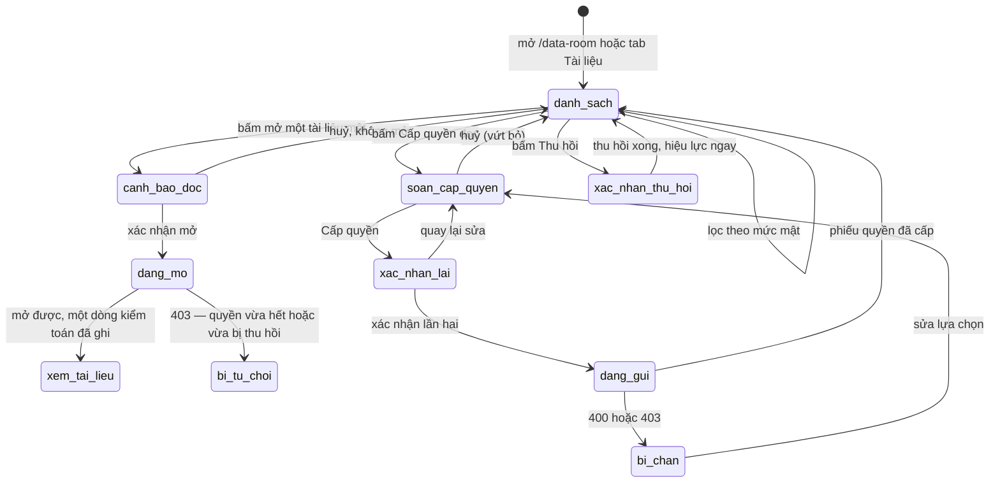

# Phòng dữ liệu và cấp quyền đọc

## Tóm tắt

Phòng dữ liệu là chỗ tài liệu mật sống, và màn hình cấp quyền đọc là chỗ quyết định ai được mở chúng. Đây là **màn hình có rủi ro cao nhất trong toàn bộ hệ thống**: một lần bấm sai ở đây làm lộ nội dung mà mọi cơ chế khác được dựng lên để bảo vệ.

Vì vậy nó không được thiết kế như một danh sách có nút "Cấp quyền" ở góc. Việc cấp quyền phải **có chủ ý và có thời hạn mặc định**: người cấp phải nói cho ai, để làm gì, tới mức nào, và tới bao giờ — bốn câu hỏi, không phải một cú bấm.

Toàn bộ cơ chế [phân loại mật và cấp quyền đọc](../nen-tang/mo-hinh-du-lieu.md#cấp-quyền-đọc) đã có mã chạy được và **không ai chạm tới được**. Hệ quả hôm nay: nội dung mà giao diện cũ hiển thị thẳng nay cần một phiếu quyền, và chưa có màn hình nào cấp phiếu đó.

Màn hình sống ở hai chỗ, cùng một thành phần:

- `/data-room` ở bảng quản trị — bản đầy đủ, có bộ lọc theo subject và theo mức mật, cộng một mục quản lý phiếu quyền.
- Một **tab** trong màn chi tiết của đề bài, tài sản công nghệ và [hồ sơ vụ việc](console-ho-so-vu-viec.md) — bản rút gọn, chỉ tài liệu của bản ghi đang mở.

Nó phụ thuộc hoàn toàn vào [`../api-v2/dataroom-va-cap-quyen.md`](../api-v2/dataroom-va-cap-quyen.md), chưa tồn tại. Nó cũng không nên phát hành trước [`nhat-ky-kiem-toan.md`](nhat-ky-kiem-toan.md): cấp quyền đọc mà không tra được ai đã đọc gì thì không ai dám bật.

## Trường hợp đơn giản

Quản trị viên mở một đề bài và bấm sang tab **Tài liệu**. Họ thấy danh sách tài liệu của đề bài đó: tên, loại, mức mật, kích thước, phiên bản, thời điểm sửa lần cuối.

Một môi giới cần đọc hồ sơ kỹ thuật mật của đề bài. Quản trị viên bấm **Cấp quyền đọc**. Hộp thoại hỏi bốn thứ: cho ai, vì mục đích gì, tới mức mật nào, và tới ngày nào — ngày kết thúc **đã điền sẵn một giá trị mặc định ngắn**, không để trống.

Họ xác nhận. Một phiếu quyền mới hiện ra trong mục quyền của subject này, kèm người nhận, mục đích, mức trần, khoảng hiệu lực, và nút **Thu hồi**.

Môi giới đó mở lại đề bài. Bây giờ danh sách tài liệu của họ dài hơn trước — những tài liệu mật trong mức trần đã hiện ra. Trên đầu danh sách có một dòng nói rõ: mở một tài liệu mật sẽ được ghi lại, kèm mục đích ghi trên phiếu.

## Tương tác, sự kiện theo sự kiện

### Vào màn

**Danh sách tài liệu.** Máy chủ đã lọc theo quyền: người xem chỉ nhận về tài liệu họ thực sự đọc được — công khai với mọi người, mật với chủ sở hữu hoặc người có phiếu quyền còn hiệu lực trong mức trần.

Hai yêu cầu tuyệt đối ở đây:

1. **Tài liệu không đọc được thì không xuất hiện.** Không phải hiện ra rồi báo lỗi khi bấm. Không có ổ khoá xám, không có dòng mờ.
2. **Giao diện không được để lộ số lượng tài liệu bị ẩn.** Không "3 tài liệu khác bị ẩn", không tổng số lệch với số dòng, không khoảng trống trong đánh số. Con số đó tự nó là một rò rỉ: nó nói cho người ngoài biết có bao nhiêu thứ đang giấu ở đây.

Trạng thái rỗng vì thế có hai nghĩa mà giao diện **cố ý không phân biệt**: "bản ghi này không có tài liệu nào" và "bạn không đọc được tài liệu nào của bản ghi này". Đây là chỗ duy nhất trong bộ tài liệu này mà việc gộp hai trạng thái rỗng là đúng — mọi màn hình khác phải tách chúng ra.

**Mục quyền.** Ở `/data-room`, một mục riêng liệt kê phiếu quyền của subject đang chọn: ai, mục đích, mức trần, hiệu lực từ/đến, và trạng thái (còn hiệu lực, đã hết hạn, đã thu hồi).

> Ghi chú kỹ thuật: hiện **không có** hàm nào liệt kê phiếu quyền. Chỉ có ba hàm: hỏi một người có quyền hay không, cấp một phiếu, và thu hồi một phiếu **theo định danh phiếu**. Không có đường nào lấy ra định danh đó. Nghĩa là nút Thu hồi hôm nay không xây được. Đây là phụ thuộc chặn, không phải điểm hoàn thiện sau.

Không có gì được focus sẵn; đây là trang đọc.

### Rời đi không đổi gì

Mở danh sách tài liệu **không ghi gì**, kể cả khi danh sách chứa tài liệu mật. Người dùng nhìn thấy tên một tài liệu mật không phải là một sự kiện.

Mở **nội dung** một tài liệu mật thì có. Đây là ngoại lệ duy nhất trong toàn hệ thống với luật "đường đọc không ghi kiểm toán" — xem [Nói trước, không nói sau](#nói-trước-không-nói-sau).

### Bắt đầu sửa

Ba hành động sửa ở màn hình này, và chúng có ba mức chủ ý khác nhau.

**Tải tệp lên.** Người dùng chọn tệp, chọn mức mật, xác nhận. Giao diện phải chặn trước ba thứ mà máy chủ cũng chặn nhưng chặn muộn hơn: kiểu nội dung ngoài danh sách cho phép, phần mở rộng nằm trong danh sách cấm, và kích thước.

**Sửa một đoạn văn bản mật.** Người dùng gõ vào một trong bốn đoạn. **Không có ô chọn mức mật** — mức mật suy ra từ mã đoạn và người dùng không đổi được. Giao diện phải hiện mức đã suy ra ngay cạnh ô nhập, dưới dạng một nhãn đọc-được-không-sửa-được, để người gõ biết mình đang gõ vào đâu.

**Cấp một phiếu quyền.** Đây là hành động cần chủ ý nhất, và [nó có phần riêng](#cấp-quyền-đọc).

### Trong khi sửa

Không có endpoint xem trước. Với việc cấp quyền, giao diện tự áp được ba luật: mục đích phải có, mức trần phải chọn, ngày kết thúc phải sau ngày bắt đầu. Hai luật còn lại chỉ máy chủ biết: quyền của người cấp, và mục đích có thuộc danh sách cho phép không.

URL không đổi khi hộp thoại mở.

### Gửi đi

Cấp quyền và thu hồi đều là một lời gọi. Trong lúc chờ, nút khoá và đổi chữ; hộp thoại **không đóng** cho tới khi có kết quả.

Thành công: hộp thoại đóng, mục quyền cập nhật từ phản hồi, và danh sách tài liệu **không đổi** — người vừa được cấp quyền là người khác, không phải người đang bấm.

Đường thất bại:

| Kết quả | Người dùng thấy | Cái gì được giữ |
|---|---|---|
| **400 `VALIDATION_FAILED`** | Mục đích không thuộc danh sách cho phép. Nếu ô mục đích là một danh sách chọn thì lỗi này không bao giờ xảy ra — nó xảy ra nghĩa là giao diện và máy chủ bất đồng về danh sách. | Giữ toàn bộ hộp thoại. |
| **403 `FORBIDDEN`** kèm mã quy tắc | Câu nói rõ chỉ quản trị viên cấp được quyền đọc. **Chủ sở hữu tài liệu không cấp được quyền cho người khác** — xem [Ai cấp được quyền](#ai-cấp-được-quyền). | Giữ, nút tắt hẳn. |
| **404** | Phiếu quyền không tồn tại (khi thu hồi). | Tải lại mục quyền. |

## Cấp quyền đọc

Một phiếu quyền gồm năm thứ, và cả năm phải có mặt trong hộp thoại:

| Trường | Yêu cầu |
|---|---|
| **Cho ai** | Một người cụ thể. Không có cấp quyền theo nhóm, theo vai trò hay theo tổ chức. |
| **Subject nào** | Đề bài, tài sản công nghệ, hồ sơ vụ việc hoặc người. Phiếu gắn vào subject, không vào từng tài liệu: cấp một lần là mở mọi tài liệu của subject đó trong mức trần. |
| **Mục đích** | **Bắt buộc.** Nó được chép vào mọi dòng kiểm toán về sau, nên nó là câu trả lời cho "tại sao người này xem được cái này" sau nhiều tháng. |
| **Mức trần** | `Confidential` hay `HighlyConfidential`. Phiếu mở mọi tài liệu **tới và bao gồm** mức đó. (`Internal` không còn tồn tại — [ADR-0007](../../../04-technical/adr/0007-muc-mat-internal.md).) |
| **Hiệu lực từ / đến** | Ngày kết thúc phải có giá trị mặc định ngắn và phải là một quyết định có ý thức nếu người dùng muốn bỏ nó đi. |

Bốn yêu cầu thiết kế làm việc cấp quyền trở nên có chủ ý:

**Một: mặc định là có thời hạn.** Ô ngày kết thúc điền sẵn. Để trống nó — tức cấp quyền vĩnh viễn — phải là một thao tác riêng, có nhãn nói thẳng "không hết hạn" và một câu cảnh báo, không phải hệ quả của việc bỏ qua một ô.

**Hai: xác nhận hai bước.** Sau khi điền, hộp thoại hiện lại bằng lời những gì sắp xảy ra: "*Tên người* sẽ đọc được tài liệu tới mức *X* của *bản ghi Y*, từ hôm nay tới *ngày Z*, vì *mục đích*." Người dùng đọc câu đó rồi mới bấm lần hai. Đây là chỗ duy nhất trong hệ thống đáng bắt xác nhận hai bước.

**Ba: mức trần mặc định là mức thấp nhất mở được việc.** Không chọn sẵn `HighlyConfidential`. Nếu ô để mặc định, nó phải là `Confidential`.

**Bốn: nói rõ phiếu mở cả subject, không phải một tệp.** Người cấp thường nghĩ mình đang mở một tài liệu. Hộp thoại phải hiện **số tài liệu mà phiếu này sẽ mở ra** ngay trước khi xác nhận.

> Ghi chú kỹ thuật: mục đích hiện được kiểm theo một danh sách đóng 23 giá trị ở tầng dịch vụ; gửi một chuỗi ngoài danh sách bị từ chối với 400. Trường lưu nó dài tối đa 60 ký tự. Nghĩa là ô mục đích **phải là một danh sách chọn**, không phải ô văn bản tự do. Xem [Câu hỏi mở](#câu-hỏi-mở-và-kiểm-chứng) — việc có nên kèm thêm một ô diễn giải tự do bên cạnh là một quyết định chưa chốt.

> Ghi chú kỹ thuật: hàm cấp quyền hiện **không nhận** ngày bắt đầu; nó luôn đặt hiệu lực từ thời điểm cấp. Cấp trước cho một ngày trong tương lai là không làm được. Ô "hiệu lực từ" vì thế hoặc bị khoá ở hôm nay, hoặc hợp đồng API phải thêm tham số đó.

### Ai cấp được quyền

Chỉ **quản trị viên**. Quy tắc cho phép hành động cấp phiếu chỉ khớp với vai trò nền tảng quản trị viên; mọi vai trò khác rơi vào mặc định từ chối.

Hệ quả với sản phẩm, và nó lớn: **chủ sở hữu một đề bài không mở tài liệu mật của chính mình cho người khác được**. Họ đọc được (chủ sở hữu luôn đọc được tài liệu của mình), nhưng muốn cho môi giới đọc thì phải nhờ quản trị viên. Mọi lượt cấp quyền đi qua một cái cổ chai người.

Thu hồi cũng vậy: cùng một quyền, cùng một cổ chai.

### Thu hồi

Nút **Thu hồi** trên từng phiếu. Nó **có hiệu lực ngay**: lượt đọc tiếp theo của người đó bị từ chối, không có độ trễ, không có phiên còn sống sót.

Phiếu đã thu hồi **không biến mất**; nó ở lại trong mục quyền với thời điểm thu hồi. Đây là dấu vết duy nhất còn lại của việc một người đã từng đọc được cái gì.

Thu hồi không cần lý do và không sinh dòng kiểm toán nào. Giao diện phải hỏi lại trước khi thực hiện.

## Ba loại tài liệu

| Loại | Người dùng thấy gì | Điều giao diện phải nói rõ |
|---|---|---|
| **Tệp** (`FILE`) | Tên tệp, kiểu, kích thước, mức mật, số phiên bản. | Mức mật do người tải lên chọn tự do. Không có gì kiểm rằng một tệp thực sự mật đã được đánh dấu mật. |
| **Ảnh đại diện** (`PROFILE_PICTURE`) | Một ảnh. | **Đặt ảnh mới xoá ảnh cũ, không giữ lịch sử.** Đây là loại tài liệu duy nhất không có lịch sử phiên bản. Ảnh đại diện luôn ở mức công khai, kể cả khi subject là bản ghi mật. |
| **Đoạn văn bản** (`TEXT_SECTION`) | Một khối văn bản trong biểu mẫu, không phải một tệp tải về. | **Mức mật suy ra từ mã đoạn**, người dùng không chọn được. Bốn mã đoạn: hai mã cho ra `Confidential`, hai mã cho ra `HighlyConfidential`. |

Bốn mã đoạn giữ nguyên tên từ hệ cũ: nội dung mức 2, bản do AI xử lý của mức 2, nội dung mức 3, bản do AI xử lý của mức 3.

### Đã gỡ khác chưa nhập

Gỡ một đoạn văn bản **không xoá nó**. Nó tạo một phiên bản mới rỗng, và bản cũ ở lại trong lịch sử.

Hệ quả nhìn thấy được: lịch sử phiên bản của một đoạn văn bản sẽ có những mục trông như trống. Giao diện phải phân biệt được ba trạng thái mà dữ liệu thô để lẫn lộn:

1. **Chưa nhập** — chưa có tài liệu nào cho mã đoạn này. Ô trống, không có lịch sử.
2. **Đã gỡ** — có tài liệu, phiên bản hiện tại rỗng. Ô trống, **nhưng lịch sử có mục**, và giao diện phải nói "đã gỡ ngày *X*", kèm đường xem lại nội dung cũ.
3. **Có nội dung** — phiên bản hiện tại có chữ.

Vẽ trạng thái 2 giống trạng thái 1 là xoá mất thông tin quan trọng nhất ở đây: đã từng có gì đó, và có người quyết định gỡ nó đi.

Gỡ một đoạn **chưa từng tồn tại** không tạo gì và không báo lỗi — máy chủ lặng lẽ không làm gì. Giao diện không nên hiện thông báo thành công cho một thao tác không xảy ra.

## Giới hạn tệp

Hai giới hạn khác nhau, ở hai tầng khác nhau, và chúng lệch nhau:

| Tầng | Giới hạn | Người dùng thấy gì khi vượt |
|---|---|---|
| HTTP | 12 MB | Lời gọi bị chặn trước khi tới ứng dụng; thông điệp đến từ hạ tầng, không phải từ hệ thống. |
| Lưu trữ | 10 MB | Một lỗi nghiệp vụ có câu chữ đàng hoàng. |

Một tệp 11 MB qua được tầng HTTP rồi mới bị từ chối ở tầng dưới, nên nó cho ra một thông điệp lỗi **đến từ chỗ khác** với tệp 13 MB. Hai tệp quá lớn, hai lời giải thích khác nhau.

**Giao diện phải chặn ở 10 MB**, ngay khi người dùng chọn tệp, trước khi gửi bất cứ thứ gì. Đó là cách duy nhất để mọi tệp quá lớn nhận cùng một câu trả lời.

Kiểm tra kiểu nội dung và phần mở rộng cũng phải chạy ở giao diện, cùng lý do. Danh sách kiểu cho phép và danh sách phần mở rộng bị cấm là dữ liệu cố định; nhân bản chúng ở giao diện là chấp nhận được, miễn là chúng nằm một chỗ dùng chung.

## Nói trước, không nói sau

Mở nội dung một tài liệu mật **ghi một dòng kiểm toán**. Dòng đó mang: ai mở, hành động gì, tài liệu nào, mục đích trên phiếu quyền, kết quả, mã quy tắc đã cho phép, và mã tương quan.

Người đọc phải biết điều đó **trước khi họ mở**, không phải sau. Ba yêu cầu:

1. Một dòng thường trực ở đầu danh sách tài liệu, chỉ hiện khi danh sách có tài liệu mật: "Mở tài liệu mật được ghi lại kèm mục đích của bạn."
2. Một bước xác nhận trước lần mở đầu tiên trong mỗi phiên, nói rõ mục đích nào sẽ được ghi.
3. Mục đích đó phải **hiện ra bằng chữ**, không phải một mã. Người đọc có quyền biết dòng kiểm toán mang tên mình sẽ nói gì.

Bước xác nhận không được lặp lại ở mỗi tài liệu — làm vậy nó thành một cú bấm phản xạ và mất hết ý nghĩa.

Lượt bị **từ chối** cũng ghi, với kết quả từ chối và mã quy tắc. Đây là dòng có giá trị nhất trong toàn bộ nhật ký, và [màn hình nhật ký](nhat-ky-kiem-toan.md) là chỗ đọc nó.

> Ghi chú kỹ thuật: đường mở tài liệu hiện **không truyền mục đích** vào dòng kiểm toán — nó truyền mức mật và cờ đã-kiểm-phiếu, nhưng bỏ trống ô mục đích. Nghĩa là dòng kiểm toán của một lượt đọc mật hôm nay không có mục đích, đúng chỗ mà thiết kế nói nó phải có. Endpoint v2 phải tra phiếu quyền đang áp và truyền mục đích của phiếu đó vào. Nếu không làm, cả cơ chế mục đích thành trang trí.

## Biến thể

| Biến thể | Lúc vào màn | Trong khi sửa |
|---|---|---|
| Vai trò | `ADMIN` là vai trò duy nhất cấp và thu hồi được quyền, nhưng **không** phải vai trò đọc được mọi thứ: quy tắc chặn tài liệu mật không có phiếu quyền chạy trước mọi quy tắc cho phép và **áp cả với quản trị viên**. Một quản trị viên không có phiếu thì không thấy tài liệu mật của người khác. `USER` thấy tài liệu công khai của mọi subject, tài liệu mật của chính mình, và tài liệu mật của người khác nếu có phiếu. Khách chưa đăng nhập chỉ thấy tài liệu công khai. Vai trò trong hồ sơ vụ việc **không** cấp quyền đọc tài liệu — chỉ phiếu quyền cấp. | Vai trò không đổi giữa chừng ở phía người dùng. Phiếu quyền thì đổi được: xem dòng "Bản ghi bị đổi bởi người khác". |
| Trạng thái bản ghi | Mức mật của từng tài liệu quyết định nó có trong danh sách hay không. Phiếu quyền có ba trạng thái nhìn thấy được: còn hiệu lực, đã hết hạn, đã thu hồi — và cả ba phải trông khác nhau. Subject bị xoá mềm vẫn giữ tài liệu; xoá cứng subject mới xoá tài liệu theo. Đoạn văn bản đã gỡ khác đoạn chưa nhập. | Mức mật của một đoạn văn bản **không đổi được trong khi sửa** — nó là hàm của mã đoạn. Mức mật của một tệp chỉ đặt được lúc tải lên; không có đường đổi mức mật của tệp đã có. |
| Cấu hình backend | Địa chỉ công khai của tệp dựng từ cấu hình kho đối tượng. Nếu cấu hình lệch với địa chỉ API thật, mọi liên kết tệp trỏ sai và chuyện đó không lộ ra cho tới khi có người bấm vào. | Không ảnh hưởng. |
| Phím tắt của biểu mẫu | Danh sách hỗ trợ Tab qua các dòng. Không focus gì. | Hộp thoại cấp quyền focus ô chọn người khi mở. Escape đóng và **vứt bỏ**. Enter **không** gửi ở bất kỳ bước nào — cấp quyền đọc dữ liệu mật không được xảy ra vì một phím Enter lạc. Ctrl/Cmd+Enter chuyển sang bước xác nhận, không gửi thẳng. |

## Huỷ và gián đoạn

| Sự kiện | Trước khi gửi | Trong khi đang gửi |
|---|---|---|
| Bấm Huỷ hoặc nhấn Escape | Hộp thoại đóng, mọi lựa chọn bị vứt bỏ. Không có gì được ghi, không phiếu nào được cấp. **Nên hỏi lại** nếu người dùng đã đi tới bước xác nhận. | Không có cách huỷ. Nút đã khoá và không có nút Dừng. |
| Đi chỗ khác trong app | Hộp thoại đóng, mất lựa chọn. Tệp đang chọn nhưng chưa tải lên bị mất. | Kết quả không tới giao diện. **Phiếu quyền ở máy chủ vẫn được cấp.** Người dùng quay lại thấy một phiếu mình không nhớ đã cấp — tình huống tệ nhất có thể có ở màn hình này. |
| Back/Forward của trình duyệt | Hộp thoại không phải một route, nên Back rời khỏi trang. Với màn hình này, hộp thoại **nên** đẩy một mục vào lịch sử, để Back đóng hộp thoại thay vì rời trang giữa lúc đang cấp quyền. | Như trên: lệnh hoàn tất, giao diện không biết. |
| Tải lại trang, hoặc đóng tab | Mất lựa chọn. Không có bản nháp — và **không nên có**: một phiếu quyền dở dang được khôi phục ở phiên sau là một cái bẫy. | Lệnh hoàn tất. Khoá chống lặp cứu ở đây: thử lại **cùng khoá** trả phát lại thay vì cấp hai phiếu. |
| Mất mạng, hoặc quá hạn | Không ảnh hưởng — chưa gọi gì. Tệp đang tải lên dở thì hỏng và phải chọn lại. | Giao diện không biết phiếu đã cấp chưa. **Phải giữ nguyên khoá chống lặp cho lần thử lại**; sinh khoá mới sẽ cấp hai phiếu cho cùng một người, và thu hồi một phiếu không đóng phiếu kia. |
| Phiên hết hạn (401), hoặc v1 bị dừng (410) | Người dùng bị đẩy về đăng nhập, mất lựa chọn. Không mất mát đáng kể. | 401 giữa chừng nghĩa là lệnh bị từ chối trước tầng nghiệp vụ; không phiếu nào được cấp. |
| Bản ghi bị đổi bởi người khác | Danh sách tài liệu hiển thị đã cũ. Nguy hiểm hơn: **phiếu quyền của chính người đang xem có thể vừa bị thu hồi**, và danh sách trên màn hình vẫn đầy đủ. Bấm mở sẽ nhận 403. Không có kênh đẩy; chỉ tải lại mới thấy. Giao diện phải xử lý 403 ở bước mở như một tình huống bình thường, không phải một lỗi hệ thống. | Phiếu quyền **không mang số phiên bản**, nên không có 409 ở đường này. Hai quản trị viên cấp hai phiếu cho cùng một người sẽ tạo hai phiếu, cả hai đều có hiệu lực. |
| Trình duyệt tự điền | Không áp dụng — không trường nào là email hay mật khẩu. Ô chọn người có thể là ô tìm theo email; nó phải tắt tự điền để trình quản lý mật khẩu không ghi email của **người đang đăng nhập** vào ô "cho ai". | Không áp dụng. |

Sau bất kỳ gián đoạn nào, người dùng ở lại danh sách tài liệu. Không có gì đáng cứu.

## Tương tác với hệ thống khác

**Quyền và vai trò.** Đây là màn hình duy nhất mà quyền đọc đến từ một **phiếu trong cơ sở dữ liệu**, không từ token và không từ vai trò. Hai tầng chồng lên nhau: bảng quy tắc quyết định hành động có được phép về nguyên tắc không, phiếu quyền quyết định người này với subject này ở mức này thì sao. Quy tắc chặn tài liệu mật không có phiếu đứng ở ưu tiên cao nhất và thắng mọi quy tắc cho phép, kể cả quy tắc của quản trị viên.

**Kiểm tra dữ liệu và cách hiện lỗi.** Ba luật kiểm tra ở tầng dịch vụ cho ra 400: kiểu nội dung ngoài danh sách, phần mở rộng bị cấm, mục đích ngoài danh sách. Cả ba phải bị chặn ở giao diện trước, vì cả ba đều là dữ liệu cố định mà giao diện biết được.

**Thay đổi chưa lưu.** Ô soạn đoạn văn bản mật là chỗ bẩn được và là chỗ đáng giữ nhất — nội dung mật thường dài và khó gõ lại. Hộp thoại cấp quyền thì ngược lại: **không giữ**, không khôi phục, không nháp.

**Cập nhật lạc quan và hoàn tác.** **Không được cập nhật lạc quan** ở bất kỳ đâu trên màn hình này. Hiện một tài liệu ra rồi rút lại là làm lộ sự tồn tại của nó; hiện một phiếu quyền đã cấp rồi rút lại là nói dối về một quyết định bảo mật. Không có hoàn tác: thu hồi một phiếu vừa cấp là một hành động mới, và cả hai đều ở lại.

**Ngoại tuyến.** Không xếp hàng lệnh cấp quyền, không cache nội dung tài liệu mật ở trình duyệt, không lưu tệp đã tải xuống vào bộ nhớ ngoại tuyến của ứng dụng.

**Thông báo và toast.** **Không có loại thông báo nào cho phòng dữ liệu.** Người được cấp quyền không được báo; người bị thu hồi quyền không được báo; chủ sở hữu tài liệu không được báo khi có người được cấp quyền đọc tài liệu của mình. Điều cuối cùng đáng lo nhất và phải quyết trước khi phát hành.

**Trạng thái lọc/tìm trong URL.** Bộ lọc theo mức mật và theo loại tài liệu nằm trong URL. Định danh subject cũng vậy khi mở ở `/data-room`. **Định danh tài liệu không nằm trong URL** dưới dạng liên kết mở thẳng nội dung — một URL như vậy bị chia sẻ ra ngoài là một lối vòng qua bước cảnh báo.

**Đa ngôn ngữ.** 4 mức mật, 3 loại tài liệu, 4 mã đoạn văn bản, và **23 mục đích** cần dịch. Nhóm mục đích là nhóm quan trọng nhất: nó xuất hiện trong hộp thoại cấp quyền và trong từng dòng kiểm toán, và một bản dịch sai ở đây làm sai lệch lý do một người được xem dữ liệu mật.

**Khả năng truy cập.** Mức mật không được truyền đạt chỉ bằng màu — mỗi tài liệu cần một nhãn chữ. Hộp thoại cấp quyền phải bẫy focus và trả focus về nút đã mở nó. Bước xác nhận thứ hai phải được trình đọc màn hình đọc như một cảnh báo, không như một đoạn văn bình thường.

**Dấu vết kiểm toán.** Mở tài liệu mật ghi một dòng; bị từ chối cũng ghi một dòng kèm mã quy tắc. Cấp quyền và thu hồi quyền **không ghi dòng nào khi thành công** — chỉ khi bị từ chối. Nghĩa là câu hỏi "ai đã cấp quyền này" chỉ trả lời được bằng chính phiếu quyền, và câu hỏi "ai đã thu hồi" thì **không trả lời được**. Đây là lỗ hổng nghiêm trọng nhất trong toàn bộ tài liệu này.

## Trường hợp biên

- **Không có đường liệt kê phiếu quyền.** Không có nó thì không có nút Thu hồi, không có mục quyền, và không ai biết mình đã cấp gì cho ai. Phụ thuộc chặn.
- **Đường đọc một tài liệu theo định danh không đi qua cổng phân quyền nào** và trả về cả nội dung văn bản lẫn địa chỉ tệp. Nếu endpoint v2 phơi thẳng đường đó ra, mọi cơ chế phiếu quyền bị vòng qua bằng một định danh. Endpoint phải dùng đường có kiểm quyền, và chỉ đường đó.
- **Đường liệt kê toàn bộ tài liệu của một subject cũng không có cổng.** Nó tồn tại cho mục đích nội bộ và không được phơi ra HTTP.
- **Quản trị viên không đọc được tài liệu mật của người khác nếu không có phiếu.** Điều này đúng thiết kế nhưng trái với kỳ vọng của hầu hết người dùng bảng quản trị. Giao diện phải nói rõ, nếu không quản trị viên sẽ tưởng hệ thống hỏng.
- **Chủ sở hữu luôn đọc được tài liệu mật của mình mà không cần phiếu**, và lượt đọc đó **vẫn** ghi một dòng kiểm toán. Người dùng đọc tệp của chính mình vẫn để lại vết.
- **Ảnh đại diện luôn ở mức công khai** dù được đặt vào một subject mật. Đặt ảnh mới xoá vĩnh viễn ảnh cũ, không phục hồi được.
- **Kiểm tra kiểu tệp chạy trước kiểm tra quyền.** Một người không có quyền tải lên, tải một tệp `.php`, sẽ nhận lỗi định dạng chứ không nhận 403 — và học được rằng định dạng nào bị cấm.
- **Mở một đoạn văn bản đã gỡ** không phân biệt được với mở một tài liệu không tồn tại: cả hai cùng cho ra "không có nội dung".
- **Một người có hai phiếu cho cùng một subject** thì mức trần cao hơn thắng, và thu hồi một phiếu không có tác dụng gì cho tới khi phiếu kia cũng bị thu hồi. Giao diện phải hiện **mọi** phiếu của một người trên cùng một subject, không chỉ phiếu mới nhất.
- **Phiếu quyền không có ngày bắt đầu đặt được**, nên "hiệu lực từ" luôn là thời điểm cấp.

## Câu hỏi mở và kiểm chứng

- **Cấp và thu hồi quyền không được ghi kiểm toán khi thành công.** Đây đáng bị coi là lỗi, không phải một quyết định: màn hình cấp quyền đọc dữ liệu mật mà không ghi lại ai đã cấp gì cho ai là chỗ duy nhất trong hệ thống mà việc thiếu dấu vết gây hại trực tiếp. (chưa cấp mã lỗi)
- **Mục đích: danh sách chọn hay văn bản tự do?** Mã hiện tại bắt buộc chọn trong 23 giá trị đóng và cắt ở 60 ký tự. Một danh sách đóng cho ra dữ liệu tra cứu được nhưng không nói được *hoàn cảnh cụ thể*; một ô tự do thì ngược lại. Chưa chốt liệu có nên có cả hai — một mã đóng để lọc, cộng một dòng diễn giải tự do để đọc.
- **Ai được cấp quyền, ngoài quản trị viên?** Chủ sở hữu bản ghi không cấp được quyền cho tài liệu của chính mình. Nếu giữ nguyên, mọi lượt cấp quyền đi qua một cổ chai người và màn hình này phải có hàng đợi yêu cầu cấp quyền. Nếu mở cho chủ sở hữu, bảng quy tắc phải thêm một hàng.
- **Thời hạn mặc định là bao lâu?** Chưa chốt. Con số này quyết định phần lớn hành vi thật của hệ thống: mặc định 7 ngày và mặc định 1 năm cho ra hai sản phẩm khác nhau.
- **Có được cấp quyền vĩnh viễn không?** Chưa chốt. Mã cho phép; thiết kế nên hỏi lại.
- **Chủ sở hữu có được biết ai đang đọc dữ liệu của mình không?** Chưa chốt, và nó gắn với cùng câu hỏi ở [`nhat-ky-kiem-toan.md`](nhat-ky-kiem-toan.md#câu-hỏi-mở-và-kiểm-chứng).
- **Có cần đường xem lịch sử phiên bản của một tài liệu không?** Dữ liệu phiên bản có đủ nhưng không có đường đọc; hiện chỉ phiên bản mới nhất tới được người dùng. Không có nó thì trạng thái "đã gỡ" không hiện được đúng.
- **Có cần đổi mức mật của một tệp đã tải lên không?** Hiện không có đường nào. Một tệp đánh dấu sai mức lúc tải lên thì phải xoá và tải lại.
- Chưa chạy bộ test phân quyền để xác nhận rằng quản trị viên thật sự bị chặn khi không có phiếu, và rằng lượt bị từ chối thật sự để lại dòng kiểm toán. Bài test đó đã có sẵn; chạy nó là việc rẻ nhất nên làm trước khi bắt đầu code.

Đặc tả — chưa có mã. Dựa trên SourceCode/nacentech, bản chụp ngày 2026-09-04.
