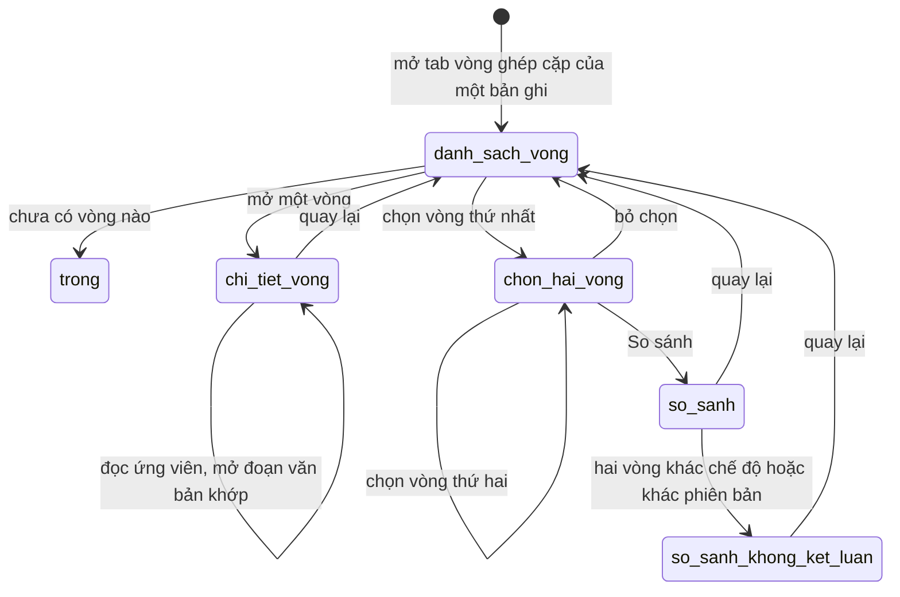

# Vòng ghép cặp

## Tóm tắt

Vòng ghép cặp là một lần tính ứng viên cho một đề bài hoặc một tài sản công nghệ. Mỗi vòng ghi lại phiên bản công cụ tìm kiếm, phiên bản mô hình nhúng, chế độ chấm điểm, câu truy vấn đã dùng, và toàn bộ ứng viên kèm điểm thô, đoạn văn bản khớp, chỉ số đoạn, xếp hạng và lý do.

Màn hình này liệt kê các vòng của một bản ghi và **so sánh hai vòng với nhau**. Đó là giá trị chính của nó: vòng cũ chỉ đọc và tính lại luôn tạo vòng mới, nên hai lần tính cách nhau vài tháng đều còn nguyên, và câu hỏi *kết quả đổi là do dữ liệu đổi hay do thuật toán đổi* có câu trả lời — nhưng chỉ khi màn hình đặt đúng hai vòng cạnh nhau và nói rõ cái gì giống, cái gì khác.

Facade v1 chỉ trả một **danh sách ứng viên phẳng** của vòng mới nhất, không lộ vòng nào, chế độ nào, phiên bản nào. Toàn bộ thông tin trên đã nằm trong dữ liệu và không tới được người dùng — xem [`../nen-tang/mo-hinh-du-lieu.md#vòng-ghép-cặp`](../nen-tang/mo-hinh-du-lieu.md#vòng-ghép-cặp).

Màn hình sống ở bảng quản trị, dưới hai route mới: danh sách vòng của một bản ghi, và trang so sánh hai vòng. Nó **chỉ đọc** — không có nút tính lại ở đây; xem mục "Bắt đầu sửa". Nó phụ thuộc hoàn toàn vào [`../api-v2/matching.md`](../api-v2/matching.md), chưa tồn tại.

## Trường hợp đơn giản

Quản trị viên mở một đề bài và bấm sang tab vòng ghép cặp. Họ thấy một danh sách, mới nhất trên cùng: mỗi dòng gồm thời điểm tính, chế độ chấm điểm, phiên bản công cụ tìm kiếm, số ứng viên, và một dấu hiệu cho biết vòng nào đang là vòng có thẩm quyền.

Vòng trên cùng có 10 ứng viên, tính tuần trước. Vòng dưới có 4 ứng viên, tính từ tháng Ba. Họ chọn cả hai và bấm **So sánh**.

Trang so sánh mở ra với một dòng kết luận ở đầu: hai vòng dùng **cùng** chế độ chấm điểm, **cùng** phiên bản công cụ, **cùng** mô hình nhúng — nên khác biệt đến từ dữ liệu, không từ thuật toán.

Bên dưới là bảng hợp nhất hai danh sách ứng viên: sáu bản ghi chỉ xuất hiện ở vòng mới, hai bản ghi có ở cả hai vòng kèm xếp hạng của từng vòng, hai bản ghi rơi khỏi vòng mới. Mỗi dòng mở rộng ra được để đọc đoạn văn bản đã khớp.

Họ đọc xong, quay lại. Không có gì được ghi.

## Tương tác, sự kiện theo sự kiện

### Vào màn

**Danh sách vòng.** Một lời gọi, phân trang. Mỗi dòng phải mang đủ năm thứ để người dùng chọn được hai vòng đáng so: thời điểm, chế độ chấm điểm, phiên bản công cụ, phiên bản mô hình nhúng, số ứng viên.

Bộ lọc theo chế độ chấm điểm và theo phiên bản công cụ nên nằm trong URL. Không lọc theo điểm.

Trạng thái rỗng có **ba nghĩa** và giao diện phải phân biệt cả ba, vì chúng dẫn tới ba hành động khác nhau:

1. **Bản ghi chưa từng được tính.** Thường vì nó chưa xuất bản, hoặc chủ sở hữu tắt tự động ghép cặp.
2. **Bản ghi đã được tính nhưng không ra ứng viên nào.** Trường hợp này **không để lại vòng nào** — xem "Trường hợp biên". Giao diện không phân biệt được nó với trường hợp trên bằng dữ liệu vòng; nó phải suy từ chỗ khác hoặc nói thẳng là không biết.
3. **Bản ghi không có nội dung để tính.** Không có phần mô tả thì không có đoạn văn bản nào để nhúng.

**Chi tiết một vòng.** Phần đầu là siêu dữ liệu của vòng; phần thân là danh sách ứng viên xếp theo hạng tăng dần. Mỗi ứng viên hiện: bản ghi nào, xếp hạng, điểm thô, lý do, chỉ số đoạn, và đoạn văn bản đã khớp (thu gọn mặc định).

**Trang so sánh.** Hai lời gọi song song, mỗi vòng một lời gọi. Dòng kết luận ở đầu trang được tính từ siêu dữ liệu, không từ điểm.

Không focus gì ở cả ba trang. Đây là các trang đọc.

### Rời đi không đổi gì

Đọc vòng và đọc ứng viên **không ghi gì**: không dòng kiểm toán, không bản ghi truy vấn tìm kiếm, không đổi cờ có thẩm quyền của vòng nào.

Đây là chỗ dễ nhầm nên nói rõ: hệ thống **có** một bảng ghi lại mọi lượt truy vấn tìm kiếm, kèm câu truy vấn, ngưỡng, chế độ, phiên bản công cụ, kết quả và thời gian chạy. Bảng đó chỉ được ghi khi **chạy một lượt tìm kiếm mới**, tức là khi tính lại ứng viên hoặc khi người dùng gõ vào ô tìm kiếm. Đọc lại một vòng đã lưu không chạm vào chỉ mục tìm kiếm, nên không sinh dòng nào.

Tuyên bố kiểm được: mở danh sách vòng, mở hai vòng, so sánh, quay lại — số dòng trong bảng truy vấn tìm kiếm không tăng, và cờ có thẩm quyền của mọi vòng giữ nguyên.

### Bắt đầu sửa

**Không có gì sửa được.** Vòng ghép cặp bất biến: mọi giá trị đặc trưng — điểm, đoạn văn bản, chỉ số đoạn — được lưu thẳng trong ứng viên để dựng lại vòng cũ mà không phải hỏi lại chỉ mục.

Ba thao tác duy nhất: chọn hai vòng để so, mở rộng một ứng viên để đọc đoạn văn bản khớp, và đổi cách sắp xếp bảng so sánh. Không thao tác nào là lệnh ghi.

**Không có nút tính lại trên màn hình này**, dù backend có sẵn lệnh xếp hàng tính lại. Lý do là nghiệp vụ chứ không phải kỹ thuật: tính lại tạo một vòng mới và đẩy vòng đang đọc xuống hàng cũ, tức là đổi chính thứ người dùng đang so sánh, ngay giữa lúc họ đang so. Lệnh tính lại thuộc màn hình nội dung của bản ghi; màn hình này chỉ hiển thị kết quả.

### Trong khi sửa

Không áp dụng theo nghĩa biểu mẫu. Thứ đổi trong lúc người dùng ở lại là *đang chọn vòng nào* và *đang mở ứng viên nào*.

Hai vòng đang so **phải nằm trong URL**. Một đường dẫn so sánh phải gửi được cho đồng nghiệp; nếu không, kết quả so sánh chỉ tồn tại trong đầu người mở nó.

URL không đổi khi người dùng mở rộng một ứng viên. Việc mở rộng không phải một route.

### Gửi đi

**Không có gì được gửi và không có gì được ghi lại.**

Đây là tuyên bố kiểm được: sau một lượt xem đầy đủ, không vòng nào được tạo, không cờ có thẩm quyền nào đổi, bảng truy vấn tìm kiếm không dài thêm, và không dòng kiểm toán nào sinh ra.

Hệ quả cho thiết kế: không cần khoá chống lặp, không có số phiên bản, không có đường 409, không có trạng thái "đang gửi".

## Hai chế độ chấm điểm

Hệ thống có hai cách tính điểm, và một vòng ghi lại nó đã dùng cách nào.

**`LEGACY_SCORING`** tái tạo đúng hành vi của hệ NestJS cũ, để đo lại đường cơ sở trên nền tảng mới. Truy vấn theo vectơ và truy vấn theo từ khoá chạy cạnh nhau trong cùng một lệnh, nên công cụ tìm kiếm **cộng** hai điểm khác đơn vị lại thành một. Lọc cứng theo trạng thái xuất bản và theo chủ sở hữu chạy **sau** khi đã cắt top-K.

**`CORRECTED_SCORING`** lọc cứng **trước** mọi bước thu hồi, chạy hai kênh thu hồi riêng biệt — một theo vectơ, một theo từ khoá — rồi hợp nhất bằng thứ hạng nghịch đảo thay vì cộng điểm thô.

Đây là một **cờ vận hành**. Người dùng không chọn được, không có ô chọn nào, và màn hình chỉ hiển thị chế độ mà vòng đó đã dùng. Đổi cờ chỉ ảnh hưởng các vòng tính **sau đó**; vòng đã lưu giữ nguyên nhãn của nó.

Ba hệ quả mà màn hình phải phản ánh:

1. **Điểm thô của hai chế độ không cùng đơn vị.** Điểm của chế độ cũ là tổng của hai thang khác nhau và không có trần; điểm của chế độ đã sửa là tổng các phân số nghịch đảo thứ hạng, gần như luôn là một số rất nhỏ. Màn hình **không được** vẽ chúng trên cùng một trục, không được tính hiệu số, và không được xếp chung một bảng xếp hạng. So sánh giữa hai chế độ chỉ có nghĩa ở mức **thứ hạng** và **có mặt hay không có mặt**.
2. **Vòng chế độ cũ có thể trả ít ứng viên hơn hẳn** mà không phải vì thiếu ứng viên. Lọc chạy sau khi cắt top-K nghĩa là các ô trong top-K bị bản nháp và bản ghi của chính chủ sở hữu chiếm chỗ, rồi bị loại, và không có gì được lấy bù vào. Khi một vòng cũ có 3 ứng viên còn vòng mới có 10, màn hình phải giúp người đọc thấy nguyên nhân này thay vì để họ kết luận rằng dữ liệu đã giàu lên gấp ba.
3. **Lý do của từng ứng viên khác nhau theo chế độ**, và đó là dấu hiệu thứ hai để nhận ra vòng thuộc loại nào ngay ở mức từng dòng.

## Ba phiên bản công cụ tìm kiếm

Một vòng mang đúng một phiên bản công cụ, và có ba giá trị:

| Phiên bản | Vòng đó là gì |
|---|---|
| PostgreSQL (pgvector), chấm điểm kiểu cũ — `postgres-16/pgvector-legacy` | Tính trên nền tảng mới, chế độ `LEGACY_SCORING` |
| PostgreSQL (pgvector), chấm điểm đã sửa — `postgres-16/pgvector-rrf` | Tính trên nền tảng mới, chế độ `CORRECTED_SCORING` |
| Elasticsearch (kiểu cũ / đã sửa) | **Nhãn lịch sử.** Elasticsearch đã gỡ 2026-09-05 (ADR-0010); không vòng mới nào mang nhãn này, vòng cũ nếu có vẫn đọc được |
| **Nhập từ hệ cũ** | **Không phải một lần tính.** Vòng được di trú từ bảng ghép cặp của hệ NestJS |

Loại thứ ba phải được **đánh dấu rõ ràng ở mọi chỗ nó xuất hiện** — trong danh sách, trong trang chi tiết, và trong trang so sánh. Ba lý do:

- Nó **không được tính lại**; điểm là điểm cũ, chép nguyên và không chuẩn hoá.
- Nó **không có câu truy vấn**, nên không dựng lại được nó đã hỏi gì.
- Nó mang nhãn chế độ chấm điểm cũ nhưng chưa bao giờ chạy qua công cụ tìm kiếm mới, nên hai vòng cùng nhãn chế độ vẫn có thể đến từ hai hệ thống khác nhau.

Vì vậy trang so sánh **không được đưa ra kết luận nguyên nhân** khi một trong hai vòng là vòng nhập từ hệ cũ. Nó phải nói thẳng: so sánh này không công bằng, vì một bên là kết quả đo và một bên là dữ liệu chép sang.

## Cái màn hình so sánh phải nói

Trang so sánh có hai phần, và phần đầu quan trọng hơn phần sau.

**Phần đầu — cái gì giống, cái gì khác.** Ba trục: chế độ chấm điểm, phiên bản công cụ, phiên bản mô hình nhúng. Từ ba trục đó suy ra một trong ba kết luận:

| Ba trục | Kết luận màn hình phải hiện |
|---|---|
| Giống hết | Khác biệt đến từ **dữ liệu**: nội dung đổi, bản ghi mới xuất bản, hoặc nhãn lĩnh vực đổi. |
| Khác ít nhất một trục | Khác biệt có phần đến từ **thuật toán**. Màn hình không tách được hai nguồn và phải nói là không tách được. |
| Một bên nhập từ hệ cũ | **Không kết luận được.** Hai bên không cùng loại. |

**Phần sau — hợp nhất hai danh sách ứng viên.** Một bảng, mỗi dòng là một bản ghi ứng viên, với xếp hạng ở vòng A, xếp hạng ở vòng B, và một trong ba tình trạng: chỉ ở A, chỉ ở B, có ở cả hai. Điểm thô hiện theo từng cột riêng và **chỉ được trừ cho nhau khi hai vòng cùng chế độ**.

Đoạn văn bản khớp hiện được cho từng bên. Đây là chỗ người đọc thấy vì sao một bản ghi rơi hạng: thường vì đoạn khớp đổi, chứ không vì điểm rơi.

## Chỉ mục tìm kiếm không chứa nội dung mật

Chỉ mục chỉ chứa nội dung công khai. Các đoạn văn bản mật của một bản ghi — nội dung mức 2, mức 3 và các bản do AI xử lý của chúng — nằm trong phòng dữ liệu và **không bao giờ được đưa vào chỉ mục**.

Hệ quả phải nói thẳng trên màn hình, không giấu trong tài liệu: **ứng viên được tính chỉ trên nội dung công khai.** Hai bản ghi có thể ăn khớp hoàn hảo ở phần mật và không xuất hiện trong bất kỳ vòng nào của nhau.

Ba yêu cầu:

- Trang chi tiết vòng phải mang một câu nói rõ phạm vi tính, đặt ở chỗ đọc được cùng lúc với danh sách ứng viên.
- Đoạn văn bản khớp hiển thị trên màn hình luôn là đoạn công khai, nên nó **không cần cấp quyền đọc** và không sinh dòng kiểm toán. Đây là điểm khác biệt so với [phòng dữ liệu](phong-du-lieu-va-cap-quyen.md) và phải rõ để không ai đi cấp quyền vô ích.
- Khi một bản ghi có nhiều nội dung mật, số đoạn được nhúng có thể ít hơn nhiều so với độ dài mà người dùng nhìn thấy ở trang nội dung. Màn hình nên hiện số đoạn đã nhúng để khoảng cách đó không thành một bí ẩn.

## Biến thể

| Biến thể | Lúc vào màn | Trong khi đọc |
|---|---|---|
| Vai trò | Màn hình thuộc bảng quản trị, chỉ vai trò `ADMIN` vào được. Quản trị viên xem được vòng của mọi bản ghi, kể cả bản nháp và bản đã xoá mềm. Ở cổng người dùng, chủ sở hữu vẫn chỉ thấy danh sách ứng viên phẳng của vòng mới nhất — xem [`../portal/ket-qua-ghep-cap.md`](../portal/ket-qua-ghep-cap.md); việc có mở siêu dữ liệu vòng cho chủ sở hữu hay không là câu hỏi chưa chốt. Khách chưa đăng nhập không vào được. | Vai trò không đổi giữa chừng ở phía người dùng. Mất vai trò quản trị viên trong lúc đang đọc thì lần tải lại sau trả 403 và toàn bộ bảng quản trị đóng lại, không riêng màn hình này. |
| Trạng thái bản ghi | Trạng thái xuất bản quyết định bản ghi có được tính hay không: chỉ bản đã xuất bản mới vào chỉ mục và mới được lấy làm ứng viên. Bản ghi **đã xoá mềm vẫn giữ nguyên các vòng cũ** — xoá gỡ đoạn văn bản khỏi chỉ mục nhưng không xoá vòng. Mức chất lượng của tài sản công nghệ **không tham gia** vào việc tính ứng viên ở bất kỳ chế độ nào; xem [`cong-chat-luong-cong-nghe.md`](cong-chat-luong-cong-nghe.md). Khoá tạm của hồ sơ vụ việc không liên quan. | Ứng viên là một tham chiếu được lưu, không phải một bản sao. Bản ghi ứng viên có thể đã bị gỡ xuất bản hoặc xoá mềm sau khi vòng được tính, và bản thân vòng không biết. Màn hình phải phân giải lại từng ứng viên lúc hiển thị và **đánh dấu ứng viên đã xoá hoặc đã gỡ xuất bản**, thay vì hiện một dòng trông như bình thường. |
| Cấu hình backend | `Matching:ScoringMode` là biến thể chính của màn hình này. Nó quyết định chế độ của các vòng **sẽ** được tính, không đổi vòng đã có. Bốn cấu hình khác cũng in dấu vào vòng: phiên bản mô hình nhúng, số ứng viên tối đa mỗi vòng, ngưỡng điểm tối thiểu, và số ký tự nội dung đưa vào câu truy vấn. `Api:V1CompatEnabled` không liên quan vì v1 không có đường nào tới dữ liệu vòng. `Mail:DryRun` không ảnh hưởng. | Cờ đổi giữa chừng không đổi gì trên màn hình đang mở — vòng đã lưu là bất biến. Nó chỉ đổi vòng tiếp theo, và vòng đó xuất hiện sau một lần tải lại. |
| Phím tắt của biểu mẫu | Không có biểu mẫu. Tab đi qua bộ lọc, rồi qua từng dòng vòng, rồi tới nút So sánh. Nút So sánh tắt cho tới khi đúng hai vòng được chọn. | Escape bỏ toàn bộ lựa chọn vòng và **không hỏi lại** — không có gì để mất. Enter trên một dòng vòng mở vòng đó; Space chọn/bỏ chọn nó để so sánh. Ctrl/Cmd+Enter không gắn với gì, vì màn hình không có lệnh gửi. |

## Huỷ và gián đoạn

| Sự kiện | Trước khi gửi | Trong khi đang gửi |
|---|---|---|
| Bấm Huỷ hoặc nhấn Escape | Bỏ lựa chọn vòng, hoặc thu gọn ứng viên đang mở. Không có gì được ghi và không hỏi lại. | Không có lệnh gửi. |
| Đi chỗ khác trong app | Mất lựa chọn vòng nếu nó chưa vào URL — đó chính là lý do lựa chọn phải vào URL. Không mất gì khác. | Không có lệnh gửi. |
| Back/Forward của trình duyệt | Hai vòng đang so nằm trong URL, nên Back quay đúng cặp vừa so. Việc mở rộng một ứng viên không đẩy mục vào lịch sử. | Không có lệnh gửi. |
| Tải lại trang, hoặc đóng tab | Tải lại cho ra đúng nội dung cũ — vòng bất biến. Không có bản nháp nào để mất. | Không có lệnh gửi. |
| Mất mạng, hoặc quá hạn | Lời gọi đọc thất bại. Ở trang so sánh, một trong hai lời gọi có thể hỏng trong khi cái kia thành công; giao diện phải hiện lỗi cho đúng nửa hỏng và **không so sánh với một nửa rỗng**. Thử lại an toàn vô hạn. | Không có lệnh gửi. |
| Phiên hết hạn (401), hoặc v1 bị dừng (410) | 401 đẩy về đăng nhập; không mất gì vì không có gì đang gõ, và URL đủ để quay lại đúng cặp vòng. 410 không áp dụng: màn hình này chỉ sống trên v2. | Không có lệnh gửi. |
| Bản ghi bị đổi bởi người khác | Vòng đã lưu không đổi được. Thứ đổi được là **vòng nào đang có thẩm quyền**: một lần tính lại chạy nền trong lúc này sẽ tạo vòng mới và hạ vòng đang đọc xuống. Nội dung đang đọc vẫn đúng, chỉ nhãn "đang có thẩm quyền" là cũ. Không có kênh đẩy, nên chỉ tải lại mới biết. Ứng viên trỏ tới bản ghi vừa bị xoá thì lần phân giải sau đó trả về một bản ghi đã xoá — phải đánh dấu, không được bỏ dòng đi. | Không có lệnh gửi. |
| Trình duyệt tự điền | Không áp dụng — không trường nhập nào tồn tại. Ô lọc của danh sách là ô chọn, không phải ô văn bản tự do. | Không áp dụng. |

Sau bất kỳ gián đoạn nào, người dùng quay lại đúng cặp vòng đang so. Không có gì đáng cứu.

## Tương tác với hệ thống khác

**Quyền và vai trò.** Quyền ở đây là quyền nền tảng, không phải vai trò trong một bản ghi: quản trị viên thấy hết, người khác không vào được màn hình. Đây là điểm khác với [console hồ sơ vụ việc](console-ho-so-vu-viec.md), nơi quyền do vai trò trong từng hồ sơ quyết định.

**Kiểm tra dữ liệu và cách hiện lỗi.** Không có dữ liệu gửi lên. Bốn lỗi đọc cần câu riêng: bản ghi không tồn tại, bản ghi chưa có vòng nào, một trong hai vòng của trang so sánh không tải được, và ứng viên trỏ tới bản ghi đã biến mất. Bốn câu này khác nghĩa và không được gộp.

**Thay đổi chưa lưu.** Không có tương tác. Màn hình không có trạng thái *đã bẩn*.

**Cập nhật lạc quan và hoàn tác.** Không có tương tác. Ở tầng dữ liệu cũng không có hoàn tác: không sửa được một vòng, không xoá được một ứng viên, và không hạ được một vòng xuống ngoài việc tính một vòng mới.

**Ngoại tuyến.** Không xếp hàng gì. Không có bản nháp cục bộ.

**Thông báo và toast.** Có đúng một loại thông báo liên quan: khi một vòng mới hoàn tất và tìm được ứng viên, chủ sở hữu bản ghi nhận thông báo. Thông báo đó dẫn tới danh sách ứng viên phẳng ở cổng người dùng, **không** dẫn tới màn hình này. Quản trị viên không nhận thông báo nào về vòng ghép cặp.

**Trạng thái lọc/tìm trong URL.** Bộ lọc của danh sách và hai vòng đang so đều phải nằm trong URL. Đây là yêu cầu bắt buộc chứ không phải điểm hoàn thiện: một kết quả so sánh không gửi được cho người khác thì không dùng được để ra quyết định chung.

**Đa ngôn ngữ.** Hai chế độ chấm điểm, ba phiên bản công cụ và ba giá trị lý do đều lưu bằng chuỗi kỹ thuật tiếng Anh. Chúng cần **nhãn tiếng Việt** cho người đọc, nhưng chuỗi gốc phải hiện được ở đâu đó, vì nó là thứ người vận hành dùng để đối chiếu với cấu hình. Dịch mà giấu hẳn bản gốc sẽ làm màn hình vô dụng với chính người cần nó nhất.

**Khả năng truy cập.** Bảng so sánh là một bảng dữ liệu thật với tiêu đề hàng và cột, không phải hai danh sách đặt cạnh nhau bằng CSS. Tình trạng "chỉ ở A / chỉ ở B / cả hai" không được chỉ dựa vào màu. Đoạn văn bản khớp mở ra là một vùng có thể mở rộng, và trạng thái mở/đóng phải được thông báo.

**Dấu vết kiểm toán.** Đọc vòng không ghi dòng nào. Việc *tính* một vòng thì ghi một dòng vào bảng truy vấn tìm kiếm, kèm câu truy vấn, ngưỡng, chế độ, phiên bản công cụ, danh sách kết quả và thời gian chạy — nhưng bảng đó cũng chưa có đường HTTP nào và không thuộc màn hình này. Nếu nó được mở, nó thuộc [nhật ký kiểm toán](nhat-ky-kiem-toan.md) hoặc một màn hình vận hành riêng.

## Trường hợp biên

- **Tính lại mà không ra ứng viên nào thì không tạo vòng.** Vòng cũ ở nguyên chỗ và vẫn mang nhãn có thẩm quyền. Người dùng nhìn màn hình sẽ tin rằng lần tính gần nhất là lần cũ, trong khi thực tế đã có một lần tính sau đó và nó ra tay trắng. Màn hình không có cách nào biết được điều này từ dữ liệu vòng.
- **Điểm của hai chế độ không so trực tiếp được.** Đây là cái bẫy lớn nhất của màn hình: hai con số cùng tên "điểm" đặt cạnh nhau mời người đọc trừ chúng cho nhau.
- **Vòng nhập từ hệ cũ không có câu truy vấn.** Trường đó rỗng theo thiết kế, không phải mất dữ liệu.
- **Ứng viên trỏ tới bản ghi đã xoá mềm hoặc đã gỡ xuất bản.** Vòng lưu tham chiếu, không lưu bản sao. Dòng vẫn phải hiện — nó là bằng chứng của lần tính đó — nhưng phải mang dấu hiệu, và không được mở sang một trang 404.
- **Xoá một bản ghi không xoá vòng của nó.** Đoạn văn bản bị gỡ khỏi chỉ mục nhưng vòng và ứng viên ở lại. Danh sách vòng của một bản ghi đã xoá mềm vẫn đầy đủ.
- **Chiều ghép cặp là cố định.** Đề bài chỉ ghép với tài sản công nghệ và ngược lại; không có vòng nào ghép hai đề bài. Màn hình không cần ô chọn chiều.
- **Vòng chỉ được tính khi bản ghi đã xuất bản và có nội dung.** Bản nháp không bao giờ có vòng, kể cả khi nội dung của nó đã đầy đủ.
- **Số ứng viên tối đa mỗi vòng là một cấu hình.** Hai vòng cách nhau vài tháng có thể khác nhau về số ứng viên chỉ vì con số đó đã đổi, chứ không vì dữ liệu đổi. Màn hình so sánh nên hiện giới hạn đã dùng nếu dựng lại được; nếu không dựng lại được, nó không được kết luận nguyên nhân từ chênh lệch số lượng.
- **Phiên bản mô hình nhúng là một chuỗi cấu hình, không phải một phép đo.** Nếu người vận hành đổi mô hình thật mà không đổi chuỗi, vòng sẽ mang nhãn sai và màn hình không có cách nào phát hiện.

## Câu hỏi mở và kiểm chứng

- ~~**Không có endpoint nào cho vòng ghép cặp.** Tầng dịch vụ có sẵn hàm đọc vòng mới nhất và liệt kê ứng viên, nhưng không hàm nào liệt kê **lịch sử các vòng**, và không controller nào lộ siêu dữ liệu vòng ra ngoài. Cả màn hình lẫn hợp đồng API đều phải bổ sung một đường liệt kê vòng. Đây là phụ thuộc chặn. (chưa cấp mã lỗi)~~ **Đã có 2026-09-05**: `GET .../match-rounds` (liệt kê, lọc theo chế độ và công cụ), `GET /api/v2/match-rounds/{roundId}` và `.../candidates` — xem [`../api-v2/matching.md`](../api-v2/matching.md#bề-mặt-cần-có). Màn hình dựng theo đúng đặc tả này: danh sách vòng với bộ lọc trong URL, chi tiết một vòng, trang so sánh với kết luận từ ba trục và bảng hợp nhất; đo ở [`../verification/admin.md`](../verification/admin.md#moivong-ghep-capmd).
- **Việc một lần tính lại ra tay trắng không để lại dấu vết nào đáng bị coi là lỗi**, không phải một chi tiết. Nó làm cho câu "lần tính gần nhất là lúc nào" không có câu trả lời đúng. (chưa cấp mã lỗi)
- **Chủ sở hữu có được xem lịch sử vòng của nội dung mình không?** Chưa chốt. Nếu có, phải quyết định thêm họ có thấy chế độ chấm điểm và phiên bản công cụ hay không — đó là thông tin vận hành nội bộ, và nó cũng là thứ giải thích vì sao kết quả của họ đổi.
- **Có nên hiện một thang điểm đã chuẩn hoá bên cạnh điểm thô không?** Chuẩn hoá làm hai chế độ so được bằng mắt nhưng đánh mất ý nghĩa của con số gốc, và hệ cũ đã từng quy điểm thành phần trăm — bản .NET cố ý không làm vậy khi di trú. Chưa chốt.
- **So sánh hơn hai vòng cùng lúc có cần không?** Ba mốc thời gian cho ra một đường xu hướng, hai mốc chỉ cho ra một hiệu số. Chưa ai yêu cầu.
- **Ai được đọc câu truy vấn của một vòng?** Câu truy vấn ghép nối tiêu đề và phần đầu nội dung của bản ghi nguồn. Với bản ghi đã xuất bản thì nó là nội dung công khai, nhưng bảng ghi truy vấn tìm kiếm còn chứa cả truy vấn do người dùng gõ tay, và hai loại này không nên chung một màn hình nếu chưa quyết định ai được đọc gì.
- **Có cần một màn hình so sánh không gắn với một bản ghi cụ thể không** — kiểu "đổi cờ chấm điểm rồi tính lại 200 bản ghi, xem tổng thể khác bao nhiêu"? Đó là công cụ đánh giá chất lượng tìm kiếm, khác mục đích với màn hình này, và nằm ngoài phạm vi hiện tại.
- Chưa quan sát được vòng thật nào vì cơ sở dữ liệu rỗng và sidecar nhúng chưa chạy (Elasticsearch đã gỡ; chỉ mục nay trong PostgreSQL). Mọi mô tả về hình dạng điểm và số lượng ứng viên ở trên suy từ mã, chưa đo.
- Chưa chạy đối chiếu hai chế độ trên cùng một tập dữ liệu. Đó là việc phải làm trước khi màn hình so sánh có ý nghĩa, vì nó quyết định bảng so sánh cần hiện thêm cột nào.

Đặc tả; **mã đã có 2026-09-05** (`dmst-admin-main/src/features/matching/`). Dựa trên SourceCode/nacentech, bản chụp ngày 2026-09-05.
