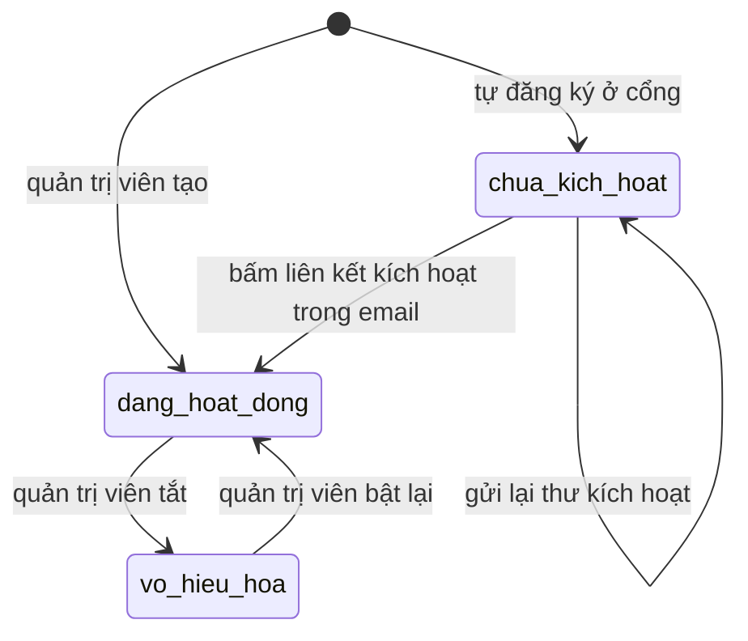

# Xác thực và vai trò

Tài liệu này sở hữu: token sống bao lâu, vai trò có những gì, tài khoản đi qua những trạng thái nào, và giới hạn tần suất là bao nhiêu. Tài liệu khác liên kết tới đây thay vì nhắc lại các con số.

## Tóm tắt

Một người dùng đổi email và mật khẩu lấy một token, rồi gắn token đó vào mọi lời gọi sau. Không có phiên phía máy chủ, không có refresh token, không có đăng xuất phía máy chủ: đăng xuất là xoá token khỏi trình duyệt.

Vai trò được quyết ngay trong lệnh đăng nhập. Cổng người dùng và bảng quản trị gọi hai đường dẫn đăng nhập khác nhau, và mỗi đường chỉ chấp nhận một vai trò. Gọi sai đường thì bị từ chối bằng đúng câu như khi sai mật khẩu.

## Vai trò

Bốn giá trị, nằm trong claim `role` của token:

| Vai trò | Nghĩa |
|---|---|
| `ANONYMOUS` | Chưa đăng nhập. Không có token. |
| `USER` | Người dùng cổng. Tự đăng ký được. |
| `ADMIN` | Quản trị viên. Không có đường tự đăng ký; phải do một quản trị viên khác tạo. |
| `SYSTEM` | Worker và công cụ di trú. Không có người thật đứng sau, và **không có `PersonId`** — mọi thao tác cần một người cụ thể sẽ hỏng nếu chạy dưới vai trò này. |

Đây là *vai trò nền tảng*, khác với vai trò trong một hồ sơ vụ việc cụ thể (chủ bài toán, môi giới chính, bên đánh giá…). Vai trò trong hồ sơ không nằm trong token và không đi theo người sang hồ sơ khác — xem [`mo-hinh-du-lieu.md`](mo-hinh-du-lieu.md).

Quyền đọc dữ liệu mật cũng **không** đến từ token. Nó đến từ *cấp quyền đọc*, một phiếu riêng có mục đích và thời hạn.

## Token

| Thuộc tính | Giá trị |
|---|---|
| Nơi chứa | Header `Authorization: Bearer <token>` |
| Thời hạn | **24 giờ** |
| Ký bằng | Khoá HMAC trong cấu hình `Auth:SigningKey` |
| Định danh người dùng | Claim `sub` |
| Vai trò | Claim `role` |
| Dung sai đồng hồ | 30 giây |

`Auth:SigningKey` **không có giá trị mặc định** và phải dài ít nhất 32 byte. Thiếu thì API không khởi động được — nó ném lỗi ngay lúc dựng. Đây là một thay đổi có chủ đích so với NacenTwin, vốn rơi về một chuỗi bí mật cố định khi thiếu biến môi trường.

Hệ quả trực tiếp của việc đổi khoá: **mọi token do NestJS phát hành đều không còn hợp lệ**. Tại thời điểm cutover, mọi người đang đăng nhập đều bị đẩy ra.

### Kiểm tra ở mỗi lời gọi, không chỉ lúc đăng nhập

Token hợp lệ chưa đủ. Với mỗi request, máy chủ tra lại tài khoản theo claim `sub` và từ chối nếu tài khoản **không còn hoạt động**. Vô hiệu hoá một tài khoản vì thế có tác dụng ngay ở lời gọi tiếp theo, không phải sau 24 giờ.

Nếu claim `sub` không phải một định danh hợp lệ, token bị từ chối trước cả bước tra tài khoản.

### Nơi ba client cất token

Không client nào dùng `HttpOnly`; cả hai cổng đều cất trong cookie mà JavaScript đọc được, không có cờ `Secure`.

| Bề mặt | Tên cookie | Thời hạn cookie | So với token (24 giờ) |
|---|---|---|---|
| Bảng quản trị | `admin_token` | 7 ngày | Cookie sống lâu hơn token **6 ngày** |
| Cổng người dùng | `dmst_access_token` | 365 ngày | Cookie sống lâu hơn token **364 ngày** |
| Trang giới thiệu | không có | — | Không đăng nhập |

Hai tên cookie khác nhau nên hai bề mặt không giẫm lên phiên của nhau, kể cả khi chạy cùng miền.

Khoảng lệch giữa tuổi cookie và tuổi token là khoảng thời gian trình duyệt tin rằng nó còn đăng nhập trong khi máy chủ đã hết công nhận. Cái người dùng thấy trong khoảng đó khác nhau ở hai bề mặt, và đó là chỗ hai client xử lý khác nhau — xem mục dưới. Xem [B-09](../bug-triage.md#b-09-cookie-sống-7-ngày-token-sống-24-giờ).

## Phiên hết hạn

**Bảng quản trị** bắt 401 ở một chỗ tập trung: xoá cookie, phát một sự kiện, lớp phiên nghe sự kiện và xoá tài khoản khỏi bộ nhớ, lớp bảo vệ thấy không còn tài khoản và đưa về `/login`. Người dùng bị đẩy ra ngay, ở giữa bất kỳ thao tác nào, **không có cảnh báo và không giữ lại cái họ đang gõ**.

**Cổng người dùng không có xử lý 401 nào.** Bộ chặn phản hồi của nó chỉ đổi lỗi thành một `Error` mang thông điệp rồi ném tiếp. Token hết hạn vì thế biểu hiện thành một lỗi lạ ở bất cứ màn hình nào người dùng đang đứng, cookie vẫn còn đó, và lần tải trang sau vẫn tưởng là đã đăng nhập. Người dùng phải tự xoá cookie hoặc chờ 365 ngày. Xem [B-12](../bug-triage.md#b-12-cổng-người-dùng-không-xử-lý-401).

Không có đăng xuất phía máy chủ. Xoá cookie là tất cả những gì xảy ra; token đã cấp vẫn dùng được cho tới khi hết 24 giờ nếu ai đó còn giữ nó.

## Vòng đời một tài khoản

**Tự đăng ký** chỉ có ở cổng người dùng và luôn tạo tài khoản `USER` ở trạng thái chưa kích hoạt. Không có đường tự đăng ký thành `ADMIN`.

**Quản trị viên tạo** thì tài khoản vào thẳng trạng thái hoạt động, và **bắt buộc phải đặt mật khẩu**. Hệ cũ mặc định `12345678` khi không nhập; đây là một trong bảy thay đổi có chủ đích.

**Kích hoạt** cần một token gửi qua email, sống **60 phút**, dài ít nhất 16 ký tự. Hết hạn thì phải yêu cầu gửi lại.

**Vô hiệu hoá** có hiệu lực ở lời gọi kế tiếp, không cần chờ token hết hạn.

Không có trạng thái xoá. Tài khoản không bị xoá khỏi hệ thống — và facade v1 hiện **không có** đường xoá người dùng, dù bảng quản trị vẫn gọi nó. Xem [B-02](../bug-triage.md#b-02-xóa-người-dùng-trong-admin-trả-405).

## Mật khẩu

- Đặt lại mật khẩu và đăng ký yêu cầu tối thiểu **8 ký tự**.
- **Đổi mật khẩu** (khi đang đăng nhập) khắt khe hơn hẳn: ít nhất 8 ký tự và phải có đủ chữ thường, chữ hoa, chữ số và ký tự đặc biệt. Ba đường vào cùng một thứ, ba luật khác nhau — một người đặt được mật khẩu `12345678` lúc đăng ký sẽ không đổi được sang `abcdefgh`.
- Mật khẩu **không bị cắt khoảng trắng** ở bất kỳ đâu; email thì có.
- Mật khẩu cũ băm bằng bcrypt được nhận nguyên dạng và **băm lại sang thuật toán mới ở lần đăng nhập đầu tiên**. Người dùng không thấy gì; đây là lý do lần đăng nhập đầu sau cutover có thể chậm hơn một nhịp.

## Giới hạn tần suất

Đếm theo cặp **địa chỉ IP và email**, nên hai người sau cùng một NAT dùng hai email khác nhau không tính chung.

| Hành động | Số lần | Trong |
|---|---|---|
| Đăng ký | 5 | 300 giây |
| Gửi lại thư kích hoạt | 3 | 600 giây |
| Đăng nhập | 10 | 300 giây |

Vượt ngưỡng trả 429 với mã tương ứng (`REGISTER_RATE_LIMITED`, `RESEND_RATE_LIMITED`, `LOGIN_RATE_LIMITED`). Không giao diện nào đếm trước hay báo còn bao nhiêu lần; người dùng chỉ biết khi đã bị chặn.

## Những câu trả lời cố ý mơ hồ

Hai đường không tiết lộ tài khoản có tồn tại hay không:

- **Đăng nhập sai vai trò** trả `INVALID_CREDENTIALS`, không phải 403. Một tài khoản `USER` gõ đúng mật khẩu ở trang đăng nhập admin nhận đúng câu như khi gõ sai.
- **Quên mật khẩu** luôn trả thành công, kèm câu "nếu email tồn tại trong hệ thống…". Thư chỉ được gửi khi tài khoản có thật.

Đường thứ ba **cố tỏ ra mơ hồ nhưng không mơ hồ**. Gửi lại thư kích hoạt phân biệt được **ba** trường hợp:

| Email | Phản hồi |
|---|---|
| Không tồn tại | **404** `ACCOUNT_NOT_FOUND` |
| Tồn tại, chưa kích hoạt | 200, câu chung "If the account exists and is not active, …" |
| Tồn tại, đã kích hoạt | 200, câu riêng "Account is already active. Please sign in." |

Câu chung ở hàng giữa được viết như thể nó che giấu điều gì đó, nhưng mã trạng thái ở hàng đầu đã nói hết. Bất kỳ ai cũng dò được một email có tài khoản hay không, và có kích hoạt hay chưa, chỉ bằng mã trạng thái và câu trả lời. Xem [B-13](../bug-triage.md#b-13-gửi-lại-thư-kích-hoạt-phân-biệt-được-ba-trạng-thái-tài-khoản).

**Quên mật khẩu không có giới hạn tần suất.** Mã `FORGOT_PASSWORD_RATE_LIMITED` tồn tại ở cả hai phía nhưng không đường nào gọi bộ đếm, nên đường này dò được không giới hạn — trong khi ba đường còn lại đều bị chặn.

## Tương tác với hệ thống khác

**Quyền và vai trò.** Đây là tài liệu sở hữu. Việc một thao tác cụ thể cần vai trò gì nằm trong tài liệu của thao tác đó; cách từ chối được ghi lại nằm ở [`../xuyen-suot/quyen-va-vai-tro.md`](../xuyen-suot/quyen-va-vai-tro.md).

**Kiểm tra dữ liệu và cách hiện lỗi.** Thông điệp của 12 mã xác thực legacy đi trong trường `code`, khác với mọi lỗi khác — xem [`hop-dong-api.md`](hop-dong-api.md#thân-lỗi-của-v1).

**Thay đổi chưa lưu.** Bị đẩy ra vì 401 **vứt bỏ** mọi thứ đang gõ ở bảng quản trị. Không có cơ chế giữ lại.

**Cập nhật lạc quan và hoàn tác.** Không có tương tác.

**Ngoại tuyến.** Không có tương tác — không thể xác thực khi ngoại tuyến, và không client nào lưu trạng thái đăng nhập để dùng offline.

**Thông báo và toast.** Không có tương tác ở tầng này.

**Trạng thái lọc/tìm trong URL.** Không có tương tác.

**Đa ngôn ngữ.** Mọi thông điệp xác thực từ máy chủ là **tiếng Anh**, kể cả trên giao diện tiếng Việt hoàn toàn.

**Khả năng truy cập.** Không có tương tác ở tầng này.

**Dấu vết kiểm toán.** Đăng nhập, đổi mật khẩu và đặt lại mật khẩu đều ghi dòng kiểm toán kèm địa chỉ IP và trình duyệt. Hai trường đó có **thời hạn lưu riêng, ngắn hơn** bản thân dòng kiểm toán; hết hạn thì chúng bị cắt còn dòng vẫn nguyên.

## Trường hợp biên

- **Ba luật mật khẩu khác nhau cho ba đường vào cùng một trường.** Đăng ký và đặt lại chỉ cần 8 ký tự; đổi mật khẩu cần đủ bốn loại ký tự.
- **Đổi mật khẩu thành công yêu cầu đăng nhập lại**, nhưng máy chủ **không** vô hiệu hoá token cũ — nó chỉ trả một câu bảo người dùng làm vậy. Token cũ vẫn dùng được đến hết 24 giờ.
- **Vai trò `SYSTEM` không có `PersonId`.** Bất kỳ đường nào chạy dưới vai trò này mà cần một người cụ thể sẽ ném lỗi thay vì âm thầm gán sai người.
- **Đổi khoá ký là một công tắc.** Đổi `Auth:SigningKey` ở môi trường đang chạy đẩy mọi người ra ngay lập tức.
- **Ba `.env.example` đều trỏ `http://localhost:3001`** — cổng của NestJS cũ. Backend .NET chạy ở 5000 (docker) hoặc 5199 (chạy tay). Ai dựng frontend theo tệp mẫu sẽ nói chuyện với một máy chủ không tồn tại. Xem [B-14](../bug-triage.md#b-14-ba-envexample-vẫn-trỏ-cổng-nestjs-cũ).
- **Cổng người dùng mặc định về `http://localhost:3001`** ngay trong mã, không chỉ trong tệp mẫu: thiếu biến môi trường thì nó dùng giá trị đó.

## Câu hỏi mở và kiểm chứng

- Chưa đo giới hạn tần suất trên bản chạy. Chưa biết bộ đếm đặt ở đâu và nó có sống qua lần khởi động lại của API không.
- Chưa xác nhận thư kích hoạt và thư đặt lại mật khẩu thực sự gửi được: cấu hình mặc định bật chế độ chỉ ghi log, không gửi thật.
- Chưa xác nhận điều gì xảy ra ở cổng người dùng khi token hết hạn giữa lúc đang điền một biểu mẫu dài. Từ mã thì cái họ gõ được giữ lại vì không có gì đẩy họ đi, nhưng lời gọi thất bại và thông điệp không nói rằng cần đăng nhập lại.
- Việc đổi mật khẩu không vô hiệu hoá token cũ đáng bị coi là lỗi hơn là một quyết định; đây là hành vi kế thừa từ hệ cũ và chưa thấy chỗ nào ghi lý do giữ nó.

Đối chiếu với SourceCode/nacentech, SourceCode/dmst-admin-main và SourceCode/dmst-user-main, bản chụp ngày 2026-09-04.
