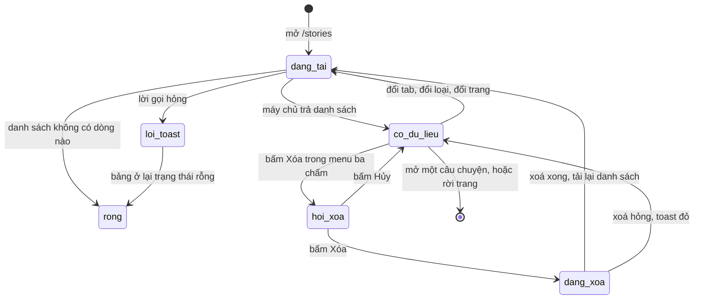
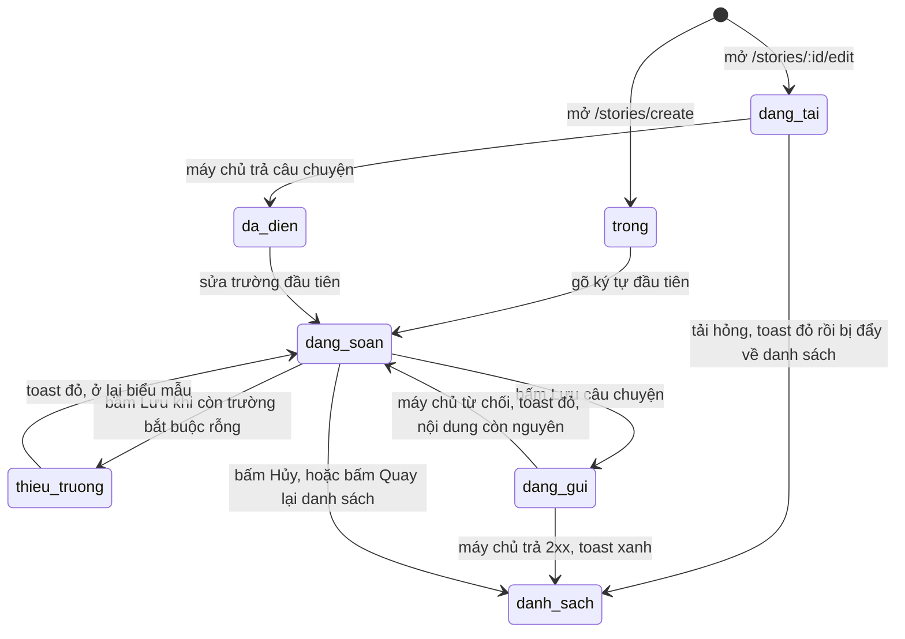

# Câu chuyện ở cổng người dùng

## Tóm tắt

Câu chuyện là khu vực duy nhất của cổng người dùng nơi người dùng tự viết một bài dài, tự chọn lúc nào công khai nó, và tự xoá nó. Bốn màn hình: danh sách câu chuyện của chính mình, biểu mẫu tạo, biểu mẫu sửa, và trang xem một câu chuyện. Cả bốn nối vào API thật; đây không phải vỏ.

Một câu chuyện có một *kiểu* (thành công hoặc thất bại), một *trạng thái* (nháp hoặc đã xuất bản), và một cờ **bị ẩn** do quản trị viên đặt. Cổng người dùng đọc cờ bị ẩn từ máy chủ nhưng **không hiển thị nó ở bất kỳ đâu**, nên tác giả của một câu chuyện đã bị ẩn vẫn thấy chữ "Công khai" trên màn hình của mình. Ba trạng thái nhìn thấy được ở [`../nen-tang/mo-hinh-du-lieu.md`](../nen-tang/mo-hinh-du-lieu.md#câu-chuyện) rút xuống còn hai ở giao diện này.

## Trường hợp đơn giản

Người dùng bấm **Câu chuyện** ở thanh bên. Trang mở ra một bảng gồm những câu chuyện của chính họ: số thứ tự, tiêu đề, thẻ loại, thẻ trạng thái, ngày tạo, và một nút ba chấm ở cuối mỗi dòng. Phía trên bảng có ba tab lọc theo trạng thái — *Tất cả*, *Nháp*, *Đã công bố* — và một ô chọn lọc theo loại.

Họ bấm **Tạo câu chuyện**. Biểu mẫu mở ra với ô tiêu đề rỗng, một trình soạn thảo giàu định dạng cho phần nội dung, và ở cột phải là hai thẻ chọn loại: *Thành công* đang được chọn sẵn, *Thất bại* thì không. Nếu họ đổi sang *Thất bại*, một khối cam hiện thêm ở dưới với ô **Bài học rút ra** bắt buộc.

Dưới đáy màn hình có một thanh dính. Bên trái thanh là hai nút gạt **Lưu nháp** / **Công khai**; bên phải là nút **Hủy** và nút **Lưu câu chuyện**.

Họ gõ tiêu đề, gõ nội dung, chọn **Công khai**, rồi bấm **Lưu câu chuyện**. Nút đổi chữ thành "Đang lưu…", một toast xanh "Đã tạo câu chuyện thành công" hiện lên, và trang quay về danh sách. Câu chuyện xuất hiện ở đầu bảng với thẻ xanh "Công khai".

Từ lúc đó nó có mặt trên [trang giới thiệu công khai](../landing/trang-chu-va-cau-chuyen.md) — trừ khi quản trị viên bật cờ ẩn, mà người dùng sẽ không biết.

## Tương tác, sự kiện theo sự kiện

Hai tương tác chính: duyệt danh sách, và soạn một câu chuyện.

### Danh sách

### Biểu mẫu

### Vào màn

**Danh sách.** Trang gọi ngay danh sách câu chuyện *của chính người dùng*, trang 1, 20 dòng, không lọc. Trong lúc chờ, vùng bảng hiển thị dòng "Đang tải...". Ba tab và ô chọn loại luôn bấm được, kể cả khi bảng còn trống.

> Ghi chú kỹ thuật: danh sách của tôi gọi `GET /api/v1/stories/my`. Đường này trả **cả nháp, cả đã xuất bản, cả đã bị ẩn** — không lọc theo trạng thái hiển thị. Có một đường thứ hai, `GET /api/v1/stories`, chỉ trả câu chuyện đã xuất bản và chưa bị ẩn của mọi người; cổng người dùng **không gọi đường này ở đâu cả**. Danh sách câu chuyện của người khác không tồn tại ở cổng.

**Biểu mẫu tạo.** Không tải gì. Mọi ô rỗng, loại mặc định là *Thành công*, trạng thái mặc định là *Lưu nháp*. Không ô nào được focus sẵn.

**Biểu mẫu sửa.** Hiện một vòng xoay giữa màn với dòng "Đang tải..." rồi mới vẽ biểu mẫu. Nếu lời gọi hỏng — kể cả vì câu chuyện không tồn tại — hiện toast "Không thể tải thông tin câu chuyện" và **đẩy thẳng về danh sách**. Không có màn hình lỗi để ở lại.

**Trang xem.** Cùng cách: vòng xoay, rồi nội dung, hoặc toast "Không thể tải câu chuyện" và bị đẩy về danh sách.

### Rời đi không đổi gì

**Không có gì được ghi lại.** Mở biểu mẫu tạo rồi bấm **Quay lại danh sách** không tạo bản nháp nào ở máy chủ; trạng thái `DRAFT` chỉ tồn tại sau một lần lưu thành công. Mở biểu mẫu sửa rồi rời đi không phát lệnh ghi nào. Không có lưu tự động, không có lưu cục bộ, không có mục nào trong lịch sử ngoài chính lần điều hướng.

Duyệt danh sách, đổi tab, đổi trang đều chỉ sinh lệnh đọc.

### Bắt đầu sửa

Không có gì đổi hình dạng ở ký tự đầu tiên. Nút **Lưu câu chuyện** sáng từ đầu và bấm được kể cả khi mọi ô còn rỗng. Không có nhãn "chưa lưu", không có dấu chấm bên cạnh tiêu đề, và **không có cảnh báo khi rời trang**.

Khái niệm *đã bẩn* ở [`../nen-tang/luu-va-phien-ban.md`](../nen-tang/luu-va-phien-ban.md) không có biểu hiện nào ở màn hình này.

### Trong khi sửa

Không có kiểm tra dữ liệu nào chạy trong lúc gõ. Không ô nào chuyển đỏ, không có đếm ký tự, không có gợi ý. Ô tiêu đề bị chặn cứng ở **255 ký tự** — gõ tiếp thì không có gì xảy ra và không có thông báo nào giải thích.

Một trường phụ thuộc: chọn loại **Thất bại** làm hiện khối *Bài học rút ra*; chọn lại **Thành công** làm khối đó biến mất **cùng với nội dung đã gõ trong nó**. Nội dung ấy vẫn nằm trong bộ nhớ biểu mẫu và sẽ được gửi lại nếu người dùng đổi ý lần nữa trong cùng phiên soạn.

Hai nút gạt **Lưu nháp** / **Công khai** ở thanh đáy **không lưu gì cả**. Chúng chỉ đặt trạng thái sẽ được gửi kèm ở lần lưu tiếp theo. Chữ trên nút nói ngược lại điều đó.

URL không đổi trong suốt quá trình soạn.

### Gửi đi

Bấm **Lưu câu chuyện**. Thứ tự xảy ra:

1. Kiểm tra tại chỗ, dừng ở lỗi đầu tiên gặp được:
   - tiêu đề rỗng sau khi cắt khoảng trắng → toast "Vui lòng nhập tiêu đề";
   - nội dung rỗng → toast "Vui lòng nhập nội dung câu chuyện";
   - loại là *Thất bại* mà bài học rỗng → toast "Vui lòng nhập bài học rút ra".
   Trường hợp nào cũng **dừng**, không có lời gọi mạng, và biểu mẫu giữ nguyên.
2. Nút bị khoá, đổi chữ thành "Đang lưu…". Các ô **không** bị khoá — người dùng gõ tiếp được trong lúc chờ, và cái họ gõ thêm sẽ không đi cùng lần gửi này.
3. Gửi tiêu đề đã cắt khoảng trắng, nội dung **nguyên văn**, loại, trạng thái, và bài học. Tạo mới thì `POST`, sửa thì `PUT` toàn phần.
4. Thành công: toast xanh ("Đã tạo câu chuyện thành công" hoặc "Đã cập nhật câu chuyện") rồi **rời khỏi biểu mẫu về danh sách**. Người dùng không thấy kết quả đã lưu ở lại trên màn hình mình vừa soạn.
5. Thất bại: toast đỏ một câu chung ("Không thể tạo câu chuyện" / "Không thể cập nhật câu chuyện"). **Câu này giống nhau cho mọi lý do** — sai định dạng, hết phiên, mất mạng, máy chủ lỗi. Thông điệp thật của máy chủ bị vứt.

Xoá đi qua một hộp thoại xác nhận nói "Hành động này không thể hoàn tác." Câu đó đúng theo nghĩa đen: khác đề bài và tài sản công nghệ vốn *xoá mềm*, câu chuyện bị **xoá hẳn khỏi cơ sở dữ liệu**.

> Ghi chú kỹ thuật: khi loại là *Thành công*, giao diện gửi `lesson: null`. Máy chủ đọc `null` là "không đổi trường này" chứ không phải "xoá trường này"; cờ xoá bài học tồn tại ở tầng dịch vụ nhưng facade v1 luôn đặt nó là *không*. Hệ quả: đổi một câu chuyện thất bại thành công thì bài học cũ **vẫn nằm trong cơ sở dữ liệu**, chỉ là không màn hình nào hiện nó nữa. Không có đường nào qua v1 để xoá nó.

## Biến thể

| Biến thể | Lúc vào màn | Trong khi sửa |
|---|---|---|
| Vai trò | Khách chưa đăng nhập bị lớp bảo vệ đẩy về `/login` trước khi trang kịp dựng. `USER` thấy đúng câu chuyện của mình. `ADMIN` đăng nhập vào cổng người dùng cũng chỉ thấy câu chuyện của chính mình ở đây — kiểm duyệt nằm ở [bảng quản trị](../admin/cau-chuyen.md), không ở đây. | Không ảnh hưởng. Quyền ghi được kiểm ở máy chủ theo quan hệ tác giả, và tác giả luôn là người đang đăng nhập. |
| Trạng thái bản ghi | Nháp và đã xuất bản hiện chung một bảng, phân biệt bằng thẻ màu. **Cờ bị ẩn không được hiện ở đâu**, nên một câu chuyện đã bị quản trị viên gỡ khỏi trang giới thiệu vẫn mang thẻ xanh "Công khai". Câu chuyện đã xoá không còn tồn tại nên không có trạng thái nào cho nó. | Đổi trạng thái là một nút gạt, không có hộp xác nhận: một câu chuyện đã xuất bản có thể bị hạ về nháp trong một cú bấm và một lần lưu. Không có gì cảnh báo rằng nó sẽ biến mất khỏi trang giới thiệu. |
| Cấu hình backend | Nếu v1 đã bị dừng dịch vụ, danh sách hỏng và người dùng chỉ thấy toast "Không thể tải danh sách câu chuyện" trên một bảng rỗng — không có câu nào nói rằng dịch vụ đã dừng. | Không ảnh hưởng cho tới lúc gửi; lúc đó mọi lỗi đều cho ra cùng một toast đỏ. |
| Phím tắt của biểu mẫu | Không ô nào được focus sẵn. Tab đi từ tiêu đề vào vùng soạn thảo rồi ra cột phải. | **Enter không gửi biểu mẫu** — nó xuống dòng trong trình soạn thảo. **Escape không làm gì**: biểu mẫu là một trang, không phải hộp thoại. Ctrl/Cmd+Enter không được xử lý riêng. Escape *có* đóng hộp thoại xác nhận xoá. |

Đổi biến thể giữa chừng: chỉ trạng thái bản ghi đổi được trong lúc người dùng đang ở màn hình, và nó đổi được từ hai phía — người dùng gạt nút, hoặc quản trị viên bật cờ ẩn ở bề mặt khác. Trường hợp thứ hai không có tín hiệu nào ở đây.

## Huỷ và gián đoạn

| Sự kiện | Trước khi gửi | Trong khi đang gửi |
|---|---|---|
| Bấm Huỷ hoặc nhấn Escape | **Hủy** vứt bỏ mọi thứ đã gõ và về danh sách, không hỏi lại. Escape không làm gì trên biểu mẫu; trên hộp thoại xoá, Escape đóng hộp thoại và không xoá gì. | Nút **Hủy** vẫn bấm được và vẫn điều hướng. Lời gọi đang bay không bị huỷ; nó vẫn tới máy chủ và vẫn ghi. Người dùng rời đi mà không biết mình vừa lưu thành công hay không. |
| Đi chỗ khác trong app | Đi được ngay, không hỏi. Nội dung chưa gửi mất hẳn. | Đi được ngay. Toast kết quả có thể hiện lên ở màn hình mới, nói về một việc người dùng đã rời khỏi. |
| Back/Forward của trình duyệt | Về màn trước, không hỏi. Bấm Forward quay lại biểu mẫu thì biểu mẫu **rỗng lại** — nội dung không được khôi phục. | Như trên. Lệnh ghi vẫn hoàn tất ở máy chủ. |
| Tải lại trang, hoặc đóng tab | Mọi thứ chưa lưu mất. Không có hộp thoại "bạn có chắc muốn rời trang". | Lời gọi bị bỏ giữa chừng ở phía trình duyệt. Máy chủ có thể đã ghi xong. Tải lại xong người dùng phải tự nhìn danh sách để biết. |
| Mất mạng, hoặc request quá hạn | Không ảnh hưởng — biểu mẫu chưa gọi gì. Danh sách thì hiện toast "Không thể tải danh sách câu chuyện" trên bảng rỗng. | Nút mở khoá, toast đỏ chung hiện lên. Không có thử lại tự động, không có hàng đợi. Nội dung trong biểu mẫu còn nguyên và gửi lại được. |
| Phiên hết hạn (401), hoặc v1 bị dừng (410 Gone) | Cổng người dùng **không có bộ chặn 401**: một lời gọi bị từ chối chỉ biến thành một toast đỏ, người dùng ở lại trang với bảng rỗng và không hiểu vì sao. Người dùng chỉ bị đưa về `/login` khi họ **rời tab rồi quay lại** — lúc đó lớp phiên kiểm lại token, thấy hỏng, xoá nó, và lớp bảo vệ đẩy họ ra. | Cùng một toast đỏ chung. Không có lời mời đăng nhập lại, không có giữ lại bản nháp để gửi sau khi đăng nhập. Chuyển tab để đăng nhập lại chính là thứ làm mất bài đang soạn. |
| Bản ghi bị đổi bởi tab khác hoặc người khác (409 khi `If-Match` lệch), hoặc bị xoá | Không có tương tác: câu chuyện **không mang số phiên bản** và giao diện không gửi `If-Match`. Hai tab mở cùng một câu chuyện thì tab lưu sau ghi đè tab lưu trước, im lặng. Nếu câu chuyện đã bị xoá ở tab khác, biểu mẫu vẫn mở với dữ liệu cũ. | Lưu một câu chuyện đã bị xoá cho ra toast đỏ chung; người dùng không được nói rằng bản ghi không còn. |
| Trình duyệt tự điền | Không ảnh hưởng. Biểu mẫu không có trường nào mà trình quản lý mật khẩu nhận ra; ô tiêu đề có thể nhận gợi ý tự điền của trình duyệt nhưng vùng soạn thảo giàu định dạng thì không. | Không ảnh hưởng. |

Sau mọi gián đoạn xảy ra **trước** khi rời trang, nội dung người dùng đang gõ còn nguyên trong biểu mẫu. Sau mọi gián đoạn làm rời trang, nó mất hẳn. Không có đường ở giữa.

## Tương tác với hệ thống khác

**Quyền và vai trò.** Máy chủ chỉ cho tác giả sửa và xoá câu chuyện của chính mình; người khác nhận từ chối kèm câu "Bạn không có quyền chỉnh sửa câu chuyện này". Nhưng **đọc thì không kiểm gì**: bất kỳ tài khoản đã đăng nhập nào gọi `GET /api/v1/stories/{id}` với một định danh hợp lệ đều nhận về toàn bộ câu chuyện, kể cả bản **nháp của người khác**. Trang xem của cổng dựng thẳng từ đường này, nên dán một định danh lạ vào `/stories/{id}` là đủ. Xem [Câu hỏi mở](#câu-hỏi-mở-và-kiểm-chứng).

**Kiểm tra dữ liệu và cách hiện lỗi.** Ba luật ở phía giao diện (tiêu đề, nội dung, bài học khi là thất bại), hiện bằng toast đỏ chứ không gắn vào ô. Mọi luật khác nằm ở máy chủ và **thông điệp của chúng bị vứt**: mọi thất bại đều cho ra một trong hai câu chung. Người dùng gõ sai một giá trị hợp lệ hoá được sẽ không bao giờ biết mình sai ở đâu.

**Thay đổi chưa lưu.** Không có tương tác nào. Không có chốt chặn khi rời trang, không lưu nháp cục bộ, không khôi phục sau khi tải lại. Xem [`../xuyen-suot/thay-doi-chua-luu.md`](../xuyen-suot/thay-doi-chua-luu.md).

**Cập nhật lạc quan và hoàn tác.** Không có. Danh sách được tải lại từ máy chủ sau mỗi lần xoá; biểu mẫu rời đi sau mỗi lần lưu. Không dòng nào xuất hiện hay biến mất trước khi máy chủ xác nhận, và không có hoàn tác.

**Ngoại tuyến.** Không có hàng đợi. Bấm Lưu khi mất mạng là một lời gọi hỏng, không phải một lời gọi được hoãn. Bài viết dài vẫn còn trên màn hình cho tới khi người dùng rời trang.

**Thông báo và toast.** Khu vực này chạy hoàn toàn bằng toast: bảy thông điệp, bốn xanh và ba đỏ. Toast không sống qua một lần điều hướng, nên thông điệp thành công của một lần lưu và màn hình danh sách mà nó dẫn tới là một cặp mong manh. Câu chuyện không sinh loại thông báo nào trong khay thông báo — bốn loại tồn tại đều thuộc ghép cặp và lời mời hợp tác.

**Trạng thái lọc/tìm trong URL.** Không có gì trong URL. Tab trạng thái, ô loại và số trang đều là trạng thái trong bộ nhớ. Lọc một danh sách dài, mở một câu chuyện, rồi bấm Back sẽ về bảng ở trang 1 không lọc. Xem [`../nen-tang/dieu-huong-va-url.md`](../nen-tang/dieu-huong-va-url.md).

**Đa ngôn ngữ.** Toàn bộ chữ là tiếng Việt viết thẳng trong mã. Không có bộ chuyển ngôn ngữ ở cổng người dùng. Vì mọi thông điệp lỗi của máy chủ đều bị thay bằng câu tiếng Việt chung, khu vực này là chỗ hiếm hoi ở cổng mà người dùng không gặp tiếng Anh — cái giá là mất hết thông tin về nguyên nhân.

**Khả năng truy cập.** Chưa rà. Bảng danh sách dùng thẻ `table` thật, có phần đầu bảng; nhưng cả dòng là vùng bấm được mà không có vai trò nút, hai thẻ chọn loại là `button` không nằm trong nhóm radio, và trình soạn thảo giàu định dạng chưa được kiểm với trình đọc màn hình. Thanh công cụ đáy nằm cố định và có thể che nội dung ở màn hình thấp.

**Dấu vết kiểm toán.** Tạo, sửa, xoá và đổi trạng thái đều sinh sự kiện kiểm toán ở phía máy chủ, cùng giao dịch với dữ liệu. Người dùng không thấy dấu vết đó ở đâu, và lần bị ẩn do quản trị viên thực hiện cũng vậy — [chưa có màn hình nhật ký kiểm toán](../moi/nhat-ky-kiem-toan.md).

## Trường hợp biên

- **Bị ẩn nhìn giống công khai.** Máy chủ trả cờ ẩn trong mọi phản hồi và giao diện đọc nó vào kiểu dữ liệu, nhưng không màn hình nào vẽ nó. Tác giả của một câu chuyện đã bị gỡ khỏi trang giới thiệu vẫn thấy thẻ xanh "Công khai" và không có cách nào biết. (chưa cấp mã lỗi)
- **"Lần cuối cập nhật" hiện ngày tạo.** Trang xem có hai dòng thông tin thêm; dòng thứ hai ghi "Lần cuối cập nhật" nhưng lấy đúng giá trị của dòng ngày tạo. Sửa một câu chuyện xong mở lại vẫn thấy ngày cũ. Máy chủ *có* trả ngày cập nhật. (chưa cấp mã lỗi)
- **"Người tạo: Bạn" là chuỗi cố định.** Trang xem không đọc tác giả từ dữ liệu; nó luôn ghi "Bạn". Vì trang này mở được câu chuyện của người khác (xem *Quyền và vai trò*), dòng đó có thể nói sai. (chưa cấp mã lỗi)
- **Nút "Lưu nháp" không lưu.** Nó chọn trạng thái. Một người dùng bấm "Lưu nháp" rồi rời trang mất toàn bộ bài viết, và chữ trên nút vừa nói với họ điều ngược lại. (chưa cấp mã lỗi)
- **Bài học không xoá được.** Đổi một câu chuyện thất bại sang thành công giấu bài học khỏi mọi màn hình nhưng để nguyên nó trong cơ sở dữ liệu, và không có đường nào qua v1 để gỡ.
- **Ô lọc trạng thái ở danh sách không lọc được "bị ẩn".** Ba tab chỉ phủ hai giá trị trạng thái. Không có tab, không có ô, không có cách nào lọc ra những câu chuyện đang bị ẩn.
- **Bảng luôn tính 20 dòng một trang.** Số dòng viết cứng ở giao diện và trùng với mặc định của máy chủ. Nếu mặc định của máy chủ đổi, phần đánh số thứ tự ở cột đầu sẽ lệch.
- **Xoá là xoá thật.** Đây là loại bản ghi nội dung duy nhất ở cổng người dùng không được xoá mềm. Đề bài và tài sản công nghệ giữ lại dữ liệu; câu chuyện thì không.
- **Dòng chữ hứa kiểm duyệt trước.** Cột phải của biểu mẫu ghi "Câu chuyện của bạn sẽ được kiểm duyệt trước khi hiển thị công khai." Không có hàng đợi kiểm duyệt: bấm Công khai là lên trang giới thiệu ngay. Kiểm duyệt chỉ tồn tại ở dạng gỡ xuống sau đó.

## Câu hỏi mở và kiểm chứng

- Chưa dựng cổng người dùng trong trình duyệt. Mọi mô tả về cái hiện ra trên màn hình đọc từ mã; cần một lượt kiểm bằng tay, đặc biệt là hành vi của trình soạn thảo giàu định dạng khi dán nội dung có ảnh, và việc thanh đáy cố định có che nút cuối trang trên màn hình thấp không.
- **Việc `GET /api/v1/stories/{id}` không kiểm quyền đọc đáng bị coi là lỗi.** Một tài khoản bất kỳ đọc được bản nháp chưa xuất bản của người khác nếu đoán hoặc lấy được định danh. Cần đo trên bản chạy rồi nộp vào [`../bug-triage.md`](../bug-triage.md). (chưa cấp mã lỗi)
- Chưa xác nhận điều gì hiện ra khi máy chủ trả lỗi kiểm tra dữ liệu dạng **mảng**: bộ chặn phản hồi của cổng lấy `message` rồi nhét vào một `Error`, nhưng giao diện câu chuyện vứt thông điệp đó và hiện câu chung, nên có thể lỗi mảng không bao giờ lộ ra ở đây. Cần đo để biết hình dạng lỗi có ảnh hưởng gì tới khu vực này không.
- Chưa xác nhận việc các ô nhập **không bị khoá** trong lúc gửi có gây ra mất chữ hay không: người dùng gõ thêm trong nửa giây chờ sẽ thấy chữ mình gõ biến mất khi trang chuyển về danh sách.
- Chưa rõ vì sao trang xem của cổng lại có nút Sửa và nút Xoá cho mọi câu chuyện nó mở được, kể cả câu chuyện không thuộc người đang xem. Máy chủ sẽ từ chối, nhưng giao diện mời họ thử.
- Chưa đo hành vi khi hai tab cùng sửa một câu chuyện. Câu chuyện không có số phiên bản nên cơ chế ở [`../xuyen-suot/dong-thoi-va-if-match.md`](../xuyen-suot/dong-thoi-va-if-match.md) không áp dụng được; cần xác nhận rằng kết quả đúng là "ai lưu sau thắng".

Đối chiếu với SourceCode/dmst-user-main và SourceCode/nacentech, bản chụp ngày 2026-09-04.
