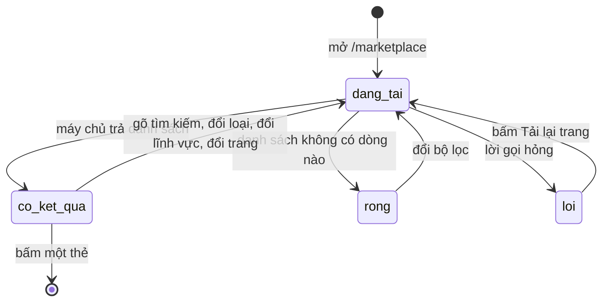
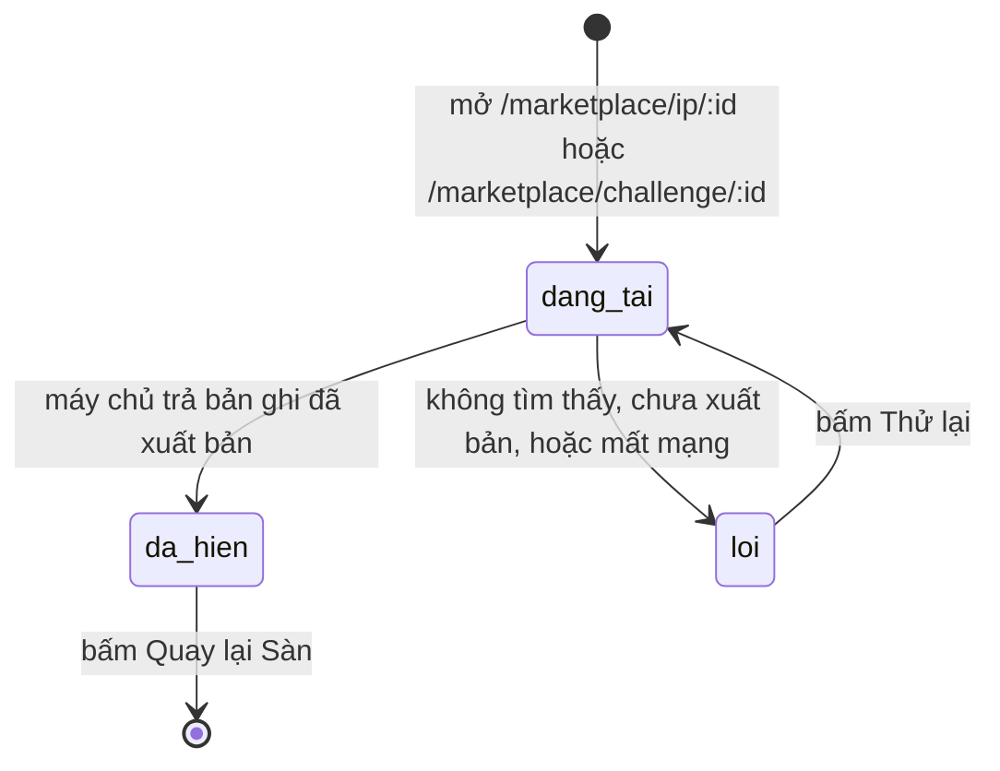

# Chợ giao dịch

## Tóm tắt

Chợ giao dịch là khu vực duy nhất của cổng người dùng nơi người dùng nhìn thấy nội dung của **người khác**. Nó có ba route đang chạy: danh sách `/marketplace`, chi tiết một công nghệ `/marketplace/ip/:id`, chi tiết một đề bài `/marketplace/challenge/:id`. Cả ba đều có mặt trong thanh bên dưới tên **Sàn giao dịch** và ai đăng nhập cũng vào được.

Khu vực này ở giữa hai thái cực. Danh sách và hai trang chi tiết **đọc dữ liệu thật từ máy chủ** — tìm kiếm, lọc theo lĩnh vực, phân trang, nội dung, tệp đính kèm, tất cả đến từ API. Nhưng mọi thứ *làm được* với một bản ghi thì không: quyền sở hữu hiển thị là một chuỗi cố định giống hệt nhau ở mọi thẻ, và luồng "nộp giải pháp" đi kèm nó mang ba công nghệ bịa và một tên doanh nghiệp bịa được chọn bằng một phép so sánh chuỗi.

Chợ giao dịch vì thế là một trang **đọc được, không làm được gì**: xem thì thật, hành động thì chưa tồn tại.

> Ghi chú kỹ thuật: bản rà [`../bmad/BMAD_SOI_Vong1_2026-09-04.md`](../bmad/BMAD_SOI_Vong1_2026-09-04.md) và [`../glossary.md`](../glossary.md) xếp `marketplace` vào nhóm *vỏ* vì phép đo đếm số tệp gọi client HTTP **theo từng thư mục khu vực**. Ba trang đang chạy của `marketplace` gọi API thật, nhưng chúng nhập hàm gọi từ `features/intakes/api/intake.ts` — tệp nằm ở khu vực khác — nên phép đếm theo thư mục không thấy. Xem [Câu hỏi mở](#câu-hỏi-mở-và-kiểm-chứng).

## Trường hợp đơn giản

Người dùng bấm **Sàn giao dịch** ở thanh bên. Trang mở ra một khối trắng ở trên với tiêu đề "Sàn giao dịch Công nghệ Quốc gia", một ô tìm kiếm, một ô chọn **Loại** (*Tất cả* / *Cung* / *Cầu*) và một ô chọn **Lĩnh vực**. Dưới đó là một khối kết quả: dòng "N kết quả phù hợp" rồi một lưới thẻ ba cột.

Mỗi thẻ có một ảnh, các nhãn lĩnh vực, tiêu đề, một dòng đơn vị, một dòng ngày cập nhật, và một nút **Xem chi tiết**.

Họ gõ vào ô tìm kiếm; lưới tải lại và về trang 1. Họ chọn một lĩnh vực; lưới tải lại lần nữa. Họ bấm một thẻ. Nếu đó là một công nghệ, trang chuyển sang `/marketplace/ip/{id}`; nếu là một đề bài, sang `/marketplace/challenge/{id}`.

Trang chi tiết có một nút **Quay lại Sàn** ở đầu, một khối nhãn và tiêu đề, một khối "Thông tin công khai" chứa nội dung, và một khối "Tài liệu đính kèm" tách hình ảnh khỏi tệp. Không có nút nào để làm gì tiếp. Người dùng đọc xong thì bấm quay lại.

## Tương tác, sự kiện theo sự kiện

Hai tương tác chính: duyệt và lọc danh sách, và mở một trang chi tiết.

### Danh sách

### Chi tiết

### Vào màn

**Danh sách.** Trang phát hai lời gọi độc lập ngay khi dựng: một lấy danh sách lĩnh vực để đổ vào ô lọc, một lấy trang kết quả đầu tiên (9 dòng, không lọc, không tìm kiếm).

Hai lời gọi hỏng theo hai kiểu khác nhau. Danh sách lĩnh vực hỏng thì ô lọc rỗng và một dòng chữ hổ phách hiện dưới nó: "Không tải được danh mục lĩnh vực. Bạn vẫn có thể xem dữ liệu hiện có." Danh sách kết quả hỏng thì cả khối kết quả bị thay bằng một hộp đỏ viền đứt, một biểu tượng cảnh báo, dòng "Không tải được dữ liệu marketplace", **thông điệp thật của máy chủ**, và một nút **Tải lại trang** nạp lại toàn bộ trang.

Trong lúc chờ, lưới hiện ba thẻ xám giả lập.

**Chi tiết.** Trang tải đúng một bản ghi theo định danh trong đường dẫn. Trong lúc chờ, ba dải xám nhấp nháy. Nếu hỏng, hiện "Không tải được thông tin. Vui lòng thử lại." và một nút **Thử lại** — nút này cũng chỉ nạp lại toàn bộ trang.

> Ghi chú kỹ thuật: cả hai đường của chợ giao dịch đều **yêu cầu đăng nhập** ở phía máy chủ. Đường chi tiết chỉ trả bản ghi có trạng thái đã xuất bản; mọi trường hợp khác — không tồn tại, đã xoá mềm, còn là bản nháp — đều trả *không tìm thấy*. Giao diện gộp tất cả vào một câu "Không tải được thông tin. Vui lòng thử lại." và mời người dùng thử lại một việc sẽ không bao giờ thành công.

### Rời đi không đổi gì

**Không có gì được ghi lại.** Duyệt chợ, gõ vào ô tìm kiếm, mở một bản ghi rồi đóng tab — không lệnh ghi nào được phát, không bản nháp nào tồn tại, không lượt xem nào được đếm. Mọi lời gọi ở khu vực này là lệnh đọc.

Máy chủ *có* ghi sự kiện kiểm toán cho lượt đọc, nhưng người dùng không thấy điều đó ở đâu và nó không đổi gì trên màn hình.

### Bắt đầu sửa

Không có biểu mẫu nào để sửa. Ba điều khiển duy nhất là ô tìm kiếm, ô chọn loại và ô chọn lĩnh vực; cả ba là bộ lọc, không phải trường dữ liệu. Không có khái niệm *đã bẩn*, không có nút Lưu, không có cảnh báo khi rời trang.

### Trong khi sửa

Đổi bộ lọc là thứ gần nhất với "sửa" ở đây, và nó có một hình dạng đáng nói.

Mỗi lần ô tìm kiếm đổi, **cả ba bộ đếm trang bị đưa về 1**. Mỗi lần ô lĩnh vực đổi, chỉ bộ đếm trang của tab đang mở bị đưa về 1. Lời gọi được phát lại sau **mỗi ký tự** — không có độ trễ gõ, không có huỷ lời gọi cũ ở phía trình duyệt; chỉ có một cờ nội bộ bỏ qua kết quả về muộn. Gõ một từ mười chữ cái là mười lời gọi.

Ba tab *Tất cả* / *Cung* / *Cầu* mỗi tab **giữ số trang và lĩnh vực riêng**. Chuyển tab rồi chuyển lại thì về đúng chỗ cũ. Nhưng ô lĩnh vực của tab *Tất cả* dùng chung thành phần giao diện với tab *Cung*, nên ba trạng thái lọc tồn tại sau ba nhãn không nói rõ điều đó.

URL không đổi trong suốt quá trình. Không ký tự nào của từ khoá, không lĩnh vực nào, không số trang nào đi vào thanh địa chỉ.

### Gửi đi

**Không có gì được gửi đi.** Khu vực này không có một lệnh ghi nào. Không có nút Lưu, không có biểu mẫu, không có lời mời hợp tác nào được tạo từ đây.

Điều đó không hiển nhiên khi đọc mã, vì cơ sở hạ tầng cho một lệnh ghi **đã có sẵn và đang được nạp cùng trang**:

- Hàm bọc route của trang chi tiết đề bài dựng sẵn một lời gọi mở hộp thoại *Nộp Giải pháp cho Doanh nghiệp*, và tên doanh nghiệp truyền vào hộp thoại đó được chọn bằng một phép so sánh: mã đề bài bằng đúng chuỗi `'1'` thì là **"Tập đoàn Dệt May Việt Nam"**, mọi mã khác là **"VinCommerce"**. Đây là tên của hai tổ chức có thật, gán cho những bản ghi thật của người dùng, bằng một điều kiện không liên quan gì tới dữ liệu.
- Hộp thoại đó được gắn ở gốc ứng dụng và **luôn nằm trong gói phát hành**. Nó chứa ba công nghệ bịa cứng — "Hệ thống chẩn đoán bệnh thông minh AI", "Pin năng lượng mặt trời hiệu suất cao", "Máy in 3D kim loại công nghiệp" — được trình bày là *công nghệ của bạn đã niêm yết*.
- Nếu ai đó bấm hết hai bước của hộp thoại, kết quả là một **toast xanh "Đề xuất đã được gửi thành công."** rồi chuyển về `/marketplace`. Không có lời gọi mạng nào. Không có gì được ghi lại.
- Trang chi tiết công nghệ tương tự có một lời gọi mở phòng thương thảo, và một hộp thoại xác nhận tương ứng cũng nằm ở gốc ứng dụng; xác nhận nó cho ra một hộp cảnh báo của trình duyệt rồi điều hướng tới `/deal-room` — [một route không tồn tại](phong-thuong-thao.md).

Lý do duy nhất người dùng chưa gặp những thứ trên là **hai trang chi tiết nhận các lời gọi đó rồi bỏ qua chúng**: chúng khai báo tham số nhưng không lấy ra dùng, nên không có nút nào trên màn hình kích hoạt được. Đó là một sợi chỉ mỏng, không phải một quyết định được viết ra ở đâu.

## Biến thể

| Biến thể | Lúc vào màn | Trong khi sửa |
|---|---|---|
| Vai trò | Khách chưa đăng nhập bị đẩy về `/login`; không có chợ giao dịch công khai. `USER` và `ADMIN` thấy **hoàn toàn giống nhau**: cùng danh sách, cùng chi tiết, cùng không có hành động nào. Chợ không phân biệt bản ghi của chính mình với bản ghi của người khác — công nghệ của chính người đang xem cũng hiện trong lưới như mọi thẻ khác. | Không ảnh hưởng. Không điều khiển nào đổi theo vai trò. |
| Trạng thái bản ghi | Chỉ bản ghi **đã xuất bản** vào chợ. Bản nháp và bản đã xoá mềm không xuất hiện trong danh sách và cho ra lỗi ở trang chi tiết. Mức chất lượng của tài sản công nghệ **không được hiện ở đâu**, nên mọi công nghệ trông như nhau dù tất cả đều đang ở bậc thấp nhất — xem [`../nen-tang/mo-hinh-du-lieu.md`](../nen-tang/mo-hinh-du-lieu.md#mức-chất-lượng-của-tài-sản-công-nghệ). | Một bản ghi bị gỡ xuất bản trong lúc người dùng đang lọc sẽ biến mất ở lần tải lưới tiếp theo, không có thông báo. |
| Cấu hình backend | v1 bị dừng dịch vụ thì cả hai lời gọi hỏng; người dùng thấy hộp đỏ có **thông điệp thật của máy chủ**, tức là câu "API v1 đã ngừng" bằng tiếng Việt. Đây là màn hình duy nhất trong ba tài liệu này hiện đúng nguyên nhân. | Không ảnh hưởng. |
| Phím tắt của biểu mẫu | Không ô nào được focus sẵn. Tab đi từ ô tìm kiếm sang ô loại sang ô lĩnh vực rồi vào lưới thẻ. | **Enter trong ô tìm kiếm không làm gì thêm** — lời gọi đã được phát ở mỗi ký tự rồi. **Escape không làm gì**: không có hộp thoại nào đang mở ở luồng đang chạy. Ctrl/Cmd+Enter không được xử lý riêng. |

Đổi biến thể giữa chừng: chỉ trạng thái bản ghi đổi được trong lúc người dùng đang xem, và nó đổi từ phía chủ sở hữu bản ghi hoặc từ quản trị viên. Không có tín hiệu nào ở màn hình này.

## Huỷ và gián đoạn

| Sự kiện | Trước khi gửi | Trong khi đang gửi |
|---|---|---|
| Bấm Huỷ hoặc nhấn Escape | Không có nút Huỷ ở bất kỳ màn hình nào. Escape không làm gì. | Không có lệnh gửi nào để huỷ. |
| Đi chỗ khác trong app | Đi được ngay, không hỏi. Bộ lọc và số trang mất hẳn. | Không ảnh hưởng — không có gì được ghi lại. |
| Back/Forward của trình duyệt | Từ chi tiết bấm Back về danh sách thì danh sách **tải lại từ đầu**: trang 1, không lọc, không từ khoá. Cái người dùng vừa lọc ra không quay lại được. | Không ảnh hưởng. |
| Tải lại trang, hoặc đóng tab | Bộ lọc mất. Trang chi tiết thì tải lại được vì định danh nằm trong đường dẫn — đây là điểm khác biệt so với bảng quản trị. | Không ảnh hưởng. |
| Mất mạng, hoặc request quá hạn | Danh sách hiện hộp đỏ có thông điệp thật và nút **Tải lại trang**; nút này nạp lại cả ứng dụng chứ không thử lại một lời gọi. Chi tiết hiện câu chung và nút **Thử lại** cũng nạp lại cả trang. | Không ảnh hưởng — không có gì được ghi lại. |
| Phiên hết hạn (401), hoặc v1 bị dừng (410 Gone) | Cổng người dùng không có bộ chặn 401. Lời gọi bị từ chối rơi vào hộp đỏ với thông điệp của máy chủ; người dùng ở lại trang trống. Họ chỉ bị đưa về `/login` khi **rời tab rồi quay lại**, vì lúc đó lớp phiên kiểm lại token và xoá nó nếu hỏng. | Không ảnh hưởng — không có gì được ghi lại. |
| Bản ghi bị đổi bởi tab khác hoặc người khác (409 khi `If-Match` lệch), hoặc bị xoá | Không có tương tác: đây là màn hình chỉ đọc và không gửi `If-Match`. Bản ghi bị đổi trong lúc đang xem thì trang tiếp tục hiện bản cũ cho tới lần tải lại tiếp theo. Bản ghi bị xoá hoặc bị gỡ xuất bản thì lần tải lại tiếp theo cho ra lỗi "Không tải được thông tin." | Không ảnh hưởng — không có gì được ghi lại. |
| Trình duyệt tự điền | Ô tìm kiếm có thể nhận gợi ý tự điền của trình duyệt; giá trị điền vào kích hoạt một lần tải lưới như gõ tay. Không có trường nào mà trình quản lý mật khẩu nhận ra. | Không ảnh hưởng. |

Sau mọi gián đoạn, trạng thái duy nhất người dùng có thể mất là bộ lọc và số trang, và họ **luôn** mất chúng khi rời màn hình.

## Tương tác với hệ thống khác

**Quyền và vai trò.** Hai đường của chợ đều yêu cầu đăng nhập, nhưng không kiểm gì thêm: mọi tài khoản thấy đúng cùng một tập bản ghi đã xuất bản. Không có phân biệt chủ sở hữu, không có lọc theo lĩnh vực phụ trách, không có mức mật nào được áp — nội dung mật đi qua [phòng dữ liệu](../moi/phong-du-lieu-va-cap-quyen.md) và không có mặt ở đây. Xem [`../xuyen-suot/quyen-va-vai-tro.md`](../xuyen-suot/quyen-va-vai-tro.md).

**Kiểm tra dữ liệu và cách hiện lỗi.** Không có luật kiểm tra dữ liệu nào — không có gì để nhập. Lỗi đọc được hiện theo hai kiểu không thống nhất: danh sách hiện thông điệp thật của máy chủ, chi tiết thì thay bằng một câu tiếng Việt chung. Cùng một nguyên nhân cho ra hai trải nghiệm khác nhau ở hai màn hình cạnh nhau.

**Thay đổi chưa lưu.** Không có tương tác. Không có gì để lưu.

**Cập nhật lạc quan và hoàn tác.** Không có tương tác. Lưới chỉ đổi sau khi máy chủ trả lời, và một kết quả về muộn hơn kết quả mới hơn sẽ bị bỏ qua thay vì ghi đè.

**Ngoại tuyến.** Không có bộ nhớ đệm và không có hàng đợi. Mất mạng là trang trống với hộp đỏ. Ảnh của thẻ có ảnh dự phòng dạng dữ liệu nhúng nên vẫn hiện được khi ảnh thật hỏng.

**Thông báo và toast.** Khu vực đang chạy **không dùng toast**. Toast duy nhất liên quan tới chợ giao dịch là câu "Đề xuất đã được gửi thành công." của luồng nộp giải pháp — luồng chưa có nút nào kích hoạt được, và câu đó nói về một việc chưa từng xảy ra.

**Trạng thái lọc/tìm trong URL.** Không có gì trong URL, kể cả tab đang mở. Đây là khu vực chịu thiệt nhiều nhất từ luật chung ở [`../nen-tang/dieu-huong-va-url.md`](../nen-tang/dieu-huong-va-url.md): chợ giao dịch là nơi người ta muốn gửi một kết quả tìm kiếm cho đồng nghiệp, và đó là đúng thứ không làm được. Đường dẫn tới **một** bản ghi thì chia sẻ được.

**Đa ngôn ngữ.** Toàn bộ chữ là tiếng Việt viết thẳng trong mã. Hai nhãn *Cung* và *Cầu* được dịch tại chỗ từ hai giá trị tiếng Anh của máy chủ. Không có bộ chuyển ngôn ngữ.

**Khả năng truy cập.** Chưa rà. Cả thẻ là vùng bấm được nhưng không có vai trò nút và không nhận focus bằng Tab; nút **Xem chi tiết** bên trong thẻ thì nhận được, và bấm nó gọi hai việc cùng lúc. Ba thẻ xám lúc đang tải không thông báo gì cho trình đọc màn hình.

**Dấu vết kiểm toán.** Mọi lượt đọc đều sinh sự kiện kiểm toán ở phía máy chủ. Vì chợ không có lệnh ghi, đây là khu vực mà nhật ký kiểm toán chỉ gồm lượt đọc — và [chưa có màn hình nào](../moi/nhat-ky-kiem-toan.md) để nhìn thấy chúng.

## Trường hợp biên

- **Tên tổ chức có thật được gán cho bản ghi bằng phép so sánh chuỗi.** Mã đề bài bằng `'1'` cho ra "Tập đoàn Dệt May Việt Nam", mọi mã khác cho ra "VinCommerce". Định danh bản ghi là GUID nên nhánh đầu không bao giờ trúng; kết quả thực tế là **mọi đề bài trong hệ thống đều được gọi là VinCommerce** trong luồng nộp giải pháp. Chuỗi này nằm trong gói phát hành. (chưa cấp mã lỗi)
- **Ba công nghệ bịa nằm sẵn ở gốc ứng dụng.** Hộp thoại nộp giải pháp được gắn cùng mọi trang của cổng và mang một danh sách cứng ba công nghệ, giới thiệu chúng là công nghệ của người đang đăng nhập. Nó chưa mở ra được, nhưng nó được tải cùng mọi lần vào ứng dụng. (chưa cấp mã lỗi)
- **Một toast báo thành công cho việc không xảy ra.** Nếu luồng nộp giải pháp được nối lại, câu "Đề xuất đã được gửi thành công." hiện lên mà không có lời gọi mạng nào. (chưa cấp mã lỗi)
- **Mọi thẻ đều ghi cùng một đơn vị.** Dòng đơn vị của thẻ là chuỗi "Đơn vị đăng tải trên DMST", giống hệt nhau ở mọi kết quả. Trang chi tiết cũng vậy: công nghệ ghi "Đơn vị đăng tải trên DMST", đề bài ghi "Nhu cầu doanh nghiệp trên DMST". Máy chủ *có* trả người đăng; giao diện không dùng.
- **Đề bài được vẽ bằng thẻ dành cho công nghệ.** Lưới dùng một loại thẻ duy nhất cho cả hai kiểu, và mọi thẻ ghi "Chi tiết giải pháp" ở chân — kể cả thẻ của một đề bài, vốn là một bài toán chứ không phải một giải pháp. Có một thành phần thẻ riêng cho đề bài trong mã nhưng **không nơi nào nhập nó**.
- **Nhãn "Cập nhật" trên thẻ là ngày tạo.** Thẻ lấy ngày tạo rồi in ra dưới chữ "Cập nhật". Trang chi tiết thì dùng đúng ngày cập nhật. Hai màn hình cạnh nhau nói hai ngày khác nhau về cùng một bản ghi. (chưa cấp mã lỗi)
- **Nút "Thử lại" ở trang chi tiết nạp lại cả trang.** Với nguyên nhân thật sự phổ biến nhất — bản ghi không tồn tại hoặc chưa xuất bản — bấm nó cho ra đúng màn hình lỗi đó, mãi mãi.
- **Ba tab giữ ba bộ lọc riêng nhưng chỉ có một ô hiện.** Người dùng chuyển tab và thấy ô lĩnh vực đổi giá trị mà không hiểu vì sao.
- **Mỗi ký tự gõ là một lời gọi.** Không có độ trễ gõ. Với một danh sách lớn, gõ nhanh sinh nhiều lần tải lưới liên tiếp; kết quả cuối cùng vẫn đúng nhờ cờ bỏ qua kết quả muộn, nhưng lưới nhấp nháy.
- **Ba route "nộp giải pháp", "thương lượng", "đăng ký dùng thử" được ánh xạ nhưng không tồn tại.** Hàm bọc route của danh sách vẫn dịch ba hành động đó thành ba đường dẫn đã bị comment. Hành động duy nhất thẻ thật sự phát ra là *xem chi tiết*, nên chưa ai rơi vào nhánh bắt-tất-cả — nhưng ánh xạ đó vẫn ở đó.

## Câu hỏi mở và kiểm chứng

- Chưa dựng cổng người dùng trong trình duyệt. Mọi mô tả về cái hiện ra trên màn hình đọc từ mã; cần một lượt kiểm bằng tay, đặc biệt là nhịp nhấp nháy của lưới khi gõ tìm kiếm và cách hộp đỏ hiển thị thông điệp của máy chủ.
- **Phân loại `marketplace` là *vỏ* cần được sửa lại.** Ba trang đang chạy đọc dữ liệu thật; cái thiếu là mọi hành động, không phải mọi dữ liệu. [`../glossary.md`](../glossary.md) và [`../bmad/BMAD_SOI_Vong1_2026-09-04.md`](../bmad/BMAD_SOI_Vong1_2026-09-04.md) đang liệt kê nó vào nhóm sáu khu vực vỏ; nên tách nó ra thành một hạng riêng — *có đọc, không có ghi* — trước khi lượt rà nhất quán chạy.
- Chưa xác nhận chuỗi tên doanh nghiệp bịa có thật sự không tới được người dùng hay không. Nó không tới được **chỉ vì** hai trang chi tiết bỏ qua tham số nhận vào; một dòng mã nối lại là đủ để nó hiện lên. Cần một lượt kiểm bằng tay xác nhận rằng không nút nào trên hai trang đó mở được hộp thoại, và một quyết định về việc gỡ hẳn chuỗi đó khỏi mã.
- Chưa xác nhận điều gì hiện ra khi mở `/marketplace/ip/{id}` với định danh của một **đề bài**, và ngược lại. Hai route dùng chung một đường API và không kiểm kiểu, nên một đề bài mở qua đường công nghệ sẽ hiện với nhãn "Cầu" trong khung dành cho công nghệ.
- Chưa rõ vì sao chợ giao dịch **yêu cầu đăng nhập**. Một sàn công nghệ quốc gia thường là bề mặt công khai, và trang giới thiệu đã có một đường công khai cho câu chuyện; cần hỏi lại đây là quyết định hay là mặc định thừa kế từ hệ cũ.
- Chưa đo số lời gọi thật sự phát ra khi gõ một từ dài trên bản chạy, và chưa biết máy chủ có chặn tần suất cho đường đọc này không.

Đối chiếu với SourceCode/dmst-user-main và SourceCode/nacentech, bản chụp ngày 2026-09-04.
