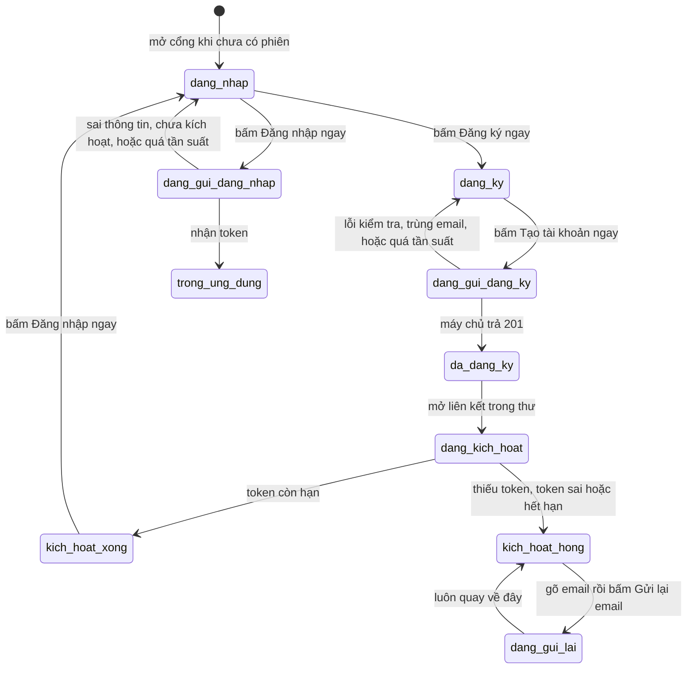
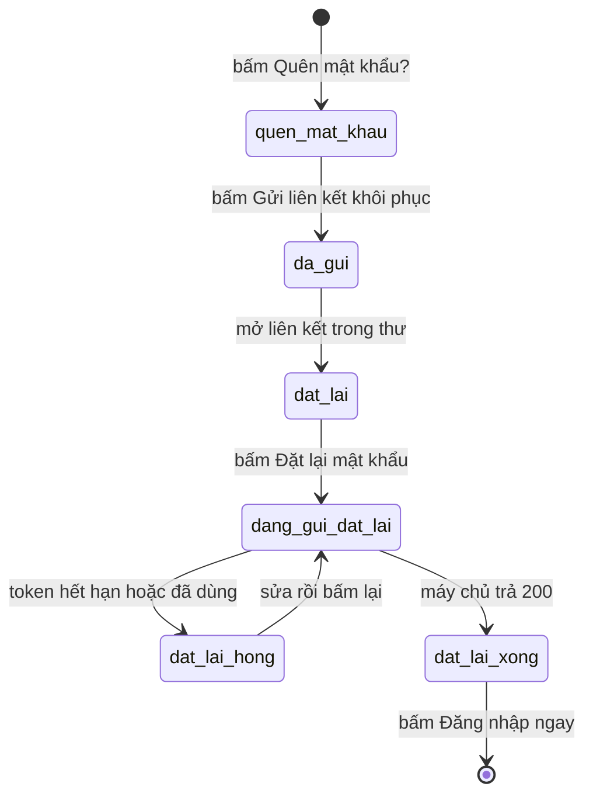

# Đăng ký và kích hoạt

## Tóm tắt

Cổng người dùng có sáu route nằm ngoài lớp bảo vệ, và chúng tạo thành một chuỗi: đăng ký tài khoản, nhận thư, bấm liên kết kích hoạt, rồi đăng nhập. Hai nhánh phụ đi kèm — quên mật khẩu và đặt lại mật khẩu — dùng chung một cơ chế token gửi qua email. Đây là bề mặt duy nhất trong hệ thống mà một người tự tạo được tài khoản cho mình; mọi tài khoản tạo ở đây đều là vai trò `USER` và đều ở trạng thái chưa kích hoạt cho tới khi bấm liên kết.

Khác bảng quản trị, cổng này **dịch thông điệp lỗi của máy chủ sang tiếng Việt** bằng một bảng tra theo mã lỗi viết sẵn trong mã nguồn. Mã nào không có trong bảng thì rơi về câu tiếng Anh gốc, nên giao diện lộ tiếng Anh ở đúng vài chỗ chứ không phải ở khắp nơi.

Danh sách route và cách chúng liên kết với nhau nằm ở [`../nen-tang/dieu-huong-va-url.md`](../nen-tang/dieu-huong-va-url.md). Token, thời hạn và giới hạn tần suất nằm ở [`../nen-tang/xac-thuc-va-vai-tro.md`](../nen-tang/xac-thuc-va-vai-tro.md).

## Trường hợp đơn giản

Một người mở cổng, bị đưa về `/login`, bấm **Đăng ký ngay**. Trang đăng ký là một thẻ trắng trên nền có hiệu ứng sáng, với bảy ô: Họ (bắt buộc), Tên, Email (bắt buộc), Số điện thoại, Tổ chức, Mật khẩu, Xác nhận mật khẩu. Chỉ ba ô có dấu sao đỏ.

Khi họ gõ ký tự đầu tiên vào ô mật khẩu, một khối đo độ mạnh hiện ra: một thanh màu và bốn dòng điều kiện — ít nhất 8 ký tự, chữ hoa, chữ thường, số — mỗi dòng có một vòng tròn tick khi điều kiện đạt.

Bấm **Tạo tài khoản ngay**. Nút đổi chữ thành "Đang khởi tạo…". Nếu thành công, toàn bộ biểu mẫu bị thay bằng một thẻ nói "Đăng ký thành công!" và một liên kết quay lại đăng nhập; đồng thời một toast xanh hiện câu "Đăng ký thành công. Vui lòng kiểm tra email để kích hoạt tài khoản."

Thư đến, họ bấm liên kết, trình duyệt mở `/activate-account?token=…`. Trang hiện vòng xoay "Đang xác thực" một nhịp rồi chuyển sang "Xác thực thành công!" với nút **Đăng nhập ngay**.

Ở `/login`, họ gõ email và mật khẩu, bấm **Đăng nhập ngay**, và hạ cánh ở `/ips` — danh sách công nghệ của chính họ, đang rỗng.

## Tương tác, sự kiện theo sự kiện

### Vào màn

Sáu route này dựng ngay, không chờ gì. Không ô nào được focus sẵn ở bất kỳ trang nào; người dùng phải bấm hoặc nhấn Tab.

`/login` có một ngoại lệ: nếu cookie phiên đã có, trang tự chuyển đi ngay khi dựng xong. Đích đến là vị trí người dùng định tới trước khi bị chặn, nếu có; nếu không thì `/ips`. Đây là chỗ cổng người dùng làm khác bảng quản trị — nó **đọc và dùng** đích đến đã ghi lại.

`/verify-email` và `/activate-account` là **cùng một trang**, và nó gọi máy chủ ngay khi dựng: nó đọc `token` từ chuỗi truy vấn và gửi đi mà không hỏi gì. Không có token thì nó vào thẳng trạng thái lỗi với câu "Liên kết xác thực không hợp lệ. Không tìm thấy mã token." và mở sẵn khối gửi lại thư.

`/reset-password` cũng đọc `token` từ chuỗi truy vấn nhưng **không** gọi máy chủ. Không có token thì nó hiện "Liên kết không hợp lệ" và một liên kết về đăng nhập; có token thì nó vẽ biểu mẫu mà chưa biết token còn hạn hay không. Người dùng chỉ biết token đã hỏng sau khi gõ xong mật khẩu và bấm gửi.

Các ô đều khai báo `autocomplete` đúng loại (`email`, `new-password`, `current-password`, `tel`), nên trình quản lý mật khẩu nhận ra biểu mẫu.

### Rời đi không đổi gì

Không trang nào lưu gì. Không nháp, không lời gọi mạng, không mục lịch sử — trừ `/verify-email`, vốn **đã gọi máy chủ trước khi người dùng làm gì**. Mở liên kết kích hoạt rồi đóng tab ngay vẫn kích hoạt tài khoản: token đã bị tiêu thụ ở phía máy chủ.

### Bắt đầu sửa

Không biểu mẫu nào ở đây có khái niệm *đã bẩn* theo nghĩa của [`../nen-tang/luu-va-phien-ban.md`](../nen-tang/luu-va-phien-ban.md). Không có cảnh báo khi rời trang, không có nút Huỷ.

Ở trang đăng ký, ký tự đầu tiên trong ô mật khẩu làm khối đo độ mạnh xuất hiện. Ở các ô khác, ký tự đầu tiên **xoá thông điệp lỗi của chính ô đó** nếu có — khác bảng quản trị, nơi dải đỏ đứng yên cho tới lần gửi sau.

### Trong khi sửa

Kiểm tra dữ liệu chỉ chạy lúc gửi, trừ thước đo độ mạnh mật khẩu chạy theo từng ký tự.

Thước đo có bốn điều kiện và bốn mức: rỗng, Yếu (đạt 0–1 điều kiện), Trung bình (2–3), Mạnh (4). Biểu mẫu **chỉ chặn mức Yếu**. Hệ quả: `Abc1` đạt ba điều kiện (hoa, thường, số) nên được xếp Trung bình và qua được kiểm tra tại chỗ, rồi bị máy chủ từ chối vì chưa đủ 8 ký tự.

URL không đổi ở bất kỳ trang nào trong nhóm này.

### Gửi đi

Mọi nút gửi đều bị khoá trong lúc chờ và đổi chữ ("Đang khởi tạo…", "Đang xác thực…", "Đang gửi…", "Đang xử lý…"). Không nút nào huỷ được lời gọi đang bay.

**Đăng ký.** Email được cắt khoảng trắng, các trường tuỳ chọn rỗng được bỏ hẳn khỏi thân request. Máy chủ tạo tài khoản ở trạng thái chưa kích hoạt, **huỷ mọi token kích hoạt cũ chưa dùng**, sinh một token mới, và đưa thư vào hàng đợi trong cùng giao dịch với việc ghi tài khoản.

| Máy chủ trả | Người dùng thấy |
|---|---|
| 201 | Thẻ "Đăng ký thành công!" thay biểu mẫu, kèm toast xanh tiếng Việt |
| 409 `EMAIL_ALREADY_IN_USE` | Dòng đỏ **dưới ô email**: "Email đã được sử dụng." Không có toast |
| 400 — mật khẩu chưa đủ 8 ký tự, email sai định dạng, thiếu Họ | Toast đỏ ghép các thông điệp **tiếng Anh** của máy chủ, ngăn cách bằng dấu phẩy |
| 400 `CONFIRM_PASSWORD_MISMATCH` | Toast đỏ "Mật khẩu xác nhận không khớp." |
| 429 `REGISTER_RATE_LIMITED` | Toast đỏ "Bạn thao tác quá nhanh. Vui lòng thử lại sau." |

Đường thất bại giữ nguyên mọi thứ đã gõ, kể cả hai ô mật khẩu.

**Kích hoạt.** Token phải dài ít nhất 16 ký tự, nếu không máy chủ trả 400 trước khi tra cứu. Token đúng và còn hạn thì tài khoản chuyển sang hoạt động, token bị đánh dấu đã dùng, và một thư chào mừng được đưa vào hàng đợi. Token đã dùng một lần **không dùng lại được**: mở lại đúng liên kết đó cho ra màn hình lỗi.

**Gửi lại thư kích hoạt.** Chỉ có ở trạng thái lỗi của trang kích hoạt. Nút bị khoá khi ô email rỗng.

| Máy chủ trả | Người dùng thấy |
|---|---|
| 200, tài khoản chưa kích hoạt — thư mới được gửi | Toast xanh "Đã gửi lại email xác thực." |
| 200, tài khoản **đã kích hoạt rồi** — không gửi gì | Toast xanh "Đã gửi lại email xác thực." |
| 404 `ACCOUNT_NOT_FOUND` | Toast đỏ "Không tìm thấy tài khoản để gửi lại email xác thực." |
| 429 `RESEND_RATE_LIMITED` | Toast đỏ "Bạn thao tác quá nhanh. Vui lòng thử lại sau." |

Hai dòng đầu giống hệt nhau ở phía người dùng dù máy chủ trả hai câu khác nhau: bảng tra tiếng Việt của cổng ưu tiên **mã** hơn **câu**, và cả hai trường hợp đều mang mã `ACTIVATION_EMAIL_RESENT`. Câu tiếng Anh "Account is already active. Please sign in." bị vứt đi trước khi tới màn hình.

**Quên mật khẩu.** Máy chủ luôn trả 200 và không tiết lộ email có tồn tại hay không. Nó huỷ mọi token đặt lại cũ chưa dùng rồi sinh một token mới. Giao diện đi xa hơn máy chủ một bước: nó hiện màn hình "Kiểm tra email của bạn" **kể cả khi lời gọi thất bại** — lỗi chỉ được ghi ra console.

**Đặt lại mật khẩu.** Hai ô, có nút con mắt bật/tắt hiện mật khẩu (dùng chung cho cả hai ô). Kiểm tra tại chỗ: tối thiểu 8 ký tự và hai ô phải khớp. Máy chủ nhận tối đa 128 ký tự. Thành công thì thẻ đổi thành "Mật khẩu đã được đặt lại"; thất bại thì một dải đỏ hiện phía trên biểu mẫu và **hai ô mật khẩu vẫn còn nguyên**.

**Đăng nhập.** Kiểm tra tại chỗ: email đúng định dạng và mật khẩu **tối thiểu 6 ký tự** — một con số không khớp với bất kỳ luật nào ở phía máy chủ hay ở trang đăng ký. Thành công thì token được ghi vào cookie, một toast xanh "Đăng nhập thành công." hiện lên, và trang chuyển đi bằng cách thay chỗ trong lịch sử.

| Máy chủ trả | Người dùng thấy |
|---|---|
| `INVALID_CREDENTIALS` — sai mật khẩu, email không có, **hoặc tài khoản là `ADMIN`** | Toast đỏ "Email hoặc mật khẩu không đúng." |
| `ACCOUNT_NOT_ACTIVATED` | Toast đỏ "Tài khoản chưa được kích hoạt. Vui lòng kiểm tra email xác thực." |
| `LOGIN_RATE_LIMITED` | Toast đỏ mang câu **tiếng Anh** của máy chủ |
| 400 | Toast đỏ ghép các thông điệp tiếng Anh |

Máy chủ kiểm mật khẩu **trước** khi kiểm trạng thái kích hoạt và vai trò. Nghĩa là câu "Tài khoản chưa được kích hoạt" chỉ hiện ra khi mật khẩu đã đúng — nó xác nhận cả sự tồn tại lẫn mật khẩu của tài khoản đó.

> Ghi chú kỹ thuật: sau khi ghi token, giao diện gọi tiếp `GET /api/v1/auth/me` để lấy hồ sơ. Lời gọi này **không chặn** việc chuyển trang: nếu nó hỏng, người dùng vẫn vào được ứng dụng nhưng phần hồ sơ trong bộ nhớ là rỗng. Hệ quả nhìn thấy được: tên trên góc phải hiện "Người dùng", và mọi màn hình so chủ sở hữu bằng định danh người dùng đều kết luận "không phải của bạn" — các tab nội dung mật và tab ghép cặp biến mất khỏi trang chi tiết.

## Biến thể

| Biến thể | Lúc vào màn | Trong khi sửa |
|---|---|---|
| Vai trò | Đã có phiên `USER` hợp lệ thì `/login` tự chuyển sang đích đã ghi hoặc `/ips`. Năm route còn lại **vẫn mở** khi đã đăng nhập: một người đang có phiên vẫn vào được `/register` và tạo tài khoản thứ hai. Khách chưa đăng nhập vào được cả sáu. | Không ảnh hưởng. Vai trò chỉ được xét khi máy chủ trả lời, và tài khoản `ADMIN` nhận `INVALID_CREDENTIALS` ở đường đăng nhập của cổng. |
| Trạng thái bản ghi | Không ảnh hưởng ở lúc vào màn — chưa có bản ghi nào được tải. | Trạng thái tài khoản quyết định kết quả gửi: chưa kích hoạt cho `ACCOUNT_NOT_ACTIVATED`, đã bị vô hiệu hoá cũng cho đúng mã đó, email đã tồn tại cho `EMAIL_ALREADY_IN_USE`. Token kích hoạt và token đặt lại đã dùng thì không dùng lại được. |
| Cấu hình backend | Đường dẫn trong thư kích hoạt được dựng từ cấu hình phía máy chủ, mặc định là `/activate-account` trên `http://localhost:5173`. Cấu hình này lệch với địa chỉ thật thì liên kết trong thư dẫn tới hư không. Nếu chế độ chỉ ghi log của hệ thư đang bật thì **không thư nào được gửi**, và người dùng đứng mãi ở màn "kiểm tra email". | Nếu v1 đã bị dừng dịch vụ, mọi lời gọi trả 410 và rơi vào nhánh lỗi chung — thông điệp không giải thích được gì. |
| Phím tắt của biểu mẫu | Không ô nào được focus sẵn ở bất kỳ trang nào. Tab đi theo thứ tự khai báo. | Enter trong bất kỳ ô nào của một biểu mẫu đều gửi biểu mẫu đó, vì cả năm đều là `<form>` thật — trừ khối **gửi lại thư kích hoạt**, vốn là nút rời không nằm trong form, nên Enter ở đó **không làm gì**. Escape không làm gì ở đâu; không có hộp thoại nào để đóng. Ctrl/Cmd+Enter không được xử lý riêng. |

Đổi biến thể giữa chừng: chỉ trạng thái tài khoản đổi được trong lúc người dùng đang gõ (một quản trị viên vô hiệu hoá tài khoản, hoặc token hết hạn 60 phút). Cả hai chỉ lộ ra ở bước gửi.

## Huỷ và gián đoạn

| Sự kiện | Trước khi gửi | Trong khi đang gửi |
|---|---|---|
| Bấm Huỷ hoặc nhấn Escape | Không trang nào có nút Huỷ. Escape không làm gì. | Không có cách huỷ. Không nút Dừng, Escape không huỷ lời gọi đang bay. |
| Đi chỗ khác trong app | Đi tự do, không cảnh báo, không lưu gì. Các liên kết chéo giữa sáu trang đều là điều hướng thường. | Rời trang bỏ lời gọi ở phía trình duyệt nhưng **không hoàn tác gì ở phía máy chủ**: tài khoản vẫn được tạo, token vẫn bị tiêu thụ, thư vẫn được gửi. |
| Back/Forward của trình duyệt | Quay lại trang trước trong chuỗi. Mọi ô về rỗng — không trang nào khôi phục nội dung đã gõ. | Như trên: lời gọi bị bỏ, tác dụng phía máy chủ vẫn xảy ra. Bấm Forward quay lại một biểu mẫu rỗng, không phải biểu mẫu đang gửi. |
| Tải lại trang, hoặc đóng tab | Mọi ô về rỗng. Không có nháp. Riêng `/verify-email` **gọi lại máy chủ** khi tải lại, và lần này token đã bị tiêu thụ nên nó hiện màn hình lỗi dù lần trước đã thành công. | Lời gọi bị bỏ. Với đăng nhập, token **không** kịp vào cookie nên tải lại xong vẫn ở trang đăng nhập dù máy chủ đã cấp token. Với đăng ký, tài khoản đã được tạo nhưng người dùng không thấy màn hình xác nhận và không biết phải kiểm tra email. |
| Mất mạng, hoặc request quá hạn | Không ảnh hưởng — chưa có lời gọi nào. | Nút mở khoá và một toast đỏ hiện thông điệp mặc định của thư viện HTTP, không phải câu tiếng Việt. Mọi ô giữ nguyên nội dung. Ngoại lệ: **quên mật khẩu vẫn hiện màn hình thành công**, vì nhánh lỗi của nó cũng dẫn tới đó. |
| Phiên hết hạn (401), hoặc v1 bị dừng (410 Gone) | Không áp dụng — sáu trang này không cần phiên. Nếu cookie còn nhưng token đã hết hạn, `/login` vẫn tự chuyển người dùng vào trong ứng dụng, rồi lớp phiên gọi `me`, nhận 401, xoá cookie và đẩy họ trở lại đây. | 401 ở bước lấy hồ sơ sau đăng nhập bị nuốt: người dùng vào được ứng dụng với hồ sơ rỗng. 410 rơi vào nhánh lỗi chung ở mọi trang. |
| Bản ghi bị đổi bởi tab khác hoặc người khác (409 khi `If-Match` lệch), hoặc bị xoá | Không ảnh hưởng — không có bản ghi nào đang được sửa, và không lời gọi nào ở đây gửi số phiên bản. | Không có 409 ở nhóm này. Nhưng có một dạng tranh chấp thật: yêu cầu gửi lại thư kích hoạt hoặc yêu cầu quên mật khẩu lần thứ hai **huỷ token của lần thứ nhất**. Ai bấm hai lần rồi mở thư cũ sẽ gặp màn hình "liên kết đã hết hạn" dù thư mới đến sau. |
| Trình duyệt tự điền, hoặc trình quản lý mật khẩu ghi vào biểu mẫu | Nhận bình thường nhờ các thuộc tính `autocomplete`. Ở trang đăng ký, mật khẩu do trình quản lý sinh ra làm thước đo độ mạnh cập nhật ngay. | Các ô **không bị khoá** trong lúc gửi ở bất kỳ trang nào của nhóm này — chỉ nút bị khoá. Trình quản lý mật khẩu vẫn ghi được vào ô, nhưng thân request đã được đóng gói nên nội dung mới không đi theo. |

Sau bất kỳ gián đoạn nào, người dùng ở lại đúng trang với nội dung đã gõ còn nguyên, trừ khi họ tải lại. Không có trạng thái nửa vời ở phía trình duyệt: hoặc cookie có token, hoặc không.

## Tương tác với hệ thống khác

**Quyền và vai trò.** Sáu trang này là nơi vai trò `USER` được cấp. Máy chủ kiểm vai trò ngay trong lệnh đăng nhập và từ chối mọi vai trò khác bằng đúng câu như khi sai mật khẩu. Không có đường tự đăng ký thành `ADMIN`. Xem [`../nen-tang/xac-thuc-va-vai-tro.md`](../nen-tang/xac-thuc-va-vai-tro.md).

**Kiểm tra dữ liệu và cách hiện lỗi.** Ba tầng luật khác nhau chồng lên nhau: biểu thức email của giao diện lỏng hơn của máy chủ; ngưỡng mật khẩu của giao diện (đạt 2/4 điều kiện) khác của máy chủ (tối thiểu 8 ký tự); và ngưỡng của trang đăng nhập (6 ký tự) không khớp cái nào. Lỗi hiện ở hai chỗ khác nhau: **dưới ô** cho lỗi kiểm tra tại chỗ và cho email trùng, **toast đỏ** cho mọi thứ còn lại.

**Thay đổi chưa lưu.** Không có tương tác. Không biểu mẫu nào ở đây từng ở trạng thái đã bẩn, và không trang nào chặn việc rời đi.

**Cập nhật lạc quan và hoàn tác.** Không có tương tác. Không có gì được hiển thị trước khi máy chủ xác nhận — trừ màn hình thành công của quên mật khẩu, vốn hiện ra kể cả khi máy chủ không xác nhận gì.

**Ngoại tuyến.** Không có hàng đợi. Bấm gửi khi mất mạng là một lời gọi thất bại, không phải một lời gọi được hoãn.

**Thông báo và toast.** Đây là nhóm màn hình dùng toast nhiều nhất trong cổng: thành công, thất bại và trạng thái đều đi qua toast, trừ lỗi từng ô. Toast không sống qua một lần điều hướng, nên toast "Đăng nhập thành công." được phát ngay trước khi trang đổi và có thể không kịp nhìn thấy.

**Trạng thái lọc/tìm trong URL.** Hai trang đọc chuỗi truy vấn: `/verify-email` và `/reset-password` đều đọc tham số `token`. Không trang nào ghi gì vào URL. Đích đến sau đăng nhập **không** nằm trong URL mà nằm trong trạng thái điều hướng của trình duyệt, nên nó mất khi tải lại trang.

**Đa ngôn ngữ.** Chữ trong giao diện là tiếng Việt viết thẳng trong mã. Thông điệp máy chủ được dịch bằng một bảng tra theo mã lỗi; mã nào không có trong bảng thì lộ nguyên câu tiếng Anh. Ba chỗ chắc chắn lộ tiếng Anh: lỗi kiểm tra dữ liệu 400, giới hạn tần suất đăng nhập, và lỗi mạng. Không có bộ chuyển ngôn ngữ.

**Khả năng truy cập.** Ô email và ô mật khẩu ở trang đăng nhập và trang quên mật khẩu có `<label>` gắn bằng `htmlFor`; các ô ở trang đăng ký thì **không** — nhãn là thẻ `<label>` không trỏ tới ô nào, nên trình đọc màn hình không ghép được nhãn với ô. Không trang nào chuyển focus tới thông điệp lỗi sau khi gửi hỏng. Nút hiện/ẩn mật khẩu ở trang đặt lại có `tabIndex={-1}` nên không tới được bằng bàn phím.

**Dấu vết kiểm toán.** Đăng nhập, đổi mật khẩu và đặt lại mật khẩu đều ghi dòng kiểm toán ở phía máy chủ. Địa chỉ IP đi kèm được lấy từ request và cũng là khoá đếm giới hạn tần suất cho đăng ký và gửi lại thư. Người dùng không thấy gì về việc này, vì [chưa có màn hình nhật ký kiểm toán](../moi/nhat-ky-kiem-toan.md).

## Trường hợp biên

- **Không có đường từ "chưa kích hoạt" tới "gửi lại thư".** Người dùng đăng nhập và nhận câu "Tài khoản chưa được kích hoạt" đứng ở trang đăng nhập, nơi **không có liên kết nào** dẫn tới màn hình gửi lại. Khối gửi lại chỉ xuất hiện ở trạng thái lỗi của `/verify-email`, và cách duy nhất tới đó là gõ tay địa chỉ hoặc mở lại một liên kết kích hoạt đã hỏng.
- **Mở lại liên kết kích hoạt đã dùng cho ra màn hình thất bại.** Người dùng bấm hai lần vào thư, hoặc tải lại tab sau khi kích hoạt xong, sẽ thấy "Xác thực thất bại" dù tài khoản của họ đã hoạt động bình thường.
- **Quên mật khẩu không phân biệt thành công với thất bại.** Nhánh lỗi và nhánh thành công dẫn tới cùng một màn hình và cùng một toast xanh. Mất mạng, máy chủ sập hay email không tồn tại đều trông giống nhau.
- **Không có giới hạn tần suất cho quên mật khẩu.** Mã lỗi `FORGOT_PASSWORD_RATE_LIMITED` tồn tại ở cả hai phía và giao diện có nhánh xử lý nó, nhưng đường xử lý ở máy chủ **không gọi bộ đếm nào**. Nhánh đó là mã chết.
- **Trang đăng nhập chấp nhận mật khẩu 6 ký tự, trang đăng ký đòi 8.** Một người đặt được mật khẩu 8 ký tự rồi quên, gõ 6 ký tự để thử, sẽ nhận câu "Email hoặc mật khẩu không đúng" từ máy chủ chứ không phải một gợi ý về độ dài.
- **`Abc1` qua được thước đo độ mạnh.** Ba trong bốn điều kiện đạt cho ra mức Trung bình, và biểu mẫu chỉ chặn mức Yếu. Người dùng bấm gửi rồi mới nhận câu tiếng Anh về độ dài tối thiểu.
- **Đăng ký được khi đang đăng nhập.** Route `/register` không kiểm phiên. Tạo tài khoản thứ hai trong lúc phiên cũ còn nguyên là làm được, và cookie phiên cũ không bị đụng tới.
- **Người dùng đã kích hoạt bấm gửi lại thư thấy "Đã gửi lại email xác thực."** nhưng không thư nào được gửi. Họ chờ một thư không bao giờ đến.
- **Cookie phiên sống 365 ngày.** Xem ghi chú ở [`../nen-tang/xac-thuc-va-vai-tro.md`](../nen-tang/xac-thuc-va-vai-tro.md#nơi-ba-client-cất-token) và [B-09](../bug-triage.md#b-09-cookie-sống-7-ngày-token-sống-24-giờ).

## Câu hỏi mở và kiểm chứng

- **Chưa dựng cổng người dùng trong trình duyệt.** Toàn bộ mô tả về cái hiện ra trên màn hình đọc từ mã. Cần một lượt kiểm bằng tay cho: nhịp chuyển của trang đăng nhập khi đã có phiên, thứ tự và nội dung toast, và hình dạng thông điệp lỗi 400 sau khi được ghép bằng dấu phẩy.
- **Chưa xác nhận thư có gửi được không.** Cấu hình mặc định của hệ thư bật chế độ chỉ ghi log. Nếu môi trường thật cũng vậy thì toàn bộ chuỗi đăng ký → kích hoạt và chuỗi quên → đặt lại mật khẩu đều đứt ở giữa, và không màn hình nào nói ra điều đó.
- **Chưa xác nhận `VITE_API_BASE_URL` ở môi trường thật.** Mã nguồn mặc định về `http://localhost:3001` — cổng của NestJS cũ, không phải của backend .NET. Thiếu biến môi trường thì mọi lời gọi ở nhóm này đi tới một máy chủ không tồn tại. Xem [B-14](../bug-triage.md#b-14-ba-envexample-vẫn-trỏ-cổng-nestjs-cũ).
- **Việc gửi lại thư kích hoạt trả 404 cho email không tồn tại đáng bị coi là lỗi** — nó biến một đường được thiết kế để mơ hồ thành một máy dò email. Điều này **khác** với mô tả hiện có ở [`../nen-tang/xac-thuc-va-vai-tro.md`](../nen-tang/xac-thuc-va-vai-tro.md#những-câu-trả-lời-cố-ý-mơ-hồ), vốn nói đường này luôn trả thành công; hai chỗ cần được rà lại trên bản chạy rồi thống nhất. (chưa cấp mã lỗi)
- **Việc quên mật khẩu hiện màn hình thành công trên nhánh lỗi đáng bị coi là lỗi**, không phải một quyết định chống dò email: máy chủ đã lo phần mơ hồ rồi, còn giao diện đang giấu cả lỗi mạng và lỗi máy chủ thật. (chưa cấp mã lỗi)
- **Việc trang đăng nhập không có liên kết gửi lại thư kích hoạt đáng bị coi là lỗi** — nó tạo ra một ngõ cụt cho đúng nhóm người dùng cần giúp nhất. (chưa cấp mã lỗi)
- Chưa đo được điều gì hiện ra khi `message` từ máy chủ là mảng: cổng ghép mảng bằng dấu phẩy trước khi hiển thị, khác bảng quản trị vốn đưa thẳng mảng vào React. Cần xác nhận câu ghép đọc có xuôi không.
- Chưa rõ trình duyệt xử lý thế nào khi người dùng bấm liên kết kích hoạt trong ứng dụng thư trên điện thoại: đường dẫn dựng từ cấu hình máy chủ, và chưa biết cấu hình đó ở môi trường thật trỏ tới đâu.

Đối chiếu với SourceCode/dmst-user-main và SourceCode/nacentech, bản chụp ngày 2026-09-04.
