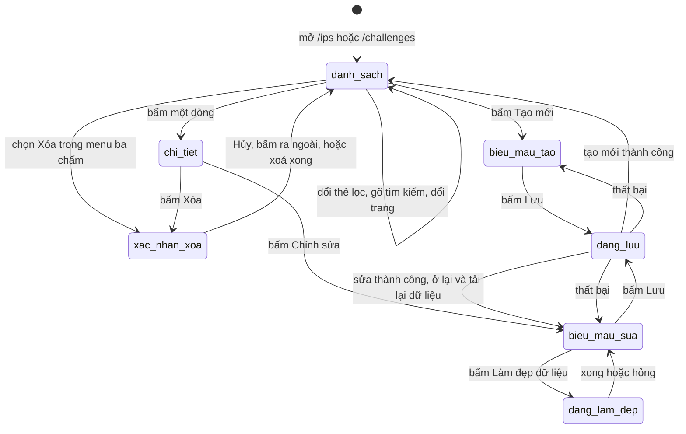

# Đề bài và công nghệ của tôi

## Tóm tắt

Đây là khu vực lõi của cổng người dùng và là nơi duy nhất một người dùng cuối tạo được nội dung có thật trong hệ thống. Nó có hai bản sao gần như giống hệt nhau — `/ips` cho *tài sản công nghệ* (giao diện gọi là **Cung**) và `/challenges` cho *đề bài* (giao diện gọi là **Cầu**) — cùng dựng từ một bộ ba màn hình: danh sách, biểu mẫu tạo/sửa, trang chi tiết. Loại bản ghi được khoá theo route, không chọn được trên biểu mẫu.

Người dùng chỉ thấy và chỉ sửa được bản ghi của chính mình ở khu vực này. Mỗi bản ghi có hai trạng thái, *nháp* và *đã công bố*, và ba lớp nội dung: công khai, bảo mật mức 2, bảo mật mức 3. Xoá là [xoá mềm](../nen-tang/luu-va-phien-ban.md#xoá-là-xoá-mềm) và **không có đường khôi phục**.

Một nút riêng, **Làm đẹp dữ liệu**, gửi nội dung cho mô hình ngôn ngữ viết lại thành một bản nháp tiếp thị. Bản viết lại đi vào một trường riêng; nội dung gốc do người dùng nhập không bao giờ bị thay.

## Trường hợp đơn giản

Sau khi đăng nhập, người dùng hạ cánh ở `/ips`. Trang có một tiêu đề với nút **Tạo Cung mới**, ba thẻ lọc trạng thái (Tất cả / Nháp / Đã công bố) mỗi thẻ kèm một con số, một ô tìm kiếm, và một bảng: STT, ảnh, tiêu đề, loại, trạng thái AI, trạng thái, ngày tạo, và một nút ba chấm.

Bấm **Tạo Cung mới**. Màn hình chia đôi: cột trái hẹp chứa ảnh đại diện, tiêu đề, danh mục và khối hành động; phần còn lại là ba tab nội dung. Họ gõ tiêu đề, gõ nội dung vào trình soạn thảo giàu định dạng ở tab đầu, kéo thả vài tệp, chọn **Công khai** ở khối trạng thái, rồi bấm **Lưu**.

Một toast xanh hiện "Đã công bố thông tin thành công. Đang chờ AI xử lý nội dung." và trang quay về danh sách. Bản ghi mới nằm ở đầu bảng.

Bấm vào dòng đó để mở trang chi tiết: tiêu đề, hai nhãn (Cung, Đã công bố), ngày tạo, hai nút **Chỉnh sửa** và **Xóa**, một khối tab bên trái và một cột thông tin bên phải. Vì họ là chủ sở hữu và bản ghi đã công bố, cột phải có thêm một thẻ **Matching Hub** — xem [`ket-qua-ghep-cap.md`](ket-qua-ghep-cap.md).

## Tương tác, sự kiện theo sự kiện

### Vào màn

**Danh sách** gọi máy chủ ngay khi dựng, xin 10 dòng của trang 1, lọc theo loại của route. Trong lúc chờ, một khung xương xám nhấp nháy thay chỗ bảng. Ba con số trên thẻ lọc đến từ cùng một phản hồi và **được đếm trên toàn bộ tập đã lọc**, không phải trên trang hiện tại.

Danh sách rỗng cho ra một dòng "Chưa có Cung hoặc Cầu nào" — câu này giống nhau ở cả hai route và không nói rõ đang thiếu loại nào.

**Biểu mẫu tạo** không gọi gì để lấy bản ghi, nhưng vẫn tải hai danh mục nhãn trước khi vẽ. Trong lúc đó nó hiện "Đang tải…" chiếm cả màn hình — kể cả khi tạo mới.

**Biểu mẫu sửa** tải bản ghi qua đường công khai `GET /api/v1/intakes/{id}`, không phải đường riêng của chủ sở hữu. Nếu loại của bản ghi không khớp route (mở một đề bài bằng đường dẫn `/ips/…`), nó hiện toast "Dữ liệu không thuộc loại phù hợp với route hiện tại" và đá về danh sách.

**Trang chi tiết** tải cùng một cách. Tab đang mở lấy từ tham số `tab` trong URL nếu hợp lệ, ngược lại là tab công khai.

Không ô nào được focus sẵn ở bất kỳ màn hình nào.

### Rời đi không đổi gì

Danh sách và trang chi tiết không ghi gì. Biểu mẫu cũng không — **trừ một trường hợp**: bấm dấu × trên một tệp đính kèm đã có sẵn gọi thẳng lệnh xoá tới máy chủ ngay lúc bấm, không chờ Lưu. Mở biểu mẫu sửa, gỡ một tệp, rồi bỏ đi mà không lưu: tệp đó đã mất.

Ngoài trường hợp đó, đóng tab giữa chừng không để lại gì. Không có nháp cục bộ ở bất kỳ đâu.

### Bắt đầu sửa

Biểu mẫu không có chỉ báo *đã bẩn*: không dấu chấm trên tiêu đề, không hộp thoại xác nhận khi rời trang, không nút **Bỏ thay đổi**. Nút **Lưu** luôn bấm được, kể cả khi chưa gõ gì.

Chọn một ảnh đại diện làm nó hiện ngay trong khung tròn ở cột trái — đây là bản xem trước cục bộ, chưa có gì được gửi đi. Ảnh bị từ chối tại chỗ nếu không phải hình ảnh hoặc lớn hơn 5 MB.

Kéo tệp vào một trong ba tab thêm một ô vuông vào dải ngang, cũng chỉ ở phía trình duyệt.

### Trong khi sửa

Không có kiểm tra dữ liệu nào chạy trong lúc gõ. Không ô nào chuyển đỏ, không có thông điệp nào hiện ra cho tới khi bấm Lưu.

Ô tìm kiếm trên danh sách có độ trễ **400 mili giây**: gõ xong dừng tay thì mới có một lời gọi. Đổi thẻ lọc, đổi từ khoá hoặc đổi loại đều đưa về trang 1.

**Không có ô chọn lĩnh vực.** Biểu mẫu tải danh sách lĩnh vực và giữ sẵn hàm xử lý, nhưng không vẽ ra ô nào. Kết quả: bản ghi tạo ở cổng luôn có danh sách lĩnh vực rỗng, và bản ghi cũ được sửa thì giữ nguyên lĩnh vực đã có nhờ biểu mẫu gửi lại đúng những gì nó đọc được.

Khối "Nội dung sau xử lý" chỉ xuất hiện khi trạng thái xử lý AI của bản ghi là *hoàn tất*. Ba tab đều dùng chung một cờ này, nên bật hoặc tắt là bật tắt cả ba.

URL không đổi trong lúc sửa. Trang, bộ lọc và từ khoá của danh sách cũng không vào URL — xem [`../nen-tang/dieu-huong-va-url.md`](../nen-tang/dieu-huong-va-url.md).

### Gửi đi

Bấm **Lưu**. Thứ tự xảy ra:

1. Kiểm tra tại chỗ: tiêu đề không được rỗng. Nếu trạng thái đang là *Công khai* thì nội dung công khai cũng không được rỗng. Hỏng thì hiện toast đỏ và **dừng**, không có lời gọi mạng.
2. Nút đổi chữ thành "Đang lưu…" và bị khoá; hai nút chọn trạng thái cũng bị khoá. Các ô nội dung **không** bị khoá.
3. Toàn bộ biểu mẫu được đóng gói thành một request nhiều phần: tiêu đề, nội dung ba lớp, loại, trạng thái, danh mục, ảnh đại diện, và ba nhóm tệp mới.
4. Máy chủ ghi, rồi trả về bản ghi đầy đủ.
5. Tạo mới: toast xanh rồi chuyển về danh sách. Sửa: toast xanh rồi **ở lại**, và biểu mẫu được nạp lại từ phản hồi mới.

Toast luôn kèm câu "Đang chờ AI xử lý nội dung." dù thực tế bước viết lại bằng AI không tự chạy — xem [Trường hợp biên](#trường-hợp-biên).

Mọi thất bại, bất kể lý do, cho ra đúng một toast: "Có lỗi xảy ra, vui lòng thử lại." Câu của máy chủ bị vứt đi.

**Cái gì tạo ra phiên bản mới.** Chỉ tiêu đề hoặc nội dung chính. Đổi lĩnh vực, đổi danh mục, đổi trạng thái công bố, thay ảnh đại diện, thêm tệp — không cái nào tạo phiên bản. Số phiên bản không hiện ở đâu trong giao diện. Xem [`../nen-tang/luu-va-phien-ban.md`](../nen-tang/luu-va-phien-ban.md).

> Ghi chú kỹ thuật: khi nội dung chính đổi **và** biểu mẫu không gửi kèm bản nội dung do AI xử lý, máy chủ **xoá trắng tiêu đề và nội dung do AI viết lại** rồi xếp hàng một việc cắt đoạn và nhúng lại. Biểu mẫu chỉ gửi trường đó khi nó khác rỗng, nên hành vi thực tế là: sửa nội dung của một bản ghi chưa từng làm đẹp thì không mất gì; sửa nội dung của một bản ghi đã làm đẹp thì bản AI được giữ lại y nguyên và **không** được viết lại theo nội dung mới. Sau khi lưu, mã của biểu mẫu còn chủ động chép lại giá trị cũ đè lên phản hồi để phòng trường hợp máy chủ xoá nó.

**Xoá.** Có hai đường: menu ba chấm trên danh sách, và nút đỏ trên trang chi tiết. Cả hai mở cùng một hộp thoại xác nhận. Xoá thành công thì danh sách được tải lại, hoặc trang chi tiết chuyển về danh sách.

Hộp thoại của danh sách nói: "Hành động này không thể hoàn tác và sẽ xóa tất cả các tệp đính kèm liên quan." Nửa đầu đúng; **nửa sau sai** — máy chủ chỉ đánh dấu thời điểm xoá và giữ nguyên mọi tệp.

**Tệp đính kèm.** Máy chủ nhận đúng một danh sách kiểu tệp: ảnh JPEG, PNG, WebP, GIF, BMP, TIFF, ICO; tài liệu PDF, Word, Excel, văn bản thuần; và nén ZIP, RAR. Ngoài ra nó chặn theo phần mở rộng một danh sách tệp thực thi và mã nguồn. Giới hạn kích thước ở [`../nen-tang/hop-dong-api.md`](../nen-tang/hop-dong-api.md#tải-và-tải-lên-tệp).

Ô chọn tệp của biểu mẫu khai báo nhận `image/*,video/*,.pdf,.doc,.docx`, và giao diện có sẵn biểu tượng riêng cho tệp video. Nhưng **video không nằm trong danh sách cho phép của máy chủ**: mọi lần lưu kèm video đều hỏng, và hỏng bằng đúng câu "Có lỗi xảy ra, vui lòng thử lại." không nói lý do.

**Làm đẹp dữ liệu.** Nút chỉ có ở chế độ sửa. Bấm nó:

1. Một toast "Hệ thống đang xử lý, vui lòng chờ giây lát…" hiện lên và ở lại.
2. Máy chủ đọc **bản đã lưu trên máy chủ**, không phải cái đang có trong trình soạn thảo. Bản ghi chưa có nội dung thì bị từ chối.
3. Mô hình trả về một tiêu đề và một phần nội dung viết lại; máy chủ ghi cả hai vào trường AI và đặt trạng thái xử lý là *hoàn tất*.
4. Nếu chủ sở hữu đang bật cờ *tự động ghép cặp*, một vòng tính ứng viên được xếp hàng ngay sau đó.
5. Giao diện dựng lại trình soạn thảo "Nội dung sau xử lý" từ đầu để hiển thị kết quả, và hiện toast "Làm đẹp dữ liệu thành công."

Mô hình hỏng, trả JSON sai, hoặc trả thiếu trường thì máy chủ trả lỗi với câu "AI beautification failed. Intake data was not modified." — dữ liệu không bị đụng tới. Giao diện hiện "Không thể làm đẹp dữ liệu. Vui lòng thử lại." và bỏ câu của máy chủ đi.

Đường AI **nay yêu cầu đăng nhập**; ở hệ cũ ba endpoint AI mở cho tất cả. Đây là một trong bảy thay đổi có chủ đích.

## Biến thể

| Biến thể | Lúc vào màn | Trong khi sửa |
|---|---|---|
| Vai trò | Cả năm route đều nằm dưới lớp bảo vệ: khách chưa đăng nhập bị đưa về `/login`, và vị trí họ định tới được ghi lại để quay về sau khi đăng nhập. Vai trò `ADMIN` không tồn tại ở bề mặt này — quản trị viên có màn hình riêng ở [`../admin/de-bai-va-cong-nghe.md`](../admin/de-bai-va-cong-nghe.md). Danh sách và biểu mẫu sửa chỉ nhận bản ghi của chính người đang đăng nhập; bản ghi của người khác trả "không tìm thấy". | Không ảnh hưởng. Quyền sở hữu được kiểm ở máy chủ tại mỗi lời gọi, không đổi giữa chừng. |
| Trạng thái bản ghi | Thẻ lọc quyết định danh sách hiện gì: tất cả, chỉ nháp, hoặc chỉ đã công bố. Dòng nào có trạng thái xử lý AI là *đang xử lý* thì **bị làm mờ và không bấm được**. Trên trang chi tiết, ba tab nội dung mật và tab ghép cặp chỉ hiện với chủ sở hữu. Bản ghi đã xoá mềm không xuất hiện trong danh sách. | Đổi trạng thái công bố là hai nút ở cột trái và có hiệu lực ngay khi Lưu. Chuyển sang *Công khai* bật thêm một luật kiểm tra: nội dung công khai phải khác rỗng. `QualityLevel` của tài sản công nghệ **không hiện ở đâu** và không đổi được — xem [`../nen-tang/mo-hinh-du-lieu.md`](../nen-tang/mo-hinh-du-lieu.md#mức-chất-lượng-của-tài-sản-công-nghệ). |
| Cấu hình backend | Nhà cung cấp mô hình và địa chỉ kho tệp là cấu hình phía máy chủ. Địa chỉ công khai của tệp sai thì mọi ảnh và mọi liên kết tải về trên trang chi tiết đều hỏng, và không có gì báo trước. | Cờ tự động ghép cặp của chính người dùng (đặt ở [`thong-bao-va-cai-dat.md`](thong-bao-va-cai-dat.md)) quyết định việc lưu và việc làm đẹp có kéo theo một vòng tính ứng viên hay không. Nếu v1 đã bị dừng dịch vụ, mọi lời gọi trả 410 và hiện ra như một lỗi lạ. |
| Phím tắt của biểu mẫu | Không ô nào được focus sẵn. Tab đi qua cột trái trước rồi tới các tab nội dung. | Biểu mẫu tạo/sửa **không phải một `<form>`**: nút Lưu là nút thường, nên **Enter trong ô tiêu đề không lưu** — nó không làm gì. Trong trình soạn thảo giàu định dạng, Enter xuống dòng và `/` mở bảng chèn khối. Escape đóng hộp thoại xác nhận xoá và hộp xem ảnh phóng to; ở chỗ khác nó không làm gì. Ctrl/Cmd+Enter không được xử lý riêng. |

Đổi biến thể giữa chừng: chỉ trạng thái công bố đổi được trong lúc người dùng đang thao tác, và người đổi nó chính là người dùng.

## Huỷ và gián đoạn

| Sự kiện | Trước khi gửi | Trong khi đang gửi |
|---|---|---|
| Bấm Huỷ hoặc nhấn Escape | Biểu mẫu **không có nút Huỷ** — chỉ có "Quay lại" ở góc trên cột trái, và nó rời đi ngay, không hỏi gì, vứt mọi thứ chưa lưu. Trong hộp thoại xác nhận xoá, Huỷ và bấm ra ngoài đều đóng hộp mà không xoá; hộp này **không nghe Escape**. | Không có cách huỷ. Nút đã bị khoá, Escape không huỷ lời gọi đang bay, và không có nút Dừng. |
| Đi chỗ khác trong app | Đi tự do, không cảnh báo. Nội dung chưa lưu mất hết. Trên trang chi tiết, đổi tab không tải lại gì — bốn tab dùng chung dữ liệu đã tải một lần. | Rời trang bỏ lời gọi ở phía trình duyệt nhưng **không hoàn tác ở phía máy chủ**: bản ghi vẫn được tạo hoặc sửa. Người dùng quay lại danh sách và thấy một bản ghi họ tưởng chưa lưu. |
| Back/Forward của trình duyệt | Rời biểu mẫu mà không cảnh báo, mất mọi thay đổi. Back từ trang chi tiết về danh sách **mất bộ lọc, từ khoá và số trang** — danh sách dựng lại ở trang 1 không lọc. | Như trên: lời gọi bị bỏ, tác dụng phía máy chủ vẫn xảy ra. Forward quay lại một biểu mẫu đã dựng lại từ đầu, không phải biểu mẫu đang gửi. |
| Tải lại trang, hoặc đóng tab | Mọi thứ chưa lưu mất. Ảnh xem trước và tệp đang chờ tải lên mất theo. Bản ghi đã lưu thì được tải lại nguyên vẹn từ máy chủ. | Lời gọi bị bỏ ở phía trình duyệt. Máy chủ vẫn hoàn tất nếu request đã tới nơi: kết quả là một bản ghi đã đổi mà người dùng không nhận được xác nhận. Không có khoá chống lặp trên v1, nên bấm Lưu lại sau đó **tạo thêm một bản ghi nữa** ở đường tạo mới. |
| Mất mạng, hoặc request quá hạn | Không ảnh hưởng — biểu mẫu không gọi gì cho tới lúc gửi, trừ hai danh sách nhãn lúc vào màn; hỏng thì toast "Có lỗi khi tải dữ liệu" và ô danh mục rỗng. | Nút mở khoá và toast đỏ "Có lỗi xảy ra, vui lòng thử lại." Mọi thứ đã gõ giữ nguyên, kể cả tệp đang chờ. Bấm Lưu lại là gửi lại toàn bộ, kể cả các tệp. |
| Phiên hết hạn (401), hoặc v1 bị dừng (410 Gone) | Nếu người dùng chuyển sang tab khác rồi quay lại, lớp phiên gọi lại máy chủ; token đã hết hạn thì cookie bị xoá và họ bị đưa về `/login`, mất mọi thứ chưa lưu **không cảnh báo**. Nếu họ ngồi yên một chỗ, không có gì xảy ra. | Cổng người dùng **không có nhánh xử lý 401 nào**: lời gọi thất bại hiện ra đúng như một lỗi thường, với câu "Có lỗi xảy ra, vui lòng thử lại." Không câu nào nói rằng cần đăng nhập lại, và cookie vẫn còn nguyên. 410 cũng vậy. Xem [B-12](../bug-triage.md#b-12-cổng-người-dùng-không-xử-lý-401). |
| Bản ghi bị đổi bởi tab khác hoặc người khác (409 khi `If-Match` lệch), hoặc bị xoá | Danh sách và biểu mẫu chụp dữ liệu một lần lúc vào màn và **không làm mới**. Mở cùng một bản ghi ở hai tab thì tab thứ hai vẫn thấy bản cũ. | Không có kiểm tra phiên bản trên v1: lệnh ghi **không gửi số phiên bản** và không bao giờ nhận 409. Hai tab cùng lưu thì tab lưu sau thắng, và tab lưu trước không biết. Nếu bản ghi đã bị xoá mềm ở nơi khác, lệnh sửa trả "không tìm thấy". Xem [`../xuyen-suot/dong-thoi-va-if-match.md`](../xuyen-suot/dong-thoi-va-if-match.md). |
| Trình duyệt tự điền, hoặc trình quản lý mật khẩu ghi vào biểu mẫu | Không có ô nào ở đây trông giống biểu mẫu đăng nhập, nên trình quản lý mật khẩu không đề nghị điền. Trình duyệt có thể gợi ý cho ô tiêu đề theo lịch sử nhập. | Các ô không bị khoá trong lúc gửi, nhưng thân request đã được đóng gói nên mọi thay đổi sau đó không đi theo. Người dùng gõ tiếp trong lúc chờ sẽ thấy nội dung của mình bị thay bởi phản hồi máy chủ khi biểu mẫu được nạp lại. |

Sau một gián đoạn, biểu mẫu không có cách nào lấy lại cái đã mất. Không nháp cục bộ, không lịch sử hoàn tác, không cảnh báo trước khi rời trang.

## Tương tác với hệ thống khác

**Quyền và vai trò.** Danh sách và mọi lệnh ghi đi qua đường `/my/intakes`, vốn ràng buộc theo người đang đăng nhập ở cả hai tầng: facade so chủ sở hữu rồi trả "không tìm thấy" nếu lệch, và tầng chính sách kiểm lại theo quan hệ *chủ sở hữu*. Nội dung mật chỉ hiện với chủ sở hữu hoặc người có [cấp quyền đọc](../nen-tang/mo-hinh-du-lieu.md#cấp-quyền-đọc), và **chưa có màn hình nào cấp quyền đó**.

**Kiểm tra dữ liệu và cách hiện lỗi.** Kiểm tra tại chỗ có đúng hai luật: tiêu đề khác rỗng, và nội dung khác rỗng khi công bố. Mọi luật khác nằm ở máy chủ — loại tệp, kích thước tệp, giá trị trạng thái, độ dài trường — và **không luật nào trong số đó tới được người dùng dưới dạng một câu giải thích**, vì mọi lỗi lưu đều bị gộp thành một toast duy nhất.

**Thay đổi chưa lưu.** Đây là màn hình có nhiều thứ để mất nhất trong cổng, và là màn hình duy nhất mà một gián đoạn có thể xoá công sức nhiều phút. Không có bảo vệ nào. Xem [`../xuyen-suot/thay-doi-chua-luu.md`](../xuyen-suot/thay-doi-chua-luu.md).

**Cập nhật lạc quan và hoàn tác.** Không có cập nhật lạc quan ở luồng lưu: giao diện chờ máy chủ rồi mới đổi. Có đúng một chỗ đi trước máy chủ — xoá một tệp đính kèm đã có: ô vuông biến mất khỏi dải ngay lập tức, và nếu lệnh hỏng thì nó **không quay lại**, chỉ có một toast đỏ. Không có hoàn tác ở bất kỳ đâu.

**Ngoại tuyến.** Không có hàng đợi và không có nháp cục bộ. Mất mạng giữa chừng là một lời gọi thất bại.

**Thông báo và toast.** Mọi phản hồi đi qua toast: lưu, xoá, xoá tệp, làm đẹp, lỗi tải. Toast làm đẹp là loại "đang chạy" và ở lại cho tới khi có kết quả. Toast không sống qua một lần điều hướng, nên toast "đã lưu" của luồng tạo mới được phát ngay trước khi chuyển trang. Việc nội dung được công bố hoặc được cắt đoạn xong **không sinh thông báo nào** trong khay — bốn loại thông báo hiện có không có loại nào cho việc này; xem [`thong-bao-va-cai-dat.md`](thong-bao-va-cai-dat.md).

**Trạng thái lọc/tìm trong URL.** Bộ lọc trạng thái, từ khoá và số trang **không nằm trong URL**. Trang chi tiết là ngoại lệ duy nhất: nó đọc và giữ tham số `tab`. Định danh bản ghi nằm trong đường dẫn ở cả bốn màn hình, nên các liên kết đó chia sẻ được và tải lại được.

**Đa ngôn ngữ.** Giao diện là tiếng Việt viết thẳng trong mã. Máy chủ trả tiếng Anh cho lỗi kiểm tra dữ liệu, nhưng ở khu vực này người dùng không bao giờ nhìn thấy chúng vì mọi lỗi đều bị thay bằng một câu tiếng Việt chung. Hai từ "Cung" và "Cầu" chỉ tồn tại ở giao diện; dữ liệu và API dùng `ip` và `challenge`.

**Khả năng truy cập.** Bảng danh sách là `<table>` thật có `<thead>`, nhưng cả dòng là vùng bấm được đặt trên `<tr>` chứ không phải một liên kết, nên bàn phím không tới được. Ô "Loại" và ô "Trạng thái" trên biểu mẫu là các nút thường không có `aria-pressed`, nên trình đọc màn hình không biết cái nào đang được chọn. Hộp thoại xác nhận xoá tự dựng, không bẫy focus và không nghe Escape. Ảnh trong danh sách có `alt` là tiêu đề bản ghi.

**Dấu vết kiểm toán.** Mỗi lần tạo, sửa, xoá và mỗi lần tải tệp lên ghi một dòng kiểm toán trong cùng giao dịch với dữ liệu, kèm số phiên bản của bản ghi tại thời điểm đó. Người dùng không thấy gì về việc này.

## Trường hợp biên

- **Trang chi tiết dùng đường công khai và đường đó không kiểm gì.** Lệnh lấy chi tiết mà cả bốn màn hình dùng là `GET /api/v1/intakes/{id}`, một đường **cho phép truy cập ẩn danh**, **không kiểm trạng thái công bố**, và **có lấy cả bản ghi đã xoá mềm**. Ai có định danh đều đọc được phần công khai của một bản nháp hoặc một bản đã xoá của người khác. Phần nội dung mật và tệp mật vẫn được lọc đúng, nhưng tiêu đề, nội dung công khai và tệp công khai thì không. Điều này đáng bị coi là lỗi. (chưa cấp mã lỗi)
- **Hộp thoại xoá nói sai về tệp đính kèm.** Câu "sẽ xóa tất cả các tệp đính kèm liên quan" mô tả hành vi của hệ cũ. Hệ mới giữ lại tệp — đó là một trong bảy thay đổi có chủ đích.
- **Xoá một tệp đính kèm là không hoàn tác được và không hỏi.** Một dấu × nhỏ hiện khi rê chuột, bấm là gọi máy chủ ngay. Không hộp thoại, không hoàn tác, và tệp không quay lại nếu lệnh hỏng.
- **Không chọn được lĩnh vực ở cổng.** Biểu mẫu tải danh sách lĩnh vực rồi không dùng. Vì lĩnh vực là bộ lọc cứng khi tính ứng viên ghép cặp, mọi bản ghi tạo ở cổng đều chạy ghép cặp không có bộ lọc lĩnh vực. Điều này đáng bị coi là lỗi. (chưa cấp mã lỗi)
- **Toast luôn nói "Đang chờ AI xử lý nội dung."** Máy chủ đặt trạng thái xử lý AI thành *hoàn tất* ngay lúc ghi và đi thẳng sang bước cắt đoạn; không có bước viết lại nào chạy tự động. Người dùng chờ một việc không xảy ra, và cột "Trạng thái AI" trên danh sách hầu như luôn báo xong.
- **Ô chọn tệp mời tải video, máy chủ từ chối video.** Giao diện có biểu tượng riêng cho video và cho phép chọn video, nhưng danh sách kiểu tệp được chấp nhận ở máy chủ không có video nào. (chưa cấp mã lỗi)
- **Hai giới hạn kích thước tệp lệch nhau.** Tệp trong khoảng giữa qua được tầng HTTP rồi bị từ chối ở tầng lưu trữ, và thông điệp đến từ chỗ khác — xem [`../nen-tang/hop-dong-api.md`](../nen-tang/hop-dong-api.md#tải-và-tải-lên-tệp). Người dùng chỉ thấy một câu chung.
- **Làm đẹp chạy trên bản đã lưu, không trên cái đang gõ.** Sửa nội dung rồi bấm Làm đẹp mà chưa Lưu thì mô hình đọc nội dung cũ, và kết quả trả về đè lên trình soạn thảo "Nội dung sau xử lý".
- **Không thấy số phiên bản, không xem lại được bản cũ.** Nội dung cũ vẫn còn ở phía máy chủ nhưng không có màn hình nào mở nó ra — xem [`../moi/lich-su-phien-ban.md`](../moi/lich-su-phien-ban.md).
- **Dòng đang xử lý AI không bấm được nhưng menu ba chấm vẫn hoạt động.** Người dùng vẫn sửa và xoá được một bản ghi mà giao diện đang bảo là chưa mở được.
- **Bảng luôn hỏi 10 dòng một trang.** Mặc định của máy chủ là 20 và trần là 100; con số 10 do giao diện tự đặt và không đổi được.
- **Trộn hai loại rồi cắt lại theo trang.** Khi không lọc theo loại, máy chủ lấy một trang từ mỗi nguồn rồi trộn và cắt — nghĩa là tổng số đúng nhưng thứ tự giữa các trang có thể bỏ sót bản ghi. Ở cổng người dùng, cả hai route đều luôn lọc theo một loại nên trường hợp này không xảy ra; nó chỉ xuất hiện ở bảng quản trị.

## Câu hỏi mở và kiểm chứng

- **Chưa dựng cổng người dùng trong trình duyệt.** Mọi mô tả về cái hiện ra trên màn hình đọc từ mã. Cần một lượt kiểm bằng tay cho: hành vi của trình soạn thảo giàu định dạng khi được dựng lại sau khi làm đẹp, cách dải tệp đính kèm cuộn ngang trên màn hình hẹp, và việc bố cục hai cột có dùng được trên máy tính bảng không.
- **Chưa xác nhận đường công khai `GET /api/v1/intakes/{id}` thực sự trả bản nháp và bản đã xoá của người khác.** Đây là điều đọc được từ mã và cần một lượt đo trên bản chạy vì hệ quả của nó lớn.
- **Chưa rõ chính xác trường nào tính là "nội dung" để tạo phiên bản** ngoài tiêu đề và phần nội dung chính. Ba lớp nội dung mật lưu ở phòng dữ liệu và có phiên bản riêng, không tính vào phiên bản của bản ghi.
- **Chưa đo được luồng làm đẹp** vì chưa có nhà cung cấp mô hình cấu hình sẵn. Chưa biết một lần gọi mất bao lâu, và toast "đang xử lý" ở lại bao lâu trước khi người dùng nghĩ là treo.
- Chưa xác nhận việc gửi lại toàn bộ tệp khi bấm Lưu lần thứ hai có tạo ra bản sao của các tệp cũ hay không. Đọc từ mã thì mỗi lần lưu **thêm mới** các tệp trong danh sách chờ; tệp đã tải lên lần trước không nằm trong danh sách đó nên không bị nhân đôi, nhưng cần đo để chắc.
- Chưa rà xem việc đổi trạng thái từ *đã công bố* về *nháp* có gỡ bản ghi khỏi chỉ mục tìm kiếm ngay không, hay chỉ đổi một cờ và chờ việc nền chạy.
- Việc mọi lỗi lưu đều bị thay bằng một câu chung đáng bị coi là lỗi hơn là một quyết định: người dùng tải nhầm một tệp video không có cách nào biết vì sao. (chưa cấp mã lỗi)

Đối chiếu với SourceCode/dmst-user-main và SourceCode/nacentech, bản chụp ngày 2026-09-04.
