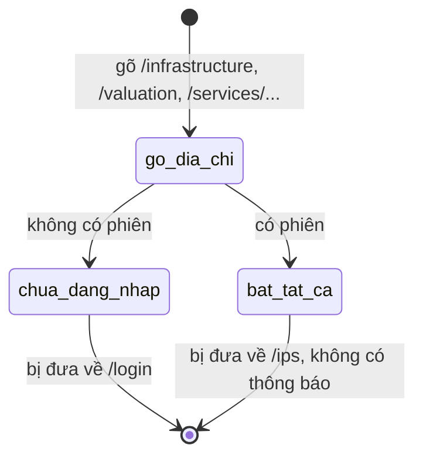
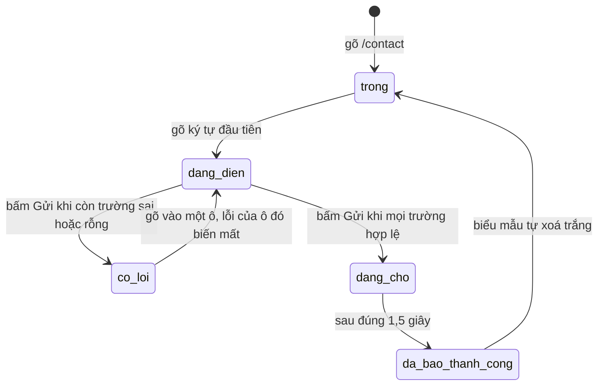

# Bốn khu vực chưa có backend

## Tóm tắt

Bốn khu vực của cổng người dùng — **hạ tầng dùng chung** (`infrastructure`), **dịch vụ chuyên nghiệp** (`services`), **định giá công nghệ** (`valuation`) và **liên hệ** (`contact`) — chia chung đúng một sự thật: **không tệp nào trong chúng gọi API**. Chúng là [vỏ](../glossary.md) theo đúng nghĩa của từ: có trang, có biểu mẫu, có điều hướng, và dữ liệu hiển thị là hằng số trong mã.

Chúng **không đồng hạng nhau** ở một điểm quyết định: ba khu vực đầu đã bị gỡ khỏi định tuyến, khu vực thứ tư thì không.

| Khu vực | Số trang | Thành phần phụ | Route | Vào được không |
|---|---|---|---|---|
| `infrastructure` | 7 | — | 7, **đã comment** | Không |
| `services` | 12 | 10 (9 bước wizard + 1 thẻ gói) | 12, **đã comment** | Không |
| `valuation` | 3 | 3 bước wizard | 4, **đã comment** | Không |
| `contact` | 1 | — | 1, **đang chạy** | Có, nhưng chỉ bằng cách gõ URL |

23 route bị comment ở đây, cộng với [một route của phòng thương thảo](phong-thuong-thao.md), thành 24 route không tồn tại — con số mà [`../nen-tang/dieu-huong-va-url.md`](../nen-tang/dieu-huong-va-url.md#bốn-khu-vực-bị-gỡ-khỏi-định-tuyến) sở hữu.

Khối route bị comment mang chú thích `Hidden until these sections are ready for use`. **Đó là một quyết định có ý thức và đúng**, và với ba khu vực này nó đặc biệt đúng: chúng chứa những biểu mẫu hứa hẹn thuê thiết bị của các viện nghiên cứu có thật, và một luồng thanh toán với ba mức giá bằng tiền thật. Không phát hành cái chưa có backend là việc phải làm, và ở đây nó đã được làm.

Khu vực thứ tư thì bị bỏ sót khỏi cùng quyết định đó, và đó là nội dung nặng nhất của tài liệu này.

## Trường hợp đơn giản

**Với ba khu vực đã ẩn:** không có trường hợp đơn giản. Gõ `/infrastructure`, `/valuation` hay `/services/pricing` vào thanh địa chỉ rơi vào nhánh bắt-tất-cả và bị đưa về `/ips`, không có trang lỗi và không có thông báo. Thanh bên không có mục nào dẫn tới chúng — các dòng tương ứng trong bảng ánh xạ menu cũng đã bị comment cùng một chú thích.

**Với `contact`:** người dùng phải **tự gõ `/contact`**. Không có mục nào ở thanh bên, không có liên kết nào ở chân trang, không có nút nào ở bất kỳ màn hình nào đang chạy dẫn tới đó. Đường dẫn duy nhất trong mã trỏ tới `/contact` nằm trong trang tư vấn tài sản trí tuệ — một trang đã bị comment.

Ai gõ đúng địa chỉ đó sẽ thấy một trang hai cột. Cột trái: bốn khối thông tin liên hệ (địa chỉ **54 Triều Khúc, Thanh Xuân, Hà Nội**, điện thoại **1900 xxxx**, email **support@dmst.gov.vn**, giờ làm việc thứ 2–thứ 6 8:00–17:00), rồi một khung xám ghi "Bản đồ Google Maps" và lặp lại địa chỉ. Cột phải: một biểu mẫu năm trường — họ tên, email, điện thoại, chủ đề, nội dung — và nút **Gửi tin nhắn**.

Họ điền, bấm gửi. Nút đổi chữ thành "Đang gửi…" trong một giây rưỡi. Rồi một dải xanh hiện lên trên biểu mẫu — "✓ Cảm ơn bạn đã liên hệ. Chúng tôi sẽ phản hồi trong vòng 24h." — kèm một toast xanh cùng nội dung. Biểu mẫu tự xoá trắng. Dải xanh biến mất sau năm giây.

**Không có gì được gửi đi. Không có gì được ghi lại.** Không ai đọc tin nhắn đó, và không có bản sao nào của nó ở bất kỳ đâu sau khi biểu mẫu tự xoá.

## Tương tác, sự kiện theo sự kiện

Hai tương tác chính: cố vào một khu vực đã ẩn, và gửi biểu mẫu liên hệ.

### Vào một khu vực đã ẩn

### Biểu mẫu liên hệ

Không trạng thái nào trong sơ đồ thứ hai chạm tới mạng.

### Vào màn

**Ba khu vực đã ẩn:** không vào màn được. Đây là một tuyên bố kiểm được: gõ từng đường trong 23 đường bị comment và xác nhận cả 23 đều dừng ở `/ips`.

**`contact`:** trang dựng ngay, không có lời gọi mạng nào, không có trạng thái đang tải. Năm ô rỗng, ô chủ đề ở giá trị "-- Chọn chủ đề --". Không ô nào được focus sẵn. Không có gì được điền sẵn, kể cả họ tên và email của người đang đăng nhập — thông tin mà cổng đã có trong bộ nhớ.

Ô chủ đề có sáu lựa chọn: *Định giá công nghệ*, *Tư vấn tài sản trí tuệ*, *Đánh giá năng lực đổi mới sáng tạo*, *Chuyên gia vận hành*, *Chuyên gia công nghệ*, *Đào tạo & Hỗ trợ*. **Cả sáu đều trỏ tới những khu vực đã bị ẩn.** Trang liên hệ là mảnh duy nhất còn sót lại trên bề mặt của một cụm chức năng đã được gỡ xuống, và nó vẫn mời người dùng hỏi về từng cái một.

### Rời đi không đổi gì

**Không có gì được ghi lại.** Mở `/contact`, không chạm gì, đóng tab — không lời gọi mạng, không bản nháp, không mục nào ở lưu trữ cục bộ. Với ba khu vực đã ẩn, câu trả lời còn ngắn hơn: không có màn nào để rời.

### Bắt đầu sửa

Không có khái niệm *đã bẩn* ở bất kỳ khu vực nào trong bốn khu vực. Trang liên hệ không cảnh báo khi rời đi, không lưu nháp, không đổi hình dạng ở ký tự đầu tiên. Nút **Gửi tin nhắn** sáng từ đầu và bấm được khi cả năm ô còn rỗng.

### Trong khi sửa

Trang liên hệ là khu vực duy nhất trong bốn khu vực có kiểm tra dữ liệu đáng gọi tên, và nó chạy **lúc bấm gửi**, không phải lúc gõ:

- họ tên không rỗng;
- email không rỗng và khớp một mẫu đơn giản;
- điện thoại không rỗng và gồm **đúng 10 hoặc 11 chữ số** sau khi bỏ khoảng trắng — số có tiền tố quốc gia `+84` bị từ chối, và thông điệp chỉ nói "Số điện thoại không hợp lệ";
- chủ đề đã chọn;
- nội dung không rỗng.

Sau lần bấm gửi đầu tiên, mỗi ô sai mang một viền đỏ và một dòng chữ đỏ dưới nó. Gõ vào một ô **xoá lỗi của riêng ô đó** ngay lập tức, không kiểm lại. Ô email đang báo lỗi định dạng sẽ hết đỏ ở ký tự đầu tiên người dùng gõ thêm, dù giá trị vẫn sai.

Ba khu vực đã ẩn có các luật kiểm tra tương tự ở dạng "đủ trường mới cho đi bước tiếp" trong các wizard ba bước, và một hộp cảnh báo của trình duyệt trong trang đăng ký dùng thử. Không luật nào trong số đó tới được người dùng.

URL không đổi ở bất kỳ thao tác nào của cả bốn khu vực.

### Gửi đi

**Không gửi đi đâu cả. Không có gì được ghi lại.**

Trang liên hệ: sau khi qua kiểm tra, nút bị khoá và đổi chữ, rồi một bộ hẹn giờ **1500 mili giây** chạy. Hết giờ, nút mở khoá, dải xanh hiện, toast xanh hiện, biểu mẫu bị xoá trắng, và một bộ hẹn giờ thứ hai giấu dải xanh sau năm giây. Chú thích trong mã gọi đó là *giả lập lời gọi API*.

Ba khu vực đã ẩn cũng vậy, ở quy mô lớn hơn. Bảng dưới liệt kê những thông điệp thành công đang nằm trong mã và cái thực sự xảy ra sau mỗi cái:

| Khu vực | Người dùng sẽ thấy | Thực tế |
|---|---|---|
| `infrastructure` | "Thiết bị đã được gửi đến Admin để duyệt. Vui lòng chờ phê duyệt." | Không có lời gọi mạng |
| `infrastructure` | "Yêu cầu đã được gửi thành công. Vui lòng chờ phê duyệt." | Không có lời gọi mạng |
| `infrastructure` | "Đã duyệt yêu cầu thuê thiết bị", "Đã gửi mã QR qua email", "Đã tải mã QR xuống máy" | Không có lời gọi mạng, không có mã QR nào tồn tại |
| `services` | "Đã gửi yêu cầu đánh giá thành công. Vui lòng chờ phê duyệt." | Không có lời gọi mạng |
| `services` | "Đã gửi yêu cầu chuyên gia công nghệ", "Đã gửi yêu cầu kết nối chuyên gia", "Đã gửi yêu cầu đào tạo & hỗ trợ" | Không có lời gọi mạng |
| `services` | Thanh toán thành công, chuyển sang trang chúc mừng | Một bộ hẹn giờ 1500 mili giây; **không có giao dịch nào** |
| `valuation` | "Đã gửi yêu cầu định giá", "Đã cập nhật và gửi lại yêu cầu định giá" | Không có lời gọi mạng |
| `valuation`, `services` | "Đã lưu nháp" | Không có lời gọi mạng; bản nháp không tồn tại ở đâu |
| `contact` | "Cảm ơn bạn đã liên hệ. Chúng tôi sẽ phản hồi trong vòng 24h." | Một bộ hẹn giờ 1500 mili giây |

Dòng đáng chú ý nhất là dòng thanh toán. Khu vực `services` có một trang bảng giá với ba gói — **5.000.000₫**, **12.000.000₫**, **25.000.000₫** — và một trang thanh toán nhận họ tên, email, điện thoại, tổ chức và một phương thức trong ba lựa chọn: chuyển khoản ngân hàng, ví điện tử (nêu đích danh Momo, ZaloPay, VNPay), thẻ ngân hàng (nêu đích danh ATM, Visa, Mastercard). Bấm thanh toán chạy một bộ hẹn giờ rồi chuyển sang trang báo thành công. Không có cổng thanh toán, không có hoá đơn, không có bản ghi. Đây là lý do mạnh nhất để khối route đó phải ở nguyên trong dấu comment cho tới khi có backend thật.

## Biến thể

| Biến thể | Lúc vào màn | Trong khi sửa |
|---|---|---|
| Vai trò | Ba khu vực đã ẩn: không ảnh hưởng, mọi vai trò đều bị đưa về `/ips`. `contact`: nằm dưới lớp bảo vệ, nên khách chưa đăng nhập bị đẩy về `/login` — **một trang liên hệ chỉ mở được sau khi đăng nhập**. `USER` và `ADMIN` thấy hoàn toàn giống nhau. | Không ảnh hưởng. Không trường nào và không nút nào đổi theo vai trò. Biểu mẫu liên hệ **không** điền sẵn thông tin của người đang đăng nhập dù cổng đã có nó. |
| Trạng thái bản ghi | Không ảnh hưởng. Không khu vực nào trong bốn khu vực có bản ghi ở máy chủ. Các trạng thái hiện trên màn hình của ba khu vực đã ẩn — *Nháp*, *Chờ tiếp nhận*, *Đang thẩm định*, *Hoàn tất*, *Bị từ chối* — là chuỗi trong mảng dữ liệu bịa và không ánh xạ vào trạng thái nào của backend. | Không ảnh hưởng. |
| Cấu hình backend | Không ảnh hưởng. Bốn khu vực không gọi máy chủ, nên v1 bị dừng dịch vụ, địa chỉ gốc API sai, hay máy chủ tắt hẳn cũng không đổi gì. Trang liên hệ vẫn báo gửi thành công khi backend đã ngừng hoàn toàn. | Không ảnh hưởng. |
| Phím tắt của biểu mẫu | Không ô nào được focus sẵn ở trang liên hệ. Tab đi lần lượt qua năm ô rồi tới nút. | **Enter trong một ô văn bản gửi biểu mẫu** — trang liên hệ dùng thẻ `form` thật với sự kiện gửi, khác hầu hết biểu mẫu khác của cổng. **Escape không làm gì**: không có hộp thoại. Ctrl/Cmd+Enter không được xử lý riêng. |

Đổi biến thể giữa chừng: không biến thể nào ở đây đổi được, vì không có gì ở phía máy chủ để đổi.

## Huỷ và gián đoạn

| Sự kiện | Trước khi gửi | Trong khi đang gửi |
|---|---|---|
| Bấm Huỷ hoặc nhấn Escape | **Trang liên hệ không có nút Huỷ**, chỉ có nút Gửi. Escape không làm gì. Ba khu vực đã ẩn có nút Quay lại trong các wizard; chúng vứt bỏ dữ liệu đã điền mà không hỏi. | Không có cách huỷ. Nút bị khoá và bộ hẹn giờ 1,5 giây chạy tới cùng. Vì không có gì được gửi, huỷ được cũng không thay đổi kết quả. |
| Đi chỗ khác trong app | Đi được ngay, không hỏi. Mọi thứ đã điền mất hẳn. **Không có gì được ghi lại**, nên không có gì để mất ở phía máy chủ. | Rời trang huỷ bộ hẹn giờ. Dải xanh và toast không bao giờ hiện, và biểu mẫu không bao giờ được xoá trắng — nhưng kết quả cuối cùng giống hệt trường hợp chờ đủ 1,5 giây: không có gì tồn tại. |
| Back/Forward của trình duyệt | Về màn trước. Bấm Forward quay lại `/contact` cho ra một biểu mẫu **rỗng** — nội dung không được khôi phục. | Như trên. |
| Tải lại trang, hoặc đóng tab | Mọi thứ đã điền mất. Không có hộp thoại cảnh báo rời trang. | Bộ hẹn giờ chết cùng trang. Không có gì khác đi. |
| Mất mạng, hoặc request quá hạn | **Không ảnh hưởng.** | **Không ảnh hưởng** — và đây là tuyên bố kiểm được rõ nhất của bốn khu vực này: ngắt mạng hoàn toàn rồi gửi biểu mẫu liên hệ vẫn cho ra dải xanh "Cảm ơn bạn đã liên hệ" sau đúng 1,5 giây. Không có request nào để quá hạn. |
| Phiên hết hạn (401), hoặc v1 bị dừng (410 Gone) | **Không ảnh hưởng** ở bản thân màn hình — nó không gọi gì nên không nhận được 401 hay 410. Người dùng vẫn bị đưa về `/login` nếu họ rời tab rồi quay lại, vì lớp phiên kiểm token khi tab hiện lại và xoá token hỏng. Đó là lớp bên ngoài. | Không ảnh hưởng. Biểu mẫu vẫn báo thành công với một phiên đã chết. |
| Bản ghi bị đổi bởi tab khác hoặc người khác (409 khi `If-Match` lệch), hoặc bị xoá | Không có tương tác. Không có bản ghi, không có số phiên bản, không có `If-Match`. Hai tab mở `/contact` là hai biểu mẫu độc lập và không bao giờ thấy nhau. | Không ảnh hưởng. |
| Trình duyệt tự điền | Ba ô đầu của biểu mẫu liên hệ **không khai báo thuộc tính tự điền**, nên trình duyệt phải tự đoán từ tên trường và có thể không đề nghị gì. Giá trị điền vào, nếu có, được nhận bình thường. Không có trường mật khẩu. | Các ô không bị khoá trong lúc chờ, nên tự điền ghi vào được — rồi bị xoá trắng khi bộ hẹn giờ kết thúc. |

Sau mọi gián đoạn, kết quả giống hệt nhau ở cả bốn khu vực: **không có gì ở phía máy chủ khác đi**, và mọi thứ người dùng gõ hoặc mất hoặc bị xoá trắng.

## Tương tác với hệ thống khác

**Quyền và vai trò.** Không có tương tác. Bốn khu vực không gọi API nên không có lượt kiểm quyền nào xảy ra. Lớp bảo vệ đăng nhập vẫn áp cho `/contact` — đó là lớp định tuyến chung, không phải quyết định của khu vực này. Khi các khu vực này có backend, chúng sẽ cần một mô hình quyền mà [`../nen-tang/mo-hinh-du-lieu.md`](../nen-tang/mo-hinh-du-lieu.md#cái-chưa-có-trong-mã) ghi nhận là **chưa được thiết kế**.

**Kiểm tra dữ liệu và cách hiện lỗi.** Chỉ trang liên hệ có luật thật, năm luật, kiểm lúc gửi, hiện gắn vào từng ô. Đây là cách hiện lỗi tốt nhất trong ba tài liệu portal của bộ này — và nó nằm trên biểu mẫu duy nhất không gửi đi đâu. Không luật nào trong bốn khu vực đến từ máy chủ, nên không khu vực nào gặp hình dạng lỗi v1 ở [`../nen-tang/hop-dong-api.md`](../nen-tang/hop-dong-api.md).

**Thay đổi chưa lưu.** Không có tương tác, vì không có gì được lưu. Mọi thứ trên màn hình là thay đổi chưa lưu, vĩnh viễn.

**Cập nhật lạc quan và hoàn tác.** Bốn khu vực này là cập nhật lạc quan thuần tuý: thông điệp thành công hiện ra mà không có ai xác nhận và không bao giờ bị đảo ngược. Không có hoàn tác ở đâu.

**Ngoại tuyến.** Không có hàng đợi và không cần. Cả bốn khu vực chạy đủ khi ngoại tuyến, xem bảng gián đoạn.

**Thông báo và toast.** Ít nhất mười lăm toast xanh nằm trong mã bốn khu vực, tất cả sinh tại chỗ, tất cả nói về việc không xảy ra. Không loại thông báo nào của hệ thống ứng với hạ tầng, dịch vụ, định giá hay liên hệ — bốn loại tồn tại đều thuộc ghép cặp và lời mời hợp tác.

**Trạng thái lọc/tìm trong URL.** Không có gì trong URL. Các danh sách của ba khu vực đã ẩn có tab lọc theo trạng thái và ô tìm kiếm; tất cả là trạng thái trong bộ nhớ, lọc trên mảng dữ liệu bịa.

**Đa ngôn ngữ.** Toàn bộ chữ là tiếng Việt viết thẳng trong mã, kể cả tên gói dịch vụ và tên phương thức thanh toán. Không có bộ chuyển ngôn ngữ ở cổng người dùng.

**Khả năng truy cập.** Chưa rà. Trang liên hệ dùng `label` không gắn `for` vào ô tương ứng, và thông điệp lỗi không được liên kết với ô bằng thuộc tính mô tả, nên trình đọc màn hình không đọc lỗi khi focus vào ô sai. Khung "Bản đồ Google Maps" là một khối trang trí không có nội dung thay thế. Ba khu vực đã ẩn chưa được rà.

**Dấu vết kiểm toán.** Không có gì được ghi, ở đâu cả. Một yêu cầu thuê thiết bị, một đơn định giá, một khoản thanh toán và một tin nhắn hỗ trợ đều là những thứ mà một hệ thống có kiểm toán phải ghi lại; ở đây chúng không để lại dấu vết nào — kể cả một dòng nhật ký ở phía trình duyệt.

## Trường hợp biên

- **`/contact` báo gửi thành công cho một tin nhắn không tồn tại.** Đây là màn hình đang phục vụ người dùng thật, dưới một tên miền của sản phẩm, hứa phản hồi trong 24 giờ cho một việc không ai nhận được. Nó nên bị đưa vào cùng khối comment với ba khu vực kia, hoặc được nối vào một hộp thư thật, trước bất cứ việc nào khác trong tài liệu này. (chưa cấp mã lỗi)
- **`/contact` không có đường vào.** Không mục thanh bên, không liên kết chân trang, không nút nào. Route sống mà không ai tới được — trừ người gõ đúng địa chỉ, hoặc máy tìm kiếm. Hai điều này cộng lại nghĩa là lỗi trên có thể đã tồn tại lâu mà không ai gặp.
- **Sáu chủ đề của biểu mẫu liên hệ đều trỏ tới khu vực đã bị ẩn.** Người dùng chọn "Định giá công nghệ" rồi mô tả nhu cầu của họ, cho một dịch vụ không có mặt trên sản phẩm và một tin nhắn không đi đâu.
- **Hai bề mặt công bố hai bộ thông tin liên hệ khác nhau.** Trang liên hệ của cổng ghi *54 Triều Khúc, Thanh Xuân, Hà Nội*, *1900 xxxx*, *support@dmst.gov.vn*. Chân trang [trang giới thiệu](../landing/trang-chu-va-cau-chuyen.md) ghi *Nhà C6, Phường Thanh Xuân, TP. Hà Nội*, *(024) 39330313*, *nacentech@mst.gov.vn*. Ít nhất một trong hai bộ là sai. (chưa cấp mã lỗi)
- **Số điện thoại `1900 xxxx` là chỗ giữ chỗ đang hiển thị công khai.** Bốn chữ `x` nằm nguyên trong mã và hiện nguyên trên màn hình.
- **Tên các viện và trường có thật trong dữ liệu bịa của `infrastructure`.** Tám thiết bị bịa được gán cho *Phòng Lab ĐHBK Hà Nội*, *Viện Công nghệ sinh học - ĐHQG*, *Viện Hóa học - Viện KHCN*, *Đại học Bách Khoa Hà Nội*, *Viện Cơ khí - ĐHBK TP.HCM*, *Viện Môi trường - Viện KHCN*, *Đại học Khoa học Tự nhiên*, *Viện Dược liệu Quốc gia*. Vì route bị comment và tệp không được nhập ở đâu, khối này **không nằm trong gói phát hành**. Cần gỡ trước khi mở lại route.
- **Ảnh của `infrastructure` tải từ một dịch vụ ảnh bên ngoài.** Tám thiết bị bịa dùng ảnh từ một kho ảnh công cộng trên Internet, tức là trang sẽ gọi ra ngoài miền khi được mở lại.
- **Luồng thanh toán bịa với tiền thật và tên nhà cung cấp thật.** Ba mức giá bảy chữ số và ba nhóm phương thức nêu đích danh Momo, ZaloPay, VNPay, Visa, Mastercard. Không có gì phía sau. Đây là khối phải được rà lại kỹ nhất trước khi bất kỳ ai mở lại một route nào của `services`.
- **Wizard định giá "lưu nháp" rồi đóng luôn màn hình.** Bấm lưu nháp hiện toast rồi gọi hàm hoàn tất, tức là rời khỏi wizard. Người dùng mất mọi thứ vừa điền ngay sau khi được báo là đã lưu.
- **`valuation` có bốn route bị comment cho ba trang.** Route sửa và route tạo dùng chung một trang, và route sửa truyền vào dữ liệu rỗng — nên "sửa" một bản định giá sẽ mở một wizard trắng.
- **Gõ một route đã comment không cho trang lỗi.** Cả 23 đường đều dừng ở `/ips`. Xem [`../nen-tang/dieu-huong-va-url.md`](../nen-tang/dieu-huong-va-url.md).

## Câu hỏi mở và kiểm chứng

- Chưa dựng cổng người dùng trong trình duyệt. Mọi mô tả đọc từ mã. Ba tuyên bố kiểm được ngay khi có bản chạy: cả 23 đường đã comment đều dừng ở `/ips`; `/contact` mở được và không có đường vào nào từ giao diện; gửi biểu mẫu liên hệ khi đã ngắt mạng vẫn cho ra dải xanh sau 1,5 giây.
- **Việc `/contact` còn chạy đáng bị coi là lỗi**, không phải một quyết định. Nó rơi ra ngoài đúng cái ranh giới mà khối comment đã vẽ, và hậu quả của nó — một lời hứa phản hồi cho một tin nhắn bị vứt — nặng hơn hậu quả của mọi khu vực đã ẩn cộng lại, vì những khu vực kia không ai vào được. Cần nộp vào [`../bug-triage.md`](../bug-triage.md). (chưa cấp mã lỗi)
- **Quyết định sản phẩm còn bỏ ngỏ: bốn khu vực này có thuộc bản phát hành nào không.** [`../nen-tang/mo-hinh-du-lieu.md`](../nen-tang/mo-hinh-du-lieu.md#cái-chưa-có-trong-mã) ghi rằng dịch vụ chuyên nghiệp, tài chính, chương trình, hoá đơn và mạng lưới chuyên gia **nằm ngoài phạm vi bản này một cách có chủ đích**. Nếu điều đó vẫn đúng, ba khu vực đã ẩn không phải hàng tồn chờ nối API — chúng là thiết kế của một sản phẩm khác, và câu hỏi là giữ chúng trong kho mã hay gỡ đi. Không tự chọn hộ ở đây.
- Chưa rõ ai sở hữu thông tin liên hệ đúng. Cần một nguồn duy nhất cho địa chỉ, điện thoại và email, rồi cả hai bề mặt đọc từ đó.
- Chưa rõ luật kiểm tra số điện thoại 10–11 chữ số có cố ý loại số có tiền tố quốc gia không, hay chỉ là một mẫu chép nhanh.
- Chưa rà xem trang liên hệ có bị máy tìm kiếm lập chỉ mục không. Vì nó nằm dưới lớp bảo vệ đăng nhập ở phía trình duyệt chứ không ở phía máy chủ, câu trả lời phụ thuộc vào cách trang được phục vụ.
- Chưa đếm chính xác số thông điệp thành công giả trong ba khu vực đã ẩn; con số "ít nhất mười lăm" đến từ một lượt tìm theo mẫu, không phải một lượt đọc hết.

Đối chiếu với SourceCode/dmst-user-main và SourceCode/nacentech, bản chụp ngày 2026-09-04.
