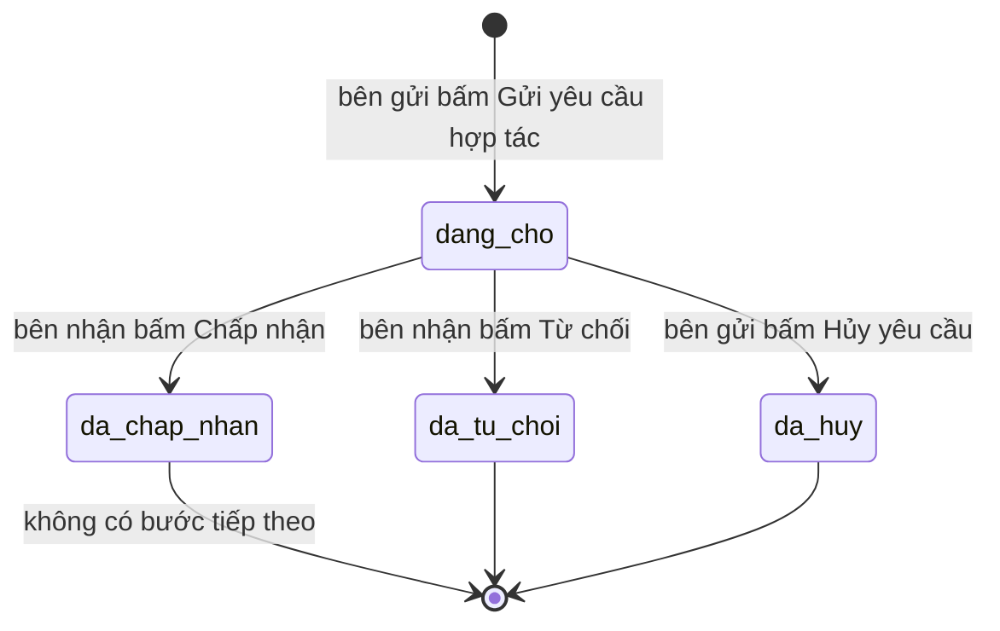
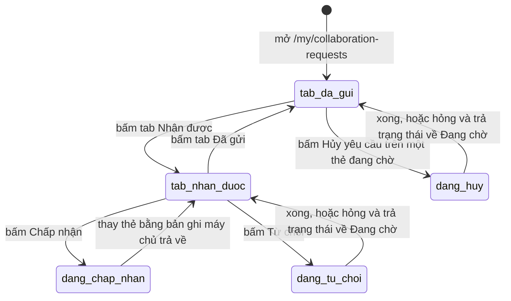

# Lời mời hợp tác

## Tóm tắt

Lời mời hợp tác là bước đầu tiên hai bên nói chuyện với nhau trong hệ thống. Một người chọn một bản ghi của mình, chọn một bản ghi **khác loại** của người khác, và gửi một lời mời. Bên nhận chấp nhận hoặc từ chối; bên gửi huỷ được chừng nào lời mời còn đang chờ.

Chỉ có **một chỗ gửi** lời mời trong cổng: nút trên thẻ ứng viên ở tab ghép cặp — xem [`ket-qua-ghep-cap.md`](ket-qua-ghep-cap.md). Và **một chỗ quản lý**: trang `/my/collaboration-requests` với hai tab, *Đã gửi* và *Nhận được*.

Điều quan trọng nhất về lời mời trong bản này: **chấp nhận không làm gì ngoài việc đổi trạng thái**. Nó không tự từ chối các lời mời đang chờ khác, và nó không tạo hồ sơ vụ việc. Cả hai đều là thay đổi có chủ đích so với hệ cũ. Sau khi hai bên đồng ý, hệ thống không đưa họ đi đâu tiếp — không có phòng thương thảo, không có hồ sơ, không có bước sau.

## Trường hợp đơn giản

Người dùng mở một tài sản công nghệ đã công bố của mình, sang tab **Nhu cầu phù hợp**, thấy ba đề bài. Ở thẻ đầu tiên có nút viền xanh **Gửi yêu cầu hợp tác**. Họ bấm.

Nút đổi sang "Đang gửi…", rồi biến thành một huy hiệu xanh lá "Đã gửi yêu cầu". Một toast xanh hiện "Đã gửi yêu cầu hợp tác thành công". Nút trên hai thẻ còn lại **mờ đi và không bấm được nữa**.

Bên kia, chủ đề bài nhận một thông báo trong khay. Bấm vào nó, họ tới `/my/collaboration-requests?tab=received`. Ở đó có một thẻ: tên bản ghi đề xuất, một mũi tên, tên bản ghi mục tiêu, một nhãn vàng "Đang chờ", thời gian tương đối, và hai nút **Từ chối** và **Chấp nhận**.

Họ bấm **Chấp nhận**. Nhãn đổi sang xanh lá "Đã chấp nhận", hai nút biến mất, và một khối thông tin về hai bản ghi đã ghép hiện ra bên dưới thẻ. Người gửi nhận một thông báo *lời mời được chấp nhận* và thấy trạng thái đổi khi họ mở tab *Đã gửi*.

Đó là hết. Không có bước tiếp theo trong sản phẩm.

## Tương tác, sự kiện theo sự kiện

### Vào màn

Trang `/my/collaboration-requests` đọc tham số `tab` từ URL; giá trị hợp lệ là `sent` và `received`, mặc định là `sent`. Tab đang mở **được ghi ngược vào URL** bằng cách thay chỗ trong lịch sử — nên sao chép địa chỉ ở tab *Nhận được* cho ra một liên kết mở đúng tab đó, nhưng Back không quay về tab trước.

Mỗi tab tự tải danh sách của mình khi được dựng, xin 20 dòng của trang 1. Trong lúc chờ, ba khối xám nhấp nháy. Danh sách rỗng cho ra một biểu tượng và hai dòng chữ khác nhau cho hai tab.

Hai tab **không tải trước lẫn nhau**: chuyển sang tab kia là một lần tải mới.

Máy chủ trả về, kèm mỗi lời mời, thông tin của hai bản ghi liên quan và thông tin của **một bên** — tab *Đã gửi* kèm bên nhận, tab *Nhận được* kèm bên gửi. Giao diện không hiển thị thông tin người nào cả: thẻ chỉ có tên hai bản ghi.

Không ô nào được focus sẵn.

### Rời đi không đổi gì

Không có gì được ghi lại. Đổi tab thay chỗ mục hiện tại trong lịch sử nên không tích luỹ mục thừa.

### Bắt đầu sửa

Không có biểu mẫu. Mọi thao tác là một nút bấm dẫn thẳng tới một lệnh gửi; không có trạng thái trung gian nào để bỏ dở.

**Không có ô nhập lời nhắn ở bất kỳ đâu.** Máy chủ nhận một trường `message` tối đa 1000 ký tự và lưu nó, các danh sách đều trả nó về, nhưng không màn hình nào trong cổng cho nhập và không màn hình nào hiển thị.

### Trong khi sửa

Không áp dụng. Không có kiểm tra dữ liệu phía trình duyệt cho luồng này.

Ở tab ghép cặp có một luật do giao diện tự đặt: khi trang chi tiết dựng, nó xin 50 lời mời đã gửi gần nhất và tìm xem bản ghi đang xem đã có lời mời nào **đang chờ** chưa. Nếu có, nó khoá nút trên mọi thẻ ứng viên và đánh dấu đúng thẻ ứng viên đã được mời là "Đã gửi yêu cầu".

Luật này chặt hơn luật của máy chủ. Máy chủ chỉ cấm **trùng cặp**: cùng hai bản ghi, theo cả hai chiều. Nó cho phép một bản ghi có nhiều lời mời đang chờ tới nhiều đối tác khác nhau. Giao diện thì cho phép đúng một.

### Gửi đi

**Gửi lời mời.** Thân request chỉ có hai định danh: bản ghi nguồn và bản ghi đích. Máy chủ kiểm theo thứ tự:

| Điều kiện | Kết quả khi hỏng |
|---|---|
| Người gửi phải **sở hữu bản ghi nguồn** | 403 |
| Bản ghi đích phải có chủ | 422 |
| Hai bản ghi không được cùng một chủ — **không tự mời chính mình** | 400 |
| Bản ghi nguồn phải **đã công bố** | 400 |
| Bản ghi đích phải **đã công bố** | 400 |
| Hai bản ghi phải **khác loại** — đề bài với công nghệ, không cùng loại | 400 |
| Không được **trùng một lời mời đang chờ**, xét cả hai chiều | 400 |

Không tìm thấy một trong hai bản ghi thì 404.

Thành công thì máy chủ trả **201** và phát một sự kiện; sự kiện đó tạo một thông báo *nhận lời mời* cho bên nhận và đưa một thư vào hàng đợi.

**Chấp nhận.** Chỉ bên nhận làm được; bên khác nhận 403 với câu "You can only accept collaboration requests sent to you". Trạng thái chuyển sang *đã chấp nhận*, một thông báo *lời mời được chấp nhận* và một thư đi tới **bên gửi**. Phản hồi là **201**, không phải 200 — một nét kế thừa của hệ cũ.

Đây là chỗ hành vi khác hệ cũ rõ nhất: chấp nhận **không** tự đặt các lời mời đang chờ khác thành đã từ chối, và **không** tạo hồ sơ vụ việc.

**Từ chối.** Cùng ràng buộc như chấp nhận. Trạng thái nội bộ là `DECLINED` nhưng facade đổi tên thành `rejected` cho khớp hệ cũ, nên giao diện hiện "Đã từ chối".

**Huỷ.** Chỉ bên gửi làm được. Trạng thái chuyển sang *đã huỷ*. Phản hồi là 200 với một câu tiếng Anh mà giao diện không đọc.

**Cách giao diện xử lý ba nút.** Ba nút hành xử khác nhau:

- **Từ chối** và **Huỷ** đổi trạng thái trên màn hình **ngay lập tức**, rồi gọi máy chủ. Hỏng thì trạng thái được trả về *Đang chờ* và một toast đỏ hiện lên.
- **Chấp nhận** chờ máy chủ rồi **thay hẳn cả thẻ** bằng bản ghi máy chủ trả về. Đây là lý do khối thông tin hai bản ghi đã ghép chỉ hiện ra sau khi chấp nhận: nó cần dữ liệu quan hệ mà chỉ phản hồi của lệnh chấp nhận mới có đủ.

Ở cả ba, nút đang chạy đổi thành một vòng xoay và **cả hai nút trên thẻ đó** bị khoá; các thẻ khác vẫn bấm được.

**Danh sách không được tải lại sau mỗi hành động.** Trạng thái trên màn hình được vá tại chỗ. Người dùng thấy đúng kết quả của việc mình vừa làm nhưng không thấy thay đổi nào khác đã xảy ra trong lúc đó.

> Ghi chú kỹ thuật: bộ chặn phản hồi HTTP của cổng chuyển mọi lỗi thành một `Error` chỉ mang thông điệp, **mã trạng thái bị vứt đi**. Ở tab ghép cặp, mã xử lý lỗi gửi lời mời có ba nhánh riêng cho 400, 403 và 404 — cả ba **không bao giờ chạy**, vì mã trạng thái không còn tồn tại khi lỗi tới nơi. Mọi thất bại, kể cả trùng lời mời, đều rơi vào nhánh cuối: "Không thể gửi yêu cầu hợp tác. Vui lòng thử lại." Bảy luật ở bảng trên vì thế không có luật nào nói được lý do cho người dùng.

## Biến thể

| Biến thể | Lúc vào màn | Trong khi sửa |
|---|---|---|
| Vai trò | Route nằm dưới lớp bảo vệ; khách chưa đăng nhập bị đưa về `/login`. Hai tab luôn chỉ hiện lời mời mà người đang đăng nhập là một bên: tab *Đã gửi* lọc theo bên gửi, tab *Nhận được* lọc theo bên nhận. Vai trò `ADMIN` có một đường riêng liệt kê **mọi** lời mời của hệ thống, nhưng nó không thuộc cổng này. | Ba nút hành động được gác hai lớp: facade so định danh rồi trả 403, và tầng chính sách kiểm lại theo quan hệ *chủ sở hữu*. Vai trò không đổi giữa chừng. |
| Trạng thái bản ghi | Nút hành động chỉ hiện khi lời mời đang ở trạng thái **đang chờ**: tab *Đã gửi* có nút Hủy, tab *Nhận được* có Từ chối và Chấp nhận. Ba trạng thái còn lại chỉ có nhãn màu. Riêng lời mời **đã bị từ chối** ở tab *Đã gửi* có thêm một dòng gợi ý bảo quay lại trang bản ghi để chọn đối tác khác. | Nút gửi ở tab ghép cặp chỉ hiện khi bản ghi nguồn **đã công bố**; giao diện tự che luật đó. Bản ghi đích đã công bố hay chưa thì giao diện không biết và không che được — kết quả là một toast lỗi chung. Bản ghi bị xoá mềm sau khi lời mời được tạo vẫn hiện tên trong thẻ. |
| Cấu hình backend | Thư báo lời mời chỉ được gửi thật khi hệ thư không ở chế độ chỉ ghi log. Đường dẫn trong thư dựng từ cấu hình phía máy chủ. Hai đường danh sách này nâng trần số dòng mỗi trang lên **1000** thay vì trần chung 100 của [`../nen-tang/hop-dong-api.md`](../nen-tang/hop-dong-api.md#danh-sách-và-phân-trang); giao diện luôn xin 20 nên không chạm tới. | Nếu v1 đã bị dừng dịch vụ, mọi lời gọi trả 410 và hiện ra như một lỗi lạ. |
| Phím tắt của biểu mẫu | Không ô nhập nào, không gì được focus sẵn. Tab đi qua hai nút chuyển tab rồi tới các nút hành động theo thứ tự thẻ. | Không có hộp thoại nào ở màn hình này, nên **Escape không làm gì** — kể cả trước một hành động không hoàn tác được như Huỷ. Enter kích hoạt nút đang được focus, đúng như hành vi mặc định của nút. Ctrl/Cmd+Enter không được xử lý riêng. |

Đổi biến thể giữa chừng: trạng thái của một lời mời đổi được bởi bên kia trong lúc người dùng đang nhìn màn hình, và màn hình không phản ánh điều đó cho tới lần tải lại.

## Huỷ và gián đoạn

| Sự kiện | Trước khi gửi | Trong khi đang gửi |
|---|---|---|
| Bấm Huỷ hoặc nhấn Escape | **Không có bước xác nhận nào** cho cả ba hành động. Bấm Hủy yêu cầu, Từ chối hay Chấp nhận là gửi ngay. Escape không làm gì. | Không có cách huỷ. Nút đã khoá, Escape không dừng lời gọi đang bay, không có nút Dừng. |
| Đi chỗ khác trong app | Đi tự do, không mất gì — màn hình này chỉ đọc cho tới khi bấm nút. | Rời trang bỏ lời gọi ở phía trình duyệt nhưng **không hoàn tác ở phía máy chủ**: lời mời vẫn được tạo, chấp nhận hay huỷ, và thông báo cùng thư vẫn được gửi cho bên kia. |
| Back/Forward của trình duyệt | Vì đổi tab thay chỗ trong lịch sử, Back **không** quay về tab trước mà rời hẳn trang. Quay lại thì danh sách được tải mới hoàn toàn. | Như trên: lời gọi bị bỏ, tác dụng phía máy chủ vẫn xảy ra. |
| Tải lại trang, hoặc đóng tab | Danh sách được tải mới, về trang 1 của tab trong URL. Không mất gì. | Lời gọi bị bỏ. Không có khoá chống lặp trên v1, nên bấm gửi lần nữa sau đó **thử tạo một lời mời thứ hai** — và bị chặn bởi chính luật cấm trùng lời mời đang chờ, với một toast không nói được lý do. |
| Mất mạng, hoặc request quá hạn | Không ảnh hưởng — không có lời gọi nào cho tới khi bấm nút. Nếu lần tải danh sách lúc vào màn hỏng, một toast đỏ hiện lên và danh sách rỗng, trông giống hệt trường hợp thật sự không có lời mời nào. | Với Từ chối và Huỷ, trạng thái đã đổi trên màn hình được **trả về Đang chờ** và một toast đỏ hiện lên. Với Chấp nhận, thẻ giữ nguyên trạng thái cũ và một toast đỏ hiện lên. Với lệnh gửi ở tab ghép cặp, nút trở lại bình thường. |
| Phiên hết hạn (401), hoặc v1 bị dừng (410 Gone) | Nếu người dùng chuyển sang tab trình duyệt khác rồi quay lại, lớp phiên gọi lại máy chủ, nhận 401, xoá cookie và đưa họ về `/login`. Nếu họ ngồi yên, không có gì xảy ra và danh sách vẫn hiện dữ liệu cũ. | Cổng **không có nhánh xử lý 401 nào**: hết hạn hiện ra đúng như một lỗi thường, và với Từ chối hay Huỷ thì trạng thái được trả về Đang chờ — trông như thao tác bị từ chối chứ không phải phiên đã hết. 410 cũng vậy. Xem [B-12](../bug-triage.md#b-12-cổng-người-dùng-không-xử-lý-401). |
| Bản ghi bị đổi bởi tab khác hoặc người khác (409 khi `If-Match` lệch), hoặc bị xoá | Danh sách được chụp một lần và **không tự làm mới**. Bên kia chấp nhận hoặc từ chối trong lúc này thì màn hình vẫn hiện "Đang chờ" và vẫn hiện nút hành động. | Không có kiểm tra phiên bản ở đường này và không bao giờ có 409. Một lời mời đã bị bên kia trả lời trước đó thì lệnh của mình **vẫn chạy** và ghi đè trạng thái: máy chủ không kiểm trạng thái hiện tại trước khi đổi. Người thao tác sau thắng. Xem [`../xuyen-suot/dong-thoi-va-if-match.md`](../xuyen-suot/dong-thoi-va-if-match.md). |
| Trình duyệt tự điền, hoặc trình quản lý mật khẩu ghi vào biểu mẫu | Không có ô nhập nào để điền. Không ảnh hưởng. | Không ảnh hưởng. |

Sau một gián đoạn, người dùng không mất công sức nào — nhưng có thể mất thông tin: một lệnh đã tới máy chủ mà giao diện không kịp nhận phản hồi để lại một lời mời ở trạng thái mà màn hình đang hiện sai.

## Tương tác với hệ thống khác

**Quyền và vai trò.** Bốn lệnh ghi có bốn luật chủ thể khác nhau: tạo cần sở hữu bản ghi nguồn, chấp nhận và từ chối cần là bên nhận, huỷ cần là bên gửi. Đọc một lời mời cụ thể cần là một trong hai bên. Tầng chính sách kiểm lại từng lệnh theo quan hệ *chủ sở hữu*, và tầng đó có một quy tắc riêng cho việc **tạo** lời mời mà mọi tài khoản đã đăng nhập đều thoả. Xem [`../xuyen-suot/quyen-va-vai-tro.md`](../xuyen-suot/quyen-va-vai-tro.md).

**Kiểm tra dữ liệu và cách hiện lỗi.** Bảy luật ở máy chủ, không luật nào được che trước ở giao diện trừ luật "bản ghi nguồn phải đã công bố". Và vì mã trạng thái bị vứt trong bộ chặn phản hồi, **không luật nào giải thích được cho người dùng vì sao lời mời bị từ chối**. Đây là chỗ hỏng nghiêm trọng nhất của màn hình này.

**Thay đổi chưa lưu.** Không có tương tác. Không có biểu mẫu và không có gì để lưu.

**Cập nhật lạc quan và hoàn tác.** Hai trong ba hành động là cập nhật lạc quan có hoàn tác: Từ chối và Huỷ đổi trạng thái trước, và trả về *Đang chờ* nếu lệnh hỏng. Chấp nhận thì không — nó chờ máy chủ. Sự thiếu nhất quán này nhìn thấy được: hai nút cạnh nhau trên cùng một thẻ phản ứng khác nhau. Không có hoàn tác thật ở phía máy chủ: một lời mời đã huỷ không mở lại được, và lệnh chấp nhận cũng không rút lại được.

**Ngoại tuyến.** Không có hàng đợi phía trình duyệt. Phía máy chủ, thông báo và thư đi qua hàng đợi trong cùng cơ sở dữ liệu và trong cùng giao dịch với việc ghi lời mời — nên không có chuyện lời mời được ghi mà thông báo bị mất.

**Thông báo và toast.** Ba trong bốn loại thông báo của hệ thống sinh ra từ màn hình này: *nhận lời mời* cho bên nhận khi lời mời được tạo, *lời mời được chấp nhận* và *lời mời bị từ chối* cho bên gửi. **Huỷ không sinh thông báo nào** — bên nhận không được báo rằng lời mời đã biến mất. Mỗi thông báo kèm một thư gửi tới hộp thư của người nhận. Trên màn hình, toast lo phần phản hồi tức thời: sáu toast khác nhau cho ba hành động thành công và ba hành động thất bại.

**Trạng thái lọc/tìm trong URL.** Tab đang mở nằm trong tham số `tab` và được ghi lại bằng cách thay chỗ trong lịch sử. Số trang **không** nằm trong URL: đổi trang rồi tải lại đưa về trang 1. Không có bộ lọc trạng thái hay ô tìm kiếm.

**Đa ngôn ngữ.** Giao diện là tiếng Việt viết thẳng trong mã, kể cả bốn nhãn trạng thái. Nội dung thông báo trong khay do máy chủ soạn và **bằng tiếng Anh**. Thân thư cũng do máy chủ dựng. Hai chữ "intake đề xuất" và "intake mục tiêu" trên thẻ là chữ Anh–Việt lẫn lộn và không nằm trong [`../glossary.md`](../glossary.md).

**Khả năng truy cập.** Hai tab dùng thành phần tab có sẵn nên điều hướng bằng phím mũi tên và quan hệ nhãn–nội dung là đúng chuẩn. Nút hành động là `<button>` thật, tới được bằng bàn phím. Nhãn trạng thái phân biệt bằng cả màu lẫn chữ. Điểm yếu: trạng thái đổi tại chỗ mà không có vùng thông báo động, nên trình đọc màn hình không nói gì khi một lời mời chuyển từ *Đang chờ* sang *Đã chấp nhận*.

**Dấu vết kiểm toán.** Mỗi lệnh ghi một dòng kiểm toán trong cùng giao dịch với dữ liệu, và lượt bị từ chối vì chính sách cũng được ghi với kết quả `DENY` cùng mã quy tắc đã chặn. Không màn hình nào đọc được — xem [`../moi/nhat-ky-kiem-toan.md`](../moi/nhat-ky-kiem-toan.md).

## Trường hợp biên

- **Lý do bị từ chối không bao giờ tới người dùng.** Bảy luật, một câu duy nhất: "Không thể gửi yêu cầu hợp tác. Vui lòng thử lại." Bản ghi đích chưa công bố, hai bản ghi cùng loại, đã có lời mời đang chờ giữa đúng hai bản ghi này — cả ba trông giống hệt nhau. Nguyên nhân là bộ chặn phản hồi vứt mã trạng thái, làm ba nhánh xử lý lỗi của mã trở thành mã chết. Điều này đáng bị coi là lỗi. (chưa cấp mã lỗi)
- **Giao diện chỉ cho một lời mời đang chờ trên mỗi bản ghi; máy chủ cho nhiều.** Sau khi gửi một lời mời từ một bản ghi, nút trên mọi ứng viên khác của bản ghi đó bị khoá cho tới khi lời mời kia được trả lời hay bị huỷ. Không có gì trên màn hình giải thích vì sao. Đây là một hạn chế do giao diện tự đặt, không phải luật nghiệp vụ. (chưa cấp mã lỗi)
- **Việc kiểm "đã có lời mời đang chờ" chỉ nhìn 50 dòng gần nhất.** Người dùng có nhiều hơn 50 lời mời đã gửi sẽ thấy nút mở lại cho một bản ghi thực ra đang có lời mời chờ, và lần bấm đó bị máy chủ từ chối bằng câu lỗi chung.
- **Trường lời nhắn tồn tại nhưng không có chỗ nhập và không có chỗ đọc.** Máy chủ nhận tối đa 1000 ký tự, lưu lại và trả về trong mọi danh sách; thẻ trên màn hình bỏ qua nó hoàn toàn. Một lời mời gửi bằng công cụ khác kèm lời nhắn thì người nhận không đọc được. (chưa cấp mã lỗi)
- **Liên kết trong thư báo lời mời trỏ tới một route không tồn tại.** Thư dựng đường dẫn dạng `/collaboration-requests/{id}`, trong khi route thật của cổng là `/my/collaboration-requests`. Bấm vào liên kết trong thư rơi vào nhánh bắt-tất-cả và bị đưa về `/ips`. (chưa cấp mã lỗi)
- **Không có trang chi tiết cho một lời mời** dù máy chủ có đường lấy một lời mời theo định danh. Không màn hình nào gọi nó.
- **Huỷ không báo cho bên nhận.** Ba trong bốn chuyển trạng thái sinh thông báo; huỷ thì không. Bên nhận mở tab của mình và thấy lời mời đã chuyển sang "Đã hủy" mà không có gì báo trước.
- **Chấp nhận và từ chối trả 201.** Đây là mã trạng thái của việc *tạo mới*, dùng cho một lệnh cập nhật. Giữ nguyên từ hệ cũ để giao diện không phải sửa.
- **Máy chủ không kiểm trạng thái hiện tại trước khi đổi.** Hai người bấm gần nhau, hoặc một người mở hai tab, có thể ghi đè lên quyết định của lần trước mà không có xung đột nào được báo.
- **Chấp nhận không dẫn tới đâu.** Sau khi hai bên đồng ý, sản phẩm không có bước tiếp theo: không hồ sơ vụ việc, không phòng dữ liệu, không kênh liên lạc. Khối thông tin hiện ra dưới thẻ chỉ nhắc lại tên hai bản ghi. Đây là hệ quả trực tiếp của việc [console hồ sơ vụ việc chưa tồn tại](../moi/console-ho-so-vu-viec.md).
- **Không có thông tin liên hệ ở đâu.** Máy chủ trả về email và tên của bên kia trong cùng phản hồi; thẻ không hiển thị. Hai bên đã chấp nhận hợp tác vẫn không có cách nào liên lạc trong sản phẩm.

## Câu hỏi mở và kiểm chứng

- **Chưa dựng cổng người dùng trong trình duyệt.** Mọi mô tả về cái hiện ra trên màn hình đọc từ mã. Cần một lượt kiểm bằng tay cho: hành vi của nút sau khi gửi thành công ở tab ghép cặp, và việc khối thông tin hai bản ghi đã ghép có hiện đúng sau khi chấp nhận không.
- **Chưa xác nhận trên bản chạy rằng ba nhánh xử lý lỗi theo mã trạng thái thực sự là mã chết.** Đọc từ mã thì bộ chặn phản hồi thay lỗi bằng một `Error` thường trước khi tới nơi, nhưng cần một lần đo để chắc.
- **Chưa biết bên nhận có nhận ra mình cần làm gì không** sau khi chấp nhận. Vì không có bước tiếp theo, câu hỏi này thuộc về thiết kế sản phẩm chứ không phải mã, và nên được trả lời cùng lúc với [`../moi/console-ho-so-vu-viec.md`](../moi/console-ho-so-vu-viec.md).
- **Chưa rõ vì sao chấp nhận và từ chối được cài khác nhau** ở phía giao diện — một cái chờ máy chủ, một cái đi trước. Không có chú thích nào nói; có vẻ là do chấp nhận cần dữ liệu quan hệ trong phản hồi.
- Chưa xác nhận thư báo lời mời gửi được không: cấu hình mặc định của hệ thư bật chế độ chỉ ghi log.
- Chưa rà xem việc máy chủ không kiểm trạng thái hiện tại trước khi chấp nhận hay từ chối là chủ ý hay sót. Nếu là sót, nó cho phép biến một lời mời đã huỷ thành đã chấp nhận. (chưa cấp mã lỗi)
- Chưa đo hành vi phân trang: giao diện xin 20 dòng và chỉ hiện thanh chuyển trang khi có hơn một trang, nhưng số trang không vào URL nên chưa biết trải nghiệm quay lại có gãy không.

Đối chiếu với SourceCode/dmst-user-main và SourceCode/nacentech, bản chụp ngày 2026-09-04.
