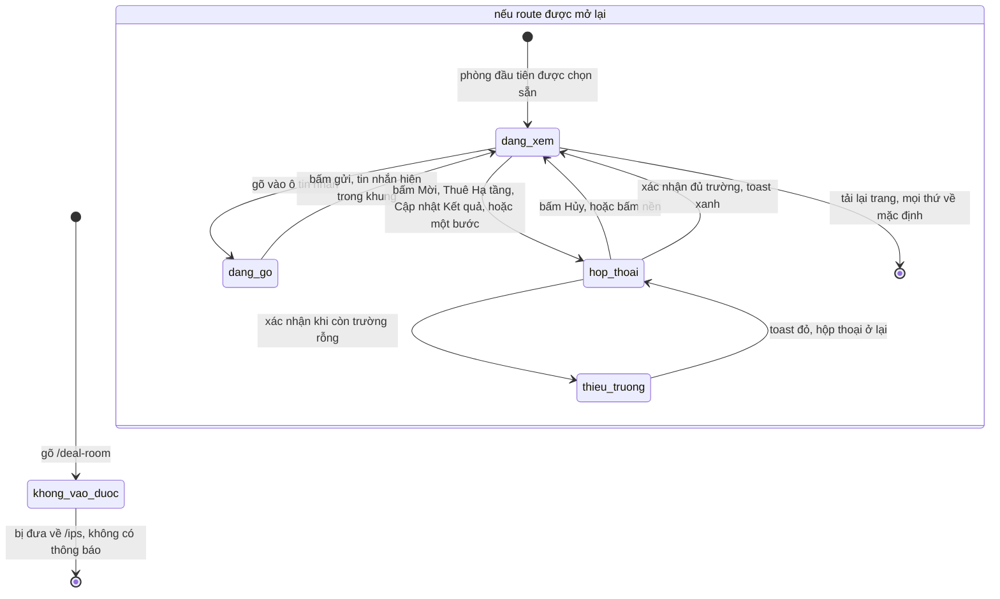

# Phòng thương thảo

## Tóm tắt

Phòng thương thảo (`deal-room`) là một khu vực **vỏ**: có một trang đầy đủ, tám thành phần giao diện, năm hộp thoại và một luồng làm việc mạch lạc, nhưng **không tệp nào gọi API** và **route của nó đã bị comment lại**. Không có cách nào vào được nó từ giao diện đang chạy. Gõ thẳng `/deal-room` vào thanh địa chỉ không cho trang lỗi: nhánh bắt-tất-cả của cổng im lặng đưa người dùng về `/ips`.

Việc gỡ nó khỏi định tuyến là **một quyết định có ý thức và đúng**. Khối route mang chú thích `Hidden until these sections are ready for use`, và với một màn hình phát ra sáu thông điệp "đã gửi", "đã lưu", "đã hoàn thành" mà không gửi gì cả, ẩn nó đi là việc phải làm.

Tài liệu này tồn tại vì phòng thương thảo là **tiền thân giao diện của module `case`** trong backend .NET. Module đó có mã chạy được, có 12 giai đoạn, có ma trận chuyển, có bản ghi quyết định, có hold — và không có endpoint nào. Vỏ có thiết kế mà thiếu lõi; lõi có luật mà thiếu cửa. Sprint xây sau sẽ ghép hai thứ này, nên phần chịu lực của tài liệu là [bảng đối chiếu](#đối-chiếu-với-hồ-sơ-vụ-việc) chứ không phải phần mô tả màn hình.

## Trường hợp đơn giản

Không có trường hợp đơn giản. Không người dùng nào mở được màn hình này.

Cái mô tả dưới đây là cái **sẽ** hiện ra nếu route được mở lại, đọc từ mã.

Màn hình chia ba cột. Cột trái là danh sách cuộc trò chuyện, có ô tìm kiếm và ba dòng dữ liệu bịa: "Tập đoàn Viettel", "Vingroup", "FPT Corporation" — tên ba doanh nghiệp có thật, kèm tên dự án, tin nhắn cuối, trạng thái và số tin chưa đọc. Cột giữa là khung chat: đầu khung ghi tên đối tác và tên dự án, thân khung là các bong bóng tin nhắn xen với các dòng sự kiện hệ thống, đáy khung là ô nhập và nút gửi. Cột phải là bảng thông tin, gấp lại được bằng nút chữ *i* ở đầu cột giữa.

Cột phải có ba phần. **Thành viên trong phòng**: ba người bịa với tên, đơn vị, chữ cái viết tắt và một nhãn *Admin*; dưới đó là nút **Thêm người / Mời thành viên**. **Tiến độ giao dịch**: ba bước theo dọc — *Thỏa thuận* (đã xong), *PoC* (đang chạy), *Chốt Hợp đồng* (chưa tới) — mỗi bước là một nút tròn bấm được, rồi ba nút hành động **Thuê Hạ tầng**, **Cập nhật Kết quả**, **Hoàn thành Giao dịch**, rồi nhật ký PoC với hai bản báo cáo bịa. **Files đã gửi**: ba tệp bịa với tên, dung lượng và ngày, một lưới bốn ô màu thay cho ảnh, và ở cuối là nút rời khỏi cuộc trò chuyện.

## Tương tác, sự kiện theo sự kiện

### Vào màn

Ở bản đang chạy: route không tồn tại, nên "vào màn" là bị đẩy về `/ips`. Không có trang không tìm thấy, không có thông báo, không có gợi ý rằng địa chỉ vừa gõ có nghĩa.

Nếu route được mở lại: trang dựng tức thì, **không có lời gọi mạng nào**, không có trạng thái đang tải. Cuộc trò chuyện thứ nhất được chọn sẵn. Cột phải mở sẵn. Ô tìm kiếm rỗng và **không lọc gì** — nó có ô nhập và có trạng thái nhưng danh sách không đọc trạng thái đó.

Chỉ cuộc trò chuyện thứ nhất có tin nhắn. Chọn cuộc thứ hai hoặc thứ ba cho ra khung chat rỗng dưới một cái đầu khung vẫn ghi đủ tên đối tác và tên dự án.

### Rời đi không đổi gì

**Không có gì được ghi lại.** Đây là câu trả lời kiểm được: mở màn hình, không chạm gì, rời đi — không lời gọi mạng nào được phát, không bản ghi nào được tạo, không mục nào được lưu ở trình duyệt. Người kiểm thử mở tab mạng của trình duyệt và **đếm được đúng không lời gọi nào** trong suốt vòng đời màn hình này, kể cả sau khi bấm hết mọi nút.

### Bắt đầu sửa

Không có khái niệm *đã bẩn*. Ô tin nhắn, ô email mời, ba trường của biểu mẫu thuê hạ tầng và ba trường của biểu mẫu kết quả PoC đều là trạng thái trong bộ nhớ trang. Không nút nào sáng lên, không nhãn nào đổi, không cảnh báo nào khi rời đi.

### Trong khi sửa

Không có kiểm tra dữ liệu nào chạy trong lúc gõ. Ô email của hộp thoại mời không kiểm định dạng; nó chỉ kiểm rỗng, và kiểm lúc bấm xác nhận.

Ba trạng thái phụ thuộc nhau đáng nói:

- Ba bước tiến độ là **nút**. Bấm bước nào cũng mở hộp thoại xác nhận "Bạn muốn chuyển sang giai đoạn ...?" — kể cả bước đã xong, kể cả bước ở cuối khi đang ở bước đầu. Không có ràng buộc thứ tự.
- Xác nhận một bước **viết lại toàn bộ ba bước**: bước được chọn thành *đang chạy*, mọi bước trước nó thành *đã xong*, mọi bước sau nó thành *chưa tới*. Nhảy từ bước 3 về bước 1 là hợp lệ và xoá sạch trạng thái đã xong của hai bước sau.
- Hộp thoại kết quả PoC yêu cầu đủ ba thứ: một dòng kết quả, một tệp đính kèm, và một ô đánh dấu xác nhận. Thiếu bất kỳ thứ nào cho ra toast "Vui lòng điền đầy đủ thông tin và xác nhận".

URL không đổi ở bất kỳ thao tác nào.

### Gửi đi

**Không gửi đi đâu cả. Không có gì được ghi lại.** Sáu hành động của màn hình này đều kết thúc bằng một thông điệp thành công và một thay đổi chỉ tồn tại trong bộ nhớ trang:

| Hành động | Người dùng thấy | Thực tế xảy ra |
|---|---|---|
| Gửi tin nhắn | Bong bóng tin nhắn hiện ở cuối khung, ghi "Tôi" | Một phần tử được thêm vào một mảng trong bộ nhớ |
| Mời thành viên | Toast "Đã gửi lời mời đến {email}" | Không có lời gọi mạng; danh sách thành viên **không đổi** |
| Thuê hạ tầng | Toast "Đã gửi yêu cầu đến Admin" | Không có lời gọi mạng; không quản trị viên nào nhận được gì |
| Cập nhật kết quả PoC | Toast "Đã lưu và chia sẻ kết quả PoC" + một dòng sự kiện trong khung chat | Tệp không được tải lên; nhật ký PoC bên phải **không đổi** |
| Chuyển giai đoạn | Toast "Đã cập nhật trạng thái giai đoạn" + một dòng sự kiện | Ba chấm tròn đổi màu trong bộ nhớ |
| Hoàn thành giao dịch | Toast "Đã hoàn thành giao dịch và khóa phòng chat" | **Không gì cả** — không có khoá nào, ô nhập vẫn gõ được, mọi nút vẫn bấm được |

Tải lại trang đưa mọi thứ về đúng dữ liệu bịa ban đầu. Không có gì tồn tại qua một lần F5.

Ba thông điệp trong bảng trên nói về việc có người khác nhận được thứ gì đó — một quản trị viên, một người được mời, một đối tác thấy kết quả PoC. **Không ai nhận được gì.** Đó là lý do đủ để giữ khu vực này ẩn.

## Đối chiếu với hồ sơ vụ việc

Đây là phần dùng được cho sprint xây. [`../nen-tang/mo-hinh-du-lieu.md`](../nen-tang/mo-hinh-du-lieu.md#mười-hai-giai-đoạn) sở hữu 12 giai đoạn và ma trận chuyển; bảng dưới chỉ nói giao diện vỏ đang đứng ở đâu so với chúng.

### Ba bước của vỏ so với 12 giai đoạn

| Bước trong vỏ | Giai đoạn tương ứng của hồ sơ vụ việc | Ghi chú |
|---|---|---|
| *(không có)* | `DISCOVERY` | Vỏ giả định phòng đã tồn tại. Không có màn hình tạo hồ sơ. |
| *(không có)* | `QUALIFICATION` | Giai đoạn chốt ảnh chụp chính sách và bắt buộc có môi giới chính. Vỏ không có khái niệm nào trong hai cái đó. |
| *(không có)* | `MATCHING` | Ghép cặp ở cổng là [một màn hình khác](ket-qua-ghep-cap.md), không nối vào đây. |
| **Thỏa thuận** | `DUE_DILIGENCE` + `DEAL_DESIGN` | Một bước của vỏ gộp hai giai đoạn có ma trận chuyển khác nhau: từ thẩm định còn *từ chối* được, từ thiết kế thương vụ thì chỉ còn *rút lui* hoặc *huỷ*. |
| **PoC** | `EXECUTION` + `OUTCOME_VERIFICATION` | Nhật ký PoC của vỏ gần nhất với chứng cứ của giai đoạn xác minh kết quả. `EXECUTION` **không rút lui được**, chỉ huỷ — vỏ không phân biệt. |
| **Chốt Hợp đồng** | `COMMERCIALIZATION_MONITORING` + `CLOSED` | Nút *Hoàn thành Giao dịch* là `CLOSED`. Vỏ không có gì cho giai đoạn theo dõi thương mại hoá. |
| *(không có)* | `REJECTED`, `WITHDRAWN`, `CANCELLED` | Vỏ không có đường ra nào ngoài "hoàn thành". Nút *Rời khỏi cuộc trò chuyện* là rời **một cuộc trò chuyện**, không phải rút khỏi một hồ sơ. |

Ba bước đi được một chiều duy nhất trong vỏ — về phía trước hoặc về phía sau tuỳ ý — trong khi ma trận thật cho phép lùi **đúng một bậc và chỉ trong nửa đầu**. Màn hình thật phải chỉ hiện những nút hợp lệ theo giai đoạn hiện tại, chứ không phải ba chấm tròn bấm được hết.

### Khái niệm trong vỏ so với khái niệm trong module

| Khái niệm trong vỏ | Khái niệm tương ứng | Khoảng cách |
|---|---|---|
| Cuộc trò chuyện | Hồ sơ vụ việc | Vỏ nhận diện phòng bằng tên đối tác; hồ sơ có **mã hồ sơ**, một *tuyến*, một tiêu đề, một đề bài kèm số phiên bản đã ghim. |
| Thành viên trong phòng | Bên tham gia | Vỏ có ba người và một nhãn *Admin*. Hồ sơ có **bảy vai trò** chỉ có hiệu lực trong hồ sơ đó, mỗi bên có mốc bắt đầu và mốc kết thúc. |
| Mời thành viên bằng email | Phân công môi giới, hoặc thêm bên tham gia | Hai việc khác nhau bị gộp làm một. Phân công môi giới còn bị **capacity** chặn với mã `CAPACITY_EXCEEDED`; vỏ không có chỗ nào cho một lời từ chối như vậy. |
| Ba chấm tròn tiến độ | Giai đoạn + ma trận chuyển | Xem bảng trên. |
| Hộp thoại "Xác nhận chuyển giai đoạn?" | Bản ghi quyết định | Hộp thoại chỉ hỏi có/không. Bản ghi quyết định cần **loại quyết định** (`APPROVE`, `REJECT`, `RETURN_FOR_REWORK`, `WAIVE`), **mã lý do**, **diễn giải**, và tham chiếu uỷ quyền. Bốn trường không có ô nào trong vỏ. |
| *(không có)* | Hold | Hồ sơ đang có hold mở **không chuyển giai đoạn được, bất kể quyền**. Vỏ không có khái niệm khoá, không có chỗ hiện lý do hold, không có nút gỡ hold. Đây là khoảng trống lớn nhất. |
| *(không có)* | Ảnh chụp chính sách | Chốt tại `QUALIFICATION` và trả lời câu "lúc đó luật là gì". Không có gì trong vỏ tương ứng. |
| Nhật ký PoC | Chứng cứ của `OUTCOME_VERIFICATION` | Vỏ coi PoC là tệp đính kèm cộng một dòng chữ. Chưa rõ hồ sơ định mô hình hoá kết quả thế nào — xem [`../moi/console-ho-so-vu-viec.md`](../moi/console-ho-so-vu-viec.md). |
| Files đã gửi | Tài liệu trong phòng dữ liệu | Vỏ liệt kê tệp phẳng, ai vào phòng cũng thấy. Tài liệu thật có **mức mật** và cần **cấp quyền đọc** cho mọi thứ từ `Confidential` trở lên; không có phiếu thì tệp **không có trong danh sách**, chứ không phải hiện ra rồi báo lỗi. |
| Nút Thuê Hạ tầng | Tuyến `SHARED_INFRASTRUCTURE` | Vỏ coi thuê hạ tầng là một hành động trong phòng; kiến trúc coi hạ tầng dùng chung là một **tuyến** của cả hồ sơ, quyết định bộ chính sách áp lên nó. Xem [`khu-vuc-chua-co-backend.md`](khu-vuc-chua-co-backend.md). |
| Khung chat | *(không có)* | **Không có module nhắn tin trong backend.** Đây là thứ duy nhất trong vỏ mà lõi không có gì tương ứng. Nếu chat được giữ, nó là một năng lực mới, không phải một cửa cho năng lực đã có. |
| *(không có)* | Số phiên bản và `If-Match` | Hồ sơ có số phiên bản và chuyển giai đoạn gửi kèm nó; lệch thì trả 409 với số hiện tại. Vỏ không giữ số nào và không có màn hình xử lý xung đột. |
| Toast "đã gửi", "đã lưu" | Sự kiện kiểm toán | Mọi thay đổi thật ghi một dòng kiểm toán **trong cùng giao dịch**, kèm mục đích và mã quy tắc đã quyết. Vỏ ghi không gì cả. |

Đọc hai bảng cho ra kết luận cho sprint: **cái vỏ có mà lõi không có là khung chat; cái lõi có mà vỏ không có là hầu hết mọi thứ còn lại.** Ghép hai thứ này không phải là nối API vào các nút hiện tại — nó là dựng lại màn hình quanh giai đoạn, quyết định và hold, rồi giữ lại chat như một khối bên cạnh.

## Biến thể

| Biến thể | Lúc vào màn | Trong khi sửa |
|---|---|---|
| Vai trò | Không ảnh hưởng. Route không tồn tại nên mọi vai trò đều bị đưa về `/ips`. Nếu route được mở lại, nó nằm dưới lớp bảo vệ nên khách chưa đăng nhập bị đẩy về `/login`; `USER` và `ADMIN` thấy hoàn toàn giống nhau, và nhãn *Admin* cạnh một thành viên là chữ cứng, không đọc vai trò của ai. | Không ảnh hưởng. Không nút nào ẩn đi hay khoá lại theo vai trò. Khi nối vào module thật, đây là chỗ *vai trò trong hồ sơ* phải quyết định nút nào hiện. |
| Trạng thái bản ghi | Không ảnh hưởng. Không có bản ghi nào. Ba bước tiến độ khởi tạo cứng ở *đã xong / đang chạy / chưa tới* mỗi lần trang dựng. | Không ảnh hưởng — không trạng thái nào ở máy chủ đổi được cái đang hiện. |
| Cấu hình backend | Không ảnh hưởng. Màn hình không gọi máy chủ nên v1 bị dừng dịch vụ, địa chỉ gốc API sai, hay máy chủ tắt hẳn cũng không đổi gì. | Không ảnh hưởng. |
| Phím tắt của biểu mẫu | Không ô nào được focus sẵn. | **Enter trong ô tin nhắn chưa được xác nhận là gửi** — nút gửi thì gửi. **Escape không đóng hộp thoại nào**: năm hộp thoại đều là lớp phủ tự dựng, không dùng thành phần hộp thoại có sẵn, và không cái nào bắt phím. Bấm ra ngoài nền cũng không đóng. Ctrl/Cmd+Enter không được xử lý riêng. |

Đổi biến thể giữa chừng: không biến thể nào ở đây đổi được, vì không có gì ở phía máy chủ để đổi.

## Huỷ và gián đoạn

| Sự kiện | Trước khi gửi | Trong khi đang gửi |
|---|---|---|
| Bấm Huỷ hoặc nhấn Escape | Bốn trong năm hộp thoại có nút Hủy và nó đóng hộp thoại, vứt nội dung đã gõ. **Escape không làm gì** ở bất kỳ hộp thoại nào, và bấm ra ngoài nền cũng không đóng — chỉ nút Hủy hoặc dấu X mới đóng được. | Không có pha "đang gửi". Mọi hành động hoàn tất tức thì trong bộ nhớ. |
| Đi chỗ khác trong app | Đi được ngay, không hỏi. Tin nhắn đã gõ, thành viên đã mời, bước đã chuyển — tất cả biến mất. **Không có gì được ghi lại**, nên không có gì để mất ở phía máy chủ. | Không ảnh hưởng. |
| Back/Forward của trình duyệt | Về màn trước. Bấm Forward quay lại thì trang dựng lại từ dữ liệu bịa ban đầu; mọi tin nhắn đã gõ mất. | Không ảnh hưởng. |
| Tải lại trang, hoặc đóng tab | Mọi thứ về mặc định. Không có hộp thoại cảnh báo rời trang. **Không có gì được ghi lại** ở máy chủ, ở lưu trữ cục bộ, hay ở bộ nhớ phiên. | Không ảnh hưởng. |
| Mất mạng, hoặc request quá hạn | **Không ảnh hưởng.** Màn hình chạy đủ khi ngắt mạng hoàn toàn: gửi tin nhắn được, mời thành viên được, chuyển giai đoạn được, và mọi toast thành công vẫn hiện. Đây là dấu hiệu kiểm được rõ nhất rằng không có gì đi ra ngoài. | Không ảnh hưởng. |
| Phiên hết hạn (401), hoặc v1 bị dừng (410 Gone) | **Không ảnh hưởng** ở màn hình này — nó không gọi gì nên không nhận được 401 hay 410. Người dùng vẫn bị đưa về `/login` nếu họ rời tab rồi quay lại, vì lớp phiên kiểm token khi tab hiện lại. Đó là lớp bên ngoài, không phải màn hình này. | Không ảnh hưởng. |
| Bản ghi bị đổi bởi tab khác hoặc người khác (409 khi `If-Match` lệch), hoặc bị xoá | Không có tương tác. Không có bản ghi, không có số phiên bản, không có `If-Match`. Hai tab mở cùng màn hình này là hai bản sao độc lập của cùng một tập dữ liệu bịa và không bao giờ thấy nhau. | Không ảnh hưởng. |
| Trình duyệt tự điền | Ô email của hộp thoại mời có thể nhận địa chỉ từ trình duyệt; giá trị điền vào được nhận bình thường và vẫn không đi đâu. Không có trường mật khẩu. | Không ảnh hưởng. |

Sau mọi gián đoạn, kết quả giống hệt nhau: màn hình về đúng dữ liệu bịa ban đầu, và **không có gì ở phía máy chủ khác đi**.

## Tương tác với hệ thống khác

**Quyền và vai trò.** Không có tương tác ở bản đang chạy. Khi nối vào module thật, đây là màn hình mà [*vai trò trong hồ sơ*](../nen-tang/mo-hinh-du-lieu.md#bên-tham-gia) — khác vai trò nền tảng — quyết định ai chuyển được giai đoạn, ai mời được người, ai thấy được tệp nào. Nhãn *Admin* cứng trong vỏ là đúng chỗ cần đặt vai trò thật, và sai ở chỗ vai trò nền tảng không phải thứ được dùng.

**Kiểm tra dữ liệu và cách hiện lỗi.** Bốn luật, tất cả là "không rỗng", tất cả kiểm lúc bấm xác nhận, tất cả hiện bằng toast đỏ. Không có luật nào về định dạng, không có luật nào về nghiệp vụ. Ma trận chuyển — luật chịu lực nhất của hồ sơ vụ việc — không có mặt.

**Thay đổi chưa lưu.** Không có tương tác, vì không có gì được lưu. Mọi thứ trên màn hình là thay đổi chưa lưu, vĩnh viễn.

**Cập nhật lạc quan và hoàn tác.** Màn hình này là cập nhật lạc quan **thuần tuý**: mọi thay đổi hiện ra ngay và không bao giờ được xác nhận hay bị đảo ngược, vì không có ai để xác nhận. Không có hoàn tác. Nhảy giai đoạn sai không lùi lại được bằng một nút Hoàn tác — chỉ bằng cách bấm lại một bước khác.

**Ngoại tuyến.** Không có hàng đợi và không cần. Màn hình chạy đủ khi ngoại tuyến, xem bảng gián đoạn.

**Thông báo và toast.** Sáu toast xanh và bốn toast đỏ, tất cả sinh tại chỗ. Không loại thông báo nào của hệ thống ứng với phòng thương thảo, và [`../nen-tang/mo-hinh-du-lieu.md`](../nen-tang/mo-hinh-du-lieu.md) ghi nhận rằng **không có loại thông báo nào cho hồ sơ vụ việc** — bốn loại tồn tại đều thuộc ghép cặp và lời mời hợp tác. Con số tin chưa đọc trong cột trái là hằng số.

**Trạng thái lọc/tìm trong URL.** Không có gì trong URL, kể cả cuộc trò chuyện đang mở. Nếu màn hình được nối vào hồ sơ thật, đây là chỗ đầu tiên phải sửa: một hồ sơ vụ việc là thứ người ta gửi đường dẫn cho nhau.

**Đa ngôn ngữ.** Toàn bộ chữ là tiếng Việt viết thẳng trong mã, kể cả tên ba bước. Tên giai đoạn thật lưu bằng chuỗi tiếng Anh viết hoa và **không có bảng dịch nào ở phía máy chủ**; màn hình thật sẽ phải tự dịch 12 giai đoạn, 3 tuyến, 7 vai trò và 4 loại quyết định.

**Khả năng truy cập.** Chưa rà, và có ít nhất ba vấn đề nhìn thấy từ mã: năm hộp thoại là lớp phủ tự dựng không có vai trò `dialog`, không bẫy focus, không đóng bằng Escape; ba chấm tròn tiến độ là nút không có nhãn chữ cho trình đọc màn hình; cột phải đặt chiều cao cứng bằng chiều cao màn hình và cuộn riêng, nên nó tràn khi thanh đầu trang chiếm chỗ.

**Dấu vết kiểm toán.** Không có gì được ghi. Đây là điều đáng nói nhất khi ghép với module thật: mọi chuyển giai đoạn của hồ sơ vụ việc ghi một **bản ghi quyết định chỉ ghi thêm** trong cùng giao dịch, và bản ghi đó cần bốn trường mà vỏ không hỏi. Xem [`../moi/nhat-ky-kiem-toan.md`](../moi/nhat-ky-kiem-toan.md).

## Trường hợp biên

- **Gõ `/deal-room` không cho trang lỗi.** Nhánh bắt-tất-cả của cổng đưa người dùng về `/ips` và không nói gì. Người gõ đúng một địa chỉ có nghĩa trong mã sẽ nghĩ mình gõ sai. Xem [`../nen-tang/dieu-huong-va-url.md`](../nen-tang/dieu-huong-va-url.md).
- **Vẫn có hai đường dẫn tới `/deal-room` trong mã đang chạy.** Trang chi tiết công nghệ của [chợ giao dịch](cho-giao-dich.md) nhận một lời gọi điều hướng tới `/deal-room`, và hộp thoại xác nhận mở phòng ở gốc ứng dụng cũng vậy. Cả hai chưa có nút nào kích hoạt được, nhưng nếu được nối lại chúng sẽ đưa người dùng về `/ips` sau một hộp cảnh báo của trình duyệt. (chưa cấp mã lỗi)
- **Ba tên doanh nghiệp có thật trong dữ liệu bịa.** "Tập đoàn Viettel", "Vingroup", "FPT Corporation" xuất hiện là đối tác của những giao dịch không tồn tại, kèm tin nhắn và kết quả PoC bịa. Vì route bị comment và tệp không được nhập ở đâu, khối này **không nằm trong gói phát hành** — khác với dữ liệu bịa của [chợ giao dịch](cho-giao-dich.md#trường-hợp-biên). Cần gỡ trước khi mở lại route.
- **"Hoàn thành Giao dịch" không khoá gì.** Toast nói phòng chat đã bị khoá; ô nhập vẫn gõ được, nút vẫn bấm được, ba bước vẫn chuyển được. (chưa cấp mã lỗi)
- **Chuyển giai đoạn đi được mọi hướng.** Không có ràng buộc thứ tự, không có giai đoạn kết thúc, không có hold. Nhảy về bước 1 xoá trạng thái đã xong của hai bước sau mà không hỏi.
- **Ô tìm kiếm không lọc.** Nó có trạng thái và có ô nhập; danh sách cuộc trò chuyện không đọc trạng thái đó.
- **Hai trong ba cuộc trò chuyện không có tin nhắn.** Chọn chúng cho ra khung rỗng dưới một cái đầu khung đầy đủ thông tin, trông như lỗi tải chứ không như một phòng mới.
- **Kết quả PoC không vào nhật ký PoC.** Gửi một báo cáo thêm một dòng vào khung chat nhưng danh sách nhật ký bên phải giữ nguyên hai bản ghi bịa. Hai chỗ hiển thị cùng một thứ và chúng không đồng bộ.
- **Tệp đính kèm không được đọc.** Hộp thoại kết quả PoC nhận một tệp và chỉ lấy tên của nó; nội dung không đi đâu.

## Câu hỏi mở và kiểm chứng

- Chưa dựng cổng người dùng trong trình duyệt, và **không thể dựng màn hình này** vì route đã bị comment. Kiểm chứng nó đòi hỏi mở lại route trong một nhánh riêng; không được mở lại trên nhánh phát hành. Tuyên bố kiểm được mà không cần mở route: gõ `/deal-room` phải cho ra `/ips`.
- Chưa xác nhận Enter trong ô nhập tin nhắn có gửi không; mã của khung chat chưa được đọc tới mức đó.
- **Quyết định sản phẩm còn bỏ ngỏ: giữ hay bỏ khung chat.** Backend không có module nhắn tin. Nếu giữ, đó là một năng lực mới cần thiết kế riêng — lưu trữ, mức mật của tin nhắn, ai đọc được sau khi rời hồ sơ, thời hạn lưu. Nếu bỏ, phần lớn cột giữa của vỏ không dùng lại được. Đây là câu hỏi phải trả lời **trước** khi ghép vỏ với module `case`.
- **Quyết định sản phẩm còn bỏ ngỏ: ba bước hay 12 giai đoạn.** Người dùng cuối ở cổng có nên thấy đủ 12 giai đoạn không, hay chỉ môi giới thấy đủ còn các bên tham gia thấy một bản rút gọn ba bước? Vỏ giả định cái sau mà không nói ra. [`../moi/console-ho-so-vu-viec.md`](../moi/console-ho-so-vu-viec.md) sở hữu câu trả lời này.
- Chưa rõ *hold* sẽ hiện ra thế nào ở màn hình của một bên tham gia không phải môi giới: chỉ khoá nút, hay hiện cả lý do hold. Lý do hold có thể là thông tin nội bộ.
- Chưa rõ nút *Thuê Hạ tầng* nên đi đâu. Trong kiến trúc, hạ tầng dùng chung là một **tuyến** của hồ sơ chứ không phải một hành động trong hồ sơ; giữ nguyên nút này khi nối API sẽ mã hoá một mô hình sai vào giao diện.
- Chưa đo được gì trên bản chạy, nên toàn bộ tài liệu này đọc từ mã. Tuyên bố "không có gì được ghi lại" kiểm được bằng cách mở tab mạng của trình duyệt và xác nhận không có lời gọi nào trong suốt vòng đời màn hình.

Đối chiếu với SourceCode/dmst-user-main và SourceCode/nacentech, bản chụp ngày 2026-09-04.
