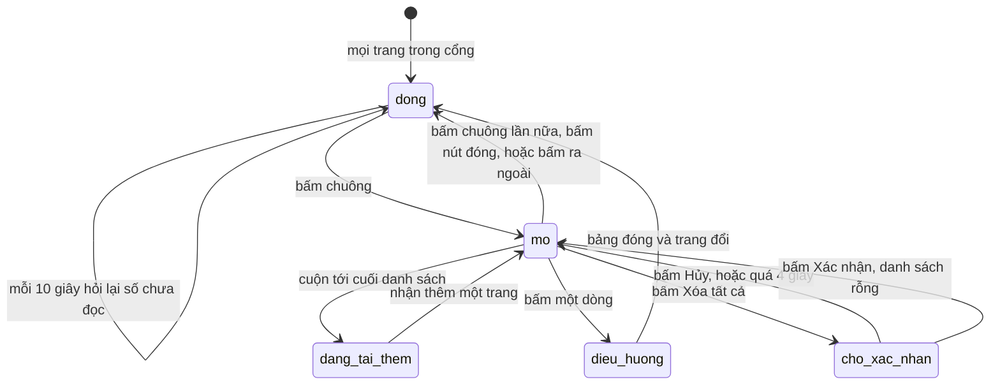
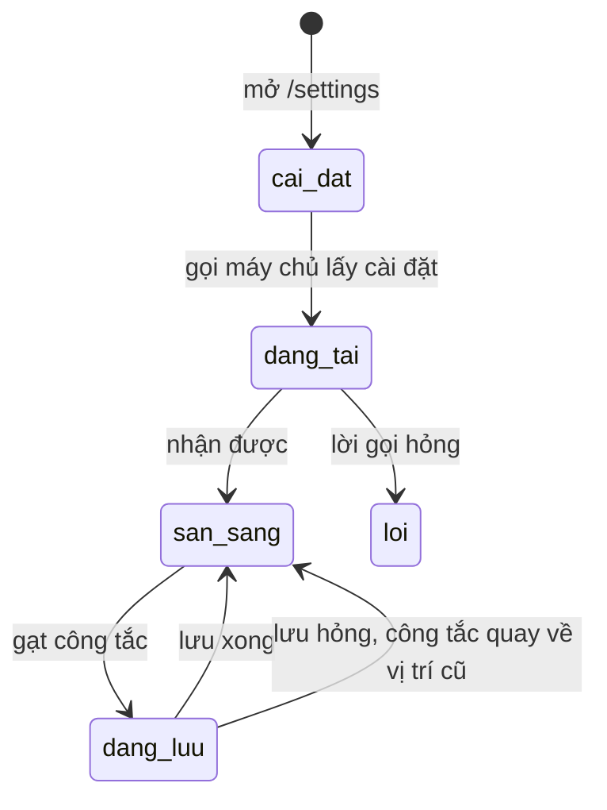

# Thông báo và cài đặt

## Tóm tắt

Hai bề mặt nhỏ, cùng nằm ở góc phải trên của mọi trang trong cổng: một cái chuông và một trình đơn tài khoản.

Cái chuông mở **khay thông báo** — một bảng thả xuống liệt kê những gì hệ thống đã làm cho người dùng. Có đúng bốn loại thông báo trong toàn hệ thống, và cả bốn đều xoay quanh ghép cặp và lời mời hợp tác. Một con số đỏ trên chuông đếm số chưa đọc và được làm mới bằng cách **hỏi máy chủ mỗi mười giây**.

Trình đơn tài khoản có bốn mục: Hồ sơ cá nhân, Đổi mật khẩu, Cài đặt, Đăng xuất. Mục **Cài đặt** dẫn tới `/settings`, một trang chỉ có **một công tắc**: bật hay tắt việc tự động tính ứng viên ghép cặp. Mục **Đổi mật khẩu** mở một hộp thoại nổi trên bất kỳ trang nào. Mục **Hồ sơ cá nhân** không làm gì.

## Trường hợp đơn giản

Người dùng đang ở danh sách công nghệ của mình. Cái chuông ở góc phải có một chấm đỏ ghi số 3. Họ bấm vào.

Một bảng trắng bo góc trượt xuống, rộng khoảng một phần tư màn hình. Đầu bảng ghi "Thông báo" kèm huy hiệu 3, một nút đánh dấu tất cả đã đọc và một nút đóng. Thân bảng là danh sách: mỗi dòng có một biểu tượng tròn (cái bắt tay cho lời mời, cái chuông cho ghép cặp), một câu mô tả, thời gian tương đối, một chấm xanh nếu chưa đọc, và một dấu × hiện khi rê chuột.

Họ bấm một dòng. Chấm xanh biến mất, số trên chuông giảm còn 2, bảng đóng lại, và trang chuyển tới đúng chỗ thông báo nói tới — tab ghép cặp của một bản ghi, hoặc một trong hai tab của trang lời mời hợp tác.

Sau đó họ mở trình đơn tài khoản, chọn **Cài đặt**. Trang `/settings` có một khối duy nhất: tiêu đề "Tự động khớp (Auto-Matching)", một dòng giải thích, và một công tắc. Gạt công tắc, một toast xanh "Đã lưu cài đặt" hiện lên ngay.

## Tương tác, sự kiện theo sự kiện

### Vào màn

**Khay thông báo.** Bộ đếm chạy ngay khi bất kỳ trang nào trong cổng được dựng, và chạy mãi: một lời gọi lấy số chưa đọc lúc đầu, rồi lặp lại mỗi mười giây. Nó **không dừng khi tab bị ẩn** và không dừng khi bảng đóng.

Danh sách thông báo chỉ được tải khi bảng mở, và mỗi lần mở là một lần tải mới từ trang 1, 15 dòng. Trong lúc chờ, bốn khối xám nhấp nháy. Danh sách rỗng cho ra một biểu tượng chuông mờ và dòng "Chưa có thông báo nào".

**Trang cài đặt.** Gọi máy chủ ngay khi dựng để lấy giá trị công tắc. Ba trạng thái loại trừ nhau: một vòng xoay kèm "Đang tải…", một khung đỏ chứa thông điệp lỗi, hoặc khối công tắc. Không có giá trị mặc định hiển thị trong lúc chờ — công tắc **không tồn tại** cho tới khi máy chủ trả lời.

**Hộp thoại đổi mật khẩu.** Không gọi gì. Ba ô rỗng, không ô nào được focus sẵn. Hộp được dựng ở gốc ứng dụng nên nó nổi trên mọi trang.

### Rời đi không đổi gì

Khay thông báo và trang cài đặt không ghi gì nếu người dùng chỉ nhìn. Hộp thoại đổi mật khẩu tự xoá sạch ba ô mỗi lần đóng, và cũng xoá sạch khi danh tính người dùng đổi.

Đóng bảng thông báo **không** đánh dấu gì đã đọc. Chỉ bấm vào một dòng, hoặc bấm nút đánh dấu tất cả, mới đổi trạng thái.

### Bắt đầu sửa

Công tắc ở trang cài đặt không có trạng thái *đã bẩn*: gạt nó là lưu ngay, không có nút Lưu.

Hộp thoại đổi mật khẩu có thước đo độ mạnh chạy theo từng ký tự trong ô mật khẩu mới: bốn vạch màu và một chữ (Yếu / Trung bình / Khá / Mạnh) tính trên năm điều kiện — độ dài từ 8, chữ thường, chữ hoa, chữ số, ký tự đặc biệt. Thước đo **chỉ để xem**; luật chặn thật là một biểu thức riêng đòi đủ cả năm.

Gõ vào một ô đang có lỗi sẽ xoá lỗi của ô đó.

### Trong khi sửa

Ở khay và ở trang cài đặt: không có kiểm tra dữ liệu nào.

Ở hộp thoại đổi mật khẩu, kiểm tra chỉ chạy lúc gửi, trừ thước đo độ mạnh. Ba luật tại chỗ: mật khẩu hiện tại không rỗng; mật khẩu mới phải đủ 8 ký tự với chữ hoa, chữ thường, số và ký tự đặc biệt, và **không được trùng mật khẩu hiện tại**; ô xác nhận phải khớp.

Đây là luật khắt khe hơn hẳn luật lúc đăng ký, vốn chỉ đòi 8 ký tự — xem [`../nen-tang/xac-thuc-va-vai-tro.md`](../nen-tang/xac-thuc-va-vai-tro.md#mật-khẩu). Một người đặt được mật khẩu `abcdefgh` khi đăng ký sẽ không đổi được sang một mật khẩu cùng kiểu.

URL không đổi ở bất kỳ thao tác nào trong ba bề mặt này.

### Gửi đi

**Đánh dấu một thông báo đã đọc.** Xảy ra như tác dụng phụ của việc bấm vào dòng, trước khi chuyển trang. Chấm xanh biến mất và bộ đếm giảm **ngay lập tức**; nếu lệnh hỏng thì cả hai được trả lại và một toast đỏ hiện lên. Dòng đã đọc rồi thì bấm chỉ chuyển trang, không gọi gì.

Đích đến được giao diện **tự dựng lại theo loại**, không dùng đường dẫn mà máy chủ gửi kèm: thông báo lời mời luôn về `/my/collaboration-requests` với tab tương ứng; thông báo ghép cặp về trang chi tiết của bản ghi kèm `?tab=matches`. Đường dẫn trong dữ liệu chỉ được dùng khi không dựng lại được.

**Đánh dấu tất cả đã đọc.** Nút chỉ hiện khi còn dòng chưa đọc trong danh sách đang hiển thị. Mọi dòng đổi sang đã đọc ngay, bộ đếm giảm theo, rồi lệnh mới được gửi. Hỏng thì toàn bộ danh sách được khôi phục.

**Xoá một thông báo.** Dấu × trên dòng. Dòng biến mất ngay, không có xác nhận, không hoàn tác. Hỏng thì danh sách được khôi phục và một toast đỏ hiện lên.

**Xoá tất cả.** Nút ở chân bảng. Bấm lần đầu **không xoá**: nó đổi chân bảng thành một câu hỏi "Xác nhận xóa tất cả?" với hai nút Xác nhận và Hủy, và câu hỏi đó **tự biến mất sau bốn giây**. Bấm Xác nhận thì danh sách rỗng ngay và lệnh được gửi.

**Tải thêm.** Bảng dùng cuộn vô hạn: một điểm mốc vô hình ở cuối danh sách, khi nó lọt vào tầm nhìn thì trang kế được xin về và **nối vào** danh sách hiện có. Chân bảng ghi "Cuộn để xem thêm" khi còn trang.

**Lưu cài đặt.** Công tắc đổi vị trí ngay, rồi lệnh được gửi. Hỏng thì công tắc quay lại vị trí cũ và một toast đỏ "Không thể lưu cài đặt. Vui lòng thử lại." Trong lúc chờ, công tắc bị khoá.

**Đổi mật khẩu.** Thứ tự xảy ra:

1. Kiểm tra tại chỗ ba luật; hỏng thì hiện lỗi dưới ô tương ứng và **dừng**.
2. Nút đổi chữ thành "Đang xử lý…" và cả hai nút bị khoá.
3. Máy chủ kiểm lại: mật khẩu hiện tại phải đúng, mật khẩu mới phải đủ bốn loại ký tự, **không được trùng mật khẩu hiện tại**, và **không được trùng mật khẩu vừa dùng trước đó**. Luật cuối không có ở phía giao diện.
4. Thành công thì hộp thoại đóng, một toast xanh "Đổi mật khẩu thành công. Vui lòng đăng nhập lại." hiện lên, và **một phần mười giây sau, cookie bị xoá và người dùng bị đưa về `/login`**.

Máy chủ trả một câu bảo đăng nhập lại nhưng **không vô hiệu hoá token cũ**: token đó vẫn dùng được tới hết hạn nếu ai đó còn giữ. Việc đăng xuất là quyết định của giao diện.

Đổi mật khẩu thành công cũng đưa một thư cảnh báo vào hàng đợi, kèm thời điểm, địa chỉ IP và trình duyệt đã dùng, định dạng theo giờ Việt Nam.

> Ghi chú kỹ thuật: hộp thoại phân loại lỗi máy chủ bằng cách **dò chuỗi** trong thông điệp. Bất kỳ câu nào chứa `password`, `uppercase`, `8 ký tự` hay `không đúng` đều bị gán vào ô **Mật khẩu hiện tại**. Vì phần lớn thông điệp lỗi mật khẩu của máy chủ là tiếng Anh và có chứa từ `password`, lỗi về **mật khẩu mới** thường hiện dưới ô **mật khẩu hiện tại**. Chỉ những câu chứa `khớp`, `mismatch` hay `match` mới xuống ô xác nhận; còn lại đi vào toast.

## Biến thể

| Biến thể | Lúc vào màn | Trong khi sửa |
|---|---|---|
| Vai trò | Cả ba bề mặt chỉ tồn tại bên trong khung đã đăng nhập; khách chưa đăng nhập không thấy chuông, không thấy trình đơn tài khoản, và `/settings` đưa họ về `/login`. Máy chủ ràng buộc mọi lệnh thông báo và lệnh cài đặt theo chính người đang đăng nhập — không có tham số nào chỉ định người khác. Vai trò `ADMIN` có một đường riêng đọc thông báo của mọi người, không thuộc cổng này. | Không ảnh hưởng. Quyền được kiểm ở máy chủ tại mỗi lời gọi theo quan hệ *chính mình*. |
| Trạng thái bản ghi | Thông báo có hai trạng thái, đã đọc và chưa đọc; chưa đọc thì nền dòng hơi xanh, chữ đậm hơn, và có chấm tròn. Cài đặt chỉ có một cờ nhị phân. Không bản ghi nào ở đây có bản nháp, phiên bản hay xoá mềm — **xoá thông báo là xoá thật**, khác với đề bài và công nghệ. | Không ảnh hưởng. |
| Cấu hình backend | Cờ tự động ghép cặp là cấu hình **của người dùng**, không phải của hệ thống, và nó quyết định việc lưu nội dung có kéo theo một vòng ghép cặp hay không — xem [`ket-qua-ghep-cap.md`](ket-qua-ghep-cap.md). Thư cảnh báo đổi mật khẩu chỉ gửi thật khi hệ thư không ở chế độ chỉ ghi log. Hai đường danh sách thông báo nâng trần số dòng mỗi trang lên **1000** và đặt mặc định **10** thay vì 20; giao diện luôn xin 15. | Nếu v1 đã bị dừng dịch vụ, bộ đếm mười giây trả 410 và **im lặng giữ nguyên con số cũ**, nên cái chuông tiếp tục hiển thị một con số đã chết. |
| Phím tắt của biểu mẫu | Không ô nào được focus sẵn ở đâu, kể cả khi hộp thoại đổi mật khẩu mở. | Hộp thoại đổi mật khẩu là một `<form>` thật nên **Enter trong bất kỳ ô nào gửi biểu mẫu**. Nó **không nghe Escape**: đóng phải bấm dấu × hoặc bấm ra ngoài. Bảng thông báo cũng không nghe Escape; đóng bằng cách bấm ra ngoài hoặc bấm lại chuông. Công tắc ở trang cài đặt bật tắt bằng Space khi được focus. Ctrl/Cmd+Enter không được xử lý riêng ở đâu. |

Đổi biến thể giữa chừng: bộ đếm mười giây có thể mang về một con số mới trong lúc người dùng đang mở bảng, và nó **ghi đè** con số mà bảng vừa tự tính — xem [Trường hợp biên](#trường-hợp-biên).

## Huỷ và gián đoạn

| Sự kiện | Trước khi gửi | Trong khi đang gửi |
|---|---|---|
| Bấm Huỷ hoặc nhấn Escape | Hộp thoại đổi mật khẩu có nút **Hủy** vứt sạch ba ô và đóng lại, không hỏi gì; Escape không làm gì. Xoá tất cả thông báo có một bước xác nhận với nút Hủy, và bước đó tự huỷ sau bốn giây. Xoá một thông báo và gạt công tắc **không có bước huỷ nào**. | Không có cách huỷ ở bất kỳ đâu. Nút Hủy của hộp thoại bị khoá trong lúc gửi; Escape không dừng lời gọi đang bay. |
| Đi chỗ khác trong app | Bảng thông báo đóng khi bấm ra ngoài. Rời `/settings` không mất gì vì công tắc lưu ngay khi gạt. Rời trang trong lúc hộp thoại đổi mật khẩu đang mở thì hộp **vẫn mở** — nó nằm ở gốc ứng dụng, không thuộc trang nào. | Rời trang bỏ lời gọi ở phía trình duyệt nhưng **không hoàn tác ở phía máy chủ**: thông báo vẫn bị đánh dấu hoặc bị xoá, cài đặt vẫn được ghi, mật khẩu vẫn được đổi. Với đổi mật khẩu, người dùng ở lại với một token cũ vẫn dùng được và một mật khẩu đã đổi mà họ không biết. |
| Back/Forward của trình duyệt | Bảng thông báo không tạo mục lịch sử; Back đi thẳng ra khỏi trang đang xem. Sau khi bấm một thông báo, Back quay lại trang trước và **bảng không mở lại**. `/settings` là một route thường. | Như trên: lời gọi bị bỏ, tác dụng phía máy chủ vẫn xảy ra. |
| Tải lại trang, hoặc đóng tab | Bảng đóng và danh sách sẽ được tải mới ở lần mở sau. Bộ đếm khởi động lại. `/settings` gọi lại máy chủ. Hộp thoại đổi mật khẩu biến mất cùng ba ô. | Lời gọi bị bỏ. Không có khoá chống lặp trên v1: bấm lại một lệnh xoá đã chạy thì lần thứ hai trả "không tìm thấy"; bấm lại lệnh đổi mật khẩu thì lần thứ hai hỏng vì mật khẩu hiện tại đã đổi — và lỗi đó hiện dưới ô **Mật khẩu hiện tại**, tình cờ đúng chỗ. |
| Mất mạng, hoặc request quá hạn | Bộ đếm mười giây **nuốt lỗi hoàn toàn**: nó giữ nguyên con số biết được lần cuối và không có dấu hiệu nào cho biết nó đã ngừng cập nhật. Lần tải danh sách thông báo hỏng cũng im lặng — bảng hiện "Chưa có thông báo nào", giống hệt trường hợp thật sự rỗng. `/settings` thì hiện khung đỏ với thông điệp lỗi. | Mọi thao tác lạc quan được hoàn tác và một toast đỏ hiện lên, mỗi thao tác một câu riêng. Hộp thoại đổi mật khẩu mở khoá hai nút và giữ nguyên ba ô, kể cả mật khẩu. |
| Phiên hết hạn (401), hoặc v1 bị dừng (410 Gone) | Bộ đếm mười giây gặp 401 cũng nuốt im lặng, nên cái chuông tiếp tục hiển thị con số cũ vô thời hạn. Nếu người dùng chuyển sang tab trình duyệt khác rồi quay lại, lớp phiên gọi lại máy chủ, nhận 401, xoá cookie và đưa họ về `/login`. | Cổng **không có nhánh xử lý 401 nào**: hết hạn hiện ra như một lỗi thường, thao tác lạc quan bị hoàn tác, và toast nói "vui lòng thử lại" — thử lại bao nhiêu lần cũng hỏng. 410 cũng vậy. Xem [B-12](../bug-triage.md#b-12-cổng-người-dùng-không-xử-lý-401). |
| Bản ghi bị đổi bởi tab khác hoặc người khác (409 khi `If-Match` lệch), hoặc bị xoá | Không có kiểm tra phiên bản ở nhóm đường này. Danh sách thông báo được chụp lúc mở bảng và **không tự làm mới**, nhưng bộ đếm thì có: một thông báo mới đến làm con số trên chuông tăng trong khi bảng đang mở vẫn hiện danh sách cũ. Đổi cài đặt ở một tab khác thì tab này vẫn hiện giá trị cũ cho tới khi tải lại. | Không bao giờ có 409. Xoá một thông báo đã bị xoá ở tab khác trả "không tìm thấy" và rơi vào toast lỗi chung. Hai tab cùng gạt công tắc thì tab gạt sau thắng, không có cảnh báo. |
| Trình duyệt tự điền, hoặc trình quản lý mật khẩu ghi vào biểu mẫu | Ba ô của hộp thoại đổi mật khẩu khai báo `autocomplete` đúng loại (`current-password`, `new-password`, `new-password`), nên trình quản lý mật khẩu nhận ra và đề nghị điền. Khay và trang cài đặt không có ô nào. | Ba ô **không bị khoá** trong lúc gửi — chỉ hai nút bị khoá. Trình quản lý vẫn ghi được vào ô nhưng thân request đã đóng gói nên nội dung mới không đi theo. |

Sau một gián đoạn, không có công sức nào bị mất ở ba bề mặt này — nhưng con số trên chuông có thể sai và không có gì nói ra điều đó.

## Tương tác với hệ thống khác

**Quyền và vai trò.** Mọi lệnh thông báo và lệnh cài đặt lấy định danh người dùng từ token chứ không từ tham số, nên không có cách nào chạm vào dữ liệu của người khác. Tầng chính sách kiểm lại theo quan hệ *chính mình*. Đổi mật khẩu cũng vậy: nó đổi mật khẩu của chủ token, không nhận định danh nào.

**Kiểm tra dữ liệu và cách hiện lỗi.** Khay và trang cài đặt không có kiểm tra nào. Hộp thoại đổi mật khẩu có ba luật tại chỗ và bốn luật ở máy chủ, và **cách nó phân lỗi về từng ô là dò chuỗi**, nên lỗi thường hiện sai chỗ. Lỗi tải cài đặt hiện trong một khung đỏ tại chỗ; mọi lỗi khác đi qua toast.

**Thay đổi chưa lưu.** Không có tương tác ở khay và trang cài đặt — công tắc lưu ngay khi gạt. Hộp thoại đổi mật khẩu thì có ba ô có thể đang dở, và nó **vứt sạch chúng khi đóng** mà không hỏi. Xem [`../xuyen-suot/thay-doi-chua-luu.md`](../xuyen-suot/thay-doi-chua-luu.md).

**Cập nhật lạc quan và hoàn tác.** Đây là khu vực dùng cập nhật lạc quan nhiều nhất trong cổng: cả năm thao tác của khay và công tắc cài đặt đều đổi màn hình trước rồi mới gọi máy chủ, và cả sáu đều có nhánh hoàn tác kèm toast. Ở phía máy chủ thì **không có hoàn tác nào**: thông báo đã xoá là mất hẳn.

**Ngoại tuyến.** Không có hàng đợi phía trình duyệt. Bộ đếm mười giây tiếp tục chạy khi mất mạng, thất bại im lặng mỗi vòng, và tự khỏi khi mạng có lại.

**Thông báo và toast.** Đây là tài liệu của khay thông báo. Bốn loại tồn tại: *tìm được ứng viên*, *nhận lời mời*, *lời mời được chấp nhận*, *lời mời bị từ chối*. Không có loại nào cho việc nội dung được xử lý xong, cho việc lời mời bị huỷ, hay cho hồ sơ vụ việc. Người dùng **không tắt được** loại nào — không có trang cài đặt thông báo. Toast lo phần phản hồi tức thời và có sáu câu riêng cho sáu thao tác thất bại.

**Trạng thái lọc/tìm trong URL.** Không có gì vào URL. Bảng mở hay đóng, trang thông báo đang ở đâu, tất cả nằm trong bộ nhớ. Máy chủ nhận hai bộ lọc — theo đã đọc và theo loại — nhưng **giao diện không dùng bộ lọc nào**.

**Đa ngôn ngữ.** Khung giao diện là tiếng Việt viết thẳng trong mã. **Nội dung từng thông báo do máy chủ soạn và bằng tiếng Anh**, ví dụ "System found 3 matching partner intakes for your intake …". Đây là chỗ tiếng Anh lộ ra rõ nhất trong toàn cổng, vì nó chiếm phần lớn diện tích của bảng. Thời gian được định dạng ở phía trình duyệt bằng tiếng Việt: "vừa xong", "5 phút trước", "3 giờ trước", "2 ngày trước", rồi chuyển sang ngày tháng khi quá bảy ngày.

**Khả năng truy cập.** Nút chuông có `aria-label`. Công tắc cài đặt có nhãn riêng. Nhưng từng dòng thông báo là `
` gắn sự kiện bấm, **không tới được bằng bàn phím**, và dấu × để xoá nằm bên trong dòng đó nên cũng không tới được theo cách thông thường; nó lại còn ẩn hoàn toàn cho tới khi rê chuột. Bảng thả xuống không bẫy focus và không nghe Escape. Số chưa đọc không có vùng thông báo động, nên trình đọc màn hình không biết khi nó tăng. Hộp thoại đổi mật khẩu cũng tự dựng, không bẫy focus và không nghe Escape.

**Dấu vết kiểm toán.** Đổi mật khẩu ghi một dòng kiểm toán kèm địa chỉ IP và trình duyệt — hai trường có thời hạn lưu riêng, ngắn hơn dòng kiểm toán. Đọc, đánh dấu và xoá thông báo cũng đi qua tầng chính sách nên lượt bị từ chối được ghi lại. Không màn hình nào đọc được — xem [`../moi/nhat-ky-kiem-toan.md`](../moi/nhat-ky-kiem-toan.md).

## Trường hợp biên

- **Con số trên chuông và số trong bảng không phải một.** Bảng tự đếm số dòng chưa đọc trong 15 dòng nó đã tải; chuông lấy số từ máy chủ. Người có hơn 15 thông báo chưa đọc sẽ thấy hai con số khác nhau ở hai chỗ cách nhau vài chục điểm ảnh.
- **Bộ đếm mười giây ghi đè kết quả của mọi thao tác.** Đánh dấu tất cả đã đọc làm con số trên chuông về 0 ngay; trong vòng mười giây sau đó, một vòng hỏi mới trả về con số của máy chủ và ghi đè lên. Nếu lệnh đánh dấu chưa kịp chạy xong hoặc đã hỏng, con số cũ nhảy trở lại mà không có gì giải thích. (chưa cấp mã lỗi)
- **Bộ đếm không bao giờ dừng.** Nó chạy trên mọi trang, kể cả khi tab bị ẩn, cả đêm, mỗi mười giây một lời gọi. Không có cơ chế giãn nhịp và không dừng khi phiên đã hết hạn. (chưa cấp mã lỗi)
- **Mọi lỗi của bộ đếm bị nuốt.** Mạng đứt, phiên hết hạn, v1 bị dừng — cả ba đều cho ra cùng một hành vi: con số cũ đứng yên. Cái chuông trông vẫn bình thường trong khi không còn gì hoạt động.
- **Đường dẫn máy chủ gửi kèm gần như không được dùng.** Mỗi thông báo mang một đường dẫn điều hướng do máy chủ dựng, nhưng giao diện dựng lại đường dẫn cho cả bốn loại. Hai bên hiện đang khớp; nếu máy chủ đổi đường dẫn, giao diện sẽ không đi theo.
- **Xoá một thông báo không có xác nhận, xoá tất cả thì có.** Hai mức độ nguy hiểm khác nhau được đối xử theo hai cách, và bước xác nhận của "xoá tất cả" **tự biến mất sau bốn giây** — một người bị gián đoạn giữa chừng quay lại và bấm tiếp sẽ chỉ mở lại bước xác nhận, không xoá nhầm.
- **Cuộn vô hạn nối thêm nhưng không khử trùng.** Nếu một thông báo mới đến giữa hai lần xin trang, các dòng bị đẩy xuống và một dòng có thể xuất hiện hai lần trong danh sách.
- **Không có bộ lọc dù máy chủ hỗ trợ.** Máy chủ nhận lọc theo đã đọc và theo loại, và nó **kiểm tra chặt** hai tham số đó — gửi một loại không nằm trong bốn loại sẽ nhận một câu liệt kê đủ bốn tên. Giao diện không gửi tham số nào.
- **Mục "Hồ sơ cá nhân" không làm gì.** Nó có trong trình đơn tài khoản, có biểu tượng, bấm được, và không có nhánh xử lý nào. Trình đơn đóng lại và không có gì xảy ra. Máy chủ có sẵn đường sửa hồ sơ. (chưa cấp mã lỗi)
- **Trang cài đặt chỉ có một công tắc.** Không có gì về hồ sơ, về thông báo, về ngôn ngữ, về bảo mật. Ngay cả đổi mật khẩu — thứ thuộc về cài đặt hơn cả — cũng không có trên trang này mà nằm trong trình đơn tài khoản.
- **Không có mục Cài đặt trong thanh bên.** Năm mục của thanh bên không có nó; đường duy nhất tới `/settings` là qua trình đơn tài khoản ở góc phải trên.
- **Lỗi về mật khẩu mới hiện dưới ô mật khẩu hiện tại.** Hệ quả của việc dò chuỗi: câu tiếng Anh mô tả luật của mật khẩu mới có chứa từ `password`, nên nó bị gán vào ô đầu tiên. (chưa cấp mã lỗi)
- **Máy chủ có thêm một luật mà giao diện không biết:** mật khẩu mới không được trùng mật khẩu vừa dùng trước đó. Người dùng đổi qua rồi đổi lại sẽ bị chặn bằng một câu tiếng Anh hiện dưới sai ô.
- **Đổi mật khẩu không vô hiệu hoá token cũ.** Giao diện đăng xuất người dùng, nhưng bất kỳ ai còn giữ token cũ vẫn dùng được tới hết hạn — xem [`../nen-tang/xac-thuc-va-vai-tro.md`](../nen-tang/xac-thuc-va-vai-tro.md#trường-hợp-biên).
- **Tắt cờ tự động ghép cặp không xoá kết quả cũ.** Nó chỉ ngăn các vòng mới chạy tự động; danh sách ứng viên đã có vẫn đứng nguyên, và nút bấm tay vẫn dùng được.
- **Không có cách nào biết cờ tự động ghép cặp mặc định là gì cho tài khoản mới.** Trang chỉ hiện giá trị máy chủ trả về, và không có dòng nào nói giá trị đó là mặc định hay đã từng được đổi.

## Câu hỏi mở và kiểm chứng

- **Chưa dựng cổng người dùng trong trình duyệt.** Mọi mô tả về cái hiện ra trên màn hình đọc từ mã. Cần một lượt kiểm bằng tay cho: cuộn vô hạn của bảng, hành vi của bước xác nhận bốn giây, và việc bảng có bị cắt trên màn hình hẹp không.
- **Chưa đo được độ lệch giữa con số trên chuông và số dòng chưa đọc trong bảng** trong một phiên có nhiều thông báo. Đây là thứ dễ đo nhất và có khả năng cao là sai.
- **Chưa xác nhận nhịp mười giây có gây tải đáng kể không** khi nhiều người dùng mở tab cả ngày. Con số này là hằng số trong mã, không phải cấu hình.
- **Chưa xác nhận nội dung thông báo có thật sự là tiếng Anh trên bản chạy.** Máy chủ dựng câu bằng chuỗi tiếng Anh viết thẳng trong mã, không đi qua bảng dịch nào; cần một lượt xem để biết nó trông thế nào trong một giao diện tiếng Việt.
- Chưa rõ vì sao trang cài đặt chỉ có một công tắc trong khi máy chủ có sẵn đường sửa hồ sơ và mục "Hồ sơ cá nhân" đã có chỗ trong trình đơn. Đây là câu hỏi sản phẩm, không phải câu hỏi về mã.
- Chưa rà xem có màn hình nào khác trong cổng cũng đọc số chưa đọc không, hay chỉ cái chuông. Nếu chỉ một chỗ thì việc nó nuốt lỗi ảnh hưởng hẹp; nếu nhiều chỗ thì rộng hơn.
- Việc không có cách tắt từng loại thông báo, và không có loại nào cho những sự kiện quan trọng khác, nên được xem lại cùng lúc với thiết kế của [`../moi/console-ho-so-vu-viec.md`](../moi/console-ho-so-vu-viec.md) — hiện chưa có loại thông báo nào cho hồ sơ vụ việc.

Đối chiếu với SourceCode/dmst-user-main và SourceCode/nacentech, bản chụp ngày 2026-09-04.
