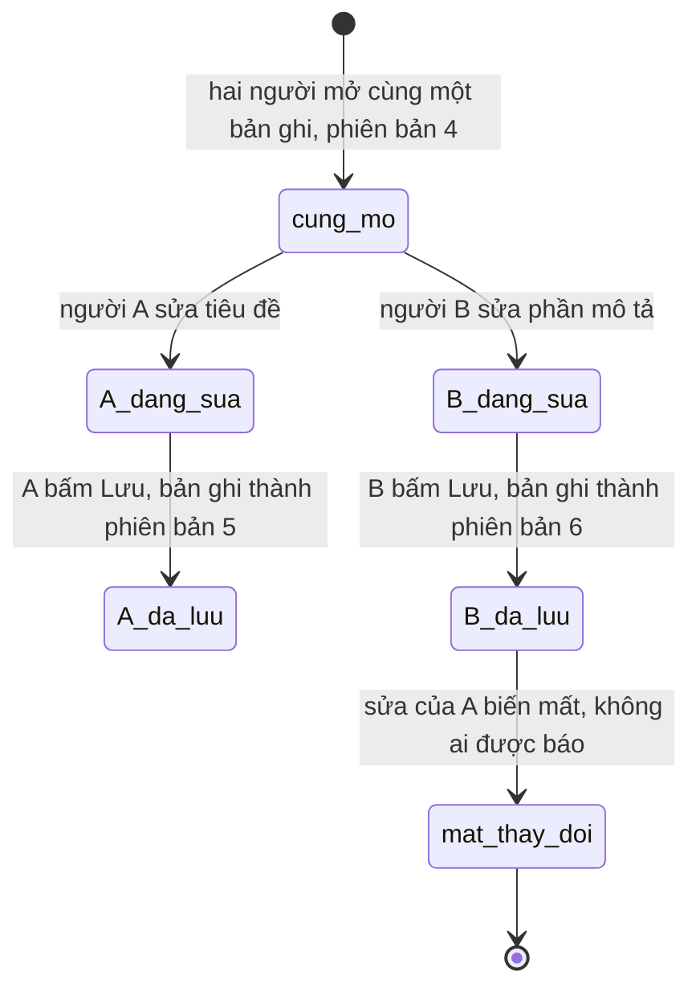

# Đồng thời và If-Match

## Tóm tắt

Hai người mở cùng một bản ghi, cùng sửa, cùng bấm Lưu. Hôm nay: người bấm sau thắng, người bấm trước không biết gì, và không có dấu vết nào cho thấy đã có một thay đổi bị đè lên.

Backend đã có sẵn cơ chế để chuyện đó không xảy ra. Mọi bản ghi gốc mang một số **phiên bản** tăng dần, và cơ sở dữ liệu từ chối một lệnh ghi dựa trên phiên bản đã cũ. Nhưng cơ chế đó chỉ chặn được hai lệnh ghi **trong cùng một khoảnh khắc**, không chặn được hai người sửa cách nhau mười phút — vì để chặn được chuyện đó, giao diện phải cầm số phiên bản trong tay và gửi nó lên. Facade v1 **không trả số phiên bản về cho client**, và không client nào giữ nó.

Hồ sơ vụ việc là chỗ đầu tiên bắt buộc phải có nó, và cũng là chỗ đầu tiên có mã cho nó.

Định nghĩa của *phiên bản* và *đã lưu* thuộc [`../nen-tang/luu-va-phien-ban.md`](../nen-tang/luu-va-phien-ban.md); hình dạng lỗi 409 thuộc [`../nen-tang/hop-dong-api.md`](../nen-tang/hop-dong-api.md).

## Hai loại "phiên bản", đừng lẫn

Từ *phiên bản* trong hệ thống này chỉ hai thứ khác nhau, và chúng không liên quan gì tới nhau:

| | Phiên bản nội dung | Số phiên bản của bản ghi |
|---|---|---|
| Là gì | Một bản chụp bất biến của tiêu đề và phần nội dung chính | Một số nguyên đếm số lần bản ghi bị sửa |
| Có ở | Đề bài, tài sản công nghệ, tài liệu | **Mọi bản ghi gốc** — người, đề bài, công nghệ, câu chuyện, hồ sơ vụ việc, tài liệu, nhãn phân loại… |
| Tăng khi | Sửa nội dung chính | **Mọi** lần ghi, kể cả đổi nhãn hay đổi trạng thái xuất bản |
| Dùng để | Xem lại và so sánh nội dung cũ | Phát hiện hai người sửa cùng một bản ghi |
| Người dùng thấy | Chưa màn hình nào hiện | Chưa màn hình nào hiện |

Tài liệu này nói về cột thứ hai. Cột thứ nhất ở [`../moi/lich-su-phien-ban.md`](../moi/lich-su-phien-ban.md).

## Số phiên bản tăng thế nào

Mỗi lần một bản ghi được ghi xuống, số phiên bản của nó tăng đúng một đơn vị. Ba điều đáng chú ý:

- **Sửa danh sách con cũng làm tăng.** Thêm một tệp đính kèm hay đổi danh sách lĩnh vực của một đề bài làm số phiên bản của chính đề bài đó tăng, dù không trường nào của nó đổi. Đây là chủ ý: hai người sửa hai phần khác nhau của cùng một bản ghi vẫn là hai người sửa cùng một bản ghi.
- **Nó không phải số lần bấm Lưu.** Một lần bấm Lưu sửa nhiều thứ vẫn chỉ tăng một.
- **Nó tăng cả khi lệnh ghi đến từ việc chạy nền**, không chỉ từ người dùng. Một đề bài vừa được xử lý AI xong có số phiên bản cao hơn lúc người dùng mở nó ra, dù không ai đụng vào.

Điều thứ ba là chỗ một thiết kế giao diện ngây thơ sẽ hỏng: nếu màn hình chặn lưu mỗi khi số phiên bản đổi, người dùng sẽ bị chặn bởi chính hệ thống chứ không bởi người khác.

## Cái đang chạy hôm nay

Cơ sở dữ liệu đã dùng số phiên bản làm điều kiện cho mọi lệnh ghi. Nếu hai lệnh ghi cùng chạm một bản ghi trong cùng một khoảnh khắc, lệnh thứ hai không ghi được gì và máy chủ trả **409** với câu tiếng Việt "Bản ghi đã bị thay đổi bởi một yêu cầu khác. Tải lại và thử lại."

Nhưng cửa sổ đó rất hẹp. Mỗi lời gọi v1 tự đọc bản ghi rồi ghi lại ngay trong cùng một lần xử lý, nên hai lời gọi cách nhau vài giây đã không còn đụng nhau: lời gọi sau đọc được phiên bản mới nhất và ghi đè bình thường.

Cái xảy ra thật, và xảy ra thường xuyên:

Người A không nhận thông báo nào. Màn hình của họ vẫn hiện nội dung họ vừa lưu, đúng cho tới lần tải lại tiếp theo. Người B không biết mình vừa đè lên việc của ai. Nhật ký kiểm toán có đủ hai dòng và đủ hai số phiên bản, nhưng không màn hình nào đọc được nó.

Không client nào giữ số phiên bản, và cũng không có gì để giữ: **facade v1 không đưa số phiên bản vào phản hồi**. Cả ba client đọc `updatedAt` để hiển thị và không bao giờ gửi nó lại. Đây không phải một thiếu sót của client; nó là một thiếu sót của hợp đồng.

## Cái v2 sẽ có

Hồ sơ vụ việc là bản ghi đầu tiên bắt buộc kiểm phiên bản, và mã cho nó đã tồn tại. Lệnh chuyển giai đoạn nhận một **số phiên bản kỳ vọng**. Nếu số đó khác số hiện tại của hồ sơ:

- máy chủ trả **409** với mã `VERSION_CONFLICT` và trường `currentVersion` là số hiện tại;
- **không** bản ghi quyết định nào được tạo;
- **không** giai đoạn nào đổi.

Nếu số khớp, thì việc đổi giai đoạn, tăng số phiên bản và ghi bản ghi quyết định xảy ra trong **một giao dịch** — không có trạng thái nửa vời.

Việc phân công môi giới chính cũng nhận một số phiên bản kỳ vọng và hành xử như vậy.

Vì sao hồ sơ vụ việc là chỗ đầu tiên cần: nó là bản ghi duy nhất mà **nhiều người khác nhau thao tác cùng lúc theo thiết kế**. Một đề bài có một chủ; một hồ sơ vụ việc có tới bảy loại bên tham gia, và ít nhất hai trong số đó — môi giới chính và đồng môi giới — đều được phép chuyển giai đoạn. Đè lên nhau ở đây không làm mất một dòng chữ; nó làm mất một quyết định.

> Ghi chú kỹ thuật: cơ chế được gọi là *If-Match* trong chú thích mã và trong kiến trúc, nhưng chỗ đã viết xong **không dùng header** — số phiên bản kỳ vọng là một trường trong thân lệnh. Header `ETag` đã được mở cho trình duyệt đọc trong cấu hình CORS nhưng chưa có chỗ nào trong mã đặt nó, và chưa có chỗ nào đọc header `If-Match`. Khi đặc tả v2 được viết, đây là một quyết định phải chốt: header hay trường trong thân. Hai cách không tương thích với nhau ở phía client.

## Thiết kế trải nghiệm khi đụng 409

Đây là phần chưa tồn tại ở bất kỳ đâu và là phần khó nhất. Chưa màn hình nào trong ba bề mặt có nhánh 409, nên mọi điều dưới đây là đề xuất, không phải mô tả.

**Nguyên tắc thứ nhất: không bao giờ vứt cái người dùng đang gõ.** Một xung đột phiên bản là *gián đoạn*, không phải *huỷ* — nó không nói lên người dùng muốn gì. Xử lý mặc định phải là giữ lại. Xem [`thay-doi-chua-luu.md`](thay-doi-chua-luu.md).

**Nguyên tắc thứ hai: nói rõ đã có người khác.** Câu chữ phải nói được ba điều: có người vừa sửa, sửa cái gì nếu biết, và cái người dùng đang gõ vẫn còn.

Ba mức xử lý, xếp theo công sức:

| Mức | Hiện gì | Người dùng làm gì |
|---|---|---|
| Tối thiểu | Một dải cảnh báo trong trang: "Bản ghi này vừa được người khác cập nhật. Thay đổi của bạn chưa được lưu." kèm nút **Tải lại** | Tự chép lại cái mình gõ sau khi tải lại. Đủ để không mất dữ liệu, nhưng khó chịu |
| Nên có | Cùng câu trên, thêm nút **Ghi đè**: tải lại số phiên bản mới rồi gửi lại đúng nội dung người dùng đang gõ | Một lần bấm. Vẫn mất thay đổi của người kia, nhưng có ý thức |
| Đầy đủ | Một màn so sánh hai bên: bản trên máy chủ và bản đang gõ, chọn theo từng trường | Trộn thủ công. Chỉ đáng làm cho hồ sơ vụ việc và cho biểu mẫu đề bài dài |

Với **hồ sơ vụ việc**, mức tối thiểu là không đủ. Chuyển giai đoạn không phải một biểu mẫu văn bản; nó là một quyết định phụ thuộc vào giai đoạn hiện tại. Nếu ai đó vừa chuyển hồ sơ từ `MATCHING` sang `DUE_DILIGENCE`, thì cái người dùng định làm — chuyển sang `DUE_DILIGENCE` — đã hết nghĩa. Ở đây câu đúng không phải "tải lại và thử lại" mà là **"hồ sơ đã sang giai đoạn khác, đây là giai đoạn hiện tại, đây là các đường đi hợp lệ từ đó"**, và bộ nút phải được vẽ lại. Nội dung người dùng đã gõ vào ô lý do thì giữ nguyên — nó vẫn có thể dùng được cho hành động mới.

**Nguyên tắc thứ ba: đừng chặn trước.** Một màn hình thăm dò máy chủ định kỳ để phát hiện sớm xung đột rồi khoá biểu mẫu lại sẽ chặn nhầm rất nhiều: số phiên bản tăng cả vì việc chạy nền. Chỗ đúng để phát hiện là **lúc gửi**, không phải lúc gõ. Nếu muốn cảnh báo sớm, cảnh báo phải là thông tin, không phải rào chắn.

## Huỷ và gián đoạn

| Sự kiện | Trước khi gửi | Trong khi đang gửi |
|---|---|---|
| Người dùng bấm Huỷ hoặc nhấn Escape | Vứt bỏ thay đổi chưa lưu. Số phiên bản trong bộ nhớ không còn ý nghĩa và bị bỏ theo. | Không huỷ được lời gọi. Nếu máy chủ đã ghi, số phiên bản đã tăng và giao diện không biết. |
| Người dùng đi chỗ khác trong app | Như trên, không có cảnh báo. | Lời gọi bị bỏ. Kết quả không được đọc, nên nếu nó là 409 thì không ai biết. |
| Nút Back/Forward của trình duyệt | Như trên. | Như trên. |
| Tải lại trang, hoặc đóng tab | Số phiên bản được đọc lại từ máy chủ cùng bản ghi. Đây là cách duy nhất hiện có để đồng bộ lại. | Kết quả mất. Lệnh có thể đã chạy hoặc chưa; không cách nào biết trên v1. Trên v2, gửi lại với **cùng khoá chống lặp** cho câu trả lời chắc chắn. |
| Mất mạng, hoặc request quá hạn | Không ảnh hưởng. | Đây là chỗ khoá chống lặp và số phiên bản phải đi cùng nhau: thử lại với cùng khoá và cùng số phiên bản là an toàn; sinh khoá mới thì có thể thực thi hai lần. |
| Phiên hết hạn (401), hoặc v1 bị dừng (410 Gone) | Số phiên bản đang giữ trở nên vô dụng. | 401 và 410 không phân biệt được với 409 ở client hiện tại — cả ba đều rơi vào cùng một khối bắt lỗi. |
| Bản ghi bị đổi bởi tab khác hoặc người khác, hoặc bị xoá | **Không có gì báo.** Màn hình tiếp tục hiện dữ liệu cũ cho tới lần gửi. | 409 khi lệch phiên bản; 404 khi bản ghi đã bị xoá mềm. Hai lỗi này cần hai câu khác nhau — "có người vừa sửa" và "bản ghi này không còn nữa" — và hôm nay không client nào phân biệt. |
| Trình duyệt tự điền, hoặc trình quản lý mật khẩu ghi vào biểu mẫu | Không ảnh hưởng tới số phiên bản. | Không ảnh hưởng. |

Hai tab của **cùng một người** là trường hợp thường gặp nhất và ít được nghĩ tới nhất: mở một bản ghi ở hai tab, sửa ở cả hai, lưu lần lượt. Hệ thống không phân biệt được đây với hai người khác nhau, và nó không nên phân biệt — mất dữ liệu là mất dữ liệu.

## Tương tác với hệ thống khác

**Quyền và vai trò.** Kiểm phiên bản chạy **sau** kiểm quyền: một người không có quyền chuyển giai đoạn nhận 403 chứ không nhận 409, kể cả khi số phiên bản họ gửi cũng sai. Thứ tự này quan trọng vì nó quyết định thông điệp nào hiện ra.

**Kiểm tra dữ liệu và cách hiện lỗi.** 409 là mã trạng thái dùng chung cho *lệch phiên bản* và cho *xung đột trạng thái* (ví dụ email đã tồn tại). Ở v2, hai loại phân biệt được bằng trường `code`; ở v1 thì không. Xem [`loi-va-thong-bao.md`](loi-va-thong-bao.md).

**Thay đổi chưa lưu.** Một xung đột phiên bản để lại biểu mẫu ở trạng thái bẩn — đúng như mọi lỗi khác lúc gửi. Xem [`thay-doi-chua-luu.md`](thay-doi-chua-luu.md).

**Cập nhật lạc quan và hoàn tác.** Không có hoàn tác ở bất kỳ đâu. Quay lại một nội dung cũ nghĩa là ghi thêm một phiên bản nữa, và số phiên bản lại tăng.

**Ngoại tuyến.** Không client nào xếp hàng lệnh ghi khi mất mạng. Nếu sau này có, số phiên bản trong hàng đợi sẽ cũ theo thời gian và mọi lệnh trong hàng sẽ đụng 409 khi mạng trở lại — đó là lý do đủ để không làm hàng đợi ngoại tuyến trước khi có màn so sánh.

**Thông báo và toast.** Xung đột phiên bản **không nên** hiện bằng toast: toast biến mất, và người dùng cần đọc kỹ rồi quyết định. Nó phải là một dải trong trang hoặc một hộp thoại.

**Trạng thái lọc/tìm trong URL.** Không có tương tác.

**Đa ngôn ngữ.** Câu 409 của máy chủ đã là tiếng Việt. Đây là một trong số ít chỗ giao diện có thể hiển thị thẳng thông điệp máy chủ mà không lộ tiếng Anh.

**Dấu vết kiểm toán.** Mỗi dòng kiểm toán ghi kèm **số phiên bản của đối tượng** tại thời điểm đó. Đây là thứ cho phép dựng lại một vụ đè dữ liệu sau này: hai dòng liên tiếp với hai số phiên bản liền nhau và hai người khác nhau.

## Trường hợp biên

- **Đè dữ liệu hôm nay là im lặng và không có đường phát hiện từ giao diện.** Nó chỉ tra được từ nhật ký kiểm toán, mà không màn hình nào đọc được nhật ký.
- **Số phiên bản tăng vì việc chạy nền.** Một đề bài đang được xử lý AI có số phiên bản đổi mà không ai sửa. Giao diện nào coi mọi thay đổi số phiên bản là "có người khác đang sửa" sẽ báo động giả liên tục.
- **Đổi danh sách lĩnh vực cũng tăng số phiên bản.** Hai người, một người sửa tiêu đề và một người sửa nhãn, vẫn xung đột với nhau dù họ không chạm cùng một trường.
- **409 khi lệch phiên bản và 409 khi xung đột trạng thái trông giống nhau ở v1.** Người dùng nhận cùng một mã cho "có người vừa sửa" và cho "email này đã tồn tại".
- **Hồ sơ đang có hold mở không chuyển giai đoạn được, bất kể số phiên bản đúng hay sai.** Đây là một lý do từ chối khác, cần một câu khác.
- **Chuyển giai đoạn thất bại không để lại bản ghi quyết định nào.** Đúng như mong muốn, nhưng nó có nghĩa là dòng thời gian của hồ sơ **không** cho thấy đã có ai thử và bị chặn. Chỉ nhật ký kiểm toán biết.
- **Hai tab của cùng một người là xung đột hợp lệ.** Không nên có ngoại lệ cho trường hợp này.

## Câu hỏi mở và kiểm chứng

- Chưa đo được bất kỳ xung đột nào trên bản chạy vì cơ sở dữ liệu rỗng và vì chưa có endpoint v2. Toàn bộ mô tả về hành vi 409 đọc từ mã.
- Trường `currentVersion` trả về khi hai lệnh ghi đụng nhau trong cùng khoảnh khắc được lấy từ đối tượng trong bộ nhớ, mà số phiên bản của đối tượng đó **đã được tăng lên trước khi lệnh ghi thất bại**. Nếu đúng vậy thì con số trả về không phải số hiện tại của bản ghi trong cơ sở dữ liệu, và một giao diện tin vào nó sẽ gửi lại một số vẫn sai. Đường chuyển giai đoạn của hồ sơ vụ việc không có vấn đề này vì nó so sánh trước khi ghi. Cần đo (chưa cấp mã lỗi).
- Chưa chốt số phiên bản đi bằng header `If-Match` và `ETag` hay bằng một trường trong thân lệnh. Mã đã viết dùng cách thứ hai; kiến trúc và cấu hình CORS chuẩn bị cho cách thứ nhất. Đây là quyết định phải ra trước khi viết endpoint v2 đầu tiên.
- Chưa quyết định facade v1 có được bổ sung số phiên bản vào phản hồi không. Nếu có, ba client có thể bắt đầu giữ nó ngay mà không chờ v2 — nhưng việc đó phá vỡ cam kết "facade tái tạo nguyên hình dạng NestJS".
- Chưa quyết định mức xử lý 409 nào sẽ được xây cho từng loại màn hình. Mức đầy đủ (so sánh từng trường) tốn nhiều công và có thể không đáng cho các biểu mẫu ngắn.
- Chưa rõ có bản ghi nào ngoài hồ sơ vụ việc cần kiểm phiên bản ở tầng API ngay từ đầu không. Biểu mẫu đề bài của cổng người dùng dài và có nhiều tệp đính kèm; đó là ứng viên tiếp theo.
- Chưa rõ điều gì xảy ra khi một bản ghi bị xoá mềm trong lúc một người đang sửa nó. Từ mã thì lệnh ghi sẽ không tìm thấy bản ghi và trả 404, nhưng chưa xác nhận.

Đối chiếu với SourceCode/nacentech và ba repo frontend, bản chụp ngày 2026-09-04.
