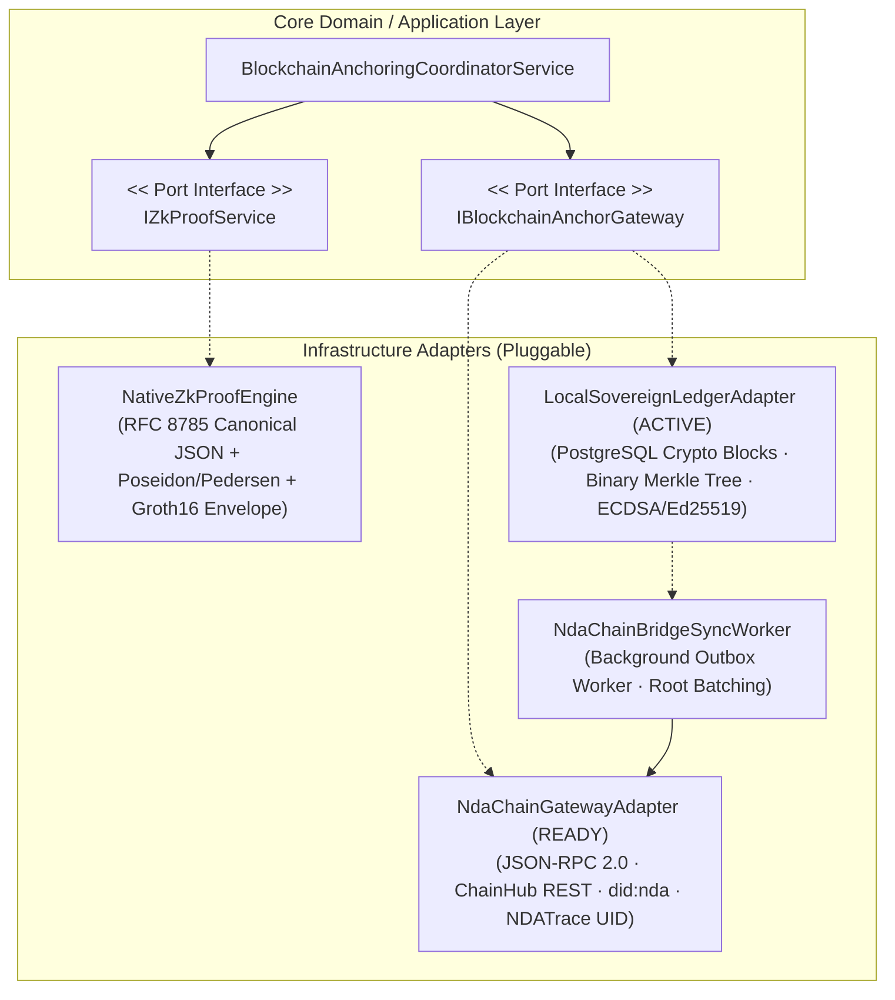
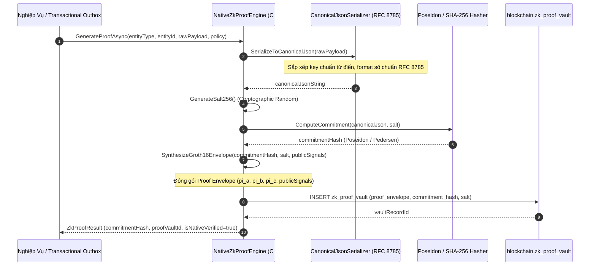
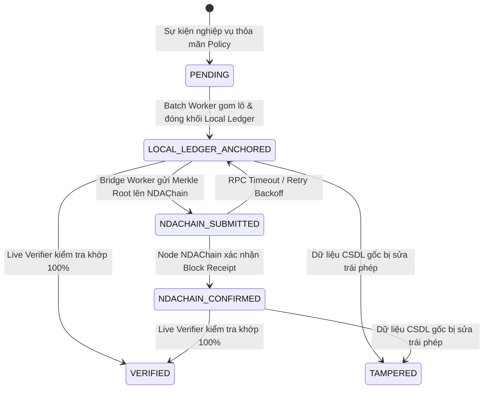

# ADR-0017: Động Cơ Bảo Chứng Mật Mã Học ZKProof Đa Thực Thể & Đầu Chờ Liên Thông Chuỗi Khối Quốc Gia NDAChain (Entity-Agnostic Blockchain & ZKP Anchoring Engine)

- **Số ADR**: ADR-0017 (Kiến trúc Nền tảng & Hạ tầng Chuỗi Khối Quốc Gia NacenTech)
- **Trạng thái**: Chấp thuận (Accepted)
- **Ngày quyết định**: 2026-11-02
- **Người đề xuất & Thẩm định**: Software Architect kiêm TechLead SA (`nacen-techlead-sa`)
- **Phê duyệt DoR Gate 2**: Product Owner kiêm Project Manager (`nacen-po-pm`)
- **Phân hệ tác động**: `TASK-11_HA_TANG_BLOCKCHAIN_NDACHAIN_VA_ZKPROOF`, `NacenTech.Modules.Blockchain`, `TASK-04` (Seller Offers), `TASK-08` (MOU Deal Room), `TASK-09` (TT17 Assessment), `TASK-02` (Enterprise Profile)
- **Căn cứ nghiệp vụ & Thiết kế cơ sở**:
  * Quyết định `PO-DEC-20261102-06` tại [`Specification/BASIC_DESIGN_NACENTECH.md`](file:///Users/luongdt/Library/CloudStorage/GoogleDrive-luongdt.wi@gmail.com/My%20Drive/NacenTechProject/Specification/BASIC_DESIGN_NACENTECH.md) Mục 24.
  * C4 Level 1 (Mục 2.1) & C4 Level 2 (Mục 2.2) tích hợp khối `NdaChain` và `BlockchainAnchoring`.
  * Walking Skeleton WS-06 (Bảo chứng Mật Mã Học & Neo Chuỗi Bất Biến ZKP / NDAChain) Mục 3.2.
  * Tuân thủ Nghị định 13/2023/NĐ-CP (PDPD) về bảo vệ dữ liệu cá nhân và bí mật thương mại.

---

## 1. Bối Cảnh (Context)

Nền tảng NacenTech / NacenTwin là Sàn Giao dịch Công nghệ & Đổi mới Sáng tạo Quốc gia, nắm giữ các tài sản trí tuệ vô hình, hồ sơ công nghệ, biên bản ghi nhớ hợp tác (MOU), và kết quả thẩm định năng lực công nghệ theo Thông tư 17/2019/TT-BKHCN. Nhằm thiết lập tính bất biến, chống chối bỏ (Non-repudiation) và phục vụ liên thông chính phủ điện tử, Chủ đầu tư yêu cầu tích hợp với **Hạ tầng Chuỗi Khối Quốc Gia NDAChain** do Trung tâm Dữ liệu Quốc gia (Bộ Công an) và Hiệp hội Dữ liệu Quốc gia (NDA) chủ trì.

Tuy nhiên, trong quá trình thẩm định kiến trúc tiền triển khai, đội ngũ SA nhận diện 4 rào cản kỹ thuật cốt tử:

1. **Thực tế Hạ tầng & Rủi ro Phụ thuộc Ngoài (External Node Dependency & Ports & Adapters Mandate)**:
   - Tại thời điểm phát triển, đầu mối NDAChain chưa cung cấp tài khoản node RPC production hoặc credentials chính thức.
   - Nếu đội ngũ lập trình chờ đợi kết nối thật thì dự án sẽ bị đình trệ; ngược lại, nếu dùng dữ liệu giả lập (mocking ngầm chuỗi băm ngẫu nhiên hoặc transaction hash tĩnh), hệ thống sẽ vi phạm nghiêm trọng **Kỷ luật Zero-Mock** của NacenTech và không chứng minh được tính toàn vẹn toán học khi nghiệm thu.
2. **Nguy Cơ Vi Phạm Quyền Riêng Tư & Lộ Bí Mật Kinh Doanh (Privacy & Compliance Risk)**:
   - Dữ liệu trên blockchain là công khai hoặc bán công khai giữa các node liên minh.
   - Các dữ liệu như Báo cáo tài chính doanh nghiệp (TT17), điều khoản thương thảo bí mật trong Deal Room, danh tính nhân sự R&D nếu đẩy trực tiếp (plaintext) lên chuỗi khối sẽ vi phạm trực tiếp Nghị định 13/2023/NĐ-CP về bảo vệ dữ liệu cá nhân và lộ bí mật sáng chế của doanh nghiệp.
3. **Hiện tượng "Cứng Nhắc Thực Thể" (Entity Coupling & Hardcoded Anchoring)**:
   - Nếu viết mã neo chuỗi gán cứng riêng cho từng bảng (`seller_technology_offers` hoặc `mou_agreements`), khi Bộ KH&CN hoặc Chủ đầu tư muốn mở rộng bảo chứng sang các thực thể mới (ví dụ: Chứng chỉ học liệu số LMS, Hồ sơ chuyên gia, Bằng sáng chế độc quyền), lập trình viên sẽ phải sửa code, viết lại API và chạy lại toàn bộ quy trình kiểm thử.
4. **Chi Phí & Nghẽn Cổ Chai Giao Dịch (Scalability & Transaction Cost Bottlenecks)**:
   - Việc gửi từng giao dịch đơn lẻ lên chuỗi khối sẽ gây quá tải mạng, trễ xác nhận (block confirmation latency từ 5–15 giây) và tiêu tốn tài nguyên gas/phí giao dịch khổng lồ khi quy mô đạt hàng chục ngàn công nghệ và hồ sơ.

---

## 2. Quyết Định Kiến Trúc (Architectural Decisions)

Software Architect kiêm TechLead quyết định ban hành kiến trúc **Động Cơ Bảo Chứng Mật Mã Học ZKProof Đa Thực Thể & Đầu Chờ Chuỗi Khối Quốc Gia (Entity-Agnostic Blockchain & ZKP Anchoring Engine)** với các trụ cột thiết kế sau:

### 2.1. Kiến Trúc Lục Giác Cổng & Bộ Thích Ứng (Hexagonal Ports & Adapters Architecture)

Tách biệt hoàn toàn tầng Domain cốt lõi khỏi hạ tầng chuỗi khối cụ thể bằng cách định nghĩa các Ports trừu tượng:



1. **Port `IZkProofService`**:
   - Chịu trách nhiệm chuẩn hóa dữ liệu thực thể thành chuỗi đại số chuẩn tắc (Canonical Representation), tính toán Cam kết Mật mã học (Cryptographic Commitment), sinh Proof Envelope và xác minh tính hợp lệ của bằng chứng không kiến thức.
2. **Port `IBlockchainAnchorGateway`**:
   - Trừu tượng hóa hành vi ghi nhận và tra cứu trạng thái neo trên sổ cái.
   - Định nghĩa các phương thức: `AnchorMerkleRootAsync`, `GetAnchorReceiptAsync`, `VerifyAnchorProofAsync`.

---

### 2.2. Kỷ Luật Zero-Mock: Sổ Cái Mật Mã Nội Bộ (Local Sovereign Cryptographic Ledger)

Khi chưa có kết nối vật lý với node NDAChain, hệ thống tuyệt đối **KHÔNG DÙNG DỮ LIỆU FAKE**. Thay vào đó, hệ thống vận hành một **Sổ cái Mật mã Học Nội bộ (Local Sovereign Cryptographic Ledger)** hoàn chỉnh chạy trực tiếp trên CSDL PostgreSQL 16:

1. **Cấu Trúc Khối Băm Chuỗi Thật (Real Cryptographic Blockchain Structure)**:
   - Mỗi khối `blockchain.ledger_blocks` được gắn kết toán học với khối trước đó qua hàm băm mật mã học SHA-256 / Keccak-256:
     $$\text{BlockHash}_n = \text{SHA256}\left(\text{BlockNumber}_n \mathbin{\Vert} \text{PreviousHash}_{n-1} \mathbin{\Vert} \text{MerkleRoot}_n \mathbin{\Vert} \text{Timestamp}_n \mathbin{\Vert} \text{TxCount}_n\right)$$
   - Khối nguyên thủy (Genesis Block - Block #0) có `previous_hash = '0000000000000000000000000000000000000000000000000000000000000000'`.
2. **Cây Merkle Nhị Phân Thật (Binary Merkle Tree)**:
   - Các bản ghi neo (`anchor_records`) trong chu kỳ đóng khối (mặc định gom lô 10 bản ghi hoặc mỗi 5 phút) được đưa vào cây Merkle nhị phân cân bằng.
   - Mỗi lá của cây là băm cam kết ZKP: $\text{Leaf}_i = \text{Hash}(\text{Commitment}_i)$.
   - Hệ thống tính toán Merkle Root và sinh đường dẫn kiểm chứng `merkle_path` (Audit Proof) cho từng bản ghi. Bất kỳ sự thay đổi dù chỉ 1 bit của dữ liệu gốc cũng làm sai lệch Merkle Root và bị phát hiện ngay lập tức.
3. **Chữ Ký Số Khối Cấp Nền Tảng Thật (Real Cryptographic Key Signature)**:
   - Mỗi khối được ký số số hóa học bằng cặp khóa ECDSA (secp256k1) hoặc Ed25519 của Nền tảng NacenTech (`validator_address`, `block_signature`).
   - Bất kỳ ai cũng có thể dùng Public Key công khai của hệ thống để xác thực tính toàn vẹn và nguồn gốc của khối mà không cần tin cậy mù quáng vào cơ sở dữ liệu.

---

### 2.3. Đầu Chờ Chuỗi Khối Quốc Gia NDAChain & Bộ Đồng Bộ Cầu Nối (NDAChain Ready Adapter & Bridge Sync)

1. **Bộ Thích Ứng NDAChain (`NdaChainGatewayAdapter`)**:
   - Được thiết kế sẵn sàng 100% về mặt cấu trúc hợp đồng để kích hoạt ngay khi nhận được credentials:
     * Giao thức JSON-RPC 2.0 qua HTTPS/WSS (tương thích EVM PoA của NDAChain).
     * ChainHub REST API Gateway theo tài liệu hướng dẫn của Trung tâm Dữ liệu Quốc gia.
     * ABI Smart Contract chuẩn `NdaAnchorRegistry.sol`:
       ```solidity
       function anchorMerkleRoot(
           bytes32 rootHash, 
           uint256 recordCount, 
           string memory schemaCode, 
           string memory metadataUri
       ) external returns (bytes32 txHash);
       ```
     * Định dạng định danh phân tán quốc gia: `did:nda:<mst_or_taxid>:<entity_uuid>`.
     * Định danh truy xuất chuỗi khối quốc gia: `NDATrace UID` theo chuẩn GS1 EPCIS / EBSI.
2. **Cơ Chế Đồng Bộ Cầu Nối Tự Động (`NdaChainBridgeSyncWorker`)**:
   - Khi cờ cấu hình `Blockchain:NdaChain:Enabled = true`:
     * Background Worker sẽ quét các khối nội bộ có trạng thái `LOCAL_LEDGER_ANCHORED`.
     * Gom các Merkle Root của các khối này và gọi lệnh `anchorMerkleRoot` lên NDAChain.
     * Cập nhật biên lai chuỗi khối quốc gia: `ndachain_tx_hash`, `ndachain_block_number`, chuyển trạng thái bản ghi thành `NDACHAIN_CONFIRMED`.
   - Cơ chế này đảm bảo: **Dữ liệu được bảo chứng ngay lập tức tại Local Ledger mà không phụ thuộc vào tình trạng mạng hoặc tiến độ cấp quyền của NDAChain.**

---

### 2.4. Động Cơ Mật Mã Học ZKProof Lai (Hybrid Native .NET 10 ZKP Architecture)

Nhằm bảo đảm hiệu năng siêu tốc mà không làm phình to footprint hạ tầng, hệ thống triển khai kiến trúc ZKP lai:



1. **Chuẩn Hóa Đại Số Dữ Liệu Theo RFC 8785 (Canonical JSON Serialization)**:
   - Loại bỏ hoàn toàn sự phụ thuộc vào khoảng trắng, thứ tự thuộc tính của JSON parser.
   - Sắp xếp key theo thứ tự từ điển UTF-8 bytes, chuẩn hóa số thực theo tiêu chuẩn ECMAScript IEEE 754 để đảm bảo: **Dữ liệu gốc giống nhau sẽ luôn luôn sinh ra một chuỗi băm duy nhất và bất biến tuyệt đối.**
2. **Cam Kết Ẩn Mật Mã Học (Cryptographic Commitment & Salt)**:
   - Tính toán cam kết mật mã học:
     $$\text{Commitment} = \text{Hash}\left(\text{CanonicalPayload} \mathbin{\Vert} \text{Salt}_{256}\right)$$
   - Sử dụng thuật toán băm thân thiện với mạch ZK (Poseidon Hash hoặc SHA-256 salted).
   - `Salt` 256-bit sinh ngẫu nhiên theo chuẩn mật mã học (`RandomNumberGenerator`), được lưu trữ mã hóa trong `blockchain.zk_proof_vault`, ngăn chặn triệt để tấn công vét cạn (Brute-force Dictionary Attack).
3. **Đóng Gói Bằng Chứng Không Kiến Thức (Groth16 Envelope)**:
   - Hệ thống đóng gói cấu trúc bằng chứng theo định dạng chuẩn quốc tế SnarkJS / Groth16 Envelope:
     ```json
     {
       "scheme": "Groth16_BN254",
       "pi_a": ["0x12a...", "0x09b...", "0x01"],
       "pi_b": [["0x1f...", "0x2a..."], ["0x03...", "0x11..."], ["0x01", "0x00"]],
       "pi_c": ["0x18c...", "0x34d...", "0x01"],
       "publicSignals": ["0xCommitmentHash...", "0xSchemaHash...", "0xTimestamp..."]
     }
     ```
   - Định dạng này sẵn sàng 100% để bộ kiểm chứng trực tuyến (Live Verifier Tool) trên Web hoặc Smart Contract trên NDAChain kiểm tra trong $O(1)$ thời gian thực mà không cần giải mã dữ liệu nội dung thô.

---

### 2.5. Ma Trận Chính Sách Neo Dữ Liệu Đa Thực Thể (Entity-Agnostic Policy Matrix)

Không gắn cứng logic vào từng bảng nghiệp vụ. Bảng `blockchain.anchor_policies` cho phép Quản trị viên kích hoạt hoặc tạm dừng neo chuỗi cho bất kỳ thực thể nào qua giao diện `/admin/blockchain`:

| Mã Thực Thể (`entity_type`) | Mô Tả Nghiệp Vụ | Tiêu Chí Neo Tự Động (Anchor Trigger) | Danh Sách Trường Ẩn Danh / Cam Kết ZKP | Trạng Thái Mặc Định |
| :--- | :--- | :--- | :--- | :---: |
| `SELLER_OFFER` | Chào bán công nghệ & thiết bị | Trạng thái chuyển sang `APPROVED` | `offer_code`, `title`, `seller_id`, `trl_level`, `specifications` | **BẬT** |
| `DEAL_ROOM_MOU` | Biên bản ghi nhớ hợp tác MOU | Hai bên ký duyệt `MOU_SIGNED` | `mou_code`, `opportunity_id`, `buyer_id`, `seller_id`, `terms_hash` | **BẬT** |
| `TT17_ASSESSMENT` | Điểm thẩm định năng lực CN | Cán bộ Sở phê duyệt `APPROVED` | `assessment_code`, `enterprise_id`, `final_score`, `criteria_scores` | **BẬT** |
| `ENTERPRISE_PROFILE` | Hồ sơ pháp nhân DN ĐMST | Hồ sơ được xác thực `VERIFIED` | `tax_code`, `legal_name`, `incorporation_date`, `charter_capital` | **TẮT** (Chờ cấu hình) |
| `LMS_CERTIFICATE` | Chứng chỉ hoàn thành học liệu | Cấp chứng chỉ `ISSUED` | `cert_code`, `learner_id`, `material_id`, `completed_at` | **TẮT** (Chờ cấu hình) |

---

## 3. Thiết Kế Schema CSDL & Máy Trạng Thái Sổ Cái (`blockchain.*`)

### 3.1. Cấu Trúc 5 Bảng Dữ Liệu Chuyên Biệt

1. **`blockchain.anchor_policies`**: Định nghĩa chính sách neo cho từng loại thực thể (Trigger status, schema JSON path, cờ ZKP, chu kỳ đóng khối).
2. **`blockchain.anchor_records`**: Lưu trữ từng bản ghi neo của thực thể, băm cam kết ZKP, trạng thái neo, và liên kết khóa ngoại với khối sổ cái.
3. **`blockchain.ledger_blocks`**: Sổ cái chuỗi khối nội bộ (Block Number, Previous Hash, Block Hash, Merkle Root, Chữ ký số ECDSA, Trạng thái liên thông).
4. **`blockchain.zk_proof_vault`**: Kho lưu trữ an toàn bằng chứng không kiến thức Groth16 Envelope, Public Signals và Salt bảo vệ PDPD.
5. **`blockchain.bridge_sync_logs`**: Nhật ký đồng bộ cầu nối giữa Sổ cái nội bộ và Chuỗi khối Quốc gia NDAChain (TxHash, GasUsed, ResponsePayload, RetryAttempts).

### 3.2. Máy Trạng Thái Vòng Đời Neo Dữ Liệu (Anchoring Lifecycle State Machine)



- **`PENDING`**: Bản ghi đã được sinh từ nghiệp vụ, đang xếp hàng trong hàng đợi gom lô.
- **`LOCAL_LEDGER_ANCHORED`**: Đã đưa vào cây Merkle thật, đóng khối sổ cái nội bộ có chữ ký ECDSA. Đạt chuẩn xác thực toàn vẹn 100%.
- **`NDACHAIN_SUBMITTED`**: Merkle Root đã được gửi qua cổng JSON-RPC/ChainHub của NDAChain, đang chờ xác nhận giao dịch.
- **`NDACHAIN_CONFIRMED`**: Giao dịch đã được ghi nhận trên chuỗi khối quốc gia, có `ndachain_tx_hash` và `block_number`.
- **`TAMPERED`**: Cảnh báo đỏ nguy hiểm! Phát hiện khi dữ liệu nghiệp vụ gốc bị ai đó can thiệp trực tiếp vào database, làm lệch cam kết mật mã học.

---

## 4. Hệ Quả & Đánh Đổi (Consequences & Trade-offs)

### 4.1. Điểm Tích Cực (Positive Consequences)
- **Độc lập hạ tầng hoàn toàn**: Đội ngũ phát triển và kiểm thử có thể vận hành, kiểm thử toàn trình 100% tính năng chuỗi khối ngay hôm nay với dữ liệu toán học thật mà không phải chờ đợi node Bộ Công an.
- **Bảo mật & Tuân thủ Luật An toàn thông tin**: Tuyệt đối không lộ PII hoặc thông tin kinh doanh nhạy cảm lên mạng phân tán nhờ cơ chế ZKP Commitment và Merkle Tree.
- **Khả năng mở rộng vượt bậc (O(1) Anchoring)**: Gom hàng nghìn bản ghi vào 1 Merkle Root giúp chi phí neo trên chuỗi khối quốc gia tiệm cận mức tối thiểu, loại bỏ nghẽn cổ chai giao dịch.
- **Tính linh hoạt nghiệp vụ**: Bổ sung thực thể mới chỉ cần thêm 1 dòng cấu hình trong `anchor_policies`, không cần sửa mã nguồn ứng dụng.

### 4.2. Đánh Đổi & Điểm Cần Lưu Ý (Trade-offs & Mitigations)
- **Độ trễ neo dữ liệu (Batching Latency)**: Do áp dụng cơ chế gom lô (Batching) để tối ưu hiệu năng, bản ghi sẽ ở trạng thái `PENDING` trong khoảng 1–5 phút trước khi vào khối.
  * *Biện pháp giảm thiểu*: Cung cấp nút CTA "Đóng khối ngay (Flush Block Now)" trên trang Quản trị `/admin/blockchain` cho các tình huống cần xác thực khẩn cấp.
- **Quản lý an toàn khóa bí mật (Platform Private Key Security)**: Khóa bí mật dùng để ký số `ledger_blocks` phải được bảo vệ nghiêm ngặt.
  * *Biện pháp giảm thiểu*: Giai đoạn đầu cấu hình qua biến môi trường an toàn (Environment Variable/K8s Secret), giai đoạn sau kết nối HSM / Azure Key Vault.

---

## 5. Kế Hoạch Triển Khai & Kiểm Chứng (Verification Mandate)

Quyết định này được kiểm chứng qua bộ kiểm thử 4 tầng bắt buộc:
1. **Unit Test Toán Học (`NacenTech.Blockchain.Tests`)**:
   - Kiểm thử tính bất biến của Canonical JSON RFC 8785 (thay đổi thứ tự trường không đổi hash).
   - Kiểm thử tính toán Merkle Tree nhị phân, kiểm tra bằng chứng đường dẫn `merkle_path` khớp 100%.
   - Kiểm thử tính toán cam kết ZKP và đóng gói Groth16 Envelope.
2. **Database Integration Test (PostgreSQL 16 Thật)**:
   - Kiểm thử quy trình gom lô và đóng khối `ledger_blocks`, đối soát chữ ký ECDSA và liên kết băm `previous_hash`.
3. **Chaos & Resilience Test**:
   - Giả lập lỗi mạng ngắt kết nối NDAChain Gateway: Kiểm tra hệ thống tự động lưu giữ tại `LOCAL_LEDGER_ANCHORED` và tự động retry qua `NdaChainBridgeSyncWorker` khi mạng phục hồi mà không rơi rụng dữ liệu.
4. **End-to-End Visual QA & Kịch Bản Phá Hoại (Tamper Data E2E Test)**:
   - Tạo hồ sơ công nghệ $\rightarrow$ Đóng khối thành công (Badge Xanh: *Đã bảo chứng*).
   - Dùng script can thiệp sửa trực tiếp 1 ký tự tiêu đề trong bảng `seller_technology_offers`.
   - Chạy Live Verifier Tool: Hệ thống lập tức báo cờ đỏ **TAMPERED** (Dữ liệu đã bị giả mạo), chứng minh sức mạnh bảo chứng mật mã học của hệ thống.
