# AI Features - Flow Documentation

Tài liệu mô tả toàn bộ luồng hoạt động của các tính năng AI trong hệ thống DMST Backend.

---

## Tổng quan kiến trúc

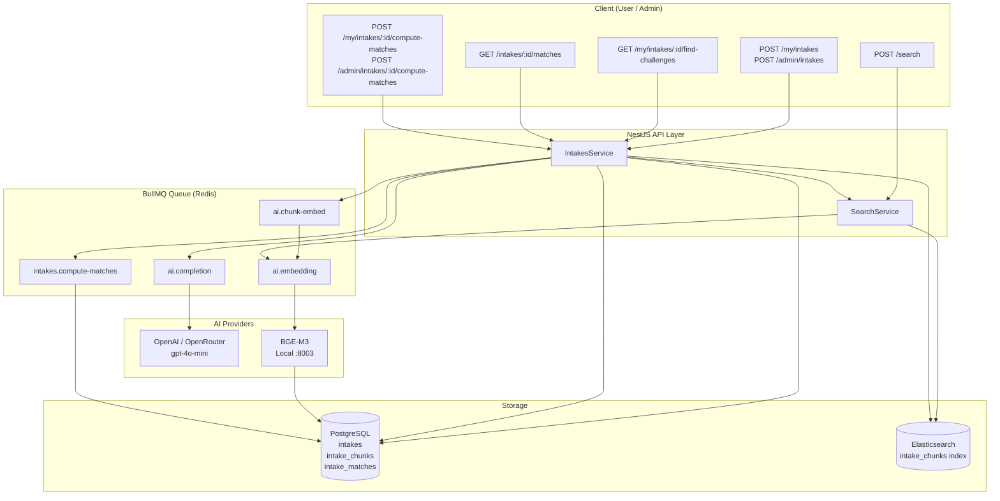

---

## 1. Luồng tạo Intake (AI Processing Pipeline)

Khi user/admin tạo intake mới, hệ thống tự động chạy **4 bước AI** nối tiếp nhau dưới nền:

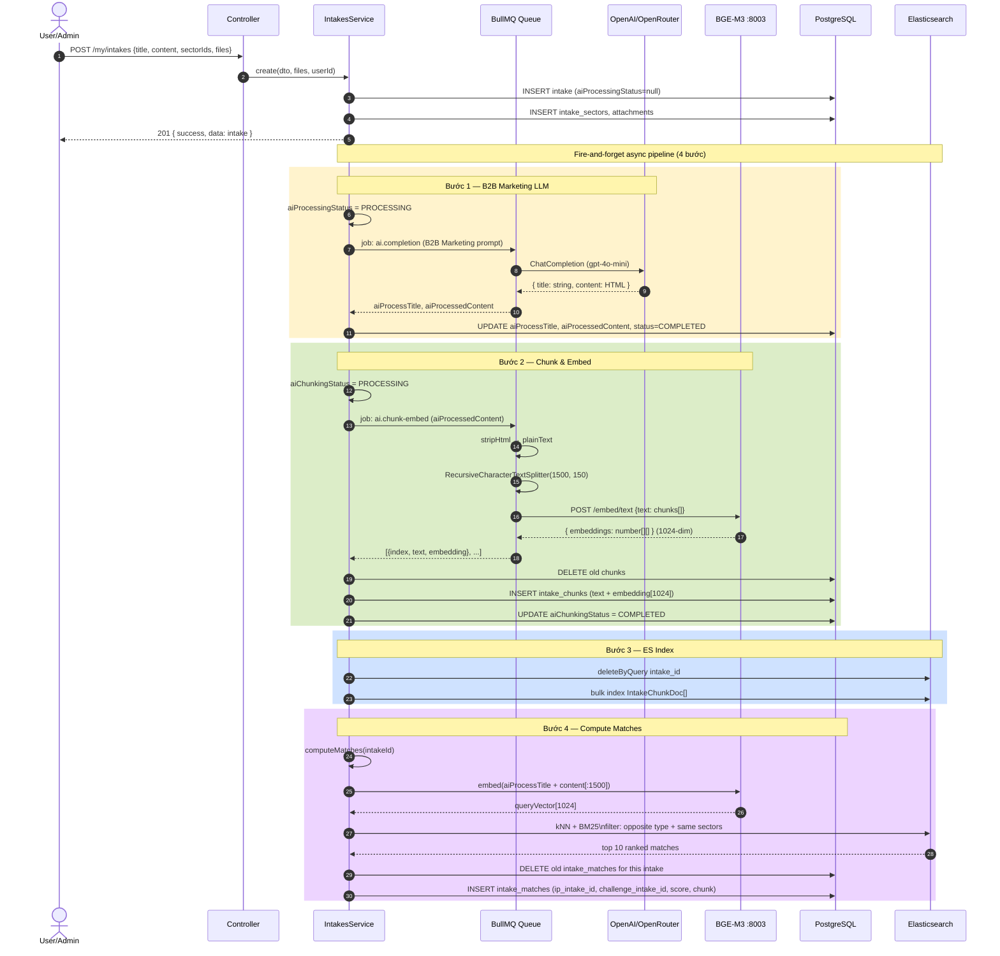

---

## 2. Luồng B2B Marketing (LLM Processing)

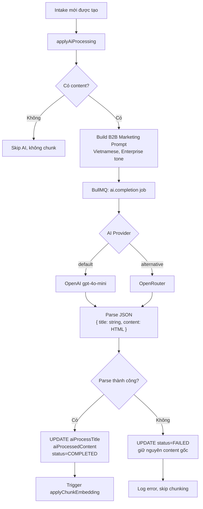

**Prompt output format:**
```json
{
  "title": "≤65 ký tự, B2B enterprise tone",
  "content": "<h1>Hero</h1><h2>Tổng quan</h2><h2>Tính năng</h2><h2>Giá trị cốt lõi</h2>"
}
```

---

## 3. Luồng Chunk & Embed (Vector Processing)

```mermaid
flowchart LR
    A[aiProcessedContent\nHTML text] --> B[stripHtml\n→ plainText]
    B --> C[RecursiveCharacterTextSplitter\nchunkSize=1500, overlap=150]
    C --> D["chunks[]\n~1-5 chunks/intake"]
    D --> E[BGE-M3 API\nPOST /embed/text\nbatch all chunks]
    E --> F["embeddings[][1024]\n1 vector per chunk"]
    F --> G[(PostgreSQL\nintake_chunks\ntext + float[1024])]
    G --> H[indexIntake\n→ Elasticsearch]
    H --> I[computeMatches\n→ intake_matches]

    style E fill:#f9a825,color:#000
    style H fill:#0277bd,color:#fff
    style I fill:#6a1b9a,color:#fff
```

---

## 4. Luồng Compute Matches (Queue-based Matching)

Matching chạy qua `intakes-queue` (BullMQ). Có hai nguồn trigger:

### 4a. Automatic (sau khi ES index xong)

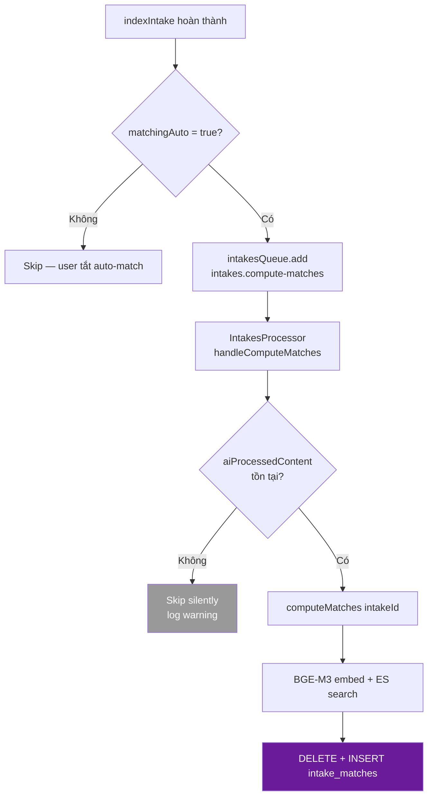

### 4b. Manual (API endpoint)

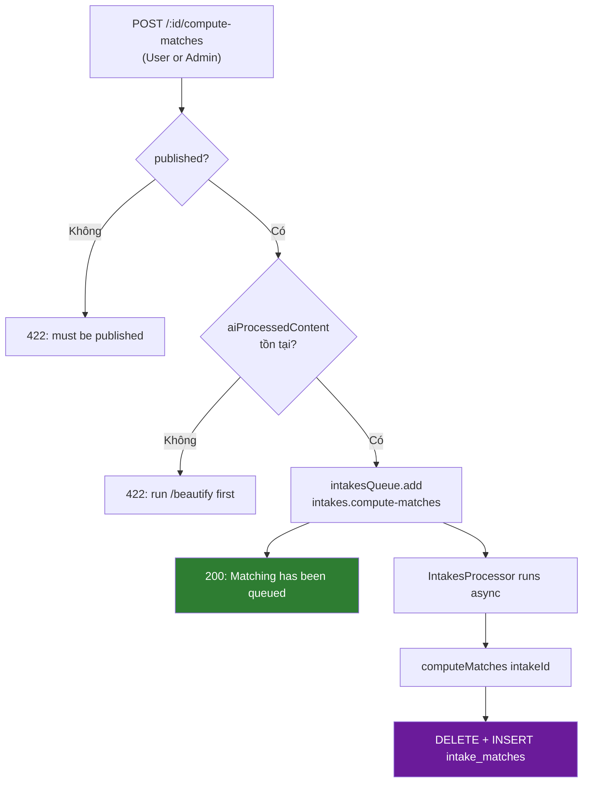

### Điều kiện match hợp lệ

- Intake candidate phải `status = published`
- Intake candidate phải thuộc user khác (không match với chính mình)
- Intake candidate phải cùng ngành (sectorIds overlap)

**Bảng `intake_matches`:**
```
ip_intake_id        → UUID của IP intake
challenge_intake_id → UUID của Challenge intake
score               → float (hybrid search score)
matched_chunk       → text chunk khớp nhất
chunk_index         → vị trí chunk trong intake
computed_at         → thời điểm tính toán
```

---

## 5. Luồng Tìm kiếm Semantic (Hybrid Search)

Buyer tìm kiếm giải pháp IP theo nội dung mô tả nhu cầu (live search):

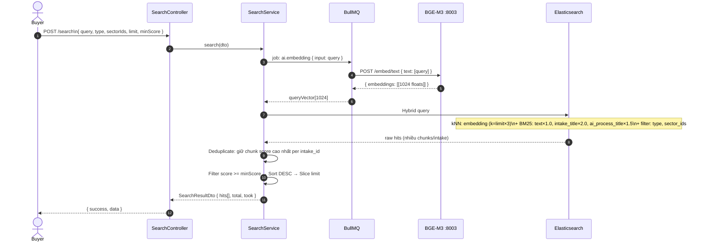

---

## 6. Luồng đọc Matches (Pre-computed)

Đọc kết quả đã tính sẵn từ DB — không cần gọi BGE-M3 hay ES:

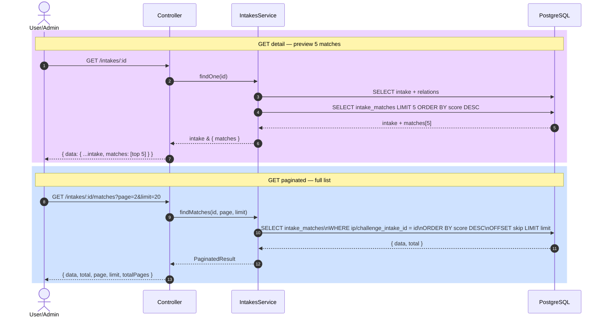

---

## 7. Luồng Seller → Find Challenges (Live Search)

Seller dùng nội dung IP để tìm kiếm live qua ES (không dùng pre-computed):

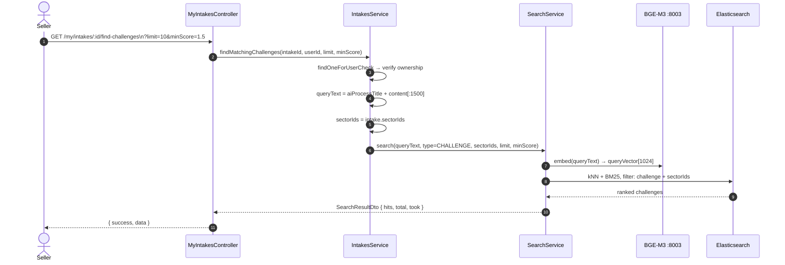

> **Khác với `/matches`:** endpoint này gọi BGE-M3 + ES real-time, không đọc từ `intake_matches`. Phù hợp khi cần kết quả tươi nhất ngay sau khi có challenges mới được index.

---

## 8. Trạng thái AI của Intake

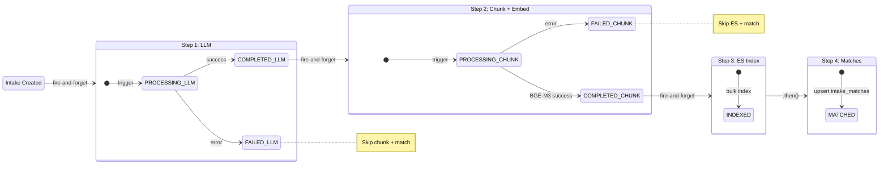

---

## 9. Kiến trúc Queue (BullMQ)

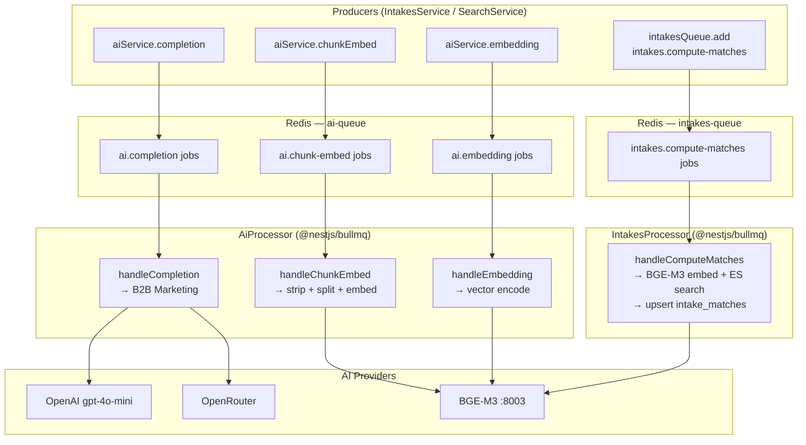

---

## 10. Cấu trúc dữ liệu

### Elasticsearch Index: `intake_chunks`

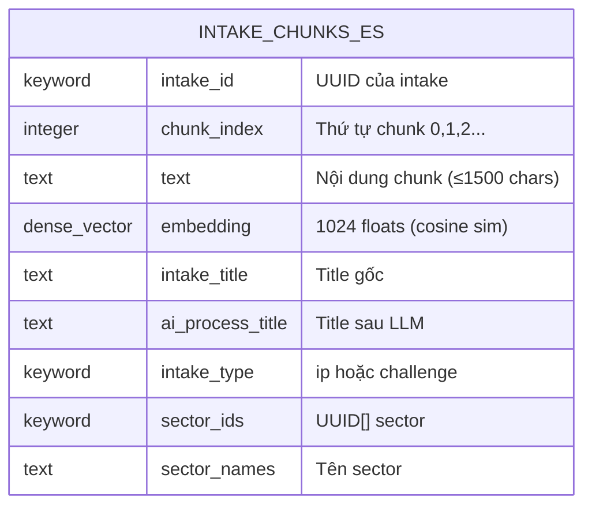

**Hybrid search score:**
```
_score = kNN_score(cosine_similarity) + BM25_score
       = vector_relevance + text_relevance(title×2.0, ai_title×1.5, content×1.0)
```

### PostgreSQL: `intake_matches`

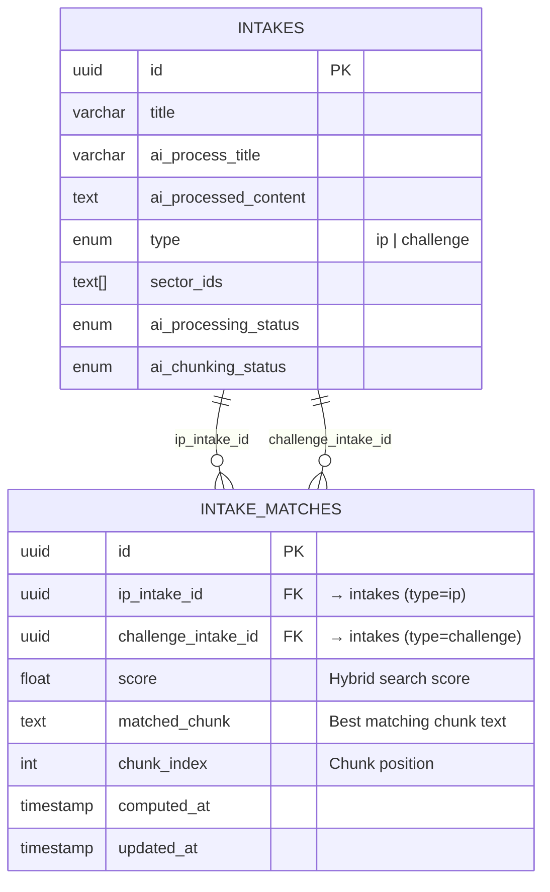

---

## 11. Tóm tắt tất cả Endpoints liên quan AI

| Endpoint | Auth | Mô tả |
|----------|------|-------|
| `POST /my/intakes` | User | Tạo IP/Challenge → trigger full AI pipeline |
| `POST /admin/intakes` | Admin | Như trên |
| `PATCH /my/intakes/:id` | User | Update content → re-trigger pipeline |
| `POST /my/intakes/:id/beautify` | User | LLM làm đẹp intake → lưu `aiProcessedContent` |
| `POST /admin/intakes/:id/beautify` | Admin | Như trên, không cần ownership |
| `POST /my/intakes/:id/compute-matches` | User | Trigger matching thủ công qua queue (phải published + có aiProcessedContent) |
| `POST /admin/intakes/:id/compute-matches` | Admin | Như trên, không cần ownership |
| `POST /search` | Public | Live hybrid search (BGE-M3 + ES) |
| `GET /my/intakes/:id/find-challenges` | User | Live search challenges theo IP intake |
| `GET /intakes/:id` | Public | Detail + top 5 pre-computed matches |
| `GET /my/intakes/:id` | User | Detail + top 5 pre-computed matches |
| `GET /admin/intakes/:id` | Admin | Detail + top 5 pre-computed matches |
| `GET /intakes/:id/matches` | Public | Paginated pre-computed matches |
| `GET /my/intakes/:id/matches` | User | Paginated matches (ownership check) |
| `GET /admin/intakes/:id/matches` | Admin | Paginated matches |
| `POST /ai/completion` | Admin | Test B2B marketing prompt |
| `POST /ai/embedding` | Admin | Test BGE-M3 embedding |
| `POST /ai/chat` | Admin | Test LLM chat |

---

## 12. Environment Configuration

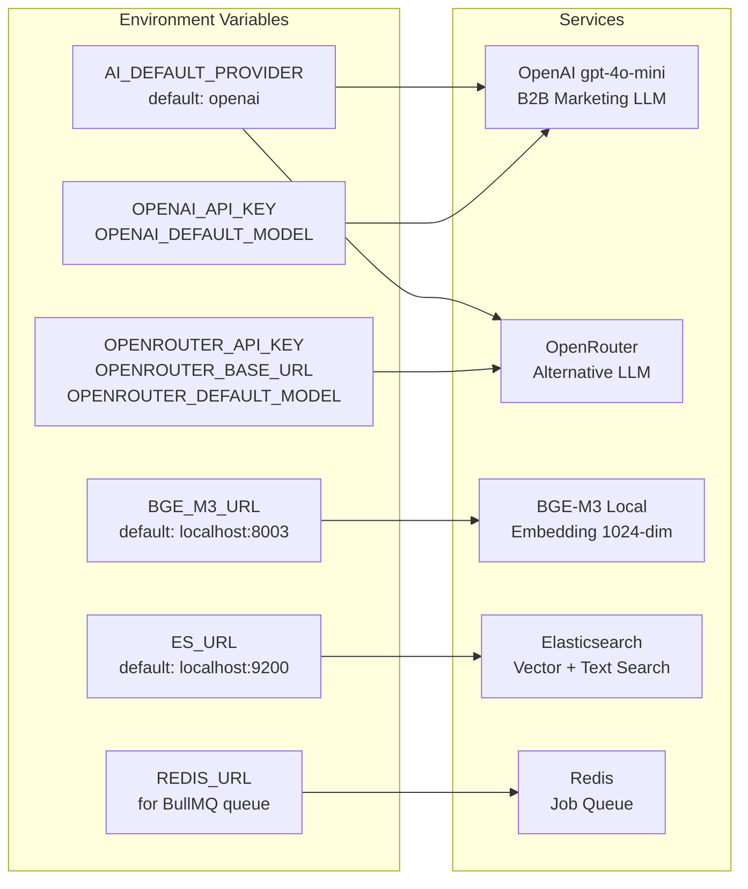
