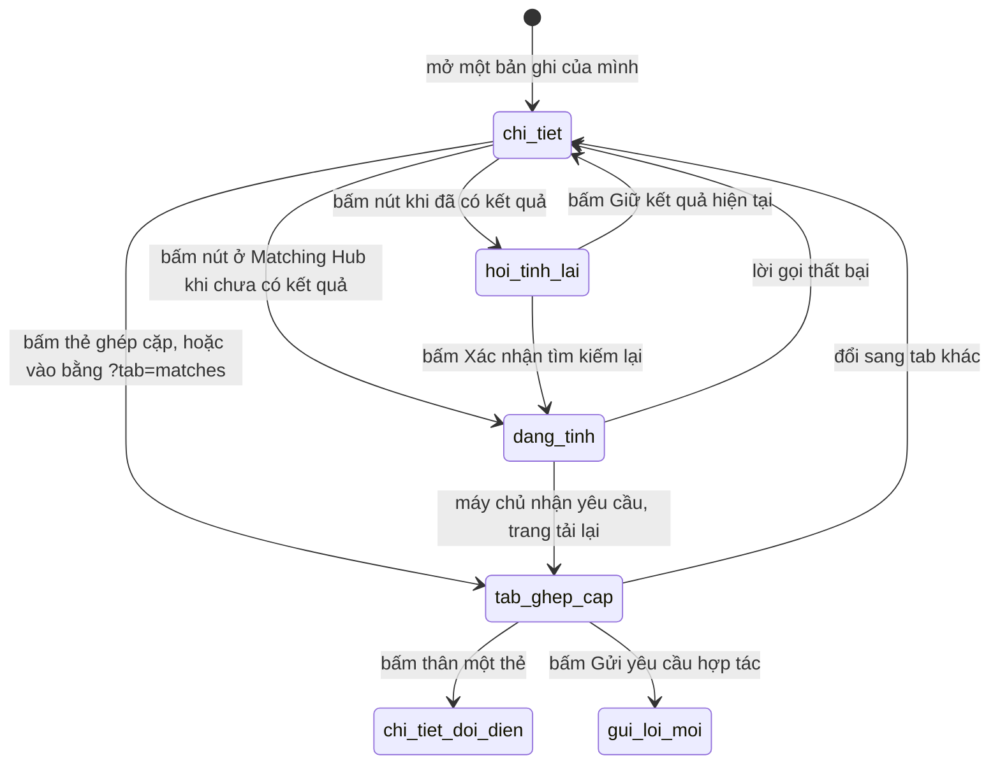

# Kết quả ghép cặp

## Tóm tắt

Ghép cặp là cách hệ thống trả lời câu hỏi "ai đang cần đúng thứ tôi có". Với một đề bài, nó tìm các tài sản công nghệ có thể đáp ứng; với một tài sản công nghệ, nó tìm các đề bài phù hợp. Kết quả xuất hiện ở đúng một chỗ trong cổng người dùng: một tab trên trang chi tiết của bản ghi, chỉ chủ sở hữu thấy.

Không có màn hình ghép cặp riêng, không có danh sách gộp, không có bộ lọc. Người dùng đi tới từng bản ghi của mình rồi mở tab của bản ghi đó. Hai đường vào tab này: bấm thẻ trên trang chi tiết, hoặc bấm một thông báo *tìm được ứng viên* trong khay.

Cơ chế bên dưới là *vòng ghép cặp*: mỗi lần tính tạo một vòng mới, bất biến, và vòng cũ được giữ lại. Người dùng không thấy khái niệm này — giao diện chỉ hiện một danh sách phẳng. Xem [`../nen-tang/mo-hinh-du-lieu.md`](../nen-tang/mo-hinh-du-lieu.md#vòng-ghép-cặp).

## Trường hợp đơn giản

Người dùng mở một tài sản công nghệ của mình đã ở trạng thái *đã công bố*. Cột phải của trang chi tiết có một thẻ viền xanh gắn nhãn **Matching Hub**, với dòng chữ "Tìm kiếm giải pháp phù hợp", một ô trạng thái ghi "Chưa có kết quả", và một nút cùng tên.

Họ bấm nút. Một toast "Hệ thống đang xử lý, vui lòng chờ giây lát…" hiện lên, nút đổi sang "Đang làm mới kết quả…". Vài giây sau toast biến mất, được thay bằng "Đã cập nhật kết quả tìm kiếm giải pháp phù hợp", và màn hình tự nhảy sang tab **Nhu cầu phù hợp** ở khối bên trái.

Tab đó là một danh sách thẻ. Mỗi thẻ có một huy hiệu thứ hạng tròn (vàng cho hạng nhất, xám hạng nhì, cam hạng ba), tiêu đề của bản ghi đối diện, một con số điểm, các nhãn lĩnh vực, một đoạn trích văn bản đã khớp, ngày tính, và một nút **Gửi yêu cầu hợp tác**.

Bấm vào thân thẻ mở trang chi tiết của bản ghi đối diện. Bấm nút gửi yêu cầu thì đi sang [`loi-moi-hop-tac.md`](loi-moi-hop-tac.md).

## Tương tác, sự kiện theo sự kiện

### Vào màn

Tab ghép cặp **không tự gọi máy chủ**. Danh sách ứng viên đi kèm trong cùng phản hồi đã dựng nên trang chi tiết, nên mở tab là chuyện hoàn toàn ở phía trình duyệt: không có khung xương chờ, không có nhịp trễ.

Máy chủ nhét vào phản hồi đó **năm ứng viên điểm cao nhất của vòng gần nhất**, và chỉ khi người gọi là chủ sở hữu. Có một đường riêng trả danh sách ứng viên phân trang, nhưng **cổng người dùng không gọi nó**. Hệ quả trực tiếp: người dùng không bao giờ thấy quá năm kết quả, dù một vòng ghép cặp có tối đa mười ứng viên.

Tab chỉ tồn tại khi giao diện kết luận người đang xem là chủ sở hữu, và nó kết luận điều đó bằng cách so định danh trong hồ sơ đang giữ trong bộ nhớ với trường chủ sở hữu của bản ghi. Nếu hồ sơ chưa tải được — chuyện xảy ra khi lời gọi lấy hồ sơ sau đăng nhập hỏng — thì tab **biến mất** dù bản ghi đúng là của họ.

Vào thẳng bằng `?tab=matches` được, và đó là cách các thông báo *tìm được ứng viên* dẫn người dùng tới đây. Nhưng nếu người mở không phải chủ sở hữu, một hiệu ứng theo dõi sẽ lập tức kéo tab về *Thông tin công khai*.

Thẻ **Matching Hub** ở cột phải chỉ hiện khi hội đủ hai điều kiện: người xem là chủ sở hữu **và** bản ghi đang ở trạng thái *đã công bố*. Bản nháp không có nút tính, dù tab ghép cặp vẫn hiện ra và vẫn nói "Chưa có kết quả".

### Rời đi không đổi gì

Không có gì được ghi lại. Đổi tab không tạo mục lịch sử và **không cập nhật URL** — tham số `tab` chỉ được đọc lúc vào màn, không được ghi khi người dùng chuyển tab. Sao chép địa chỉ ở tab ghép cặp cho ra một liên kết mở lại ở tab công khai.

### Bắt đầu sửa

Không có gì để sửa. Tab này chỉ đọc: không sắp xếp lại được, không lọc được, không bỏ được một ứng viên, không đánh dấu được cái nào đã xem.

Hai hành động duy nhất là mở bản ghi đối diện và gửi lời mời hợp tác.

### Trong khi sửa

Không áp dụng. Không có biểu mẫu, không có kiểm tra dữ liệu, không có trạng thái đã bẩn.

### Gửi đi

Chỉ có một lệnh gửi: **yêu cầu tính lại**.

Nếu chưa có kết quả nào, bấm nút là chạy luôn. Nếu đã có, một hộp thoại chặn hiện lên: "Làm mới danh sách kết quả phù hợp?" với hai nút — *Giữ kết quả hiện tại* và *Xác nhận tìm kiếm lại*.

Thứ tự xảy ra sau khi xác nhận:

1. Toast "đang xử lý" hiện lên và ở lại; nút bị khoá và đổi chữ.
2. Máy chủ kiểm hai điều kiện và từ chối nếu hỏng: bản ghi phải **đã công bố**, và phải **có nội dung**.
3. Máy chủ **xếp một việc vào hàng đợi** rồi trả lời ngay với câu "Matching has been queued".
4. Giao diện tải lại toàn bộ bản ghi, chuyển sang tab ghép cặp, và hiện toast xanh "Đã cập nhật kết quả tìm kiếm giải pháp phù hợp".

Bước 3 và bước 4 là chỗ trải nghiệm gãy: máy chủ mới chỉ **nhận** yêu cầu, chưa tính xong, nhưng giao diện đã tải lại và tuyên bố đã cập nhật. Danh sách người dùng nhìn thấy ngay sau đó rất có thể vẫn là danh sách cũ.

**Việc tính thực sự làm gì.** Nó lấy tiêu đề cộng 1500 ký tự đầu của nội dung làm câu truy vấn, tìm trong chỉ mục **loại đối diện** — đề bài tìm công nghệ và ngược lại — với ba ràng buộc: chỉ bản ghi **đã công bố**, **loại trừ bản ghi của chính chủ sở hữu**, và nếu bản ghi có nhãn lĩnh vực thì chỉ trong các lĩnh vực đó. Ngưỡng điểm tối thiểu và số ứng viên tối đa là cấu hình phía máy chủ.

Xong thì nó đánh dấu vòng cũ là đã bị thay và ghi một vòng mới, kèm phiên bản công cụ tìm kiếm, phiên bản mô hình nhúng và chế độ chấm điểm đã dùng. Không thông tin nào trong ba thứ đó tới được giao diện.

Nếu lần tính mới **không tìm được ứng viên nào**, máy chủ dừng sớm: nó **không tạo vòng mới và không thay vòng cũ**. Người dùng bấm "Tìm lại", chờ, rồi thấy đúng danh sách cũ — và toast vẫn báo đã cập nhật.

**Tính tự động.** Ngoài nút bấm tay, một vòng ghép cặp được xếp hàng tự động sau mỗi lần nội dung của bản ghi được cắt đoạn và đưa vào chỉ mục lại — tức là sau mỗi lần nội dung chính đổi, và sau mỗi lần công bố hay gỡ công bố. Điều kiện: chủ sở hữu đang bật cờ *tự động ghép cặp* ở [`thong-bao-va-cai-dat.md`](thong-bao-va-cai-dat.md). Bấm **Làm đẹp dữ liệu** cũng kéo theo một vòng nếu cờ đó đang bật.

Khi một vòng hoàn tất và có ít nhất một ứng viên, chủ sở hữu nhận một thông báo *tìm được ứng viên* trong khay, kèm số lượng và tiêu đề bản ghi.

**Điểm số.** Con số trên mỗi thẻ là điểm thô của công cụ tìm kiếm, làm tròn một chữ số thập phân. Nó không phải phần trăm và không có trần: hai bản ghi ở hai vòng khác nhau, hoặc ở hai chế độ chấm điểm khác nhau, không so được với nhau. Giao diện không nói gì về điều này.

## Biến thể

| Biến thể | Lúc vào màn | Trong khi sửa |
|---|---|---|
| Vai trò | Tab ghép cặp và thẻ Matching Hub chỉ hiện với **chủ sở hữu**. Khách chưa đăng nhập không vào được route này. Vai trò `ADMIN` có đường riêng ở bảng quản trị và không đi qua màn hình này. Người đã đăng nhập nhưng hồ sơ chưa tải được thì bị đối xử như người ngoài: cả tab lẫn thẻ đều biến mất. | Không ảnh hưởng. Quyền được kiểm ở máy chủ tại mỗi lời gọi. |
| Trạng thái bản ghi | Bản ghi **nháp**: tab ghép cặp vẫn hiện nhưng thẻ Matching Hub thì không, nên không có cách nào bắt đầu tính. Bản ghi **đã công bố**: đủ cả hai. Bản ghi không có nội dung: nút vẫn bấm được nhưng máy chủ từ chối. Ứng viên trong danh sách luôn là bản ghi đã công bố của người khác — nếu một ứng viên bị gỡ công bố hoặc bị xoá sau khi vòng được tính, nó **vẫn nằm trong danh sách** cho tới lần tính lại. | Đổi trạng thái công bố phải qua biểu mẫu sửa, tức là rời khỏi màn hình này. Quay lại thì thẻ Matching Hub xuất hiện hoặc biến mất theo. |
| Cấu hình backend | Chế độ chấm điểm quyết định thứ tự và thành phần của danh sách: chế độ cũ lọc cứng **sau** khi lấy tốp đầu, chế độ đã sửa lọc **trước** rồi hợp nhất hai kênh. Đổi được bằng cấu hình mà không dựng lại frontend, và người dùng không chọn được. Ngưỡng điểm tối thiểu, số ứng viên tối đa và số ký tự đưa vào câu truy vấn cũng là cấu hình. Chỉ mục tìm kiếm hoặc dịch vụ nhúng không chạy thì việc tính hỏng ở hàng đợi, **không có gì báo cho người dùng**. | Không ảnh hưởng trong lúc thao tác; cấu hình chỉ đọc khi việc nền chạy. |
| Phím tắt của biểu mẫu | Không ô nhập nào ở màn hình này, không gì được focus sẵn. Các thẻ ứng viên là `
` bấm được, **không tới được bằng Tab**; chỉ nút Gửi yêu cầu hợp tác bên trong thẻ là tới được. | Hộp thoại xác nhận tính lại đóng bằng Escape và bằng cách bấm ra ngoài. Enter và Ctrl/Cmd+Enter không được xử lý riêng. |

Đổi biến thể giữa chừng: chỉ trạng thái của một ứng viên có thể đổi trong lúc người dùng đang nhìn danh sách, và danh sách không phản ánh điều đó.

## Huỷ và gián đoạn

| Sự kiện | Trước khi gửi | Trong khi đang gửi |
|---|---|---|
| Bấm Huỷ hoặc nhấn Escape | Escape đóng hộp thoại xác nhận tính lại, tương đương bấm *Giữ kết quả hiện tại*. Ngoài hộp thoại đó, không có gì để huỷ. | Không có cách huỷ. Việc đã vào hàng đợi ở phía máy chủ và sẽ chạy bất kể người dùng làm gì tiếp theo. Không có nút Dừng, Escape không dừng được. |
| Đi chỗ khác trong app | Đi tự do, không mất gì — màn hình này chỉ đọc. | Rời trang bỏ lời gọi ở phía trình duyệt, nhưng **việc tính vẫn chạy** nếu yêu cầu đã tới máy chủ. Quay lại sau đó sẽ thấy kết quả mới, không có gì giải thích nó đến từ đâu. |
| Back/Forward của trình duyệt | Quay về danh sách. Tab đang mở **không nằm trong URL** nên Back không đưa về tab công khai; nó rời hẳn trang chi tiết. | Như trên: lời gọi bị bỏ, việc nền vẫn chạy. |
| Tải lại trang, hoặc đóng tab | Trang dựng lại từ đầu và mở ở tab công khai, vì tham số `tab` không được ghi vào URL khi người dùng chuyển tab bằng tay. | Lời gọi bị bỏ. Việc vẫn ở trong hàng đợi. Không có khoá chống lặp trên v1, nhưng hàng đợi khử trùng theo bản ghi, nên bấm hai lần liên tiếp **không** tạo hai việc. |
| Mất mạng, hoặc request quá hạn | Không ảnh hưởng — tab không gọi gì. | Toast "đang xử lý" biến mất và một toast đỏ "Không thể tìm kiếm kết quả. Vui lòng thử lại." hiện lên. Danh sách giữ nguyên. Nếu yêu cầu đã tới máy chủ trước khi kết nối đứt, việc vẫn chạy và người dùng nhận một thông báo *tìm được ứng viên* mà không hiểu vì sao. |
| Phiên hết hạn (401), hoặc v1 bị dừng (410 Gone) | Không có gì xảy ra cho tới khi người dùng bấm một nút hoặc chuyển tab trình duyệt — lúc chuyển tab, lớp phiên gọi lại máy chủ, nhận 401, xoá cookie và đưa họ về `/login`. | Cổng **không có nhánh xử lý 401 nào**: lỗi hiện ra như một lỗi thường với câu "Không thể tìm kiếm kết quả. Vui lòng thử lại." Không câu nào nói cần đăng nhập lại. 410 cũng vậy. Xem [B-12](../bug-triage.md#b-12-cổng-người-dùng-không-xử-lý-401). |
| Bản ghi bị đổi bởi tab khác hoặc người khác (409 khi `If-Match` lệch), hoặc bị xoá | Danh sách ứng viên được chụp một lần lúc vào màn và **không tự làm mới**. Một ứng viên bị chủ của nó xoá hoặc gỡ công bố vẫn hiện ở đây; bấm vào nó sẽ mở ra một trang chi tiết vẫn đọc được, vì đường công khai không kiểm trạng thái. | Không có kiểm tra phiên bản ở đường này và không bao giờ có 409. Nếu bản ghi bị xoá ở tab khác giữa chừng, lệnh tính lại trả "không tìm thấy" và rơi vào toast lỗi chung. |
| Trình duyệt tự điền, hoặc trình quản lý mật khẩu ghi vào biểu mẫu | Không có ô nhập nào để điền. Không ảnh hưởng. | Không ảnh hưởng. |

Sau một gián đoạn, người dùng không mất gì ở màn hình này — nhưng cũng không biết chắc việc tính đã chạy hay chưa, vì trạng thái duy nhất giao diện hiển thị là số kết quả đang có.

## Tương tác với hệ thống khác

**Quyền và vai trò.** Danh sách ứng viên chỉ được nhét vào phản hồi khi người gọi là chủ sở hữu, và lệnh tính lại đi qua đường `/my/intakes` vốn từ chối bản ghi của người khác bằng "không tìm thấy". Tầng chính sách kiểm lại theo quan hệ *chủ sở hữu*. Thẻ ứng viên chỉ hiện phần công khai của bản ghi đối diện; nội dung mật không đi kèm.

**Kiểm tra dữ liệu và cách hiện lỗi.** Hai luật ở máy chủ — phải đã công bố, phải có nội dung — và cả hai được thi hành **sau** khi người dùng bấm nút. Giao diện đã che luật thứ nhất bằng cách chỉ hiện thẻ Matching Hub cho bản ghi đã công bố, nhưng luật thứ hai thì không: một bản ghi đã công bố mà nội dung rỗng vẫn có nút, và bấm vào chỉ cho ra toast lỗi chung.

**Thay đổi chưa lưu.** Không có tương tác. Màn hình này không có gì để lưu.

**Cập nhật lạc quan và hoàn tác.** Có một dạng cập nhật lạc quan không được thừa nhận: giao diện tuyên bố "Đã cập nhật kết quả" trước khi việc tính chạy xong, mà không có nhánh hoàn tác khi hoá ra không có gì đổi. Không có hoàn tác thật ở đâu; vòng ghép cặp là bản ghi chỉ đọc.

**Ngoại tuyến.** Không có hàng đợi phía trình duyệt. Nhưng phía máy chủ thì có: yêu cầu tính là một việc trong hàng đợi nằm cùng cơ sở dữ liệu, đưa vào trong cùng giao dịch với lời gọi. Đây là lý do một lời gọi thành công không có nghĩa là kết quả đã sẵn sàng.

**Thông báo và toast.** Đây là nguồn của một trong bốn loại thông báo hệ thống: *tìm được ứng viên*, phát khi một vòng hoàn tất với ít nhất một ứng viên. Bấm vào thông báo đó đưa thẳng tới tab ghép cặp của đúng bản ghi. Xem [`thong-bao-va-cai-dat.md`](thong-bao-va-cai-dat.md). Trên màn hình này, toast lo phần còn lại: một toast "đang chạy" và hai toast kết quả.

**Trạng thái lọc/tìm trong URL.** Tham số `tab` được **đọc** lúc vào màn nhưng không được **ghi** khi người dùng chuyển tab, nên trạng thái này chỉ đi một chiều: liên kết từ thông báo mở đúng tab, còn liên kết người dùng tự sao chép thì không. Không có bộ lọc hay phân trang nào ở tab này để đưa vào URL.

**Đa ngôn ngữ.** Giao diện là tiếng Việt viết thẳng trong mã, và nhãn đổi theo loại bản ghi: đề bài thì tab tên "Giải pháp phù hợp", tài sản công nghệ thì "Nhu cầu phù hợp". Nội dung thông báo *tìm được ứng viên* do máy chủ soạn và **bằng tiếng Anh**; nó hiện nguyên văn trong khay.

**Khả năng truy cập.** Thẻ ứng viên là `
` gắn sự kiện bấm, không phải liên kết hay nút, nên bàn phím không tới được và trình đọc màn hình không nhận ra là bấm được. Huy hiệu thứ hạng chỉ phân biệt bằng màu và một chữ số. Điểm số không có nhãn nào giải thích đơn vị. Hộp thoại xác nhận tính lại là thành phần có sẵn nên có bẫy focus và nghe Escape.

**Dấu vết kiểm toán.** Mỗi lần tìm kiếm ghi một dòng nhật ký truy vấn ở phía máy chủ: câu truy vấn, loại đích, danh sách lĩnh vực, ngưỡng điểm, chế độ chấm điểm, phiên bản công cụ, danh sách kết quả và thời gian chạy. Với vòng ghép cặp tự động, dòng này không gắn với người dùng nào. Không màn hình nào đọc được nhật ký đó — xem [`../moi/vong-ghep-cap.md`](../moi/vong-ghep-cap.md).

## Trường hợp biên

- **Thông báo "đã cập nhật" đến trước kết quả.** Lệnh tính lại chỉ xếp hàng một việc, nhưng giao diện tải lại và báo thành công ngay. Với một hàng đợi rảnh, việc có thể xong kịp; với hàng đợi bận, người dùng nhìn danh sách cũ và tin rằng đó là kết quả mới. Điều này đáng bị coi là lỗi. (chưa cấp mã lỗi)
- **Tính lại mà không tìm được gì thì giữ nguyên kết quả cũ.** Máy chủ dừng trước khi tạo vòng mới, nên vòng cũ vẫn là vòng hiện hành. Người dùng không có cách nào phân biệt "vẫn còn đúng năm kết quả đó" với "lần tính mới không ra gì".
- **Chỉ thấy tối đa năm kết quả.** Một vòng có thể chứa tới mười ứng viên và có một đường trả danh sách phân trang, nhưng cổng không gọi nó. Năm ứng viên còn lại tồn tại trong dữ liệu và không tới được người dùng. (chưa cấp mã lỗi)
- **Đường "tìm đề bài phù hợp" tồn tại nhưng không có nút nào gọi nó.** Máy chủ có một lệnh riêng nhận một bản ghi của người dùng rồi trả về các đề bài khớp nhất, kèm ngưỡng điểm và số lượng tuỳ chỉnh — nó không tạo vòng ghép cặp và không ghi gì. Cổng người dùng **không gọi lệnh này ở bất kỳ đâu**. Đường tìm kiếm toàn văn chung cũng vậy: có ở máy chủ, không có ô tìm kiếm nào trong cổng dùng tới. (chưa cấp mã lỗi)
- **Bản nháp có tab ghép cặp nhưng không có cách nào tính.** Tab hiện ra với câu "Sẵn sàng cho lần tìm kiếm đầu tiên" và một gợi ý bảo dùng nút ở cột phải — nút đó không tồn tại ở trạng thái nháp.
- **Ứng viên có thể đã biến mất.** Vòng ghép cặp là ảnh chụp tại thời điểm tính. Một ứng viên bị gỡ công bố hay bị xoá mềm vẫn hiện đủ tiêu đề, lĩnh vực và đoạn trích cho tới lần tính sau.
- **Điểm số không so sánh được giữa hai lần tính.** Đổi chế độ chấm điểm ở cấu hình làm thang điểm đổi hoàn toàn, và giao diện hiện cùng một con số ở cùng một chỗ như thể chúng cùng đơn vị.
- **Bản ghi không có nhãn lĩnh vực thì không có bộ lọc lĩnh vực.** Vì [biểu mẫu ở cổng không cho chọn lĩnh vực](de-bai-va-cong-nghe-cua-toi.md#trong-khi-sửa), mọi bản ghi tạo ở đây đều rơi vào trường hợp này và ghép cặp trên toàn bộ chỉ mục.
- **Tab đang mở không vào URL.** Chuyển sang tab ghép cặp rồi sao chép địa chỉ cho ra một liên kết mở lại ở tab công khai. Chỉ liên kết do thông báo dựng mới giữ đúng tab.
- **Tab ghép cặp biến mất khi hồ sơ người dùng chưa tải được.** Vì quyền sở hữu được suy ra ở phía trình duyệt bằng cách so hai định danh, một lời gọi hồ sơ hỏng làm chủ sở hữu thật bị đối xử như người ngoài trên chính bản ghi của mình.

## Câu hỏi mở và kiểm chứng

- **Chưa dựng cổng người dùng trong trình duyệt.** Mọi mô tả về cái hiện ra trên màn hình đọc từ mã. Cần một lượt kiểm bằng tay cho: khoảng cách thật giữa lúc bấm nút và lúc kết quả xuất hiện, và việc màn hình có tự nhảy sang tab ghép cặp đúng như mã mô tả không.
- **Chưa chạy được việc tính trên bản chạy** vì chưa có chỉ mục tìm kiếm và dịch vụ nhúng. Toàn bộ phần mô tả cơ chế đọc từ mã, không phải từ quan sát.
- **Chưa biết hàng đợi chạy nhanh thế nào.** Đây là con số quyết định toàn bộ trải nghiệm của màn hình này: nếu việc chạy dưới một giây thì lời tuyên bố "đã cập nhật" gần đúng, nếu mất hàng chục giây thì nó sai hẳn.
- **Chưa xác nhận điều gì hiện ra khi việc tính hỏng ở hàng đợi.** Đọc từ mã thì không có gì cả: không thông báo thất bại, không cờ trạng thái, không dòng nào trên màn hình. Người dùng bấm nút, được báo thành công, và không bao giờ biết.
- Chưa rõ vì sao cổng lấy ứng viên từ phản hồi chi tiết thay vì gọi đường phân trang. Có thể là quyết định giảm số lời gọi, có thể là sót; không có chú thích nào nói.
- Chưa đo được hành vi khử trùng của hàng đợi: đọc từ mã thì hai lần bấm liên tiếp trên cùng một bản ghi gộp thành một việc, nhưng chưa biết cửa sổ khử trùng dài bao lâu.
- Việc chế độ chấm điểm, phiên bản công cụ và phiên bản mô hình nhúng có trong dữ liệu nhưng không tới được bất kỳ màn hình nào là một khoảng trống đã biết, không phải lỗi — xem [`../moi/vong-ghep-cap.md`](../moi/vong-ghep-cap.md).

Đối chiếu với SourceCode/dmst-user-main và SourceCode/nacentech, bản chụp ngày 2026-09-04.
