# Kiến trúc hệ thống NacenTech V2 — Hạ tầng giao dịch và thương mại hóa công nghệ

> Trạng thái: Architecture baseline — approved for implementation planning  
> Phiên bản: 2.20  
> Ngày: 2026-09-03  
> Định hướng: demand-first, broker-led, finance-linked, outcome-based  
> Backend chốt: ASP.NET Core trên .NET 10 LTS, modular monolith  
> Chiến lược chuyển đổi: thay thế backend NestJS bằng .NET **một lần**, có diễn tập; dữ liệu chuyển bằng ETL một chiều có đối soát; NestJS đóng băng từ tuần 0 rồi ngừng hẳn sau cutover; không có cửa sổ hai stack cùng ghi  
> Public platform principal: NacenTech — phía Nhà nước, giữ policy/standard/oversight  
> Private platform operator/SPV: NacenX — thay vai trò vận hành dự kiến của SotaTek trong `proposal.md`  
> Tham chiếu vận hành: tổng hợp Hàn Quốc, Israel, Mỹ, châu Âu, Nhật Bản, Đài Loan và các mạng hỗ trợ SME tại những nền kinh tế có điều kiện gần Việt Nam  
> Baseline hiện trạng: bộ `Bao cao ra soat 08-2026/` và source code NacenTwin  
> Tài liệu tiền nhiệm: `../NACENTECH_ARCHITECTURE.md` — giữ lại để đối chiếu  
> Đây không phải ý kiến pháp lý. Mọi luồng tiền, tài sản công, IP công, định giá, chữ ký số và dữ liệu cá nhân phải được pháp chế xác nhận trước khi mở production.

## Mục lục

1. Kết luận kiến trúc
2. Mục tiêu, phạm vi và non-goals
3. Nguyên tắc thiết kế
4. Mô hình vận hành và phân vai
5. Đơn vị nghiệp vụ cốt lõi: Commercialization Case
6. Ba transaction track
7. Stage-gate và state model
8. Kiến trúc logic tổng thể
9. Bounded contexts và module
10. Mô hình dữ liệu cốt lõi
11. Demand intake và qualification
12. Technology supply và TLO Workbench
13. Broker, Expert Network và Case Workbench
14. Matching và recommendation
15. Evaluation, valuation và due diligence
16. Data Room, IP và hợp đồng
17. Pilot, milestone, evidence và outcome
18. Finance orchestration
19. Program, voucher và challenge funding
20. Billing, fee và chia sẻ doanh thu
21. Dữ liệu, event và nguồn sự thật
22. API và tích hợp
23. Identity, authorization và bảo mật
24. AI và Intelligence Layer
25. Yêu cầu phi chức năng
26. Hình thái triển khai và stack
27. Lộ trình theo cổng chất lượng
28. KPI vận hành
29. Nhân sự và operating model
30. Migration từ NacenTwin hiện tại
31. Quyết định cần xác nhận
32. Acceptance criteria
33. Cấu trúc repository
34. Đối chiếu mô hình quốc tế và quyết định áp dụng cho Việt Nam
35. Tài liệu tham chiếu

---

## 1. Kết luận kiến trúc

NacenTech V2 không được thiết kế như một catalog hoặc sàn tự phục vụ. Lõi public-purpose của nó là **case-management platform cho toàn bộ vòng đời thương mại hóa công nghệ**; NacenX có thêm managed talent/expert service liền kề nhưng không được làm sai ranh giới này.

Đơn vị trung tâm của thương mại hóa là `CommercializationCase`, bắt đầu từ một nhu cầu đã được xác định và kết thúc bằng outcome được xác minh. Công nghệ, chuyên gia, lab, vốn, hợp đồng và dữ liệu đều tham gia phục vụ case; chúng không phải các marketplace độc lập ghép lại. Chỉ nhu cầu tuyển dụng/fractional/squad không gắn giao dịch công nghệ mới dùng `TalentServiceMandate` thương mại riêng của NacenX (§13.10).

Bề mặt sản phẩm V2.19 hội tụ thành **Trợ lý đổi mới cho doanh nghiệp → Broker Copilot → mạng chuyên gia/dịch vụ chuyên môn → Bàn vận hành sau chuyển giao**, cùng đọc/ghi các artifact được phân quyền của một case. `ExpertBusinessDesk` hỗ trợ từng chuyên gia; `EvidencePassport` giúp tái sử dụng claim có nguồn. Nhu cầu ISO/hợp quy/công nhận độc lập và bảo đảm chuyển đổi số đi qua `ProfessionalServiceMandate`, không tạo case chuyển giao giả. Cấu trúc này tạo doanh thu định kỳ trước và sau giao dịch, đồng thời giảm giờ broker ở giữa; nó không trao quyền quyết định cho AI và không biến phí dịch vụ thành quyền chứng nhận/công nhận.

V2.17 bổ sung `Government Innovation Fabric` như overlay liên bang để nối **bài toán công/doanh nghiệp → kết quả nhiệm vụ KH&CN và IP → tiêu chuẩn–đo lường–chất lượng → vốn/ưu đãi → khách hàng công/tư → adoption → phản hồi chính sách**. NacenTech giữ chuẩn, mandate và oversight; NacenX điều phối workflow/evidence theo hợp đồng; từng bộ, địa phương, quỹ, registry, lab/CAB và đơn vị mua vẫn giữ source of truth cùng thẩm quyền thật của mình. Overlay không tạo transaction track thứ tư và không biến platform thành cơ quan liên thông tự quyết.

V2.18 bổ sung ngành dọc `DIGITAL_TRANSFORMATION_AND_INNOVATION_ASSURANCE`: NacenX có thể bán Văn phòng chuyển đổi số/đổi mới sáng tạo thuê ngoài, chẩn đoán, thẩm định lựa chọn công nghệ, điều phối PoC, fractional CDTO và PMO/adoption; NacenTech hỗ trợ chuẩn, mạng và mandate công phù hợp. Đây là **dịch vụ trung gian bảo đảm quyết định và hiệu quả**, không phải nhà thầu tích hợp hệ thống tổng hợp, cơ quan mua sắm hay đơn vị tự chứng nhận dự án số của chính mình.

V2.19 chốt mô hình **lõi ổn định + cấu hình versioned + module/adapter mở rộng**. Một deployment chỉ bật capability phù hợp với sector, payer, mandate và phase bằng `CapabilityProfileVersion`; toàn bộ hệ sinh thái vẫn nằm trong kiến trúc đích nhưng không đồng nghĩa phải code/build/activate cùng lúc. Bất biến về authority, security, transaction, audit, tiền, dữ liệu và AI không thể bị cấu hình hoặc feature flag vượt qua.

NacenTech/NacenX không cạnh tranh với AI bằng khả năng viết, tìm kiếm hoặc tóm tắt. Các capability đó sẽ ngày càng rẻ và phổ biến. Lợi thế phải nằm ở **mandate thật, mạng đối tác/chuyên gia đã thẩm tra, dữ liệu có quyền và lineage, workflow xuyên tổ chức, thực thi tại hiện trường, người chịu trách nhiệm và outcome kiểm chứng được**. AI được dùng để hạ chi phí phục vụ; phần khách hàng trả tiền là trách nhiệm, điều phối và kết quả ngoài đời (§20.11, §24.8).

### 1.1 Sáu quyết định quan trọng nhất

1. **Demand-first.** Chỉ đưa một nhu cầu vào matching khi có problem owner, urgency, budget path và người có quyền quyết định.
2. **Broker-led.** Mỗi case đạt qualification phải có broker chịu trách nhiệm và SLA; AI không sở hữu case.
3. **Finance-linked.** Nhu cầu vốn được mô hình hóa từ đầu; NacenX điều phối hồ sơ trên nền tảng NacenTech nhưng không cho vay, bảo lãnh hoặc giữ tiền.
4. **Outcome-based.** Thành công là pilot/hợp đồng/outcome, không phải listing, lượt xem hay số tài khoản.
5. **Platform as system of record for process, not truth owner for everything.** Quyền IP thuộc registry/chủ sở hữu, quyết định tín dụng thuộc đối tác tài chính, chứng nhận thuộc tổ chức có thẩm quyền, tiền thuộc PSP/ngân hàng.
6. **Federated network, không độc quyền trung tâm.** NacenTech giữ public mandate, chuẩn và giám sát; NacenX vận hành case process, referral, audit trail và international gateway dùng chung; TTO, viện, lab, đối tác tài chính và node địa phương giữ mandate thật của họ.

### 1.2 Hình thái phát triển

- Bắt đầu bằng concierge operation và broker workbench.
- Modular monolith trong năm đầu.
- Xem NacenTwin hiện tại là hệ thống brownfield cần bảo toàn **dữ liệu** và **hành vi API đang chạy**, không bảo toàn runtime.
- Thay backend một lần: .NET phục vụ cả `/api/v1` (facade tương thích trên V2 aggregate, có ngày sunset) lẫn `/api/v2` từ ngày cutover; NestJS đóng băng từ tuần 0, chỉ nhận security fix và `search_query_log`, rồi ngừng hẳn (§30.2).
- Cắt một lần là quyết định về **runtime**, không phải về **phạm vi**: `CapabilityProfileVersion` (§9.4) vẫn quyết định capability nào được bật; Python RAG và Elasticsearch không nằm trong cú cắt (§26.2, §26.6.7).
- Mở từng capability theo profile, không bật toàn bộ proposal ngay.
- Tích hợp dữ liệu theo lineage; không copy dữ liệu rồi tự tuyên bố đã xác minh.
- Automation chỉ thay thế bước đã chạy thủ công ổn định và có số liệu.

### 1.3 Mức độ sẵn sàng của tài liệu

| Lớp quyết định | Trạng thái | Ghi chú |
|---|---|---|
| Mô hình vận hành và kiến trúc nghiệp vụ đích | `APPROVED_BASELINE` | Đủ để lập backlog, ADR và kế hoạch triển khai |
| Kiến trúc chuyển đổi từ NacenTwin | `APPROVED_BASELINE` | Một cutover duy nhất theo runbook §30.2; bắt buộc kiểm kê dữ liệu/API, golden recording và ≥ 2 lần diễn tập trên snapshot production trước cutover |
| Backend và runtime | `DECIDED` | ASP.NET Core, .NET 10 LTS; mặc định bỏ qua .NET 11 STS |
| Ranh giới transaction giữa module | `DECIDED` | `MOD-01…05` tại §9.2; shared transaction trong core, saga chỉ ra ngoài |
| Cơ chế policy snapshot | `DECIDED` | §9.3; snapshot JSONB bất biến, resolve tại `QUALIFICATION` |
| Ma trận stage transition | `DECIDED` | §7.4 và §7.5; kèm optimistic concurrency bắt buộc |
| Xóa dữ liệu cá nhân trên nền WORM/append-only | `DECIDED` | Crypto-shredding (§16.5) + pseudonymized actor (§23.5) |
| Authorization engine và enforcement point | `DECIDED` | §23.2; policy engine nội bộ tại application service, RLS chỉ chặn tenant |
| Expert Network | `DECIDED` | §13.5–13.9; case-scoped engagement, không role `EXPERT` toàn cục |
| NacenX Technology Talent & Expert Services | `DECIDED_WITH_LEGAL_GATE` | §13.10 và §20.6; managed network trước, không mở sàn freelancer tự phục vụ ở baseline |
| Danh mục kinh doanh NacenX | `DECIDED_HYPOTHESIS` | §20.7; lấy hợp đồng vận hành định kỳ làm nền, dự án/milestone làm tăng trưởng, success fee chỉ là phần thưởng thêm |
| Bàn điều hành và trợ lý AI riêng cho chuyên gia | `DECIDED_WITH_PILOT_GATE` | §13.11, §20.8, §24.5; AI hỗ trợ hành chính/thương mại trong giới hạn, chuyên gia giữ quyền cam kết cuối |
| Bộ ba desk hội tụ và Hồ sơ bằng chứng | `DECIDED_WITH_PILOT_GATE` | §11.5, §13.12, §15.5, §17.7, §20.9, §24.6; doanh nghiệp–broker–chuyên gia dùng chung case, adoption nối sau execution |
| Dịch vụ chuyên môn và sẵn sàng pháp lý | `DECIDED_WITH_LEGAL_AND_PILOT_GATE` | §13.13, §15.6, §20.10; expert-led, AI-assisted, tách tư vấn khỏi đánh giá/chứng nhận/công nhận có thẩm quyền |
| Khả năng chống hàng hóa hóa bởi AI | `DECIDED_WITH_QUARTERLY_VALIDATION` | §20.11, §24.8; tự động hóa tác vụ phổ thông, không bán output AI thô, giữ human/authority gate và đo contribution sau AI/review |
| Government Innovation Fabric liên cơ quan | `DECIDED_LOGICAL_BOUNDARY_WITH_MANDATE_GATE` | §10.6.1, §19.6, §34.17; nối challenge–research result–IP–NQI–funding–buyer–policy feedback, không thay system/authority nguồn |
| Bảo đảm chuyển đổi số và đổi mới sáng tạo | `DECIDED_WITH_PILOT_AND_CONFLICT_GATE` | §10.2.5, §13.14, §20.12, §24.9, §34.18; diagnostic–option assurance–PoC–adoption, tách tư vấn/triển khai/thẩm định độc lập |
| Mô hình cấu hình và mở rộng capability | `DECIDED_WITH_SCHEMA_AND_ACTIVATION_GATE` | §9.4; code cứng bất biến, cấu hình hóa policy/catalog/profile, mở rộng bằng module/adapter; cấm tenant fork và workflow tùy ý |
| Partner Network và International Gateway | `DECIDED` | §10.6, §22.2, §27 và §34; mô hình liên bang, quốc tế là overlay chứ không phải transaction track thứ tư |
| Phân vai NacenTech–NacenX | `DECIDED_LOGICAL_BOUNDARY` | NacenTech là public principal; NacenX là private operator/SPV. Hợp đồng, data role, IP/license và exit package là `OPEN_GATE` |
| Đa tiền tệ và tỷ giá | `DECIDED` | §10.9; VND là ledger currency, tỷ giá đóng băng theo sự kiện |
| Ranh giới cam kết xóa dữ liệu | `DECIDED` | §16.6; bảo đảm kỹ thuật dừng ở biên platform, ngoài biên là nghĩa vụ hợp đồng |
| Pháp lý, operating entity, finance/escrow | `OPEN_GATE` | Chưa được coi là production-ready nếu thiếu legal memo/đối tác |
| **Unit economics và bền vững tài chính** | `SCENARIO_CALIBRATED_DATA_OPEN` | §20.5 có công thức và stress test H0; giá/giờ/conversion thật vẫn phải đo ở Phase 0. Mô hình chỉ khả thi có điều kiện, chưa chứng minh có lãi |
| NFR và định biên cho phạm vi liên bang | `TO_BE_REFINED` | §25.1 và §29.3 nêu đề xuất; con số cuối do Product Council và DevOps chốt |
| Detailed design từng module | `TO_BE_REFINED` | Chốt bằng ADR, API contract, threat model và acceptance test |

Vì vậy V2.20 là **kiến trúc chuẩn để bắt đầu implementation planning**, không phải tuyên bố rằng toàn bộ hệ thống hiện tại đã production-ready, đã miễn nhiễm trước AI hoặc đã có quyền liên thông mọi cơ quan.

Thay đổi 2.1 → 2.2 đóng các lỗ hổng thiết kế sẽ không retrofit được rẻ nếu để lại: ranh giới transaction, cơ chế policy snapshot, ma trận stage transition, đường rò tài liệu qua attachment, mâu thuẫn WORM/quyền xóa, mô hình tiền tệ và scheduler dài hạn.

Thay đổi 2.2 → 2.3 đưa Expert Network thành capability hạng nhất: taxonomy vai trò, profile/credential, requirement/matching, case-scoped engagement, COI/access, deliverable, fee và evidence-based track record.

Thay đổi 2.3 → 2.4 đưa Partner Network và International Technology Gateway thành capability hạng nhất; bổ sung node accreditation, referral/co-brokerage, đánh giá năng lực hấp thụ, kiểm soát chuyển giao xuyên biên giới, chương trình đồng tài trợ và benchmark quốc tế. Lõi `CommercializationCase` và ba transaction track không đổi.

Thay đổi 2.4 → 2.5 bổ sung evidence grading bắt buộc cho benchmark công/tư, private commercialization layer theo venture-client và managed scouting, IP-as-a-product, tách public/commercial ledger cùng các guardrail chống pay-to-rank, platform ôm rủi ro sản xuất/đầu tư và scale theo vanity metric.

Thay đổi 2.5 → 2.6 đóng các khoảng trống mà việc mở sang xuyên biên giới tạo ra: mô hình đa tiền tệ và tỷ giá, ranh giới thật của cam kết xóa dữ liệu khi tài liệu đã được xuất hợp pháp ra nước ngoài, ánh xạ chuỗi cross-border vào stage/artifact/hold, và áp dụng nhất quán quy tắc tách cổng kỹ thuật/thị trường cho toàn bộ phase.

Thay đổi 2.6 → 2.7 bổ sung lớp chương trình công–tư có kiểm soát: anchor buyer/advance commitment, đồng tài trợ trả theo milestone, hợp đồng phát triển năng lực node, chuyên gia chuyển giao cắm tại doanh nghiệp, consortium có thời hạn và guardrail IP/data/public-interest. Mỗi chương trình phải chọn hình thức pháp lý thật; từ “hybrid” trong tài liệu không tự động đồng nghĩa một hợp đồng PPP theo luật.

Thay đổi 2.7 → 2.8 chốt lại mô hình trong `proposal.md`: NacenTech đại diện phía Nhà nước, giữ vai trò kiến tạo/chuẩn/giám sát; NacenX thay SotaTek ở vai trò private platform operator/SPV, phát triển, vận hành và thu phí dịch vụ. Bổ sung `PlatformOperatingAgreement`, tách quyền policy–operation–verification, data/IP portability, step-in/exit và guardrail chống operator lock-in/xung đột lợi ích.

Thay đổi 2.8 → 2.9 bổ sung §20.5 unit economics: chi phí phục vụ một case theo stage, chi phí điều chỉnh theo tỷ lệ rơi, năng suất broker, biên theo từng dòng dịch vụ, ngưỡng hòa vốn, mức phụ thuộc trợ cấp, giá của các guardrail liêm chính và câu hỏi ai chịu lỗ tới khi nào. Kèm KPI tài chính (§28.2.1), cổng financial viability tại Phase 2–3 và nghĩa vụ bấm giờ tại Phase 0. **Tài liệu tới 2.8 mô tả cơ chế doanh thu nhưng chưa bao giờ chứng minh mô hình có lãi; 2.9 không chứng minh thay — nó định nghĩa phép đo và đặt cổng chặn để câu hỏi đó không bị bỏ qua.**

Thay đổi 2.9 → 2.10 sửa hai điểm kế toán có thể làm sai quyết định: không phân bổ một cost pool hai lần giữa `CostToServe` và fixed cost; không gọi mọi hợp đồng công là trợ cấp. Bổ sung stress test ba kịch bản, tách `PublicRevenueConcentration` khỏi `OperatingSubsidyDependence` và chốt đánh giá ban đầu: **NacenX khả thi có điều kiện với recurring anchor contracts/retainer; không khả thi nếu lấy success fee làm động cơ chính trong 24 tháng đầu.**

Thay đổi 2.10 → 2.11 đưa **Technology Talent & Expert Services** thành trụ doanh thu liền kề của NacenX: expert-on-demand, fractional/interim technology leader, retained technology search, managed project squad và technical due diligence. Mô hình khởi đầu là managed/curated network, không phải directory hoặc sàn freelancer mở. Nhu cầu tuyển dụng chung dùng `TalentServiceMandate` riêng thay vì ép vào `CommercializationCase`; mọi hoạt động giới thiệu việc làm, cho thuê lại lao động hoặc cung ứng nhân sự chỉ được bật sau legal classification và giấy phép/đối tác có giấy phép phù hợp.

Thay đổi 2.11 → 2.12 chuyển danh mục kinh doanh sang ngôn ngữ dễ dùng để ra quyết định và bổ sung §20.7: chín hướng doanh thu được xếp theo hiệu quả kinh tế, ba gói nên bán trước, cơ cấu doanh thu mục tiêu 55/30/10/5 và cổng dừng từng dòng. Trọng tâm không phải bán quyền truy cập “sàn”, mà bán dịch vụ vận hành đổi mới sáng tạo, tìm công nghệ tới thử nghiệm và văn phòng thương mại hóa thuê ngoài; mọi dịch vụ trả phí vẫn tách khỏi quyền công nhận/giám sát của NacenTech.

Thay đổi 2.12 → 2.13 bổ sung **Bàn điều hành và trợ lý AI riêng cho chuyên gia**: tiếp nhận/sàng lọc yêu cầu, quản lý lịch, chuẩn bị phạm vi–báo giá–hợp đồng, hỗ trợ đàm phán trong chính sách chuyên gia đã duyệt, theo dõi bàn giao/hóa đơn và chăm sóc khách hàng. Mỗi chuyên gia có không gian tri thức, bộ nhớ và chính sách riêng; không học chéo dữ liệu. AI chỉ tự động xác nhận/đặt lịch/nhắc việc rủi ro thấp, không tự ký, nhận trách nhiệm, chuyển IP, phá giá hoặc tiết lộ dữ liệu. Sản phẩm được đưa vào gói kinh doanh thứ ba thay vì mở thêm một hướng không kiểm soát.

Thay đổi 2.13 → 2.14 hội tụ app quanh ba bàn làm việc và một chuỗi sau giao dịch: **Trợ lý đổi mới cho doanh nghiệp** tạo demand có ngân sách; **AI hỗ trợ broker** giảm giờ phục vụ case; **Bàn điều hành chuyên gia** giữ nguyên từ 2.13; **Bàn vận hành sau chuyển giao** tạo recurring revenue 6–24 tháng. Bổ sung **Hồ sơ bằng chứng tái sử dụng** để giảm thẩm định lặp lại nhưng không biến thành pay-to-accredit. Enterprise Desk là lớp sản phẩm của hợp đồng Văn phòng đổi mới hiện có, Broker Copilot là công cụ nội bộ; chỉ Adoption Desk và Evidence Passport thêm hai dòng dịch vụ, giữ kỷ luật không nhân bản marketplace.

Thay đổi 2.14 → 2.15 đưa **Dịch vụ chuyên môn và sẵn sàng pháp lý** thành capability hạng nhất: đánh giá/định giá công nghệ, ISO, tiêu chuẩn cơ sở, hợp chuẩn–hợp quy, công bố sản phẩm, hồ sơ doanh nghiệp KH&CN và các dịch vụ chuyên ngành. Nhu cầu gắn chuyển giao dùng `CommercializationCase`; nhu cầu độc lập dùng `ProfessionalServiceMandate`. NacenX bán tư vấn, chuẩn bị và điều phối; chuyên gia ký deliverable chuyên môn, tổ chức đủ điều kiện thực hiện đánh giá/chứng nhận, cơ quan có thẩm quyền quyết định công nhận. AI chỉ hỗ trợ route/checklist/extraction/draft/deadline, không ký kết luận hoặc bảo đảm được cấp phép.

Thay đổi 2.15 → 2.16 bổ sung **chiến lược cạnh tranh trong kỷ nguyên AI**: phân rã từng dịch vụ thành tác vụ `AUTOMATE`, `AI_FIRST_REVIEWED`, `HUMAN_ACCOUNTABLE` và `EXTERNAL_AUTHORITY`; loại/bundle output tra cứu–soạn thảo phổ thông khỏi sản phẩm độc lập; định giá theo mandate, workflow và outcome; đo biên sau cả chi phí model, review, rework và liability. Mỗi quý phải benchmark khả năng tự phục vụ bằng AI phổ thông và `BUNDLE/DIFFERENTIATE/STOP` dòng bị hàng hóa hóa, thay vì bảo vệ doanh thu cũ bằng tuyên bố “AI không thay được”.

Thay đổi 2.16 → 2.17 bổ sung **Government Innovation Fabric** để khai thác hệ thống Bộ KH&CN và liên kết quản lý nhà nước mà không dựng siêu hệ thống: `InterAgencyMandateVersion`, portfolio bài toán công, route thương mại hóa kết quả nhiệm vụ ngân sách, route vốn/ưu đãi, hạ tầng chất lượng quốc gia, sandbox có thẩm quyền, public venture client và vòng phản hồi chính sách. Mỗi route chỉ orchestration/reference; quyết định tài trợ, mua sắm, IP, thử nghiệm/chứng nhận, sandbox và chính sách vẫn thuộc cơ quan nguồn. Phase 0–4A mở theo một wedge và mandate thật, không ký MoU hàng loạt hoặc tích hợp 34 địa phương/liên bộ trước demand.

Thay đổi 2.17 → 2.18 đưa **Bảo đảm chuyển đổi số và đổi mới sáng tạo** thành ngành dọc thương mại có kiểm soát: chẩn đoán năng lực, roadmap, thẩm định phương án/nhà cung cấp, PoC có baseline, fractional CDTO, PMO/adoption và đo giá trị 6/12 tháng. Ngành dọc tái sử dụng `ProfessionalServiceMandate`, `CommercializationCase`, `TalentServiceMandate` và `ManagedServiceAgreement`, không tạo track hay marketplace mới. Vai trò tư vấn, triển khai và thẩm định độc lập bị tách bằng conflict gate; AI chuẩn bị bằng chứng và phương án nhưng không chọn nhà thầu, nghiệm thu hoặc tuyên bố dự án hiệu quả.

Thay đổi 2.18 → 2.19 chốt **kiến trúc cấu hình mở rộng có kiểm soát**: `CapabilityProfileVersion` phân capability thành `CORE_NOW`, `PILOT_ON_DEMAND`, `SCALE_AFTER_EVIDENCE` và `DEFERRED_OPTION`; policy/catalog/form/checklist/SLA được version hóa, còn bất biến authority/security/transaction/audit vẫn nằm trong code và test. Mỗi ngành, chương trình hoặc node dùng cùng core, không fork source/database; integration đi qua adapter có fallback thủ công. Cấu hình mới phải qua schema, dry-run, approval, effective date, rollback và activation gate, không biến hệ thống thành workflow engine tùy ý.

Thay đổi 2.19 → 2.20 đổi **chiến lược chuyển đổi backend từ strangler sang thay thế một lần** (D2-17r, §30.2). Lý do: NestJS hiện tại nhỏ (14 entity, 95 route, không có test), mô hình dữ liệu và phân quyền của nó khác kiến trúc đích về nguyên tắc chứ không phải về chi tiết, và Phase 0 là vận hành thủ công nên không có tính năng mới nào cần NestJS trong hai tháng đầu. Chạy hai stack song song vì vậy chỉ tạo chi phí gateway, token bridging và dual-ownership mà không mua được gì. Điều được giữ nguyên: mọi quy tắc dữ liệu §30.1/§30.3, nguyên tắc "một biến mỗi bước" cho search (§26.6.7), Python RAG và Elasticsearch không đổi tại cutover, `CapabilityProfileVersion` vẫn quyết định phạm vi. Điều được thêm: facade `/api/v1` trong .NET có sunset (D2-148), chính sách rollback (D2-149), chuyển password hash (D2-150), runbook cutover có đối soát và diễn tập. Đây là quyết định đi ngược khuyến nghị "cuốn chiếu" rút từ benchmark NPfIT tại §34; nó chấp nhận được vì phạm vi cắt là một backend nhỏ đã đóng băng, không phải một chương trình quốc gia thay đồng loạt.

---

## 2. Mục tiêu, phạm vi và non-goals

### 2.1 Mục tiêu

NacenTech giúp các bên:

- biến bài toán kinh doanh/chính sách thành demand brief có thể giao dịch;
- tìm và đánh giá công nghệ, chuyên gia hoặc hạ tầng phù hợp;
- bảo vệ thông tin và quyền IP trong quá trình due diligence;
- thiết kế pilot/chuyển giao với tiêu chí nghiệm thu rõ ràng;
- kết nối sponsor, voucher, quỹ và tổ chức tài chính;
- ký kết, thực thi, ghi nhận bằng chứng và xác minh outcome;
- theo dõi thương mại hóa sau 6/12/24 tháng;
- cung cấp dữ liệu tổng hợp phục vụ chính sách theo đúng quyền và consent.

### 2.2 Phạm vi V2

Ba transaction track:

| Track | Giá trị chính | Kết quả tối thiểu |
|---|---|---|
| `CHALLENGE_PILOT` | Tìm và thử giải pháp cho một bài toán | Pilot agreement + verified outcome |
| `TECHNOLOGY_TRANSFER` | Mua/license/chuyển giao IP và know-how | Transfer/license agreement + handover evidence |
| `SHARED_INFRASTRUCTURE` | Dùng lab, thiết bị, chuyên gia để R&D/đo thử | Service agreement + verified deliverable |

Phạm vi còn bao gồm ba overlay dùng chung cho cả ba track:

- **Federated delivery overlay** — case có thể được giới thiệu và phối hợp bởi nhiều node địa phương/chuyên ngành nhưng chỉ có một lead broker và một nguồn sự thật về stage;
- **Cross-border overlay** — sourcing, quyền chuyển giao, compliance, localization, đồng tài trợ và handover quốc tế; không tạo transaction track thứ tư chỉ vì công nghệ đến từ nước ngoài;
- **Government Innovation Fabric overlay** — kết nối có mandate tới bài toán công, kết quả nhiệm vụ KH&CN, IP, tiêu chuẩn–đo lường–chất lượng, quỹ/ưu đãi, mua sắm và phản hồi chính sách; không nhập authority hoặc database nguồn vào platform.

NacenX còn có ba **dòng kinh doanh liền kề** dùng chung trust/compliance infrastructure nhưng không làm thay đổi ba transaction track: `TECHNOLOGY_TALENT_AND_EXPERT_SERVICES`, `PROFESSIONAL_AND_REGULATORY_READINESS_SERVICES` và `DIGITAL_TRANSFORMATION_AND_INNOVATION_ASSURANCE`. Expert assignment phục vụ một case vẫn nằm trong `CommercializationCase`; tuyển dụng/fractional/squad độc lập dùng `TalentServiceMandate` (§13.10), còn ISO/hợp quy/công nhận hoặc diagnostic/thẩm định số độc lập dùng `ProfessionalServiceMandate` (§13.13–13.14). Retainer văn phòng/PMO dùng `ManagedServiceAgreement`; PoC/chuyển giao dùng case hiện có. `ExpertBusinessDesk` (§13.11) là văn phòng số/trợ lý AI riêng giúp expert quản lý hoạt động kinh doanh, không phải transaction track hoặc authority mới. Đây là dịch vụ thương mại của NacenX, không phải chức năng quản lý nhà nước của NacenTech.

### 2.3 Non-goals

Theo phân vai đã chốt, **NacenTech không trực tiếp kinh doanh hoặc vận hành dịch vụ nền tảng**; **NacenX không có thẩm quyền nhà nước, không ban hành policy, công nhận chính thức, cấp vốn công hoặc quyết định đầu tư**. Ranh giới chung của mô hình:

- tự cấp chứng nhận hoặc thay tổ chức công nhận;
- tự định giá pháp lý nếu không có đơn vị đủ điều kiện;
- tự quyết định cấp vốn, bảo lãnh hoặc đầu tư;
- tự giữ tiền của khách hàng;
- tự sở hữu IP chỉ vì IP được đăng trên nền tảng;
- bảo đảm mọi technology listing đều thương mại hóa được;
- dùng AI để tự động ra quyết định tín dụng, lựa chọn nhà cung cấp hoặc kết luận nghiệm thu;
- xây DEX, token, blockchain marketplace hoặc tài sản mã hóa;
- ingest dữ liệu hàng loạt mà không có source lineage và quyền sử dụng.
- thay cơ quan ngoại giao, cơ quan quản lý thương mại, hải quan hoặc tổ chức có thẩm quyền quyết định điều kiện hợp tác quốc tế;
- coi MoU, chuyến khảo sát, technology listing hoặc mua thiết bị là bằng chứng đã chuyển giao know-how;
- dựng 34 bản sao nền tảng hoặc mặc định mọi tỉnh phải có một trung tâm cùng hình thái;
- tự kết luận sanctions/export-control/dual-use clearance bằng một rule tĩnh không có legal owner;
- bán thứ hạng matching, accreditation, kết luận evaluation hoặc quyền đọc confidential demand;
- tự ôm inventory, manufacturing rollout, equity portfolio hoặc royalty risk trên balance sheet baseline.
- biến NacenTech thành doanh nghiệp tuyển dụng/cung ứng lao động, dùng uy tín công để bảo đảm ứng viên hoặc bán dữ liệu nhân sự;
- mở sàn freelancer tự phục vụ, đấu giá giá công hoặc cho client mua thứ hạng chuyên gia trong baseline;
- gọi hợp đồng cung ứng nhân sự là tư vấn/dự án để né giấy phép, nghĩa vụ lao động, thuế hoặc phân loại cho thuê lại lao động.
- để AI tự ký, tự nhận trách nhiệm, tự cấp phép IP hoặc tự đàm phán ngoài chính sách/ủy quyền đã đóng băng của chuyên gia;
- trộn kho tri thức/bộ nhớ giữa các chuyên gia hoặc dùng dữ liệu khách hàng/chuyên gia để huấn luyện chung khi thiếu quyền và opt-in;
- giả mạo rằng thông điệp tự động do chính chuyên gia tự viết/gửi khi thực tế được trợ lý thực hiện theo ủy quyền.
- quảng cáo NacenX/AI là bên “cấp ISO”, “cấp hợp quy” hoặc “công nhận DN KH&CN” khi thiếu authority; thu phí đổi lấy kết luận thuận lợi;
- để AI ký professional opinion, định giá cuối, tự nộp hồ sơ, tuyên bố đạt chuẩn hoặc bảo đảm cơ quan/tổ chức ngoài sẽ phê duyệt.
- biến NacenTech thành cổng phê duyệt liên bộ, tự quyết định tài trợ/mua sắm/sandbox/chứng nhận hoặc sửa dữ liệu registry nguồn;
- sao chép toàn bộ cơ sở dữ liệu nhiệm vụ, IP, tiêu chuẩn, doanh nghiệp và thủ tục hành chính vào một kho mới khi thiếu mandate/purpose/lineage;
- coi `InterAgencyMandateVersion`, MoU, API connection hoặc policy feedback do platform tổng hợp là quyết định hành chính hay căn cứ tự động cấp quyền lợi.
- biến NacenX thành nhà thầu tích hợp hệ thống tổng hợp mặc định, cơ quan thẩm định/mua sắm công hoặc bên tự nghiệm thu giải pháp do mình/affiliate triển khai;
- bán “chứng nhận chuyển đổi số”, bảng điểm maturity hoặc xếp hạng nhà cung cấp thiếu method, evidence, disclosure và reviewer chịu trách nhiệm;
- nhận referral/success fee bí mật từ nhà cung cấp đang được NacenX tư vấn lựa chọn hoặc trả phí evaluator theo kết luận PoC thuận lợi.

---

## 3. Nguyên tắc thiết kế

1. **Problem owner trước technology owner.** Demand có chủ và ngân sách quan trọng hơn số lượng supply.
2. **Case trước catalog.** Mọi workflow giao dịch phải quy về một case.
3. **Stage-gate, không workflow vô hạn.** Mỗi stage có owner, input, output và decision record.
4. **Human accountable.** Mọi case qualified có broker; mọi evaluation có evaluator; mọi approval có người/tổ chức chịu trách nhiệm.
5. **Evidence before score.** Không có bằng chứng thì không sinh trust signal.
6. **Source authority rõ ràng.** NacenX không tự nâng cấp dữ liệu nhập từ nguồn chưa xác minh; NacenTech chỉ công nhận khi có mandate/căn cứ và evidence phù hợp.
7. **Version everything material.** Demand, technology package, evaluation criteria, agreement và outcome definition đều versioned.
8. **Freeze at commitment.** Các tiêu chí, quyền IP, milestone và fee được đóng băng khi ký/pilot bắt đầu.
9. **Privacy by case.** Quyền truy cập phụ thuộc vai trò trong case, không chỉ vai trò toàn hệ thống.
10. **Finance is external authority.** Platform chỉ orchestration và projection.
11. **Explainable matching.** Mọi shortlist phải có reason và exclusion reason.
12. **Append-only audit.** Quyết định quan trọng không ghi đè.
13. **Public data is not public access.** Dữ liệu hình thành từ ngân sách công vẫn có thể chứa bí mật, PII hoặc IP.
14. **Manual-first.** Quy trình chưa chạy thủ công ổn định không được tự động hóa sâu.
15. **Interoperability over lock-in.** Dữ liệu case và evidence phải export theo chuẩn có version.
16. **One case, one lead broker.** Nhiều node có thể phối hợp nhưng không được tạo nhiều stage truth hoặc tranh quyền sở hữu case theo địa giới.
17. **Absorption before import.** Không đưa công nghệ nước ngoài vào deal nếu doanh nghiệp Việt Nam thiếu người, vốn, hạ tầng, quyền sử dụng hoặc kế hoạch vận hành sau bàn giao.
18. **Reciprocity where feasible.** International gateway hỗ trợ cả inbound và outbound; Việt Nam không chỉ là nơi mua công nghệ.
19. **Payer cannot buy truth.** Người trả phí mua service/deliverable, không mua thứ hạng, chứng nhận, kết luận hay verified outcome.
20. **Paid validation before private scale.** Sự quan tâm, đăng ký và free demo không thay paid pilot, purchase path, renewal hoặc realized revenue.

---

## 4. Mô hình vận hành và phân vai

### 4.1 Actor

| Actor | Làm | Không làm |
|---|---|---|
| Cơ quan quản lý | Ban hành chuẩn, policy, chương trình và quyền truy cập dữ liệu | Chọn bên thắng trong case thương mại riêng lẻ nếu không có thẩm quyền |
| NacenTech — Public Platform Principal | Kiến tạo thị trường, giữ public mandate; ban hành/đề xuất chuẩn và policy theo thẩm quyền; công nhận output, giám sát operator, public KPI và chương trình Nhà nước | Bán dịch vụ thương mại, xuất hóa đơn operator, can thiệp case tư nhân hoặc trực tiếp vận hành production thường ngày |
| NacenX — Private Platform Operator/SPV | Đầu tư/phát triển/vận hành platform, broker và expert operations, support/SLA, security operations, audit logging; ký hợp đồng và thu phí dịch vụ được phép | Ban hành policy/công nhận chính thức, phân bổ vốn công, quyết định đầu tư/tín dụng, tự cấp accreditation hoặc tự nghiệm thu outcome có lợi ích |
| Program Sponsor | Cấp ngân sách/challenge, định nghĩa outcome cấp chương trình | Sửa tiêu chí sau khi nhận proposal |
| Problem Owner | Sở hữu bài toán, cung cấp dữ liệu, quyết định mua/pilot | Xem dữ liệu kín của ứng viên ngoài phạm vi được phép |
| Technology Provider | Cung cấp công nghệ/giải pháp và bằng chứng năng lực | Tự đánh dấu technology là independently verified |
| TLO | Xác nhận quyền, đóng gói công nghệ, điều phối với nhà nghiên cứu | Cam kết điều khoản vượt thẩm quyền của chủ sở hữu |
| Technology Broker | Qualification, search, matching, điều phối deal | Tự đánh giá case do mình hưởng success fee nếu gây xung đột |
| Evaluator/Valuer | Đánh giá kỹ thuật/giá trị theo mandate | Ra quyết định tín dụng hoặc đầu tư |
| Responsible Professional/Consulting Organization | Ký/chịu trách nhiệm gap assessment, quy trình, hồ sơ và ý kiến trong đúng scope/credential | Tự biến tư vấn thành certificate hoặc quyết định của cơ quan ngoài |
| Lab/Conformity Assessment Body | Thử nghiệm, giám định, đánh giá/chứng nhận trong đúng phạm vi đăng ký/chỉ định/công nhận | Để phí môi giới hoặc operator quyết định kết luận |
| Recognition/Regulatory Authority | Tiếp nhận, thẩm định và ban hành quyết định theo thẩm quyền | Ủy quyền ngầm authority cho platform/AI chỉ vì nhận hồ sơ điện tử |
| Finance Partner | Thẩm định và quyết định tài chính | Sửa outcome hoặc hồ sơ gốc trên platform |
| Corporate Venture Client | Sở hữu use case, ngân sách/PO, pilot site và đường mua/scale startup solution | Mở innovation call chỉ để marketing hoặc coi free demo là adoption |
| Private Capital/IP Finance Partner | Quyết định equity, debt hoặc royalty funding và chịu balance-sheet risk | Dùng platform score thay investment committee/due diligence |
| Domain Advisor | Phân rã bài toán, chuẩn hóa demand, tư vấn chuyên ngành | Tự qualification/phê duyệt demand nếu không có mandate |
| Technical/Lab Expert | Tư vấn giải pháp, thiết kế pilot, thử nghiệm, đào tạo, handover | Truy cập toàn bộ case hoặc tự xác minh deliverable của mình |
| Expert Business Assistant | Theo ủy quyền: sàng lọc lead, điều phối lịch/liên lạc, chuẩn bị báo giá/hợp đồng, nhắc bàn giao và công nợ | Tự cam kết giá/IP/trách nhiệm ngoài mandate, sửa credential hoặc tác động thứ tự matching |
| Technology Talent Client | Mở mandate tìm chuyên gia, lãnh đạo công nghệ hoặc đội dự án; cung cấp scope, ngân sách, decision owner và điều kiện làm việc | Mua dữ liệu hồ sơ, ép tiết lộ bí mật của employer cũ hoặc dùng accreditation công như bảo đảm tuyển dụng |
| Talent Candidate/Fractional Expert | Cung cấp hồ sơ, consent, availability và thực hiện assignment theo hợp đồng | Tự nâng trạng thái credential, chia sẻ thông tin mật hoặc nhận mandate xung đột chưa khai báo |
| Independent Verifier | Xác minh outcome | Thay đổi tiêu chí outcome sau execution |
| Auditor | Kiểm tra lineage, decision và financial projection | Sửa audit event |
| Partner Node Operator | Tiếp nhận/referral nhu cầu, xác minh bối cảnh địa phương, điều phối pilot và theo dõi adoption theo mandate | Tự giữ case theo địa giới, sửa stage hoặc mở dữ liệu ngoài referral/access grant |
| International Gateway Manager | Quản lý quan hệ đối tác, sourcing, handoff, hồ sơ xuyên biên giới và SLA corridor | Cam kết IP, phê duyệt export control hoặc ký thay các party |
| Local Adoption Lead | Chịu trách nhiệm năng lực tiếp nhận, localization, đào tạo, vận hành và aftercare tại doanh nghiệp Việt Nam | Xác nhận outcome độc lập cho phần việc do mình thực hiện |

### 4.2 Quan hệ public principal–private operator

Mô hình đích đúng với proposal:

```text
NacenTech — phía Nhà nước/public principal
  policy + standard + public program + recognition + oversight + public-interest data rule
                              │ PlatformOperatingAgreement
                              ▼
NacenX — private operator/SPV
  product + engineering + cloud/operations + broker service + support + commercial billing
                              │ shared case/evidence protocol
                              ▼
Viện/trường/lab/doanh nghiệp/quỹ/node/chuyên gia/evaluator
  giữ mandate, IP, tiền, quyết định và trách nhiệm chuyên môn thật của mình
```

Đây không phải outsourcing phát triển phần mềm thuần túy và cũng không mặc định NacenTech góp vốn vào NacenX. Quan hệ pháp lý, thời hạn, procurement/selection route và cơ chế thu phí phải nằm trong `PlatformOperatingAgreement` hoặc bộ hợp đồng tương đương:

```yaml
PlatformOperatingAgreement:
  publicPrincipalOrgId: NacenTech
  privateOperatorOrgId: NacenX
  legalFormAndAuthorityRef: string
  termAndRenewalRule: object
  publicServiceScopeAndSla: object
  commercialServiceAndTariffRule: object
  policyChangeAndReleaseApprovalRule: object
  dataRoleMatrixRef: string
  platformIpAndLicenseMatrixRef: string
  securityPrivacyAndAuditRule: object
  relatedPartyAndConflictRule: object
  subcontractorAndCloudApprovalRule: object
  sourceBuildRunbookAndDataPortabilityRule: object
  serviceCreditTerminationAndStepInRule: object
  exitTransitionPlanRef: string
```

Ma trận quyền quyết định tối thiểu:

| Quyết định | Accountable | NacenX |
|---|---|---|
| Public policy, chuẩn dữ liệu, public KPI, công nhận output | NacenTech/cơ quan có thẩm quyền | Implement, không tự sửa |
| Product backlog và vận hành thường ngày trong phạm vi hợp đồng | NacenX | Accountable theo SLA; thay đổi material phải qua change control |
| Public program eligibility/allocation | Sponsor/NacenTech theo thẩm quyền | Workflow/projection, không approve |
| Commercial service, price và invoice | NacenX theo tariff/contract đã disclosure | Accountable; không mua được truth/rank/accreditation |
| Evaluation/verification | Evaluator/verifier độc lập | Điều phối và lưu evidence, không kết luận thay |
| Security incident | NacenX xử lý; NacenTech giám sát/nhận báo cáo | Incident commander theo runbook, không tự che/xóa audit |
| Official aggregate/publication | NacenTech/cơ quan có thẩm quyền | Chuẩn bị projection, method và lineage |

NacenTech không sở hữu mặc định dữ liệu/IP của doanh nghiệp chỉ vì giữ vai trò public principal. NacenX cũng không sở hữu hoặc được tái sử dụng dữ liệu case vì đang vận hành. Data controllership/processing, foreground software IP, license, source escrow hoặc repository access, export format, key handover và thời gian chuyển giao phải được chốt theo từng lớp dữ liệu/tài sản trước production.

### 4.3 RACI cấp case

Mỗi `CommercializationCase` phải có:

- `problemOwnerOrgId` — Accountable cho nhu cầu;
- `leadBrokerId` — Responsible cho tiến độ;
- `caseSponsorOrgId` — Accountable cho chương trình/vốn tài trợ nếu có;
- `technologyOwnerOrgId` — Accountable cho quyền cung cấp/chuyển giao;
- `evaluationOwnerId` — Responsible cho evaluation order;
- `verificationOwnerId` — Responsible cho outcome verification;
- `financeOwnerId` — đầu mối tại finance partner, nếu có;
- `expertEngagementOwnerIds[]` — owner từng mandate chuyên gia nếu case cần;
- `operatorSupervisorId` — người của NacenX chịu trách nhiệm SLA và conflict-of-interest vận hành;
- `publicOversightOwnerId` — đầu mối NacenTech/cơ quan có thẩm quyền khi case thuộc public program hoặc cần công nhận chính thức.

Không đủ owner bắt buộc thì case không qua `QUALIFICATION`.

### 4.4 Conflict-of-interest

- Broker hưởng success fee không được làm independent evaluator hoặc verifier cùng case.
- Evaluator không được thuộc problem owner, technology provider hoặc bên liên quan trong thời gian policy quy định.
- Domain/technical expert có thể giữ nhiều năng lực nhưng mỗi lần tham gia phải có assignment/mandate riêng và purpose riêng.
- Expert tham gia thiết kế hoặc cung cấp giải pháp không được làm independent verifier cho outcome của chính giải pháp đó.
- Evaluator/verifier nhận phí mandate độc lập, không hưởng success fee theo kết luận của mình.
- Nhân sự NacenX không được tự phê duyệt, đánh giá hoặc xác minh case mà NacenX, công ty liên quan, broker hưởng phí hoặc subcontractor của NacenX là provider/bên hưởng lợi.
- Nhân sự NacenTech không được dùng quyền oversight để chọn bên thắng hoặc sửa outcome ngoài mandate/chương trình có thẩm quyền.
- Mọi quan hệ lợi ích được khai báo bằng `ConflictDeclaration`, versioned và audit.
- Rule engine chặn xung đột định danh được; quan hệ không thể tự động xác định phải được khai báo và kiểm tra ngẫu nhiên.

---

## 5. Đơn vị nghiệp vụ cốt lõi: Commercialization Case

### 5.1 Aggregate root

`CommercializationCase` là aggregate root cho quá trình giao dịch. Nó không chứa toàn bộ dữ liệu con trong một transaction CSDL; nó giữ identity, stage, policy snapshot và các reference bắt buộc.

```yaml
CommercializationCase:
  id: uuid
  caseCode: NT-2026-000123
  track: CHALLENGE_PILOT | TECHNOLOGY_TRANSFER | SHARED_INFRASTRUCTURE
  stage: DISCOVERY | QUALIFICATION | MATCHING | DUE_DILIGENCE |
         DEAL_DESIGN | EXECUTION | OUTCOME_VERIFICATION |
         COMMERCIALIZATION_MONITORING | CLOSED |
         REJECTED | WITHDRAWN | CANCELLED
  title: string
  problemOwnerOrgId: uuid
  leadBrokerId: uuid|null
  sponsorProgramId: uuid|null
  activeDemandVersionId: uuid
  policySnapshotId: uuid
  confidentialityLevel: PUBLIC | RESTRICTED | CONFIDENTIAL | HIGHLY_CONFIDENTIAL
  targetDecisionAt: datetime|null
  budgetPathStatus: UNKNOWN | OWNER_FUNDED | SPONSOR_FUNDED |
                    FINANCE_REQUIRED | MIXED | CONFIRMED
  createdAt: datetime
  version: integer
```

### 5.2 Thành phần của case

```text
CommercializationCase
├── DemandBriefVersion
├── CaseParty / CaseAssignment
├── MatchRound
│   └── MatchCandidate
├── DataRoom
│   └── AccessGrant / DocumentVersion
├── EvaluationOrder
│   └── EvaluationReport
├── DealDesignVersion
├── Agreement
├── FinanceNeed
│   └── FinanceApplication
├── ExecutionPlan
│   └── Milestone
│       └── EvidenceEnvelope
├── OutcomeDefinitionVersion
│   └── OutcomeClaim / OutcomeVerification
├── FeeAgreement / FeeSplit
└── DecisionRecord / AuditEvent
```

### 5.3 Invariant cấp case

```text
CASE-01  Qualified case phải có problem owner, lead broker và active demand version.
CASE-02  Match candidate phải trỏ tới technology package version bất biến.
CASE-03  Không mở data room nếu chưa có confidentiality policy và legal basis.
CASE-04  Không chuyển DEAL_DESIGN nếu evaluation bắt buộc chưa hoàn tất.
CASE-05  Không bắt đầu EXECUTION nếu agreement, outcome definition và execution plan chưa freeze.
CASE-06  Không VERIFIED outcome nếu verifier xung đột lợi ích.
CASE-07  Không CLOSED nếu nghĩa vụ monitoring bắt buộc chưa được lập lịch hoặc waived có lý do.
CASE-08  Mọi stage transition có DecisionRecord và actor hợp lệ.
CASE-09  Finance decision chỉ được ghi từ finance partner hoặc import có chữ ký/xác thực.
CASE-10  Không sửa version đã được reference bởi agreement đang hiệu lực.
CASE-11  Attachment của Message phải là DocumentVersion thuộc DataRoom của chính case đó.
         Upload trực tiếp vào conversation bị cấm; mọi file đi qua data room trước.
CASE-12  Người đọc Message chỉ thấy attachment khi có AccessGrant hiệu lực cho document set
         tương ứng. Thiếu grant thì hiển thị placeholder có tên document set và đường yêu cầu
         quyền, không trả 404 và không lộ tên file.
CASE-13  Case ở stage từ QUALIFICATION trở đi không được tồn tại quá thời hạn policy quy định
         khi thiếu owner bắt buộc. Owner rời vai trò thì case mang CaseHold
         REASSIGNMENT_REQUIRED (§10.6); stage giữ nguyên và mọi gate bị chặn tới khi
         reassignment có DecisionRecord.
CASE-14  policySnapshotId của case là bất biến. Đổi snapshot phải tạo DecisionRecord riêng và
         không hồi tố lên DecisionRecord đã ghi.
```

---

## 6. Ba transaction track

### 6.1 `CHALLENGE_PILOT`

Dùng khi problem owner có bài toán và cần tuyển giải pháp để thử nghiệm.

```text
Challenge brief
→ Eligibility screening
→ Provider application/invitation
→ Shortlist
→ Evaluation
→ Pilot design
→ Funding/co-funding confirmation
→ Pilot execution
→ Independent verification
→ Scale/stop decision
```

Artifacts bắt buộc:

- challenge brief;
- eligibility criteria;
- evaluation rubric;
- shortlist decision;
- pilot plan;
- baseline và outcome definition;
- funding plan;
- verification report;
- scale decision.

### 6.2 `TECHNOLOGY_TRANSFER`

Dùng cho mua, license hoặc chuyển giao IP/know-how.

```text
Technology need
→ Rights and ownership screening
→ Search and shortlist
→ NDA/data room
→ Technical and market evaluation
→ Valuation
→ Term sheet
→ Finance approval
→ Transfer/license agreement
→ Handover and training
→ Commercialization monitoring
```

Artifacts bắt buộc:

- rights evidence và encumbrance declaration;
- technology package;
- evaluation/valuation report theo policy;
- term sheet;
- finance decision nếu cần;
- agreement;
- handover checklist;
- royalty/reporting schedule;
- commercialization outcome plan.

### 6.3 `SHARED_INFRASTRUCTURE`

Dùng khi doanh nghiệp cần lab, thiết bị hoặc chuyên gia để R&D, thử nghiệm hoặc tạo mẫu.

```text
Service need
→ Capability and legal gate
→ Quote/slot proposal
→ Sample/IP and safety review
→ Service agreement
→ Execution
→ Deliverable verification
→ Invoice/settlement reference
→ Follow-up need
```

Artifacts bắt buộc tùy dịch vụ:

- capability scope;
- quyền khai thác tài sản;
- sample chain-of-custody;
- an toàn và điều kiện vận hành;
- quote và SLA;
- deliverable schema;
- usage log;
- test/result record;
- incident record nếu có.

### 6.4 Không trộn track

Một case có đúng một `track`. Nếu pilot dẫn đến transfer, tạo case mới và liên kết bằng `parentCaseId`/`originCaseId`. Không đổi track giữa vòng đời vì điều đó làm thay đổi policy, artifact và KPI.

---

## 7. Stage-gate và state model

### 7.1 Stage-gate chung

| Stage | Mục tiêu | Gate để đi tiếp |
|---|---|---|
| `DISCOVERY` | Ghi nhận vấn đề sơ bộ | Có problem owner và consent |
| `QUALIFICATION` | Xác nhận nhu cầu có thật | Budget path, urgency, authority, scope tối thiểu |
| `MATCHING` | Tạo shortlist | Có candidate đủ hard filters và reason |
| `DUE_DILIGENCE` | Kiểm tra kỹ thuật, quyền, thị trường | Evaluation bắt buộc hoàn tất |
| `DEAL_DESIGN` | Chốt cấu trúc pilot/transfer/service | Term, outcome, finance và fee được freeze |
| `EXECUTION` | Thực hiện nghĩa vụ | Milestone/evidence theo plan |
| `OUTCOME_VERIFICATION` | Xác minh kết quả | Verification decision có mandate |
| `COMMERCIALIZATION_MONITORING` | Theo dõi ứng dụng và scale | Đủ kỳ theo dõi hoặc waiver |
| `CLOSED` | Kết thúc case | Không còn obligation mở |

### 7.2 DecisionRecord

Mọi transition tạo bản ghi:

```yaml
DecisionRecord:
  id: uuid
  caseId: uuid
  fromStage: string
  toStage: string
  decision: APPROVE | REJECT | RETURN_FOR_REWORK | WAIVE
  reasonCodes: [string]
  rationale: string
  decidedBy: actorId
  mandateRef: string
  evidenceRefs: [uri]
  policySnapshotId: uuid
  decidedAt: datetime
  signatureRef: string|null
```

Không update `DecisionRecord`. Quyết định mới supersede quyết định cũ bằng reference.

### 7.3 Rework và termination

- `RETURN_FOR_REWORK` giữ nguyên stage và tạo action list.
- `REJECTED` dùng khi không đạt qualification/eligibility.
- `WITHDRAWN` do problem owner/provider rút trước commitment.
- `CANCELLED` sau commitment, bắt buộc cancellation decision và xử lý nghĩa vụ.
- Reopen case đã `CLOSED` không được phép; tạo follow-up case.

### 7.4 Ma trận transition hợp lệ

Transition không có trong bảng bị application service từ chối, không phụ thuộc quyền của actor.

| From | To hợp lệ | Ghi chú |
|---|---|---|
| `DISCOVERY` | `QUALIFICATION`, `REJECTED`, `WITHDRAWN` | |
| `QUALIFICATION` | `MATCHING`, `DISCOVERY`, `REJECTED`, `WITHDRAWN` | Về `DISCOVERY` là rework, giữ demand version |
| `MATCHING` | `DUE_DILIGENCE`, `QUALIFICATION`, `REJECTED`, `WITHDRAWN` | |
| `DUE_DILIGENCE` | `DEAL_DESIGN`, `MATCHING`, `REJECTED`, `WITHDRAWN` | Về `MATCHING` mở `MatchRound` mới, không sửa round cũ |
| `DEAL_DESIGN` | `EXECUTION`, `DUE_DILIGENCE`, `WITHDRAWN`, `CANCELLED` | `WITHDRAWN` chỉ khi chưa có agreement hiệu lực |
| `EXECUTION` | `OUTCOME_VERIFICATION`, `CANCELLED` | Không quay lại `DEAL_DESIGN`; thay đổi term dùng amendment |
| `OUTCOME_VERIFICATION` | `COMMERCIALIZATION_MONITORING`, `EXECUTION`, `CLOSED` | Về `EXECUTION` chỉ khi verification kết luận `INCONCLUSIVE` và có rework plan |
| `COMMERCIALIZATION_MONITORING` | `CLOSED` | |
| `CLOSED`, `REJECTED`, `WITHDRAWN`, `CANCELLED` | — | Terminal |

Quy tắc kèm theo:

- `REJECTED` chỉ hợp lệ trước `DEAL_DESIGN`. Sau đó dùng `WITHDRAWN` hoặc `CANCELLED`.
- `WITHDRAWN` chỉ hợp lệ khi chưa có agreement hiệu lực; sau đó bắt buộc `CANCELLED` kèm settlement nghĩa vụ.
- Transition lùi luôn tạo `DecisionRecord` với `decision = RETURN_FOR_REWORK` và không xóa artifact của stage sau.
- Case mang `CaseHold` đang mở không transition được, kể cả transition hợp lệ theo bảng.

### 7.5 Concurrency của transition

`POST /api/v2/cases/{id}/transition` bắt buộc:

- header `If-Match` theo `CommercializationCase.version`; thiếu header trả 428, sai version trả 409;
- `Idempotency-Key` cho mỗi lần gửi, lưu kèm kết quả để retry trả cùng response;
- một transaction duy nhất ghi `Case.stage`, `Case.version` và `DecisionRecord`;
- không có đường ghi `Case.stage` nào khác ngoài application service này, kể cả job nội bộ.

Hai transition đồng thời trên cùng case luôn có đúng một cái thắng; cái thua nhận 409 kèm stage hiện tại và không tạo `DecisionRecord`.

---

## 8. Kiến trúc logic tổng thể

```mermaid
flowchart TB
    subgraph Channels[Experience channels]
      BUYER[Enterprise Innovation Desk / Problem Owner Portal]
      SUPPLY[Provider / TLO Portal]
      BROKER[Broker Workbench]
      PROFESSIONAL[Professional Services Workspace]
      ADOPTIONUSER[Adoption Operations Workspace]
      EXPERT[Evaluator / Verifier Portal]
      TALENTCLIENT[Technology Talent Client Portal]
      GOV[Program & Policy Portal]
      NODE[Partner Node Console]
      ADMIN[Operator Console]
      ZALO[Zalo OA / ZNS / Thin Mini App]
    end

    BFF[API Gateway / BFF]

    subgraph Core[Commercialization Core — modular monolith]
      IAM[Identity & Organization]
      DEMAND[Demand & Qualification]
      TECH[Technology Registry & Packaging]
      CASE[Case & Stage-Gate]
      BROKERAGE[Brokerage]
      COPILOT[Broker Copilot]
      EXPERTNET[Expert Network & Engagement]
      PROSERV[Professional Services & Regulatory Readiness]
      TALENT[Technology Talent & Managed Assignments]
      NETWORK[Partner Network & International Gateway]
      GOVFABRIC[Government Innovation Fabric]
      MATCH[Matching]
      COMM[Case Communication]
      ROOM[Data Room & IP Control]
      EVAL[Evaluation & Valuation]
      DEAL[Deal Design & Agreements]
      EXEC[Execution & Evidence]
      OUTCOME[Outcome Registry]
      ADOPTION[Post-transfer Adoption]
      PASSPORT[Reusable Evidence Passport]
      FIN[Finance Orchestration]
      PROGRAM[Program / Voucher]
      BILL[Billing & Fee Split]
      AUDIT[Audit & Policy]
    end

    subgraph Data[Data plane]
      PG[(PostgreSQL)]
      OBJ[(Object Storage + Object Lock)]
      SEARCH[(FTS / Vector Index)]
      REDIS[(Redis Cache)]
      OUTBOX[(Transactional Outbox)]
    end

    subgraph External[External authorities]
      RD[R&D / Patent / Enterprise Registries]
      CA[CA / Timestamp / E-sign]
      FINPARTNER[NATIF / Bank / Guarantee Fund]
      PSP[Payment / Invoice Providers]
      ACCR[Accreditation / Evaluation Bodies]
      NQI[NQI: Standards / Metrology / Lab / CAB / TBT]
      PUBLICBUYER[Public / SOE Buyer & Procurement]
      REGULATOR[Sector Regulator / Sandbox Authority]
      LOCALNODE[Provincial / Sector Nodes, TISC, TTO, Labs]
      GLOBAL[Foreign TTO / RTO / Innovation Networks]
      BI[Policy BI / Data Warehouse]
      RAG[Existing Python RAG / BGE-M3]
    end

    subgraph Legacy[Decommissioned after cutover — not on request path]
      V1DB[(Legacy PostgreSQL snapshot / uploads — read-only archive)]
      ETL[One-time ETL + golden recording tool]
    end

    Channels --> BFF --> Core
    V1DB -. one-way ETL, reconciliation report .-> ETL -.-> Core
    Core --> Data
    Core <--> External
    NODE --> BFF
    NETWORK <--> LOCALNODE
    NETWORK <--> GLOBAL
```



### 8.1 Bốn mặt phẳng

1. **Execution plane** — case, broker, deal, pilot và outcome.
2. **Control/evidence plane** — policy, permission, audit, document, signature và lineage.
3. **Integration plane** — registry, finance, payment, invoice, CA và reporting.
4. **Federation plane** — mandate, accreditation, referral, co-brokerage, partner SLA và international gateway; không sở hữu stage truth của case.

Không để integration adapter ghi trực tiếp bảng domain. Mọi dữ liệu vào đi qua inbox/idempotency và application service.

### 8.2 Baseline hiện tại và kiến trúc chuyển tiếp

Baseline tháng 08/2026 không phải hệ thống rỗng. NacenTwin đã có:

- user/admin authentication, activation và reset password;
- intake loại `ip`/`challenge` với draft/published;
- AI rewrite, chunking, embedding, hybrid search và persisted match;
- notification, email và collaboration request;
- frontend/admin và các màn hình Figma có mức hoàn thiện khác nhau;
- Python RAG/BGE-M3 và Elasticsearch đang phục vụ pipeline matching.

Những capability trên được **reuse có kiểm soát**, không được mặc định là domain model V2. Cái được kế thừa là **dữ liệu** và **hành vi API** (ghi thành golden recording), không phải runtime NestJS. Quy tắc chuyển đổi:

1. Từ ngày cutover, .NET phục vụ cả `/api/v1` lẫn `/api/v2`. `/api/v1` là **facade tương thích** cho hai portal hiện có (`dmst-user`, `dmst-admin`), cài trên V2 aggregate qua đúng application service; nó không có schema riêng và không được nhận endpoint mới (D2-148). Capability V2 đi vào `/api/v2`.
2. Client không truy cập trực tiếp database/service nội bộ. Không có gateway định tuyến theo version giữa hai stack vì chỉ còn một stack.
3. Sau cutover, không process nào ghi vào schema legacy. NestJS và database cũ ở trạng thái read-only archive trong rollback window (D2-149) rồi decommission; không có đường ghi ngược.
4. Giữ `legacyId`, `sourceSystem`, `sourceHash`, `migratedAt`, mapping version và batch ID cho **mọi** record được chuyển; reconciliation report từng bảng là điều kiện đóng cutover (§30.2).
5. Python RAG và Elasticsearch được giữ nguyên tại cutover; chỉ thay sau benchmark và contract test theo §26.6.7. Cắt runtime và đổi search engine không được rơi vào cùng một bước.
6. Màn hình Figma/mock chỉ xuất hiện dưới preview feature flag và watermark; không công bố như capability production.
7. Zalo là channel adapter, không phải core thứ hai và không sở hữu trạng thái case.

---

## 9. Bounded contexts và module

| Context | Trách nhiệm | Không sở hữu |
|---|---|---|
| `identity` | User, organization, KYC/KYB reference, membership | Quyền IP |
| `policy` | Policy version, profile, eligibility, mandate | Quyết định case cụ thể |
| `demand` | Enterprise Innovation Desk, problem lead, demand brief, qualification, budget path và innovation portfolio | Match result, procurement decision |
| `technology` | Technology asset, rights evidence, package version, lineage | Transfer agreement |
| `brokerage` | Broker profile, assignment, SLA, fee eligibility, copilot proposal và case-risk signal | Evaluation conclusion, stage truth |
| `expert` | Expert profile/version, credential evidence, offering, requirement, matching, engagement lifecycle và bàn điều hành/trợ lý AI riêng cho chuyên gia | Evaluation conclusion, stage decision, quyền đại diện pháp lý mặc định và document access ngoài mandate |
| `professionalservices` | mandate dịch vụ chuyên môn độc lập; regulatory/digital-assurance route, capability baseline, roadmap, option assessment, scope, expert/partner assignment, remediation, deliverable và external decision/value reference | Chứng nhận/công nhận chính thức, procurement authority, vendor implementation hoặc kết luận ngoài mandate |
| `talent` | Talent service mandate, requirement version, candidate snapshot/introduction, search, placement, fractional/interim assignment và managed squad | Public accreditation, employment authority, payroll/worker status ngoài hợp đồng và stage của commercialization case |
| `network` | Partner node, mandate, capability, accreditation, referral, corridor, gateway assessment và localization coordination | Stage của case, quyền IP, quyết định compliance/tài chính của cơ quan có thẩm quyền |
| `matching` | Candidate generation, hard filter, ranking, explanation | Final selection |
| `communication` | Case invitation, conversation, message, consultation request, channel delivery reference | Stage decision và document access |
| `dataroom` | Document, access grant, NDA, watermark, access log | Business decision |
| `evaluation` | Evaluation order/report, valuer mandate | Finance approval |
| `case` | Stage, party, decision, obligation | Document bytes |
| `deal` | Term sheet, agreement, signature status | Money custody |
| `execution` | Plan, milestone, deliverable, evidence | Independent verification |
| `outcome` | Definition, claim, verification, monitoring | Raw analytics without consent |
| `adoption` | adoption agreement/plan, operational issue, training/capability retention và supplier-SLA observation sau transfer | Official verification, supplier dispute decision, maintenance execution của provider |
| `evidencepassport` | reusable claim/source/expiry/review/share grant/use record cho organization/technology/lab/expert | Public accreditation, source authority hoặc quyền đọc document ngoài grant |
| `finance` | Finance need/application, consent, external status | Credit decision engine |
| `program` | Challenge, sponsor, eligibility, grant allocation | Bank balance |
| `publicinnovation` | inter-agency mandate, public challenge portfolio và route nối research result–NQI–funding–buyer–sandbox–policy feedback | Official registry, funding/procurement/sandbox decision hoặc policy authority của cơ quan nguồn |
| `billing` | Platform fee, broker split, invoice reference | PSP ledger |
| `integration` | Adapters, inbox/outbox, reconciliation | Domain policy |
| `reporting` | Read model, aggregate policy dashboard | Mutable source record |
| `audit` | Append-only audit and integrity checks | Operational edits |

### 9.1 Module dependency rule

- Module chỉ gọi public application interface của module khác.
- Không join xuyên schema trong write path.
- Reporting/read model được phép dùng projection riêng.
- `case` tham chiếu ID/version, không copy toàn bộ object.
- Circular dependency bị chặn trong architecture test.

### 9.2 Ranh giới transaction

Nhiều command chạm nhiều module trong cùng một hành động nghiệp vụ. `DealDesignFrozen` phải đóng băng đồng thời demand version, technology package version, outcome definition và fee agreement — bốn module. `CASE-05` và acceptance criteria số 7 chỉ đúng nếu việc đóng băng là nguyên tử.

Quy tắc chốt:

```text
MOD-01  Command trong core V2 chạy trong đúng một transaction PostgreSQL,
        kể cả khi ghi vào nhiều module schema.
MOD-02  Module giao tiếp bằng public application interface và dùng chung
        IUnitOfWork do host mở; module không tự BeginTransaction.
MOD-03  Mọi tương tác với hệ thống ngoài đi qua outbox trong cùng transaction đó.
        Không gọi HTTP/queue đồng bộ bên trong transaction.
MOD-04  Module muốn tách thành service riêng phải trước đó gỡ hết phụ thuộc
        MOD-01 và chuyển sang saga có compensating command được test.
MOD-05  Architecture test chặn: DbContext riêng cho mỗi module, transaction
        lồng nhau, và lời gọi I/O ngoài bên trong transaction scope.
```

Đây là lý do chọn modular monolith thay vì microservices ở năm đầu: nguyên tử hóa xuyên module còn rẻ. Khi một module cần tách, chi phí thật là gỡ `MOD-01`, không phải việc đóng gói container.

### 9.3 Cơ chế PolicySnapshot

`policySnapshotId` xuất hiện trên `CommercializationCase` và `DecisionRecord`. Nếu nó chỉ là con trỏ tới bảng policy có thể sửa thì toàn bộ audit trail mất giá trị. Cơ chế:

```yaml
PolicySnapshot:
  id: uuid
  caseId: uuid
  resolvedAt: datetime
  resolvedFrom:
    programPolicyVersionId: uuid|null
    trackPolicyVersionId: uuid
    sectorPolicyVersionId: uuid|null
    platformPolicyVersionId: uuid
  document: jsonb        # nội dung đã resolve, bất biến
  documentHash: string   # SHA-256 trên canonical JSON (§16.4)
  supersedesId: uuid|null
  supersedeDecisionRecordId: uuid|null
```

- Snapshot chứa **các rule mà case này thực sự chạm tới** sau khi resolve, không phải toàn bộ policy set: gate điều kiện từng stage, evaluation bắt buộc theo track, ngưỡng conflict-of-interest, quy tắc fee, retention class, quy tắc allocation nếu có program.
- Resolve tại thời điểm vào `QUALIFICATION`. Trước đó case chạy theo platform policy hiện hành và không có cam kết nào bị đóng băng.
- Nội dung lưu inline dạng JSONB bất biến. Mọi gate evaluation đọc từ snapshot, **không** đọc bảng policy hiện hành.
- Policy đổi giữa vòng đời không tự động áp vào case đang chạy. Muốn áp phải tạo snapshot mới với `supersedesId` và một `DecisionRecord` riêng nêu lý do; `DecisionRecord` đã ghi giữ nguyên `policySnapshotId` cũ.
- Case đã có agreement hiệu lực chỉ được đổi snapshot khi amendment tương ứng được ký.

### 9.4 Lõi ổn định và cấu hình mở rộng có kiểm soát

#### 9.4.1 Nguyên tắc phân lớp

Hệ thống không code cứng một quy trình riêng cho từng ngành, tỉnh, chương trình hoặc khách hàng; đồng thời cũng không xây một no-code workflow engine cho phép cấu hình mọi thứ. Ranh giới đúng là:

| Lớp | Cách thay đổi | Ví dụ |
|---|---|---|
| **Bất biến lõi** | code + migration + architecture/security/legal review + automated test | aggregate/stage semantics, transaction boundary, authority/COI, authorization, audit, money, evidence integrity, AI prohibited action |
| **Cấu hình versioned** | schema validation + dry-run + approval + effective date/expiry + rollback | sector taxonomy, qualification threshold, required evidence, form/checklist, SLA, price/fee policy, capability activation |
| **Module capability** | module contract + feature/profile gate; release khi pilot/evidence đạt | talent, professional services, adoption, public innovation, finance/program |
| **Adapter ngoài biên** | connector contract + inbox/outbox/idempotency + conformance test + manual fallback | quỹ/ngân hàng, registry, lab/CAB, Zalo, e-sign, node địa phương, đối tác quốc tế |

Quy tắc ngắn gọn: **code cứng các bất biến; cấu hình hóa điểm biến đổi; mở rộng bằng module và adapter**. Không một config, admin account, tenant override hoặc feature flag nào được bypass hard invariant.

#### 9.4.2 Capability profile và cấp kích hoạt

Mỗi organization/node/program/vertical được bind tới đúng một `CapabilityProfileVersion` hiệu lực; profile có thể kế thừa platform baseline nhưng sau khi publish là bất biến:

```yaml
CapabilityProfileVersion:
  profileCode: MANUFACTURING_DIGITAL_TRANSFORMATION
  version: 1
  scope:
    organizationIds: []
    nodeIds: []
    programIds: []
    sectors: [MANUFACTURING]
  capabilities:
    CORE_NOW:
      - DEMAND_AND_QUALIFICATION
      - CASE_STAGE_GATE
      - EXPERT_ASSIGNMENT
      - DATAROOM_EVIDENCE_AUDIT
    PILOT_ON_DEMAND:
      - DIGITAL_DIAGNOSTIC
      - TECHNOLOGY_ASSESSMENT
      - PAID_POC
      - ADOPTION_DESK
    SCALE_AFTER_EVIDENCE:
      - FINANCE_ROUTING
      - INTERNATIONAL_GATEWAY
    DEFERRED_OPTION:
      - RETAINED_TECH_SEARCH
      - ROYALTY_FINANCE
  policyVersionRefs: []
  configurationSetVersionId: uuid
  approvedBy: actorRef
  effectiveAt: datetime
  expiresAt: datetime|null
  rollbackToVersionId: uuid|null
```

Bốn cấp có ý nghĩa bắt buộc:

- `CORE_NOW`: luôn bật cho profile production vì giữ integrity của case/process;
- `PILOT_ON_DEMAND`: chỉ bật khi có payer, owner, mandate/partner và acceptance criteria của pilot;
- `SCALE_AFTER_EVIDENCE`: chỉ bật sau paid repeat/outcome/unit-economics/security gate;
- `DEFERRED_OPTION`: có trong kiến trúc đích nhưng không nằm trong release, ngân sách, route/UI/API production hiện tại.

`FeatureFlag` chỉ điều khiển rollout/canary/kill switch trong phạm vi capability đã được profile và authority cho phép. Flag không tự tạo quyền, legal basis, transaction type, fee type hoặc AI action mới.

#### 9.4.3 Governance của cấu hình

Mọi configuration set phải có JSON Schema/version, owner, purpose, source, changelog, approval role, effective/expiry, impact preview, test fixture và rollback target. Quy trình:

```text
DRAFT → VALIDATED → DRY_RUN → APPROVED → SCHEDULED → ACTIVE → SUPERSEDED/REVOKED
```

- validation chặn field/capability/action không có trong registry allowlist;
- dry-run chạy trên fixture và cohort lịch sử không chứa dữ liệu ngoài quyền, hiển thị thay đổi gate/fee/SLA/access trước khi activate;
- material change về qualification, fee, access, retention hoặc AI action cần dual approval của domain owner và governance/security/legal owner tương ứng;
- case đã freeze tiếp tục dùng `PolicySnapshot`; profile/config mới không sửa hồi tố decision hoặc agreement cũ;
- rollback tạo version/audit mới, không xóa config và outcome đã phát sinh;
- dashboard/report luôn ghi `capabilityProfileVersionId` và `configurationSetVersionId` để so sánh cohort đúng cấu hình.

#### 9.4.4 Cấm tenant fork và tùy biến không kiểm soát

- không fork source code, schema/database hoặc stage semantics riêng cho từng tỉnh/khách hàng;
- khác biệt địa phương/ngành đi qua extension field có schema, policy/profile và adapter contract; nếu cần aggregate/invariant mới thì phải nâng core/module bằng ADR;
- một deployment có thể dùng database vật lý riêng vì yêu cầu pháp lý/an toàn, nhưng vẫn cùng canonical schema/migration/contract và conformance suite;
- adapter hỏng/không có API phải hạ về manual signed reference/import có lineage; core case không được ngừng chạy hoặc giả lập external decision;
- UI/API chỉ hiển thị và cho phép command thuộc capability active; endpoint tồn tại trong code không đồng nghĩa tenant có quyền gọi;
- cấu hình không được tạo state transition tùy ý, script thực thi tùy ý, SQL expression hoặc model tool permission ngoài allowlist.

Cách này giữ toàn bộ pattern quốc tế trong kiến trúc đích nhưng cho phép triển khai một vertical slice sâu: một ngành, một cluster, 3–5 doanh nghiệp, vài node/đối tác và một flow end-to-end. Mở rộng là publish profile/module/adapter sau evidence gate, không sao chép thêm một platform.

### 9.5 Ranh giới communication và dataroom

`communication` không sở hữu quyền đọc tài liệu. Cụ thể:

- `Message.attachmentRefs` chỉ chứa `documentVersionId` thuộc DataRoom của case đó (`CASE-11`).
- API gửi message từ chối payload có file binary; client phải upload vào data room trước, nhận `documentVersionId`, rồi mới gửi.
- Khi render conversation, quyền đọc từng attachment được đánh giá lại theo `AccessGrant` tại thời điểm đọc, không theo quyền của người gửi tại thời điểm gửi (`CASE-12`).
- Thu hồi `AccessGrant` làm attachment cũ trong lịch sử hội thoại trở lại placeholder ngay, không cần sửa message.

---

## 10. Mô hình dữ liệu cốt lõi

### 10.1 Identity và actor

| Entity | Nội dung |
|---|---|
| `Organization` | MST/định danh, loại hình, owner type, verification status |
| `Person` | định danh, contact, consent và status |
| `OrganizationMembership` | vai trò của person trong organization |
| `RoleAssignment` | quyền theo platform/program/case |
| `PlatformOperatingAgreement` | mandate NacenTech–NacenX, SLA, tariff, policy/change control, data/IP, audit, step-in và exit |
| `OperatingRoleBinding` | gắn organization vào `PUBLIC_PRINCIPAL` hoặc `PRIVATE_OPERATOR`, có scope, hiệu lực và authority evidence |
| `CapabilityProfileVersion` | profile bất biến theo organization/node/program/sector: capability activation class, policy/config refs, approval, effective/expiry và rollback |
| `ConfigurationSetVersion` | tập cấu hình versioned có schema, owner/source, changelog, dry-run result, approval, effective/expiry và supersede/revoke state |
| `BrokerProfile` | lĩnh vực, vùng, chứng chỉ, track record, fee status |
| `ConflictDeclaration` | quan hệ và tuyên bố xung đột lợi ích |

`EvaluatorProfile` **không phải entity riêng**. Nó là projection đọc trên `ExpertProfileVersion` + `ExpertCredential` lọc theo mandate đánh giá (§13.5), không có bảng và không có vòng đời độc lập. Mọi ghi đi vào `expert` context.

### 10.2 Demand và technology

| Entity | Nội dung |
|---|---|
| `DemandBrief` | identity ổn định của nhu cầu |
| `DemandBriefVersion` | problem, baseline, desired outcome, constraints, budget path |
| `TechnologyAsset` | IP/know-how/product/capability identity |
| `TechnologyPackageVersion` | mô tả, TRL evidence, rights, use cases, deployment needs |
| `RightsEvidence` | patent/ownership/license/authorization reference |
| `SourceRecord` | nguồn, external ID, fetchedAt, hash, license, authority level |
| `CapabilityOffering` | service/lab/expert capability có SLA và price model |

### 10.2.1 Expert network và engagement

| Entity | Nội dung |
|---|---|
| `ExpertProfile` | identity ổn định của hồ sơ chuyên gia, gắn `Person` và organization affiliation |
| `ExpertProfileVersion` | chuyên ngành, sector, technology taxonomy, TRL experience, vùng, ngôn ngữ, delivery mode |
| `ExpertCredential` | credential/degree/certificate/accreditation, issuer, scope, hiệu lực và evidence reference |
| `ExpertOffering` | loại dịch vụ, SLA, availability policy, price model và delivery mode |
| `ExpertRequirement` | nhu cầu chuyên gia của case: type, scope, deliverable, deadline, budget, credential bắt buộc |
| `ExpertMatchRound` | universe, hard filter, ranking version, conflict pre-check và broker/operator curation |
| `ExpertCandidate` | expert profile version, fit reason, exclusion reason và availability snapshot |
| `ExpertInvitation` | lời mời theo requirement/mandate draft, expiry và response |
| `ExpertEngagement` | aggregate cho một mandate: role type, case, purpose, status, access scope, fee/agreement refs |
| `ExpertDeliverable` | output theo mandate, acceptance criteria, document/evidence refs và acceptance status |
| `ExpertTrackRecord` | projection từ engagement đã hoàn tất và outcome có evidence; không phải rating tự khai |

`ExpertProfile` có lifecycle `DRAFT | UNDER_REVIEW | APPROVED | SUSPENDED | RETIRED`. Chỉ profile `APPROVED` với credential còn hiệu lực mới vào shortlist chính thức; profile tự khai vẫn có thể được tìm trong review queue nhưng không gắn nhãn verified.

### 10.2.2 Bàn điều hành và trợ lý AI riêng cho chuyên gia

| Entity | Nội dung |
|---|---|
| `ExpertBusinessDesk` | aggregate gắn một `ExpertProfile`: gói dịch vụ, trạng thái, kênh, múi giờ, assistant team, AI mode và data boundary |
| `ExpertRepresentationMandateVersion` | phạm vi NacenX/assistant được đại diện, hành động được phép/cấm, mức phải xin duyệt, phí, hiệu lực và chấm dứt |
| `ExpertNegotiationPolicyVersion` | dịch vụ, mức giá/sàn giá, giới hạn giảm giá, lịch/capacity, cancellation, IP/liability rule và approval threshold do chuyên gia freeze |
| `ExpertLead` | yêu cầu khách hàng, nguồn, mục đích, ngân sách, deadline, trạng thái qualification, COI và consent/contact purpose |
| `ExpertQuoteVersion` | phạm vi, deliverable, giá, thuế, lịch, giả định, loại trừ, hiệu lực và approval/sent status; version cũ bất biến |
| `ExpertCalendarHold` | khoảng giữ lịch có expiry, nguồn calendar, timezone và trạng thái confirm/release |
| `ExpertDelegatedAction` | hành động draft/đề xuất/gửi/thực hiện, actor là AI/assistant/expert, policy decision, approval và audit |
| `ExpertKnowledgeSpace` | nguồn tri thức riêng của chuyên gia, quyền dùng, classification, index partition, retention và deletion state |
| `ExpertAIActionProposal` | tác vụ AI đề xuất: input/source, model/prompt, output, risk level, policy result và accept/edit/reject/send record |
| `ExpertRelationshipRecord` | lịch sử khách hàng/engagement, next action, follow-up và commercial note; không thay case evidence hoặc official track record |

AI là công cụ của `ExpertBusinessDesk`, không phải actor có tư cách ký. `ExpertDelegatedAction.actorType = AI` chỉ cho biết nguồn tạo đề xuất/hành động hành chính; trách nhiệm pháp lý vẫn thuộc expert hoặc người được ủy quyền hợp lệ.

### 10.2.3 Technology talent và managed assignment

| Entity | Nội dung |
|---|---|
| `TalentServiceMandate` | aggregate thương mại cho một nhu cầu nhân sự/chuyên gia ngoài `CommercializationCase`; client, service type, scope, decision owner, budget, exclusivity, SLA và legal-classification status |
| `TalentRequirementVersion` | role/outcome, seniority, skill taxonomy, sector, location, work mode, duration, compensation/budget band và hard filters đã version hóa |
| `TalentCandidateSnapshot` | snapshot hồ sơ/consent/availability/credential tại lúc shortlist; không ghi đè theo profile hiện hành |
| `TalentSearchRound` | universe, sourcing channel, filter, reason, curator và shortlist bất biến |
| `TalentIntroduction` | consent hai phía, thời điểm giới thiệu, ownership window, interview status và duplicate/circumvention check |
| `PlacementAgreement` | retained-search milestone, placement trigger, fee, replacement/refund rule và employer/candidate obligations |
| `FractionalAssignment` | part-time/interim mandate, capacity, deliverable, time/acceptance, conflict, invoicing và termination rule |
| `ManagedSquadAssignment` | statement of work, squad composition, delivery owner, milestone, acceptance, IP/data/security và legal classification |
| `ReplacementObligation` | điều kiện, thời hạn, exception và trạng thái thực hiện khi placement/assignment không tiếp tục |

`TalentServiceMandate.serviceType` tối thiểu:

```text
EXPERT_ON_DEMAND | TECHNICAL_DUE_DILIGENCE | FRACTIONAL_TECH_LEAD |
INTERIM_CTO | RETAINED_TECH_SEARCH | MANAGED_PROJECT_SQUAD
```

Không tạo bản sao `ExpertProfile`: `talent` tham chiếu `ExpertProfileVersion`/`Person` có consent và lưu snapshot tại shortlist. Permanent placement không tự cấp `CaseParty`, không tạo public credential và không sinh `ExpertTrackRecord`; chỉ deliverable có evidence trong engagement/assignment phù hợp mới tạo track record.

### 10.2.4 Trợ lý đổi mới cho doanh nghiệp

| Entity | Nội dung |
|---|---|
| `EnterpriseInnovationDesk` | aggregate theo organization: gói dịch vụ, portfolio, user/decision owner, AI mode, quota case, SLA và data boundary |
| `EnterpriseInnovationPolicyVersion` | sector, budget/approval threshold, procurement route, risk, data/IP, preferred/blocked party và action approval rule |
| `EnterpriseProblemLead` | vấn đề thô từ Web/Zalo/email/meeting, source, owner, urgency, baseline, budget signal và trạng thái triage |
| `InnovationPortfolioItem` | sáng kiến/case reference, sponsor, expected value, cost, risk, stage, next decision và stop/continue state |
| `EnterpriseAIActionProposal` | đề xuất phân rã bài toán, yêu cầu dữ liệu, meeting brief, shortlist review hoặc next action; source/risk/policy/approval/audit |

`EnterpriseProblemLead` chỉ trở thành `DemandBrief` khi người có thẩm quyền xác nhận owner, mục tiêu, baseline, budget path và quyền dùng dữ liệu. AI không được tự tạo demand “đủ điều kiện” hoặc tự mở procurement.

### 10.2.5 Dịch vụ chuyên môn và sẵn sàng pháp lý

| Entity | Nội dung |
|---|---|
| `ProfessionalServiceMandate` | aggregate cho nhu cầu chuyên môn độc lập: client, service type, product/site/scope, payer, legal route, SLA, fee, liability và trạng thái |
| `ProfessionalRequirementVersion` | câu hỏi cần trả lời, tiêu chuẩn/quy chuẩn/procedure version, jurisdiction, baseline, output, acceptance và exclusion đã freeze |
| `RegulatoryRouteVersion` | chuỗi tư vấn → khắc phục → thử nghiệm/đánh giá → nộp → external decision, authority/CAB/lab và gate theo phiên bản quy định |
| `ProfessionalAssignment` | lead expert, reviewer, tổ chức tư vấn/lab/CAB, role, credential scope, conflict, independence và mandate hiệu lực |
| `GapAssessmentVersion` | yêu cầu, trạng thái đáp ứng, evidence, finding, severity, limitation và expert signature/reference |
| `RemediationPlanVersion` | action, owner, due date, dependency, evidence cần tạo, change control và readiness state |
| `ProfessionalDeliverable` | report/checklist/SOP/process/dossier draft, source/evidence, version, responsible professional và client acceptance |
| `ExternalSubmission` | bộ hồ sơ đã client phê duyệt gửi tới CAB/lab/cơ quan; recipient, channel, submitted version, receipt và status reference |
| `ExternalDecisionReference` | quyết định/chứng nhận/kết quả thử nghiệm do nguồn ngoài ban hành, scope/effective/expiry/source và không editable bởi operator |
| `ProfessionalAIActionProposal` | route/checklist/extraction/draft/reminder proposal có citation, policy, reviewer và disposition; không là ý kiến chuyên môn cuối |
| `DigitalCapabilityBaselineVersion` | baseline versioned về quy trình, con người, dữ liệu, ứng dụng/hạ tầng, an toàn, governance, chi phí và outcome; mỗi finding có source/confidence/owner |
| `DigitalTransformationRoadmapVersion` | danh mục use case, ưu tiên, dependency, owner, budget range, target KPI, risk, procurement/PoC route và stop/continue gate đã freeze |
| `TechnologyOptionAssessmentVersion` | tiêu chí và trọng số đã freeze, option/vendor claim, fit-gap, TCO, lock-in/exit, security/data/IP, reference evidence, conflict và recommendation có limitation |
| `DigitalValueRealizationPlanVersion` | baseline, target, observation source, benefit/cost owner, adoption metric, verification method và checkpoint 6/12 tháng; không đồng nhất business case dự báo với outcome thật |

`ProfessionalServiceMandate.serviceType` tối thiểu:

```text
TECHNOLOGY_ASSESSMENT | TECHNOLOGY_VALUATION | IP_AND_MARKET_DUE_DILIGENCE |
DIGITAL_TRANSFORMATION_DIAGNOSTIC | ENTERPRISE_ARCHITECTURE_REVIEW |
TECHNOLOGY_PROCUREMENT_ASSURANCE | DIGITAL_SOLUTION_DUE_DILIGENCE |
AI_DATA_GOVERNANCE_READINESS | DIGITAL_PROJECT_INDEPENDENT_VERIFICATION |
ISO_MANAGEMENT_SYSTEM | BASE_STANDARD_DEVELOPMENT |
CONFORMITY_READINESS | PRODUCT_DECLARATION_READINESS |
SCIENCE_TECH_ENTERPRISE_READINESS | HIGH_TECH_ENTERPRISE_READINESS |
SECTOR_REGULATORY_READINESS | COMPLIANCE_MAINTENANCE
```

Nếu mandate phục vụ trực tiếp một pilot/transfer/evaluation thì tham chiếu `CommercializationCase` và artifact/stage tương ứng; nếu là nhu cầu độc lập của doanh nghiệp thì `caseId = null`. Không tạo `CommercializationCase` giả chỉ để bán tư vấn ISO hoặc hồ sơ hành chính.

### 10.3 Case và transaction

| Entity | Nội dung |
|---|---|
| `CommercializationCase` | aggregate root và stage |
| `CaseParty` | organization/person và role trong case |
| `CaseAssignment` | broker/evaluator/verifier assignment |
| `BrokerCopilotWorkspace` | queue/SLA/capacity, case summary, next-action và AI mode theo broker/team; không sở hữu stage truth |
| `BrokerAIActionProposal` | draft summary, missing field, meeting note, next action, communication hoặc risk suggestion kèm source/policy/reviewer |
| `CaseRiskSignal` | tín hiệu case có nguy cơ rơi/quá hạn/scope creep/COI/data gap; rule/model version, evidence và disposition của broker |
| `MeetingCapture` | participant/consent, transcript/notes source, extracted action draft và retention; không tự biến thành DecisionRecord |
| `CaseInvitation` | lời mời trao đổi từ match/listing; accept không mặc định tạo độc quyền |
| `Conversation` | hội thoại gắn case hoặc consultation request |
| `Message` | nội dung/attachment reference; không thay DecisionRecord |
| `ChannelDelivery` | trạng thái gửi Web/ZNS/email và external message reference |
| `MatchRound` | scope, algorithm/model version, thời điểm |
| `MatchCandidate` | technology version, score, reason, exclusion |
| `DecisionRecord` | quyết định stage-gate append-only |
| `Obligation` | nghĩa vụ có due date, owner, completion evidence |

### 10.4 Deal, execution và outcome

| Entity | Nội dung |
|---|---|
| `DealDesignVersion` | loại deal, price/royalty, rights, risk allocation |
| `Agreement` | contract type, parties, frozen refs, signature status |
| `ExecutionPlan` | plan version và track-specific parameters |
| `Milestone` | acceptance criteria, amount reference, deadline, state |
| `EvidenceEnvelope` | hash, source, actor, timestamp, confidentiality |
| `OutcomeDefinitionVersion` | metric, baseline, target, method, verifier |
| `OutcomeClaim` | giá trị do party khai báo |
| `OutcomeVerification` | verified/rejected/qualified conclusion |
| `MonitoringCheckpoint` | 6/12/24-month status và evidence |
| `AdoptionServiceAgreement` | phạm vi hỗ trợ sau chuyển giao, site/user, SLA, kỳ 6–24 tháng, fee, supplier responsibility, verifier và exit/handover |
| `AdoptionPlanVersion` | SOP rollout, đào tạo, tích hợp, vận hành, bảo trì, KPI, owner, escalation và acceptance đã version hóa |
| `AdoptionIssue` | vấn đề vận hành, severity, owner, supplier/expert referral, SLA, resolution và evidence |
| `OperationalKPIObservation` | metric/baseline/value/source/period/confidence; không tự là verified outcome |
| `SupplierSLAObservation` | obligation/SLA, expected/actual, breach/dispute và source evidence; platform không tự phán quyết tranh chấp |
| `CapabilityRetentionAssessment` | năng lực con người/quy trình/công cụ còn lại tại doanh nghiệp sau hỗ trợ, assessor và evidence |
| `EvidencePassport` | hồ sơ tái sử dụng cho organization/technology/lab/expert, owner, purpose class, status và disclosure policy |
| `EvidenceClaimVersion` | claim có taxonomy, value, source, issuer/authority level, issued/expiry, review status và confidence; version cũ bất biến |
| `PassportShareGrant` | recipient, purpose, claim/document set, expiry, consent/legal basis và revocation; không mặc định công khai toàn passport |
| `PassportUseRecord` | case/evaluation nào tái sử dụng claim nào, as-of time, reviewer và quyết định cần recheck |

### 10.5 Finance và fee

| Entity | Nội dung |
|---|---|
| `FinanceNeed` | acquisition/completion/commercialization amount |
| `FinanceApplication` | partner, status, consent, external reference |
| `FinanceDecisionReference` | decision metadata, không lưu bí mật thừa |
| `Program` | sponsor, policy, budget ceiling, eligibility |
| `GrantAllocation` | case allocation và status |
| `ManagedServiceAgreement` | hợp đồng NacenX với một payer cho gói dịch vụ định kỳ/dự án: service line, phạm vi, quota case, SLA, deliverable, giá, kỳ thanh toán, gia hạn, change/exit rule |
| `ServiceLineMarginReview` | kỳ review, service line, số engagement trả tiền, contribution/fully-loaded margin, repeat rate, SLA, cash conversion và quyết định `SCALE/REPRICE/REDESIGN/STOP` |
| `FeeAgreement` | payer, basis, rate/fixed fee, cap, trigger |
| `FeeSplit` | operator/broker/partner share |
| `InvoiceReference` | invoice external ID/status |
| `PaymentReference` | PSP/bank external ID/status, không phải tiền thật |

### 10.5.1 AI task và economic governance

| Entity | Nội dung |
|---|---|
| `TaskDisposition` | registry versioned theo task/service line: nhóm thay thế, source, acceptance criteria, accountable role, credential/mandate, action policy, eval, fallback và economic baseline |
| `AICommoditizationReview` | review theo quý: model/cost benchmark, acceptance, review/rework hours, win/loss, willingness-to-pay, commodity exposure và quyết định có owner/expiry |
| `ModelEconomicEvaluation` | model/provider/prompt/retrieval version, cohort/golden set, quality/safety/cost/job, human-review cost, uplift và fallback result |

`TaskDisposition` là policy registry, không phải output do model tự phân loại tại runtime. Version đã gắn một action/case không bị sửa hồi tố; đổi ranh giới automation tạo version và decision mới.

### 10.6 Partner network và chuyển giao xuyên biên giới

| Entity | Nội dung |
|---|---|
| `PartnerNode` | đầu mối địa phương/chuyên ngành/quốc tế; gắn organization, loại node, vùng và trạng thái |
| `NodeMandateVersion` | căn cứ ủy quyền, phạm vi dịch vụ, sector/territory, data rights, hiệu lực và evidence |
| `NodeCapabilityVersion` | năng lực broker, TTO, lab, pilot, regulatory, finance referral, ngôn ngữ và SLA có bằng chứng |
| `NodeAccreditation` | tier, tiêu chí, assessor, hiệu lực, finding và suspension reason |
| `CaseReferral` | case/source node/target node, purpose, minimum disclosure, SLA, status và handoff evidence |
| `CoBrokerAssignment` | lead/support broker, node, scope công việc, fee rule và conflict state |
| `InternationalCorridor` | cặp quốc gia/mạng, sector, focal point, agreement, data/IP/compliance policy và hiệu lực |
| `GatewayAssessment` | sourcing, eligibility, rights, compliance, partner capability và quyết định có owner |
| `AbsorptiveCapacityAssessment` | người, thiết bị, QMS, vốn, pháp lý, supply chain, after-sales và khả năng cải tiến của bên nhận |
| `LocalizationPlanVersion` | adaptation, pilot, tiêu chuẩn, đào tạo, BOM/supply, bảo trì, dữ liệu, timeline và acceptance criteria |
| `IPRightsMatrixVersion` | background/foreground IP, territory, field of use, exclusivity, sublicense, improvement và manufacturing rights |
| `FundingSideCommitment` | phía tài trợ, authority, amount/currency, eligible cost, external status và reconciliation reference |
| `TransferHandoverPackage` | source/know-how/SOP/training/material/equipment refs, acceptance test và evidence manifest |
| `DataExportAuthorization` | quyết định cho phép tiết lộ dữ liệu/tài liệu xuyên biên giới theo classification, purpose, recipient, country, retention, legal basis và hiệu lực |

Loại `PartnerNode` tối thiểu:

```text
PROVINCIAL_GATEWAY | SECTOR_GATEWAY | TTO_IP_HUB | APPLIED_R_AND_D_CENTER |
TESTBED_LAB | INDUSTRY_ASSOCIATION | FINANCE_GATEWAY | INTERNATIONAL_GATEWAY
```

Tier accreditation:

| Tier | Được làm | Không được làm |
|---|---|---|
| `N0_REGISTERED` | hiện diện trong directory, nhận thông tin công khai | nhận referral có dữ liệu case |
| `N1_REFERRAL_READY` | intake/referral theo SLA và minimum disclosure | điều phối execution hoặc mở confidential data mặc định |
| `N2_EXECUTION_READY` | co-broker, pilot/localization theo capability đã thẩm định | tự cấp accreditation hay quyết định thay sponsor |
| `N3_PROGRAM_READY` | vận hành chương trình được ủy quyền và báo cáo outcome | dùng ngân sách/mandate ngoài phạm vi policy |

Accreditation áp cho **capability cụ thể**, không phải huy hiệu vĩnh viễn cho cả organization. Một node có thể `N2` về kiểm thử thực phẩm nhưng chỉ `N0` về bán dẫn. Hết hiệu lực hoặc finding nghiêm trọng phải chặn assignment mới, không xóa lịch sử case.

`CaseReferral` có lifecycle:

```text
DRAFT → SUBMITTED → ACKNOWLEDGED → ACCEPTED → HANDOFF_COMPLETED
                                   ↘ DECLINED | EXPIRED | WITHDRAWN
```

Referral không clone `CommercializationCase`. Target node nhận minimum disclosure trước; chỉ sau `ACCEPTED`, conflict check và grant phù hợp mới nhận thêm dữ liệu. Case luôn giữ một `leadBrokerId`; node hỗ trợ dùng `CoBrokerAssignment` có scope và fee rule riêng.

Cross-border là overlay trên `CHALLENGE_PILOT`, `TECHNOLOGY_TRANSFER` hoặc `SHARED_INFRASTRUCTURE`. Workflow nghiệp vụ chi tiết được biểu diễn bằng assessment, obligation, hold và evidence thay vì chèn thêm stage vào §7:

```text
SOURCE_IDENTIFIED
→ ELIGIBILITY_SCREENED
→ RIGHTS_VERIFIED
→ COMPLIANCE_REVIEWED
→ ABSORPTIVE_CAPACITY_CONFIRMED
→ JOINT_DUE_DILIGENCE
→ LOCALIZATION_PLAN_APPROVED
→ PILOT / LICENSE / CO_DEVELOPMENT
→ HANDOVER_ACCEPTED
→ VERIFIED_ADOPTION
```

Chuỗi trên **không phải state machine riêng**. Mỗi bước phải ánh xạ về stage §7.1, artifact ghi nhận hoàn thành và hold chặn tiến độ; thiếu bảng này thì mỗi đội hiện thực một kiểu và cổng Phase 4A không kiểm được bằng máy:

| Bước cross-border | Stage §7.1 | Artifact ghi nhận hoàn thành | Hold chặn nếu chưa xong |
|---|---|---|---|
| `SOURCE_IDENTIFIED` | `MATCHING` | `GatewayAssessment.sourcing` | — |
| `ELIGIBILITY_SCREENED` | `MATCHING` | `GatewayAssessment.eligibility` | — |
| `RIGHTS_VERIFIED` | `DUE_DILIGENCE` | `IPRightsMatrixVersion` + `RightsEvidence` | `RIGHTS_TERRITORY_REVIEW` |
| `COMPLIANCE_REVIEWED` | `DUE_DILIGENCE` | `GatewayAssessment.compliance` + `DataExportAuthorization` nếu có tiết lộ | `EXPORT_CONTROL_REVIEW`, `CROSS_BORDER_DATA_REVIEW` |
| `ABSORPTIVE_CAPACITY_CONFIRMED` | `DUE_DILIGENCE` | `AbsorptiveCapacityAssessment` | `LOCAL_ABSORPTION_REVIEW` |
| `JOINT_DUE_DILIGENCE` | `DUE_DILIGENCE` | `EvaluationReport` của cả hai phía + `GatewayAssessment.partnerCapability` | — |
| `LOCALIZATION_PLAN_APPROVED` | `DEAL_DESIGN` | `LocalizationPlanVersion` đã freeze, có localization owner | `LOCAL_ABSORPTION_REVIEW` |
| `PILOT / LICENSE / CO_DEVELOPMENT` | `EXECUTION` | `Agreement` + `ExecutionPlan` đã freeze | — |
| `HANDOVER_ACCEPTED` | `EXECUTION` | `TransferHandoverPackage` với evidence manifest đầy đủ theo agreement | — |
| `VERIFIED_ADOPTION` | `OUTCOME_VERIFICATION` → `COMMERCIALIZATION_MONITORING` | `OutcomeVerification` + `MonitoringCheckpoint` | — |

Case cross-border không được freeze deal khi bất kỳ hold nào ở các bước trước `DEAL_DESIGN` còn mở. Tiến độ đo bằng artifact đã tồn tại, không bằng nhãn bước tự khai.

`CaseHold` bổ sung `EXPORT_CONTROL_REVIEW`, `RIGHTS_TERRITORY_REVIEW`, `CROSS_BORDER_DATA_REVIEW` và `LOCAL_ABSORPTION_REVIEW`. Rule engine chỉ tạo flag/hold; kết luận pháp lý phải trỏ tới người hoặc tổ chức có mandate và evidence as-of-date.

Một import chỉ được tính là chuyển giao hoàn tất khi có quyền sử dụng hợp lệ **và** handover evidence phù hợp deal: tài liệu kỹ thuật/SOP, đào tạo, acceptance test, khả năng vận hành/bảo trì, cùng quyền đối với cải tiến nếu hợp đồng quy định. Mua thiết bị, tham dự khóa học hoặc ký MoU riêng lẻ không đủ.

### 10.6.1 Government Innovation Fabric

Đây là overlay orchestration trên `CommercializationCase`, `Program`, `PartnerNode` và hệ thống nguồn; không phải master database mới.

| Entity | Nội dung |
|---|---|
| `InterAgencyMandateVersion` | cơ quan tham gia, căn cứ, role `SOURCE/DECISION/DELIVERY/OVERSIGHT`, scope, purpose, data field, action, SLA, effective/expiry, funding và exit; version cũ bất biến |
| `PublicChallengePortfolio` | portfolio của một bộ/địa phương/SOE/public-service unit: owner, sector, budget envelope reference, procurement policy và reporting rule |
| `PublicChallengeItemVersion` | problem owner, baseline, user/site/data readiness, desired outcome, budget/procurement path, authority, acceptance và disclosure; chỉ chuyển thành demand khi qualified |
| `ResearchResultReference` | nhiệm vụ/kết quả nguồn, organization/PI, nghiệm thu, asset/IP owner, exploitation mandate, restriction, source URL/hash và as-of; platform không sửa nguồn |
| `ResearchResultCommercializationRoute` | chuỗi result → rights/asset clearance → package → market validation → pilot/license → adoption; owner/gate/evidence theo bước |
| `FundingAndIncentiveRouteVersion` | quỹ, grant, credit/guarantee, tax/incentive hoặc doanh nghiệp fund; eligibility source/version, application authority, co-funding, evidence và external status |
| `NationalQualityInfrastructureRouteVersion` | standard/regulation, metrology/calibration, testing, CAB/accreditation, TBT/traceability/market-access step, issuer và external decision reference |
| `RegulatorySandboxCase` | `caseId`, authority, legal instrument, scope/cohort, risk/consumer/data guardrail, metric, reporting, expiry, stop/exit và external decision; không tự tạo quyền thử nghiệm |
| `PublicVentureClientCommitmentVersion` | public/SOE buyer, use case/site, pilot budget, procurement route, milestone, acceptance, option/non-obligation to purchase và conflict rule |
| `PolicyFeedbackRecord` | finding tổng hợp từ case: evidence cohort, bottleneck, affected rule/program/standard, impact, recommendation, reviewer, disposition và publication class |

Invariants:

```text
GIF-01 Mọi agency action/data access có InterAgencyMandateVersion còn hiệu lực.
GIF-02 Record nguồn chỉ ingest reference/snapshot có lineage; correction bằng version/compensation.
GIF-03 PublicChallengeItem không QUALIFIED nếu thiếu owner, authority, budget/procurement path và acceptance.
GIF-04 Research result không publish TRANSACTION_READY nếu thiếu owner/rights/asset-use clearance.
GIF-05 Funding/incentive route chỉ chuẩn bị/referral; external authority mới approve và platform không dự báo như chắc chắn.
GIF-06 NQI route không gộp tư vấn, testing, conformity assessment, accreditation và official market decision thành một badge.
GIF-07 SandboxCase không active nếu thiếu văn bản/authority, guardrail, metric, expiry và stop/exit.
GIF-08 PublicVentureClientCommitment không phải PO/revenue; mua tiếp là decision/procurement riêng.
GIF-09 PolicyFeedbackRecord không làm thay đổi policy/program; chỉ decision của authority có mandate mới có hiệu lực.
GIF-10 Không một cơ quan vừa là provider hưởng lợi vừa là verifier/approver duy nhất cho chính milestone nếu policy yêu cầu độc lập.
```

Một route có thể tham chiếu nhiều system nhưng vẫn giữ một `caseId`, một lead broker và từng decision owner riêng. `InterAgencyMandateVersion` hết hạn chặn action/data fetch mới; không xóa audit, obligation hoặc snapshot đã được sử dụng hợp pháp.

### 10.7 Vòng đời định danh và tham chiếu

Người và tổ chức thay đổi trong khi case và agreement vẫn chạy. Bốn tình huống chắc chắn xảy ra trong năm đầu và phải có luật trước khi code:

| Sự kiện | Xử lý |
|---|---|
| Broker chuyển `RETIRED`/`SUSPENDED` khi đang giữ case | Case mang `CaseHold(REASSIGNMENT_REQUIRED)`; operator reassign bằng `DecisionRecord`; fee eligibility của broker cũ tính theo phần việc đã hoàn thành trước thời điểm rời, không bị xóa |
| Evaluator từ chối hoặc mất mandate giữa `EvaluationOrder` | Order chuyển `VOID` kèm lý do; tạo order mới; báo cáo dở dang không được dùng làm input cho gate |
| Organization sáp nhập, tách hoặc đổi MST | `Organization` giữ nguyên ID nội bộ; thay đổi pháp nhân ghi thành `OrganizationIdentityVersion` mới có `effectiveFrom` và evidence. Agreement đã ký giữ reference tới identity version tại thời điểm ký, không tự cập nhật |
| Person bị vô hiệu hóa nhưng đang là `decisionAuthority` trên demand version | Demand version không đổi; case mang `CaseHold(AUTHORITY_REQUIRED)` cho tới khi problem owner chỉ định người thay và tạo demand version mới |

```yaml
CaseHold:
  id: uuid
  caseId: uuid
  type: REASSIGNMENT_REQUIRED | AUTHORITY_REQUIRED | CONFLICT_REVIEW |
        LEGAL_REVIEW | DATA_QUALITY_REVIEW |
        EXPORT_CONTROL_REVIEW | RIGHTS_TERRITORY_REVIEW |
        CROSS_BORDER_DATA_REVIEW | LOCAL_ABSORPTION_REVIEW
  openedAt: datetime
  openedBy: actorId
  reason: string
  dueAt: datetime|null
  resolvedAt: datetime|null
  resolutionDecisionRecordId: uuid|null
```

`CaseHold` không phải stage. Case giữ nguyên stage, chỉ bị chặn mọi transition (§7.4) và xuất hiện trong hàng đợi SLA của operator.

### 10.8 Money, thuế và làm tròn

Fee theo phần trăm, cap, split nhiều bên và VAT là chuỗi phép tính có làm tròn. Không định nghĩa một lần thì mỗi module tính một kiểu và reconciliation sẽ lệch từng đồng.

```yaml
Money:
  amountMinor: integer   # số nguyên theo đơn vị nhỏ nhất; VND scale 0
  currency: string       # ISO 4217, mặc định VND
```

Quy tắc:

- Không dùng floating point ở bất kỳ đâu trong đường tính tiền. Trung gian dùng `decimal(18,4)`.
- Chỉ làm tròn tại bước ghi ra `Money`, không làm tròn ở từng bước trung gian.
- Fee `PERCENTAGE`: half-up tới đơn vị nhỏ nhất. `cap` áp dụng **sau** làm tròn.
- `FeeSplit`: tính tỷ lệ trên số đã làm tròn, làm tròn từng bên half-up, phần dư phân bổ theo largest remainder cho bên có tỷ lệ lớn nhất. Bất biến bắt buộc: `SUM(FeeSplit.amount) == FeeAgreement.computedAmount`, không sai một đồng.
- Thuế tính trên số sau split theo `taxRuleRef`; không gộp ngược từ số đã có thuế nếu rule không quy định.
- Mọi `Money` hiển thị kèm currency; API không trả số trần không có currency.
- `basisDefinition` của `FeeAgreement` phải trỏ tới một field cụ thể trên một version đã freeze, không phải mô tả tự do.

### 10.9 Đa tiền tệ và tỷ giá

International corridor (§10.6) và `FundingSideCommitment` đưa ngoại tệ vào đường tính tiền, trong khi fee cap, program ceiling và allocation invariant vốn viết theo VND. Không định nghĩa tỷ giá thì ba thứ hỏng cùng lúc: cap không áp được, `SUM(FeeSplit)` không kiểm được, và `SUM(allocations) <= ceiling` không so sánh được.

**Nguyên tắc:**

- **VND là ledger currency.** `ProgramLedger` và `CommercialServiceLedger` báo cáo bằng VND.
- **Không mất currency gốc.** Mọi `Money` giữ nguyên `currency` phát sinh; quy đổi tạo giá trị dẫn xuất có `fxRateRef`, `fxAsOf` và `fxSource`, không ghi đè giá trị gốc.
- **Tỷ giá đóng băng theo sự kiện, không theo thời điểm đọc:**

| Mục đích quy đổi | Tỷ giá chốt tại |
|---|---|
| Fee basis và áp `cap` | ngày ký `Agreement` gắn `FeeAgreement` |
| Settlement, invoice, payment reference | ngày phát hành hóa đơn |
| Program allocation và kiểm `ceiling` | ngày authority xác nhận `FundingSideCommitment` |
| Báo cáo/dashboard | as-of date của kỳ báo cáo, ghi rõ trên mặt báo cáo |

- **Không tính lại hồi tố.** Tỷ giá đã đóng băng trên một version đã freeze không đổi khi thị trường đổi. Sửa tỷ giá phải qua amendment và `DecisionRecord`.
- **Chênh lệch tỷ giá là khoản riêng.** Chênh lệch giữa ngày chốt fee và ngày thanh toán ghi thành `FxDifference` có owner theo hợp đồng; không nuốt vào fee, không phân bổ ngầm vào `FeeSplit`.
- **`fxSource` phải là nguồn có thẩm quyền** (ngân hàng thanh toán hoặc tỷ giá do cơ quan có thẩm quyền công bố), có as-of time và lưu snapshot. Không dùng API tỷ giá không xác định nguồn.

**Sửa kiểu dữ liệu:**

```text
FeeAgreement.capVnd: integer|null          → cap: Money|null
Program.totalBudgetVnd: integer            → totalBudget: Money
Program.allocationLimitVnd: integer        → allocationLimit: Money
DemandBriefVersion.budget.amountRangeVnd   → amountRange: [Money, Money]
```

**Bất biến phát biểu lại:**

```text
FX-01  SUM(FeeSplit.amount) == FeeAgreement.computedAmount, kiểm theo TỪNG currency.
       Split trả bằng nhiều currency phải có FeeAgreement ghi rõ currency của từng bên
       và tỷ giá đóng băng cho phần quy đổi.
FX-02  SUM(active allocations quy đổi theo tỷ giá đã đóng băng) <= ceiling quy đổi cùng cách.
       Không so sánh hai số ở hai tỷ giá khác nhau.
FX-03  Mọi Money quy đổi hiển thị kèm currency gốc, số gốc, tỷ giá và as-of date.
       Dashboard không hiển thị số VND quy đổi mà giấu gốc.
```

---

## 11. Demand intake và qualification

### 11.1 Nguồn demand

- challenge do sponsor mở;
- nhu cầu doanh nghiệp tự đăng;
- broker discovery;
- nhu cầu từ hiệp hội/chuỗi cung ứng;
- nhu cầu phát sinh từ regulatory compliance;
- referral từ NATIF/ngân hàng;
- bài toán địa phương được chuyên gia phân rã.

### 11.2 DemandBriefVersion tối thiểu

```yaml
DemandBriefVersion:
  problemStatement: string
  currentAlternative: string
  baselineMetrics: [Metric]
  desiredOutcomes: [MetricTarget]
  decisionAuthority: personRef
  urgencyReason: string
  targetDecisionAt: datetime
  technicalConstraints: [Constraint]
  regulatoryConstraints: [Constraint]
  ipConstraints: [Constraint]
  deploymentContext: object
  budget:
    amountRange: [Money, Money]        # §10.9
    path: OWNER | SPONSOR | FINANCE | MIXED | UNKNOWN
    evidenceRef: uri|null
  confidentiality: enum
  sourceInterviewRefs: [uri]
```

### 11.3 Qualification scorecard

Qualification là rule + human decision, không phải AI score tự động.

| Tiêu chí | Gate |
|---|---|
| Problem owner | Có tổ chức và người chịu trách nhiệm |
| Authority | Biết người phê duyệt/mua |
| Urgency | Có mốc quyết định hoặc trigger |
| Budget path | Tối thiểu biết nguồn dự kiến |
| Measurability | Có baseline/target hoặc kế hoạch tạo baseline |
| Feasibility | Không vi phạm pháp luật/policy |
| Data access | Có quyền cung cấp dữ liệu cần cho matching/pilot |
| Commitment | Đồng ý tham gia phiên qualification và review shortlist |

Demand thiếu budget path có thể lưu ở `DISCOVERY`, nhưng không tính vào qualified pipeline.

### 11.4 Từ vấn đề thô tới demand đủ điều kiện

Doanh nghiệp thường bắt đầu bằng một triệu chứng hoặc yêu cầu mua sắm, chưa phải một `DemandBriefVersion` có thể đem đi tìm công nghệ. `EnterpriseProblemLead` giữ phần thông tin còn thô; `InnovationPortfolioItem` giúp doanh nghiệp nhìn toàn bộ vấn đề, thử nghiệm và quyết định trong cùng một danh mục.

```text
EnterpriseProblemLead
→ làm rõ problem owner, baseline, urgency và decision path
→ xác nhận budget path/data access
→ EnterpriseDemandConfirmed
→ tạo DemandBriefVersion
→ qualification theo §11.3
→ Case nếu đạt gate
```

AI có thể trích xuất, hỏi thiếu, gợi ý baseline và phát hiện trùng lặp. Chỉ problem owner/decision authority của doanh nghiệp mới xác nhận nhu cầu; broker và AI không được tự biến lead thành qualified demand để làm đẹp pipeline.

### 11.5 Trợ lý đổi mới cho doanh nghiệp

`EnterpriseInnovationDesk` là lớp sản phẩm của **Văn phòng đổi mới sáng tạo thuê ngoài**, không phải một sàn mới. Một workspace riêng cho từng doanh nghiệp hỗ trợ:

- tiếp nhận vấn đề từ biểu mẫu, email, Zalo, cuộc họp hoặc referral;
- chuẩn bị câu hỏi làm rõ, `DemandBriefVersion`, baseline và bản đồ người ra quyết định;
- quản lý danh mục problem → search → pilot → adoption, lịch review và action owner;
- soạn meeting brief, biên bản, nhắc phê duyệt, data request và báo cáo ban điều hành;
- kết nối có kiểm soát sang broker, chuyên gia và TLO trên cùng `Case`, không sao chép hồ sơ bằng email;
- theo dõi ngân sách dự kiến, SLA và bằng chứng, nhưng không thay ERP/procurement/contract system của khách hàng.

Ba mức tự động hóa dùng cùng taxonomy `L0_DRAFT_ONLY | L1_ADMIN_AUTOMATION | L2_BOUNDED_COMMERCIAL` tại §13.11.3. Baseline chỉ cho `L0`; `L1` mở theo `EnterpriseInnovationPolicyVersion`, action allowlist, audit và khả năng thu hồi. Không có quyền tự động:

- xác nhận demand đủ điều kiện, phê duyệt ngân sách hoặc mở quy trình mua sắm;
- chọn solution/expert, đổi shortlist/ranking hoặc tạo quyết định đánh giá;
- cam kết giá, pilot, hợp đồng, outcome hoặc chia sẻ dữ liệu ngoài purpose đã duyệt.

Người trả tiền là doanh nghiệp/sponsor của văn phòng đổi mới qua `ManagedServiceAgreement`; phí desk có thể là một cấu phần thuê bao của hợp đồng này, không được thu thêm kín theo từng lời giới thiệu. Chỉ báo cáo giá trị bằng thời gian từ problem tới quyết định, số demand đủ điều kiện, cycle time, tỷ lệ pilot/adoption, contribution margin và renewal — không dùng số lead/AI message làm thành công.

---

## 12. Technology supply và TLO Workbench

### 12.1 TechnologyAsset không đồng nghĩa TechnologyPackage

- `TechnologyAsset` là identity của tài sản/năng lực.
- `TechnologyPackageVersion` là gói thông tin đủ để đánh giá cho một use case.
- Một asset có nhiều package version theo ngành, thị trường hoặc phạm vi công bố.

### 12.2 TechnologyPackageVersion

```yaml
TechnologyPackageVersion:
  title: string
  summary: string
  assetType: PATENT | KNOW_HOW | SOFTWARE | PRODUCT | PROCESS | CAPABILITY
  problemSolved: [string]
  useCases: [UseCase]
  trlClaim: integer|null
  trlEvidenceRefs: [uri]
  rights:
    ownerOrgId: uuid
    ownershipEvidenceRefs: [uri]
    encumbrances: [string]
    availableDealTypes: [ASSIGNMENT, EXCLUSIVE_LICENSE, NON_EXCLUSIVE_LICENSE, SERVICE]
  validation:
    priorDeployments: [DeploymentEvidence]
    measuredOutcomes: [OutcomeEvidence]
  deploymentRequirements: object
  regulatoryRequirements: [string]
  commercializationReadiness: object
  publicDisclosure: object
  sourceLineage: [SourceRecordRef]
  packageHash: string
```

### 12.3 TLO Workbench

TLO Workbench hỗ trợ:

- import asset từ nguồn R&D/patent;
- deduplicate;
- xác minh owner và mandate;
- thu thập encumbrance;
- tạo public teaser và confidential package;
- khai báo deal type;
- tạo evidence checklist;
- phản hồi broker inquiry;
- quản lý researcher approval;
- theo dõi case và obligation sau chuyển giao.

### 12.4 Quality level

| Level | Ý nghĩa |
|---|---|
| `DISCOVERED` | Có source record, chưa xác minh quyền |
| `OWNER_CONFIRMED` | Owner/TLO xác nhận asset và mandate |
| `PACKAGED` | Có package đủ trường bắt buộc |
| `EVIDENCE_REVIEWED` | Bằng chứng đã được reviewer kiểm |
| `TRANSACTION_READY` | Rights, deal type và disclosure đủ cho matching |
| `SUSPENDED` | Hết quyền, tranh chấp hoặc dữ liệu không còn hợp lệ |

Chỉ `TRANSACTION_READY` được đưa vào shortlist chính thức.

---

## 13. Broker, Expert Network và Case Workbench

### 13.1 Broker profile

Broker có:

- sector taxonomy;
- technology taxonomy;
- transaction tracks;
- vùng hoạt động;
- ngôn ngữ;
- capacity;
- conflict attributes;
- SLA history;
- closed-case outcome;
- fee eligibility;
- status `APPLICANT | ACTIVE | SUSPENDED | RETIRED`.

### 13.2 Assignment

Assignment dựa trên:

- sector fit;
- workload;
- conflict check;
- sponsor/program rule;
- region;
- track record;
- rotation/fairness.

Operator có thể override nhưng phải ghi `DecisionRecord` và lý do.

### 13.3 Broker Workbench

Workbench hiển thị:

- pipeline theo stage và SLA;
- next best action dựa trên rule;
- qualification checklist;
- candidate search;
- communication log;
- data-room request;
- evaluation/finance referral;
- obligation và deadline;
- fee eligibility projection;
- case health/risk flags.

### 13.4 Broker KPI

- qualified-to-shortlist time;
- shortlist-to-meeting conversion;
- meeting-to-deal conversion;
- completed case;
- verified outcome;
- repeat problem owner;
- dispute/conflict rate;
- data completeness;
- không dùng số tin nhắn hoặc số listing làm KPI chính.

### 13.5 Loại engagement chuyên gia

`ExpertProfile` không phải một platform role cấp quyền chung. Mỗi lần tham gia case tạo một `ExpertEngagement` với đúng `roleType`:

| `roleType` | Mục đích | Output điển hình | Hạn chế chính |
|---|---|---|---|
| `DOMAIN_ADVISOR` | Phân rã bài toán, chuẩn hóa demand | problem framing, requirement note | Không tự qualification/phê duyệt demand |
| `TECHNICAL_EXPERT` | Tư vấn giải pháp, kiến trúc pilot, chuyển giao know-how | technical memo, pilot design, training/handover | Không tự đánh giá độc lập giải pháp mình thiết kế |
| `LAB_SERVICE_EXPERT` | Đo kiểm, thử nghiệm, tạo mẫu, vận hành thiết bị | test result, prototype, service deliverable | Không tự nghiệm thu deliverable của mình |
| `EVALUATOR_VALUER` | Đánh giá kỹ thuật, IP, market, valuation theo mandate | signed `EvaluationReport` | Không nhận success fee và không quyết định mua/vốn |
| `INDEPENDENT_VERIFIER` | Xác minh milestone/outcome | `OutcomeVerification` | Không tham gia thiết kế/cung cấp giải pháp cùng case |

Một person có thể đủ điều kiện cho nhiều `roleType`, nhưng authorization, conflict check, fee và track record được tính theo từng engagement. `EvaluatorProfile` là specialization của `ExpertProfile`, không phải một identity riêng.

### 13.6 Từ consultation request tới engagement

```text
ConsultationRequest
  → operator triage
  → DemandBrief draft
  → CommercializationCase ở DISCOVERY
  → ExpertRequirement
  → ExpertMatchRound
  → broker/operator shortlist
  → ExpertInvitation
  → conflict declaration + credential check
  → NDA/AccessGrant + agreement/fee reference
  → ExpertEngagement ACTIVE
  → ExpertDeliverable
  → acceptance hoặc rework
  → fee trigger + evidence-based track record
```

- `ConsultationRequest` từ Web/Zalo chỉ là lead, không phải booking hoặc case đã qualified.
- Triage không được mở hồ sơ mật hoặc cam kết một chuyên gia cụ thể.
- Trước khi mời chuyên gia vào công việc có scope, phí hoặc dữ liệu case, hệ thống phải tạo `CommercializationCase` ở `DISCOVERY` và `ExpertRequirement` có owner.
- Với direct expert service, dùng track `SHARED_INFRASTRUCTURE`; không tạo một expert marketplace đứng ngoài case model.
- Engagement phục vụ formal evaluation/verifying phải reference `EvaluationOrder`/`OutcomeDefinitionVersion`; expert module không lưu conclusion thay các context đó.

Lifecycle:

```text
DRAFT → INVITED → COI_CLEARANCE → CONTRACTING → ACTIVE
       → DECLINED                    ↓
                       DELIVERABLE_SUBMITTED
                          ↙        ↓       ↘
                      REWORK   COMPLETED   VOID/CANCELLED
```

Chỉ `ACTIVE` được cấp access; chỉ `COMPLETED` với deliverable được accept mới sinh fee trigger/track record. `VOID` giữ audit và không xóa báo cáo dở dang.

### 13.7 Matching và bổ nhiệm chuyên gia

**Hard filter:**

- profile `APPROVED` và không suspended;
- credential/accreditation còn hiệu lực nếu mandate yêu cầu;
- sector/technology/TRL experience;
- delivery mode, vùng, ngôn ngữ, deadline và capacity;
- budget/price-model fit;
- organization relationship và conflict-of-interest;
- program rotation/fairness rule nếu dùng ngân sách công.

**Ranking có giải thích:** domain fit, evidence-backed experience, prior deliverable outcome, availability và commercial fit. Không dùng số follower, lượt xem hoặc rating không có evidence.

AI chỉ tạo candidate recall/explanation. Broker/operator curate shortlist; actor có mandate phê duyệt assignment. Override phải có reason code và audit. Invitation không được gửi tự động chỉ vì score cao.

### 13.8 Access, COI và tính độc lập

- Mỗi engagement có `purpose`, `caseRole`, document set và thời hạn riêng; expert không được xem toàn bộ case mặc định.
- NDA không tự cấp quyền đọc. `AccessGrant` vẫn là điều kiện bắt buộc và được đánh giá lại khi đọc attachment.
- Chuyển `roleType` trong cùng case tạo engagement mới và chạy lại COI; không sửa role trên engagement cũ.
- Technical/domain expert có quan hệ với provider/problem owner phải khai báo; policy quyết định loại trừ hay cho phép có giám sát.
- Người đã thiết kế/cung cấp solution hoặc deliverable không được làm independent verifier cho chính output đó.
- Evaluator/verifier nhận fixed mandate fee; không nhận success component phụ thuộc kết luận.
- Conflict waiver chỉ hợp lệ nếu policy cho phép, có actor đủ thẩm quyền, lý do, scope, expiry và `DecisionRecord`.

### 13.9 Deliverable, phí và KPI

Mỗi `ExpertEngagement` phải có deliverable/acceptance criteria có version. Hội thoại, số giờ online hoặc việc đã mở Zalo không tự chứng minh hoàn thành. Phí hỗ trợ:

| Engagement | Fee basis mặc định |
|---|---|
| Domain advisory | theo buổi/giờ hoặc fixed package có cap |
| Technical/lab service | fixed + milestone/deliverable |
| Evaluation/valuation | fixed mandate fee |
| Independent verification | fixed verification fee |
| Broker kết nối/điều phối | milestone fee + success component có cap, tách khỏi expert fee |

KPI Expert Network:

- time-to-qualified-expert-shortlist;
- invitation acceptance và time-to-accept;
- credential freshness/completeness;
- engagement completion và deliverable acceptance/rework;
- time-to-replace khi expert từ chối/mất mandate;
- case progression sau expert engagement;
- repeat engagement có outcome tốt;
- conflict/dispute/cancellation rate.

Không dùng tổng số expert đăng ký, lượt xem directory hoặc số tin nhắn làm KPI thành công.

### 13.10 NacenX Technology Talent & Expert Services

#### 13.10.1 Vì sao là managed network, không phải sàn mở

Đây là dòng kinh doanh hợp lý vì chu kỳ mua ngắn và lặp lại hơn một thương vụ chuyển giao công nghệ, dùng lại được taxonomy/profile/credential/COI của Expert Network và tạo retainer/tháng thay vì chỉ chờ success fee cuối case. Nhưng NacenX không có lợi thế khi cạnh tranh trực diện bằng số freelancer hoặc giá thấp. Lợi thế phải là **curated technical talent + custom search + compliance + delivery accountability**.

Baseline vận hành:

```text
client mandate có ngân sách và decision owner
→ NacenX qualification + legal classification
→ custom sourcing từ network và ngoài network
→ consent + credential/COI/employer restriction check
→ shortlist có giải thích do người curate
→ interview/technical assessment theo mandate
→ placement hoặc assignment có deliverable
→ invoice/reconciliation/replacement hoặc outcome review
```

Không công khai contact, rate hoặc confidential employment data để client tự lách quy trình. Không thu phí chỉ để ứng viên/chuyên gia xuất hiện cao hơn. Self-service discovery chỉ được mở sau khi managed service chứng minh repeat demand, fill rate, contribution margin và compliance; giao kết vẫn phải qua đúng legal gate.

#### 13.10.2 Sáu sản phẩm thương mại

| Sản phẩm | Outcome bán cho client | Cơ chế thu đề xuất | Biên nghiệp vụ |
|---|---|---|---|
| `EXPERT_ON_DEMAND` | cuộc gọi/buổi làm việc/memo với đúng chuyên gia | expert fee pass-through + coordination/compliance fee | không phải permanent hiring; engagement phải có topic, COI và prohibited-information rule |
| `TECHNICAL_DUE_DILIGENCE` | report/review theo scope và acceptance | fixed mandate + milestone | tách người bán/ứng viên khỏi evaluator; không bảo đảm quyết định đầu tư |
| `FRACTIONAL_TECH_LEAD` / `INTERIM_CTO` | năng lực lãnh đạo công nghệ theo capacity và deliverable trong 3–12 tháng | monthly retainer + management fee + milestone tùy scope | không được dùng nhãn tư vấn để che quan hệ lao động/cho thuê lại lao động thực tế |
| `RETAINED_TECH_SEARCH` | qualified shortlist và placement cho vị trí công nghệ khó/cấp cao | kickoff retainer + shortlist milestone + placement fee | ưu tiên retained/hybrid; không dùng pure contingent làm mặc định vì search thất bại vẫn phát sinh chi phí |
| `MANAGED_PROJECT_SQUAD` | đội kỹ thuật hoàn thành statement of work/milestone | management fee + milestone; talent cost tách pass-through | NacenX chịu delivery management theo SOW, không mặc định là đơn vị cho thuê người |
| `EMBEDDED_TRANSFER_EXPERT` | chuyên gia cắm tại doanh nghiệp để hấp thụ/chuyển giao và handover năng lực | program/client retainer + verified milestone | nếu gắn technology case thì dùng `CommercializationCase`; outcome là capability retained, không phải số tháng onsite |

Thứ tự pilot đề xuất: (1) expert-on-demand và technical due diligence; (2) fractional/interim; (3) retained tech search; (4) managed squad sau cùng vì delivery, IP, bảo hiểm và phân loại lao động phức tạp nhất.

#### 13.10.3 Hai đường nghiệp vụ không được trộn

```text
Nhu cầu phục vụ chuyển giao/pilot/evaluation
→ CommercializationCase + ExpertRequirement + ExpertEngagement

Nhu cầu tuyển người/fractional/squad độc lập
→ TalentServiceMandate + TalentRequirementVersion + assignment/placement
```

Một client có thể chuyển từ expert call sang commercialization case hoặc retained search, nhưng phải tạo aggregate mới, consent mới, contract/fee mới và liên kết `originRef`; không đổi `serviceType` trên hồ sơ cũ để né COI, fee trigger hay retention rule.

#### 13.10.4 Ranh giới NacenTech–NacenX và pháp lý

- NacenTech chỉ giữ policy public-interest, tiêu chuẩn dữ liệu/portability và oversight theo `PlatformOperatingAgreement`; không ký hợp đồng tuyển dụng, không nhận placement fee và không giới thiệu ứng viên với tư cách cơ quan nhà nước.
- NacenX ký hợp đồng, xuất hóa đơn và chịu trách nhiệm về talent service. Dữ liệu chương trình công/confidential case không được tái sử dụng để sourcing thương mại nếu thiếu authority, purpose compatibility và consent.
- Theo Luật Việc làm 74/2025/QH15 có hiệu lực từ 01/01/2026 và Nghị định 352/2025/NĐ-CP, hoạt động dịch vụ việc làm/giới thiệu việc làm điện tử phải được pháp chế phân loại và chỉ mở bằng pháp nhân có giấy phép hoặc partner có giấy phép phù hợp. `RETAINED_TECH_SEARCH` mặc định `LEGAL_GATE_REQUIRED`.
- `FRACTIONAL_*` và `MANAGED_PROJECT_SQUAD` phải có memo phân loại **tư vấn theo deliverable, cung ứng dịch vụ, quan hệ lao động hay cho thuê lại lao động** trước khi bán. Tên hợp đồng và cách xuất hóa đơn không thay bản chất vận hành.
- Trước activation phải chốt employer permission, tax/invoice, contractor/employee classification, data processing, insurance/liability, IP assignment, non-solicit/circumvention và replacement/cancellation rule theo luật áp dụng.

#### 13.10.5 Trust và anti-conflict

- Xác minh identity, credential source, employer/board restriction, availability và quyền nhận việc; expert tái xác nhận compliance định kỳ và theo từng mandate.
- Cấm chia sẻ bí mật employer, dữ liệu nội bộ, thông tin trọng yếu chưa công khai hoặc nội dung bị hạn chế; operator có quyền dừng engagement và ghi incident.
- Người thực hiện due diligence không được là candidate, recruiter hưởng fee phụ thuộc kết luận hoặc người đã làm solution đang đánh giá.
- Public accreditation, outcome verification và thứ hạng commercialization không được dùng như “bảo lãnh chất lượng tuyển dụng”. Commercial review/assessment phải mang nhãn và nguồn riêng.
- Candidate/client consent được ghi trước introduction; NacenX không bán contact list. Fee ownership window, duplicate introduction và off-platform conversion phải được định nghĩa minh bạch, không dùng điều khoản khóa vô thời hạn.

### 13.11 Bàn điều hành và trợ lý AI riêng cho chuyên gia

#### 13.11.1 Giá trị nghiệp vụ

Sản phẩm không bán một chatbot chung. Nó cung cấp **văn phòng số riêng cho từng chuyên gia**, kết hợp AI, workflow và người trợ lý khi cần để xử lý phần việc hành chính/thương mại mà chuyên gia bận rộn thường bỏ lỡ:

- nhận và sàng lọc yêu cầu từ Web, Zalo, email và referral;
- chuẩn hóa dịch vụ, phạm vi, giá, lịch và điều kiện nhận việc;
- chuẩn bị thư trả lời, lịch họp, đề xuất, báo giá, NDA và hợp đồng;
- hỗ trợ đàm phán trong giới hạn đã được chuyên gia duyệt;
- nhắc tài liệu, bàn giao, nghiệm thu, hóa đơn và công nợ;
- ghi nhớ quan hệ khách hàng, follow-up và gợi ý engagement tiếp theo;
- chuẩn bị meeting brief/draft chuyên môn từ kho tri thức riêng có nguồn.

Giá trị đo được là thời gian hành chính được tiết kiệm, tốc độ phản hồi, tỷ lệ lead đủ điều kiện thành hợp đồng, doanh thu thực thu, tỷ lệ khách quay lại và renewal của chính chuyên gia — không phải số câu AI đã sinh.

#### 13.11.2 Luồng từ yêu cầu tới hợp đồng

```text
Client inquiry
→ ExpertLead + AI extraction/triage draft
→ assistant/expert xác nhận scope, budget, identity và COI
→ kiểm tra availability + ExpertNegotiationPolicyVersion
→ AI chuẩn bị ExpertQuoteVersion
→ expert/authorized assistant phê duyệt
→ gửi và theo dõi phản hồi
→ thay đổi điều khoản tạo quote version mới
→ expert ký NDA/hợp đồng
→ ExpertEngagement/TalentServiceMandate tương ứng
→ lịch, deliverable, nghiệm thu, invoice reminder và follow-up
```

Không được biến `ExpertLead` thành engagement đã bán chỉ vì AI trả lời khách hàng. Chỉ hợp đồng/mandate và fee trigger hợp lệ mới tạo doanh thu.

#### 13.11.3 Ba mức tự động hóa

| Mức | AI được làm | Ví dụ | Phê duyệt |
|---|---|---|---|
| `L0_DRAFT_ONLY` | chỉ soạn nháp/tóm tắt/gợi ý | trả lời inquiry, meeting brief, phạm vi, báo giá | người xem trước mọi lần gửi |
| `L1_ADMIN_AUTOMATION` | thực hiện hành chính rủi ro thấp theo policy | xác nhận đã nhận, gợi ý slot trống, nhắc lịch/tài liệu/công nợ | được auto-send khi rule cho phép; luôn có audit/undo hoặc escalation |
| `L2_BOUNDED_COMMERCIAL` | đề xuất thương mại trong khung đã freeze | chọn gói, tính giá chuẩn, gợi ý giảm giá trong trần | baseline vẫn yêu cầu expert/authorized assistant duyệt trước khi gửi/cam kết |

Không có `L3_AUTONOMOUS_COMMITMENT` trong baseline. AI không được tự:

- ký hoặc chấp nhận hợp đồng/NDA;
- cam kết giá ngoài policy, độc quyền, bảo hành, bồi thường hoặc trách nhiệm;
- chuyển giao/cấp phép IP, đồng ý sử dụng dữ liệu hoặc hứa outcome;
- nhận việc khi COI/employer/topic restriction chưa clear;
- xuất hóa đơn, nhận/giữ tiền hoặc xác nhận đã thanh toán;
- gửi tài liệu confidential khi thiếu `AccessGrant` đúng purpose;
- sửa credential, track record, official evaluation hoặc public recognition.

#### 13.11.4 Ủy quyền và xung đột vai trò

- `ExpertRepresentationMandateVersion` phải được chuyên gia ký, có scope, expiry, phí, quyền chấm dứt và danh sách hành động luôn cần phê duyệt. Baseline: hợp đồng chuyên môn vẫn do chuyên gia/pháp nhân cung cấp dịch vụ ký.
- NacenX khi đại diện thương mại cho expert phải gắn disclosure trên shortlist/quote. Nhân sự đại diện expert không được là người duy nhất curate/rank expert đó cho cùng procurement/program.
- Phí trợ lý/đại diện không mua được ưu tiên matching. Nếu NacenX thu phí cả client và expert trên cùng engagement, payer, service, split và conflict approval phải hiển thị trước khi ký.
- Assistant chỉ đọc dữ liệu cần cho mandate. Email/calendar OAuth dùng scope tối thiểu, token mã hóa, revoke được; không ingest toàn bộ mailbox mặc định.
- Dừng mandate phải chặn gửi mới, thu hồi token/grant và export dữ liệu cho expert theo retention; lịch sử action đã gửi giữ audit.

#### 13.11.5 AI đặc thù cho từng chuyên gia

Mỗi `ExpertKnowledgeSpace` là partition riêng. Nguồn có thể gồm hồ sơ, publication, presentation, dịch vụ, bảng giá, mẫu trả lời và tài liệu do chuyên gia có quyền sử dụng. Tài liệu của client/case chỉ vào khi agreement, purpose và consent cho phép.

Ưu tiên retrieval trên nguồn có trích dẫn và policy riêng thay vì fine-tune ngay. Không dùng dữ liệu expert A để trả lời/thích nghi cho expert B; không dùng confidential client deliverable làm training corpus chung. Mọi câu trả lời chuyên môn phải hiển thị nguồn hoặc ghi rõ không có nguồn, và không được bịa credential/case study.

Email, attachment và nội dung khách gửi là input không tin cậy: phải scan, classify và chống prompt injection trước khi retrieval/tool use. AI không được tự mở rộng quyền chỉ vì văn bản đầu vào yêu cầu “bỏ qua chính sách” hoặc chứa lệnh gọi công cụ.

#### 13.11.6 Pilot 90 ngày

Chạy concierge trước với 10–15 chuyên gia bận rộn trong một vertical, dùng Web/Zalo/email/calendar adapters hiện có. Thu phí từ ngày đầu; không build autonomous agent đầy đủ trước khi có số:

- thời gian phản hồi trước/sau;
- giờ hành chính chuyên gia và assistant tiết kiệm;
- lead qualified, quote, signed engagement và tiền thực thu;
- tỷ lệ draft AI được accept/edit/reject;
- lỗi gửi nhầm, vi phạm policy, COI/data incident;
- renewal và contribution margin theo từng desk.

Nếu chuyên gia không có đủ lead hoặc không chịu trả phí, quyết định `STOP/REDESIGN`; không dùng số lượt chat làm lý do tiếp tục build.

### 13.12 Broker Copilot

`BrokerCopilotWorkspace` là công cụ nội bộ giúp broker xử lý nhiều case hơn với chất lượng kiểm soát được; nó không phải broker tự trị và không tạo thêm một marketplace. Copilot được phép:

- tóm tắt case, meeting và chuỗi trao đổi; liệt kê dữ liệu/evidence còn thiếu;
- soạn câu hỏi qualification, search query, outreach draft và case brief;
- so sánh candidate trên tiêu chí đã freeze, dẫn nguồn và nêu khoảng trống;
- đề xuất next action, deadline, owner và `CaseRiskSignal` về SLA, COI, quyền dữ liệu hoặc case bị kẹt;
- chuẩn bị handoff giữa demand owner, expert, TLO, evaluator và Adoption Desk.

Copilot không được tự thay đổi `Case.stage`, tạo/sửa `DecisionRecord`, xác nhận qualification, gửi shortlist cuối, chọn người thắng, gỡ legal hold hoặc cam kết với bên ngoài. Mọi `BrokerAIActionProposal` có input source, policy/model version, người review và disposition `ACCEPTED | EDITED | REJECTED | EXPIRED`.

`MeetingCapture` chỉ được bật sau thông báo/consent phù hợp; transcript, audio và summary có purpose, retention và access policy riêng. `CaseRiskSignal` là tín hiệu cần xử lý, không phải kết luận vi phạm; broker phải disposition hoặc escalate, hệ thống không âm thầm hành động.

Copilot chỉ được coi là hiệu quả khi giảm `BrokerAdminHoursPerCase` hoặc `HoursPerClosedDeal` mà qualification quality, conversion, SLA, complaint và policy/data incident không xấu đi. Đây là công cụ giảm cost-to-serve của các dòng hiện có, không ghi doanh thu AI độc lập và không được scale trước pilot có baseline.

### 13.13 Mạng dịch vụ chuyên môn và sẵn sàng pháp lý

#### 13.13.1 Giá trị và danh mục

Đây là **managed professional-services network**, không phải thư mục chuyên gia để khách tự liên hệ và không phải chatbot pháp lý. NacenX tiếp nhận, định tuyến, chọn chuyên gia/đối tác theo phạm vi năng lực, quản lý deliverable và theo dõi tới external decision. Danh mục khởi đầu:

- đánh giá, thẩm định và định giá công nghệ/IP;
- due diligence kỹ thuật, thị trường, quyền và khả năng thương mại hóa;
- ISO management system: gap assessment, thiết kế quy trình/SOP, triển khai và pre-audit;
- xây dựng tiêu chuẩn cơ sở, xác định tiêu chuẩn/quy chuẩn áp dụng;
- tư vấn sẵn sàng hợp chuẩn, hợp quy, công bố sản phẩm và điều phối thử nghiệm;
- chuẩn bị hồ sơ doanh nghiệp khoa học và công nghệ/doanh nghiệp công nghệ cao;
- readiness chuyên ngành về an toàn, môi trường, an ninh mạng, dữ liệu hoặc yêu cầu sản phẩm;
- duy trì nghĩa vụ, giám sát thay đổi và tái đánh giá/tái chứng nhận.

#### 13.13.2 Ba tầng trách nhiệm không được trộn

| Tầng | Sản phẩm bàn giao | Ai chịu trách nhiệm |
|---|---|---|
| `ADVISORY_PREPARATION` | route, gap assessment, SOP/process, remediation và dossier draft | lead expert/tổ chức tư vấn theo mandate |
| `INDEPENDENT_ASSESSMENT` | thử nghiệm, giám định, đánh giá/chứng nhận trong phạm vi đủ điều kiện | lab/tổ chức đánh giá sự phù hợp hoặc assessor có authority phù hợp |
| `OFFICIAL_RECOGNITION` | giấy phép, giấy chứng nhận/công nhận hoặc quyết định hành chính | cơ quan/tổ chức có thẩm quyền theo thủ tục áp dụng |

NacenTech/NacenX chỉ được xuất hiện ở tầng hai hoặc ba khi chính pháp nhân đó có authority/đăng ký/chỉ định phù hợp, role được disclosure và conflict được kiểm soát; baseline là **không**. NacenX không dùng từ “cấp ISO”, “cấp hợp quy” hoặc “công nhận DN KH&CN” cho dịch vụ tư vấn của mình.

Legal baseline tham chiếu tại ngày tài liệu: Luật Tiêu chuẩn và Quy chuẩn kỹ thuật phân biệt đánh giá phù hợp với tiêu chuẩn/quy chuẩn và các hình thức thử nghiệm, giám định, chứng nhận/công bố; Nghị định 107/2016/NĐ-CP quy định điều kiện kinh doanh dịch vụ đánh giá sự phù hợp. Thủ tục công bố trên Cổng Dịch vụ công theo Nghị định 268/2025/NĐ-CP ghi cơ quan có thẩm quyền cấp tỉnh tiếp nhận/thẩm định/cấp hoặc từ chối Giấy chứng nhận DN KH&CN. Đây là routing baseline, không thay legal memo theo service type, ngành và thời điểm mở bán (§35).

#### 13.13.3 Luồng dịch vụ

```text
ProfessionalServiceMandate
→ conflict + credential/scope check
→ ProfessionalRequirementVersion + RegulatoryRouteVersion freeze
→ assign lead expert/reviewer/CAB/lab khi cần
→ GapAssessmentVersion
→ RemediationPlanVersion
→ ProfessionalDeliverable + client acceptance
→ readiness decision của client/lead expert
→ ExternalSubmission
→ ExternalDecisionReference
→ maintenance/expiry/renewal hoặc close
```

Mọi thay đổi tiêu chuẩn, quy chuẩn, jurisdiction, product/site hoặc output tạo version/change request; không sửa scope cũ để làm kết quả trông như đã đạt. Client giữ quyền quyết định nộp hồ sơ. External rejection/condition phải được lưu đúng nguồn, không đổi thành “thành công tư vấn”.

#### 13.13.4 Chuyên gia, độc lập và trách nhiệm nghề nghiệp

- mỗi assignment kiểm tra credential **đúng phạm vi**, hiệu lực, kinh nghiệm, employer restriction, COI và professional liability/insurance khi cần;
- người tư vấn triển khai không được là người duy nhất thực hiện independent certification/verification cho cùng scope khi rule hoặc chuẩn độc lập yêu cầu tách biệt;
- deliverable chuyên môn có responsible professional, scope, method, sources, assumptions, limitations, signature/reference và review path;
- NacenX chịu trách nhiệm orchestration/SLA theo hợp đồng của mình; không bảo lãnh ý kiến chuyên môn, chứng nhận hoặc quyết định của cơ quan ngoài;
- lab/CAB/regulator fee và decision tách khỏi phí tư vấn; commercial payment không mua kết luận thuận lợi.

#### 13.13.5 AI là copilot, không phải chuyên gia ký tên

AI được route sơ bộ, trích yêu cầu, tạo checklist/dossier draft, phát hiện thiếu/hết hạn/mâu thuẫn, liên kết evidence, nhắc deadline và so sánh version. Mọi output phải dẫn nguồn/version và hiển thị `DRAFT_NOT_PROFESSIONAL_OPINION` cho tới khi chuyên gia duyệt.

AI không được tự chọn legal route cuối, kết luận đạt/không đạt, ký report, định giá cuối, tuyên bố hợp chuẩn/hợp quy, nộp hồ sơ ra ngoài, cam kết chắc chắn được chứng nhận/công nhận hoặc giả danh expert/CAB/cơ quan. Nội dung quy định thay đổi phải qua source update + expert review, không lấy model memory làm nguồn luật hiện hành.

### 13.14 Bảo đảm chuyển đổi số và đổi mới sáng tạo

#### 13.14.1 Định vị và danh mục sản phẩm

NacenX đóng vai trò **đơn vị trung gian điều phối và bảo đảm chất lượng quyết định**, không mặc định bán license/phần cứng, viết phần mềm hay tổng thầu mọi dự án. Danh mục theo thứ tự ưu tiên:

| Sản phẩm | Aggregate/route | Giá trị bán được |
|---|---|---|
| Văn phòng chuyển đổi số và đổi mới sáng tạo thuê ngoài | `ManagedServiceAgreement` + `EnterpriseInnovationDesk` | retainer cho portfolio, governance, expert/vendor coordination và decision cadence |
| Chẩn đoán năng lực và roadmap | `ProfessionalServiceMandate` | baseline có evidence, 3–5 use case ưu tiên, owner/budget/KPI và roadmap được lãnh đạo chấp nhận |
| Thẩm định công nghệ và bảo đảm mua sắm | `ProfessionalServiceMandate` | requirement độc lập, fit-gap, TCO/lock-in, data/security/IP, reference check và recommendation có giới hạn |
| Tìm giải pháp tới PoC | `CommercializationCase` | shortlist → paid PoC → outcome verification → quyết định triển khai/dừng |
| Fractional CDTO/CIO/CTO và managed expert squad | `TalentServiceMandate` | năng lực lãnh đạo/triển khai theo kỳ, SOW và deliverable rõ |
| PMO, quản trị thay đổi và Adoption Desk | `ManagedServiceAgreement`/`AdoptionServiceAgreement` | triển khai, đào tạo, issue/SLA, adoption và value checkpoint 6/12 tháng |
| AI/data governance readiness | `ProfessionalServiceMandate` | data inventory, use-case risk, control/eval/human oversight và remediation plan |
| Chương trình ngành/cụm/địa phương | `Program` + Government Innovation Fabric | cohort diagnostic, expert/testbed/funding route và outcome tổng hợp theo mandate công |

Không tạo directory nhà cung cấp, marketplace chuyển đổi số hoặc điểm maturity công khai mới. Supplier/solution chỉ được đưa vào shortlist theo requirement của mandate/case; trả phí không mua thứ hạng.

#### 13.14.2 Ba thời điểm thẩm định

1. **Trước mua/đầu tư:** kiểm chứng vấn đề, requirement, kiến trúc đích, phương án build/buy/partner, TCO, lock-in/exit, dữ liệu, an toàn, khả năng tích hợp và năng lực hấp thụ.
2. **PoC và nghiệm thu kỹ thuật:** freeze baseline/target/test data/acceptance trước khi chạy; ghi cả failure, workaround, rework và chi phí chuyển sang production.
3. **Sau triển khai:** theo dõi adoption, năng suất/chất lượng/doanh thu/chi phí, vận hành, rủi ro và value realization 6/12 tháng; self-report không tự thành verified outcome.

“Thẩm định” trong ngành dọc này là professional opinion/independent verification theo mandate. Nó không thay thẩm định giá, kiểm toán, kiểm định an toàn, phê duyệt đầu tư hay nghiệm thu của cơ quan/người có thẩm quyền khi pháp luật/hợp đồng yêu cầu chủ thể khác.

#### 13.14.3 Tường lửa xung đột lợi ích

Mỗi `ProfessionalAssignment` trong cùng scope phải có một role:

```text
ADVISOR_OR_BROKER | SOLUTION_PROVIDER_OR_IMPLEMENTER | INDEPENDENT_EVALUATOR_OR_VERIFIER
```

- một person/organization/affiliate không đồng thời là implementer và independent verifier của chính deliverable/outcome;
- nếu NacenX/affiliate nhận phí triển khai, evaluator/approver cuối phải độc lập và payer biết quan hệ này trước khi ký;
- mọi referral, reseller, commission hoặc success fee từ vendor phải disclosure; bên thẩm định lựa chọn không nhận khoản phụ thuộc vendor được chọn hoặc kết luận thuận lợi;
- criteria/weight/baseline/acceptance freeze trước khi biết kết quả; thay đổi cần change record, client authority và lý do audit được;
- NacenX chịu trách nhiệm orchestration/SLA của mình, không bảo đảm một vendor, PoC hoặc chương trình chắc chắn thành công.

#### 13.14.4 Gói mũi nhọn đầu tiên

Ưu tiên **“Văn phòng chuyển đổi số và đổi mới sáng tạo cho doanh nghiệp sản xuất”**, không mở nhiều ngành cùng lúc:

```text
baseline có evidence
→ chọn 3 bài toán có owner và budget path
→ thiết kế requirement + KPI + value plan
→ tìm chuyên gia/công nghệ và thẩm định phương án
→ một paid PoC có independent verification
→ quyết định triển khai/dừng
→ PMO, đào tạo và adoption
→ checkpoint giá trị 6/12 tháng
```

Gói đầu không cam kết “chuyển đổi số toàn diện”. Phạm vi giới hạn một site/cụm quy trình, tối đa ba use case và một PoC; mở rộng chỉ khi payer chấp nhận roadmap, contribution dương và outcome không bị bóp méo bởi vendor/consultant conflict.

---

## 14. Matching và recommendation

### 14.1 Ba tầng

**Tầng 1 — Hard filter**

- transaction readiness;
- rights/deal type;
- ngành cấm/điều kiện;
- TRL tối thiểu nếu demand yêu cầu;
- geography/data residency;
- deadline/capacity;
- accreditation/certification nếu bắt buộc;
- budget hard cap nếu có;
- conflict-of-interest.

**Tầng 2 — Explainable ranking**

```text
score = w1 * problemFit
      + w2 * evidenceFit
      + w3 * deploymentFit
      + w4 * readinessFit
      + w5 * commercialFit
      + w6 * priorOutcomeFit
```

Mỗi feature có source, timestamp và confidence. Không dùng feature không giải thích được.

**Tầng 3 — Broker curation**

Broker thêm/bỏ candidate phải ghi reason code. Shortlist cuối là quyết định của người có mandate, không phải output trực tiếp của model.

### 14.2 MatchRound bất biến

`MatchRound` lưu:

- demand version;
- policy version;
- model/rule version;
- `searchEngineVersion` và `embeddingModelVersion` (§26.6);
- candidate universe snapshot;
- feature values lưu inline, không phải tham chiếu tới index có thể reindex;
- exclusions;
- scores;
- broker adjustments;
- final shortlist;
- generatedAt.

### 14.3 Cold-start

Trong 100 case đầu:

- ưu tiên taxonomy + keyword + broker search;
- vector search chỉ là recall tool;
- không công bố xác suất thành công;
- không dùng trust score khi confidence thấp;
- thu reason code để tạo training/evaluation dataset sau này.

---

## 15. Evaluation, valuation và due diligence

### 15.1 EvaluationOrder

```yaml
EvaluationOrder:
  caseId: uuid
  type: TECHNICAL | IP_RIGHTS | MARKET | COMMERCIAL_READINESS |
        SECURITY | REGULATORY | VALUATION | IMPACT
  scopeVersionId: uuid
  evaluatorOrgId: uuid
  evaluatorId: uuid
  mandateRef: string
  conflictCheckId: uuid
  dueAt: datetime
  status: REQUESTED | ACCEPTED | IN_PROGRESS | SUBMITTED | REVIEWED | VOID
```

### 15.2 Report

Report phải gồm:

- scope và limitation;
- method/version;
- input evidence;
- finding;
- uncertainty;
- conflict declaration;
- conclusion;
- signature/timestamp;
- appeal/review path.

NacenX không gộp các report thành nhãn “đã xác minh” duy nhất; NacenTech chỉ gắn official recognition khi có mandate và căn cứ riêng.

### 15.3 Valuation

- Valuation là opinion theo thời điểm, purpose và assumption cụ thể.
- Mỗi report lưu `valuationPurpose`, `method`, `assumptions`, `range`, `effectiveAt`.
- Không dùng một valuation cho mục đích khác nếu policy không cho phép.
- Platform không tự sinh giá pháp lý từ AI.

### 15.4 Due-diligence checklist theo track

Mỗi track có template versioned. Checklist có thể yêu cầu:

- rights/ownership;
- freedom-to-operate reference;
- source code/software license;
- cybersecurity;
- regulatory approval;
- environmental/safety;
- technical reproducibility;
- commercial deployment evidence;
- key-person dependency;
- equipment readiness;
- financial viability.

Nếu có cross-border overlay, checklist bắt buộc bổ sung:

- source country, nationality/control của party và beneficial owner theo mức cần thiết;
- quyền của bên chào công nghệ, chain-of-title và quyền ký của TTO/đại diện;
- background/foreground IP, territory, field of use, exclusivity, sublicense, manufacturing và improvement rights;
- export control, sanctions, restricted-party, dual-use/end-use/end-user và giấy phép liên quan;
- quyền chuyển dữ liệu/mẫu vật/source code qua biên giới và nơi lưu trữ/xử lý;
- tiêu chuẩn, chứng nhận, đăng ký sản phẩm, an toàn và môi trường tại Việt Nam;
- thuế, ngoại hối, hải quan, withholding, pricing currency và payment route;
- khả năng thay thế vật tư/linh kiện, supply continuity, bảo trì, spare parts và after-sales;
- năng lực tiếp nhận: nhân sự, thiết bị, QMS, vốn đối ứng, regulatory owner và local value-add;
- kế hoạch localization, đào tạo, bàn giao know-how, acceptance test và hỗ trợ sau chuyển giao;
- governing law, dispute resolution, termination, step-in và xử lý IP/dữ liệu khi dự án dừng.

Kết quả screening không phải một score duy nhất. Mỗi nhóm trả `PASS | CONDITION | HOLD | NOT_APPLICABLE`, kèm owner, evidence, as-of-date và expiry/recheck date. `HOLD` pháp lý không được AI hoặc operator tự gỡ.

### 15.5 Hồ sơ bằng chứng tái sử dụng

`EvidencePassport` gom các `EvidenceClaimVersion` đã có nguồn để một tổ chức, công nghệ hoặc chuyên gia không phải nộp lại cùng một tài liệu cho mọi case. Passport **không phải chứng chỉ, accreditation, điểm uy tín hay kết luận “đã xác minh” chung**. Mỗi claim phải giữ:

- subject, claim type, issuer/source, evidence reference và content hash;
- purpose/track đã review, reviewer/authority nếu có và mức kết luận;
- issued/effective/as-of date, expiry/recheck date và trạng thái `ACTIVE | EXPIRED | REVOKED | SUPERSEDED`;
- confidentiality, data owner, permitted purpose và restriction theo quốc gia/case;
- lineage tới bản gốc; việc tái sử dụng không sao chép hoặc đổi nghĩa của report.

Tái sử dụng cần `PassportShareGrant` ghi recipient, purpose, claim scope và expiry. Case nhận phải kiểm tra freshness, purpose compatibility, conflict, thay đổi subject và yêu cầu của track; claim hết hạn/revoked không qua hard gate. `PassportUseRecord` ghi claim nào đã dùng, ai quyết định, phần nào vẫn phải thẩm định lại và số giờ/cost due diligence thực sự tiết kiệm.

NacenX có thể thu phí quản lý, làm mới và chia sẻ an toàn; không được bán kết luận có lợi, thu tiền để biến self-declaration thành accreditation hoặc ép khách mua passport để được shortlist. Official recognition vẫn thuộc đúng issuer/cơ quan có mandate.

### 15.6 Phân biệt tư vấn, đánh giá độc lập và công nhận

- `GapAssessmentVersion` là ý kiến tư vấn theo scope, không phải certificate hoặc kết luận của cơ quan quản lý.
- `EvaluationReport` chỉ có giá trị trong mandate/phương pháp được ghi; report của expert không tự trở thành kết quả đánh giá sự phù hợp.
- `ExternalDecisionReference` chỉ tham chiếu bản do issuer ngoài ban hành; platform không được tạo, sửa nội dung hoặc kéo dài hiệu lực.
- Một evidence có thể được dùng ở nhiều bước nhưng mỗi bước vẫn kiểm tra purpose, independence, scope, version và freshness riêng.
- Badge/UI luôn hiển thị rõ `PREPARED | EXPERT_REVIEWED | INDEPENDENTLY_ASSESSED | OFFICIALLY_RECOGNIZED`; không dùng một dấu xanh chung làm người dùng hiểu sai authority.

---

## 16. Data Room, IP và hợp đồng

### 16.1 Data classification

| Level | Ví dụ | Quyền mặc định |
|---|---|---|
| `PUBLIC` | teaser, public patent metadata | public/read |
| `RESTRICTED` | package chi tiết, pricing range | authenticated + purpose |
| `CONFIDENTIAL` | technical dossier, customer evidence | NDA + case membership |
| `HIGHLY_CONFIDENTIAL` | source code, formula, sensitive sample data | named user + approval + time-bound |

### 16.2 AccessGrant

Access không kế thừa chỉ từ organization. Grant gắn với:

- case;
- document set;
- purpose;
- user;
- NDA version;
- effectiveFrom/effectiveTo;
- download/print permission;
- watermark policy;
- approver.

### 16.3 Document integrity

- object storage có versioning và Object Lock;
- SHA-256 cho object integrity; thuật toán có version;
- RFC 3161/public timestamp hoặc CA phù hợp khi cần;
- document metadata append-only sau khi được reference;
- redaction tạo document version mới;
- mọi view/download/export được audit.

### 16.4 Canonicalization của hash

Hash trên file là hash bytes, ổn định. Hash trên **object có cấu trúc** — `packageHash`, `documentHash` của policy snapshot, manifest export — không ổn định nếu không chuẩn hóa serialization: thứ tự key, escape unicode, biểu diễn số, khoảng trắng.

Acceptance criteria số 13 yêu cầu auditor tính lại hash độc lập và ra cùng kết quả. Điều đó chỉ đúng khi quy tắc canonical được công bố:

- JSON canonical theo RFC 8785 (JCS): key sắp xếp theo UTF-16 code unit, không khoảng trắng thừa, unicode NFC.
- Số nguyên biểu diễn không dấu chấm động; tiền dùng `amountMinor` số nguyên (§10.8); không serialize `decimal` vào payload được hash.
- Timestamp RFC 3339 UTC, độ chính xác cố định tới mili giây.
- Trường null bị loại khỏi payload hash, không serialize thành `null`.
- `hashAlgorithm` và `canonicalizationVersion` lưu kèm mọi hash; đổi quy tắc là tăng version, không tính lại hash cũ.
- Bộ hash được đóng gói trong `packages/contracts` và dùng chung cho cả đường ghi lẫn công cụ export, không cài lại ở mỗi module.

### 16.5 Xóa dữ liệu trên nền WORM

Object Lock (§16.3) và audit append-only (§21.4) về mặt kỹ thuật không cho xóa. Yêu cầu xóa dữ liệu cá nhân theo §23.4 vì vậy không thể thực thi bằng cách xóa object. Hai cơ chế bắt buộc:

**Crypto-shredding cho document**

- Mỗi document được mã hóa bằng một data key riêng; data key được bọc bởi master key trong KMS.
- Data key gắn với `subjectScope` — chủ thể dữ liệu hoặc case — để có thể huỷ theo phạm vi.
- Thực thi xóa = huỷ data key. Object vẫn nằm dưới Object Lock cho tới hết retention nhưng vĩnh viễn không giải mã được.
- Retention của key luôn ngắn hơn hoặc bằng retention của object; job kiểm tra bất biến này định kỳ.
- Huỷ key tạo `DecisionRecord` và audit event, ghi rõ cơ sở pháp lý và phạm vi.

**Ngoại lệ**

Tài liệu thuộc agreement đang hiệu lực, evidence của outcome đã verified và hồ sơ có nghĩa vụ lưu trữ theo luật không bị huỷ key trong thời hạn lưu trữ. Trường hợp này trả lời chủ thể bằng cơ sở pháp lý của việc giữ, không im lặng.

Bản sao đã được tiết lộ hợp pháp ra ngoài biên platform cũng nằm ngoài phạm vi huỷ key — xử lý theo §16.6, không được coi là đã xóa.

### 16.6 Ranh giới của cam kết xóa

Crypto-shredding chỉ tác động tới bản NacenTech giữ. Khi `DataExportAuthorization` (§10.6) cho phép một node hoặc đối tác nước ngoài nhận tài liệu, bên đó giữ bản sao trên hạ tầng của họ; huỷ key phía NacenTech không chạm được tới bản sao đó. Tuyên bố "đã xóa" trong trường hợp này là overclaim.

**Phát biểu đúng:** bảo đảm xóa bằng kỹ thuật dừng ở biên platform. Ngoài biên là **nghĩa vụ hợp đồng**, không phải cơ chế kỹ thuật.

Hệ quả bắt buộc:

- `DataExportAuthorization` phải ghi nghĩa vụ retention/deletion của recipient, cơ sở pháp lý, thời hạn và đầu mối chịu trách nhiệm bên nhận. Không có các trường này thì không được phép export.
- Khi thực thi yêu cầu xóa, hệ thống huỷ key phía platform **và** phát sinh `Obligation` gửi yêu cầu xóa tới từng recipient đã nhận, có due date và bằng chứng phản hồi.
- Trả lời chủ thể dữ liệu phải liệt kê recipient nào đã nhận, ở quốc gia nào, theo authorization nào và trạng thái yêu cầu xóa tương ứng. Đây là quyền được biết của chủ thể, không phải thông tin tùy chọn.
- Mọi tài liệu xuất ra ngoài biên giới phải có watermark định danh recipient và access log đủ để quy trách nhiệm khi rò rỉ (§16.3).
- Dashboard và trả lời subject request không được hiển thị trạng thái "đã xóa hoàn toàn" khi còn recipient chưa xác nhận; trạng thái đúng là "đã xóa tại platform, đang chờ xác nhận từ N recipient".

### 16.7 Agreement

Các loại agreement:

- NDA;
- evaluation agreement;
- pilot agreement;
- service agreement;
- IP assignment;
- exclusive/non-exclusive license;
- know-how transfer;
- data processing/data sharing agreement;
- broker engagement;
- finance consent/referral.

Agreement freeze reference tới:

- demand version;
- technology package version;
- deal design version;
- outcome definition version;
- execution plan version;
- fee agreement;
- policy snapshot.

---

## 17. Pilot, milestone, evidence và outcome

### 17.1 ExecutionPlan

Không bắt đầu execution chỉ bằng một contract PDF. Hệ thống cần execution plan có cấu trúc:

```yaml
ExecutionPlan:
  caseId: uuid
  version: integer
  objectives: [string]
  baselineRefs: [uri]
  milestones: [MilestoneRef]
  dataCollectionPlan: object
  riskRegister: [Risk]
  changeControlPolicy: object
  verifierId: uuid
  frozenAt: datetime
```

### 17.2 Milestone state

```text
DRAFT → READY → IN_PROGRESS → SUBMITTED
      → ACCEPTED | REWORK_REQUIRED | REJECTED | DISPUTED
      → CLOSED
```

Milestone có acceptance criteria hash/frozen version. Thay đổi tạo amendment có chữ ký, không sửa trực tiếp.

### 17.3 EvidenceEnvelope

```yaml
EvidenceEnvelope:
  id: uuid
  caseId: uuid
  milestoneId: uuid|null
  type: DOCUMENT | DATASET | IMAGE | VIDEO | LOG | CERTIFICATE | TEST_RESULT
  objectVersionId: string
  contentHash: string
  hashAlgorithm: SHA-256
  producedBy: actorId
  producedAt: datetime
  receivedAt: datetime
  sourceSystem: string|null
  sourceSignatureRef: string|null
  confidentiality: enum
  metadataSchemaVersion: string
```

### 17.4 OutcomeDefinition

Outcome phải được định nghĩa trước execution:

- metric;
- unit;
- baseline;
- target/range;
- measurement method;
- measurement period;
- data source;
- exclusions;
- verifier;
- confidence/uncertainty rule.

Ví dụ không chấp nhận: “giải pháp hoạt động tốt”.  
Ví dụ chấp nhận: “giảm ít nhất 15% điện năng trên một đơn vị sản phẩm trong 30 ngày, điều chỉnh theo sản lượng, đo từ meter X và xác minh bởi Y”.

### 17.5 Verification decision

| Kết luận | Ý nghĩa |
|---|---|
| `VERIFIED_MET` | Đạt target theo method |
| `VERIFIED_PARTIAL` | Đạt một phần, ghi rõ metric |
| `VERIFIED_NOT_MET` | Không đạt |
| `INCONCLUSIVE` | Dữ liệu/phương pháp không đủ |
| `VOID` | Vi phạm protocol hoặc conflict |

Không chuyển `INCONCLUSIVE` thành success trong dashboard.

### 17.6 Monitoring

Case chuyển giao/pilot phải cấu hình checkpoint 6/12/24 tháng tùy program:

- deployment status;
- doanh thu hoặc tiết kiệm;
- vốn huy động;
- sản phẩm đưa ra thị trường;
- việc làm/IP phát sinh;
- lý do dừng;
- evidence và confidence.

### 17.7 Bàn vận hành sau chuyển giao

`Post-transfer Adoption Desk` là dịch vụ định kỳ 6–24 tháng giúp bên nhận biến hợp đồng/bàn giao thành năng lực vận hành. Dịch vụ chỉ được kích hoạt bằng `AdoptionServiceAgreement` riêng hoặc phụ lục có payer, scope, SLA, term, exit và trách nhiệm rõ; hoàn tất pilot không mặc nhiên tạo thuê bao.

```text
Transfer/milestone accepted
→ AdoptionPlanVersion freeze baseline, KPI, owner và capability plan
→ vận hành checkpoint/SLA
→ AdoptionIssue được giao owner và xử lý
→ OperationalKPIObservation + SupplierSLAObservation
→ CapabilityRetentionAssessment
→ renewal, redesign, handover hoặc close
```

Desk có thể điều phối đào tạo, change request, supplier SLA, tài liệu, phụ tùng, compliance renewal, KPI và escalation. Nó không thay nhà cung cấp chịu bảo hành, không nhận trách nhiệm vận hành của doanh nghiệp và không tự biến observation thành `VerificationDecision`. Bên hưởng phí triển khai hoặc bên chịu KPI không được là người duy nhất xác minh outcome của chính mình.

Giá trị đo bằng thời gian đưa vào vận hành, adoption/SLA issue được xử lý, KPI duy trì, năng lực nội bộ được giữ sau 6/12 tháng, renewal và contribution margin. Chỉ bán theo retainer/milestone có giới hạn phạm vi; chi phí chuyên gia, lab, travel, cloud hoặc vật tư ngoài scope phải tách pass-through.

---

## 18. Finance orchestration

### 18.1 Ba nhóm nhu cầu vốn

| Type | Nội dung |
|---|---|
| `ACQUISITION` | mua/license IP, upfront fee, đào tạo chuyển giao |
| `COMPLETION` | R&D bổ sung, prototype, test, certification |
| `COMMERCIALIZATION` | thiết bị, sản xuất, market entry và working capital |

Một case có thể có nhiều `FinanceNeed` nhưng mỗi need có purpose và amount riêng.

### 18.2 Boundary

NacenX trên nền tảng NacenTech:

- chuẩn hóa hồ sơ;
- thu consent;
- gửi referral/application;
- nhận trạng thái và danh sách bổ sung;
- lưu decision reference;
- theo dõi điều kiện liên quan tới case.

NacenX không:

- tính credit score cuối cùng;
- approve/reject khoản vay;
- nhận tiền giải ngân;
- thay đổi finance decision;
- công bố lý do nhạy cảm nếu partner không cho phép.

### 18.3 FinanceApplication state

```text
DRAFT → CONSENTED → SUBMITTED → ACKNOWLEDGED
      → INFORMATION_REQUIRED → UNDER_REVIEW
      → APPROVED | DECLINED | WITHDRAWN | EXPIRED
      → DISBURSEMENT_TRACKING → COMPLETED
```

Mọi webhook phải:

- verify signature;
- có idempotency key;
- lưu raw message;
- map sang normalized status;
- không ghi đè history.

### 18.4 Data minimization

- Chỉ gửi field partner cần và user đã consent.
- Financial documents mặc định `HIGHLY_CONFIDENTIAL`.
- Không đưa dữ liệu tín dụng vào matching hoặc public trust score.
- Retention theo agreement/pháp luật, không mặc định giữ vĩnh viễn.

### 18.5 Finance readiness

Platform có thể hiển thị `financeReadiness` dựa trên checklist hồ sơ, không gọi đó là khả năng được duyệt:

- corporate documents complete;
- finance statements available;
- deal terms present;
- evaluation report present;
- own-fund evidence;
- commercialization plan;
- collateral/guarantee information nếu được yêu cầu.

---

## 19. Program, voucher và challenge funding

### 19.1 Program

```yaml
Program:
  id: uuid
  sponsorOrgId: uuid
  type: CHALLENGE | FEASIBILITY_GRANT | PILOT_GRANT | VOUCHER |
        MATCHING_FUND | BILATERAL_R_AND_D | RECOVERABLE_GRANT |
        APPLIED_R_AND_D_CONTRACT | CORPORATE_VENTURE_CLIENT |
        VENTURE_BUILD | ANCHOR_PURCHASE | PUBLIC_PRIVATE_R_AND_D |
        KNOWLEDGE_TRANSFER_PARTNERSHIP | CAPABILITY_PERFORMANCE_CONTRACT |
        ADVANCE_MARKET_COMMITMENT
  policyVersionId: uuid
  totalBudget: Money        # §10.9; ceiling ngoại tệ quy đổi theo tỷ giá đã đóng băng
  allocationLimit: Money
  coFundingRule: object
  eligibleTracks: [enum]
  eligibleSectors: [taxonomyRef]
  evaluationRule: object
  outcomeReportingRule: object
  effectiveFrom: date
  effectiveTo: date
```

`RECOVERABLE_GRANT` chỉ là capability cấu hình; không được bật khi chưa có căn cứ pháp lý, cơ quan thu/hoàn trả, cách hạch toán và hợp đồng mẫu. `BILATERAL_R_AND_D` phải tách `FundingSideCommitment` của từng phía; NacenX không được cộng hai cam kết thành tiền đã sẵn sàng nếu một phía chưa được authority xác nhận.

`CORPORATE_VENTURE_CLIENT` yêu cầu named business owner, use case, pilot budget/purchase path, site/data readiness và acceptance criteria trước khi scout startup. `VENTURE_BUILD` chỉ được bật khi có IP owner, venture-builder/investment partner, governance/cap-table policy và legal memo; NacenX với tư cách operator không tự nhận equity, còn NacenTech không dùng ngân sách công nếu thiếu authority chương trình.

### 19.2 HybridProgramAgreement

`HYBRID` mô tả cơ chế vận hành có đóng góp công và tư; nó không phải một hình thức hợp đồng pháp lý mặc định. Trước khi active, chương trình phải đóng băng thỏa thuận sau:

```yaml
HybridProgramAgreement:
  id: uuid
  programId: uuid
  legalFormRef: string                 # PPP, đặt hàng, tài trợ, consortium... theo legal memo
  publicAuthorityId: uuid
  privateLeadId: uuid
  researchOrExecutionLeadId: uuid
  objectiveAndOutcomeDefinition: object
  additionalityBaseline: object
  contributions:                       # không cộng in-kind thành cash available
    - partyId: uuid
      kind: CASH | IN_KIND | EQUIPMENT | DATA | STAFF | SITE | IP
      value: Money|null
      valuationMethodRef: string|null
      evidenceRef: string
      confirmationStatus: enum
  riskAllocation: object
  milestonePaymentSchedule: object
  anchorPurchaseCommitment: object|null
  ipDataAndPublicInterestMatrix: object
  procurementAndCompetitionRouteRef: string
  conflictTransparencyAndAuditRule: object
  stepInTerminationClawbackRule: object
  sunsetAndAssetDispositionRule: object
  postProgramAccessAndMonitoringRule: object
```

Nếu là chương trình thuộc phạm vi Nghị định 180/2025/NĐ-CP, legal memo phải ánh xạ nguồn vốn, quyền IP, dữ liệu gốc/dữ liệu phát sinh, phân chia lợi ích, tài sản sau dự án và thẩm quyền ký. Nếu không thuộc phạm vi đó, `legalFormRef` phải trỏ tới cơ chế hợp pháp khác; platform không được tự suy diễn authority.

`ANCHOR_PURCHASE`/`ADVANCE_MARKET_COMMITMENT` chỉ ghi nhận nghĩa vụ khi target product/service profile, giá hoặc trần giá, khối lượng/option, điều kiện nghiệm thu, năng lực cung ứng và nguồn authority đã được ký. `KNOWLEDGE_TRANSFER_PARTNERSHIP` phải có transfer associate, hai supervisor, workplan, handover và kế hoạch năng lực còn lại tại doanh nghiệp.

### 19.3 Budget authority

Program ledger trên nền tảng do NacenX vận hành là commitment projection, không phải sổ Kho bạc/ngân hàng. Mọi amount hiển thị có:

- source authority;
- statement/as-of time;
- external reference;
- reconciliation status.

### 19.4 Allocation invariant

```text
SUM(active allocations) <= confirmed program ceiling   # quy đổi theo FX-02 nếu đa tiền tệ
case allocation <= per-case limit
co-funding ratio satisfies policy
same expense item cannot be funded twice
allocation only applies to eligible track/sector/cost
```

### 19.5 Anti-fraud

- related-party check;
- beneficial-owner/address/representative overlap;
- repeated buyer-provider pair anomaly;
- benchmark cost;
- evaluator conflict;
- duplicate invoice/evidence hash;
- duplicate funding across program;
- random audit;
- manual review trên ngưỡng.

Rule flag không tự kết luận gian lận. `BLOCK` chỉ dùng cho rule pháp lý/policy rõ ràng; anomaly tạo review case.

### 19.6 Government Innovation Fabric — vận hành liên cơ quan

Fabric giải quyết khoảng trống giữa các hệ thống quản lý, không thay chúng:

```text
Public/enterprise problem
  → qualified demand / PublicChallengeItem
  → research result + IP/asset owner hoặc external technology
  → expert + NQI route + funding/incentive route
  → paid pilot / public venture-client demonstration
  → lawful procurement, license hoặc private adoption decision
  → verified outcome 6/12/24 tháng
  → aggregated PolicyFeedbackRecord
```

Bảy rail được mở độc lập theo mandate:

1. **Public challenge rail:** bộ, địa phương, đơn vị sự nghiệp hoặc doanh nghiệp nhà nước đưa bài toán có owner, site/data, budget và procurement path; không mở cuộc thi chỉ để lấy hồ sơ.
2. **Public research-result rail:** ingest reference từ hệ thống nhiệm vụ/kết quả; TTO/chủ trì xác nhận owner, quyền khai thác và asset treatment trước khi đóng gói.
3. **National quality infrastructure rail:** route tiêu chuẩn, đo lường, hiệu chuẩn, thử nghiệm, đánh giá phù hợp, accreditation/TBT/truy xuất nguồn gốc và market access; từng issuer giữ kết luận riêng.
4. **Funding/incentive rail:** một hồ sơ evidence có thể chuẩn bị nhiều referral nhưng mỗi quỹ/ngân hàng/cơ quan thuế tự quyết; cấm đếm trùng nguồn hoặc gọi eligibility là approval.
5. **Public venture-client rail:** public/SOE buyer trả cho demonstration theo milestone; scale purchase là procurement/decision riêng, không là cam kết ngầm.
6. **Regulatory-sandbox rail:** platform quản lý application, obligation, evidence và reporting theo văn bản sandbox; không tự cho phép hoạt động ngoài luật.
7. **Policy-feedback rail:** tổng hợp bottleneck có cohort/evidence để cơ quan xem xét policy/program/standard; không tối ưu dashboard bằng cách che failed case.

Mỗi rail có thể do cơ quan khác giữ authority. `InterAgencyMandateVersion` phải trả lời được: ai cung cấp dữ liệu, ai quyết định, ai thực hiện, ai giám sát, dữ liệu nào được chia sẻ, SLA, nguồn tiền, thời hạn và exit. “Bộ KH&CN chủ trì” không được dùng như quyền mặc định đọc/sửa dữ liệu của bộ/ngành khác.

Pilot đầu tiên chỉ mở tối đa ba rail trong **một sector × một cluster × một nhóm payer/buyer**. Cổng mở:

- ít nhất ba qualified demand hoặc một public challenge có user/buyer authority;
- tối thiểu ba `ResearchResultReference` có owner/rights rõ hoặc ba technology package ngoài tương đương;
- một NQI route với lab/CAB/issuer thật và một funding/procurement route có đầu mối quyết định;
- `InterAgencyMandateVersion` và data-sharing/security/legal memo cho từng adapter;
- baseline cycle time, conversion, cost-to-serve và outcome; không dùng số MoU/API/listing làm gate.

Chi phí vận hành Fabric được trả bằng hợp đồng `PROGRAM_MANAGEMENT`, public-good platform service hoặc phí managed service có deliverable/SLA; không trích ngầm từ grant ceiling, không thu phí đổi lấy approval và không tạo thêm dòng phí chỉ vì đi qua nhiều cơ quan.

---

## 20. Billing, fee và chia sẻ doanh thu

### 20.1 Fee type

| Fee | Trigger |
|---|---|
| `PROGRAM_MANAGEMENT` | theo hợp đồng sponsor/mốc chương trình |
| `ENTERPRISE_INNOVATION_DESK_SUBSCRIPTION` | kỳ thuê bao/SLA của Văn phòng đổi mới doanh nghiệp được nghiệm thu; có thể là cấu phần minh bạch của `PROGRAM_MANAGEMENT` |
| `SCOUTING_RETAINER` | theo mandate và deliverable scouting đã freeze |
| `BROKERAGE_FIXED` | hoàn thành deliverable môi giới |
| `SUCCESS_FEE` | ký/hoàn tất deal theo định nghĩa |
| `EVALUATION_FEE` | report được accepted |
| `EXPERT_SERVICE_FEE` | expert engagement/deliverable được accepted |
| `PROFESSIONAL_SERVICE_FEE` | gap assessment/report/SOP/dossier/milestone do responsible professional và client accept; không phải phí mua chứng nhận/công nhận |
| `EXPERT_DESK_SUBSCRIPTION` | kỳ thuê bao bàn điều hành/trợ lý AI bắt đầu hoặc SLA kỳ được nghiệm thu |
| `EXPERT_REPRESENTATION_FEE` | engagement do bàn điều hành hỗ trợ đạt trigger đã công khai; không tạo ưu tiên matching |
| `TALENT_SEARCH_RETAINER` | kickoff hoặc milestone của retained technology search được accepted |
| `TALENT_PLACEMENT_FEE` | candidate bắt đầu làm việc/đạt trigger đã freeze; kèm replacement rule |
| `FRACTIONAL_TALENT_MANAGEMENT_FEE` | capacity/deliverable kỳ của fractional/interim assignment được accepted |
| `MANAGED_SQUAD_FEE` | milestone của statement of work được accepted; external talent cost tách pass-through |
| `TESTBED_ORCHESTRATION_FEE` | booking/service milestone của node được xác nhận |
| `CROSS_BORDER_ORCHESTRATION_FEE` | gateway/absorption/rights/localization assessment được accepted — hoặc ghi rõ đã gộp vào `PROGRAM_MANAGEMENT` (§20.5.4) |
| `PLATFORM_TRANSACTION_FEE` | execution/contract event |
| `MONITORING_FEE` | checkpoint/report |
| `ADOPTION_MANAGEMENT_FEE` | kỳ retainer hoặc milestone của dịch vụ vận hành sau chuyển giao được accepted |
| `EVIDENCE_PASSPORT_SERVICE_FEE` | quản lý/làm mới/chia sẻ claim theo scope; không mua accreditation hay kết luận |

### 20.2 FeeAgreement

Fee phải freeze trước khi broker/provider thực hiện phần việc có trả phí:

```yaml
FeeAgreement:
  payerOrgId: uuid
  beneficiaryOrgId: uuid
  feeType: enum
  calculation: FIXED | PERCENTAGE | TIERED
  basisDefinition: string
  rateOrAmount: decimal
  cap: Money|null
  settlementCurrency: string           # currency bên thụ hưởng nhận
  fxPolicyRef: string|null             # §10.9 nếu basis và settlement khác currency
  triggerEvent: string
  taxRuleRef: string
  cancellationRuleRef: string
```

### 20.3 FeeSplit

- Broker split chỉ phát sinh khi assignment hợp lệ và không có conflict breach.
- Split version được ký trước trigger.
- Billing projection không phải payment ledger.
- Invoice do đúng pháp nhân xuất; platform lưu reference/status.

### 20.4 Tách public program và commercial service

`ProgramLedger` và `CommercialServiceLedger` là hai projection logic tách biệt dù cùng dùng `CommercializationCase` và evidence:

- `ProgramLedger` thuộc governance của NacenTech/sponsor theo authority, budget ceiling, eligible cost, allocation và public outcome; NacenX chỉ vận hành projection/reconciliation;
- `CommercialServiceLedger` thuộc hoạt động dịch vụ của NacenX theo customer contract, deliverable, fee, invoice, payment reference và service margin;
- mọi expense/revenue phải có ledger, payer, beneficiary, policy/contract version và reconciliation source;
- không bù chéo chi phí giữa hai ledger nếu thiếu authority và allocation rule;
- commercial payment không tạo quyền ưu tiên matching, evaluation, accreditation hoặc access dữ liệu;
- không thu đồng thời phí hai phía cho cùng dịch vụ nếu thiếu disclosure và conflict approval.

Baseline theo proposal là NacenX tự tạo doanh thu thị trường từ subscription, orchestration, broker/expert/testbed service và success component hợp lệ. Khoản NacenTech/cơ quan công trả cho NacenX — nếu có — phải là hợp đồng/đặt hàng/mua sắm hoặc program-management fee có authority riêng; không được mặc định là trợ cấp vận hành, lấy trực tiếp từ program ceiling hoặc che trong success fee.

Chương trình công–tư dùng một `ContributionLedger` con của `ProgramLedger` để giữ riêng cam kết và thực hiện của từng bên. Cash, nhân sự, thiết bị, site, data và IP không được cộng thành một con số “vốn đã sẵn sàng”; mỗi loại giữ nguyên đơn vị, phương pháp định giá, evidence, trạng thái xác nhận và party chịu trách nhiệm. Khoản thanh toán công theo milestone không đồng nghĩa chi phí tư đã thực hiện nếu chưa reconcile độc lập.

### 20.5 Unit economics và ngưỡng bền vững tài chính

> Trạng thái: `TO_BE_REFINED`. Mục này định nghĩa **công thức, cấu trúc và ngưỡng phải đo**; mọi con số trong đây là `[TBD]` hoặc giả thuyết khởi điểm, chưa có evidence grade theo §34.1.1. Phase 0 phải thay chúng bằng giá trị đo được trước khi Phase 2 mở rộng phạm vi.

Từ 2.1 tới 2.8 tài liệu chỉ mô tả **cơ chế** doanh thu: fee type, ledger, guardrail, disclosure. Đó là kế toán và quản trị, không phải kinh tế học. §34.15 đã tự ghi bài học EIT KIC — *"network rộng không bảo đảm financial sustainability; cần service-level unit economics"* — nhưng chưa mục nào cung cấp unit economics đó. Không có nó thì không ai trả lời được câu hỏi quyết định sự tồn tại của NacenX: **doanh thu trên một case có vượt chi phí phục vụ case đó không.**

#### 20.5.1 Chi phí phục vụ một case

```text
CostToServe(case) =
      Σ_stage ( brokerHours[stage] × brokerLoadedRate )
    + Σ ( expert/evaluator/verifier fee mà NacenX chịu, phần không pass-through )
    + complianceOverhead      # COI re-check, audit coordination, evidence QA
    + platformCostAllocated   # hạ tầng, KMS, object lock, observability trên đầu case
```

`brokerLoadedRate` là chi phí đầy đủ, không phải lương: lương + bảo hiểm + chỗ ngồi + công cụ + thời gian không tính phí + phần chi phí quản lý phân bổ.

**Cost-pool invariant — không đếm hai lần.** §20.5 dùng hai góc nhìn, phải đặt tên khác nhau:

```text
ContributionMargin = Revenue
                   − externalPassThroughCost
                   − incrementalExpertOrVerifierCost
                   − incrementalCloudOrTravelCost

FullyLoadedServiceMargin = Revenue
                         − ContributionCost
                         − allocatedBrokerLabor
                         − allocatedPlatformAndComplianceOverhead
```

- Khi tính cash break-even năm, broker payroll/core team đã nằm trong `AnnualFixedCashCost`; không trừ lại `allocatedBrokerLabor` trong contribution/deal.
- Khi tính fully-loaded margin từng service line, broker/platform overhead được phân bổ vào case; phần cost pool đó không được cộng lại vào fixed cost chưa phân bổ.
- Expert/lab fee thu hộ và trả hộ là pass-through, không được gross-up thành revenue NacenX để làm đẹp margin.
- Mỗi `CostPoolAllocation` có `costPoolId`, kỳ, allocation driver và tổng phân bổ; invariant `SUM(allocated) <= costPool`.

Bảng giờ theo stage phải đo, không ước lượng bằng cảm tính:

| Stage | Giờ broker/case | Ghi chú |
|---|---:|---|
| `DISCOVERY` | `[TBD]` | phần lớn là outreach, tỷ lệ rơi cao nhất |
| `QUALIFICATION` | `[TBD]` | tốn giờ, **chưa có tiền vào** |
| `MATCHING` | `[TBD]` | |
| `DUE_DILIGENCE` | `[TBD]` | tốn giờ điều phối, phí evaluator thường pass-through |
| `DEAL_DESIGN` | `[TBD]` | |
| `EXECUTION` | `[TBD]` | |
| `OUTCOME_VERIFICATION` | `[TBD]` | thêm chi phí verifier độc lập bắt buộc (AC-8, AC-41) |
| `COMMERCIALIZATION_MONITORING` | `[TBD]` | kéo dài 24 tháng, chi phí nhỏ nhưng đuôi dài |

#### 20.5.2 Chi phí thật là chi phí đã điều chỉnh theo tỷ lệ rơi

Đây là phép tính hay bị bỏ sót và là thứ giết mô hình concierge. Giờ bỏ vào các case **không** đóng vẫn là chi phí thật của case có đóng:

```text
HoursPerClosedDeal = Σ_stage ( brokerHours[stage] ÷ cumulativeConversion[stage → signed] )
```

Minh họa **bằng số giả định để trình bày phương pháp, không phải số đề xuất**: cổng ra Phase 1 ngụ ý 10 qualified case → 1 signed deal. Nếu `QUALIFICATION` tốn 20 giờ/case thì mỗi deal ký được đã gánh 200 giờ chỉ riêng qualification, trước khi cộng bất kỳ stage nào khác. Đặt cạnh một `SUCCESS_FEE` **có cap** (D2-07), phép nhân này quyết định mô hình sống hay chết — và hiện chưa ai làm.

Hệ quả thiết kế: cổng qualification càng chặt thì chi phí trên mỗi deal càng thấp, dù số case qualified giảm. Chặt cổng là quyết định **kinh tế**, không chỉ là quyết định chất lượng.

#### 20.5.3 Năng suất broker

```text
CasesClosedPerBrokerYear =
    ( workingHoursPerYear × billableUtilization ) ÷ HoursPerClosedDeal

RevenuePerBrokerYear = CasesClosedPerBrokerYear × RevenuePerClosedDeal
```

Broker có lãi khi `RevenuePerBrokerYear > brokerLoadedCost × (1 + targetMargin)`.

| Tham số | Giá trị | Nguồn phải có |
|---|---:|---|
| `workingHoursPerYear` | `[TBD]` | chính sách nhân sự |
| `billableUtilization` | `[TBD]` | đo từ Phase 0–1, không giả định |
| `concurrentCasesPerBroker` | `[TBD]` | ràng buộc thực tế, ghi vào `BrokerProfile.capacity` |
| `brokerLoadedCost` | `[TBD]` | tài chính NacenX |
| `targetMargin` | `[TBD]` | Product Council |

`BrokerProfile.capacity` (§13.1) hiện là field không có số. Nó phải được nạp bằng `concurrentCasesPerBroker` đo được, và assignment engine (§13.2) phải từ chối vượt trần — quá tải broker là cách nhanh nhất biến case thành case rơi.

#### 20.5.4 Biên theo dòng dịch vụ

Mười tám dòng doanh thu tại §34.11.8 có cấu trúc chi phí rất khác nhau. Mỗi dòng phải có ô điền, và **dòng nào không đạt biên mục tiêu sau 12 tháng thì đóng hoặc định giá lại**, không nuôi bằng dòng khác:

| Dòng dịch vụ | Giá | Chi phí trực tiếp | Biên gộp | Ghi chú rủi ro biên |
|---|---:|---:|---:|---|
| Tìm kiếm công nghệ cho doanh nghiệp | `[TBD]` | `[TBD]` | `[TBD]` | phí duy trì trả trước, dòng tiền tốt nhất |
| Vận hành thử nghiệm giải pháp cho khách hàng doanh nghiệp | `[TBD]` | `[TBD]` | `[TBD]` | chi phí điều phối cao, cần phí chương trình cố định đủ lớn |
| Vận hành sau chuyển giao | `[TBD]` | `[TBD]` | `[TBD]` | retainer định kỳ; giới hạn scope và tách trách nhiệm supplier/verifier |
| Điều phối ký kết và thực hiện giao dịch | `[TBD]` | `[TBD]` | `[TBD]` | phí thành công **có trần** — không dùng làm nguồn sống chính |
| Kết nối chuyên gia/người đánh giá | `[TBD]` | `[TBD]` | `[TBD]` | phần lớn phí chuyên gia là khoản thu hộ; biên nằm ở phí dịch vụ |
| Bàn điều hành/trợ lý AI riêng cho chuyên gia | `[TBD]` | `[TBD]` | `[TBD]` | thuê bao định kỳ tốt; giờ trợ lý người và chi phí AI/channel phải nằm trong quota |
| Tuyển dụng nhân sự công nghệ cấp cao | `[TBD]` | `[TBD]` | `[TBD]` | tốn giờ tìm người; phí khởi động phải bù cả mandate không tuyển được |
| Giám đốc/lãnh đạo công nghệ bán thời gian | `[TBD]` | `[TBD]` | `[TBD]` | doanh thu định kỳ tốt; tách tiền trả chuyên gia khỏi biên quản lý |
| Đội dự án công nghệ do NacenX điều phối | `[TBD]` | `[TBD]` | `[TBD]` | phạm vi phình, thời gian chờ, bảo hành và phân loại lao động có thể ăn hết biên |
| Thẩm định công nghệ độc lập | `[TBD]` | `[TBD]` | `[TBD]` | phí theo nhiệm vụ cố định, người đánh giá độc lập và giới hạn trách nhiệm |
| Quản lý Hồ sơ bằng chứng tái sử dụng | `[TBD]` | `[TBD]` | `[TBD]` | review/làm mới có phí; không bán claim, tính đủ cost kiểm tra nguồn và expiry |
| Điều phối phòng lab và nơi thử nghiệm dùng chung | `[TBD]` | `[TBD]` | `[TBD]` | NacenX chỉ điều phối, không ghi toàn bộ doanh thu thiết bị |
| Vận hành chương trình/văn phòng đổi mới sáng tạo thuê ngoài | `[TBD]` | `[TBD]` | `[TBD]` | phí quản lý theo SLA, nguồn thu nền dễ dự báo nhất |
| Văn phòng thương mại hóa thuê ngoài cho viện/trường | `[TBD]` | `[TBD]` | `[TBD]` | phí năm + phí đóng gói công nghệ; chu kỳ cấp phép IP vẫn dài |
| Dịch vụ chuyên môn: ISO, tiêu chuẩn, hợp chuẩn/hợp quy và công nhận DN KH&CN | `[TBD]` | `[TBD]` | `[TBD]` | expert-led; tách phí tư vấn khỏi lab/CAB/regulator, NacenX không tự cấp kết quả |
| Điều phối chuyển giao công nghệ quốc tế | `[TBD]` | `[TBD]` | `[TBD]` | tính đủ sourcing, quyền, năng lực tiếp nhận và bản địa hóa; có cổng pháp lý |
| Dữ liệu tổng hợp, báo cáo và API | `[TBD]` | `[TBD]` | `[TBD]` | biên cao nhưng chỉ khả thi khi đủ dữ liệu có quyền và khách hàng trả tiền |
| Quản trị hợp đồng cấp phép/quyền hưởng từ IP | `[TBD]` | `[TBD]` | `[TBD]` | chỉ thu phí điều phối; không ôm rủi ro doanh thu IP (D2-38) |

`CROSS_BORDER_ORCHESTRATION_FEE` tại §20.1 là dòng phí riêng khi dịch vụ quốc tế được bán độc lập. Nếu gộp vào phí vận hành chương trình, hợp đồng vẫn phải ghi rõ phần chi phí sourcing, đánh giá năng lực tiếp nhận, ma trận quyền và bản địa hóa; không được để case xuyên biên giới không có nguồn chi trả.

#### 20.5.5 Hòa vốn, tập trung khách hàng công và phụ thuộc trợ cấp

```text
BreakEvenDealsPerYear = UncoveredAnnualFixedCashCost ÷ ContributionPerClosedDeal

UncoveredAnnualFixedCashCost =
    AnnualFixedCashCost − RecurringContributionAlreadyContracted
```

Nếu `ContributionPerClosedDeal ≤ 0` thì **không sản lượng nào cứu được**; phải sửa giá hoặc sửa mô hình phục vụ, không phải bán thêm.

`AnnualFixedCashCost` phải gồm cả định biên tại §29.1–29.3, trong đó các vai trò kích hoạt từ Phase 3–4A (Node Accreditation Manager, Corridor Lead, Finance Controller hai ledger) là chi phí cố định mới chưa từng được đưa vào bất kỳ phép tính nào. `ContributionPerClosedDeal` dùng contribution margin ở trên; không trừ lại payroll đã nằm trong fixed cash cost.

Không được gọi mọi khoản thu từ Nhà nước là “trợ cấp”. NacenTech/cơ quan công có thể là khách hàng thật mua public-good platform service hoặc program operation bằng hợp đồng có deliverable, SLA, nghiệm thu và authority. Phải tách hai chỉ số:

```text
PublicRevenueConcentration = earned revenue từ khách hàng công ÷ tổng earned revenue

OperatingSubsidyDependence = operating grant/transfer không gắn deliverable thị trường
                           ÷ total operating income
```

`OperatingSubsidyDependence` phải giảm theo lộ trình proposal. `PublicRevenueConcentration` là rủi ro tập trung khách hàng, cần disclosure và stress test renewal nhưng không mặc định là subsidy. Một hợp đồng công cạnh tranh, có deliverable và giá hợp lý là earned revenue; ngược lại, khoản cấp bù không có output không được đổi tên thành “program fee”.

#### 20.5.6 Chi phí của các guardrail liêm chính

Các quyết định bảo vệ liêm chính đều đúng và đều **có giá**. Ghi ra đây để giá đó được tính vào mô hình thay vì phát hiện muộn:

| Guardrail | Tác động lên biên |
|---|---|
| `CASE-01` — mọi case qualified phải có broker người | Sàn chi phí biến đổi, không giảm được bằng phần mềm |
| §13.8 — evaluator/verifier chỉ nhận fixed mandate fee | Chuyển một dòng tiềm năng cao thành phí cố định thấp |
| AC-8, AC-41 — verifier độc lập với provider và người thiết kế | Thêm một bên phải trả tiền trên mỗi case có outcome |
| AC-43 — đổi `roleType` là engagement mới, chạy lại COI | Thêm chu kỳ vận hành trên case có nhiều chuyên gia |
| §20.2 — fee freeze trước khi làm | Không tăng giá được khi scope phình, mà case thương mại hóa phình scope là chuyện thường |
| D2-07, AC-56 — success fee có cap, cấm pay-to-rank | Cắt trần đúng ở dòng biên cao nhất |
| §20.4 — không trợ cấp vận hành từ program ceiling | NacenX tự nuôi từ ngày đầu |
| AC-80 — case có NacenX hưởng lợi cần evaluator độc lập | Chi phí bên thứ ba trên chính các case thương mại của NacenX |

Không guardrail nào trong bảng được gỡ để cải thiện biên. Cách hợp lệ để cải thiện biên là **định giá đúng, chặt cổng qualification, tăng tỷ lệ chuyển đổi và giảm giờ trên mỗi case** — không phải nới liêm chính.

#### 20.5.7 Ai chịu lỗ và tới khi nào

D2-38 quy định NacenX không ôm balance-sheet risk đầu tư; §20.4 cấm trợ cấp vận hành. Suy ra NacenX tự chịu lỗ giai đoạn đầu — nhưng tài liệu chưa nói lỗ bao nhiêu, trong bao lâu và ai cấp vốn. Cần chốt:

- `runwayMonths` và nguồn vốn của NacenX tới điểm hòa vốn dự kiến: `[TBD]`;
- ngưỡng cảnh báo thanh khoản và nghĩa vụ thông báo sớm cho NacenTech, gắn vào `PlatformOperatingAgreement`;
- phân biệt rõ **mất khả năng thanh toán** với **chấm dứt hợp đồng**: step-in (D2-56) xử lý được tính liên tục vận hành, không xử lý được việc NacenX hết tiền giữa Phase 3;
- điều kiện để NacenTech kích hoạt step-in vì lý do tài chính, không chỉ vì vi phạm SLA.

Đây là rủi ro liên tục dịch vụ công, không phải chuyện nội bộ của một doanh nghiệp tư: nếu operator mất khả năng thanh toán giữa chừng thì nền tảng công dừng theo.

#### 20.5.8 Nghĩa vụ đo lường

Phase 0 phải trả về giá trị đo được cho: `brokerHours[stage]`, `billableUtilization`, `concurrentCasesPerBroker`, `brokerLoadedRate`, giá của ít nhất ba dòng dịch vụ, và tỷ lệ chuyển đổi thật của từng stage. Phase 0 vốn đã yêu cầu chạy case bằng công cụ thủ công — **bấm giờ trong lúc chạy** là cách rẻ nhất để có bộ số này, và không làm ở Phase 0 thì sau đó không còn cơ hội đo sạch.

#### 20.5.9 Stress test và đánh giá khả thi ban đầu

Các benchmark không ủng hộ giả định một innovation intermediary mới có thể tự nuôi hoàn toàn bằng phí giao dịch ngay từ ngày đầu:

- Fraunhofer vẫn dùng tối đa khoảng một phần ba institutional base funding; phần còn lại là hợp đồng công nghiệp và dự án công cạnh tranh, không phải chỉ private success fee.
- GTS Đan Mạch chỉ còn khoảng 8% performance-contract funding khi đã là mạng trưởng thành, có hơn 4,3 tỷ DKK turnover và hơn 20.000 khách hàng doanh nghiệp; tỷ lệ này không phải baseline hợp lý cho startup operator năm đầu.
- UK KTP yêu cầu doanh nghiệp trả phần chi phí còn lại nhưng grant vẫn thường tài trợ 50–67% tùy quy mô doanh nghiệp.
- Review Catapult ghi nhận chỉ một Catapult đạt kỳ vọng cân bằng ba nguồn; các Catapult khác phụ thuộc đáng kể vào nguồn công. Đây là cảnh báo chống giả định “cứ có network thì tự chủ tài chính”.

NacenX nhẹ tài sản hơn RTO/lab vì không sở hữu pilot line và không tự trả toàn bộ chuyên gia/lab. Điểm này làm mô hình khả thi hơn; ngược lại broker-led case, independent verification, compliance và chu kỳ deal dài khiến nó **không có economics của SaaS thuần túy**.

Stress test H0 dưới đây chỉ dùng để kiểm tra logic, **không phải forecast, bảng giá hay cam kết doanh thu**. Đơn vị tiền là tỷ VND/năm; giả định mỗi broker có `1.760 × 55% = 968` giờ productive/năm. `AnnualFixedCashCost` đã gồm payroll; `RecurringContribution` và `ContributionPerDeal` là sau pass-through/incremental cost để tránh double count:

| Kịch bản H0 | Fixed cash cost | Broker | Giờ/closed deal | Recurring contribution đã ký | Contribution/closed deal | Capacity tối đa | Deal cần hòa vốn | Kết luận |
|---|---:|---:|---:|---:|---:|---:|---:|---|
| A — success-fee-led | 12 | 4 | 180 | 3 | 0,18 | 21 | 50 | `NO_GO`: nhu cầu vượt hơn 2 lần capacity |
| B — mixed recurring base | 15 | 5 | 140 | 10 | 0,25 | 34 | 20 | `CONDITIONAL_GO`: có buffer nhưng recurring contracts phải là tiền thật |
| C — scaled recurring portfolio | 22 | 8 | 110 | 18 | 0,30 | 70 | 14 | `GO_IF_VALIDATED`: chịu được deal variance, nhưng renewal/concentration trở thành rủi ro chính |

```text
CapacityDeals = FLOOR(brokers × 968 ÷ hoursPerClosedDeal)
DealsForBreakEven = CEILING((fixedCashCost − recurringContribution) ÷ contributionPerDeal)
```

**Đánh giá hiện tại: `CONDITIONAL`, khoảng 5/10 về mức sẵn sàng kinh tế — không phải xác suất thành công.** Kỹ thuật có thể xây; vấn đề chưa chứng minh là willingness-to-pay, giá đủ bù broker hours, conversion và recurring contribution. Cụ thể:

- mô hình **khả thi thấp** nếu success fee/transaction fee là nguồn chính trong 24 tháng đầu;
- mô hình **khả thi trung bình** nếu 60–70% fixed cash cost được phủ bằng contribution đã ký từ private program operation, enterprise scouting retainer và hợp đồng public-good service có deliverable;
- mô hình chỉ lên **khả thi cao hơn** sau khi hai service line độc lập có positive fully-loaded margin, renewal thật và `HoursPerClosedDeal` giảm mà không nới guardrail.

Gate H0 để Product Council thay bằng số thật:

1. Trước Phase 2: ít nhất ba paid engagement từ ít nhất hai payer độc lập, bao phủ hai service line; runway tối thiểu 18 tháng theo burn kế hoạch.
2. Trước Phase 4A: contracted recurring contribution phủ tối thiểu 65% `AnnualFixedCashCost`; contingent success fee không vượt 25% break-even plan.
3. Một payer không vượt 50% earned revenue khi scale; nếu vượt phải có renewal stress test, transition funding và approval rủi ro tập trung.
4. `BreakEvenDealsPerYear <= 70% CapacityDeals`; 30% còn lại là buffer cho cycle time, rework, leave và case kéo dài.
5. Chưa đạt gate thì giữ mô hình concierge hẹp, giảm sector/node/corridor; không dùng tăng user/listing để bù thiếu doanh thu.

### 20.6 Unit economics cho Technology Talent & Expert Services

Mục tiêu của dòng này là bổ sung doanh thu chu kỳ ngắn/recurring cho NacenX, **không phải lấy gross billings trả hộ chuyên gia làm doanh thu**. Mọi tỷ lệ dưới đây là `H0_PRICING_HYPOTHESIS`, chỉ dùng để thiết kế thử nghiệm; bảng giá thật phải dựa trên willingness-to-pay, chi phí recruiter/engagement manager, thuế và legal classification tại Việt Nam.

| Dòng | Cấu trúc giá H0 để kiểm thử | Cách bảo vệ biên |
|---|---|---|
| Expert call/workshop | expert fee pass-through + fixed service fee hoặc 20–30% coordination/compliance margin | minimum order, cancellation fee và cap giờ chuẩn bị |
| Technical due diligence | 50% kickoff + 50% khi accepted report | scope/version/assumption rõ; change request tính riêng |
| Retained tech search | kickoff retainer + shortlist milestone + placement fee | retainer không hoàn lại cho work đã làm; replacement thay cho refund mở |
| Fractional/interim | monthly prepaid retainer + management fee + milestone tùy outcome | minimum 3 tháng, capacity cap, out-of-scope rate và notice period |
| Managed squad | external talent cost pass-through + 15–25% management margin + accepted milestone | SOW/change control, bench rule, delivery reserve và liability cap |

Không dùng tỷ lệ marketplace toàn cầu làm giá NacenX một cách máy móc. Upwork báo cáo marketplace take rate 18,7% năm 2025, nhưng đó là nền tảng quy mô lớn/tự phục vụ; NacenX custom-search và compliance-heavy có cost-to-serve cao hơn. Benchmark chỉ chứng minh cơ chế thu phí marketplace tồn tại, không chứng minh mức giá hay cầu tại Việt Nam.

```text
SearchContribution = recognizedRetainer
                   + recognizedShortlistMilestone
                   + recognizedPlacementFee
                   − sourcingChannelCost
                   − incrementalAssessmentCost
                   − replacementReserve
                   − recruiterIncrementalCost

AssignmentContribution = managementAndServiceRevenue
                       − externalTalentPassThroughCost
                       − incrementalDelivery/ComplianceCost
                       − warrantyOrReplacementReserve

MandateFillEconomics = SearchContribution ÷ (filledMandates + weightedUnfilledMandates)
```

Không được chỉ báo cáo margin trên placement thành công: mandate không fill vẫn tiêu tốn sourcing/recruiter hour. `weightedUnfilledMandates` phân bổ chi phí rơi theo stage giống §20.5.2. Expert/talent pass-through, payroll hộ hoặc expense hoàn trả trình bày gross/net riêng và không làm tăng NacenX margin.

Gate pilot riêng:

1. Chỉ bán `EXPERT_ON_DEMAND`/due diligence khi có standard scope, COI checklist, expert agreement, cancellation và client terms đã được pháp chế duyệt.
2. Chỉ bán retained search sau khi NacenX có giấy phép dịch vụ việc làm phù hợp hoặc hợp đồng với enterprise có giấy phép, cùng ma trận ai ký hợp đồng/thu phí/xử lý dữ liệu.
3. Chỉ bán fractional/squad sau memo phân loại lao động và SOW/IP/security/liability template; không vận hành “body leasing” dưới tên managed project.
4. Sau 10 paid mandates hoặc 6 tháng, dòng phải có `ContributionMarginPerMandate > 0`, repeat-client signal và cash conversion nằm trong ngưỡng; nếu không thì sửa giá/scope hoặc dừng.
5. Chỉ đầu tư self-service marketplace khi có ít nhất 20 client trả tiền lặp lại, supply density theo hai vertical, fill rate và off-platform leakage đo được; trước đó dùng concierge workbench.

Đánh giá định tính: nếu đạt các gate trên, dòng này có thể nâng mức sẵn sàng kinh tế của NacenX từ khoảng **5/10 lên 6–7/10**, vì rút ngắn chu kỳ doanh thu và tạo retainer định kỳ. Đây không phải xác suất thành công hay bảo đảm có lãi; license, recruiter productivity, fill rate, replacement, leakage và repeat purchase vẫn là biến chưa có số Việt Nam.

### 20.7 Danh mục kinh doanh ưu tiên của NacenX

Phần này dùng tiếng Việt phổ thông để trả lời ba câu hỏi: **NacenX bán gì, ai trả tiền và vì sao dòng đó có thể có lãi.** Điểm dưới đây là mức phù hợp chiến lược trên thang 10, không phải xác suất thành công hay dự báo tài chính.

| Ưu tiên | Hướng kinh doanh | Người trả tiền | Cách thu tiền | Điểm phù hợp ban đầu |
|---:|---|---|---|---:|
| 1 | Vận hành văn phòng chuyển đổi số/đổi mới sáng tạo thuê ngoài, có Trợ lý đổi mới doanh nghiệp | tập đoàn, hiệp hội, quỹ, trung tâm địa phương, sponsor có thẩm quyền | hợp đồng 6–12 tháng + thuê bao/SLA + phí theo số case/mốc công việc | 9/10 |
| 2 | Diagnostic, thẩm định phương án và tìm công nghệ tới thử nghiệm | doanh nghiệp có bài toán và ngân sách | phí diagnostic + option assessment + shortlist + thiết kế/bảo đảm pilot | 8,5/10 |
| 3 | Bàn điều hành/trợ lý AI riêng cho chuyên gia | chuyên gia hoặc tổ chức quản lý đội ngũ chuyên gia | thuê bao tháng/năm + phí trợ lý/đại diện minh bạch | 8,5/10 khi có lead thật; thấp nếu chỉ là chatbot không có khách |
| 4 | Dịch vụ chuyên môn và sẵn sàng pháp lý: đánh giá/định giá, ISO, tiêu chuẩn, hợp chuẩn–hợp quy, hồ sơ DN KH&CN | doanh nghiệp, viện/trường, quỹ/chương trình | chẩn đoán + gap assessment + milestone tư vấn + retainer duy trì; lab/CAB fee tách pass-through | 8–8,5/10 khi product hóa theo ngành; thấp nếu nhận mọi hồ sơ tùy biến |
| 5 | Bàn vận hành sau chuyển giao | doanh nghiệp tiếp nhận hoặc sponsor | retainer 6–24 tháng + milestone/SLA accepted | 8/10 nếu nối từ case đã hoàn tất; thấp nếu phải săn khách độc lập |
| 6 | Văn phòng thương mại hóa thuê ngoài cho viện/trường | viện, trường, trung tâm nghiên cứu, chủ sở hữu IP | phí năm + phí đóng gói tài sản + phí tìm doanh nghiệp + success fee có trần | 8/10 |
| 7 | Chuyên gia, lãnh đạo công nghệ bán thời gian và tuyển dụng cấp cao | doanh nghiệp/quỹ/chương trình | phí dịch vụ, phí duy trì tháng, phí tuyển dụng theo §20.6 | 7,5–8/10 |
| 8 | Vận hành chương trình thách thức và khách hàng thử nghiệm | tập đoàn/sponsor | phí quản lý chương trình + phí case + mốc được nghiệm thu | 7,5/10 |
| 9 | Cổng kết nối và bản địa hóa công nghệ quốc tế | doanh nghiệp Việt Nam/nước ngoài, viện/trường, corridor sponsor | phí đánh giá + phí duy trì + milestone; success fee chỉ là phần thêm | 7/10 |
| 10 | Quản lý Hồ sơ bằng chứng tái sử dụng | tổ chức/chuyên gia hoặc sponsor cần giảm công sức thẩm định lặp lại | thuê bao/quản lý claim + phí review/làm mới/chia sẻ an toàn | 6/10 lúc đầu; tăng khi có claim được tái sử dụng thật |
| 11 | Dữ liệu tổng hợp, báo cáo chuyên ngành và API | doanh nghiệp, quỹ, địa phương có quyền sử dụng | thuê bao năm hoặc gói báo cáo | 5/10 lúc đầu; có thể 8/10 khi đủ dữ liệu có quyền |
| 12 | Quản trị cấp phép IP, nghĩa vụ và quyền hưởng doanh thu | chủ sở hữu IP/đối tác tài chính đủ thẩm quyền | phí quản trị cố định + phí điều phối có trần | 4–6/10; chu kỳ dài |

#### 20.7.1 Ba gói phải bán trước

**Gói 1 — Văn phòng chuyển đổi số và đổi mới sáng tạo NacenX.** NacenX nhận vận hành nhu cầu, baseline/roadmap, tìm giải pháp, chuyên gia, pilot, evidence, adoption và dashboard cho một khách hàng trong 6–12 tháng. Trợ lý đổi mới doanh nghiệp tại §11.5 là giao diện làm việc hằng ngày của gói này. Đây là nguồn thu nền; hợp đồng phải có số case bao gồm, SLA, quota AI/người, phần việc ngoài phạm vi, kỳ thanh toán, nghiệm thu và gia hạn.

**Gói 2 — Chẩn đoán và tìm công nghệ đến thử nghiệm.** Bán một kết quả ngắn hạn trong 8–12 tuần: baseline → chuẩn hóa bài toán → requirement/option assessment → shortlist → paid PoC có tiêu chí. Không bán “quyền xem kho công nghệ”, maturity score vô nguồn hoặc cam kết chắc chắn có giao dịch.

**Gói 3 — Bàn điều hành chuyên gia và năng lực công nghệ theo nhu cầu.** Một phía cung cấp trợ lý số/AI riêng giúp chuyên gia xử lý lead, lịch, báo giá, hợp đồng và follow-up (§13.11); phía kia bán cuộc tư vấn, báo cáo thẩm định hoặc năng lực fractional theo tháng (§13.10). Hai phía dùng chung workflow nhưng phí đại diện không được ảnh hưởng matching.

**Module doanh thu chuyên môn — mở hẹp song song.** Từ Phase 1 có thể bán 2–3 gói chuẩn hóa theo vertical, ví dụ `ISO gap assessment`, `conformity-readiness dossier` và `science-tech-enterprise readiness`. Chỉ mở khi có responsible professional, scope/limitation template, partner lab/CAB/authority route và giá theo §20.10; không nhận mọi loại hồ sơ tùy biến rồi biến platform thành công ty tư vấn tổng hợp.

Chỉ sau khi ba gói trên có khách hàng trả tiền lặp lại mới mở Bàn vận hành sau chuyển giao cho case đã hoàn tất và Passport cho evidence đã có; sau đó mới mở rộng mạnh sang văn phòng thương mại hóa viện/trường, quốc tế, lab, dữ liệu và quản trị royalty. “Có đối tác quan tâm” hoặc MoU không được tính là đã kiểm chứng.

#### 20.7.2 Cơ cấu doanh thu mục tiêu H0

Đây là giả thuyết danh mục để kiểm thử, không phải ngân sách đã duyệt:

```text
55%  hợp đồng định kỳ:
     vận hành chương trình/văn phòng đổi mới, TTO thuê ngoài,
     bàn điều hành chuyên gia, compliance maintenance,
     vận hành sau chuyển giao, fractional assignment
     và hợp đồng dịch vụ công có deliverable

30%  dự án và milestone cố định:
     scouting, thẩm định/định giá, ISO/hợp quy readiness, pilot, lab, quốc tế

10%  phí theo kết quả có trần:
     placement, transaction, licensing success component

 5%  dòng thử nghiệm/làm sau:
     passport, dữ liệu/API và quản trị royalty
```

Tỷ trọng trên là **doanh thu**, không thay gate `RecurringContributionCoverage ≥ 65% AnnualFixedCashCost` tại §20.5.9. Doanh thu định kỳ có biên thấp không thể được dùng để tuyên bố đã phủ chi phí cố định.

#### 20.7.3 Cổng hiệu quả kinh tế cho từng dòng

Mỗi hướng kinh doanh phải có `ManagedServiceAgreement`/`FeeAgreement`, người trả tiền, sản phẩm bàn giao, giá, chi phí trực tiếp và cách nghiệm thu trước khi mở bán. Sau 6 tháng hoặc 10 engagement trả tiền — tùy điều kiện nào đến trước — Product Council phải quyết định:

```text
SCALE    khi contribution margin dương + có mua lặp lại + SLA đạt
REPRICE  khi khách hàng mua nhưng chi phí phục vụ làm biên âm
REDESIGN khi willingness-to-pay có nhưng phạm vi/delivery chưa lặp lại được
STOP     khi thiếu payer thật hoặc không có đường đạt biên dương
```

Không mở quá ba sản phẩm mới trong cùng một quý. Không lấy doanh thu của dòng đang có lãi để che biên âm quá 12 tháng của dòng khác. Không dùng số tài khoản, số hồ sơ, MoU, lượt xem hoặc giá trị giao dịch đề xuất thay tiền đã thu và biên đã reconcile.

#### 20.7.4 Ranh giới bắt buộc

- NacenTech không bán các dịch vụ trên; NacenX hoặc service partner đủ điều kiện ký hợp đồng và xuất hóa đơn.
- Khách hàng trả phí không mua được công nhận chính thức, accreditation, thứ tự shortlist, kết luận đánh giá hoặc dữ liệu mật.
- Văn phòng thương mại hóa thuê ngoài chỉ làm theo mandate của chủ sở hữu; không tự cấp quyền đối với IP.
- Dịch vụ chuyên môn chỉ đánh giá khoảng cách, thiết kế quy trình, chuẩn bị hồ sơ và điều phối theo mandate; responsible professional ký deliverable, còn lab/CAB/cơ quan có thẩm quyền mới thử nghiệm, chứng nhận hoặc công nhận trong đúng phạm vi.
- Dịch vụ dữ liệu chỉ dùng dữ liệu tổng hợp/ẩn danh hoặc dữ liệu có license, purpose và quyền bán rõ; không bán lại hồ sơ case.
- Trợ lý đổi mới doanh nghiệp không phê duyệt nhu cầu/ngân sách/mua sắm, không mua được ưu tiên matching và không thay system of record của khách hàng.
- Trợ lý AI của expert chỉ dùng kho tri thức/quyền ủy quyền riêng, không học chéo, không tự tạo cam kết pháp lý hoặc ưu tiên matching.
- Adoption Desk không thay nghĩa vụ bảo hành/vận hành của supplier/beneficiary và không tự xác minh outcome do mình hưởng phí.
- Passport chỉ tái sử dụng claim còn hiệu lực, đúng purpose và có lineage; phí dịch vụ không tạo accreditation.
- NacenX không sở hữu lab, cho vay, giữ tiền, bảo lãnh outcome, mua royalty bằng vốn vận hành hoặc ôm hàng hóa/thiết bị trong baseline.

### 20.8 Unit economics của Bàn điều hành chuyên gia

Ba gói giá cần thử nghiệm, không coi là bảng giá đã chốt:

| Gói | Thành phần | Cơ chế thu H0 |
|---|---|---|
| Tự phục vụ | hồ sơ dịch vụ, lịch, lead, nháp AI, báo giá, nhắc việc | thuê bao tháng/năm + quota AI/channel |
| Có trợ lý | tự phục vụ + người sàng lọc/liên lạc/theo dõi | thuê bao cao hơn theo số giờ/lead; vượt quota tính riêng |
| Đại diện thương mại | có trợ lý + sourcing/follow-up/điều phối giao kết | phí tháng + giả thuyết 8–15% trên expert fee thực thu do desk tạo ra, có disclosure/cap |

```text
DeskContribution(expert, period) =
      recognizedSubscription
    + recognizedRepresentationFee
    − assistantLoadedHours × assistantLoadedRate
    − AIInferenceAndRetrievalCost
    − calendar/email/Zalo/channelCost
    − incrementalComplianceAndSupportCost

RevenueUplift = collectedExpertRevenueAfterDesk − normalizedBaselineCollectedRevenue
```

Không lấy tổng phí chuyên gia làm doanh thu NacenX. Phần expert nhận là pass-through/fee của expert; NacenX chỉ ghi subscription và representation/service fee của mình. `RevenueUplift` phải điều chỉnh mùa vụ, lead source và thay đổi capacity; không tuyên bố AI tạo tăng trưởng nếu chỉ chuyển attribution từ kênh cũ.

Pilot 90 ngày pass khi:

1. Có 10–15 expert trong một vertical, tối thiểu 10 người trả phí hoặc organization sponsor trả thật.
2. Median response time giảm, expert admin hours giảm và không tăng policy/data incident; ngưỡng số do Phase 0 baseline chốt.
3. Ít nhất 30% expert trả phí có signed engagement hoặc collected revenue qua desk; đây là H0 cần thay bằng số pilot.
4. `DeskContribution > 0` ở gói có trợ lý sau khi tính đủ giờ người và AI/channel cost; gói âm biên phải đổi quota/giá hoặc dừng.
5. Có tín hiệu renewal sau kỳ đầu; usage cao nhưng không renewal không được coi là product-market fit.

Mô hình khả thi cao nhất khi NacenX đồng thời có demand pipeline. Nếu chỉ bán chatbot cho expert không có lead, giá trị kinh tế thấp và phải `REDESIGN/STOP`.

### 20.9 Unit economics của bộ ba desk và Hồ sơ bằng chứng

Bốn capability dùng chung `Case` nhưng có vai trò kinh tế khác nhau: Enterprise Desk tạo recurring base và demand chất lượng; Broker Copilot giảm cost-to-serve nội bộ; Expert Desk tăng supply responsiveness; Adoption Desk kéo dài doanh thu sau giao dịch; Passport giảm công việc thẩm định lặp lại.

```text
EnterpriseDeskContribution = recognizedSubscriptionAndMilestones
                           − accountAndInnovationManagerLoadedHours
                           − AIAndChannelCost
                           − allocatedBrokerAndComplianceCost

BrokerCopilotHoursSaved = baselineComparableBrokerHours − observedComparableBrokerHours

AdoptionContribution = recognizedRetainerAndMilestones
                     − adoptionManagerLoadedHours
                     − incrementalMonitoringAIAndComplianceCost
                     − nonPassThroughExternalCost

PassportContribution = recognizedSubscriptionAndServiceFee
                     − reviewAndSourceRefreshCost
                     − supportStorageAndSharingCost
```

`BrokerCopilotHoursSaved` chỉ được công nhận nếu conversion/quality/SLA không xấu đi và incident không tăng; giờ “tiết kiệm” do bỏ bước kiểm soát không phải lợi ích. Tổng phí supplier/expert/lab thu hộ của Adoption Desk không phải doanh thu NacenX. Passport phải tính cả chi phí làm mới claim không được tái sử dụng, không chỉ claim thành công.

Gate thí điểm trước khi scale:

1. Enterprise Desk có ít nhất ba hợp đồng trả tiền từ tối thiểu hai payer, có baseline problem-to-decision và contribution dương hoặc đường điều chỉnh giá rõ.
2. Broker Copilot chứng minh giảm giờ hành chính trên cohort so sánh được, đồng thời giữ qualification quality, conversion, SLA và incident trong ngưỡng Phase 0.
3. Adoption Desk có ít nhất hai case đã hoàn tất tự nguyện mua dịch vụ tiếp, SLA/adoption metric đo được và một chu kỳ renewal hoặc contribution dương.
4. Passport có claim được tái sử dụng hợp lệ trong ít nhất hai case độc lập, đo được giờ/cost due diligence tiết kiệm và không có expired/revoked claim lọt hard gate.
5. Không đạt gate thì giữ concierge/manual, `REPRICE | REDESIGN | STOP`; không build bốn ứng dụng hay bốn đội bán hàng độc lập.

### 20.10 Unit economics của dịch vụ chuyên môn

Không định giá bằng “một bộ hồ sơ”. Chi phí thật phụ thuộc số requirement, site/product, độ sạch evidence, số vòng khắc phục, seniority của expert và external dependency.

```text
ProfessionalMandateContribution = recognizedDiagnosticAndMilestoneFee
                                + recognizedMaintenanceRetainer
                                − leadExpertAndReviewerCost
                                − incrementalCoordinatorAndAICost
                                − nonPassThroughTravelTestOrLegalCost
                                − reworkAndLiabilityReserve

EffectiveProfessionalRate = ProfessionalMandateContribution
                          ÷ (expertHours + coordinatorHours)
```

Gói giá H0 cần kiểm thử:

| Gói | Cách thu | Guardrail biên |
|---|---|---|
| Chẩn đoán/route | fixed prepaid, scope và số giờ cố định | không hứa pass; output là route + gap sơ bộ |
| Gap assessment | 50% kickoff + 50% accepted report | giới hạn site/product/standard/version và số vòng review |
| Triển khai khắc phục/hồ sơ | milestone theo deliverable; change request tính riêng | client chịu owner/data/action; không fixed-price cho remediation chưa biết |
| Điều phối lab/CAB/external submission | coordination fee minh bạch + external fee pass-through | không gross-up phí ngoài thành doanh thu; không nhận success fee phụ thuộc kết luận thuận lợi |
| Compliance maintenance | retainer năm theo số obligation/site/product | quota update/review, expiry calendar và out-of-scope rate |

Gate trước `SCALE`:

1. Chỉ mở 2–3 service package trong một vertical, mỗi package có scope/limitation/acceptance/liability template và legal route đã review.
2. Có tối thiểu ba paid mandates từ hai payer, ít nhất hai mandate accepted; đo đủ expert/reviewer/coordinator hours kể cả hồ sơ bị dừng.
3. `ProfessionalMandateContribution > 0`, có repeat/maintenance signal và external rejection/rework không bị loại khỏi economics.
4. Không có claim quảng cáo sai authority, credential ngoài scope, pay-for-positive-conclusion hoặc AI output chưa duyệt gửi như professional opinion.
5. Nếu custom work/rework làm biên âm thì `REPRICE/REDESIGN`; nếu thiếu payer lặp lại thì giữ capability như phần của Innovation Office, không lập đội bán độc lập.

### 20.11 Khả năng cạnh tranh và bài toán kinh tế trong kỷ nguyên AI

#### 20.11.1 Kết luận

**Mô hình cạnh tranh được với AI nếu NacenX là đơn vị thực thi có AI, không phải đơn vị bán nội dung do AI tạo.** Mức chống hàng hóa hóa được đánh giá khoảng **7/10** cho mô hình managed service hẹp, có payer, mandate, expert/partner đủ điều kiện và outcome; chỉ khoảng **3/10** nếu triển khai thành sàn hồ sơ, chatbot tư vấn, công cụ matching hoặc dịch vụ soạn tài liệu phổ thông. Đây là đánh giá kiến trúc, không phải xác suất thành công.

[ILO–NASK 2025](https://www.ilo.org/resource/news/one-four-jobs-risk-being-transformed-genai-new-ilo%E2%80%93nask-global-index-shows) kết luận tác động phổ biến hơn là biến đổi tác vụ thay vì xóa toàn bộ nghề nghiệp. [OECD 2024](https://www.oecd.org/en/publications/artificial-intelligence-and-the-changing-demand-for-skills-in-the-labour-market_88684e36-en.html) cũng chỉ ra AI làm thay đổi tổ hợp kỹ năng trong các nghề có độ phơi nhiễm cao. Vì vậy ranh giới đúng không phải “nghề nào còn/nghề nào mất”, mà là **tác vụ nào tự động hóa, tác vụ nào cần review, trách nhiệm nào không được chuyển cho model**.

#### 20.11.2 Ma trận tác vụ bị thay thế hoặc biến đổi

| Nhóm | Tác vụ trong NacenTech/NacenX | Quyết định sản phẩm | Ảnh hưởng nhân sự |
|---|---|---|---|
| `AUTOMATE` | nhập liệu, OCR/extraction, phân loại tài liệu, đặt lịch, nhắc hạn, auto-ack, biên bản/tóm tắt, dịch nháp, status report, đối chiếu checklist có cấu trúc | tự động hóa mặc định sau eval; không bán riêng theo giờ | giảm mạnh nhu cầu data-entry, thư ký hành chính, điều phối viên chỉ chuyển tiếp thông tin |
| `COMMODITY_SELF_SERVICE` | FAQ chung, tìm kiếm web/patent sơ bộ, tổng hợp thị trường phổ thông, viết profile/CV, email, proposal/SOP/checklist mẫu, chatbot hỏi đáp, matching dựa từ khóa | cung cấp như tiện ích/bundle hoặc bỏ; không coi là moat hay deliverable chuyên môn độc lập | junior researcher/content/documentation và sourcing cơ bản bị ép giá mạnh |
| `AI_FIRST_REVIEWED` | phân rã problem lead, gợi ý chuyên gia/công nghệ, gap assessment vòng đầu, mapping requirement, draft valuation scenario, draft SOW/report/dossier, phát hiện thiếu evidence/rủi ro | AI làm bản đầu; broker/expert chịu trách nhiệm review theo nguồn và scope | broker, recruiter, TTO, ISO consultant và analyst chuyển từ “tạo bản nháp” sang kiểm chứng, ngoại lệ và giao tiếp khách hàng |
| `HUMAN_ACCOUNTABLE` | qualification cuối, shortlist cuối, COI, thiết kế pilot, thương lượng IP/liability/giá, expert opinion, valuation conclusion, remediation design, xử lý ngoại lệ, nghiệm thu deliverable, giải quyết tranh chấp, adoption tại doanh nghiệp | bắt buộc người có mandate quyết định/ký; AI chỉ cung cấp evidence và phương án | ít bị thay thế hơn nhưng phải dùng AI để đạt năng suất/giá cạnh tranh |
| `PHYSICAL_OR_TACIT` | khảo sát nhà máy, lấy mẫu/thử nghiệm, kiểm tra thiết bị, tích hợp/chạy thử, đào tạo vận hành, đọc bối cảnh tổ chức, xây đồng thuận và chuyển giao tri thức ngầm | thực hiện bởi expert/lab/node/đối tác tại chỗ; platform điều phối và giữ evidence | AI không thay thế việc hiện trường; robotics có thể đổi ranh giới về sau |
| `EXTERNAL_AUTHORITY` | chứng nhận, công nhận, phê duyệt quản lý, quyết định tín dụng/tài trợ, official registry, chữ ký và chấp nhận trách nhiệm theo thẩm quyền | chỉ issuer/authority hợp lệ thực hiện; platform lưu reference/version | không được tự động hóa thành quyết định của NacenX/AI dù model có vẻ trả lời đúng |

Những vai trò dễ co lại nhất trong operating model là **thư ký chỉ đặt lịch/nhắc việc, nhập liệu, tổng hợp viên phổ thông, nhân sự sourcing chỉ tìm từ khóa, người soạn hồ sơ mẫu và hỗ trợ FAQ tuyến một**. Không nên tuyển quy mô lớn cho các vai trò này; nên thiết kế một operator có AI phục vụ nhiều case, với người chuyển lên xử lý ngoại lệ và quan hệ.

Các vai trò được tăng cường thay vì biến mất là **broker, expert engagement manager, technology appraiser, chuyên gia ISO/hợp quy, TTO, recruiter cấp cao và adoption manager**. Giá trị còn lại không nằm ở số trang họ viết mà ở chẩn đoán đúng, nguồn/credential, judgement, đàm phán, điều phối nhiều bên, thực thi và trách nhiệm đối với kết luận.

#### 20.11.3 “Hào bảo vệ” thực tế của mô hình

AI phổ thông có thể bắt chước giao diện và tạo nội dung, nhưng khó tự có đồng thời các tài sản sau:

1. **Mandate và quyền hành động thật:** ai được xem dữ liệu, đại diện ai, ký gì, hiệu lực tới khi nào.
2. **Mạng cung ứng đã thẩm tra:** expert/lab/CAB/TTO/node có credential, availability, COI và lịch sử deliverable thật.
3. **Case workflow xuyên tổ chức:** stage, decision, hợp đồng, obligation, evidence và audit không bị mất trong chat.
4. **Dữ liệu riêng có quyền sử dụng:** source/version/lineage, không phải nội dung web được model tổng hợp lại.
5. **Khả năng thực thi vật lý và adoption:** pilot, test, lắp đặt, đào tạo, khắc phục và vận hành sau chuyển giao.
6. **Trách nhiệm và thẩm quyền:** professional signature, liability, independent verification và external decision.
7. **Outcome history:** conversion, rework, cost, supplier performance và kết quả 6/12 tháng có thể kiểm chứng.

Không một mục nào tự trở thành moat chỉ vì được lưu trong cơ sở dữ liệu. Moat chỉ tồn tại khi có quyền dùng hợp lệ, dữ liệu đủ dày/chất lượng, người mua lặp lại và chi phí chuyển đổi đến từ workflow/evidence có ích — không phải lock-in kỹ thuật.

#### 20.11.4 Dòng doanh thu mạnh và yếu trước AI

| Mức bền | Dòng dịch vụ | Lý do |
|---|---|---|
| Cao hơn | Văn phòng đổi mới thuê ngoài; tìm công nghệ tới paid pilot; điều phối chuyên môn có responsible professional; Adoption Desk; international localization | mua năng lực thực thi, network, accountability và outcome; AI chủ yếu hạ cost-to-serve |
| Trung bình | Expert Business Desk; retained search; TTO thuê ngoài; Evidence Passport; compliance maintenance | bền nếu gắn lead/workflow/evidence thật; yếu nếu chỉ là SaaS tạo nháp hoặc database hồ sơ |
| Thấp | chatbot tư vấn chung, listing/search, báo cáo thị trường chung, template ISO/SOP, CV/profile writer, matching từ khóa, dịch/tóm tắt và data dashboard không độc quyền | khách hàng có thể tự làm bằng model phổ thông; giá tiến gần chi phí model và khó giữ renewal |

Vì vậy không ghi doanh thu AI độc lập cho Broker Copilot và không mở “AI consultant” chung. Phần `AUTOMATE`/`COMMODITY_SELF_SERVICE` được dùng làm acquisition hoặc bundle trong phí managed service; phần tính phí phải gắn accepted deliverable, mandate, SLA, review chịu trách nhiệm hoặc outcome.

#### 20.11.5 Unit economics sau tự động hóa

```text
AIAdjustedServiceContribution = recognizedServiceRevenue
                             − humanDeliveryAndReviewCost
                             − modelRetrievalChannelCost
                             − externalNonPassThroughCost
                             − reworkIncidentAndLiabilityReserve

CommodityRevenueExposure = revenue attributable only to AUTOMATE/COMMODITY_SELF_SERVICE output
                         ÷ total commercial service revenue

AccountableValueRevenueShare = revenue from HUMAN_ACCOUNTABLE/PHYSICAL_OR_TACIT workflow
                             with accepted deliverable or active SLA
                             ÷ total commercial service revenue
```

AI chỉ cải thiện economics khi `AIAdjustedServiceContribution` tăng **mà quality, conversion, SLA, complaint và incident không xấu đi**. Không được tính “giờ tiết kiệm” nếu người review phải làm lại, khách hàng giảm willingness-to-pay tương ứng hoặc chi phí/rủi ro bị chuyển sang expert không được ghi nhận.

Định giá theo bốn nguyên tắc:

- không bán token, prompt, số trang hoặc giờ soạn nháp;
- bán retainer/SLA, diagnostic có responsible professional, milestone được chấp nhận, coordination và verified outcome;
- để AI hấp thụ phần việc lặp lại, còn senior expert tập trung ngoại lệ và quyết định giá trị cao;
- model/provider phải thay được; không huấn luyện foundation model riêng ở baseline. Tài sản NacenX là workflow, corpus có quyền, eval, policy và network, không phải phụ thuộc một model.

#### 20.11.6 Cổng chống hàng hóa hóa

Mỗi quý, `ServiceLineMarginReview` phải có thêm `AICommoditizationReview`:

1. Dùng ít nhất một model phổ thông hiện hành thực hiện cùng job-to-be-done trên dữ liệu khách hàng được phép hoặc fixture tương đương.
2. Phân loại từng bước theo ma trận §20.11.2 và đo thời gian, chất lượng, chi phí, rework, incident, willingness-to-pay và lý do thắng/thua.
3. Nếu khách hàng tự đạt phần lớn kết quả kỳ vọng mà không cần mandate/network/authority/execution, coi output đó là commodity; con số “phần lớn” phải được chốt theo vertical, H0 là 80% acceptance criteria.
4. `BUNDLE` commodity vào gói có giá trị cao hơn; `DIFFERENTIATE` bằng evidence/execution/accountability; hoặc `STOP`. Không giữ một dòng chỉ vì đã build xong.
5. Chỉ `SCALE` khi `AIAdjustedServiceContribution > 0`, có paid repeat, người chịu trách nhiệm rõ và không có serious AI/authority incident chưa đóng.

Đánh giá tổng hợp: AI làm **giảm giá trị của lớp hành chính, tra cứu và soạn thảo**, nhưng đồng thời làm NacenX nhẹ hơn và có khả năng phục vụ SME với chi phí thấp hơn. Dự án thắng nếu chuyển phần tiết kiệm đó thành tốc độ, chất lượng và outcome; dự án thua nếu tiếp tục thu tiền cho những tài liệu mà khách hàng có thể tự tạo trong vài phút.

### 20.12 Unit economics ngành dọc chuyển đổi số và đổi mới sáng tạo

#### 20.12.1 Đơn vị kinh tế và cách tính

Không đo lợi nhuận bằng số báo cáo maturity hoặc GMV nhà cung cấp. Đơn vị kinh tế là một mandate/gói được payer chấp nhận:

```text
DigitalTransformationMandateContribution
= collected/recognized service revenue
 - lead expert + reviewer + coordinator + fractional leader hours
 - vendor/solution discovery, data collection, workshop và travel
 - model/retrieval/tool/channel cost
 - rework, failed-PoC effort và warranty/liability reserve
 - direct customer acquisition and collection cost
```

Pass-through license/phần cứng/vendor/lab không là earned revenue của NacenX. Chi phí diagnostic không được giấu trong recurring contract; PoC thất bại vẫn nằm trong cohort economics. Fully-loaded margin tiếp tục trừ phần fixed cost đúng một lần theo §20.5.

#### 20.12.2 Cơ cấu doanh thu giả thuyết H0

| Nhóm | Tỷ trọng mục tiêu trong ngành dọc | Cách thu |
|---|---:|---|
| Định kỳ | 50–60% | Văn phòng thuê ngoài, fractional CDTO, PMO/adoption, governance maintenance |
| Dự án/milestone | 25–35% | diagnostic, architecture/option assessment, due diligence và PoC assurance |
| Theo kết quả có trần | ≤10–15% | chỉ với outcome đo được, không gắn quyết định mua/chứng nhận thuận lợi |

Diagnostic dùng fixed fee/prepaid với scope và số workshop rõ. Retainer ghi quota, SLA, meeting/decision cadence và out-of-scope rate. PoC trả theo milestone đã xác minh; referral/vendor commission nếu có phải tách dòng, disclosure và không trả cho independent evaluator.

#### 20.12.3 Cổng pilot trước khi mở rộng

Chỉ `SCALE` khi đồng thời:

1. có tối thiểu ba paid mandate từ hai payer, trong đó ít nhất một payer ký retainer hoặc phase tiếp theo;
2. ít nhất hai baseline/roadmap được người có thẩm quyền khách hàng chấp nhận và một paid PoC có outcome definition freeze trước execution;
3. `DigitalTransformationMandateContribution > 0`, tính cả lead không chuyển đổi, rework và PoC thất bại;
4. có bằng chứng time-to-baseline, decision time, adoption hoặc business KPI tốt hơn baseline; không dùng số workshop/tài liệu làm outcome;
5. không có serious conflict, undisclosed vendor fee, false-independence, unauthorized AI/procurement action hoặc data incident chưa đóng.

Không đạt payer lặp lại thì giữ diagnostic/thẩm định như gói thuộc Văn phòng đổi mới; không lập đội/SaaS riêng. Không đạt contribution thì `REPRICE/REDESIGN/STOP`, không bù bằng phí giới thiệu vendor thiếu minh bạch.

---

## 21. Dữ liệu, event và nguồn sự thật

### 21.1 Source of truth matrix

| Dữ liệu | Nguồn sự thật |
|---|---|
| Organization legal identity | Registry/cơ quan có thẩm quyền; platform do NacenX vận hành lưu snapshot |
| Capability/profile/configuration | NacenTech/NacenX domain governance theo scope và `PlatformOperatingAgreement`; platform lưu version bất biến, approval, effective/expiry và audit, tenant admin không tự tạo authority |
| Patent/right status | IP registry + owner/TLO evidence |
| R&D source metadata | Hệ thống nguồn, có lineage |
| Enterprise problem/innovation portfolio | Problem owner/decision authority doanh nghiệp; platform lưu version và trạng thái, AI/broker không phải authority |
| Demand và case stage | NacenX-operated platform store theo policy snapshot; NacenTech có oversight theo mandate |
| Broker assignment | NacenX-operated workflow; public-program constraint do policy/sponsor quyết định |
| Broker copilot proposal/risk signal | Platform AI/broker workflow có source và disposition; không phải nguồn thật của qualification, stage hay quyết định |
| Expert profile tự khai | Expert/person; platform lưu version và review status |
| Expert credential/accreditation | Issuer/source evidence; platform lưu reference và validity snapshot |
| Expert engagement/mandate | Platform workflow + agreement/mandate đã ký |
| Expert representation/negotiation policy | Expert hoặc pháp nhân chuyên gia ký/freeze; platform lưu version và audit, AI không phải authority |
| Expert knowledge/memory | Source document + quyền sử dụng/consent của expert/client; platform lưu partition/purpose/retention, không suy diễn quyền từ việc upload |
| Talent mandate/requirement | NacenX commercial contract/workflow; legal classification và license reference là gate, không phải platform tự cấp |
| Candidate employment/availability | Candidate và employer/source được phép; platform lưu consented snapshot/as-of, không tuyên bố quan hệ lao động hiện hành nếu thiếu xác nhận |
| Professional requirement/route | Client + responsible professional theo source pháp lý/tiêu chuẩn versioned; AI/operator không là authority |
| Gap assessment/professional deliverable | Responsible professional/tổ chức tư vấn ký theo mandate; platform lưu version, source, limitation và acceptance |
| Test/certification/official recognition | Lab/CAB/cơ quan có thẩm quyền; platform chỉ lưu `ExternalDecisionReference`, scope và hiệu lực |
| Digital capability baseline và current-state architecture | Client process/system/data owner + source evidence; responsible professional ký assessment, AI/vendor claim không là source truth |
| Technology option/vendor claim | Vendor/source document và reference evidence theo as-of; evaluator chịu trách nhiệm fit-gap/TCO/limitation, platform không biến claim thành verified fact |
| Digital roadmap và investment priority | Client decision/budget authority chấp nhận; NacenX/expert đề xuất và lưu version, không tự mở procurement |
| Digital value realization | Source system/business owner observation + cost owner reconciliation; chỉ independent verification theo method đã freeze mới là verified outcome |
| Inter-agency mandate | Cơ quan tham gia/authority phê duyệt; platform lưu version, scope, purpose, action/data field, SLA và hiệu lực |
| Public challenge/problem | Problem owner và buyer/sponsor authority; platform lưu version/qualification, không tự tạo budget/procurement authority |
| Public research result và asset/IP status | Hệ thống nhiệm vụ, tổ chức chủ trì/TTO, asset/IP registry hoặc authority tương ứng; platform lưu reference/snapshot/as-of |
| Funding/incentive eligibility và decision | Quỹ, ngân hàng, guarantee/tax/program authority; platform route hồ sơ và lưu external status/reference |
| NQI standard/test/certification/accreditation/TBT result | Cơ sở dữ liệu tiêu chuẩn, metrology/lab/CAB/accreditation/TBT authority theo từng step; platform không hợp nhất thành badge |
| Sandbox permission/condition | Cơ quan sandbox theo văn bản áp dụng; platform lưu condition/obligation/evidence và external decision reference |
| Policy change | Cơ quan ban hành có thẩm quyền; `PolicyFeedbackRecord` chỉ là evidence/recommendation input |
| Evaluation conclusion | Signed evaluator report |
| Finance decision | Finance partner |
| Payment/balance | PSP/ngân hàng/Kho bạc phù hợp |
| Invoice | Hệ thống hóa đơn/issuer |
| Outcome | Verification report + evidence; platform registry. Chỉ NacenTech/cơ quan có mandate mới gắn trạng thái official recognition |
| Adoption KPI/SLA/capability | Source system, supplier hoặc enterprise theo từng observation; platform giữ lineage. Chỉ verification report mới là independently verified outcome |
| Evidence Passport claim | Issuer/source của claim; platform lưu version, review, grant, expiry/revocation và use record, không tự trở thành issuer |
| Program ceiling | Sponsor/budget authority |
| Commercial fee/invoice | NacenX hoặc service issuer theo contract; platform lưu projection/reference |
| AI task disposition | AI Governance + domain/legal owner phê duyệt version; model không tự đổi nhóm hoặc accountable role |
| AI commoditization/economic review | Product Council/Finance trên benchmark và commercial ledger; platform lưu cohort, model/cost và decision |
| Benchmark evidence grade | Architecture Council register + nguồn evaluation/filing được version hóa |

### 21.2 Transactional outbox

Mọi domain mutation và outbox event cùng transaction PostgreSQL.

Ví dụ event:

```text
EnterpriseProblemLeadCreated
EnterpriseDemandConfirmed
DemandQualified
CaseBrokerAssigned
BrokerAIProposalReviewed
CaseRiskSignalDisposed
CaseInvitationAccepted
ExpertProfileApproved
ExpertRequirementCreated
ExpertEngagementActivated
ExpertDeliverableAccepted
ExpertBusinessDeskActivated
ExpertRepresentationMandateFrozen
ExpertLeadQualified
ExpertQuoteApproved
ExpertDelegatedActionExecuted
ExpertKnowledgeSourceRevoked
TalentMandateQualified
ProfessionalServiceMandateActivated
ProfessionalRequirementFrozen
GapAssessmentSubmitted
ProfessionalDeliverableAccepted
ExternalSubmissionRecorded
ExternalDecisionReferenced
ComplianceRenewalDue
TalentCandidateIntroduced
TalentShortlistAccepted
TalentPlacementTriggered
FractionalAssignmentActivated
ManagedSquadMilestoneAccepted
ReplacementObligationOpened
ManagedServiceAgreementActivated
ServiceLineMarginReviewed
TaskDispositionVersionApproved
AICommoditizationReviewCompleted
ModelEconomicEvaluationCompleted
InterAgencyMandateActivated
PublicChallengeItemQualified
ResearchResultReferenced
ResearchResultRightsCleared
NQIRouteFrozen
FundingAndIncentiveReferralSubmitted
DigitalCapabilityBaselineFrozen
DigitalTransformationRoadmapAccepted
TechnologyOptionAssessmentSubmitted
DigitalPoCVerificationAccepted
DigitalValueCheckpointRecorded
PublicVentureClientCommitmentFrozen
RegulatorySandboxConditionRecorded
PolicyFeedbackSubmitted
CaseReferralSubmitted
CaseReferralAccepted
CaseReferralDeclined
NodeAccreditationGranted
NodeAccreditationSuspended
CoBrokerAssigned
DataExportAuthorized
CrossBorderHoldOpened
CrossBorderHoldCleared
FundingSideCommitmentReconciled
TransferHandoverAccepted
AdoptionServiceActivated
AdoptionIssueOpened
AdoptionIssueResolved
MatchRoundCompleted
ConversationMessagePosted
ExternalChannelDeliveryRecorded
DataRoomAccessGranted
EvaluationSubmitted
DealDesignFrozen
AgreementSigned
FinanceApplicationSubmitted
FinanceDecisionReceived
ExecutionStarted
MilestoneSubmitted
OutcomeVerified
MonitoringCheckpointRecorded
EvidencePassportClaimAdded
PassportShareGranted
PassportClaimReused
CaseClosed
```

Consumer idempotent theo `eventId` và business key.

### 21.3 Ingestion

Mỗi record nhập có:

- `sourceSystem`;
- `externalId`;
- `sourceAuthorityLevel`;
- `fetchedAt`;
- `sourceUpdatedAt`;
- `contentHash`;
- `usageLicense`;
- `rawObjectRef`;
- mapping version;
- validation status.

Không merge record mơ hồ tự động. Dedup có confidence; dưới ngưỡng đưa vào review queue.

### 21.4 Audit

Audit event append-only, gồm `actorRef` (surrogate ID, không phải PII — §23.5), organization, case, action, object/version, purpose, IP/device, request correlation và timestamp. IP và device có retention riêng ngắn hơn retention của event.

Job kiểm bất biến chạy định kỳ và tạo `InvariantViolation`. Không tự sửa dữ liệu tài chính/quyết định; mọi correction qua compensating record.

---

## 22. API và tích hợp

### 22.1 Quy ước

- REST/JSON cho command/query bên ngoài; async event cho integration.
- `Idempotency-Key` bắt buộc với mọi command ghi; kết quả lưu kèm key để retry trả cùng response, không thực thi lại.
- `If-Match` theo version **bắt buộc** với mọi command sửa aggregate đã tồn tại. Thiếu header trả 428, sai version trả 409 kèm version hiện tại. Không có chế độ "ghi đè nếu không có If-Match".
- `Money` luôn có `amountMinor` và `currency` theo §10.8; không trả số trần.
- problem details RFC 9457.
- pagination cursor-based.
- timestamp RFC 3339 UTC; display theo timezone user.
- file upload qua pre-signed URL, finalize bằng hash; conversation không nhận binary, attachment phải là `documentVersionId` đã có trong data room (§9.5).

### 22.2 API chính

```text
# Capability/configuration governance — restricted
POST   /api/v2/capability-profiles
POST   /api/v2/capability-profiles/{id}/versions
POST   /api/v2/capability-profile-versions/{id}/validate
POST   /api/v2/capability-profile-versions/{id}/dry-run
POST   /api/v2/capability-profile-versions/{id}/approve
POST   /api/v2/capability-profile-versions/{id}/activate
POST   /api/v2/capability-profile-versions/{id}/revoke
GET    /api/v2/organizations/{id}/effective-capabilities

# Demand
POST   /api/v2/demands
POST   /api/v2/demands/{id}/versions
POST   /api/v2/demands/{id}/qualify

# Trợ lý đổi mới cho doanh nghiệp
POST   /api/v2/enterprise-innovation-desks
POST   /api/v2/enterprise-innovation-desks/{id}/problem-leads
POST   /api/v2/enterprise-problem-leads/{id}/confirm-demand
POST   /api/v2/enterprise-innovation-desks/{id}/portfolio-items
POST   /api/v2/enterprise-innovation-desks/{id}/ai-action-proposals
POST   /api/v2/enterprise-ai-actions/{id}/approve
POST   /api/v2/enterprise-ai-actions/{id}/execute

# Technology/TLO
POST   /api/v2/technologies
POST   /api/v2/technologies/{id}/packages
POST   /api/v2/technology-packages/{id}/submit-review
POST   /api/v2/technology-packages/{id}/mark-transaction-ready

# Case
POST   /api/v2/cases
GET    /api/v2/cases/{id}
POST   /api/v2/cases/{id}/assign-broker
POST   /api/v2/cases/{id}/transition
GET    /api/v2/cases/{id}/timeline

# Broker Copilot
POST   /api/v2/cases/{id}/broker-ai-action-proposals
POST   /api/v2/broker-ai-actions/{id}/review
POST   /api/v2/cases/{id}/risk-signals
POST   /api/v2/case-risk-signals/{id}/dispose
POST   /api/v2/cases/{id}/meeting-captures

# Communication
POST   /api/v2/case-invitations
POST   /api/v2/case-invitations/{id}/accept
POST   /api/v2/cases/{id}/conversations
POST   /api/v2/conversations/{id}/messages
POST   /api/v2/consultation-requests

# Expert network
POST   /api/v2/expert-profiles
POST   /api/v2/expert-profiles/{id}/versions
POST   /api/v2/expert-profiles/{id}/submit-review
POST   /api/v2/expert-profiles/{id}/approve
POST   /api/v2/cases/{id}/expert-requirements
POST   /api/v2/expert-requirements/{id}/match-rounds
POST   /api/v2/expert-match-rounds/{id}/finalize-shortlist
POST   /api/v2/cases/{id}/expert-engagements
POST   /api/v2/expert-engagements/{id}/accept
POST   /api/v2/expert-engagements/{id}/deliverables
POST   /api/v2/expert-deliverables/{id}/accept

# Bàn điều hành/trợ lý AI riêng cho chuyên gia
POST   /api/v2/expert-business-desks
POST   /api/v2/expert-business-desks/{id}/representation-mandates
POST   /api/v2/expert-business-desks/{id}/negotiation-policies
POST   /api/v2/expert-business-desks/{id}/leads
POST   /api/v2/expert-leads/{id}/qualify
POST   /api/v2/expert-leads/{id}/quotes
POST   /api/v2/expert-quotes/{id}/approve
POST   /api/v2/expert-business-desks/{id}/knowledge-sources
DELETE /api/v2/expert-business-desks/{id}/knowledge-sources/{sourceId}
POST   /api/v2/expert-business-desks/{id}/ai-action-proposals
POST   /api/v2/expert-ai-actions/{id}/approve
POST   /api/v2/expert-ai-actions/{id}/execute

# Dịch vụ chuyên môn và sẵn sàng pháp lý
POST   /api/v2/professional-service-mandates
POST   /api/v2/professional-service-mandates/{id}/requirements
POST   /api/v2/professional-service-mandates/{id}/regulatory-routes
POST   /api/v2/professional-service-mandates/{id}/assignments
POST   /api/v2/professional-service-mandates/{id}/gap-assessments
POST   /api/v2/professional-service-mandates/{id}/remediation-plans
POST   /api/v2/professional-service-mandates/{id}/deliverables
POST   /api/v2/professional-deliverables/{id}/accept
POST   /api/v2/professional-service-mandates/{id}/external-submissions
POST   /api/v2/external-submissions/{id}/decision-references
POST   /api/v2/professional-service-mandates/{id}/ai-action-proposals
POST   /api/v2/professional-ai-actions/{id}/review

# Bảo đảm chuyển đổi số và đổi mới sáng tạo
POST   /api/v2/professional-service-mandates/{id}/digital-capability-baselines
POST   /api/v2/professional-service-mandates/{id}/digital-roadmaps
POST   /api/v2/professional-service-mandates/{id}/technology-option-assessments
POST   /api/v2/digital-roadmaps/{id}/accept
POST   /api/v2/cases/{id}/digital-poc-verifications
POST   /api/v2/managed-service-agreements/{id}/digital-value-realization-plans
POST   /api/v2/digital-value-realization-plans/{id}/checkpoints

# AI task/economic governance — restricted admin/domain-owner API
POST   /api/v2/ai-task-dispositions
POST   /api/v2/ai-task-dispositions/{id}/approve
POST   /api/v2/service-lines/{id}/ai-commoditization-reviews
POST   /api/v2/ai-commoditization-reviews/{id}/decide
POST   /api/v2/model-economic-evaluations

# NacenX technology talent — feature/legal gated
POST   /api/v2/talent-mandates
POST   /api/v2/talent-mandates/{id}/requirements
POST   /api/v2/talent-requirements/{id}/search-rounds
POST   /api/v2/talent-search-rounds/{id}/finalize-shortlist
POST   /api/v2/talent-mandates/{id}/introductions
POST   /api/v2/talent-mandates/{id}/placements
POST   /api/v2/talent-mandates/{id}/fractional-assignments
POST   /api/v2/talent-mandates/{id}/managed-squads
POST   /api/v2/talent-assignments/{id}/deliverables
POST   /api/v2/talent-assignments/{id}/accept

# Matching
POST   /api/v2/cases/{id}/match-rounds
POST   /api/v2/match-rounds/{id}/broker-curation
POST   /api/v2/match-rounds/{id}/finalize-shortlist

# Data room
POST   /api/v2/cases/{id}/data-rooms
POST   /api/v2/data-rooms/{id}/access-grants
POST   /api/v2/data-rooms/{id}/documents

# Evaluation/deal
POST   /api/v2/cases/{id}/evaluation-orders
POST   /api/v2/evaluation-orders/{id}/reports
POST   /api/v2/cases/{id}/deal-designs
POST   /api/v2/cases/{id}/agreements

# Execution/outcome
POST   /api/v2/cases/{id}/execution-plans
POST   /api/v2/milestones/{id}/evidence
POST   /api/v2/cases/{id}/outcome-claims
POST   /api/v2/outcome-claims/{id}/verifications

# Vận hành sau chuyển giao
POST   /api/v2/cases/{id}/adoption-service-agreements
POST   /api/v2/adoption-service-agreements/{id}/activate
POST   /api/v2/adoption-service-agreements/{id}/plans
POST   /api/v2/adoption-service-agreements/{id}/issues
POST   /api/v2/adoption-issues/{id}/resolve
POST   /api/v2/adoption-service-agreements/{id}/observations
POST   /api/v2/adoption-service-agreements/{id}/capability-assessments

# Hồ sơ bằng chứng tái sử dụng
POST   /api/v2/evidence-passports
POST   /api/v2/evidence-passports/{id}/claims
POST   /api/v2/evidence-passports/{id}/share-grants
DELETE /api/v2/passport-share-grants/{id}
POST   /api/v2/evidence-passport-claims/{id}/reuse
POST   /api/v2/evidence-passport-claims/{id}/revoke

# Finance/program
POST   /api/v2/cases/{id}/finance-needs
POST   /api/v2/finance-needs/{id}/applications
POST   /api/v2/programs
POST   /api/v2/programs/{id}/allocations

# Government Innovation Fabric — authority/feature gated
POST   /api/v2/inter-agency-mandates
POST   /api/v2/inter-agency-mandates/{id}/activate
POST   /api/v2/public-challenge-portfolios
POST   /api/v2/public-challenge-portfolios/{id}/items
POST   /api/v2/public-challenge-items/{id}/qualify-demand
POST   /api/v2/research-result-references
POST   /api/v2/research-results/{id}/commercialization-routes
POST   /api/v2/cases/{id}/funding-incentive-routes
POST   /api/v2/cases/{id}/nqi-routes
POST   /api/v2/cases/{id}/public-venture-client-commitments
POST   /api/v2/cases/{id}/regulatory-sandbox-records
POST   /api/v2/policy-feedback-records
POST   /api/v2/policy-feedback-records/{id}/submit

# Partner network / international gateway
POST   /api/v2/partner-nodes
POST   /api/v2/partner-nodes/{id}/mandates
POST   /api/v2/partner-nodes/{id}/capabilities
POST   /api/v2/partner-nodes/{id}/accreditations
POST   /api/v2/cases/{id}/referrals
POST   /api/v2/referrals/{id}/acknowledge
POST   /api/v2/referrals/{id}/accept
POST   /api/v2/cases/{id}/co-broker-assignments
POST   /api/v2/international-corridors
POST   /api/v2/cases/{id}/gateway-assessments
POST   /api/v2/cases/{id}/absorption-assessments
POST   /api/v2/cases/{id}/localization-plans
POST   /api/v2/cases/{id}/ip-rights-matrices
POST   /api/v2/cases/{id}/handover-packages

# Hợp đồng dịch vụ và kiểm soát hiệu quả kinh doanh NacenX
POST   /api/v2/managed-service-agreements
POST   /api/v2/managed-service-agreements/{id}/activate
POST   /api/v2/service-lines/{id}/margin-reviews
POST   /api/v2/service-line-margin-reviews/{id}/decide

# Webhook
POST   /api/v2/webhooks/finance/{partner}
POST   /api/v2/webhooks/signature/{provider}
POST   /api/v2/webhooks/payment/{provider}
POST   /api/v2/webhooks/invoice/{provider}
POST   /api/v2/webhooks/zalo
```

### 22.3 Integration contract

Mỗi adapter có:

- schema version;
- authentication/signature;
- timeout/retry policy;
- idempotency mapping;
- reconciliation mechanism;
- data classification;
- `InterAgencyMandateVersion`, purpose, allowed field/action và source/decision authority;
- source ID/hash/as-of, freshness/review/expiry và correction contract;
- retention;
- incident contact;
- sandbox certification test.

Adapter international chỉ trao đổi metadata/public teaser theo mặc định. Document, sample data hoặc source code không đi qua partner API cho tới khi có classification, legal basis, purpose, recipient, country, retention và `DataExportAuthorization`/evidence tương ứng.

---

## 23. Identity, authorization và bảo mật

### 23.1 Identity

- Organization-first tenancy.
- Một person có thể thuộc nhiều organization nhưng context phải explicit.
- MFA bắt buộc cho broker, expert có case/data access, evaluator, verifier, finance, sponsor và operator.
- External identity/KYB được lưu reference và snapshot, không tự tuyên bố là nguồn thật.

### 23.2 Authorization

Kết hợp RBAC + ABAC:

- platform role;
- organization membership;
- case role;
- program role;
- partner-node mandate và referral/co-broker scope;
- inter-agency mandate role, purpose, field/action và expiry;
- document classification;
- purpose;
- NDA/access grant;
- conflict status;
- time/device/risk condition.

**Engine.** Các chiều quyết định trên là quy mô policy engine, không phải `if` rải trong service. Quyết định: policy engine nội bộ trong `packages/policy-engine`, rule khai báo dạng dữ liệu có version, đánh giá thuần in-process, không phụ thuộc sidecar. Mỗi lần đánh giá trả về `PERMIT`/`DENY` **kèm rule ID đã quyết định**, và lý do đó được ghi vào audit khi từ chối truy cập tài liệu mật. Không dùng engine nào không giải thích được quyết định.

**Engine bên ngoài đã xét và loại.** Ghi lại để không phải tranh luận lại:

| Ứng viên | Loại vì |
|---|---|
| OPA/Rego, OpenFGA, SpiceDB | chạy sidecar/server, trái yêu cầu in-process. Ngoài ra quan hệ/grant phải đồng bộ vào engine — đúng mô-típ bản sao có độ trễ đã bị D2-143 loại |
| ASP.NET Core Authorization đơn thuần | handler viết bằng C# là **code**, không phải "rule khai báo dạng dữ liệu có version". Chỉ dùng làm coarse gate cho platform role |
| Casbin.NET | đạt in-process và rules-as-data, nhưng: không có version/effective/approval/`DecisionRecord` nên vẫn phải bọc thêm; đánh giá theo policy đang nạp nên không phục vụ tự nhiên `PolicySnapshot` lịch sử của D2-20; matcher PERM gộp toàn bộ chiều quyết định ở trên thì Legal/governance không review được, làm mất chính lợi ích của rules-as-data; và sinh ra hai biểu diễn luật phải đồng bộ với nhau |

**Thiết kế `DecisionTable`.** Bài toán ở đây là **một bảng quyết định có version**, không phải một ngôn ngữ luật:

```yaml
AuthorizationRule:
  ruleId: string              # ổn định, đi vào audit
  ruleSetVersion: string
  effectiveFrom: datetime
  effectiveTo: datetime|null
  priority: integer           # first-match theo priority
  decisionRecordRef: uuid     # D2-20/D2-140: đổi rule phải có DecisionRecord
  # các chiều điều kiện liệt kê đầu §23.2; null = "bất kỳ"
  platformRole, organizationRelation, caseRole, programRole,
  partnerNodeMandate, interAgencyMandate, documentClassification,
  purpose, accessGrantRequired, conflictStatus, riskCondition
  effect: PERMIT | DENY
```

Ba tính chất bắt buộc:

- **Default DENY.** Ô chưa điền là từ chối. Bảng phủ `documentClassification × caseRole × purpose` có hàng trăm ô; không được để ô trống nghĩa là cho phép.
- **Deterministic.** Cùng `PolicySnapshot` và cùng request luôn trả về cùng `ruleId`. Đây là điều kiện để tái dựng quyết định sau nhiều năm.
- **Snapshot lưu chính tập rule**, không lưu tham chiếu tới bảng còn có thể đổi — cùng nguyên tắc với feature value inline của `MatchRound` tại §14.2.

**Hai tầng, không được gộp.** Tầng 1 là `DecisionTable` ở trên — luật theo vai trò và thuộc tính. Tầng 2 là `AccessGrant`, purpose, hạn hiệu lực, trạng thái COI — **truy vấn SQL trực tiếp, không nạp vào tầng 1**. Lý do giống hệt §26.6.3 và D2-143: nạp grant vào engine tạo bản sao, bản sao có độ trễ, và độ trễ trên tài liệu `CONFIDENTIAL`/`HIGHLY_CONFIDENTIAL` là rò rỉ chứ không phải sai lệch chất lượng. Architecture test chặn mọi đường nạp `AccessGrant` vào tầng 1.

**Enforcement point.** Quyết định quyền nằm ở **application service**, không ở endpoint filter. Lý do: module gọi chéo nhau (§9.2) sẽ bypass filter. Endpoint filter chỉ làm coarse-grained gate cho platform role. Architecture test chặn application service public nào không đi qua `IAuthorizationGate`.

**Purpose.** `purpose` không do client tự khai qua header — dễ giả. Purpose là thuộc tính của `AccessGrant`, chọn từ taxonomy đóng: `ENTERPRISE_INNOVATION_ADMIN`, `DEMAND_ADVISORY`, `BROKER_CASE_ASSISTANCE`, `TECHNICAL_SERVICE`, `PROFESSIONAL_SERVICE`, `REGULATORY_READINESS`, `EXTERNAL_ASSESSMENT`, `EXPERT_BUSINESS_ADMIN`, `EXPERT_REPRESENTATION`, `EVALUATION`, `DUE_DILIGENCE`, `TALENT_SEARCH`, `FRACTIONAL_ASSIGNMENT`, `MANAGED_SQUAD_DELIVERY`, `INTERNATIONAL_SOURCING`, `LOCALIZATION_DUE_DILIGENCE`, `NEGOTIATION`, `EXECUTION_DELIVERY`, `ADOPTION_SUPPORT`, `EVIDENCE_REUSE`, `VERIFICATION`, `AUDIT`, `FINANCE_REVIEW`. Truy cập ngoài purpose của grant bị từ chối kể cả khi user có case/mandate role.

**RLS.** PostgreSQL RLS chặn nhầm tenant theo `organizationId`, không diễn đạt được ABAC case-scoped kiểu "user X có grant cho document set Y trong case Z với purpose P". Không được coi RLS là lớp phòng thủ cho truy cập tài liệu mật; nó chỉ giảm thiệt hại khi có lỗi lập trình ở tầng tenancy.

**Test.** Với mười chiều thì kiểm thử ví dụ là không đủ. Bắt buộc: bảng quyết định cho từng document classification × case role × purpose, và property-based test khẳng định không tổ hợp nào cho phép đọc `CONFIDENTIAL`/`HIGHLY_CONFIDENTIAL` khi thiếu `AccessGrant` hiệu lực.

### 23.3 Security control

- TLS mọi kết nối;
- encryption at rest;
- KMS/HSM cho key quan trọng;
- secret rotation;
- malware scan upload;
- DLP rule cho export;
- watermark user/case/time;
- rate limit và bot control;
- immutable backup;
- SIEM/security alert;
- penetration test trước capability có finance/highly confidential data;
- break-glass có approval và audit.

### 23.4 Privacy

- purpose và legal basis cho từng data flow;
- consent record có version và withdrawal;
- data minimization;
- subject request workflow;
- DPIA cho finance, AI và dữ liệu nhạy cảm;
- retention policy theo data class;
- dữ liệu và log theo yêu cầu lưu trữ tại Việt Nam nếu policy/pháp luật yêu cầu.
- cross-border disclosure phải có recipient/country/purpose/data-set/retention được phê duyệt; “đối tác mạng lưới” không phải legal basis.

**Phân vai dữ liệu NacenTech–NacenX.** Không gán một nhãn controller/processor cho toàn hệ thống. `DataRoleMatrix` phải chốt theo từng processing activity:

- với dữ liệu phục vụ public policy/program do NacenTech quyết định mục đích và phương tiện cốt lõi, mặc định NacenTech là bên kiểm soát/chủ trì theo authority và NacenX là operator/processor theo hợp đồng;
- với dịch vụ thương mại riêng do NacenX xác định, vai trò pháp lý có thể khác và phải có notice/legal basis riêng, không “mượn” mandate Nhà nước;
- NacenX không dùng case/public-program data cho quảng cáo, cross-selling, huấn luyện model chung hoặc benchmark thương mại nếu thiếu authority/consent và privacy review;
- privileged production access của NacenX là just-in-time, purpose-bound, approved và audit; subcontractor/cloud provider bị ràng buộc cùng mức;
- termination phải xuất được data, policy snapshot, manifest/hash, audit, key material theo rule và deletion/retention status để chuyển operator mà không mất source of truth.

### 23.5 Audit append-only và quyền xóa dữ liệu cá nhân

Audit lưu actor, IP và device, và không được ghi đè (§21.4). Chủ thể dữ liệu vẫn có quyền yêu cầu xóa. Giải quyết bằng tách định danh khỏi chuỗi hành động:

- `AuditEvent` lưu `actorRef` — surrogate ID ổn định — chứ không lưu tên, email hay số định danh.
- PII của actor nằm trong bảng identity riêng, tham chiếu bởi `actorRef`.
- Thực thi xóa = tombstone bản ghi identity. Audit giữ nguyên `actorRef`, chuỗi hành động vẫn tái dựng được, danh tính không còn phân giải được.
- IP và device fingerprint có retention riêng, ngắn hơn retention của audit event, và bị cắt tự động khi hết hạn mà không đụng vào event.
- Cùng nguyên tắc áp cho document: nội dung xử lý bằng crypto-shredding (§16.5), metadata và hash giữ lại để chuỗi bằng chứng không đứt.
- Với dữ liệu đã tiết lộ hợp pháp ra ngoài biên platform, phạm vi bảo đảm và nghĩa vụ thông báo theo §16.6; không báo cáo là đã xóa khi mới chỉ huỷ key phía platform.

Kết quả: acceptance criteria số 12 (tái dựng transition từ audit) và §23.4 (subject request) cùng tồn tại được. Không có hai cơ chế này thì hai yêu cầu loại trừ nhau.

### 23.6 Threat chính

| Threat | Control |
|---|---|
| Technology/package giả | source lineage + owner/TLO confirmation |
| Broker thao túng shortlist | reason, audit, supervisor review, COI rule |
| Hồ sơ/credential chuyên gia giả hoặc hết hạn | issuer evidence, validity snapshot, review queue, suspension và re-check trước assignment |
| Tư vấn bị trình bày như chứng nhận/công nhận | authority label, responsible professional, external issuer reference, publication/action gate và audit |
| AI dùng quy định cũ hoặc sai jurisdiction | source/version/effective date, review owner, outdated-rule eval và chặn client-facing output quá hạn |
| Expert tự tư vấn rồi tự xác minh | engagement role tách biệt, relationship/COI check và policy chặn verifier |
| Rò rỉ IP | case-scoped access, NDA, watermark, DLP, Object Lock |
| Evaluator thông đồng | assignment rule, relationship check, random audit |
| Claim outcome giả | baseline, protocol, independent verification |
| Trục lợi voucher | related-party, duplicate evidence/invoice, benchmark |
| Finance webhook giả | signature, mTLS nếu hỗ trợ, replay protection |
| Insider sửa quyết định | append-only, DB privilege separation, dual control |
| AI làm lộ tài liệu | no external model by default, redaction, allowlist |
| Node xem quá phạm vi referral | minimum disclosure, mandate scope, explicit grant, expiry và audit |
| Đối tác quốc tế không có quyền chuyển giao | chain-of-title, TTO/owner confirmation, `IPRightsMatrixVersion` và legal hold |
| Vi phạm export control/sanctions/dual-use | screening versioned + restricted-party/end-use review + manual legal owner; không auto-clear |
| Nhập thiết bị nhưng không hấp thụ know-how | absorption gate, localization plan, training/SOP/acceptance evidence và monitoring 6/12 tháng |

---

## 24. AI và Intelligence Layer

### 24.1 AI được phép hỗ trợ

- taxonomy/classification suggestion;
- extraction từ tài liệu vào draft field;
- semantic search;
- candidate recall;
- summarize dossier cho broker/evaluator;
- missing-field detection;
- duplicate/anomaly flag;
- draft report, không ký kết luận;
- regulatory-route/checklist draft có source/version, extraction hồ sơ và cảnh báo thiếu/hết hạn;
- trend analysis trên dữ liệu đủ quyền.

### 24.2 AI không được tự quyết

- qualification cuối;
- shortlist winner;
- technology valuation;
- credit decision;
- conflict waiver;
- outcome verification;
- program funding approval;
- public trust rating khi confidence thấp.
- professional opinion/signature, kết luận đạt chuẩn/hợp quy, quyết định định giá cuối hoặc bảo đảm được chứng nhận/công nhận.

### 24.3 AI governance

Mỗi AI output lưu:

- model/provider/version;
- prompt/template version;
- input references và classification;
- retrieval sources;
- generatedAt;
- human reviewer;
- accept/edit/reject feedback;
- policy decision.

Không gửi document `CONFIDENTIAL`/`HIGHLY_CONFIDENTIAL` ra model ngoài allowlist. PII và trade secret phải redaction hoặc xử lý self-hosted theo policy.

### 24.4 Intelligence Layer

Dashboard quốc gia chỉ dùng:

- dữ liệu có quyền sử dụng;
- aggregate đạt minimum cohort;
- outcome có confidence label;
- suppression cho nhóm nhỏ;
- metric definition versioned;
- không công bố raw deal/IP data.

Phân biệt:

- `reported` — bên tham gia khai báo;
- `platform-observed` — phát sinh trong workflow;
- `independently-verified` — có verifier;
- `official` — nguồn cơ quan có thẩm quyền.

### 24.5 Trợ lý AI đặc thù cho từng chuyên gia

#### 24.5.1 Kiến trúc ngữ cảnh riêng

```text
ExpertBusinessDesk
  ├─ ExpertNegotiationPolicyVersion (rule cứng, không do model suy diễn)
  ├─ ExpertKnowledgeSpace (partition riêng theo expert)
  │    ├─ profile/offering/publication có nguồn
  │    ├─ mẫu trả lời/báo giá được expert duyệt
  │    └─ case/client document chỉ khi có purpose + AccessGrant
  ├─ Relationship memory (structured, consented, retention-bound)
  └─ AI Gateway
       ├─ input classification/redaction/prompt-injection scan
       ├─ retrieval filter theo expert + purpose + grant
       ├─ model allowlist/routing
       ├─ action policy L0/L1/L2
       └─ audit + human approval + feedback
```

Isolation key tối thiểu là `expertBusinessDeskId`; khi tác vụ gắn case/client còn phải lọc `organizationId`, `caseId`, `purpose` và `documentVersionId`. Vector/index/cache không được truy hồi chéo desk. Architecture test tạo canary secret riêng cho hai expert và khẳng định không output/retrieval nào lộ canary của desk khác.

#### 24.5.2 Bộ nhớ và cá nhân hóa

- Cá nhân hóa mặc định bằng retrieval + structured preference/policy, không fine-tune model trên dữ liệu riêng.
- Mỗi memory item có source, createdBy, purpose, classification, confidence, effective/expiry và `delete/forget` state; AI không tự nâng phỏng đoán thành fact.
- Expert xem, sửa, export, vô hiệu hóa và yêu cầu xóa memory phù hợp retention/legal hold. Xóa memory phải xóa cả search projection/cache theo §16.5, không chỉ ẩn khỏi UI.
- Feedback `accept/edit/reject` dùng để cải thiện template/ranking của đúng desk; không được đưa vào training chung nếu thiếu opt-in và quyền trên cả input lẫn output.
- Knowledge source hết quyền/hết hiệu lực phải ngừng retrieval ngay; citation tới version cũ vẫn giữ trong audit của message đã gửi.

#### 24.5.3 Action gateway

Model không gọi trực tiếp email, Zalo, calendar, quote, contract hoặc billing adapter. Mọi tool call đi qua `AIActionGateway`; desk-specific policy quyết định loại hành động được phép:

```text
AIActionProposal
→ validate schema/idempotency
→ authorization + purpose + RepresentationMandate
→ NegotiationPolicyVersion
→ risk level L0/L1/L2
→ human approval nếu policy yêu cầu
→ execute adapter
→ persist result/audit trước notification
```

`L1_ADMIN_AUTOMATION` chỉ được auto-send với allowlist template/action. Giá, discount, liability, IP, exclusivity, confidential attachment, contract acceptance và invoice luôn yêu cầu người duyệt trong baseline. Không cho model tự sửa policy hoặc chọn policy version có lợi cho đề xuất của nó.

#### 24.5.4 An toàn đầu vào và đánh giá

- Email, attachment, web page và calendar description là untrusted content; chỉ extraction, không coi câu trong tài liệu là instruction hệ thống/tool permission.
- DLP/secret/PII scan trước khi gửi model; confidential data chỉ đi model/provider được policy cho phép.
- Eval set riêng theo vertical gồm: đúng hồ sơ/giá/lịch, citation, hallucinated credential, COI/topic refusal, cross-desk leakage, prompt injection, wrong-recipient và unauthorized action.
- Canary deployment theo expert cohort; rollback bằng model/prompt/action-policy version. Incident liên quan gửi nhầm hoặc cam kết sai tự động hạ desk về `L0_DRAFT_ONLY` cho tới review.
- Không dùng “giọng giống chuyên gia” để đánh lừa recipient rằng expert tự viết. Message tự động phải disclose phù hợp rằng được trợ lý gửi thay theo ủy quyền.

### 24.6 Kiến trúc AI chung cho các desk

Enterprise Desk, Broker Copilot, Expert Desk và Adoption Desk dùng chung `AIActionGateway`, model registry, evaluation harness và adapter framework nhưng **không dùng chung memory hoặc quyền truy cập**:

```text
EnterpriseInnovationDesk ─┐
BrokerCopilotWorkspace ───┼→ context policy → retrieval filter → AIActionGateway → adapter
ExpertBusinessDesk ───────┤                      ↓
AdoptionServiceAgreement ─┘                approval + audit
```

- context key bắt buộc gồm `organizationId`, desk/workspace/agreement ID, `caseId` nếu có, purpose và policy version;
- proposal dùng schema riêng theo context; gateway không cho một desk gọi action type của desk khác chỉ vì cùng actor/model;
- retrieval index/cache/memory tách partition; handoff chỉ qua domain record hoặc `AccessGrant`, không copy chat memory ngầm;
- Enterprise/Broker/Adoption dùng `L0_DRAFT_ONLY` khi khởi động; `L1` chỉ mở theo từng action sau canary, eval và owner approval; không có autonomous decision/commitment;
- eval bắt buộc gồm source fidelity, unauthorized stage/decision change, wrong recipient, prompt injection, expired claim, cross-organization/cross-desk leakage và action replay;
- incident ở một context hạ action policy của context/cohort đó về L0; chỉ hạ toàn hệ thống khi control dùng chung bị ảnh hưởng.

Thiết kế này tạo một nền tảng trợ lý có kiểm soát thay vì bốn agent rời rạc, đồng thời giữ ranh giới trách nhiệm của doanh nghiệp, broker, expert và adoption manager.

### 24.7 Professional-services Copilot

`ProfessionalAIActionProposal` đi qua cùng `AIActionGateway` nhưng luôn gắn `ProfessionalRequirementVersion`, source/version của tiêu chuẩn–quy chuẩn–procedure và responsible professional. Retrieval ưu tiên corpus được legal/domain owner duyệt; model memory hoặc web content chưa kiểm chứng không được coi là current rule.

Action gửi dossier, xác nhận readiness, phát hành report, ghi valuation conclusion hoặc thông báo “đã đạt” luôn yêu cầu người có mandate duyệt/ký; baseline không auto-submit tới lab/CAB/regulator. Eval riêng phải có outdated-rule trap, wrong-jurisdiction, hallucinated requirement, missing exception, fabricated credential, false-pass claim và confusion giữa tư vấn–chứng nhận–công nhận.

### 24.8 Task routing và kiểm soát thay thế bởi AI

Mọi AI use case phải có `TaskDisposition` trước khi production:

```text
TaskDisposition
  taskType
  serviceLine
  disposition: AUTOMATE | COMMODITY_SELF_SERVICE | AI_FIRST_REVIEWED
             | HUMAN_ACCOUNTABLE | PHYSICAL_OR_TACIT | EXTERNAL_AUTHORITY
  inputClassification
  allowedSources[]
  acceptanceCriteriaVersion
  accountableRole
  requiredCredentialOrMandate
  actionPolicyLevel
  modelAndPromptVersion
  evaluationSetVersion
  maxStaleness
  fallbackAndEscalation
  economicBaselineRef
```

Routing bắt buộc:

- `AUTOMATE`: chỉ auto-execute sau schema/policy/eval; sampling review và rollback vẫn bắt buộc.
- `COMMODITY_SELF_SERVICE`: không phát hành như professional opinion; không tạo fee trigger độc lập trừ khi khách hàng đã mua một tiện ích có scope/SLA rõ.
- `AI_FIRST_REVIEWED`: output luôn ở trạng thái draft, có source/citation và reviewer được chỉ định; accept/edit/reject tạo telemetry.
- `HUMAN_ACCOUNTABLE`: người có mandate phải quyết định hoặc ký đúng version; “human-in-the-loop” hình thức, chỉ bấm duyệt hàng loạt, không đủ.
- `PHYSICAL_OR_TACIT`: hệ thống có thể lên lịch/checklist/capture evidence nhưng không tuyên bố đã hoàn thành khảo sát, thử nghiệm, lắp đặt hay đào tạo khi thiếu evidence của người/thiết bị thực hiện.
- `EXTERNAL_AUTHORITY`: model, expert và operator đều không thể giả lập quyết định; chỉ ingest reference từ issuer có thẩm quyền.

`TaskDisposition` không được hạ từ nhóm cần người/authority xuống `AUTOMATE` chỉ bằng thay prompt hoặc feature flag. Thay đổi cần AI Governance + domain/legal owner, regression eval, cập nhật liability/contract nếu có và audit decision. Model mới có điểm benchmark cao hơn không tự thay đổi ranh giới mandate.

Mỗi service line phải chạy hai loại eval song song:

1. **Safety/quality eval:** source fidelity, completeness, exception, outdated rule, COI, bias, leakage, unauthorized action và false-authority claim theo [NIST AI RMF Generative AI Profile](https://www.nist.gov/publications/artificial-intelligence-risk-management-framework-generative-artificial-intelligence).
2. **Substitution/economic eval:** so sánh với self-service model phổ thông trên cùng acceptance criteria, đo cost/job, review/rework hours, time-to-accepted-output, willingness-to-pay và `AIAdjustedServiceContribution` (§20.11.5).

Thiết kế không khóa vào một nhà cung cấp model. `ModelRegistry` phải có ít nhất một route thay thế/fallback cho tác vụ không chứa dữ liệu bị hạn chế, golden set độc lập provider và cost/quality regression trước đổi model. Custom model/fine-tune chỉ được đầu tư khi có quyền dữ liệu rõ, uplift đo được so với retrieval/prompt và thời gian hoàn vốn được Finance chấp thuận.

### 24.9 Copilot cho bảo đảm chuyển đổi số

AI được phép hỗ trợ kiểm kê hệ thống/quy trình/dữ liệu, trích evidence, dựng current-state map nháp, phát hiện thiếu/mâu thuẫn, so sánh option theo tiêu chí đã freeze, mô phỏng TCO/kịch bản, soạn requirement/test case, tóm tắt PoC log và cảnh báo KPI/adoption lệch baseline. Output luôn dẫn nguồn, as-of, assumption và confidence; vendor claim được gắn nhãn riêng, không hòa vào verified evidence.

AI không được:

- tự chấm maturity cuối hoặc sửa baseline để làm dự án trông hiệu quả;
- tạo tiêu chí/trọng số sau khi biết vendor hoặc kết quả PoC;
- chọn nhà cung cấp, phê duyệt ngân sách/mua sắm, ký kiến trúc hoặc security acceptance;
- tự nghiệm thu PoC, xác minh ROI/outcome hoặc che failure/workaround/rework;
- dùng dữ liệu một khách hàng để xếp hạng/huấn luyện cho khách hàng khác khi thiếu quyền;
- gửi requirement, shortlist, quote hoặc decision ra ngoài nếu thiếu actor có mandate duyệt.

Eval riêng gồm vendor-bias, fabricated integration/security claim, TCO omission, lock-in blind spot, baseline manipulation, benefit double-counting, post-result criteria change và confusion giữa forecast–observed–verified value.

---

## 25. Yêu cầu phi chức năng

| Yêu cầu | Mục tiêu ban đầu |
|---|---|
| Availability core | 99,9% theo tháng sau pilot |
| RPO | ≤ 15 phút cho transactional DB |
| RTO | ≤ 4 giờ |
| API read p95 | < 500 ms, không gồm external call |
| API command p95 | < 1.000 ms khi xử lý sync |
| Search p95 | < 2 giây |
| Audit completeness | 100% command nhạy cảm |
| AI action audit | 100% proposal/approval/execute của mọi desk có cùng correlation và policy/model/prompt version |
| AI task disposition coverage | 100% AI use case production gắn `TaskDisposition` version; 0 authority/liability/physical task bị hạ nhóm không qua approval/eval |
| Inter-agency mandate enforcement | 100% agency fetch/action gắn active mandate version, purpose, field/action và correlation; 0 cross-authority write ngoài contract |
| External source freshness | Mỗi result/IP/NQI/fund/buyer/sandbox reference có as-of/review/expiry; stale item tạo hold theo policy |
| Cross-context AI leakage | 0 trong canary/property-based security test; sự cố production hạ context/cohort phù hợp về `L0_DRAFT_ONLY` |
| Professional output attribution | 100% client-facing deliverable có responsible professional, source/version và authority label; 0 AI draft phát hành như opinion cuối |
| Digital assurance independence | 100% mandate có role/conflict disclosure; 0 implementer/affiliate tự làm independent verifier duy nhất cho cùng scope |
| Configuration integrity | 100% active profile/config có schema/version/approval/effective/rollback; 0 hard invariant hoặc authority bypass bằng config/flag |
| Outbox delivery | at-least-once, idempotent consumer |
| File integrity | hash verify khi ingest/read định kỳ |
| Retention | theo policy/data class, không một mức cho mọi dữ liệu |
| Scale năm 1 | 500 tổ chức, 5.000 user, 1.000 case active |
| Concurrent session đỉnh | 300 phiên đồng thời năm 1 |
| Tăng trưởng dữ liệu | ≤ 200 GB PostgreSQL/năm, ≤ 2 TB object/năm — dẫn dắt chi phí backup và Object Lock |
| Giới hạn upload | ≤ 500 MB/file, ≤ 5 GB/case/tháng; vượt ngưỡng cần approval operator |
| Rate limit | 60 command/phút/user, 600 query/phút/user, 10 upload/phút/user |
| Error budget | 43 phút/tháng ở 99,9%; mỗi SLO có alert, owner và runbook |
| Accessibility | WCAG 2.1 AA cho portal chính |
| Localization | Vietnamese-first, English-ready |

Object Lock làm dữ liệu không xóa được trong thời hạn retention, nên tăng trưởng object là chi phí cố định chứ không phải chi phí co giãn. Ước lượng dung lượng phải nằm trong kế hoạch ngân sách hạ tầng, không để phát hiện sau khi đã bật WORM.

Không tối ưu 200 transaction/ngày trước khi chứng minh 20 case/năm hoàn tất. Capacity test vẫn cần nhưng không được dẫn dắt scope.

### 25.1 NFR cho phạm vi liên bang — đề xuất, chưa chốt

Bảng trên viết cho phạm vi một tổ chức vận hành ở quy mô quốc gia. Phase 4A/4B thêm partner node, corridor, partner API và sandbox conformance. Các mục sau **chưa có số** và cần Product Council cùng DevOps chốt trước khi mở Phase 4A:

| Hạng mục | Vì sao cần | Đề xuất khởi điểm |
|---|---|---|
| Rate limit cho partner API | Node gọi theo batch, khác hẳn giới hạn theo user | Hạn mức riêng theo node và theo capability tier; không dùng chung quota với user |
| SLA mặc định cho `CaseReferral` | Cổng Phase 4A đo "≥ 80% acknowledge trong SLA" nhưng SLA chưa được định nghĩa ở đâu trong tài liệu | Acknowledge ≤ 2 ngày làm việc, accept/decline ≤ 5 ngày; ghi vào `NodeMandateVersion` |
| Số node và corridor đồng thời | Dẫn dắt chi phí accreditation, audit và hỗ trợ | 12 node và 2 corridor ở cuối Phase 4A |
| Độ trễ chấp nhận được khi truy cập từ node nước ngoài | Corridor phục vụ người dùng ngoài VN nhưng dữ liệu lưu tại VN | Cần đo thực tế trước khi cam kết con số |

**Mâu thuẫn phải giải trước Phase 4A.** §23.4 yêu cầu dữ liệu và log lưu tại Việt Nam khi pháp luật quy định; corridor theo định nghĩa lại đưa dữ liệu tới bên nước ngoài. Hai điều này chỉ cùng tồn tại nếu phát biểu rõ: dữ liệu **lưu trữ** tại Việt Nam, còn việc bên nước ngoài tiếp cận là **tiết lộ có kiểm soát** qua `DataExportAuthorization` (§10.6) với ranh giới xóa theo §16.6 — không phải sao chép kho dữ liệu ra nước ngoài. Legal memo phải xác nhận cách hiểu này theo từng loại dữ liệu trước khi mở corridor đầu tiên.

---

## 26. Hình thái triển khai và stack

### 26.1 Backend

**Modular monolith**:

- một API deployment;
- một worker deployment;
- module/schema tách theo bounded context;
- transactional outbox;
- background job idempotent;
- tách service khi có bottleneck, ownership hoặc compliance boundary đo được.

### 26.2 Stack

| Thành phần | Lựa chọn |
|---|---|
| Web portal/workbench | Hai portal hiện có (`dmst-user`, `dmst-admin`) là Vite + React, giữ lại và trỏ sang facade `/api/v1` trên .NET tại cutover (§30.4), sau đó chuyển dần sang `/api/v2` trước sunset D2-148. Portal mới dựng theo Next.js + TypeScript |
| API/Worker V2 | ASP.NET Core trên .NET 10 LTS, C#, modular monolith |
| Persistence | EF Core + Npgsql; migration review bắt buộc |
| Database | PostgreSQL 16+ |
| Cache/lock | **Valkey** (BSD-3), không lưu source-of-truth. Không dùng Redis: chỉ còn open source qua AGPL từ Redis 8, trái D2-146. Hàng đợi job không nằm ở đây mà ở PostgreSQL (D2-145) |
| Object storage | S3-compatible + versioning + Object Lock tại VN, đạt D2-146. Không dùng MinIO — xem §26.8.5 và D2-24 |
| Search/matching transition | Giữ Elasticsearch trong giai đoạn chuyển đổi; hội tụ sang PostgreSQL (`pgvector` dense + `sparsevec` + FTS + `pg_trgm`) theo thứ tự §26.6.7 và chỉ khi đạt toàn bộ tiêu chí §26.6 |
| Model inference | Python sidecar **không giữ state**: BGE-M3 dense + sparse, cross-encoder rerank. Giữ nguyên và thu hẹp về đúng vai trò runtime của model — không business logic, không truy cập database. Không port sang .NET: đổi lại chỉ là bớt một container không giữ state, còn phải nhận rủi ro tokenizer XLM-R (token id khác id SentencePiece thô do fairseq remap và offset — lệch id là sai embedding âm thầm), tự bảo trì head sparse, và mất khả năng đổi model theo §24/D2-14 |
| Async | PostgreSQL outbox + .NET `BackgroundService`; broker/queue chỉ thêm khi cần scale |
| Scheduler dài hạn | Bảng `ScheduledObligation` bền vững cho checkpoint 6/12/24 tháng, obligation due date và hold SLA; không dùng timer trong tiến trình |
| Authorization | `DecisionTable` tự xây in-process tại `packages/policy-engine` — bảng có version, default DENY, trả `ruleId`; tầng `AccessGrant`/purpose/COI ở SQL, cấm nạp vào engine. Quyết định ở application service, không ở endpoint filter (§23.2, D2-21) |
| Key management | KMS quản lý master key; data key theo document phục vụ crypto-shredding (§16.5) |
| Realtime | SignalR cho case-scoped notification/conversation; message vẫn persist trước khi push |
| Observability | OpenTelemetry + Prometheus + Jaeger. Loki/Tempo/Grafana là AGPL-3.0 nên không mặc định đạt D2-146; ứng viên permissive và ngoại lệ có thể chấp nhận tại §26.8.5 |
| IAM | OIDC provider **OpenIddict** (Apache-2.0) hoặc Keycloak (Apache-2.0), MFA, organization federation khi cần. Không dùng Duende IdentityServer — thương mại, trái D2-146 |
| Signing | CA/e-sign adapter theo pháp lý |
| Analytics | CDC/read replica → warehouse sau khi governance sẵn sàng |
| AI | provider allowlist hoặc self-host; gateway có audit/redaction |
| Legacy compatibility | `/api/v1` là facade trong .NET (`apps/api/V1Compat`) trên V2 aggregate, chỉ phủ các endpoint đã phân loại KEEP; không nhận endpoint mới; sunset theo D2-148. NestJS không chạy sau cutover |

### 26.3 Runtime và dependency policy

- Production target là `net10.0`; không dùng .NET 11 Preview.
- Cập nhật patch .NET 10 hằng tháng và giữ runtime/container image ở patch đang được hỗ trợ.
- Mặc định bỏ qua .NET 11 STS; đánh giá nâng thẳng lên .NET 12 LTS sau khi bản này ổn định và trước khi .NET 10 hết hỗ trợ tháng 11/2028.
- Domain project dùng C# thuần; không để ASP.NET Core/EF Core type đi vào domain model.
- Quản lý NuGet tập trung bằng `Directory.Packages.props`; production không phụ thuộc preview package.
- CI phải có unit, integration, architecture, migration và API contract test trước mọi runtime major upgrade.
- Breaking change được xử lý thành backlog có owner; không nâng runtime trực tiếp trên production.

### 26.4 Deployment profile

| Profile | Capability |
|---|---|
| `C_NEG1_STABILIZE` | security remediation, production baseline, legacy inventory, golden recording `/api/v1`, ETL + reconciliation, cutover rehearsal |
| `C0_CONCIERGE` | identity, demand, case, broker, expert profile/requirement/manual engagement, manual matching, audit |
| `C1_TRANSACTION` | communication, expert mandate/deliverable, technology package, data room, evaluation, deal, execution, outcome |
| `C2_FINANCE_PROGRAM` | finance adapter, program/voucher, billing và policy dashboard |
| `C3_NETWORK` | large-scale ingestion, private broker network, open API, intelligence |

Module chưa đủ legal/operational gate không được đóng gói vào production profile tương ứng.

### 26.5 Outbox và scheduler là hai thứ khác nhau

Outbox là phát tán ngay sau commit, vòng đời tính bằng giây. Checkpoint 6/12/24 tháng (§17.6, `CASE-07`), due date của `Obligation` và SLA của `CaseHold` là lịch dài hạn, vòng đời tính bằng tháng và năm. Dùng chung một cơ chế sẽ hỏng ở lần redeploy đầu tiên.

```yaml
ScheduledObligation:
  id: uuid
  caseId: uuid
  kind: MONITORING_CHECKPOINT | OBLIGATION_DUE | HOLD_SLA | RETENTION_REVIEW |
        KEY_EXPIRY_REVIEW
  dueAt: datetime           # UTC
  timezoneForDisplay: string
  payloadRef: uuid
  state: SCHEDULED | FIRED | ACKNOWLEDGED | CANCELLED
  firedAt: datetime|null
  attempts: integer
  lastError: string|null
```

Yêu cầu:

- lịch nằm trong PostgreSQL, sống qua restart, redeploy và đổi hạ tầng;
- worker chết nhiều ngày thì khi sống lại phải backfill toàn bộ mục quá hạn, không bỏ qua;
- `FIRED` là at-least-once; consumer idempotent theo `id`;
- mốc dài hạn tính theo UTC, chỉ đổi sang giờ Việt Nam khi hiển thị;
- huỷ lịch phải có lý do và audit, đặc biệt với checkpoint bắt buộc theo program.

### 26.6 Hội tụ search và kiến trúc truy xuất

#### 26.6.1 Hiện trạng — baseline Elasticsearch không đạt chính tiêu chí của mục này

Rà soát mã nguồn NacenTwin tháng 09/2026 cho kết quả dưới đây. Các phát hiện này thay đổi cách đặt bài toán, không chỉ bổ sung chi tiết:

| Phát hiện | Vị trí | Hệ quả |
|---|---|---|
| Index dùng `analyzer: standard` — UAX#29, với tiếng Việt là tách theo âm tiết; truy vấn dùng `match` (OR các âm tiết) chứ không phải `match_phrase` | `src/search/elasticsearch.service.ts`, `src/search/search.service.ts` | Hệ thống hiện tại **trượt** ca pass/fail "công nghệ sinh học không được khớp tài liệu chứa 'công nghệ' và 'học' nằm rời" tại §26.6.6 |
| Mapping không có ascii-folding | `src/search/elasticsearch.service.ts` | Kênh lexical **trượt** ca "cong nghe sinh hoc" phải khớp "công nghệ sinh học" |
| `knn` và `query` đặt cạnh nhau nên Elasticsearch **cộng** cosine score (chặn ở ~1,0) với BM25 score (không chặn trên); "truy vấn" là 1500 ký tự đầu của intake | `src/search/search.service.ts`, `src/intakes/intakes.service.ts` | BM25 chi phối. Cỗ máy matching thực chất là **BM25 trên âm tiết**; BGE-M3 gần như là nhiễu |
| Hard filter `PUBLISHED` và loại intake cùng chủ sở hữu chạy **sau** khi đã cắt top-K | `src/intakes/intakes.service.ts` | Ứng viên hợp lệ nằm ngoài top-K bị mất vĩnh viễn. Vi phạm §14.1 Tầng 1 |
| `IntakeChunkDoc` không mang `status`, `user_id`, TRL, ngân sách, mức mật | `src/search/elasticsearch.service.ts` | Không thể hard-filter trong Elasticsearch nếu không nhân bản toàn bộ metadata nghiệp vụ vào index |
| Ngưỡng lệch giữa hai đường: endpoint search mặc định `minScore = 2.0`, matching dùng `1.0` | `src/search/search.service.ts`, `src/intakes/intakes.service.ts` | Benchmark trên endpoint search không đo đúng thứ matching thực sự làm |
| Ghi index bằng promise không `await`, không `catch`, không outbox | `src/intakes/intakes.service.ts` | Lỗi ghi index không được phát hiện; dữ liệu vẫn ghi `COMPLETED` nhưng match không bao giờ được tính |
| Service `dmst-rag-master` đã expose sparse lexical weights và ColBERT; backend chỉ gọi endpoint dense | `app/routes/embed.py` | Kênh lexical mạnh nhất đang có sẵn và không được dùng |

Hai kết luận rút ra:

**Một — "không tệ hơn Elasticsearch" là sàn, không phải đích.** Ngưỡng so sánh tương đối tại §26.6.5 giữ nguyên nhưng không còn đủ, vì baseline đang trượt hai ca pass/fail của chính nó. Phải bổ sung ngưỡng tuyệt đối.

**Hai — lập luận "Elasticsearch có plugin phân đoạn từ" không áp dụng cho hiện trạng**, vì cấu hình đang chạy không dùng plugin nào. Phía PostgreSQL cũng không có tokenizer tiếng Việt được maintain: `pg_icu_parser` dùng UAX#29 nên cũng chỉ tách âm tiết. Thực tế là **không engine nào có word segmenter tiếng Việt đáng tin cậy**. Blocker tách từ là có thật nhưng **trung lập giữa hai engine**, không phải lợi thế của Elasticsearch.

Vì vậy thiết kế phải không phụ thuộc tokenizer ở kênh chính, thay vì đi tìm engine nào có tokenizer tốt hơn.

#### 26.6.2 Kiến trúc truy xuất đích — ba kênh recall

```text
DemandBriefVersion
        ↓
[1] Hard filter — PostgreSQL WHERE, chạy TRƯỚC mọi retrieval
    published, type ngược, khác owner, sector, TRL, budget cap,
    rights, geography, confidentiality, accreditation, CoI
        ↓  candidate universe → snapshot vào MatchRound
[2] Ba kênh recall song song, mỗi kênh top-K trên tập ĐÃ lọc
    ├── dense       vector(1024)  <=>
    ├── sparse      sparsevec     <=>   BGE-M3 lexical weights
    └── exact/trgm  pg_trgm + equality
        ↓
[3] RRF hợp nhất ba danh sách — không cộng điểm thô
        ↓
[4] Cross-encoder rerank top-50 — bge-reranker-v2-m3
        ↓
[5] Business ranking §14.1 Tầng 2 — C#, feature có source/timestamp/confidence
        ↓
[6] MatchRound / MatchCandidate — feature value lưu inline
        ↓
[7] Broker curation §14.1 Tầng 3
```

| Kênh | Kiểu dữ liệu | Giải quyết | Điểm yếu |
|---|---|---|---|
| Dense | `vector(1024)` | tương đồng ngữ nghĩa, diễn đạt khác nhau | không khớp định danh hiếm |
| Sparse | `sparsevec`, BGE-M3 lexical weights | thuật ngữ chuyên ngành; tokenizer SentencePiece XLM-R học được, **không phụ thuộc khoảng trắng** | băm nhỏ mã và định danh hiếm |
| Exact/trigram | `pg_trgm` + so khớp bằng trên cột định danh chuẩn hóa | số hiệu bằng sáng chế, mã sản phẩm, tên tổ chức, sai chính tả | không hiểu ngữ nghĩa |

Kênh sparse là **lối thoát cho bài toán tách từ tiếng Việt**: nó chuyển gánh nặng phân đoạn từ tokenizer của cơ sở dữ liệu sang tokenizer đã học của model, thứ mà cả PostgreSQL lẫn Elasticsearch đều không có. Năng lực này đã có sẵn trong `dmst-rag-master` và chỉ cần bật cờ `return_sparse`.

Bổ sung hai cột `tsvector` — một nguyên dấu, một qua `unaccent` — với `phraseto_tsquery('simple', …)`. Phrase query trên chuỗi âm tiết có thứ tự mô phỏng được phân đoạn từ và là cách vượt ca pass/fail đầu tiên tại §26.6.6. Đây là chỗ PostgreSQL **thuận hơn** Elasticsearch, không phải khó hơn.

Hợp nhất bằng **RRF**; không cộng điểm thô vì ba thang đo không cùng đơn vị — chính lỗi đang có trong hiện trạng. Rerank bằng cross-encoder trên top-50 là đòn bẩy chất lượng lớn nhất trong toàn bộ pipeline và rẻ hơn đổi engine.

**Không dùng ColBERT.** `pgvector` không có max-sim đa vector. Cross-encoder đứng ở vị trí tốt hơn trong pipeline vì nhìn thấy đầy đủ cặp truy vấn–chunk và chỉ chạy trên ứng viên đã qua hard filter.

#### 26.6.3 Vị trí truy xuất bị ràng buộc bởi bảo mật, không chỉ bởi vận hành

`intake_attachments` mang ba mức mật (`null`, `LEVEL_2`, `LEVEL_3`) và hiện **chưa** được chunk hay embed — chỉ trường nội dung được embed. Việc index toàn văn tệp đính kèm là bước bắt buộc của lộ trình, vì hồ sơ công nghệ thật nằm trong tệp chứ không nằm trong trường nội dung.

Từ thời điểm đó, mỗi chunk mang một mức mật, và **mọi search index nằm ngoài PostgreSQL trở thành điểm thực thi kiểm soát truy cập thứ hai**. Elasticsearch và Qdrant đều buộc nhân bản ACL vào document hoặc payload. ACL nhân bản là ACL có độ trễ; một bản sao cũ không phải lỗi chất lượng mà là **rò rỉ tài liệu `LEVEL_3`** — và rò rỉ im lặng: người dùng thấy đoạn trích trong kết quả tìm kiếm, không có log nào báo lỗi.

Điều này mâu thuẫn trực tiếp với §21: policy engine phải trả `PERMIT`/`DENY` kèm rule ID và ghi audit khi từ chối truy cập tài liệu mật. Một index bên ngoài không đi qua policy engine đó; nó tự quyết định bằng bản sao dữ liệu của chính nó.

Trong PostgreSQL, filter mức mật là một `JOIN` với policy state sống, trong cùng transaction và cùng snapshot. Không tồn tại bản sao nào để lệch.

**Đây là ràng buộc kiến trúc, không phải đánh đổi hiệu năng.** Khác với lập luận chi phí vận hành, nó không đảo chiều khi quy mô tăng. Vì vậy nó là căn cứ chính của D2-143, và là lý do Qdrant bị loại tại D2-144 chứ không phải vì quy mô.

#### 26.6.4 Điều kiện tiên quyết — kiểm tra trước khi benchmark

- PostgreSQL đích có cho cài extension cần thiết không (`unaccent`, `pg_trgm`, `pgvector`, và extension tokenizer tiếng Việt nếu dùng). Nếu là dịch vụ PostgreSQL quản lý, extension C của bên thứ ba thường không cài được — trường hợp đó hội tụ lexical dừng tại đây, không cần benchmark.
- Có ai chịu trách nhiệm maintain tokenizer extension khi nâng PostgreSQL major version không. Extension bên thứ ba chậm theo kịp major version là rủi ro vận hành dài hạn, không phải rủi ro kỹ thuật một lần. Kiến trúc §26.6.2 đặt gánh nặng phân đoạn lên kênh sparse chính là để **không** phải nhận rủi ro này; nếu vẫn cân nhắc tokenizer extension thì câu hỏi trên phải có người trả lời trước.
- Bảng `search_query_log` đã chạy và đã tích lũy đủ dữ liệu chưa. **Đây là đường găng thật của cả quyết định.** Truy vấn hiện chỉ đi vào application logger dạng text, không phải bảng truy vấn được, không kèm kết quả trả về, không kèm thứ broker click hoặc đưa vào shortlist. Golden set tại §26.6.5 **không thể dựng lại từ log chưa từng lưu**. Từ lúc bật ghi log tới lúc đủ dữ liệu benchmark là khoảng ba tháng; chậm bật một tháng là chậm quyết định một tháng. Việc này không phụ thuộc và không được chờ bất kỳ hạng mục nào khác.

#### 26.6.5 Golden set và ngưỡng

Tối thiểu 200 truy vấn lấy từ log thật của broker và problem owner, có relevance judgment do broker chấm. Không dùng truy vấn tự nghĩ. Bộ này phải phủ các lớp khó:

- thuật ngữ đa âm tiết: "công nghệ sinh học", "vật liệu nano", "xử lý nước thải";
- trộn Việt–Anh: "cảm biến IoT", "AI chẩn đoán hình ảnh";
- viết không dấu: "cong nghe sinh hoc";
- thiếu dấu một phần và sai chính tả phổ biến;
- tên tổ chức, tên viện, số hiệu bằng sáng chế;
- từ đồng nghĩa trong ngành.

**Baseline phải sạch trước khi đo.** Các lỗi retrieval tại §26.6.1 đều làm nhiễu phép đo. Nếu dựng pgvector rồi so trực tiếp với hiện trạng, con số thu được trộn lẫn "engine tốt hơn" với "lỗi đã được sửa nhân tiện", và không ai tách ra được. Baseline hợp lệ là baseline đã sửa hard filter, RRF, truy vấn có cấu trúc và ngưỡng thống nhất — **trên Elasticsearch**. Số đo trước khi sửa không được dùng làm căn cứ cho D2-26.

**Ngưỡng tương đối** — so với baseline đã sạch, trên cùng golden set và cùng corpus:

| Chỉ số | Ngưỡng chấp nhận |
|---|---|
| Recall@50 | Không giảm quá 2 điểm phần trăm tuyệt đối |
| nDCG@10 | Không giảm quá 5% tương đối |
| Latency p95 | < 2 giây theo §25, đo trên kích thước corpus dự kiến năm 2 |
| Thời gian reindex toàn bộ | Nằm trong cửa sổ bảo trì đã thống nhất |

Recall quan trọng hơn ranking vì theo §14.3 tầng vector/lexical là công cụ recall, còn thứ hạng cuối do broker quyết.

**Ngưỡng tuyệt đối.** Vì baseline hiện trạng trượt hai ca pass/fail của chính mục này (§26.6.1), ngưỡng tương đối một mình không đủ: một hệ thống có thể "không tệ hơn" mà vẫn sai. Các ca tại §26.6.6 là điều kiện tuyệt đối, đánh giá độc lập với baseline, và áp dụng cho **cả** engine mới lẫn baseline đã sửa.

#### 26.6.6 Ca đúng/sai — pass/fail, không tính điểm

- "công nghệ sinh học" không được khớp tài liệu chỉ chứa "công nghệ" và "học" nằm rời ở hai chỗ khác nhau;
- "cong nghe sinh hoc" phải khớp "công nghệ sinh học";
- truy vấn gõ đủ dấu không bị `unaccent` làm mất khả năng phân biệt nghĩa; cần chiến lược hai trường thay vì normalize một chiều;
- NFC/NFD và hai kiểu đặt dấu ("hòa" và "hoà") cho cùng kết quả;
- từ khóa tiếng Anh nằm trong câu tiếng Việt vẫn tìm được;
- số hiệu bằng sáng chế, mã sản phẩm và tên tổ chức khớp chính xác — đây là ca mà kênh sparse *kém*, nên nó chứng minh kênh exact/trigram tại §26.6.2 thực sự được nối, không phải chỉ có trong thiết kế;
- ứng viên hợp lệ nhưng ngữ nghĩa xa không bị mất do bị cắt top-K trước khi hard filter chạy — kiểm chứng thứ tự [1] rồi mới [2] tại §26.6.2, tức lỗi hiện trạng đã được sửa chứ không được mang theo;
- chunk mức `LEVEL_2`/`LEVEL_3` không bao giờ xuất hiện trong kết quả, kể cả dưới dạng đoạn trích hoặc highlight, với actor không có `AccessGrant` tương ứng — ca này là **bắt buộc và không có ngoại lệ**, kể cả khi mọi chỉ số chất lượng khác đều đạt.

#### 26.6.7 Quy tắc quyết định và thứ tự chuyển đổi

**Quy tắc quyết định.** Hội tụ chỉ được thực hiện khi **toàn bộ** điều kiện tại §26.6.4, §26.6.5 và §26.6.6 đạt. Thiếu bất kỳ điều kiện nào thì giữ Elasticsearch, ghi lý do vào decision register và xem lại sau 12 tháng.

Quy tắc trước đây cấm mọi hình thức hội tụ một phần. Cách viết đó rộng quá mức cần thiết: nó vô tình biến một quyết định về matching thành ràng buộc lên cả public catalog search, và chặn việc chuyển matching độc lập. Bất biến thật cần bảo vệ hẹp hơn:

> **Mỗi `MatchRound` có đúng một engine authoritative, ghi trong `searchEngineVersion`.**

Hai engine phục vụ hai workload khác nhau — matching và public catalog browse — không phá vỡ tính tái dựng, vì chúng không bao giờ cùng feed một round. Điều bị cấm là trộn hai nguồn ranking *trong cùng một round*. Xem D2-26.

**Thứ tự chuyển đổi — một biến mỗi bước.** Đổi đồng thời runtime và search engine làm mất khả năng quy nguyên nhân: khi chất lượng match tụt, không phân biệt được do port C# sai logic hay do engine kém hơn. Hai biến, một phép đo. Vì backend được thay một lần (D2-17r), các lỗi retrieval **không** được sửa trên NestJS; thay vào đó .NET giữ hai chế độ scoring sau feature flag để tách biến ngay trong một runtime. Thứ tự bắt buộc:

| Bước | Việc | Biến thay đổi |
|---|---|---|
| 1 | Bật `search_query_log` **trên NestJS ngay** (một trong hai thay đổi duy nhất được phép trên NestJS trước cutover, cùng security fix Phase -1); bảng này được ETL sang .NET và .NET ghi tiếp từ ngày đầu; kiểm tra điều kiện tiên quyết §26.6.4 | không |
| 2 | Port sang .NET, **giữ nguyên Elasticsearch**, chế độ `LEGACY_SCORING` tái tạo đúng hành vi hiện trạng (kể cả lỗi §26.6.1); replay golden recording của endpoint search/matching chứng minh parity | runtime |
| 3 | Bật `CORRECTED_SCORING` (hard filter trước top-K, RRF, truy vấn có cấu trúc, ngưỡng thống nhất) trên cùng .NET + Elasticsearch; đóng băng số đo làm baseline sạch | chất lượng retrieval |
| 4 | Bật `return_sparse`; dựng projection PostgreSQL; shadow mode; chấm golden set | search engine |
| 5 | Cutover matching; giữ Elasticsearch trong rollback window rồi mới gỡ | — |

Job queue dồn từ Redis về PostgreSQL (D2-145) đi cùng bước 2, vì đó là bước đổi runtime; đây là thành phần hạ tầng duy nhất được phép đổi cùng lúc với backend. Bước 1 không phụ thuộc bước nào và phải khởi động ngay, vì nó quyết định thời điểm sớm nhất có thể ra quyết định; việc NestJS sắp ngừng không phải lý do để hoãn.

**Ràng buộc với `MatchRound`.** Mọi `MatchRound` ghi `searchEngineVersion` và `embeddingModelVersion`. Đổi engine tạo round mới, không chạy lại round cũ. Round cũ chỉ đọc, và giữ nguyên feature value đã lưu inline chứ không truy vấn lại index.

---

### 26.7 Khung chuyển đổi backend

#### 26.7.1 Không dùng template, và đây không phải "code từ đầu"

Cần phân biệt hai nghĩa, vì gộp lại sẽ dẫn tới quyết định sai:

| | Quyết định |
|---|---|
| Viết framework — HTTP server, routing, DI, config, ORM, migration, JSON, TLS, validate token | **Không.** ASP.NET Core và EF Core cho sẵn, toàn bộ MIT |
| Viết khung nghiệp vụ — `IUnitOfWork`, outbox, queue, `IAuthorizationGate`, `DecisionTable`, scheduler, architecture test | **Có.** Khoảng 2.000 dòng |

Không dùng nguyên bộ template nào. Lý do cứng nằm ở `MOD-01`/`MOD-02`/`MOD-05`: NacenTwin là monolith **một `DbContext`**, transaction dùng chung do host mở, tách nhau bằng schema. Gần như toàn bộ template và hướng dẫn modular monolith trong hệ sinh thái .NET giả định ngược lại — mỗi module một `DbContext`, giữa các module là nhất quán cuối. FullStackHero và ABP rơi vào nhóm này nên xung đột trực tiếp với D2-19.

Được phép và nên **chép pattern rời** từ template có license permissive: `DbMigrator` và seeding, `ProblemDetails`, bố cục thư mục test, cách nối Aspire và OpenTelemetry, cách viết architecture test. Khác biệt giữa chép pattern và kế thừa template: chép thì sở hữu vài trăm dòng đọc hiểu được; kế thừa thì sở hữu vài chục nghìn dòng cùng toàn bộ dependency của nó.

#### 26.7.2 Tổ chức solution

Ba mô hình có đường cắt ở ba trục khác nhau — Clean Architecture cắt theo tầng, modular monolith cắt theo module, vertical slice cắt theo tính năng. Chồng nguyên vẹn cả ba sẽ ra 4 project cho mỗi module, tức trên 100 project theo danh sách 26 module tại §33. Quy tắc chốt:

- **Module là một project.** Bên trong chia thư mục `Domain/`, `Application/`, `Infrastructure/`.
- **Ranh giới tầng do architecture test canh, không do project reference canh.** Cơ chế này đã có sẵn cho `MOD-01…05` tại `tests/architecture/`; dùng luôn thay vì nhân project lên gấp bốn.
- Danh sách module khởi tạo ở Phase 1 là **tập con** của 26 module tại §33, không phải bản sửa danh sách đó. Module `policy` (resolve `PolicySnapshot`, §9.3) là module nghiệp vụ và không được gộp vào `packages/policy-engine` — engine đánh giá là building block, snapshot có version là dữ liệu nghiệp vụ.

#### 26.7.3 Thứ tự dựng khung

Một biến mỗi bước, cùng nguyên tắc với §26.6.7:

| # | Việc | Ước lượng |
|---|---|---|
| 0 | OIDC provider (OpenIddict); importer bcrypt hash từ `users` với rehash khi đăng nhập (D2-150); không có token bridging vì không còn stack thứ hai | 1 tuần |
| 1 | Solution skeleton, một `DbContext`, schema theo module, `IUnitOfWork` do host mở | 3 ngày |
| 2 | Architecture test `MOD-01…05` — **trước** module nghiệp vụ đầu tiên | 2 ngày |
| 3 | Outbox + dispatcher `BackgroundService` | 3 ngày |
| 4 | Job queue PostgreSQL `FOR UPDATE SKIP LOCKED` (D2-145), thay ba queue BullMQ hiện có (`ai`, `intakes`, `mail`) | 2 ngày |
| 5 | `IAuthorizationGate` + `DecisionTable` + audit correlation (§23.2) | 1–2 tuần |
| 6 | Golden recording toàn bộ endpoint `/api/v1` từ NestJS trên DB seed cố định; harness replay lên .NET | 3–4 ngày |
| 7 | Module nghiệp vụ Phase 1 (identity, demand, case, brokerage, communication tối thiểu) theo vertical slice | — |
| 8 | Facade `/api/v1` cho endpoint KEEP trên các module ở bước 7; replay xanh | 2–3 tuần, song song bước 7 |
| 9 | ETL tool theo §30.1 + reconciliation report; diễn tập lần 1 trên snapshot production | 2 tuần, song song bước 7 |
| 10 | Diễn tập lần 2 đo thời gian freeze; cutover theo runbook §30.2 | 1 tuần |

Tổng **5–6 tuần** trước module nghiệp vụ đầu tiên (bước 0–6), và **10–12 tuần** tới cutover (bước 7–10 chạy song song với ba đến bốn backend). Mốc cutover rơi vào cuối Phase 0, tức trước khi Phase 1 mở cho người dùng; toàn bộ hai tháng Phase 0 NestJS phục vụ người dùng hiện có ở trạng thái đóng băng. Nếu đội chỉ có ba backend thì bước 8–9 kéo dài và cutover trượt sang Phase 1; khi đó phải thêm người từ tuần 0 chứ không kéo NestJS thành stack song song (§29.1).

Bước 0 là điều kiện chặn của mọi slice sau, vì slice nào cũng cần định danh. Bước 2 phải đứng trước module đầu tiên: viết architecture test sau nghĩa là phải sửa nhiều module cùng lúc. Bước 6 phải làm **trước** khi NestJS nhận bất kỳ thay đổi nào ngoài security fix và `search_query_log`, để golden set gắn với một commit xác định.

#### 26.7.4 Characterization test — phủ toàn bộ trước cutover bằng record/replay

Backend hiện có 95 route trên 25 lớp `@Controller` (18 file) và **không có bộ test nào** ngoài một bài kiểm tra `GET /` trả `Hello World!`. Viết test tay cho 95 endpoint là dự án nhiều tháng, nhưng cắt một lần không cho phép "phủ theo slice sắp chuyển" vì mọi slice chuyển cùng ngày. Giải bằng hai việc:

- **Phân loại 95 endpoint** thành `KEEP` (facade tái tạo nguyên hành vi), `KEEP_WITH_CHANGE` (hành vi đổi có chủ đích theo §30.3, ví dụ publish intake không còn tự tạo `TRANSACTION_READY`; đổi phải ghi vào contract note và frontend sửa cùng cutover) và `DROP` (frontend đã gỡ khỏi điều hướng hoặc không có người dùng; xóa cùng cutover). Chỉ `KEEP` và `KEEP_WITH_CHANGE` cần replay.
- **Record/replay thay test tay.** Ghi request/response của mọi endpoint `KEEP`/`KEEP_WITH_CHANGE` từ NestJS trên DB seed cố định (kể cả trường hợp lỗi 4xx), lưu làm golden recording có commit hash. Replay lên facade .NET so status code, shape và giá trị trừ trường được khai báo volatile (`id` mới, timestamp). Chi phí vài ngày, không phải vài tháng; và bộ này chính là AC 22.

---

### 26.8 Chính sách license

#### 26.8.1 Định nghĩa và lý do

Mọi thành phần trong stack triển khai phải có license **permissive**: MIT, Apache-2.0, BSD, PostgreSQL License, hoặc tương đương. License copyleft được OSI công nhận (AGPL-3.0, LGPL, RPL-1.5) **không tự động đạt**; mỗi trường hợp cần Legal ký riêng. License source-available (SSPL, ELv2, RSALv2, BUSL) và mọi sản phẩm có tier thương mại hoặc ngưỡng doanh thu đều bị loại.

Lý do lấy từ chính kiến trúc này, không phải sở thích:

- **D2-28 — federated partner node.** Phase 4A phân phối nền tảng cho tổ chức đối tác. Phân phối là sự kiện kích hoạt nghĩa vụ copyleft.
- **Dữ liệu `LEVEL_3`.** Nghĩa vụ công bố mã nguồn đã sửa cho người dùng qua mạng của AGPL là hạng mục Legal phải ký, không phải mặc định kỹ thuật.

Cần phân biệt rõ: **framework .NET là MIT 100%** — runtime, ASP.NET Core, EF Core và Aspire đều thuộc .NET Foundation dưới MIT. Cụm thư viện thương mại hóa năm 2025 là sản phẩm của bên thứ ba độc lập và đều tùy chọn. Không có xung đột giữa D2-16 và chính sách này.

#### 26.8.2 Allowlist

| Thành phần | License |
|---|---|
| .NET 10, ASP.NET Core, EF Core, Aspire | MIT |
| PostgreSQL, `pgvector`, `pg_trgm`, `unaccent` | PostgreSQL License |
| Npgsql, Npgsql.EntityFrameworkCore.PostgreSQL | PostgreSQL License |
| Pgvector, Pgvector.EntityFrameworkCore | MIT |
| OpenIddict (OIDC) | Apache-2.0 |
| Serilog, OpenTelemetry .NET, xUnit | Apache-2.0 |
| Testcontainers for .NET, NetArchTest | MIT |
| Shouldly | BSD-3 |
| BGE-M3, XLM-RoBERTa | MIT |
| Valkey (nếu cần cache; thay Redis) | BSD-3 |
| Prometheus, Jaeger, OpenTelemetry Collector | Apache-2.0 |
| Next.js | MIT |

#### 26.8.3 Denylist

| Bị loại | Lý do | Thay bằng |
|---|---|---|
| MediatR ≥ 13, AutoMapper ≥ 15 | RPL-1.5 hoặc thương mại | bỏ hẳn — `MOD-02` đã quy định module giao tiếp bằng public application interface; map tay |
| MassTransit v9, Hangfire Pro | thương mại | không cần — `MOD-03` outbox PostgreSQL + `BackgroundService` |
| FluentAssertions ≥ 8 | thương mại | Shouldly |
| Duende IdentityServer | thương mại | OpenIddict hoặc Keycloak |
| ABP Framework | xung đột `MOD-05` (mỗi module một `DbContext`) | không dùng |
| Elasticsearch, Redis | chỉ open source qua AGPL từ 8.16 / Redis 8 | PostgreSQL theo D2-26 và D2-145; Valkey nếu cần cache |
| HashiCorp Vault | BUSL-1.1 | OpenBao (MPL-2.0) |
| MinIO | AGPL-3.0, community edition đã dừng phát triển | xem §26.8.5 |

Ghim một phiên bản cũ còn Apache-2.0 của các thư viện trên **không phải giải pháp** cho nền tảng vòng đời 10 năm. Gỡ, đừng ghim.

#### 26.8.4 License gate

Quét toàn bộ dependency trong CI và chặn build khi xuất hiện license ngoài allowlist. Không có gate thì các thư viện trên sẽ bò vào qua một PR nào đó và chỉ bị phát hiện khi audit.

#### 26.8.5 Hai lỗ hổng còn mở

Cả hai đều tồn tại độc lập với lựa chọn ngôn ngữ backend:

**Object storage.** D2-24 yêu cầu S3-compatible + versioning + **Object Lock** + key huỷ được, đặt tại VN, và §16 dựa vào Object Lock cho tính bất biến của audit và evidence. MinIO — câu trả lời mặc định — nay là AGPL-3.0, đã gỡ Console khỏi community edition, chuyển policy/replication/lifecycle sang bản thương mại, tuyên bố không thêm tính năng và không review issue, và ngừng phát hành image dựng sẵn. Ứng viên permissive: SeaweedFS (Apache-2.0, **phải xác minh hỗ trợ Object Lock trước khi chốt**), RustFS (Apache-2.0, chưa đủ trưởng thành), Ceph RGW (LGPL-2.1, copyleft yếu, nặng vận hành). Nếu không ứng viên permissive nào đạt Object Lock thì D2-24 phải chọn giữa chấp nhận LGPL/AGPL hoặc tự xây lớp WORM — cả hai đều là quyết định lớn và không được phát hiện muộn.

**Dashboard observability.** Grafana, Loki, Tempo và Mimir đều là AGPL-3.0 từ 04/2021. Bộ permissive: Prometheus hoặc VictoriaMetrics cho metrics, Jaeger cho tracing, VictoriaLogs thay Loki, Perses (Apache-2.0, CNCF sandbox) thay Grafana. Perses còn ở mức sandbox nên đây là chỗ đánh đổi thật. Nếu cần nới một ngoại lệ copyleft, **nới ở đây** — dashboard nội bộ không được phân phối cho partner node — chứ không nới ở object storage hay ở lõi ứng dụng.

---

## 27. Lộ trình theo cổng chất lượng

### Phase -1 — Security, baseline và migration foundation, tuần 0–2

Thực hiện trước feature mới:

- xoay vòng toàn bộ credential mặc định; loại secret/password rõ khỏi report, seed và artefact chia sẻ;
- chặn public admin, thay tunnel máy cá nhân bằng môi trường có owner, backup, monitoring và incident contact;
- kiểm kê API, table, file, queue, index và dữ liệu thật; lập data classification;
- đưa toàn bộ mã nguồn NacenTwin vào git trước mọi thay đổi khác; ghi golden recording `/api/v1` gắn commit hash (§26.7.4);
- đóng băng NestJS: chỉ nhận security fix trong danh sách trên và bật `search_query_log` (§26.6.7 bước 1); mọi yêu cầu tính năng trong Phase 0 đi vào backlog .NET;
- phân loại 95 endpoint `KEEP` / `KEEP_WITH_CHANGE` / `DROP` có owner ký;
- gắn preview feature flag/watermark cho toàn bộ màn hình dùng fake data;
- chốt ADR backend .NET 10, API versioning, OIDC, object storage và migration mechanism;
- dựng `packages/contracts` với bộ canonicalization/hash dùng chung (§16.4) trước khi có hash nào đi vào dữ liệu thật;
- chốt KMS và mô hình data key theo document; bật Object Lock chỉ sau khi crypto-shredding chạy được (§16.5);
- dựng khung `IAuthorizationGate` và architecture test `MOD-01…05` trước module nghiệp vụ đầu tiên.
- dựng `CapabilityRegistry`, schema cho profile/config, validator/dry-run/audit và test chứng minh config/feature flag không bypass hard invariant trước capability tùy chọn đầu tiên;
- chốt schema `TaskDisposition`, model registry/provider abstraction, golden set chất lượng–an toàn–chi phí và fallback test trước khi nối model vào action thật;
- chốt draft `PlatformOperatingAgreement` NacenTech–NacenX: authority, SLA, tariff, data role, platform IP/license, security audit, source/data portability, step-in và exit;

**Cổng ra:**

- không còn credential mặc định dùng được và không có admin endpoint public ngoài policy;
- restore test tối thiểu thành công, secret inventory có owner;
- golden recording `/api/v1` đã ghi và harness replay chạy trong CI của .NET;
- có migration inventory và mapping owner cho từng bảng/index/queue/thư mục upload; bảng §30.1 không còn dòng thiếu;
- ETL tool chạy được trên snapshot production và trả reconciliation report (§30.2 bước 4);
- mock UI không thể bị hiểu nhầm là chức năng production.
- production ownership không thể nhập nhằng: account, signing key, cloud resource, repository, domain, backup và incident duty đều có NacenTech/NacenX owner cùng quyền step-in/transfer được kiểm thử.
- profile/config production đều versioned và rollback được; tenant/node không có source/schema fork riêng và endpoint capability inactive bị authorization/application gate chặn.

### Phase 0 — Institutional design và concierge, tháng 1–2

Thực hiện:

- chọn một sector/wedge;
- chốt sponsor, budget path và finance partner đầu mối;
- ký cam kết với 3–5 TLO/provider;
- chọn 3–5 partner node thí điểm theo demand/capability thật, không theo yêu cầu phủ bản đồ;
- lập authority/data/process map cho Bộ KH&CN và cơ quan liên quan trong wedge; chọn tối đa ba Government Innovation Fabric rail, mỗi rail có agency owner và system/source owner;
- chọn tối đa 1 international corridor để chạy thủ công, chỉ khi có demand và bên tiếp nhận cụ thể;
- tuyển 3–5 broker;
- tuyển/onboard expert network cho wedge đầu tiên, kiểm tra credential và COI baseline;
- chọn 10–15 chuyên gia bận rộn cho pilot Bàn điều hành, đo baseline lead/response/admin hours/revenue và ký consent/representation scope trước khi nạp tri thức;
- chọn ít nhất ba doanh nghiệp/tối thiểu hai payer để thử Enterprise Desk; đo baseline problem-to-qualified-demand, problem-to-decision và giờ hành chính/broker;
- chọn tối thiểu hai case đã hoặc sắp bàn giao để kiểm thử willingness-to-pay cho Adoption Desk, không mặc định bên nhận sẽ mua;
- kiểm kê evidence/credential/report hay bị yêu cầu lặp lại, owner/issuer/expiry và quyền tái sử dụng trước khi thiết kế Passport;
- chọn một vertical và 2–3 gói chuyên môn chuẩn hóa; ký/kiểm tra ít nhất ba lead expert cùng route partner lab/CAB/cơ quan, credential scope, conflict và liability template;
- kiểm thử willingness-to-pay cho ISO gap, conformity readiness và hồ sơ DN KH&CN; ghi riêng payer cho tư vấn và phí external assessment/authority;
- chọn manufacturing wedge cho Digital Transformation Assurance: 3–5 doanh nghiệp/ít nhất hai payer, một site/cụm quy trình, tối đa ba use case; chạy baseline–roadmap thủ công và disclosure mọi quan hệ vendor;
- phỏng vấn 20 problem owner;
- chạy case bằng công cụ thủ công;
- chốt policy, data rights, fee và COI;
- lập `BenchmarkEvidenceRegister`, gắn grade/giới hạn cho mọi model dùng để biện minh thiết kế;
- kiểm thử willingness-to-pay với ít nhất 5 doanh nghiệp; không suy diễn nhu cầu thương mại từ ý kiến sponsor;
- đóng gói và báo giá thử đúng ba sản phẩm ưu tiên tại §20.7.1; ghi lại lý do mua/từ chối, giờ phục vụ và đường nghiệm thu;
- benchmark job-to-be-done của ba sản phẩm với ít nhất một model self-service hiện hành; tách phần khách hàng tự làm được khỏi phần cần mandate/network/accountability/execution (§20.11);
- phỏng vấn ít nhất 10 enterprise buyer về expert-on-demand, fractional tech lead và retained technology search; chạy concierge pilot chỉ với loại hình đã legal-classify;
- chốt legal route cho dịch vụ việc làm: giấy phép của NacenX hoặc licensed partner, cùng ranh giới tư vấn/deliverable với cung ứng/cho thuê lại lao động;
- **bấm giờ toàn bộ case chạy thủ công** để lấy `brokerHours[stage]`, `billableUtilization`, `concurrentCasesPerBroker` và tỷ lệ chuyển đổi thật (§20.5.8); đây là cơ hội duy nhất đo sạch trước khi automation làm nhiễu số liệu.

**Cổng ra:**

- ≥ 10 qualified demand;
- ≥ 3 demand có budget evidence;
- ≥ 5 expert profile `APPROVED` bao phủ domain advisory, technical/evaluation và verification cần cho wedge;
- cohort Bàn điều hành có ít nhất 10 expert xác nhận pilot, negotiation policy draft, knowledge source inventory và ít nhất một payer/pricing test; chưa có payer thì chỉ làm concierge research, không build AI agent;
- ≥ 1 term sheet/pilot agreement dự kiến ký;
- có payer/budget owner cụ thể cho mỗi pilot dự kiến; nếu đi private route, có ít nhất một enterprise sẵn sàng ký paid pilot/PO hoặc hợp đồng dịch vụ;
- bảng §20.5.1 và §20.5.3 đã được điền bằng số đo thật, không còn `[TBD]`; có ước lượng `HoursPerClosedDeal` đầu tiên và `BreakEvenDealsPerYear` sơ bộ;
- có baseline `AIAdjustedServiceContribution`, commodity exposure và lý do khách hàng vẫn trả tiền thay vì tự dùng AI cho từng sản phẩm pilot;
- RACI và MoU đối tác được xác nhận;
- node mandate, referral SLA và minimum-disclosure policy được xác nhận;
- có draft `InterAgencyMandateVersion` cho từng rail pilot, ít nhất một public/buyer problem có authority và ba research result/technology package có owner/rights rõ; thiếu thì giữ manual research, không build adapter;
- legal memo về dữ liệu/IP/fee/finance referral.
- có ít nhất 2 paid talent/expert mandate từ 2 payer hoặc quyết định `NO_GO` có evidence; free introduction không tính validation.
- có ít nhất một payer chấp nhận scope/báo giá diagnostic hoặc retainer chuyển đổi số, source inventory đủ dựng baseline và role matrix tách advisor–implementer–verifier; thiếu thì chưa build workflow riêng.

Không qua cổng thì dừng build platform đầy đủ.

### Phase 1 — `C0_CONCIERGE`, tháng 3–5

- organization/person/membership và hồ sơ broker/expert;
- demand intake/version;
- Enterprise Desk concierge: problem lead, portfolio, demand confirmation và AI `L0_DRAFT_ONLY`;
- qualification;
- case stage-gate;
- expert profile/version, credential evidence, offering và review queue;
- expert requirement + manual shortlist + invitation/COI workflow;
- Bàn điều hành concierge: lead inbox, calendar, representation/negotiation policy, quote version và AI `L0_DRAFT_ONLY`; Web/Zalo/email action đều qua approval/audit;
- `TalentServiceMandate`/requirement/snapshot/introduction workbench tối thiểu dưới feature flag; permanent placement chỉ bật khi legal gate pass;
- chuyển collaboration request được chấp nhận thành `CaseInvitation`/`CommercializationCase`, không auto-exclusivity;
- conversation/timeline cơ bản và mọi kết nối được ghi nhận trước khi mở kênh ngoài;
- broker workbench;
- Broker Copilot `L0_DRAFT_ONLY`: case summary, missing evidence, next-action và risk signal; đo giờ trước/sau;
- Professional Services concierge: mandate/requirement/route, expert assignment, gap assessment, remediation, deliverable và external reference; AI chỉ `L0_DRAFT_ONLY`;
- Digital Transformation Assurance concierge trên cùng mandate: capability baseline, roadmap, option assessment, conflict disclosure và value plan; chưa auto-score/chọn vendor/nghiệm thu;
- candidate registry tối thiểu;
- manual/explainable search;
- decision/audit;
- `ProgramLedger` và `CommercialServiceLedger` projection tối thiểu, fee/payer disclosure;
- `ManagedServiceAgreement`, service catalog và `ServiceLineMarginReview` tối thiểu cho ba sản phẩm ưu tiên; chưa mở đồng loạt mười hai hướng;
- `TaskDisposition` registry và `AICommoditizationReview` tối thiểu cho ba sản phẩm ưu tiên; output commodity không tạo professional fee hoặc authority label;
- `CapabilityProfileVersion` cho wedge đầu tiên: core, pilot, scale-later và deferred; UI/API/menu/job đều đọc effective capability nhưng hard invariant vẫn nằm trong application service;
- Evidence Passport concierge cho một nhóm claim lặp lại: lineage, expiry, share grant và use record; chưa tự động “chấp nhận lại” report;
- Zalo OA/ZNS cho notification/deep link qua channel adapter; chưa đưa hồ sơ mật vào Mini App;
- basic reporting.
- partner node directory, mandate/capability version và referral thủ công có audit; chưa mở federation API đại trà.
- Government Innovation Fabric concierge: inter-agency mandate, public challenge item, research-result reference, NQI/funding route và policy feedback record; tất cả external decision nhập thủ công có lineage, chưa sync hàng loạt.

**Cổng ra — technical readiness** (đội kỹ thuật kiểm soát được):

- acceptance criteria 1–4, 12, 21–25 pass trên môi trường staging;
- ma trận transition §7.4 có test phủ toàn bộ ô hợp lệ và ô bị cấm;
- property-based test authorization (§23.2) không tìm được đường đọc tài liệu mật thiếu grant;
- replay golden recording lên facade `/api/v1` xanh trong CI; cutover §30.2 đã hoàn tất và hai portal chạy trên .NET;
- restore test đạt RPO/RTO;
- toàn bộ transition tái dựng được từ audit.
- expert thiếu profile approval/credential bắt buộc không thể được activate vào engagement.

**Cổng ra — business validation** (thị trường quyết định):

- 10 qualified case trên hệ thống;
- 5 shortlist được problem owner review;
- 3 proposal;
- 1 signed pilot/deal;
- không tính free demo/innovation event là paid private validation;
- ≥ 3 expert engagement thật, ≥ 2 deliverable được problem owner accept.
- pilot Bàn điều hành đạt điều kiện §20.8 hoặc có quyết định `REDESIGN/STOP`; không dùng số tin nhắn/AI output thay renewal và contribution margin.
- Enterprise Desk có paid pilot và baseline theo §20.9; Broker Copilot giảm giờ hành chính mà không làm xấu quality/conversion/SLA/incident, nếu không giữ L0 hoặc dừng.
- Passport có ít nhất hai lượt reuse hợp lệ trên hai case độc lập trước khi đầu tư self-service; nếu không giữ như data-room feature nội bộ.
- có ít nhất ba paid professional-service mandate từ hai payer, hai deliverable được accept, contribution tính đủ giờ và không có claim sai authority; nếu thiếu thì giữ như add-on của Innovation Office.
- ngành dọc chuyển đổi số có hai baseline/roadmap được client authority chấp nhận, ít nhất một payer mua retainer/phase tiếp theo và không có vendor-fee/conflict chưa disclosure; nếu thiếu thì không lập đội/SaaS riêng.
- nếu mở talent pilot: ≥ 3 paid mandate, có ít nhất 1 repeat order hoặc placement/fractional assignment thật và tính được contribution margin theo §20.6.

Hai cổng độc lập và dẫn tới quyết định khác nhau. Trượt technical gate là dừng phát hành. Trượt business gate là xem lại wedge, sector hoặc mô hình broker — không phải xây thêm tính năng. Trộn hai loại lại thì đội kỹ thuật chịu rủi ro thị trường mà không có công cụ nào để xử lý nó, và tín hiệu sai sẽ dẫn tới build thêm khi lẽ ra phải đổi thị trường.

**Cổng financial viability trước Phase 2:**

- ≥ 3 paid engagement từ ≥ 2 payer độc lập, bao phủ ≥ 2 service line;
- NacenX có ≥ 18 tháng runway theo burn plan đã cập nhật;
- contribution margin và fully-loaded margin được tính riêng, không double count cost pool;
- chưa đạt thì tiếp tục concierge/price discovery, không mở transaction scope đầy đủ.

### Phase 2 — `C1_TRANSACTION`, tháng 6–9

- technology/TLO workbench;
- expert engagement, mandate, deliverable, fee trigger và evidence-based track record;
- chỉ khi pilot pass: mở `L1_ADMIN_AUTOMATION`, knowledge-space partition, action gateway và gói thuê bao; `L2_BOUNDED_COMMERCIAL` vẫn approval-before-send;
- retained search/fractional assignment workflow chỉ khi Phase 0–1 đạt legal và financial gate; managed squad vẫn opt-in theo SOW/legal memo riêng;
- deal room case-scoped;
- data room/NDA;
- evaluation workflow;
- deal design/agreement;
- execution plan/milestone;
- evidence/outcome verification;
- Adoption Desk cho case đã hoàn tất: agreement/plan/issue/SLA/KPI/capability assessment, với verifier tách biệt;
- Evidence Passport share/reuse/revoke có freshness/purpose gate; chỉ scale sau gate Phase 1;
- Professional Services workflow cho external submission/decision/renewal; chỉ mở từng service type khi credential, legal route, partner và template tương ứng đã pass gate;
- một paid digital PoC có baseline/target/acceptance freeze trước execution, evaluator độc lập với implementer và value checkpoint nối sang Adoption Desk;
- e-sign integration.
- một cross-border case pilot chạy bằng gateway assessment, absorption assessment, IP rights matrix và localization plan nếu pipeline Phase 0 chứng minh nhu cầu.
- một Government Innovation Fabric case pilot nối research result hoặc strategic technology với buyer, NQI route và funding/procurement route; không cần bật đủ bảy rail.
- thin Zalo Mini App cho IP storefront, expert directory và consultation request; heavy flow deep-link về web.

**Cổng ra — technical readiness:**

- không có tài liệu confidential bị truy cập sai trong security test, kể cả qua attachment của conversation;
- một case export/reconstruct độc lập thành công, auditor tính lại hash ra cùng kết quả (§16.4);
- crypto-shredding có test: huỷ key làm document không giải mã được và metadata/hash vẫn nguyên;
- `ScheduledObligation` sống qua một lần redeploy và backfill đúng mục quá hạn.

**Cổng ra — business validation:**

- ≥ 3 execution hoàn tất;
- ≥ 2 outcome independently verified.
- ≥ 2 case hoàn tất tự nguyện mua Adoption Desk hoặc có quyết định `NO_GO/REDESIGN` có evidence; completion không được tính như sale.
- claim Passport được reuse phải có use record và đo được due-diligence hours saved; không có expired/revoked claim lọt gate.

**Cổng ra — financial viability:**

- có ít nhất một dòng dịch vụ với giá đã ký thật và biên gộp tính được từ chi phí thật, không phải ước lượng;
- Adoption Desk/Passport chỉ được tính là dòng có triển vọng khi contribution tính đủ giờ review/manager, AI, support và claim/case thất bại;
- `HoursPerClosedDeal` đo được và có kế hoạch giảm cụ thể;
- `DigitalTransformationMandateContribution` tính đủ diagnostic, expert/reviewer, failed-PoC/rework và vendor-discovery cost; referral/pass-through không làm tăng giả revenue;
- nếu `ContributionPerClosedDeal ≤ 0` ở mọi dòng thì **dừng mở rộng phạm vi** và sửa giá hoặc mô hình phục vụ trước, không bán thêm.

### Phase 3 — `C2_FINANCE_PROGRAM`, tháng 10–12

- FinanceNeed/Application;
- adapter một finance partner;
- program/challenge/voucher theo policy;
- adapter read/reference có mandate tới tối đa một hệ thống kết quả nhiệm vụ/IP, một NQI source và một fund/buyer source trong wedge; external decision vẫn read-only;
- fee agreement/split;
- invoice/payment reference;
- outcome dashboard.

**Cổng ra — technical readiness:**

- webhook finance verify signature, idempotent và không ghi đè history (§18.3);
- allocation invariant §19.4 và bất biến `FX-01…03` có test, kể cả trường hợp đa tiền tệ;
- reconciliation reference khớp giữa `ProgramLedger`, `CommercialServiceLedger` và nguồn ngoài;
- AC 9–11, 33, 50, 57 pass trên staging.

**Cổng ra — business validation:**

- ≥ 3 finance applications được partner acknowledge;
- ≥ 1 case được approve hoặc có decision thật;
- ≥ 90% hồ sơ program được sponsor chấp nhận không bổ sung ngoài checklist đã thống nhất.

**Cổng ra — financial viability:**

- ≥ 1 dòng dịch vụ đạt biên gộp dương đã reconcile qua `CommercialServiceLedger`;
- `OperatingSubsidyDependence` và `PublicRevenueConcentration` được đo riêng; khoản công có deliverable không bị ghi sai thành subsidy;
- `RunwayMonths` trên ngưỡng cảnh báo đã ký trong `PlatformOperatingAgreement`;
- `BreakEvenDealsPerYear` được cập nhật bằng số thật và nằm trong năng lực của mạng broker hiện có; nếu không, cắt phạm vi Phase 4A thay vì giữ nguyên kế hoạch.

### Phase 4A — Federated network pilot, tháng 13–18

- accreditation theo capability cho 3–5 node địa phương/chuyên ngành;
- referral SLA, minimum disclosure, one-lead-broker và co-broker fee split;
- 2–3 sector dựa trên qualified demand;
- tối đa 2 international corridor có focal point và agreement vận hành;
- cross-border screening, absorption/localization/handover evidence;
- ingestion có lineage từ node/TISC/TTO được ủy quyền;
- API partner sandbox và conformance test;
- monitoring 6/12 tháng cho case mạng lưới.
- thí điểm tối đa ba cơ chế công–tư tại §34.12, mỗi cơ chế có legal form, private co-funding, outcome, sunset và exit owner riêng.
- mở Government Innovation Fabric tới 3–5 node/cơ quan chỉ khi pilot Phase 2–3 có route completion và outcome; conformance test bao gồm scope/purpose/field/action/expiry của `InterAgencyMandateVersion`.

**Cổng ra — technical readiness:**

- không có confidential document bị chia sẻ chỉ vì membership của node;
- node hết accreditation không nhận được assignment mới, chứng minh bằng test chứ không bằng quy trình thủ công;
- referral không tạo bản sao case; source và target node đọc cùng case ID và một stage duy nhất;
- bảng ánh xạ cross-border §10.6 có test: không freeze được deal khi hold bắt buộc còn mở;
- cross-border disclosure log tái dựng được recipient, quốc gia, purpose, document version và legal basis;
- AC 45–54 và 65–73 pass trên staging.

**Cổng ra — business validation:**

- ≥ 80% referral được acknowledge trong SLA đã ký (SLA theo §25.1);
- ≥ 3 cross-node case đạt `DEAL_DESIGN` hoặc cao hơn;
- ≥ 2 cross-border case hoàn tất joint due diligence;
- ≥ 1 pilot/license/co-development xuyên biên giới được ký và có localization owner.
- mỗi hybrid pilot được chọn có named private implementation owner và cash/in-kind contribution đã xác nhận; không mở rộng chỉ vì giải ngân đủ.
- ≥ 3 case Fabric hoàn tất một route liên cơ quan, ≥ 1 paid pilot/license/lawful purchase/adoption decision và 0 serious authority/data incident; API/MoU không tính outcome.

### Phase 4B — Network scale có kiểm soát, tháng 19–24+

- tăng node theo scorecard và outcome, không theo chỉ tiêu “mỗi tỉnh một platform”;
- private broker co-brokerage và finance partners bổ sung;
- API ecosystem sau khi partner sandbox đạt conformance;
- model matching đánh giá offline trên dữ liệu đa node;
- intelligence có privacy threshold;
- xem xét phủ đủ 34 tỉnh/thành bằng **đầu mối được chỉ định hoặc node liên vùng**, không bắt buộc 34 pháp nhân/trung tâm đồng nhất.

**Cổng ra — technical readiness:**

- partner API sandbox đạt conformance test trước khi node thật được cấp credential;
- rate limit theo node (§25.1) có hiệu lực và quan sát được;
- intelligence layer chặn được truy vấn dưới ngưỡng cohort trên dữ liệu đa node.

**Cổng ra — business validation:**

- node mới đạt scorecard §34.13 và tạo qualified case, không chỉ tạo event/listing;
- outcome monitoring 6/12 tháng có dữ liệu thật cho case mạng lưới.

Mở rộng chỉ xảy ra khi Phase 4A chứng minh referral tạo deal/outcome. Nếu node chủ yếu tạo event, listing hoặc MoU nhưng không tạo qualified case thì downgrade capability/tier thay vì cấp thêm tính năng.

---

## 28. KPI vận hành

### 28.1 Funnel

| Stage | KPI |
|---|---|
| Enterprise innovation desk | problem-lead-to-qualified-demand, problem-to-decision time, paid renewal |
| Demand | số demand có owner + budget path |
| Qualification | qualified rate và time-to-qualify |
| Matching | time-to-shortlist, shortlist acceptance |
| Broker Copilot | admin hours/case, proposal disposition, risk-signal resolution và quality/SLA guardrail |
| Expert network | time-to-qualified-expert-shortlist, invitation acceptance, deliverable acceptance/rework |
| Due diligence | completion time, rework rate |
| Deal | proposal-to-sign conversion, contract value |
| Execution | milestone on-time, dispute rate |
| Outcome | verified success/partial/fail/inconclusive |
| Monitoring | commercialization continuation 6/12 tháng |
| Adoption Desk | time-to-operation, issue SLA, KPI continuity, capability retention và paid renewal |
| Evidence Passport | claim freshness, reuse rate, due-diligence hours saved và expired/revoked leakage |
| Professional services | time-to-route, first-pass dossier completeness, expert rework, external decision phân loại, maintenance renewal và contribution |
| Digital Transformation Assurance | time-to-evidence-baseline, roadmap acceptance, diagnostic-to-paid-PoC, PoC-to-deployment/dừng, adoption, verified value, vendor concentration/lock-in và paid renewal |
| Public challenge | challenge-to-qualified-demand, budget/procurement-path readiness, pilot start và lawful purchase/adoption conversion |
| Public research result | rights-clear rate, result-to-package, package-to-paid-pilot/license, time-to-first-adopter và adoption 12 tháng |
| Government Innovation Fabric | mandate coverage, cross-agency SLA, source freshness, route completion, duplicate-data/funding exception và serious authority incident |
| National quality infrastructure | time-to-route, first-pass evidence completeness, test/rework cycle, external decision và market-access outcome |
| Funding/incentive | referral-to-external-decision, time-to-decision, co-funding realized và duplicate-funding prevention; eligibility không tính approval |
| Policy feedback | evidence-backed finding, authority disposition time và policy/program/standard change reference; số recommendation không là outcome |
| Partner network | referral response SLA, acceptance, handoff completion, cross-node conversion, duplicate-case rate |
| International gateway | qualified-demand-to-source, rights-ready rate, time-to-joint-DD, localization/pilot/deal conversion, verified adoption |
| Absorptive capacity | training/SOP acceptance, operator readiness, local value-add, maintenance continuity, rework sau handover |
| Hybrid program | private contribution realized, milestone pass rate, additionality, adoption/revenue sau hỗ trợ, capability retained và subsidy exit |

### 28.2 North-star metric

`Số CommercializationCase đạt verified outcome và tiếp tục triển khai sau 12 tháng`.

Trong năm đầu chưa đủ 12 tháng, dùng proxy:

`Số case có hợp đồng thật + execution hoàn tất + outcome verification`.

North-star này đo **sứ mệnh**, không đo **khả năng tồn tại của operator**. Hai thứ phải được theo dõi song song; đạt north-star trong khi lỗ không kiểm soát vẫn dẫn tới dừng hệ thống.

### 28.2.1 KPI bền vững tài chính

Bộ chỉ số này thuộc `CommercialServiceLedger` và do NacenX chịu trách nhiệm; NacenTech giám sát ở mức tổng hợp để đánh giá rủi ro liên tục dịch vụ (§20.5.7).

| KPI | Định nghĩa | Ngưỡng |
|---|---|---|
| `RevenuePerClosedDeal` | doanh thu ghi nhận trên mỗi deal ký, theo dòng dịch vụ | `[TBD]` |
| `CostToServePerClosedDeal` | §20.5.1 điều chỉnh theo tỷ lệ rơi tại §20.5.2 | `[TBD]` |
| `GrossMarginByServiceLine` | biên gộp từng dòng trong 18 dòng §34.11.8 | Dương sau 12 tháng, nếu không thì đóng hoặc định giá lại |
| `RevenueMixByContractType` | tỷ trọng doanh thu định kỳ/dự án cố định/theo kết quả/dòng thử nghiệm theo §20.7.2 | H0 55/30/10/5; thay bằng dữ liệu thật và không đánh đồng doanh thu với contribution |
| `PaidRepeatRateByServiceLine` | payer mua lại hoặc gia hạn ÷ payer đã hoàn tất kỳ đầu, theo từng dòng | Bắt buộc có trước quyết định `SCALE` |
| `HoursPerClosedDeal` | tổng giờ broker đã điều chỉnh tỷ lệ rơi | Xu hướng giảm qua từng quý |
| `BrokerBillableUtilization` | tỷ lệ giờ tính được phí | `[TBD]` |
| `PublicRevenueConcentration` | earned revenue từ khách hàng công ÷ tổng earned revenue | Disclosure + renewal/concentration stress test |
| `OperatingSubsidyDependence` | grant/transfer vận hành không gắn deliverable ÷ total operating income | Phải giảm theo lộ trình proposal |
| `RecurringContributionCoverage` | recurring contribution đã ký ÷ annual fixed cash cost | H0 ≥ 65% trước Phase 4A; thay bằng số Phase 0–3 |
| `CashConversionDays` | từ trigger fee tới tiền thực nhận | `[TBD]` |
| `RunwayMonths` | tháng vận hành còn lại theo burn hiện tại | Dưới ngưỡng cảnh báo phải thông báo NacenTech |
| `TalentTimeToQualifiedShortlist` | từ mandate qualified tới shortlist được client chấp nhận | `[TBD theo vertical]` |
| `TalentMandateFillRate` | mandate đạt placement/assignment trigger ÷ mandate qualified | đo theo service type; không loại mandate thất bại khỏi mẫu |
| `PlacementRetention90D/180D` | placement còn hiệu lực sau 90/180 ngày | `[TBD]`; report cùng replacement/refund rate |
| `TalentRepeatClientRevenue` | doanh thu talent/expert từ client mua lặp lại ÷ tổng doanh thu dòng này | Xu hướng tăng; không thay payer-concentration guardrail |
| `ContributionMarginPerTalentMandate` | §20.6, gồm chi phí sourcing của mandate không fill và replacement reserve | Dương sau pilot gate |
| `OffPlatformConversionLeakage` | introduction do NacenX tạo nhưng giao kết ngoài luồng theo attribution hợp lệ | Theo dõi, không dùng lock-in vô thời hạn để ép về 0 |
| `ExpertDeskPaidRenewalRate` | desk trả phí gia hạn ÷ desk hết kỳ đủ điều kiện | Bắt buộc có trước `SCALE` |
| `ExpertLeadResponseTime` | từ nhận inquiry tới phản hồi có ích đầu tiên, tách auto-ack | Giảm so với baseline; auto-ack không tính là xử lý xong |
| `ExpertAdminHoursSaved` | giờ hành chính trước − sau, đối chiếu cả giờ assistant NacenX | Dương; không chuyển chi phí ẩn từ expert sang NacenX |
| `ExpertLeadToCollectedRevenue` | lead qualified tạo engagement đã thu tiền ÷ lead qualified | Đo theo cohort/source; không chỉ đo signed quote |
| `AIDraftAcceptanceRate` | accept/edit/reject theo action type | Dùng để cải thiện; tỷ lệ cao không thay safety/financial gate |
| `AIUnauthorizedActionOrLeakage` | gửi nhầm, action ngoài policy hoặc rò chéo desk | 0 sự cố nghiêm trọng; trigger hạ về `L0_DRAFT_ONLY` |
| `AIAdjustedServiceContribution` | doanh thu dịch vụ trừ đủ giờ delivery/review, model/retrieval/channel, rework, incident và liability reserve (§20.11.5) | Dương trước `SCALE`; không dùng giờ tiết kiệm thô thay contribution |
| `CommodityRevenueExposure` | doanh thu chỉ dựa trên output `AUTOMATE/COMMODITY_SELF_SERVICE` ÷ tổng doanh thu dịch vụ | Theo dõi theo quý và xu hướng giảm; dòng tăng phải `BUNDLE/DIFFERENTIATE/STOP` |
| `AccountableValueRevenueShare` | doanh thu từ workflow `HUMAN_ACCOUNTABLE/PHYSICAL_OR_TACIT` có accepted deliverable/SLA ÷ tổng doanh thu dịch vụ | Xu hướng tăng; không tính pass-through hoặc badge/authority mua bằng phí |
| `DIYAIWinLossReason` | deal thắng/thua do khách hàng tự phục vụ bằng model phổ thông, theo service line/job-to-be-done | Bắt buộc trong quarterly `AICommoditizationReview` |
| `EnterpriseDeskPaidRenewalRate` | payer gia hạn Enterprise Desk ÷ payer hết kỳ đủ điều kiện | Bắt buộc có trước `SCALE` |
| `ProblemLeadToQualifiedDemand` | problem lead thành demand qualified ÷ lead đủ thời gian quan sát | Đo cùng rejection reason; không tối ưu bằng nới qualification |
| `BrokerAdminHoursPerCase` | giờ hành chính của broker trên case/cohort so sánh được | Giảm mà quality/conversion/SLA/incident không xấu đi |
| `BrokerCopilotProposalDisposition` | accept/edit/reject/expired theo action type | Chỉ để cải thiện workflow; không phải north-star |
| `AdoptionRecurringContribution` | recurring revenue trừ chi phí trực tiếp/giờ adoption manager | Dương trước `SCALE` |
| `AdoptionIssueSLA` | issue xử lý đúng SLA ÷ issue tới hạn | `[TBD theo service agreement]` |
| `CapabilityRetention6M/12M` | capability đã bàn giao còn được doanh nghiệp vận hành tại checkpoint | Tách self-reported và independently verified |
| `PassportClaimReuseRate` | active claim được reuse hợp lệ ÷ active claim đủ cơ hội reuse | Report theo claim type/purpose, không ép tăng bằng bỏ recheck |
| `DueDiligenceHoursSavedByReuse` | baseline review hours − hours có Passport, trên scope so sánh được | Dương và có reviewer xác nhận |
| `ExpiredOrRevokedClaimLeakage` | claim hết hạn/revoked vượt reuse hard gate | 0 |
| `ProfessionalMandateContribution` | §20.10, gồm expert/reviewer/coordinator hours, rework và liability reserve | Dương trước `SCALE` |
| `ProfessionalDeliverableFirstPassAcceptance` | deliverable được client accept không rework material ÷ deliverable submitted | `[TBD theo service type]`; không tối ưu bằng hạ acceptance criteria |
| `ExternalDossierCompleteness` | submission được recipient tiếp nhận không yêu cầu bổ sung do lỗi phạm vi tư vấn | Đo riêng với rejection về nội dung; không gọi tiếp nhận là approval |
| `ProfessionalMaintenanceRenewalRate` | payer gia hạn compliance maintenance ÷ payer hết kỳ đủ điều kiện | Bắt buộc có trước lập đội độc lập |
| `FalseAuthorityOrGuaranteeClaim` | quảng cáo/output nói NacenX/AI cấp, chứng nhận, công nhận hoặc bảo đảm pass trái authority | 0 |
| `DigitalTransformationMandateContribution` | §20.12, gồm expert/reviewer/coordinator, discovery, model/tool, rework, failed-PoC và liability reserve | Dương trước `SCALE` |
| `DiagnosticToPaidPoCConversion` | diagnostic accepted chuyển thành paid PoC ÷ diagnostic đủ kỳ quan sát | Tách quyết định `STOP`; không ép tăng bằng recommendation thiên lệch |
| `DigitalPoCToDeploymentDecision` | PoC có quyết định triển khai/dừng có authority và evidence ÷ PoC hoàn tất | 100%; “dừng đúng” vẫn là decision quality, không là commercial success |
| `DigitalValueRealization6M12M` | value observed/verified so với baseline/target đã freeze, net cost và source | Tách forecast, self-report, observed và independently verified |
| `UndisclosedVendorConflictOrFee` | quan hệ/commission/referral ảnh hưởng tư vấn, shortlist hoặc verification nhưng không disclosure | 0 |

Các chỉ số này **không** thay north-star và **không** được dùng để nới guardrail: cải thiện biên bằng cách hạ chuẩn liêm chính là vi phạm §20.5.6.

### 28.3 Metric guardrail

- Không gộp `INCONCLUSIVE` vào success.
- Không gọi MoU là transaction hoàn tất.
- Không tính số partner node, quốc gia hoặc corridor ký kết là outcome.
- Không tính mua/nhập thiết bị là technology transfer nếu thiếu quyền, know-how và handover evidence.
- Không tính listing import là technology ready.
- Không cộng vốn đề xuất vào vốn huy động.
- Không cộng đóng góp in-kind vào cash; không tính giải ngân hoặc private contract revenue là impact nếu chưa reconcile và chưa có additionality/outcome.
- Không công bố ROI nếu không có baseline và method.
- Mọi dashboard metric có definition/version/owner.

---

## 29. Nhân sự và operating model

### 29.1 Nhóm sản phẩm/kỹ thuật NacenX tối thiểu

| Vai trò | Số lượng gợi ý |
|---|---:|
| Product/Program Lead | 1 |
| Domain Architect/Tech Lead | 1 |
| Backend | 3–4 |
| Frontend | 2 |
| QA/Automation | 1–2 |
| DevOps/Security | 1 |
| Data/Integration Engineer | 1 |
| UX/Service Designer | 1 |

Với cutover một lần (D2-17r), ba backend là mức không có dự phòng: bước 7–10 tại §26.7.3 chạy song song và bất kỳ ai nghỉ dài đều đẩy cutover từ cuối Phase 0 sang giữa Phase 1. Muốn giữ mốc cutover thì bổ sung một đến hai backend **từ tuần 0**, không phải khi đã chậm; không được bù bằng cách kéo NestJS thành stack song song.

### 29.2 Nhóm vận hành NacenX tối thiểu

| Vai trò | Số lượng gợi ý |
|---|---:|
| Lead Technology Broker | 1 |
| Sector Broker | 3–5 |
| Enterprise Innovation Desk/Account Lead | 1 khi có ≥ 3 hợp đồng trả tiền; trước đó Product/Program Lead kiêm concierge |
| TLO/Provider Success | 2 |
| Expert & Evaluation Network Manager | 1–2 |
| Professional Services Lead | 1 sau ≥ 3 paid mandates/2 payer; trước đó Expert Network Manager kiêm concierge |
| Digital Transformation Assurance Lead | 1 sau ≥ 3 paid mandates/2 payer và một retainer/phase tiếp theo; trước đó Professional Services Lead kiêm product owner |
| Expert Business Desk Lead/Assistant | 1 lead + assistant theo giờ/lead đo được; không giả định AI thay toàn bộ vận hành |
| Technology Talent/Search Lead | 1 khi pilot có ≥ 3 paid mandate; sau đó recruiter theo vertical/capacity |
| Finance Partnership Lead | 1 |
| Legal/IP/Policy | 1–2 |
| Program Operations | 1–2 |
| Adoption Manager | 1 khi có ≥ 2 agreement trả tiền; trước đó Program Operations kiêm nhiệm |
| Evidence Passport Reviewer/Steward | 0.5–1 khi reuse gate đạt; dùng evaluator/credential reviewer hiện có ở pilot |
| Data Governance/Security Officer | 1 |
| Partner Network & International Gateway Lead | 1 |
| Government Innovation Fabric/Inter-agency Lead | 1 từ pilot có mandate; trước đó Program Lead kiêm discovery |
| Cross-border IP/Trade Compliance | 0.5–1 hoặc retainer độc lập |

Không đủ nhóm vận hành thì giảm số sector/case, không thay broker bằng AI.

NacenTech giữ một nhóm public governance gọn, tách khỏi ca vận hành hằng ngày:

| Vai trò NacenTech | Số lượng gợi ý | Trách nhiệm |
|---|---:|---|
| Public Platform/Policy Owner | 1 | mandate, policy, change approval material và operator oversight |
| Data Standard & Interoperability Lead | 1–2 | chuẩn dữ liệu, official publication, liên thông công |
| Public Program/Procurement Lead | 1 | authority, sponsor rule, public allocation/acceptance route |
| Inter-agency Mandate & NQI Liaison | 1 hoặc đầu mối dùng chung | authority/data map, mandate lifecycle, NQI/fund/buyer route và escalation; không điều phối case thường ngày |
| Legal/Privacy/Security Oversight | 1–2 hoặc đơn vị chuyên trách dùng chung | legal memo, data role, audit, incident/regulatory liaison |
| Outcome & Operator Performance Lead | 1 | KPI công, SLA, independent evaluation và renewal/exit recommendation |

Nhóm NacenTech không nhận ticket support, deploy production, xuất invoice dịch vụ hay điều phối mọi case. Nếu làm các việc đó thường xuyên thì ranh giới public principal–private operator đã bị phá.

### 29.3 Định biên cho phạm vi 2.3–2.19 — đề xuất, chưa chốt

Hai bảng NacenX được lập từ phạm vi V2.1. Từ 2.3 tới 2.19 đã thêm các bounded context `expert`, `network`, `talent`, `adoption`, `evidencepassport`, `professionalservices`, `publicinnovation`, hai ledger, cross-border assessment, partner API kèm sandbox/conformance, corridor, hybrid program agreement, technology talent operation, danh mục managed service, bộ ba desk có AI kiểm soát, Hồ sơ bằng chứng, `TaskDisposition`/AI commoditization review, Government Innovation Fabric, ngành dọc Digital Transformation Assurance, capability profile/configuration governance và nghĩa vụ portability/exit với NacenTech. Enterprise/Broker/Professional AI dùng platform team và vận hành hiện có; các lead chuyên biệt chỉ được kích hoạt sau paid/mandate/reuse gate, không tuyển trước để “đủ sơ đồ”. Giữ nguyên định biên cũ mà nhận toàn bộ phạm vi mới là mâu thuẫn cần được nêu rõ thay vì để lộ ra ở giữa Phase 4A.

Đề xuất bổ sung, kích hoạt theo phase chứ không tuyển ngay:

| Vai trò | Kích hoạt từ | Lý do |
|---|---|---|
| Backend +1–2 | Phase 2 | `expert` và `network` là module đầy đủ, không phải màn hình thêm |
| Enterprise Innovation Desk/Account Lead | Phase 1 sau ba paid contracts | quản trị problem portfolio/SLA và renewal; không tuyển trước payer gate |
| Adoption Manager | Phase 2 sau hai paid agreements | điều phối plan, issue, supplier SLA và capability handover; không kiêm verifier |
| Evidence Passport Steward | Phase 2 sau reuse gate | review lineage/freshness/grant; không cấp accreditation |
| Professional Services Lead/Regulated Partner Manager | Phase 1 sau paid/legal gate | product hóa scope, kiểm credential/COI, quản lý lab/CAB/authority route và margin; không kiêm signer/verifier mặc định |
| Digital Transformation Assurance Lead | Phase 1–2 sau ba paid mandate và một retainer/phase tiếp theo | giữ method baseline/roadmap/option/value, account cadence và conflict wall; không kiêm verifier khi NacenX/affiliate triển khai |
| Integration/Partner API Engineer | Phase 4A | sandbox, conformance test và hỗ trợ node tích hợp |
| Node Accreditation Manager | Phase 4A | accreditation theo capability có expiry, assessor và finding — không phải việc kiêm nhiệm |
| International Corridor Lead | Phase 4A | §34.14 yêu cầu focal point thật cho mỗi corridor |
| Finance Controller cho hai ledger | Phase 3 | `ProgramLedger`/`CommercialServiceLedger`, đa tiền tệ và reconciliation |
| Technology Recruiter/Engagement Manager | Phase 1 sau paid/legal gate | custom sourcing, candidate consent, client SLA, replacement và mandate economics; không lấy broker kiêm vô hạn |
| Government Innovation Fabric/Inter-agency Lead | Phase 2 sau một rail có mandate + buyer/result pipeline | quản lý mandate/SLA/escalation giữa system owner–decision authority–delivery node; không được kiêm official approver |

Nếu không cấp được các vai trò này thì cắt phạm vi tương ứng — giảm số node, hoãn corridor — chứ không giữ nguyên lộ trình với định biên cũ.

### 29.4 Case review cadence

- daily SLA/blocked queue cho operations;
- weekly case review theo broker;
- monthly portfolio review với sponsor/finance partner;
- monthly node SLA/referral review và international corridor pipeline review;
- quarterly outcome và conflict audit;
- biannual policy/model review.

---

## 30. Migration từ NacenTwin hiện tại

### 30.1 Baseline được reuse

| NacenTwin/NestJS hiện tại | Đích V2 | Quy tắc |
|---|---|---|
| `users` với role `user/admin` | `Person`, `Organization`, `OrganizationMembership`, `RoleAssignment` | Không suy diễn organization/role khi thiếu bằng chứng |
| `users.password_hash` (bcrypt) | Credential trong OIDC provider | Import hash nguyên dạng, verify bằng bcrypt và rehash sang hasher chuẩn ở lần đăng nhập đầu; không reset hàng loạt (D2-150) |
| `activation_tokens`, `password_reset_tokens`, JWT đang lưu ở trình duyệt | Không migrate | Hết hiệu lực tại cutover; người dùng đăng nhập lại; token kích hoạt chưa dùng được cấp lại qua luồng mới |
| `user_settings` | Preference của `Person` | Chuyển nguyên; khóa chưa có nghĩa trong V2 vào review |
| `sectors`, `categories`, `intake_sectors` | `packages/taxonomy` version đầu | Coi là taxonomy version 1, có owner; không cho tenant sửa tự do |
| `intake_chunks` (text + `embedding`) | Chunk projection của `TechnologyPackageVersion`/`DemandBriefVersion` | Chuyển nguyên vector kèm `embeddingModelVersion`; reindex Elasticsearch từ .NET sang index mới có `searchEngineVersion`, không mount index cũ |
| `search_query_log` (bật tại §26.6.7 bước 1) | Cùng bảng trong .NET | Chuyển nguyên; .NET ghi tiếp không đứt chuỗi |
| BullMQ job đang chờ (`ai`, `intakes`, `mail`) | Không migrate | Drain hết trước freeze; job không drain được ghi vào reconciliation report và xử lý tay |
| `intakes(type=challenge)` | `DemandBrief` + `DemandBriefVersion` | Backfill version đầu; budget/deadline/baseline còn thiếu đi vào review queue |
| `intakes(type=ip)` | `TechnologyAsset` + `TechnologyPackageVersion` | Không tự gắn `TRANSACTION_READY`; phải qua rights/quality gate |
| confidential level 1/2/3 fields | Document/data classification và `AccessGrant` | Không coi field level hiện tại là access enforcement hoàn chỉnh |
| `intake_matches` | `MatchRound` + `MatchCandidate` | Lưu model/index version; raw score không hiển thị như xác suất 0–100% |
| `collaboration_requests` | `CaseInvitation`; accept có thể tạo `CommercializationCase` | Không auto-reject ứng viên khác nếu chưa có quyết định exclusivity |
| `notifications` và email queue | Notification/channel projection | Business event/outbox là nguồn, delivery không phải source-of-truth |
| upload path hiện tại | Object storage + document metadata/hash | Scan malware, classify và migrate theo manifest |
| Elasticsearch index | Search projection | Reindex được từ source record; không phải nguồn dữ liệu chuẩn |
| Python RAG/BGE-M3 | AI/search adapter | Giữ API boundary, thêm model/prompt/input lineage và contract test |
| stories/basic stats | Content/read model | Không tính là north-star outcome |
| Expert directory/Figma fake data | Không tự động migrate | Chỉ tạo `ExpertProfile` qua onboarding/review và credential evidence; mock record không vào production |

### 30.2 Cutover một lần — runbook

Cắt một lần không bỏ việc nào của strangler; nó dồn tất cả vào một cửa sổ và vì vậy đòi diễn tập. Runbook bắt buộc:

1. **Đóng băng và ghi hành vi.** Đưa mã NestJS vào git; xuất OpenAPI từ Swagger hiện có làm contract đóng băng; ghi golden recording cho endpoint `KEEP`/`KEEP_WITH_CHANGE` (§26.7.4). Từ đây NestJS chỉ nhận security fix Phase -1 và `search_query_log`.
2. **Dựng .NET** theo §26.7.3 bước 0–8: skeleton, authorization, outbox/queue, module Phase 1, facade `/api/v1`. Replay xanh là điều kiện đi tiếp.
3. **ETL tool** theo bảng §30.1 và quy tắc §30.3, chạy được lặp lại (idempotent theo `legacyId`), gồm cả upload thư mục `uploads/` sang object storage có scan malware, hash và manifest.
4. **Reconciliation report** cho từng bảng: count nguồn/đích, `sourceHash` từng record, FK integrity, số record vào manual review queue và lý do, số file thiếu hash/classification. Report là artefact có owner ký, không phải log.
5. **Diễn tập lần 1** trên staging với snapshot production thật: ETL + reindex Elasticsearch + replay + smoke portal. Sửa mapping, chạy lại tới khi report sạch.
6. **Diễn tập lần 2** đúng trình tự cutover, đo thời gian từ freeze tới mở lại để viết thông báo người dùng. Ghi rollback rehearsal: restore snapshot + bật lại NestJS trong thời gian đã định.
7. **Cutover.** Thông báo trước; đặt NestJS read-only; drain ba queue BullMQ; snapshot database và `uploads/`; chạy ETL; reindex; chạy replay và smoke trên production; đổi cấu hình `VITE_API_BASE_URL` của hai portal sang .NET; mở lại. Người dùng đăng nhập lại (D2-150).
8. **Rollback window** theo D2-149: NestJS và snapshot giữ ở trạng thái deploy được; rollback là restore snapshot và bật lại NestJS, chấp nhận mất dữ liệu ghi vào .NET trong cửa sổ và phải thông báo rõ điều đó trước cutover. Không xây reverse-ETL.
9. **Decommission.** Hết rollback window và observation report sạch: tắt NestJS, thu hồi credential/secret của nó, lưu snapshot legacy làm read-only archive theo retention, đóng thư mục `SourceCode/dmst-backend-main` thành tài liệu đối chiếu.

Không có giai đoạn nào hai stack cùng phục vụ request ghi. Không đọc chung PostgreSQL giữa hai stack; .NET có canonical schema riêng và legacy database chỉ là nguồn ETL. Facade `/api/v1` sống trong .NET, không phải trong NestJS, và ghi qua đúng application service sở hữu aggregate.

### 30.3 Quy tắc dữ liệu và trạng thái

- giữ `legacyId`, `sourceSystem`, `sourceHash`, `migratedAt`, mapping version và batch ID;
- không migrate tự động state khi thiếu mapping rõ; record mơ hồ vào manual review queue;
- edit hiện tại đã overwrite phải trở thành version đầu, không tự tạo lịch sử giả;
- accepted collaboration không đồng nghĩa signed deal hoặc exclusivity;
- listing không trở thành `QUALIFIED`/`TRANSACTION_READY` nếu thiếu quality gate;
- file thiếu hash/classification không vào data room confidential;
- match cũ giữ raw score và algorithm label, không chuẩn hóa giả thành phần trăm;
- collaboration request đang ở trạng thái chờ tại cutover chuyển thành `CaseInvitation` `PENDING` có `legacyId`; không có workflow cũ để hoàn tất vì NestJS ngừng, nên record không map được phải vào manual review queue có owner trước khi mở lại hệ thống, không được bỏ rơi.

### 30.4 Figma, frontend và Zalo

- Hai portal hiện có (`dmst-user`, `dmst-admin`, Vite + React) được giữ và trỏ sang facade `/api/v1` trên .NET tại cutover bằng cấu hình `VITE_API_BASE_URL`/`VITE_API_PREFIX`/`VITE_API_VERSION`; endpoint `KEEP_WITH_CHANGE` và đường dẫn file mới (`/uploads` → object storage URL) sửa trong cùng release. Sau đó chuyển từng màn hình sang `/api/v2` trước sunset D2-148.
- Component Figma được reuse khi khớp design system và API contract; fake data phải được thay bằng contract fixture/test.
- Route chưa có backend chỉ được bật trong preview environment hoặc feature flag có watermark.
- Web là kênh đầy đủ cho deal room, NDA, data room, agreement và execution.
- Zalo OA/ZNS phục vụ notification/deep link; Mini App mỏng phục vụ discovery, directory và consultation intake.
- Mọi external chat/deep link phải tạo `ConsultationRequest`/`ChannelDelivery` trước để không mất funnel event.

### 30.5 Defer/replace

| Ý tưởng/phạm vi cũ | Quyết định V2.20 |
|---|---|
| Escrow là trung tâm | Defer; agreement, milestone, invoice/payment reference trước; escrow chỉ qua partner và legal gate |
| Một engagement cho mọi dịch vụ | Thay bằng case chung + ba track sub-workflow |
| Trust Index tổng hợp | Defer public score; dùng evidence badge và track-specific history |
| Booking calendar là capability lớn | Chỉ mở trong `SHARED_INFRASTRUCTURE` khi có supply/demand thật |
| Port toàn bộ Figma | Chỉ port vertical slice có API và acceptance test |
| Zalo là nền tảng thứ hai | Không; Zalo chỉ là channel adapter của core V2 |
| 200 giao dịch/ngày năm 1 | Thay bằng throughput theo case, conversion và SLA thực tế |
| 34 trung tâm = 34 platform/database | Không; một core dùng chung, node theo mandate/capability, có thể dùng node liên vùng |
| International transfer là track thứ tư | Không; cross-border overlay trên ba track hiện có |
| Ký MoU/import catalog là hoàn thành hợp tác | Không; chỉ tính case, pilot/deal, handover và verified adoption |

---

## 31. Quyết định cần xác nhận

| ID | Quyết định | Mặc định đề xuất | Owner |
|---|---|---|---|
| D2-01 | Sector pilot đầu tiên | Chọn theo 3 demand có ngân sách, không theo supply sẵn có | NacenTech/Sponsor |
| D2-02 | Transaction track đầu | `CHALLENGE_PILOT`; chỉ chọn track khác nếu pipeline chứng minh | Product Council |
| D2-03 | Operating entity | NacenTech là public principal; NacenX thay SotaTek làm private operator/SPV; tách public authority khỏi commercial operation | NacenTech/NacenX/Legal — `DECIDED` |
| D2-04 | Data mandate | Có MoU/quy chế trước ingest | Cơ quan quản lý |
| D2-05 | Finance partner | Một partner pilot, adapter chuẩn hóa | NacenTech/NATIF/Bank |
| D2-06 | Broker model | Lead broker thuộc NacenX/đối tác được assign + private co-broker; NacenTech không điều phối case thường ngày | NacenX |
| D2-07 | Broker fee | Fixed milestone + success component có cap | Finance/Legal |
| D2-08 | Evaluation network | Independent panel theo scope | NacenTech/Sponsor |
| D2-09 | Valuation legal status | Opinion theo mandate, không platform-generated | Legal |
| D2-10 | Outcome verifier | Định nghĩa trước execution, tách broker/provider | Sponsor |
| D2-11 | Public Trust Index | Chưa mở ở năm 1 | Product Council |
| D2-12 | Escrow/payment | Không thuộc core V2; adapter khi legal/use case chốt | Legal/Finance |
| D2-13 | Retention | Theo data class và agreement | DPO/Legal |
| D2-14 | AI provider | Allowlist tại VN/self-host cho confidential data | Security |
| D2-15 | Source of public funding | Baseline không trợ cấp vận hành NacenX; khoản công trả operator phải có hợp đồng/đặt hàng/program fee và authority riêng | NacenTech/Finance/Legal |
| D2-16 | Backend V2 | ASP.NET Core trên .NET 10 LTS; modular monolith | Architecture — `DECIDED` |
| D2-17r | Migration | **Supersede D2-17 (strangler).** Thay backend một lần theo runbook §30.2: NestJS đóng băng từ tuần 0, .NET phục vụ cả `/api/v1` (facade) lẫn `/api/v2` từ ngày cutover, ETL một chiều có reconciliation, ≥ 2 lần diễn tập, không dual-write, không đọc chung database. Lý do và điều giữ nguyên tại changelog 2.19 → 2.20 | Architecture — `DECIDED` |
| D2-18 | Zalo | OA/ZNS trước, Mini App mỏng; Web giữ heavy/confidential flow | Product — `DECIDED` |
| D2-19 | Ranh giới transaction | Shared transaction trong core V2 (`MOD-01…05`); saga chỉ cho integration ra ngoài | Architecture — `DECIDED` |
| D2-20 | Policy snapshot | JSONB bất biến, resolve tại `QUALIFICATION`, đổi phải có DecisionRecord | Architecture — `DECIDED` |
| D2-21 | Authorization engine | Policy engine in-process, quyết định tại application service, RLS chỉ chặn tenant. Engine là `DecisionTable` **tự xây** trong `packages/policy-engine` — bảng có version, default DENY, deterministic, trả `ruleId`; tầng `AccessGrant`/purpose/COI nằm ở SQL và cấm nạp vào engine (§23.2). Đã xét và loại OPA/OpenFGA/SpiceDB (sidecar), Casbin.NET (không có version/snapshot, matcher 11 chiều không review được) và ASP.NET Core Authorization đơn thuần (rule là code, không phải dữ liệu có version) | Security/Architecture — `DECIDED` |
| D2-22 | Xóa dữ liệu trên WORM | Crypto-shredding + pseudonymized actor trong audit | DPO/Security — `DECIDED` |
| D2-23 | Canonicalization | RFC 8785 JCS, có `canonicalizationVersion` | Architecture — `DECIDED` |
| D2-24 | Nhà cung cấp KMS và object storage | Phải hỗ trợ Object Lock + key huỷ được, đặt tại VN, **và đạt D2-146**. MinIO không còn khả dụng: AGPL-3.0, community edition đã gỡ Console và dừng phát triển. Ứng viên permissive và rủi ro tại §26.8.5; **xác minh Object Lock trên SeaweedFS là việc chặn**, vì §16 dựa vào Object Lock cho tính bất biến của audit/evidence | DevOps/Legal — `OPEN` |
| D2-25 | Cổng chất lượng | Tách technical readiness và business validation từ Phase 1 | Product Council — `DECIDED` |
| D2-26 | Hội tụ search về PostgreSQL | Mặc định giữ Elasticsearch; chỉ chuyển khi đạt toàn bộ tiêu chí §26.6, đo trên baseline đã sửa các lỗi retrieval §26.6.1. Bất biến là **một engine authoritative cho mỗi `MatchRound`**, không phải một engine cho toàn hệ thống: matching hội tụ trước, public catalog search quyết định độc lập; cấm trộn hai nguồn ranking trong cùng một round | Architecture — `OPEN` |
| D2-27 | Expert Network trong commercialization | Case-scoped engagement, không dùng một role `EXPERT` toàn cục; talent service ngoài case đi qua D2-65/`TalentServiceMandate`, không làm loãng audit của case | Product/Architecture — `DECIDED` |
| D2-28 | Network topology | Federated partner nodes dùng chung case/stage/audit; không dựng 34 platform | Governance/Architecture — `DECIDED` |
| D2-29 | Cross-border model | Overlay trên ba track; không tạo transaction track thứ tư | Product/Architecture — `DECIDED` |
| D2-30 | Node accreditation | Theo capability + tier + expiry; không công nhận organization một lần vĩnh viễn | Governance/Program — `DECIDED` |
| D2-31 | Case ownership qua node | Một lead broker; support node bằng referral/co-broker assignment | Operations — `DECIDED` |
| D2-32 | International corridor đầu tiên | Chọn theo qualified demand + local adopter + legal feasibility, không theo uy tín/MoU đơn thuần | Product Council — `OPEN_GATE` |
| D2-33 | Recoverable grant/royalty quay vòng | Chỉ bật sau legal/accounting/budget authority memo | Governance/Finance — `OPEN_GATE` |
| D2-34 | Cross-border compliance | Rule tạo flag/hold; legal authority mới được clear | Legal/Security — `DECIDED` |
| D2-35 | Private commercialization model | Venture-client + managed scouting + paid pilot; không xây marketplace tự phục vụ | Product/Operations — `DECIDED` |
| D2-36 | Commercial revenue | Retainer/milestone/success fee có cap và disclosure; cấm pay-to-rank/accredit | Governance/Finance — `DECIDED` |
| D2-37 | Public/private ledger | `ProgramLedger` dưới governance NacenTech/sponsor; `CommercialServiceLedger` của NacenX; dùng chung case/evidence nhưng không trợ cấp chéo | Finance/Architecture — `DECIDED` |
| D2-38 | Venture build/equity/royalty finance | Adapter qua finance partner/SPV riêng; NacenTech và NacenX operator không ôm balance-sheet risk ở baseline | Governance/Legal — `OPEN_GATE` |
| D2-39 | Benchmark governance | Chỉ pattern công đạt ≥`E2` ở ít nhất hai hệ thống mới được học; `E1` quan sát, `E0` chỉ làm guardrail | Architecture Council — `DECIDED` |
| D2-40 | Đa tiền tệ | VND là ledger currency; tỷ giá đóng băng theo sự kiện, không tính lại hồi tố; chênh lệch tỷ giá là khoản riêng có owner | Finance/Architecture — `DECIDED` |
| D2-41 | Nguồn tỷ giá | Ngân hàng thanh toán hoặc tỷ giá cơ quan có thẩm quyền công bố; lưu snapshot có as-of time | Finance — `OPEN` |
| D2-42 | Ranh giới cam kết xóa | Bảo đảm kỹ thuật dừng ở biên platform; ngoài biên là nghĩa vụ hợp đồng và phải thông báo cho chủ thể | DPO/Legal — `DECIDED` |
| D2-43 | Data residency và corridor | Dữ liệu lưu tại VN; truy cập từ nước ngoài là tiết lộ có kiểm soát, không phải sao chép kho dữ liệu | Legal/Security — `OPEN_GATE` |
| D2-44 | Định biên cho phạm vi liên bang | §29.3 đề xuất; con số cuối theo ngân sách và tốc độ mở node | Product Council — `OPEN` |
| D2-45 | Hình thức pháp lý chương trình công–tư | Chốt riêng theo từng program; nhãn `HYBRID` trong platform không tự tạo PPP/authority | Governance/Legal — `OPEN_GATE` |
| D2-46 | Cơ chế thanh toán công–tư | Mặc định trả theo milestone đã xác minh, private party có skin-in-the-game; không cost-plus reimbursement mặc định | Sponsor/Finance — `DECIDED` |
| D2-47 | Tài trợ node/lab hỗn hợp | Nhà nước mua capability/additionality; doanh nghiệp trả service thật; top-up chỉ theo revenue/outcome đã reconcile | Governance/Finance — `DECIDED` |
| D2-48 | Anchor purchase/AMC | Chỉ mở khi có target profile, demand authority, giá/khối lượng, supply obligation, competition route và exit | Sponsor/Legal — `OPEN_GATE` |
| D2-49 | Chuyên gia chuyển giao cắm tại doanh nghiệp | Một associate, dual supervision, workplan và handover; không thay bằng tư vấn ngắn hạn hoặc số giờ chuyên gia | Program/Operations — `DECIDED` |
| D2-50 | Quy mô hybrid pilot | Tối đa ba cơ chế ở Phase 4A; scale sau outcome và review additionality/sunset, không lập thiết chế mới trước | Product Council — `DECIDED` |
| D2-51 | Hợp đồng NacenTech–NacenX | `PlatformOperatingAgreement` hoặc bộ hợp đồng tương đương phải có authority, SLA, tariff, data/IP, security, audit, step-in và exit | NacenTech/NacenX/Legal — `OPEN_GATE` |
| D2-52 | Vai trò dữ liệu | Chốt theo từng processing activity; public-purpose plane mặc định NacenTech controller/chủ trì theo authority, NacenX operator/processor | DPO/Legal — `OPEN_GATE` |
| D2-53 | Platform IP và chống lock-in | Background IP giữ nguyên chủ; foreground/license, repository/build access, escrow, open format và transition assistance phải chốt trước production | NacenTech/NacenX/Legal — `OPEN_GATE` |
| D2-54 | Doanh thu operator | NacenX ký/thu phí dịch vụ theo contract/tariff disclosure; không thu phí cho chức năng quản lý nhà nước hoặc bán quyền ưu tiên/truth | NacenX/NacenTech/Finance — `DECIDED` |
| D2-55 | Xung đột operator | Case có NacenX/affiliate/subcontractor hưởng lợi phải có evaluator/verifier và approval độc lập; operator chỉ cung cấp workflow/evidence | Governance/Audit — `DECIDED` |
| D2-56 | Continuity và thay operator | NacenTech có quyền audit/step-in theo trigger; hệ thống phải chuyển được data, keys, source/build/runbook và audit package cho operator kế nhiệm | NacenTech/NacenX/Security — `OPEN_GATE` |
| D2-57 | Unit economics | Bắt buộc đo `brokerHours`, utilization, capacity và conversion tại Phase 0; chi phí tính theo tỷ lệ rơi, không theo case đã đóng | Finance/Operations — `DECIDED` |
| D2-58 | Giá và biên theo dòng dịch vụ | Mỗi dòng có giá và biên mục tiêu; dòng âm biên sau 12 tháng phải đóng hoặc định giá lại, không nuôi chéo | NacenX/Product Council — `OPEN` |
| D2-59 | Cách cải thiện biên | Chỉ bằng định giá, chặt cổng qualification, tăng conversion và giảm giờ/case; cấm nới guardrail liêm chính (§20.5.6) | Governance — `DECIDED` |
| D2-60 | Phí điều phối xuyên biên giới | Mở `CROSS_BORDER_ORCHESTRATION_FEE` hoặc ghi rõ đã gộp vào program fee; không để mặc định lỗ | NacenX/Finance — `OPEN` |
| D2-61 | Runway và ngưỡng thanh khoản operator | `PlatformOperatingAgreement` ghi runway, ngưỡng cảnh báo, nghĩa vụ thông báo sớm và trigger step-in vì lý do tài chính | NacenTech/NacenX — `OPEN_GATE` |
| D2-62 | Cost-pool accounting | Tách contribution margin và fully-loaded margin; payroll/overhead/pass-through chỉ được ghi/phân bổ một lần | NacenX/Finance — `DECIDED` |
| D2-63 | Public revenue và subsidy | Hợp đồng công có deliverable là earned revenue; đo riêng `PublicRevenueConcentration` và `OperatingSubsidyDependence` | NacenTech/NacenX/Finance — `DECIDED` |
| D2-64 | Khả thi kinh tế ban đầu | `CONDITIONAL`: recurring contract/retainer là nền, success fee là upside; dùng gate H0 §20.5.9 cho tới khi có số Phase 0–3 | Product Council — `DECIDED_HYPOTHESIS` |
| D2-65 | Technology talent model | NacenX vận hành managed/curated network và custom search trước; chưa mở freelancer marketplace tự phục vụ | NacenX/Product — `DECIDED` |
| D2-66 | Legal route cho headhunting | `RETAINED_TECH_SEARCH` chỉ active khi NacenX có giấy phép dịch vụ việc làm phù hợp hoặc licensed partner chịu đúng vai trò pháp lý/hợp đồng | NacenX/Legal — `OPEN_GATE` |
| D2-67 | Aggregate cho tuyển dụng chung | Dùng `TalentServiceMandate`; chỉ dùng `CommercializationCase` khi expert phục vụ trực tiếp pilot/transfer/evaluation | Architecture — `DECIDED` |
| D2-68 | Pricing talent search | Kickoff retainer + shortlist milestone + placement fee/replacement rule; pure contingent không phải mặc định | NacenX/Finance — `DECIDED_HYPOTHESIS` |
| D2-69 | Fractional và managed squad | Chỉ mở sau memo phân loại lao động/SOW/IP/liability; không đổi tên body leasing thành consulting | NacenX/Legal/Operations — `OPEN_GATE` |
| D2-70 | Public/private data boundary cho talent | Không dùng confidential/public-program data cho commercial sourcing thiếu authority/consent; commercial payment không mua public trust signal | NacenTech/NacenX/DPO — `DECIDED` |
| D2-71 | Ba sản phẩm kinh doanh đầu tiên | Văn phòng chuyển đổi số/đổi mới sáng tạo thuê ngoài; diagnostic và tìm công nghệ tới thử nghiệm; chuyên gia/lãnh đạo công nghệ theo nhu cầu | NacenX/Product Council — `DECIDED_HYPOTHESIS` |
| D2-72 | Cơ cấu doanh thu H0 | 55% định kỳ, 30% dự án/milestone, 10% theo kết quả có trần, 5% dòng thử nghiệm; revenue không thay contribution coverage | NacenX/Finance — `DECIDED_HYPOTHESIS` |
| D2-73 | Văn phòng thương mại hóa thuê ngoài | Chỉ làm theo mandate chủ sở hữu IP; phí năm + deliverable + success component có trần, không tự tạo quyền IP | NacenX/Legal/TTO — `DECIDED_WITH_GATE` |
| D2-74 | Dịch vụ chuẩn bị tuân thủ | NacenX đánh giá khoảng cách/chuẩn bị hồ sơ/điều phối; tổ chức độc lập có thẩm quyền cấp chứng nhận/kết luận | Governance/Legal — `DECIDED` |
| D2-75 | Dữ liệu và API thương mại | Chỉ mở sau khi có dữ liệu đủ chất lượng, quyền dùng/bán và payer; aggregate/anonymize không tự tạo legal basis | NacenTech/NacenX/DPO — `OPEN_GATE` |
| D2-76 | Quản trị danh mục sản phẩm | Không mở quá ba sản phẩm mới/quý; sau 6 tháng hoặc 10 engagement trả tiền phải `SCALE/REPRICE/REDESIGN/STOP` theo §20.7.3 | NacenX/Product Council — `DECIDED` |
| D2-77 | Bàn điều hành chuyên gia | Một văn phòng số riêng/expert, kết hợp AI + workflow + assistant người; nằm trong gói kinh doanh thứ ba, không mở marketplace mới | NacenX/Product — `DECIDED_HYPOTHESIS` |
| D2-78 | Mức tự động hóa AI | Phase 1 `L0_DRAFT_ONLY`; chỉ mở `L1_ADMIN_AUTOMATION` sau pilot; `L2_BOUNDED_COMMERCIAL` luôn approval-before-send; không có L3 autonomous commitment | AI Governance/Product — `DECIDED` |
| D2-79 | Ủy quyền đại diện expert | `ExpertRepresentationMandateVersion` có scope/expiry/fee; baseline expert hoặc pháp nhân expert ký hợp đồng, NacenX không mặc định đại diện pháp lý | NacenX/Legal — `OPEN_GATE` |
| D2-80 | Cô lập AI theo chuyên gia | Knowledge/memory/index/cache partition theo desk + purpose/grant; cấm học chéo hoặc dùng confidential output làm training chung | Security/DPO/AI — `DECIDED` |
| D2-81 | Cá nhân hóa AI | Retrieval + structured policy trước; fine-tune chỉ sau opt-in và rights review trên cả input/output | AI Governance/DPO — `DECIDED` |
| D2-82 | Giá Bàn điều hành | Subscription/quota + representation fee 8–15% chỉ là H0; ghi net revenue NacenX, expert fee là pass-through | NacenX/Finance — `DECIDED_HYPOTHESIS` |
| D2-83 | Xung đột đại diện–matching | Desk đại diện expert phải disclosure; representative không là người duy nhất curate/rank cùng expert; phí không tạo ưu tiên | Governance/Audit — `DECIDED` |
| D2-84 | Pilot Bàn điều hành | 10–15 expert/90 ngày; thu phí, đo response/admin time/collected revenue/renewal/contribution/safety trước khi scale | Product Council — `DECIDED` |
| D2-85 | Hội tụ ba desk | Enterprise, Broker và Expert dùng chung `Case`, evidence, policy/gateway; không dựng ba marketplace hoặc ba nguồn sự thật | Product/Architecture — `DECIDED` |
| D2-86 | Trợ lý đổi mới doanh nghiệp | Là lớp sản phẩm trong hợp đồng Văn phòng đổi mới; không mặc định là dòng bán độc lập ngoài `ManagedServiceAgreement` | NacenX/Product — `DECIDED_HYPOTHESIS` |
| D2-87 | Quyền Enterprise AI | Không qualify demand, phê duyệt budget/procurement, chọn solution/expert hoặc tạo cam kết | Enterprise Owner/AI Governance — `DECIDED` |
| D2-88 | Broker Copilot | Công cụ nội bộ giảm cost-to-serve; không đổi stage/DecisionRecord, shortlist cuối hay legal hold | Operations/AI Governance — `DECIDED` |
| D2-89 | Gate kinh tế Broker Copilot | Chỉ tính giờ tiết kiệm khi quality/conversion/SLA/incident không xấu đi; không ghi doanh thu AI độc lập | NacenX/Finance/Product — `DECIDED` |
| D2-90 | Adoption Desk | Dịch vụ 6–24 tháng có agreement/retainer riêng; supplier/enterprise vẫn chịu trách nhiệm chuyên môn và vận hành | NacenX/Operations/Legal — `DECIDED_WITH_PILOT_GATE` |
| D2-91 | Độc lập xác minh adoption | Bên hưởng phí triển khai/vận hành không là verifier duy nhất cho outcome của chính mình | Governance/Audit — `DECIDED` |
| D2-92 | Ý nghĩa Evidence Passport | Tập hợp claim có nguồn/version/expiry để tái sử dụng; không phải accreditation, trust score hay bảo đảm chung | Governance/Data — `DECIDED` |
| D2-93 | Gate tái sử dụng claim | Mỗi use kiểm freshness, purpose, conflict và change; expired/revoked claim bị chặn, mọi use có record | Data Governance/Security — `DECIDED` |
| D2-94 | AIActionGateway dùng chung | Một gateway/control plane, schema/policy/memory partition theo context; cấm handoff memory ngầm giữa desk | Architecture/Security/AI — `DECIDED` |
| D2-95 | Thứ tự mở capability | Phase 1 concierge Enterprise/Broker/Passport; Phase 2 Adoption và automation sau paid/reuse/safety gate; chỉ Adoption/Passport là hai dòng dịch vụ mới | Product Council — `DECIDED` |
| D2-96 | Aggregate dịch vụ chuyên môn | Gắn transfer dùng `CommercializationCase`; ISO/hợp quy/công nhận độc lập dùng `ProfessionalServiceMandate`, không tạo case giả | Architecture/Product — `DECIDED` |
| D2-97 | Ba tầng trách nhiệm | Tách advisory/preparation, independent assessment và official recognition; role/issuer hiển thị rõ ở mọi artifact/UI | Governance/Legal — `DECIDED` |
| D2-98 | Authority của NacenX | Baseline chỉ tư vấn/chuẩn bị/điều phối; không tự nhận là lab/CAB/cơ quan chứng nhận–công nhận nếu thiếu authority riêng | NacenX/Legal — `DECIDED` |
| D2-99 | Responsible professional | Deliverable chuyên môn phải có expert/tổ chức chịu trách nhiệm, credential đúng scope, source, limitation và review path | Professional Services/Legal — `DECIDED` |
| D2-100 | Professional AI | Chỉ route/checklist/extraction/draft/reminder có source; không ký, kết luận, định giá cuối, auto-submit hoặc bảo đảm pass | AI Governance — `DECIDED` |
| D2-101 | External decision | Chỉ lưu reference/snapshot do issuer ngoài ban hành; operator không sửa nội dung, scope, status hoặc expiry | Architecture/Audit — `DECIDED` |
| D2-102 | Phí dịch vụ chuyên môn | Diagnostic/milestone/retainer + coordination minh bạch; external fee pass-through, cấm success fee phụ thuộc kết luận thuận lợi | NacenX/Finance/Legal — `DECIDED_HYPOTHESIS` |
| D2-103 | Danh mục mở đầu | Chỉ 2–3 package/vertical sau legal route, scope/liability template, expert và external partner gate; không làm tư vấn tổng hợp | Product Council — `DECIDED_WITH_PILOT_GATE` |
| D2-104 | Nguồn quy định | Regulatory route/checklist phải có source/version/effective date và owner review; model memory không là nguồn hiện hành | Legal/Data Governance — `DECIDED` |
| D2-105 | Gate kinh tế chuyên môn | Ba paid mandate/hai payer, hai deliverable accepted, contribution dương và không false-authority claim trước `SCALE` | Product Council — `DECIDED_WITH_PILOT_GATE` |
| D2-106 | Định vị cạnh tranh với AI | NacenX là managed-service operator dùng AI; không bán chatbot/output tạo sinh phổ thông như moat | NacenX/Product Council — `DECIDED` |
| D2-107 | Phân loại tác vụ AI | Mọi use case có `TaskDisposition`; authority/liability/physical task không được hạ xuống automation bằng prompt hoặc feature flag | AI Governance/Legal/Domain Owner — `DECIDED` |
| D2-108 | Dịch vụ bị hàng hóa hóa | Tra cứu, tóm tắt, template, draft và matching cơ bản phải `BUNDLE/DIFFERENTIATE/STOP`; không bảo vệ như dòng độc lập chỉ vì đã build | Product Council — `DECIDED` |
| D2-109 | Phần khách hàng trả tiền | Giá gắn mandate, accepted deliverable, SLA, coordination, accountability hoặc outcome; không định giá theo token/prompt/số trang AI tạo | NacenX/Finance/Product — `DECIDED_HYPOTHESIS` |
| D2-110 | Economics sau AI | Chỉ ghi lợi ích khi `AIAdjustedServiceContribution` tăng mà quality/conversion/SLA/incident không xấu; tính đủ model, review, rework và liability | NacenX/Finance/AI Governance — `DECIDED` |
| D2-111 | Review cạnh tranh hàng quý | Mỗi service line benchmark với model self-service hiện hành và quyết định `BUNDLE/DIFFERENTIATE/STOP/SCALE` trên acceptance + willingness-to-pay thật | Product Council — `DECIDED` |
| D2-112 | Model strategy | Provider abstraction + retrieval/eval/policy trước; chỉ custom/fine-tune khi có quyền dữ liệu, uplift và payback được duyệt | Architecture/AI Governance/Finance — `DECIDED` |
| D2-113 | Government Innovation Fabric | Overlay liên bang trên ba track; không tạo siêu database, transaction track hay cổng phê duyệt liên bộ mới | NacenTech/Architecture — `DECIDED` |
| D2-114 | Inter-agency mandate | Mọi agency data/action có `InterAgencyMandateVersion` ghi source/decision/delivery/oversight role, field/action/purpose/SLA/expiry/exit | NacenTech/Agency Owner/DPO — `OPEN_GATE` |
| D2-115 | Source-system authority | Platform chỉ lưu reference/snapshot/lineage; registry, task system, fund, buyer, NQI và regulator giữ record/decision nguồn | Architecture/Data Governance — `DECIDED` |
| D2-116 | Public challenge quality | Chỉ qualify khi có user/problem owner, authority, site/data, budget/procurement path và acceptance; event/call không đủ | Sponsor/Procurement/Product — `DECIDED` |
| D2-117 | Public research result | Chỉ transaction-ready sau owner, IP/asset exploitation mandate, restriction và handover route được clear | TTO/Result Owner/Legal — `OPEN_GATE` |
| D2-118 | National quality infrastructure | Tách standard/metrology/test/CAB/accreditation/TBT/market decision; cấm một badge hoặc operator conclusion thay toàn chuỗi | NQI Authority/Governance — `DECIDED` |
| D2-119 | Funding và incentive | Route/referral có source version; external authority quyết định, chống đếm trùng và không hiển thị eligibility như approval | Finance/Program/Tax Authority — `DECIDED` |
| D2-120 | Public venture client | Demonstration milestone tách scale purchase; commitment/option không là PO, revenue hoặc bảo đảm mua tiếp | Buyer/Procurement/Finance — `DECIDED` |
| D2-121 | Regulatory sandbox | Chỉ active theo văn bản/authority thật, có cohort/risk/metric/report/expiry/stop; platform không tự cấp ngoại lệ | Regulator/Legal — `OPEN_GATE` |
| D2-122 | Policy feedback | Evidence-backed recommendation không tự sửa policy/program/standard; authority disposition và văn bản nguồn mới có hiệu lực | NacenTech/Agency Policy Owner — `DECIDED` |
| D2-123 | Phạm vi pilot Fabric | Tối đa ba rail trong một wedge/cluster; scale sau route completion, outcome và authority/data safety, không sau MoU/API count | Product Council — `DECIDED` |
| D2-124 | Kinh tế Fabric | Dùng program-management/public-good/managed-service contract có SLA; không thu phí approval hoặc trích ngầm grant ceiling | NacenTech/NacenX/Finance/Legal — `DECIDED` |
| D2-125 | Ngành dọc chuyển đổi số | `DIGITAL_TRANSFORMATION_AND_INNOVATION_ASSURANCE` tái sử dụng aggregate/track hiện có; không tạo marketplace hay transaction track mới | Product/Architecture — `DECIDED` |
| D2-126 | Wedge đầu tiên | Văn phòng chuyển đổi số và đổi mới sáng tạo cho doanh nghiệp sản xuất, một site/cụm quy trình, tối đa ba use case và một paid PoC | Product Council — `DECIDED_HYPOTHESIS` |
| D2-127 | Vai trò NacenX | Trung gian điều phối/bảo đảm quyết định; không mặc định là SI/tổng thầu, authority mua sắm hoặc đơn vị tự chứng nhận | NacenX/NacenTech/Legal — `DECIDED` |
| D2-128 | Tường lửa vai trò | Advisor/broker, implementer và independent evaluator/verifier tách theo cùng scope; affiliate và vendor fee phải disclosure | Governance/Audit — `DECIDED` |
| D2-129 | Diagnostic baseline | Mỗi finding có source/as-of/confidence/owner; maturity score không có evidence không được dùng để duyệt roadmap/budget | Professional Services/Data Governance — `DECIDED` |
| D2-130 | Thẩm định lựa chọn công nghệ | Freeze criteria/weight trước result; đánh giá fit-gap, TCO, lock-in/exit, data/security/IP và limitation, không pay-to-rank | Client Authority/Independent Evaluator — `DECIDED` |
| D2-131 | PoC và nghiệm thu | Freeze baseline/target/test/acceptance/verifier trước execution; failure/rework giữ nguyên, implementer không tự nghiệm thu | Client/Sponsor/Verifier — `DECIDED` |
| D2-132 | Value realization | Theo dõi 6/12 tháng, tách forecast/self-report/observed/verified và reconcile cả cost; activity/output không thay business outcome | Client/Adoption/Outcome Lead — `DECIDED` |
| D2-133 | Giá và revenue mix | Retainer 50–60%, project/milestone 25–35%, outcome fee có trần ≤10–15%; pass-through/referral tách và disclosure | NacenX/Finance — `DECIDED_HYPOTHESIS` |
| D2-134 | AI trong digital assurance | AI inventory/extract/compare/draft/monitor; không chọn vendor, phê duyệt mua sắm, ký kiến trúc/security, nghiệm thu hoặc xác minh ROI | AI Governance/Domain Owner — `DECIDED` |
| D2-135 | Route khu vực công | Mọi program/mua sắm/thẩm định công cần authority và procurement route thật; NacenTech/NacenX không thay người quyết định/nghiệm thu | NacenTech/Procurement/Legal — `OPEN_GATE` |
| D2-136 | Gate mở rộng | Ba paid mandate/hai payer, một retainer/phase tiếp theo, một PoC có outcome, contribution dương và không serious conflict/data incident | Product Council — `DECIDED_WITH_PILOT_GATE` |
| D2-137 | Mô hình mở rộng | Lõi ổn định + cấu hình versioned + module/adapter; không code cứng theo tỉnh/ngành và không xây workflow engine tùy ý | Architecture/Product — `DECIDED` |
| D2-138 | Cấp kích hoạt capability | `CORE_NOW`, `PILOT_ON_DEMAND`, `SCALE_AFTER_EVIDENCE`, `DEFERRED_OPTION`; có trong kiến trúc không đồng nghĩa active/backlog/budget | Product Council — `DECIDED` |
| D2-139 | Bất biến không cấu hình | Authority, authorization, transaction, audit, money, evidence, data/AI prohibition nằm trong code/test; config/flag không bypass | Architecture/Security/Legal — `DECIDED` |
| D2-140 | Quản trị cấu hình | Schema + validate + dry-run + approval + effective/expiry + rollback + audit; case freeze giữ `PolicySnapshot` cũ | Data Governance/Architecture — `DECIDED` |
| D2-141 | Tenant/node customization | Cùng canonical code/schema/contract; cấm source/database/stage fork theo khách hàng, khác biệt đi qua profile/policy/extension/adapter | Architecture — `DECIDED` |
| D2-142 | Adapter và fallback | External integration dùng inbox/outbox/idempotency/conformance; khi thiếu/hỏng API hạ về manual signed reference, không giả decision | Integration/Data Governance — `DECIDED` |
| D2-143 | Vị trí truy xuất và ACL | Retrieval phục vụ matching nằm trong PostgreSQL: hard filter chạy trước, ba kênh recall (`vector`, `sparsevec`, `pg_trgm`), RRF, cross-encoder rerank. Căn cứ là bảo mật chứ không phải chi phí vận hành — chunk có mức mật, nên index ngoài PostgreSQL trở thành điểm thực thi ACL thứ hai với bản sao có độ trễ, không đi qua policy engine §21. Cấm mọi search index giữ nội dung `LEVEL_2`/`LEVEL_3` mà không resolve quyền từ policy state sống | Security/Architecture — `DECIDED` |
| D2-144 | Vector database chuyên dụng | Không dùng Qdrant hay engine vector rời. Lý do mạnh nhất là **tính tất định**: matching là batch trên tập đã hard-filter (hàng trăm–vài nghìn chunk, exact cosine dưới 10 ms), trong khi `MatchRound` phải tái dựng được theo bất biến 37 — ANN cho kết quả phụ thuộc trạng thái index, nên tính xấp xỉ ở đây là nhược điểm chứ không phải tính năng. Lý do thứ hai là D2-143. Lưu ý license không phải lý do: Qdrant là Apache-2.0, permissive hơn Elasticsearch. Giá trị riêng duy nhất là ColBERT multivector, đã được cross-encoder thay thế với chi phí kiến trúc bằng 0. **Ngưỡng xét lại không tính theo số chunk** — corpus có thể lớn mà không workload nào quét toàn bộ: public catalog chỉ gồm hồ sơ published, data room scope theo một case, matching lọc trước. Chỉ xét lại khi xuất hiện yêu cầu **vector search toàn cục xuyên case** (khai thác prior art, tìm case tương tự) — cũng chính là tính năng có bài toán ACL khó nhất, nên phải giải D2-143 trước khi bàn engine | Architecture — `DECIDED` |
| D2-145 | Hàng đợi job | Dồn từ Redis/BullMQ về PostgreSQL (`FOR UPDATE SKIP LOCKED`) khi chuyển sang .NET, để enqueue nằm trong cùng transaction với ghi dữ liệu. §26.5 đã yêu cầu lịch dài hạn sống trong PostgreSQL; hàng đợi ngoài transaction là nguyên nhân cấu trúc của lỗi commit-nhưng-không-enqueue tại §26.6.1 | Architecture/DevOps — `DECIDED` |
| D2-146 | Chính sách license | Stack triển khai chỉ dùng license permissive (MIT, Apache-2.0, BSD, PostgreSQL License). Copyleft được OSI công nhận không tự động đạt, cần Legal ký từng trường hợp; source-available và mọi sản phẩm có tier thương mại/ngưỡng doanh thu bị loại. Căn cứ là D2-28 (phân phối cho partner node kích hoạt nghĩa vụ copyleft) và dữ liệu `LEVEL_3`. Allowlist/denylist và license gate trong CI tại §26.8. Framework .NET là MIT nên không xung đột D2-16 | Architecture/Legal — `DECIDED` |
| D2-147 | Khung khởi tạo backend | Không dùng nguyên bộ template nào (ABP, FullStackHero, Clean Architecture template); chỉ chép pattern rời từ nguồn permissive. Lý do cứng là `MOD-01/02/05` — một `DbContext`, transaction dùng chung do host mở — trong khi template modular monolith phổ biến giả định mỗi module một `DbContext`. Module là một project, ranh giới tầng do architecture test canh chứ không do project reference. Khung tự viết ~2.000 dòng, 5–6 tuần theo §26.7.3 | Architecture — `DECIDED` |
| D2-148 | Facade `/api/v1` và sunset | Facade sống trong .NET (`apps/api/V1Compat`), chỉ phủ endpoint `KEEP`/`KEEP_WITH_CHANGE`, cài trên V2 aggregate qua application service, không có schema riêng, không nhận endpoint mới. Sunset mặc định **6 tháng sau cutover** hoặc khi hai portal không còn gọi v1, tùy điều nào trước; gia hạn cần Product Council decision có expiry | Architecture/Product — `DECIDED` |
| D2-149 | Rollback cutover | Rollback window **48 giờ**: giữ NestJS deploy được và snapshot database/`uploads/`; rollback = restore snapshot + bật lại NestJS; không xây reverse-ETL; dữ liệu ghi vào .NET trong cửa sổ sẽ mất khi rollback và điều này phải được thông báo trước. Cutover thực hiện vào khung giờ ít người dùng; quá 48 giờ thì chỉ forward-fix | Architecture/DevOps — `DECIDED` |
| D2-150 | Chuyển credential | Import bcrypt hash nguyên dạng vào OIDC provider, verify bằng bcrypt (BCrypt.Net-Next, MIT) và rehash sang hasher chuẩn ở lần đăng nhập đầu; không reset mật khẩu hàng loạt. Mọi JWT NestJS vô hiệu tại cutover; activation/reset token chưa dùng hết hạn và cấp lại qua luồng mới | Security — `DECIDED` |

---

## 32. Acceptance criteria

Mỗi tiêu chí phải thuộc một cổng phase, nếu không cả 191 tiêu chí sẽ thành danh sách nguyện vọng không ai bị chặn vì nó:

| Cổng | Tiêu chí gate |
|---|---|
| Phase -1 | 21, 22, 74–81, 91–92, 106–112, 120, 133, 138, 140–141, 143, 152, 155, 165, 174–176, 184–187 |
| Phase 1 | 1–4, 12, 23–26, 39–44, 62, 84, 93–95, 99–101, 104, 113–116, 118–119, 121–124, 129–131, 134–137, 144–145, 147–149, 153, 156–159, 161, 167, 169–173, 180, 182, 188–190 |
| Phase 2 | 5–8, 13–14, 17, 28–32, 34–36, 64, 82–83, 88–89, 96–97, 103, 117, 125–128, 132, 139, 142, 146, 150–151, 162–163, 177–179, 181 |
| Phase 3 | 9–11, 33, 50, 57, 63, 87, 105, 160, 183, 191 |
| Phase 4A | 45–49, 51–54, 65–73, 86, 90, 168 |
| Phase 4B | 15–16, 19–20, 55–56, 58–61, 102 |
| Liên tục mọi phase | 18, 27, 37, 38, 85, 98, 154, 164, 166 |

Kiến trúc V2 được triển khai đúng khi:

1. Không thể `QUALIFIED` case thiếu problem owner, broker và demand version.
2. Không technology package nào vào shortlist chính thức nếu chưa `TRANSACTION_READY`.
3. Mọi match candidate có reason và source feature.
4. Broker adjustment được audit và không xóa model/rule output gốc.
5. Không thể mở document confidential nếu thiếu case membership, purpose và access grant.
6. Mọi evaluation report có scope, input evidence, conflict declaration và signature/reference.
7. Không thể bắt đầu execution nếu deal, outcome definition và execution plan chưa freeze.
8. Outcome verifier không đồng thời là provider, lead broker hoặc bên hưởng lợi bị policy cấm.
9. Finance decision không thể được operator sửa.
10. Program allocation không vượt ceiling và không tài trợ trùng expense item.
11. Fee/split không thay đổi sau trigger nếu không có amendment hợp lệ.
12. Mọi stage transition tái dựng được từ DecisionRecord/AuditEvent.
13. Một case có thể export thành package có manifest/hash để auditor kiểm độc lập.
14. Dữ liệu external luôn có lineage và as-of time.
15. AI output không tự tạo business decision không có human approver.
16. Dashboard phân biệt reported, platform-observed, independently-verified và official.
17. Penetration test không tìm thấy đường truy cập chéo case đối với confidential document.
18. Restore test đáp ứng RPO/RTO.
19. Invariant jobs phát hiện được fixture vi phạm và không tự sửa decision/finance data.
20. KPI production không tính listing/user như north-star metric.
21. Không còn credential mặc định, admin public hoặc secret rõ trong artefact được chia sẻ.
22. Replay golden recording chứng minh facade `/api/v1` trên .NET tương đương NestJS (status, shape, giá trị trừ trường volatile) cho mọi endpoint `KEEP`; endpoint `KEEP_WITH_CHANGE` có contract note và test riêng; endpoint `DROP` trả 410 và không còn được portal gọi.
23. Sau cutover, NestJS và schema legacy ở trạng thái read-only archive: không còn connection string ghi nào trỏ tới database cũ, reconciliation report của mọi bảng đã được owner ký, và rollback rehearsal đã chạy trong window D2-149.
24. Accept `CaseInvitation` không tự tạo exclusivity hoặc loại mọi candidate khác nếu thiếu DecisionRecord.
25. Mọi route dùng fake/mock data bị chặn production hoặc có preview flag và watermark rõ ràng.
26. Zalo/external chat không làm mất funnel event; consultation/channel delivery được ghi trước deep link.
27. Runtime/dependency major upgrade chỉ được deploy sau compatibility, migration và rollback test.
28. Attachment gửi qua conversation không thể bị đọc bởi party thiếu `AccessGrant` hiệu lực, kể cả khi party đó thuộc case; thu hồi grant làm attachment cũ trở lại placeholder ngay.
29. Command chạm nhiều module hoặc commit trọn vẹn hoặc không commit gì; không tồn tại trạng thái freeze một phần của deal design.
30. `DecisionRecord` luôn đánh giá được lại bằng đúng `PolicySnapshot` đã gắn, kể cả sau khi policy hiện hành đã đổi.
31. Auditor tính lại `packageHash`/manifest hash từ dữ liệu export và ra cùng giá trị hệ thống đã ghi.
32. Yêu cầu xóa dữ liệu cá nhân hợp lệ được thực thi mà không phá Object Lock và không làm đứt chuỗi audit: document không giải mã được, `actorRef` vẫn tái dựng được hành động.
33. `SUM(FeeSplit.amount)` bằng đúng số fee đã tính, không sai một đơn vị tiền tệ nào, với mọi tổ hợp tỷ lệ và cap.
34. Hai transition đồng thời trên cùng case chỉ tạo đúng một `DecisionRecord`; transition không có trong ma trận §7.4 bị từ chối bất kể quyền của actor.
35. Checkpoint monitoring và obligation due date vẫn kích hoạt đúng sau redeploy và sau khoảng thời gian worker ngừng chạy.
36. Case mất owner bắt buộc luôn xuất hiện trong hàng đợi `CaseHold` và không transition được cho tới khi có reassignment decision.
37. `MatchRound` cũ vẫn tái dựng được sau khi search engine hoặc embedding model đổi version, vì feature value được lưu inline và round cũ không bao giờ chạy lại; mỗi round chỉ có đúng một engine authoritative ghi trong `searchEngineVersion`, không trộn hai nguồn ranking.
38. Thay đổi search stack chỉ được deploy khi golden set tiếng Việt đạt ngưỡng recall/nDCG tại §26.6 **và** qua toàn bộ ca pass/fail §26.6.6, đo trên baseline đã sạch — không chỉ đạt ngưỡng latency, và không chỉ đạt ngưỡng tương đối so với hiện trạng. Riêng ca chunk mật không lộ với actor thiếu `AccessGrant` là điều kiện tuyệt đối, không đánh đổi được bằng chỉ số chất lượng nào khác.
39. Expert profile chưa `APPROVED`, bị `SUSPENDED` hoặc thiếu credential còn hiệu lực không thể vào shortlist chính thức/engagement active.
40. Expert chỉ đọc được document set thuộc `AccessGrant` của đúng engagement/purpose; thuộc case hoặc đã ký NDA không đủ để mở toàn bộ data room.
41. Expert đã thiết kế/cung cấp solution hoặc deliverable không thể được assign làm independent verifier cho chính outcome đó.
42. Chỉ engagement `COMPLETED` với deliverable được accept mới tạo fee trigger và `ExpertTrackRecord`; tin nhắn/cuộc gọi không được tính là hoàn thành.
43. Đổi `roleType` trong cùng case phải tạo engagement mới, chạy lại COI và access grant; không sửa assignment cũ để né audit.
44. Expert matching output luôn có reason/exclusion và không tự gửi invitation hoặc bổ nhiệm khi chưa có human approval.
45. Referral không tạo bản sao `CommercializationCase`; source/target node nhìn cùng case ID và chỉ một stage/version.
46. Target node không đọc dữ liệu ngoài minimum disclosure trước khi accept, qua COI và được cấp `AccessGrant` đúng purpose.
47. Node hết mandate/accreditation đúng capability không thể nhận assignment mới; case cũ giữ lịch sử và được hold/reassign có DecisionRecord.
48. Không thể freeze deal xuyên biên giới khi thiếu rights matrix, absorption assessment, localization owner và các legal/compliance hold bắt buộc chưa được clear.
49. Compliance rule/AI không thể tự chuyển `HOLD` thành `PASS`; clearance có actor, mandate, evidence, as-of-date và recheck date.
50. `BILATERAL_R_AND_D` không hiển thị tổng committed amount như available nếu bất kỳ funding side nào chưa được authority xác nhận/reconcile.
51. Handover chỉ hoàn tất khi manifest chứa đúng evidence theo agreement; mua thiết bị hoặc attendance record đơn lẻ không tạo verified technology-transfer outcome.
52. Cross-border disclosure log tái dựng được recipient, country, purpose, document version, legal basis/authorization và thời điểm truy cập.
53. Một node có thể có tier khác nhau theo capability/sector; hệ thống không suy diễn accreditation toàn tổ chức từ một chứng nhận hẹp.
54. KPI mạng lưới không tính MoU, listing, số node hay số quốc gia là outcome nếu không có case/deal/adoption evidence.
55. Không thể mở `CORPORATE_VENTURE_CLIENT` call nếu thiếu named business owner, pilot budget/purchase path, site/data readiness, IP rule và acceptance criteria.
56. Organization trả phí không thể mua thứ tự shortlist, kết luận evaluation, accreditation, verified outcome hoặc quyền đọc confidential demand.
57. Mọi revenue/expense tái dựng được về đúng `ProgramLedger` hoặc `CommercialServiceLedger`; reconciliation test phát hiện được trợ cấp chéo thiếu authority.
58. `TechnologyPackageVersion` theo IP licensing phải chỉ rõ evaluation kit/reference design, compatibility/test profile, support/training, version/EOL và manufacturing/service route trước `TRANSACTION_READY`.
59. Expert engagement thương mại chỉ active sau project-specific COI, employer/prohibited-topic attestation và fee/cancellation disclosure.
60. `VENTURE_BUILD`, equity participation hoặc `ROYALTY_FINANCE` không được bật nếu thiếu partner/SPV mandate, legal/accounting/risk memo và tách balance sheet.
61. Benchmark có `E1_CLAIMED` hoặc `E0_ADVERSE` không thể được dùng làm nguồn duy nhất để approve budget, mở capability hay scale node/corridor.
62. Không `Money` nào tồn tại trong hệ thống mà thiếu currency; giá trị quy đổi luôn kèm currency gốc, tỷ giá, nguồn tỷ giá và as-of date, và không bao giờ thay thế giá trị gốc.
63. Tỷ giá đã đóng băng trên version đã freeze không đổi khi thị trường đổi; `SUM(FeeSplit)` đúng theo từng currency và `SUM(allocations) <= ceiling` được so sánh ở cùng một tỷ giá (`FX-01…03`).
64. Yêu cầu xóa dữ liệu đã tiết lộ ra ngoài biên platform không được báo cáo là hoàn tất khi mới huỷ key phía platform; hệ thống liệt kê được recipient, quốc gia, authorization và trạng thái xác nhận xóa của từng bên.
65. Mọi bước cross-border có artifact tương ứng theo bảng §10.6; không thể freeze deal xuyên biên giới khi hold bắt buộc của bước trước `DEAL_DESIGN` còn mở.
66. Không thể active hybrid program nếu thiếu `legalFormRef`, public authority, private implementation owner, contribution/risk matrix, IP/data rule, procurement route, sunset và asset-disposition rule.
67. Cash và từng loại đóng góp in-kind được giữ riêng theo party; in-kind thiếu valuation method/evidence không được tính vào tỷ lệ co-funding hoặc báo cáo như cash available.
68. Public milestone payment chỉ tạo payable sau acceptance bởi verifier có mandate và không có conflict; hệ thống giữ nguyên failed/reworked evidence thay vì overwrite.
69. `CAPABILITY_PERFORMANCE_CONTRACT` không được tính top-up từ private service revenue nếu invoice/payment, related-party check, eligible service và additionality chưa được reconcile độc lập.
70. `KNOWLEDGE_TRANSFER_PARTNERSHIP` không thể hoàn tất nếu thiếu dual-supervisor acceptance, capability handover, tài liệu/SOP/training evidence và đánh giá năng lực còn lại tại doanh nghiệp.
71. `ANCHOR_PURCHASE`/`ADVANCE_MARKET_COMMITMENT` không được hiển thị như doanh thu hoặc nghĩa vụ chắc chắn trước khi target profile, authority và supply/price condition đã được thỏa mãn theo agreement.
72. Bên nhận tiền hoặc bên thực hiện không thể là người duy nhất xác nhận đóng góp, milestone, additionality hay outcome của chính mình.
73. Mỗi hybrid program có expiry/sunset review; platform phân biệt kết quả trong kỳ hỗ trợ với adoption, doanh thu, hợp tác và capability retained sau hỗ trợ.
74. Production không thể khởi chạy nếu `PUBLIC_PRINCIPAL=NacenTech` và `PRIVATE_OPERATOR=NacenX` chưa được bind bằng authority evidence, scope và effective date; một account không được đồng thời nắm hai vai trò xung đột.
75. NacenX không thể tạo/sửa public policy, official recognition, program allocation hoặc operator-performance acceptance bằng operator credential; mọi hành động này cần actor NacenTech/sponsor có mandate và audit riêng.
76. Khoản phí/invoice của NacenX không thể làm thay đổi shortlist, accreditation, evaluation, verified outcome, public eligibility hoặc quyền truy cập confidential data.
77. `PlatformOperatingAgreement` phải xuất được machine-readable register của SLA, tariff, data role, subcontractor, platform IP/license, repository/cloud/key ownership, step-in trigger và exit obligation đang hiệu lực.
78. Quarterly portability rehearsal dựng được bản export gồm source record, version, policy snapshot, agreement/evidence manifest, audit, financial projection và deletion/retention status mà không phụ thuộc API bí mật của NacenX.
79. NacenX production support chỉ truy cập confidential data bằng just-in-time grant có ticket/purpose/approval/expiry; truy cập và export của subcontractor được audit như nhân sự operator.
80. Case có NacenX, affiliate, broker hưởng phí hoặc subcontractor làm provider/bên hưởng lợi không thể dùng nhân sự NacenX làm evaluator/verifier duy nhất hoặc official approver.
81. Exit/step-in rehearsal chứng minh operator kế nhiệm có thể nhận domain/DNS, deployable source/artifact, configuration, keys theo rule, backup, runbook, incident history và data export trong RTO chuyển giao đã ký; NacenX chỉ xóa bản giữ sau acceptance và retention hold check.
82. Hệ thống tính được `CostToServe` và `HoursPerClosedDeal` từ dữ liệu vận hành thật, có điều chỉnh theo tỷ lệ rơi; không báo cáo chi phí chỉ trên các case đã đóng.
83. Mỗi dòng dịch vụ có giá, chi phí trực tiếp và biên gộp truy được về `CommercialServiceLedger`; dòng thiếu ba trường này không được mở bán.
84. Assignment engine từ chối giao case vượt `BrokerProfile.capacity` đã nạp bằng số đo thật; quá tải phải hiện thành hàng đợi có owner, không thành case rơi âm thầm.
85. Không thay đổi nào lên guardrail tại §20.5.6 được thực hiện với lý do cải thiện biên; mọi đề xuất loại này phải bị từ chối ở review và ghi lại.
86. Case xuyên biên giới có chi phí assessment được gán vào một fee type hoặc được ghi rõ đã gộp vào program fee; không tồn tại case cross-border không có nguồn chi trả xác định.
87. `RunwayMonths` dưới ngưỡng cảnh báo kích hoạt thông báo tới NacenTech theo `PlatformOperatingAgreement`; hệ thống không chờ tới khi vi phạm SLA mới báo rủi ro liên tục dịch vụ.
88. Một cost pool chỉ được expense/phân bổ một lần: reconciliation phát hiện payroll/overhead đã nằm trong `AnnualFixedCashCost` nhưng lại bị trừ lần hai trong contribution margin hoặc break-even calculation.
89. Expert/lab/payment pass-through giữ gross và net presentation riêng; khoản thu hộ không được tính thành NacenX earned revenue hay làm tăng giả gross margin.
90. Trước Phase 4A, dashboard kiểm được toàn bộ gate H0 §20.5.9: recurring contribution coverage, success-fee share, payer concentration, capacity buffer và runway; override cần Product Council decision có expiry.
91. `RETAINED_TECH_SEARCH`/giới thiệu việc làm điện tử không thể active khi thiếu legal-classification memo và giấy phép dịch vụ việc làm của NacenX hoặc hợp đồng/role matrix với licensed partner còn hiệu lực.
92. `FRACTIONAL_*` hoặc `MANAGED_PROJECT_SQUAD` không thể active khi thiếu phân loại tư vấn/dịch vụ/lao động/cho thuê lại lao động, SOW, IP/data/security, tax/invoice, liability và termination owner.
93. Permanent recruitment hoặc talent mandate không gắn giao dịch công nghệ không được tạo giả `CommercializationCase`; hệ thống dùng `TalentServiceMandate` và giữ `originRef` nếu chuyển đổi từ/đến case.
94. Candidate/expert chỉ được introduce sau consent, identity/credential source, availability và employer/conflict restriction check; client không thể tải contact list hoặc mua vị trí xếp hạng.
95. Người là candidate, solution provider, recruiter hưởng fee phụ thuộc kết luận hoặc có conflict bị cấm làm independent due-diligence evaluator cho chính mandate đó.
96. Placement/fractional/squad fee chỉ trigger theo frozen agreement; replacement/refund/cancellation obligation được tạo và theo dõi, không sửa trigger hồi tố để đạt doanh thu.
97. Talent/expert pass-through, payroll hộ và reimbursable expense không được ghi thành earned revenue/margin NacenX; `ContributionMarginPerTalentMandate` gồm cả sourcing cost của mandate không fill và replacement reserve.
98. Dữ liệu confidential case, public-program participant hoặc official accreditation không được tái sử dụng cho commercial sourcing/marketing nếu thiếu authority, compatible purpose và consent; commercial assessment luôn tách khỏi official recognition.
99. Mọi gói vận hành đổi mới sáng tạo có `ManagedServiceAgreement` ghi payer, authority/procurement route nếu là khách hàng công, phạm vi, quota case, SLA, deliverable, giá, kỳ thanh toán, nghiệm thu, change và exit rule trước khi active.
100. Văn phòng thương mại hóa thuê ngoài không thể publish/package/offer/license IP nếu thiếu mandate còn hiệu lực của chủ sở hữu; chấm dứt mandate chặn hành động mới nhưng không xóa audit và nghĩa vụ cũ.
101. NacenX hoặc bên đã tư vấn chuẩn bị tuân thủ không thể tự gắn trạng thái certified/accredited/officially accepted cho cùng hồ sơ; kết luận chính thức cần tổ chức độc lập/có thẩm quyền và source evidence.
102. Dữ liệu/báo cáo/API thương mại không thể mở nếu thiếu data-product register ghi nguồn, license, purpose, aggregation/anonymization test, prohibited field, subscriber entitlement, retention và revocation; không suy diễn rằng ẩn danh tự tạo quyền bán.
103. Sau 6 tháng hoặc 10 engagement trả tiền của một service line, hệ thống bắt buộc tạo `ServiceLineMarginReview` với contribution margin, fully-loaded margin, repeat rate, SLA, cash conversion và quyết định `SCALE/REPRICE/REDESIGN/STOP` có owner/expiry.
104. Product catalog không cho active quá ba service line mới trong cùng một quý nếu thiếu Product Council override có lý do, capacity/budget và expiry; đổi tên sản phẩm không được dùng để né trần.
105. Dashboard tài chính tách doanh thu định kỳ, dự án/milestone, theo kết quả và thử nghiệm; đối chiếu được tỷ trọng H0 §20.7.2 với contribution coverage, payer concentration và tiền thực thu, không lấy booked GMV/MoU thay revenue.
106. Model không thể gọi trực tiếp email/Zalo/calendar/quote/contract/billing adapter; mọi action đi qua `AIActionGateway`, policy/authorization/idempotency và audit trước khi thực hiện.
107. Hệ thống không có chế độ AI tự ký/chấp nhận hợp đồng, NDA, IP license, liability, invoice/payment hoặc commitment tương đương; cấu hình/feature flag không thể bypass cấm này.
108. Giá, discount, lịch, topic, cancellation hoặc term ngoài `ExpertNegotiationPolicyVersion` bị chặn và đưa về người duyệt; model không thể tự sửa/chọn policy version khác để hợp thức hóa output.
109. `L2_BOUNDED_COMMERCIAL` không gửi quote/term ra ngoài khi thiếu expert/authorized-assistant approval; retry/idempotency không tạo gửi trùng hoặc dùng approval của version cũ.
110. Test canary giữa ít nhất hai `ExpertKnowledgeSpace` chứng minh retrieval, vector index, cache, memory và AI output không lộ dữ liệu chéo desk/organization/case/purpose.
111. Thu hồi/xóa knowledge source hoặc `AccessGrant` làm source ngừng retrieval ngay, xóa projection/cache theo rule và không phá audit/citation của message đã gửi hợp pháp.
112. Eval prompt-injection chứng minh nội dung email/attachment/web không thể đổi system policy, mở rộng tool permission, đọc tài liệu ngoài grant hoặc tự kích hoạt action.
113. Assistant/NacenX không thể gửi thay expert khi thiếu `ExpertRepresentationMandateVersion` còn hiệu lực cho đúng action/channel; hết hạn/chấm dứt chặn gửi mới và thu hồi token/grant.
114. Expert được NacenX đại diện thương mại không thể được representative đó tự xếp hạng/chọn duy nhất trong cùng procurement/program; disclosure và independent curator/approval là bắt buộc.
115. Nếu client và expert cùng trả phí trên một engagement, hệ thống hiển thị payer, service, basis, split và conflict approval cho hai bên trước khi ký; thiếu disclosure chặn fee trigger.
116. Expert export được profile, policy, knowledge/memory, lead/quote/action history theo quyền; dừng desk revoke OAuth/token và thực thi retention/deletion mà không xóa nghĩa vụ/audit hợp pháp.
117. Không mở rộng Bàn điều hành sau pilot nếu thiếu payer thật, renewal signal, `DeskContribution > 0` cho gói có trợ lý hoặc có serious unauthorized-action/data incident chưa đóng; override cần Product Council decision có expiry.
118. `EnterpriseProblemLead` không thể thành qualified demand nếu problem owner/decision authority chưa xác nhận và budget path chưa qua rule §11.3; AI/broker proposal không thay xác nhận này.
119. Enterprise AI không thể mở procurement, phê duyệt ngân sách, chọn solution/expert, sửa shortlist/ranking hoặc tạo cam kết; mọi thử nghiệm action bị từ chối và audit.
120. Property/canary test chứng minh problem portfolio, policy, retrieval, memory và document của Enterprise Desk không rò sang organization/desk khác khi thiếu `AccessGrant` đúng purpose.
121. `BrokerCopilotWorkspace` không thể transition case, sửa `DecisionRecord`, xác nhận qualification, finalize shortlist hoặc clear legal hold; proposal luôn có reviewer/disposition.
122. `MeetingCapture` không được thu/giữ audio/transcript nếu thiếu notice/consent, purpose, retention và access policy phù hợp; revoke/expiry được thực thi.
123. Mọi `CaseRiskSignal` có evidence/source, reason, severity, owner và disposition/escalation; signal không âm thầm tạo quyết định hay gắn nhãn gian lận.
124. Báo cáo `BrokerCopilotHoursSaved` phải dùng cohort/baseline so sánh được và kèm quality, conversion, SLA, complaint, policy/data incident guardrail; thiếu guardrail không được tuyên bố tiết kiệm.
125. Không tạo/thu `ADOPTION_MANAGEMENT_FEE` nếu thiếu `AdoptionServiceAgreement` còn hiệu lực với payer, scope, SLA, term, exit và accepted trigger.
126. `OperationalKPIObservation`, `SupplierSLAObservation` hoặc self-report không tự trở thành verified outcome; dashboard hiển thị đúng source/confidence.
127. Provider, beneficiary hoặc Adoption Desk hưởng phí không thể là verifier duy nhất cho outcome của chính mình; conflict test phải chặn assignment/decision.
128. Mọi `AdoptionIssue` có owner, SLA, evidence, state transition và audit; close/reopen/amend không overwrite lịch sử.
129. Mọi `EvidenceClaimVersion` có subject, claim type, issuer/source, evidence/hash, as-of/effective/expiry, purpose/restriction và trạng thái; thiếu trường bắt buộc không được share/reuse.
130. Claim `EXPIRED | REVOKED | SUPERSEDED` hoặc sai purpose bị hard gate chặn khỏi reuse; refresh tạo version mới, không sửa lịch sử cũ.
131. `PassportShareGrant` giới hạn recipient, purpose, claim scope và expiry, revoke được; mọi lần đọc/reuse tạo `PassportUseRecord` và không suy diễn quyền từ link được chuyển tiếp.
132. Passport fee không thể đổi self-declaration thành accreditation/official recognition hoặc mua ưu tiên shortlist; quyết định scale cần ít nhất hai reuse độc lập và đo được due-diligence hours/cost saved.
133. Canary/eval xuyên Enterprise, Broker, Expert và Adoption chứng minh `AIActionGateway` không rò memory/retrieval/action permission giữa organization/context; incident control dùng chung hạ policy phù hợp về `L0_DRAFT_ONLY`.
134. Nhu cầu ISO/hợp quy/công nhận độc lập tạo `ProfessionalServiceMandate`; chỉ nhu cầu gắn trực tiếp pilot/transfer/evaluation mới tham chiếu `CommercializationCase`, không tạo case giả để ghi doanh thu.
135. Không activate mandate nếu thiếu payer, `ProfessionalRequirementVersion`, `RegulatoryRouteVersion`, scope/acceptance/exclusion/liability và source version đã freeze.
136. `ProfessionalAssignment` bị chặn khi credential không đúng scope/hết hạn, COI chưa clear hoặc role tư vấn–đánh giá độc lập vi phạm separation rule.
137. `GapAssessmentVersion`/`ProfessionalDeliverable` có responsible professional, method/source/version, evidence, assumptions, limitation, signature/reference và review path; sửa đổi tạo version mới.
138. UI/API phân biệt `PREPARED`, `EXPERT_REVIEWED`, `INDEPENDENTLY_ASSESSED`, `OFFICIALLY_RECOGNIZED`; không một badge chung làm sai authority.
139. `ExternalDecisionReference` chỉ được ingest từ issuer/source được phép, giữ scope/effective/expiry/hash; operator không sửa nội dung hoặc kéo dài hiệu lực và correction tạo compensating/version record.
140. AI không thể ký/phát hành professional opinion, kết luận đạt/không đạt, valuation cuối, auto-submit dossier, tuyên bố hợp chuẩn/hợp quy hoặc bảo đảm chứng nhận/công nhận.
141. Regulatory route/checklist thiếu source, jurisdiction, version/effective date hoặc đã quá review date bị chặn khỏi client-facing professional output; model memory không thay source.
142. Người/tổ chức tư vấn triển khai không thể là independent assessor/certifier duy nhất cho cùng scope khi rule/standard yêu cầu độc lập; override cần authority và audit hợp lệ.
143. Marketing, quote, contract và message không được nói NacenX/NacenTech/AI “cấp ISO”, “cấp hợp quy” hoặc “công nhận DN KH&CN” khi thiếu authority; fixture vi phạm bị publication/action gate chặn.
144. `PROFESSIONAL_SERVICE_FEE` tách external lab/CAB/regulator fee pass-through; không tạo fee/success trigger phụ thuộc kết luận thuận lợi hoặc mua priority/authority.
145. `ProfessionalMandateContribution` tính cả mandate dừng, expert/reviewer/coordinator hours, rework, AI/travel và liability reserve; không chỉ tính hồ sơ pass.
146. Nghĩa vụ maintenance/expiry/renewal tồn tại qua redeploy; certificate/decision hết hạn không hiển thị active và trigger review trước khi tái sử dụng.
147. Không `SCALE` Professional Services nếu thiếu ba paid mandate từ hai payer, hai accepted deliverable, contribution dương hoặc còn false-authority/credential/serious AI incident chưa đóng; override cần Product Council decision có expiry.
148. Mỗi AI use case có `TaskDisposition` với service line, source, acceptance version, accountable role, mandate/credential, action policy, eval và fallback; use case thiếu record không được production.
149. Output thuộc `COMMODITY_SELF_SERVICE` không được phát hành như expert/professional opinion hoặc tạo phí chuyên môn độc lập; UI/contract/ledger thể hiện đúng đây là tiện ích hay phần bundle.
150. Báo cáo tiết kiệm AI tính đủ model/retrieval/channel, giờ review/rework, incident và liability reserve; không thể vừa trừ giờ người khỏi baseline vừa giữ cùng chi phí trong contribution để tạo lợi ích giả.
151. Không `SCALE` service line AI-assisted khi `AIAdjustedServiceContribution <= 0` hoặc quality/conversion/SLA/complaint/incident xấu hơn cohort/baseline đã freeze.
152. `HUMAN_ACCOUNTABLE`, `PHYSICAL_OR_TACIT` và `EXTERNAL_AUTHORITY` không thể bị đổi thành `AUTOMATE` bằng prompt/model/feature flag; thay đổi cần domain/legal/AI approval, regression eval và audit decision.
153. AI search/matching/draft/checklist không tự trở thành shortlist cuối, professional conclusion, completed physical work, accepted deliverable hoặc external decision nếu thiếu actor/evidence/mandate tương ứng.
154. Mỗi quý, từng service line active có `AICommoditizationReview` benchmark với model self-service hiện hành, win/loss/willingness-to-pay và quyết định `BUNDLE/DIFFERENTIATE/STOP/SCALE` có owner/expiry.
155. Thay model/provider chỉ được deploy sau golden-set quality/safety/cost regression và fallback test; custom/fine-tune cần data-rights record, measured uplift và payback approval.
156. Không agency data fetch/action nào chạy khi thiếu `InterAgencyMandateVersion` active cho đúng agency, role, purpose, field/action và thời điểm; account quản trị platform không bypass được gate này.
157. Record nhiệm vụ, kết quả, IP/asset, standard, fund, buyer hoặc external decision nhập từ nguồn giữ source ID/hash/as-of/lineage; correction tạo version/compensation, không overwrite snapshot đã dùng cho quyết định.
158. `PublicChallengeItemVersion` không thể thành qualified demand nếu thiếu problem/user owner, authority, site/data readiness, budget/procurement path, acceptance và disclosure policy.
159. `ResearchResultReference` không thể publish `TRANSACTION_READY` hoặc mở license/pilot nếu owner, nghiệm thu/source, IP/asset exploitation mandate, restriction và rights clearance chưa đủ.
160. Funding/incentive eligibility hoặc application submitted không hiển thị như approved/available cash; duplicate-funding control phát hiện cùng expense/evidence ở nhiều route trước allocation/disbursement projection.
161. UI/API/report tách standard applicable, metrology/calibration, test result, conformity assessment, accreditation/TBT và market/official decision; không badge chung hoặc fee làm tăng authority level.
162. `RegulatorySandboxCase` không active nếu thiếu authority/legal instrument, scope/cohort, guardrail, metric/report, effective/expiry, stop/exit và external decision reference.
163. `PublicVentureClientCommitmentVersion` hiển thị rõ demonstration budget, procurement route và non-obligation; option/ceiling/intent không được ghi thành PO, earned revenue hoặc guaranteed scale purchase.
164. `PolicyFeedbackRecord` không thể tự sửa eligibility, policy, standard, program budget hoặc case decision; chỉ authority decision/văn bản nguồn versioned mới thay rule production.
165. Data-sharing test chứng minh purpose/field/action/minimization/expiry của từng mandate được enforce; revoke/expiry chặn fetch/action mới, xóa projection/cache theo retention nhưng giữ audit hợp pháp.
166. Cơ quan/node/provider hưởng lợi hoặc chuẩn bị hồ sơ không thể là verifier/approver duy nhất cho milestone/outcome của chính mình khi rule yêu cầu độc lập; conflict và recusal được audit.
167. Government Innovation Fabric route không clone `CommercializationCase`: mọi rail tham chiếu cùng `caseId`, một lead broker và decision owner riêng; system nguồn không bị platform ghi ngược nếu contract không cho phép.
168. Không scale Fabric quá ba rail/3–5 node-cơ quan nếu chưa có ba case hoàn tất route, một paid pilot/license/lawful purchase/adoption decision, SLA/source freshness đạt và không còn serious authority/data incident.
169. Scheduler kiểm expiry/review của `InterAgencyMandateVersion`, funding/NQI route, sandbox condition và external reference qua redeploy; expired item tạo hold/queue có owner thay vì tiếp tục action âm thầm.
170. Digital-assurance request được route đúng aggregate: diagnostic/independent assessment dùng `ProfessionalServiceMandate`, PoC/transfer dùng `CommercializationCase`, fractional role dùng `TalentServiceMandate`, retainer/PMO dùng `ManagedServiceAgreement`; không tạo case giả hoặc track mới.
171. `DigitalCapabilityBaselineVersion` không freeze nếu finding thiếu source/as-of/confidence/owner; AI inference và vendor claim hiển thị tách khỏi client/system evidence.
172. `DigitalTransformationRoadmapVersion` không active nếu thiếu client decision owner, use-case priority, dependency, budget path, KPI, risk, procurement/PoC route và stop/continue gate.
173. `TechnologyOptionAssessmentVersion` freeze criteria/weight trước result và bao phủ fit-gap, TCO, lock-in/exit, integration, data/security/IP, evidence, conflict và limitation; thay criteria sau result tạo audited change/version.
174. Cùng person/organization/affiliate không thể vừa là `SOLUTION_PROVIDER_OR_IMPLEMENTER` vừa là independent evaluator/verifier duy nhất cho cùng scope; override chỉ khi legal/contract cho phép, có disclosure và authority độc lập phê duyệt.
175. Vendor referral/reseller/commission/success fee được disclosure cho payer trước shortlist/decision; evaluator không thể nhận khoản phụ thuộc vendor được chọn hoặc kết luận thuận lợi.
176. AI không thể chọn vendor, sửa criteria/weight hoặc baseline để hợp thức hóa kết quả, phê duyệt procurement/budget, ký architecture/security acceptance, nghiệm thu PoC hay xác minh ROI/outcome.
177. Digital PoC không bắt đầu nếu thiếu baseline, target, test data/method, acceptance, cost/production-transition assumption, verifier và change rule đã freeze.
178. PoC failure, workaround, rework và adverse evidence không bị overwrite/loại khỏi report hoặc economics; implementer/beneficiary không tự biến submission thành accepted/verified outcome.
179. `DigitalValueRealizationPlanVersion` tách forecast, self-report, observed và independently verified; checkpoint 6/12 tháng truy được về source, method, cost owner và baseline version.
180. Workflow cho khách hàng/chương trình công không thể thay authority phê duyệt chủ trương, ngân sách, đấu thầu/mua sắm, an toàn hoặc nghiệm thu; mọi external decision giữ source reference và procurement route.
181. `DigitalTransformationMandateContribution` tính cả lead không chuyển đổi, diagnostic, expert/reviewer/coordinator, discovery, model/tool, rework, failed-PoC và liability reserve; pass-through/referral không là earned revenue.
182. Không active retainer Văn phòng chuyển đổi số/PMO nếu thiếu `ManagedServiceAgreement` có payer, scope/quota, SLA, decision cadence, deliverable, giá, acceptance, change và exit/handover rule.
183. Không `SCALE` ngành dọc nếu thiếu ba paid mandate từ hai payer, một retainer/phase tiếp theo, hai baseline/roadmap accepted, một paid PoC có decision/outcome, contribution dương hoặc còn serious conflict/vendor-fee/data/AI incident chưa đóng.
184. Không capability tùy chọn nào active nếu thiếu `CapabilityProfileVersion` approved/effective cho đúng organization/node/program/sector; endpoint/menu/job tồn tại trong code không tự tạo quyền sử dụng.
185. Profile/config có field, capability, transition, action hoặc expression ngoài schema/registry allowlist bị chặn trước `VALIDATED`; không hỗ trợ script/SQL/model-tool permission tùy ý.
186. Property/architecture test chứng minh config, tenant override, admin credential và feature flag không bypass authority, authorization, transaction, audit, money/evidence integrity, retention hoặc prohibited AI action.
187. Mọi config material chạy dry-run trên fixture/cohort phù hợp, có impact diff, dual approval khi cần, effective/expiry và rollback target; activate/rollback/revoke tạo audit/version mới, không overwrite lịch sử.
188. Case/decision/agreement đã freeze tiếp tục dùng đúng `PolicySnapshot` và profile/config refs cũ; config mới không sửa hồi tố gate, fee, access hoặc outcome.
189. Adapter unavailable/expired mandate không làm core giả lập external decision hoặc mất case; workflow hạ về manual signed reference/import có source/hash/as-of/owner và reconciliation queue.
190. Conformance test chứng minh hai tenant/node khác profile dùng cùng canonical API/schema/migration nhưng chỉ nhìn/gọi capability active của mình, không cần source/database/stage fork.
191. Capability `SCALE_AFTER_EVIDENCE` không thể chuyển active nếu thiếu gate đã khai báo về paid repeat, outcome, contribution, security/authority/data incident; override cần Product Council decision có owner và expiry.

---

## 33. Cấu trúc repository

Cấu trúc dưới đây là **đích**. Phần đã hiện thực tại `SourceCode/nacentech/` là tập con Phase 1: 12 module
(`identity`, `policy`, `demand`, `technology`, `dataroom`, `matching`, `communication`, `content`, `case`,
`brokerage`, `audit`, `integration`), `apps/api` kèm `V1Compat`, `apps/worker`, `tools/legacy-etl` và năm
bộ test. Module còn lại thuộc `SCALE_AFTER_EVIDENCE`/`DEFERRED_OPTION` theo §9.4.2 — có trong kiến trúc
đích nhưng không nằm trong release hiện tại.

```text
nacentech/
├── NacenTech.slnx
├── Directory.Build.props
├── Directory.Packages.props
├── apps/
│   ├── portal-problem-owner/
│   ├── workbench-enterprise-innovation/
│   ├── portal-provider-tlo/
│   ├── workbench-broker/
│   ├── workbench-adoption/
│   ├── portal-expert/
│   ├── workbench-expert-desk/
│   ├── workbench-professional-services/
│   ├── portal-talent-client/
│   ├── workbench-talent/
│   ├── portal-evaluator/
│   ├── portal-program/
│   ├── operator-console/
│   ├── channel-zalo-mini/
│   ├── api/
│   │   └── V1Compat/        # facade /api/v1 cho hai portal hiện có; sunset theo D2-148
│   └── worker/
├── tools/
│   └── legacy-etl/          # ETL một lần từ NestJS/PostgreSQL cũ, reconciliation report, golden recording + replay harness
├── modules/
│   ├── identity/
│   ├── policy/
│   ├── demand/
│   ├── technology/
│   ├── brokerage/
│   ├── expert/
│   ├── professionalservices/
│   ├── publicinnovation/ # inter-agency mandate, public challenge, result/NQI/funding/buyer/sandbox/policy-feedback routes
│   ├── talent/
│   ├── network/
│   ├── matching/
│   ├── communication/
│   ├── dataroom/
│   ├── evaluation/
│   ├── case/
│   ├── deal/
│   ├── execution/
│   ├── outcome/
│   ├── adoption/
│   ├── evidencepassport/
│   ├── finance/
│   ├── program/
│   ├── billing/
│   ├── integration/
│   ├── reporting/
│   └── audit/
├── packages/
│   ├── contracts/
│   ├── taxonomy/
│   ├── policy-engine/
│   ├── ai-action-gateway/
│   ├── event-envelope/
│   ├── observability/
│   └── test-kit/
├── config/
│   ├── profiles/
│   ├── policies/
│   ├── taxonomies/
│   └── retention/
├── integrations/
│   ├── rag/
│   ├── channels/
│   ├── registries/
│   ├── finance/
│   ├── international-gateways/
│   ├── signature/
│   ├── payment/
│   ├── invoice/
│   └── reporting/
├── tests/
│   ├── architecture/        # MOD-01…05, circular dependency, DbContext đơn
│   ├── invariants/          # CASE-01…14, allocation, fee split
│   ├── expert-engagement/   # profile, credential, COI, access, deliverable, fee trigger
│   ├── expert-business-desk/ # mandate, policy, lead, quote, AI isolation/action, calendar/channel, unit economics
│   ├── enterprise-innovation-desk/ # problem lead, portfolio, demand confirmation, AI action/isolation, economics
│   ├── professional-services/ # mandate, requirement/route, credential/COI, deliverable, external decision, AI/authority boundary, margin
│   ├── broker-copilot/       # proposal, meeting consent, risk signal, stage/decision denial, hours guardrail
│   ├── adoption-operations/  # agreement, plan, issue/SLA, observation, verifier conflict, margin
│   ├── evidence-passport/    # claim lineage/version/expiry, share/revoke/reuse, pay-to-accredit denial
│   ├── talent-services/     # legal gate, consent, introduction, placement, assignment, replacement, margin
│   ├── network-referral/     # mandate, accreditation, minimum disclosure, co-broker, SLA
│   ├── cross-border/         # rights, compliance hold, absorption, localization, handover
│   ├── authorization/       # bảng quyết định + property-based test ABAC
│   ├── privacy/             # crypto-shredding, tombstone actor, retention
│   ├── contracts/
│   ├── security/
│   ├── recovery/
│   └── journeys/
└── docs/
    ├── adr/
    ├── legal-memos/
    ├── data-governance/
    ├── playbooks/
    └── runbooks/
```

---

## 34. Đối chiếu mô hình quốc tế và quyết định áp dụng cho Việt Nam

### 34.1 Phạm vi và phương pháp

Phần này là benchmark kiến trúc/vận hành đại diện, không phải census của mọi chương trình đổi mới sáng tạo trên thế giới. Mô hình được chọn khi có nguồn chính thức và có ít nhất một cơ chế lặp lại được: demand diagnosis, TTO/licensing, applied R&D, testbed/pilot, stage funding, technology finance, regional network hoặc cross-border transfer.

Không sao chép tên tổ chức hoặc cơ cấu pháp lý. NacenTech chỉ học **cơ chế tạo outcome** và ánh xạ nó vào mandate, workflow, data, funding và accountability phù hợp Việt Nam.

#### 34.1.1 Chuẩn bằng chứng bắt buộc

Không coi một mô hình là thành công chỉ vì có ngân sách lớn, tồn tại lâu, có nhiều thành viên, ký nhiều MoU hoặc được chính tổ chức vận hành gọi là thành công. Mỗi model/pattern đưa vào `BenchmarkEvidenceRegister` phải có:

```yaml
BenchmarkEvidence:
  model: string
  ownerType: PUBLIC | PRIVATE | HYBRID | NONPROFIT
  mechanism: string
  evidenceGrade: E3_VERIFIED | E2_MEASURED | E1_CLAIMED | E0_ADVERSE
  evidenceSource: url[]
  outcomeMetric: string[]
  attributionLimit: string
  transferabilityToVietnam: HIGH | MEDIUM | LOW
  decision: ADOPT | ADAPT_AND_PILOT | OBSERVE | LESSON_ONLY
  asOfDate: date
  nextReviewAt: date
```

| Grade | Điều kiện tối thiểu | Được dùng để làm gì |
|---|---|---|
| `E3_VERIFIED` | outcome nhiều năm, số liệu kiểm toán/đánh giá độc lập hoặc filing công khai; cơ chế và giới hạn attribution rõ | Có thể tạo pattern kiến trúc sau khi kiểm tra pháp lý và khả năng chuyển sang Việt Nam |
| `E2_MEASURED` | operator/government công bố outcome nhất quán, có renewal/repeat use và phương pháp đo; nhưng causal attribution hoặc kiểm toán còn hạn chế | Chỉ `ADAPT_AND_PILOT`, phải có local baseline/counterfactual và sunset gate |
| `E1_CLAIMED` | chủ yếu là activity, case study chọn lọc, valuation hoặc số liệu marketing tự công bố | `OBSERVE`; không dùng một mình để chốt kiến trúc, ngân sách hay mở rộng mạng |
| `E0_ADVERSE` | thất bại, thua lỗ lớn, chồng lấn mandate, gian lận, bankruptcy hoặc outcome trái mục tiêu | `LESSON_ONLY`; chuyển thành guardrail/anti-pattern |

Quy tắc quyết định:

1. Mô hình nhà nước chỉ được học như benchmark thành công khi đạt ít nhất `E2` **và** cơ chế tương tự xuất hiện ở từ hai hệ thống độc lập; nếu chưa đạt thì chỉ pilot hoặc ghi bài học.
2. Mô hình tư nhân phải chứng minh willingness-to-pay, repeat customer/deal, revenue/royalty/adoption hoặc realized exit; valuation và số startup trong portfolio không đủ.
3. Không suy diễn thành công của cả tổ chức từ một chương trình con; cũng không bác bỏ một cơ chế tốt chỉ vì một tổ chức thất bại ở phần khác.
4. Số liệu do operator tự công bố được ghi rõ là operator-reported. Architecture Council rà lại register mỗi năm và trước mọi quyết định scale.

### 34.2 Các pattern hội tụ

| Pattern | Mô hình tham chiếu | Quyết định cho NacenTech |
|---|---|---|
| Trusted advisor đi vào doanh nghiệp | Thailand ITAP, Canada NRC IRAP, US MEP | Broker/industrial advisor chẩn đoán demand và theo case tới implementation; directory/search không thay vai trò này |
| Mạng node được tuyển chọn | Brazil EMBRAPII, US MEP, EU EEN | Accreditation theo capability, SLA và outcome; trung ương giữ chuẩn/audit, node giữ quan hệ địa phương |
| Viện nghiên cứu ứng dụng | Fraunhofer, TNO, AIST, ITRI | Kết nối/đặt hàng các đơn vị hiện hữu; không mặc định NacenTech tự xây viện/lab |
| Shared testbed và pilot line | Catapult, Manufacturing USA, ITRI, Singapore COI, Russia NTI testbeds | `SHARED_INFRASTRUCTURE` + pilot evidence; try-before-buy và scale-up trước đầu tư thiết bị lớn |
| Stage funding theo rủi ro | US SBIR/STTR, JST A-STEP/NEDO, Israel IIA | `FEASIBILITY_GRANT` → `PILOT_GRANT` → finance/commercial procurement; mỗi phase có gate và không tự động nối vốn |
| TTO/IP mandate rõ | US Bayh-Dole/CRADA, Yissum/Yeda/Ramot, AIST, TNO | TTO/chủ sở hữu giữ quyền IP; NacenX vận hành process/evidence/contract reference theo policy NacenTech |
| Đánh giá nối tài chính | Korea KOTEC, India TDB, Israel conditional grant | Evaluation là input có scope; finance partner/sponsor vẫn là decision authority |
| Knowledge import và bilateral co-fund | Israel Knowledge Import/BIRD, India TDB, EEN/IPI | International corridor có local adopter, rights matrix, absorption/localization và funding side; không nhập catalog vô chủ |
| Industry-led sector consortium | Manufacturing USA, MAGNET, Malaysia CREST | Consortium chỉ mở khi có shared pre-competitive problem, co-funding và IP rule; không lập “trung tâm ngành” từ supply sẵn có |
| Market roadmap + testbed | Japan NEDO, Manufacturing USA | Roadmap do doanh nghiệp/chuyên gia/cơ quan cùng sở hữu, chuyển thành challenge/pilot; không dùng roadmap như danh sách dự án xin ngân sách |

Đánh giá ban đầu cho **mô hình công**; grade cuối phải được lưu theo từng source/version trong register:

| Nhóm | Evidence ban đầu | Quyết định |
|---|---|---|
| NIST MEP và NRC IRAP | `E2–E3`: có client impact survey/benefit analysis, evaluation chính thức, delivery nhiều năm; attribution vẫn phải ghi giới hạn | `ADOPT` advisor-led diagnosis, local node và outcome follow-up; không copy eligibility/quy mô ngân sách |
| Fraunhofer, Catapult và TNO | `E2–E3`: contract revenue, industry repeat use, government review và cơ chế license/commissioned research quan sát được | `ADAPT` applied-R&D/testbed/service portfolio; asset mới chỉ đầu tư sau utilization case |
| EEN | `E2`: client/impact indicator và mạng vận hành nhiều năm; phần lớn số liệu do network/operator công bố | `ADAPT_AND_PILOT` federation/referral/SLA; KPI Việt Nam phải đo deal/adoption độc lập |
| SBIR/STTR, Manufacturing USA | `E2`: program longevity, phase award/institute output và public reporting; outcome khác nhau theo agency/institute | `ADAPT_AND_PILOT` stage funding và industry consortium; không tuyên bố toàn chương trình thành công đồng đều |
| AIST/JST/NEDO, KOTEC/KIAT và ITRI | `E2`: public reporting, licensing/industry service và institutional repeat use; causal evidence không đồng đều | `ADAPT_AND_PILOT` theo mechanism; yêu cầu local baseline, partner KPI và sunset review |
| Israel IIA/BIRD/TTO | `E2`: deal/program track record dài và cơ chế royalty/bilateral có outcome; điều kiện pháp lý rất đặc thù | `ADAPT_AND_PILOT`; không copy tỷ lệ grant, royalty hoặc restriction IP |
| Thailand ITAP, EMBRAPII, India TDB/BIRAC | `E1–E2`: operator/government reporting và case outcome, gần điều kiện Việt Nam nhưng independent attribution còn hạn chế | Ưu tiên local pilot vì transferability cao; không scale quốc gia trước verified outcome |
| Malaysia CREST, Singapore IPI/COI | `E1–E2`: mechanism rõ và operator-reported activity/outcome | `OBSERVE` hoặc pilot hẹp; không dùng làm căn cứ duy nhất để lập trung tâm/ngân sách |
| Russia NTI/Skolkovo/development institutions | `E1` cho activity, `E0` cho bằng chứng chồng lấn/tái cơ cấu thiết chế | Không coi là success benchmark; chỉ quan sát mechanism hẹp và ghi anti-pattern |

### 34.3 Mỹ

Mỹ không có một “sàn công nghệ quốc gia” duy nhất. Hệ thống thành công nhờ nhiều thiết chế có mandate tách biệt nhưng liên thông:

- **Bayh-Dole và TTO** cho phép tổ chức nhận tài trợ liên bang giữ quyền đối với invention theo điều kiện, tạo động lực lập TTO và license. Bài học là xác định owner/inventor/revenue-sharing/march-in hoặc public-interest obligation ngay từ policy; NacenTech không nhận quyền IP thay viện/trường.
- **CRADA và federal lab licensing** cho phép lab góp nhân lực, hạ tầng, thiết bị, IP và hợp tác R&D với doanh nghiệp. Bài học là dùng agreement template theo mechanism, không ép mọi hợp tác vào procurement hay license thuần túy.
- **SBIR/STTR** tài trợ theo phase từ feasibility tới development và commercialization. Bài học là mỗi khoản vốn có hypothesis, milestone và exit decision; không cấp một gói lớn cho toàn vòng đời.
- **Manufacturing USA** là mạng viện theo công nghệ, industry-led, public-private và có matching contribution. Bài học là shared R&D/testbed giải quyết vấn đề chung ngành, không biến thành nơi cho thuê mặt bằng.
- **NIST MEP** dùng mạng center/advisor địa phương phục vụ SME và đo tác động kinh doanh. Đây là tham chiếu trực tiếp cho partner node 34 tỉnh/thành.

Áp dụng: `Program` theo phase, contract/mechanism template, partner node và sector testbed. Không áp dụng máy móc ưu tiên sản xuất nội địa, quyền của Chính phủ Mỹ hoặc điều kiện eligibility dành riêng doanh nghiệp Mỹ.

### 34.4 Đức, Anh, EU, Hà Lan và Canada

**Fraunhofer** kết hợp base funding cho nghiên cứu tiền cạnh tranh với hợp đồng công nghiệp và dự án cạnh tranh; transfer qua contract research, license, spin-off, đào tạo và tiêu chuẩn. Bài học phù hợp Việt Nam là không nuôi applied R&D center hoàn toàn bằng ngân sách thường xuyên: node phải có revenue từ problem thật nhưng vẫn cần base funding đủ giữ năng lực dài hạn.

**UK Catapult** cung cấp cơ sở thử nghiệm và chuyên gia để đưa công nghệ từ concept tới market adoption. Bài học là shared asset phải có service catalog, technical owner, safety/accreditation, utilization và outcome; không đo thành công bằng diện tích cơ sở.

**Enterprise Europe Network** là mạng các chamber, development agency, university và innovation agency; doanh nghiệp dùng local contact point để nhận dịch vụ cá nhân hóa và tìm partner quốc tế. Bài học là federation dựa trên member organization/SLA/referral, không phải gom toàn bộ nhân sự về trung ương. NacenTech có thể theo đuổi vị trí international network partner khi đủ mandate và năng lực.

**TNO Hà Lan** dùng commissioned research, PPP, license, evaluation option, spin-off và joint innovation center. Bài học đáng dùng là `OPTION/EVALUATION_LICENSE` cho doanh nghiệp thử công nghệ có thời hạn trước khi ký license đầy đủ, đồng thời tách TNO khỏi cạnh tranh bán sản phẩm cuối cùng.

**Canada NRC IRAP** ghép funding với Industrial Technology Advisor. Advisor tìm hiểu năng lực kỹ thuật, quản trị, tài chính và commercialization trước khi đề xuất hỗ trợ. Đây là bằng chứng bổ sung rằng vốn không thay được quan hệ trusted-advisor và assessment thực địa.

### 34.5 Nga

Nga **không được dùng như benchmark thành công** trong V2.19 vì chưa có đủ bằng chứng outcome độc lập, ổn định và có thể quy thuộc cho toàn mô hình. Hai cấu trúc dưới đây chỉ được ghi nhận để quan sát:

- **National Technology Initiative (NTI)** tổ chức market working group có doanh nhân công nghệ, đại học/viện, chuyên gia và cơ quan quản lý; dùng roadmap, competence center và testbed cho thị trường tương lai.
- **Skolkovo** kết hợp startup resident, corporate R&D, university, grant và hạ tầng trong một cluster.

Nguồn Chính phủ Nga ghi nhận các development institution từng chồng lấn chức năng và phải tái cơ cấu. Vì vậy quyết định là `E0_ADVERSE/LESSON_ONLY` cho việc nhân rộng thiết chế chồng lấn: NacenTech không sinh thêm pháp nhân/quỹ/trung tâm nếu mandate trùng NIC, NATIF, TISC, TTO, Sở KH&CN hoặc quỹ hiện hữu; dùng adapter và quy chế phối hợp trước. Working group, roadmap hoặc testbed của NTI chỉ là hypothesis `OBSERVE`, không phải bằng chứng để Việt Nam đầu tư tương tự.

Hợp tác thực tế với tổ chức Nga phải qua legal review cập nhật cho sanctions, restricted party, export control, dual-use, payment route và công nghệ có thành phần/giấy phép từ nước thứ ba. Kiến trúc lưu screening/evidence/hold nhưng không tự tuyên bố giao dịch hợp pháp.

### 34.6 Nhật Bản

- **AIST** đóng vai trò bridge từ technology seed tới commercialization, cung cấp consulting, joint/commissioned research và technology transfer; AIST Solutions là đầu mối thương mại hóa riêng.
- **JST A-STEP/NexTEP** có nhiều loại tài trợ theo phase và mức rủi ro từ university research tới company development.
- **NEDO** nhấn mạnh project management xuyên R&D, demonstration và social implementation, có stage-gate và commercialization plan.
- **J-GoodTech/SMRJ** là nền tảng matching SME được sàng lọc, có coordinator hỗ trợ meeting và đối tác nước ngoài phải qua support organization được công nhận.

Bài học: catalog chỉ hữu ích khi member được curate và coordinator làm handoff; funding phải đi cùng project manager; viện ứng dụng và đơn vị commercialization có thể tách vai trò nhưng dùng chung pipeline.

### 34.7 Hàn Quốc

Hàn Quốc tiếp tục là tham chiếu chính cho lớp evaluation–finance:

- **KOTEC** đánh giá technology/market/business viability để làm input cho guarantee, loan, investment và transfer; kết quả vẫn do evaluator và financial authority chịu trách nhiệm, không phải score AI tự trị.
- **Smart Tech-Bridge** và joint brokerage cho thấy marketplace cần broker/TLO và dịch vụ transaction.
- **KIAT/National Technology Bank** là hạ tầng thông tin/chính sách, không thay deal team.

Áp dụng: evaluation report có scope/version/evidence, finance referral và co-brokerage. Không công bố một “điểm tín nhiệm công nghệ” chung cho mọi mục đích và không để NacenTech tự cấp bảo lãnh.

### 34.8 Đài Loan

**ITRI** là benchmark mạnh nhất cho applied R&D phục vụ công nghiệp: joint research, contract service, testing/verification, pilot production, prototyping, technology transfer, open lab, incubation và regional industry service nằm trong một chuỗi có technical depth. ITRI cũng chủ động scout IP/công nghệ quốc tế để bổ sung portfolio trong nước và đã tạo/spin-off các doanh nghiệp công nghệ lớn.

Bài học cho Việt Nam:

- muốn chuyển giao thành công phải có pilot line, process verification, reliability test và người làm engineering, không chỉ TTO;
- node vùng nên chuyên môn hóa theo cluster công nghiệp;
- công nghệ chiến lược cần `TechnologyPackage` đi cùng manufacturing/process package và workforce plan;
- NacenTech nên kết nối lab/viện đủ năng lực, chưa nên tự nhận vai trò “ITRI Việt Nam” khi thiếu hàng nghìn kỹ sư và hạ tầng.

### 34.9 Israel

Israel bổ sung lớp commercialization agent và international knowledge import:

- **Israel Innovation Authority** dùng non-dilutive conditional grant, corporate-operated lab/incubator và program portfolio để chia sẻ rủi ro;
- **Knowledge Commercialization Agencies** được chọn cạnh tranh, nhận hỗ trợ theo milestone để scout nghiên cứu trong/ngoài nước và nối với nhu cầu công nghiệp;
- **MAGNET** cho industry–academia cùng phát triển generic/pre-product technology;
- **Knowledge Import** đưa công nghệ viện nước ngoài về validate, adapt và integrate cho doanh nghiệp Israel;
- **BIRD** đồng tài trợ cặp doanh nghiệp hai nước và thu hồi theo commercial success;
- **Yissum/Yeda/Ramot** cho thấy TTO cần mandate độc quyền rõ của institution và đội ngũ licensing/business development chuyên nghiệp.

Áp dụng: international corridor, competitive commercialization agent, conditional/recoverable funding chỉ sau legal gate, và national-value safeguard cho IP hình thành từ vốn công. Không sao chép tỷ lệ grant/royalty hay hạn chế chuyển know-how của Israel vào Việt Nam khi chưa có căn cứ luật Việt Nam.

### 34.10 Các mô hình gần điều kiện Việt Nam và ASEAN

**Thailand ITAP** là mô hình gần NacenTech nhất ở SME adoption: Industrial Technology Advisor chẩn đoán bài toán, tìm chuyên gia từ mạng đại học/cơ quan KH&CN, quản lý dự án và đồng tài trợ một phần chi phí chuyên gia. Điều cần học là expert network phải phục vụ case tại nhà máy và theo dõi implementation, không phải expert marketplace.

**Brazil EMBRAPII** công nhận các đơn vị nghiên cứu có năng lực cụ thể, cấp nguồn lực linh hoạt để đơn vị trực tiếp đàm phán dự án demand-led với doanh nghiệp và chia sẻ rủi ro tiền cạnh tranh. Điều cần học là accreditation + autonomy + KPI outcome; không yêu cầu mọi địa phương tự dựng đủ lab.

**India Technology Development Board** có mandate tài trợ commercialization của công nghệ nội địa và adaptation công nghệ nhập khẩu bằng loan/equity/grant; tập trung TRL gần thị trường, prototype/pilot/demonstration và first commercial unit. **BIRAC** là interface agency theo ngành biotech, kết hợp risk capital, IP, transfer và handholding. Điều cần học là tách finance theo TRL/sector và luôn có doanh nghiệp commercializer.

**Malaysia CREST** là industry-led triple helix cho E&E, gắn collaborative R&D, talent và commercialization. Điều cần học là sector consortium phải do industry problem/roadmap dẫn dắt và có talent pipeline.

**Singapore IPI và Centres of Innovation** tuy thuộc nền kinh tế thu nhập cao hơn nhưng phù hợp bối cảnh ASEAN: IPI dùng innovation advisor, curated technology offer/need và global partner network; COI đặt chuyên gia/facility tại polytechnic/research institute theo ngành để SME co-develop và test.

### 34.11 Các mô hình tư nhân đã chứng minh và bài học áp dụng

Mô hình tư nhân không thay vai trò của Nhà nước trong public-good infrastructure, tiêu chuẩn, nghiên cứu dài hạn hoặc chia sẻ rủi ro thị trường. Điểm mạnh của tư nhân là ép quy trình quay về **người mua thật, willingness-to-pay, time-to-value, repeat use và realized return**.

#### 34.11.1 Venture client: doanh nghiệp là khách hàng thử nghiệm đầu tiên

**BMW Startup Garage** không vận hành như accelerator đổi equity. Business unit nội bộ có use case, startup được supplier number và purchase order để chạy pilot khoảng bốn tháng; mục tiêu là trở thành supplier/partner dài hạn. BMW công bố đã đánh giá khoảng 4.700 startup, thực hiện hơn 220 pilot với startup từ 26 quốc gia và đưa 30 startup thành supplier/service provider trong mười năm. Đây là evidence `E2_MEASURED`: đủ để học cơ chế procurement-led pilot, nhưng vẫn là số liệu operator-reported và phải đo conversion độc lập khi áp dụng tại Việt Nam.

Áp dụng cho NacenTech:

```text
named business owner + operational pain + pilot budget/purchase path
→ curated scouting
→ paid proof-of-value
→ supplier/technology qualification
→ scale contract or explicit stop
```

Không mở “startup call” trước khi có `DemandBrief`, site, dữ liệu, tiêu chí nghiệm thu, ngân sách thử nghiệm và người có quyền mua. NacenTech không cần lấy equity để chạy venture-client case.

#### 34.11.2 Managed open innovation và technology scouting

- **P&G Connect + Develop** dùng đội external innovation chủ động tìm inventor, patent holder, supplier và technology partner quanh nhu cầu kinh doanh; portal chỉ là intake channel.
- **yet2** đã chuyển từ marketplace listing sang dịch vụ `Define → Scout & Filter → Engage`, hỗ trợ NDA, sample, evaluation và deal follow-through. Công ty tự công bố hoạt động hơn 25 năm và hơn 250 deal; vì phần lớn số liệu là operator-reported nên xếp `E2` cho độ bền/repeat use nhưng chỉ `E1` cho tỷ lệ thành công cụ thể.
- **InnoCentive/Wazoku** dùng challenge consultant để đóng gói bài toán, rule/IP/prize và đánh giá submission. Nghiên cứu về InnoCentive và lịch sử vận hành dài hạn hỗ trợ cơ chế challenge cho bài toán có thể mô tả/đánh giá rõ; các con số ROI/success hiện tại do nhà cung cấp công bố không được coi là causal evidence.

Bài học: **dịch vụ có người điều phối thắng marketplace thuần túy**. Công nghệ cần được tìm cả ngoài catalog; broker phải có quyền phản biện problem statement, làm anonymous outreach, lọc, chuẩn bị hai bên và theo tới sample/pilot/deal.

#### 34.11.3 IP-as-a-product và ecosystem có giao diện được chứng nhận

**Arm** là bằng chứng `E3_VERIFIED` cho mô hình IP licensing có thể lặp: license/maintenance fee, tài liệu và công cụ hỗ trợ, sau đó royalty theo chip. Filing công khai cho thấy doanh thu license và royalty thực, không chỉ valuation hay số patent.

**TSMC Open Innovation Platform** kết nối process technology, PDK, EDA, design center, IP, cloud, packaging và manufacturing dưới interface/certification chung; lợi thế không nằm ở “danh mục IP lớn” mà ở khả năng đưa thiết kế tới first-time-right silicon và volume production. TSMC là bằng chứng `E3` về ecosystem thương mại lâu dài, nhưng capital intensity của foundry không thể sao chép sang NacenTech.

Áp dụng: `TechnologyPackageVersion` phải có thể bổ sung reference design, compatibility matrix, evaluation kit, test/certification profile, known limitation, support/training, version/EOL và route tới manufacturing/service partner. Listing patent không có package và adoption support không được coi là transaction-ready.

#### 34.11.4 Venture building và hard-tech de-risking

**IP Group** dùng hợp đồng dài hạn với university, đội formation, vốn theo vòng và governance để xây spinout; annual report/filing cho phép nhìn cả realized return, fair value, impairment và rủi ro portfolio. **SOSV HAX/IndieBio** ghép vốn sớm với lab, prototyping, engineering, supply-chain và commercialization cho hard-tech/biotech. HAX công bố portfolio/facility lớn nhưng phần lớn evidence outcome là operator-reported, vì vậy chỉ dùng làm `ADAPT_AND_PILOT`.

Bài học:

- research spinout cần founder/CEO, quyền IP, field/territory, cap table, milestone kỹ thuật và khách hàng thiết kế đầu tiên; không chỉ giấy phép từ trường;
- hard-tech cần ngân sách prototype, design-for-manufacturing, certification, pilot line và follow-on capital;
- NacenTech chỉ mở `VENTURE_BUILD` như một loại `Program` sau khi có đối tác đầu tư/venture builder thật; platform không tự nhận equity hay làm general partner trong năm đầu.

#### 34.11.5 Expert network thương mại

**GLG** và **AlphaSights** cho thấy giá trị nằm ở custom recruiting theo từng project, tốc độ response, screening và compliance chứ không phải số profile. Cả hai công bố framework yêu cầu expert attestation, employer restriction, topic screening, conflict check và client oversight. Vì doanh nghiệp tư nhân không công bố đầy đủ unit economics/outcome, đây là evidence `E1–E2` cho operating mechanism, không phải căn cứ sao chép pricing hoặc tuyên bố chất lượng.

Áp dụng: mọi `ExpertEngagement` có project-specific question scope, employer/conflict attestation, prohibited-topic acknowledgement, rate/cancellation rule và quyền dừng cuộc trao đổi nhưng vẫn thanh toán phần thời gian đã giữ nếu policy quy định. Không cho phép expert chia sẻ bí mật doanh nghiệp, dữ liệu nội bộ hoặc thông tin trọng yếu chưa công khai.

**Heidrick & Struggles** chứng minh mô hình kết hợp executive search với on-demand talent có doanh thu thực trong cùng một tổ chức chuyên nghiệp: filing 2024 ghi executive-search net revenue khoảng 818,4 triệu USD và on-demand talent khoảng 168,3 triệu USD, dòng thứ hai tăng 10,4%. Đây là `E3_VERIFIED` cho việc client mua cả permanent search và interim/project talent; không phải bằng chứng NacenX có cùng willingness-to-pay hoặc margin tại Việt Nam.

**Upwork** chứng minh marketplace talent quy mô lớn có thể monetise bằng take rate; filing 2025 ghi marketplace revenue khoảng 682,9 triệu USD và take rate 18,7%. Nhưng đây cũng là lý do **không sao chép ngay**: mô hình phụ thuộc supply/demand liquidity, trust-and-safety, payment, dispute, fraud prevention và self-service scale. NacenX bắt đầu từ managed niche network và custom recruiting; chỉ mở marketplace feature sau gate §20.6.

#### 34.11.6 Royalty và outcome-linked capital

**Royalty Pharma** mua royalty hiện hữu và tài trợ R&D đổi lấy dòng tiền phụ thuộc doanh thu thuốc; filing được kiểm toán cho thấy royalty receipt, acquisition và development-stage funding thực. Đây là `E3_VERIFIED` cho việc định giá dòng tiền IP chuyên ngành, đồng thời cho thấy rủi ro dự báo, regulatory, patent expiry và concentration rất cao.

NacenX chỉ điều phối `ROYALTY_FINANCE` qua finance partner/SPV độc lập sau legal gate; NacenTech chỉ tham gia nếu có public policy/program authority. Platform lưu rights, waterfall, milestone, payment reference và reconciliation; operator không dùng tiền vận hành, không tự định giá dòng tiền và không cam kết lợi nhuận.

#### 34.11.7 Challenge community và accelerator: phạm vi dùng hẹp

**Kaggle** chứng minh competition hiệu quả khi dữ liệu, metric, submission rule và leaderboard có thể chuẩn hóa. **Y Combinator** chứng minh sức mạnh của standardized terms, batch cadence, founder community và alumni follow-on. Tuy nhiên cả hai không chứng minh một cuộc chuyển giao công nghệ công nghiệp phức tạp có thể tự phục vụ trên nền tảng.

Áp dụng Kaggle-like challenge cho bài toán số có dataset hợp pháp và evaluation reproducible. Học YC ở standard document, office hour, peer network và fast decision; không dùng số đơn đăng ký, demo day attendance, valuation hoặc unicorn làm KPI NacenTech.

#### 34.11.8 Mô hình doanh thu tư nhân phù hợp NacenTech

| Dịch vụ | Người trả | Cơ chế doanh thu đề xuất | Nguyên tắc bảo vệ |
|---|---|---|---|
| Enterprise technology scouting | doanh nghiệp/problem owner | retainer theo mandate + milestone delivery | không cam kết tìm được deal; không nhận phí ẩn từ supplier |
| Venture-client pilot operation | corporate/sponsor | fixed program fee + case milestone fee | pilot phải có budget/purchase path và acceptance criteria |
| Post-transfer adoption operation | enterprise tiếp nhận/sponsor | retainer 6–24 tháng + accepted SLA/milestone | không thay supplier liability; verifier độc lập với bên hưởng phí |
| Transaction execution | payer ghi trong `FeeAgreement` | fixed milestone + success component có cap | disclose payer/split; không tác động matching/evaluation |
| Expert/evaluator engagement | case owner/program | expert fee pass-through + service fee minh bạch | rate, COI, cancellation và tax rõ; không bán quyền truy cập profile |
| Expert business desk/AI secretary | expert hoặc organization quản lý expert | subscription + assistant quota + representation fee minh bạch | per-expert isolation, mandate, approval boundary; không pay-to-rank hoặc tự cam kết |
| Retained technology search | doanh nghiệp tuyển dụng | kickoff retainer + shortlist milestone + placement fee | giấy phép/partner hợp lệ; consent, replacement và không pay-to-rank |
| Fractional/interim technology leader | doanh nghiệp | monthly retainer + management/milestone fee | classification lao động, capacity, IP/conflict và termination rõ |
| Managed technology squad | doanh nghiệp/program | pass-through talent cost + management fee + accepted milestone | SOW/change control; không che body leasing, không gross-up pass-through |
| Technical due diligence | doanh nghiệp/quỹ/tổ chức tài chính | fixed independent mandate fee | evaluator độc lập; report không phải bảo đảm đầu tư/tín dụng |
| Reusable evidence passport service | organization/expert/sponsor | subscription + claim review/refresh/secure sharing fee | claim có source/expiry/purpose; không pay-to-accredit hoặc bỏ recheck |
| Shared testbed service | enterprise/program | usage/service fee qua node vận hành | NacenTech không ghi doanh thu thiết bị nếu chỉ là orchestrator |
| Private program operation | corporate/association/fund | management fee theo SLA + verified outcome component | không tính event/listing là outcome |
| TTO/văn phòng thương mại hóa thuê ngoài | viện, trường, chủ sở hữu IP | phí năm + phí đóng gói/tìm đối tác + success component có trần | mandate của chủ sở hữu; không tự cấp quyền hoặc định giá pháp lý |
| Professional/regulatory readiness: ISO, tiêu chuẩn, hợp chuẩn–hợp quy, DN KH&CN | doanh nghiệp/program | diagnostic + gap assessment + milestone + maintenance retainer; external fee pass-through | expert ký deliverable; NacenX không tự cấp chứng nhận/công nhận hoặc thu phí đổi lấy kết luận thuận lợi |
| Điều phối chuyển giao quốc tế | doanh nghiệp/sponsor/corridor partner | assessment + retainer + milestone/success component có trần | legal hold, quyền IP, năng lực tiếp nhận và bản địa hóa có owner |
| Data/API insight | subscriber có quyền | subscription cho dữ liệu aggregate/anonymized | không bán case data/confidential document hoặc vị trí xếp hạng |
| Royalty/IP finance | finance partner/SPV | external spread/return; NacenX nhận orchestration fee nếu hợp pháp | tách balance sheet, authority, valuation và risk disclosure |

**Cấm pay-to-rank, pay-to-accredit hoặc pay-to-access confidential demand.** Commercial payer có thể mua dịch vụ nhưng không mua kết luận đánh giá, thứ tự shortlist, accreditation hoặc verified outcome.

#### 34.11.9 Mô hình tư nhân thất bại và anti-pattern

- **Quirky** biến crowdsourced idea platform thành đơn vị tự chọn, sản xuất, tồn kho và phân phối hàng loạt; công ty nộp Chapter 11 sau khi không quản lý/tài trợ nổi chi phí rollout. Quyết định `E0_ADVERSE/LESSON_ONLY`: không biến popularity vote thành demand, không để platform ôm inventory/manufacturing risk và không scale physical product trước unit economics/retailer evidence.
- **SoftBank Vision Fund** từng công bố cumulative investment loss lớn, cho thấy quy mô quỹ, valuation và số deal không thay governance, concentration limit, stage gate hoặc realized return. Quyết định: NacenTech không dùng capital raised/committed hoặc mark-to-model valuation làm north-star.
- Các patent/technology marketplace chỉ có listing, traffic và contact không được coi là mô hình thành công nếu thiếu paid pilot, license revenue, adoption và renewal. Đây là anti-pattern mặc định dù platform chưa phá sản.

#### 34.11.10 Kết luận cho private layer

Private layer đích của NacenTech là tổ hợp có kiểm soát:

```text
venture-client demand
+ managed scouting/brokerage
+ managed technology talent/search
+ expert business desk + per-expert AI assistant
+ enterprise innovation desk + broker copilot
+ expert-led professional and regulatory-readiness services
+ paid evaluation/pilot
+ post-transfer adoption + reusable evidence
+ productized IP/technology package
+ expert and testbed compliance
+ staged private capital
+ transparent fee and realized outcome
= repeatable private commercialization service
```

Nhà nước tài trợ public-good capability và market failure; doanh nghiệp trả cho tốc độ, tính phù hợp và kết quả case. Hai dòng tiền dùng chung case/evidence nhưng phải tách `ProgramLedger`, `CommercialServiceLedger`, payer, policy, invoice và KPI để tránh trợ cấp chéo không minh bạch.

### 34.12 Mô hình công–tư kết hợp đã chứng minh

“Công–tư” ở đây là **operating mechanism** phân bổ demand, vốn, năng lực, IP và rủi ro giữa cơ quan công, doanh nghiệp và viện/trường. Nó có thể được triển khai bằng PPP, đặt hàng, tài trợ có đối ứng, hợp đồng R&D, consortium hoặc mua sắm. Chỉ gọi là PPP theo nghĩa pháp lý khi hồ sơ cụ thể đáp ứng Nghị định 180/2025/NĐ-CP và các luật liên quan.

#### 34.12.1 Ma trận bằng chứng và quyết định

| Mô hình | Kết quả/cơ chế có thể kiểm tra | Grade | Khả năng chuyển sang Việt Nam | Quyết định |
|---|---|---:|---:|---|
| NASA COTS, Mỹ | Space Act Agreement, doanh nghiệp đồng đầu tư, NASA chỉ trả fixed milestone sau khi đạt tiêu chí; đối tác chịu hơn một nửa chi phí phát triển được NASA tổng kết | `E2–E3` | `HIGH` cho công nghệ chiến lược, `LOW` cho sao chép pháp quyền Mỹ | `ADOPT` milestone co-investment và anchor customer |
| UK Knowledge Transfer Partnerships | đánh giá độc lập 2010–2020; graduate/associate làm tại doanh nghiệp, được business và university cùng giám sát; doanh nghiệp cùng trả chi phí | `E3` | `HIGH` | `ADOPT` embedded transfer associate |
| Denmark GTS | bảy viện công nghệ tư nhân phi lợi nhuận; performance contract công giữ năng lực tương lai, phần lớn doanh thu đến từ dịch vụ thị trường; mạng phục vụ lượng lớn SME | `E2–E3` | `HIGH` | `ADAPT_AND_PILOT` node/lab hỗn hợp |
| France Carnot | nhãn có thời hạn và đánh giá định kỳ; public top-up gắn với hợp đồng R&D cho doanh nghiệp đã xuất hóa đơn, kèm đánh giá liên bộ năm 2024 | `E2–E3` | `HIGH` | `ADAPT_AND_PILOT` capability top-up có reconcile |
| Australia Cooperative Research Centres | consortium doanh nghiệp–viện/trường có thời hạn; impact evaluation độc lập công bố lợi ích kinh tế trên mỗi đô la công, dù attribution vẫn là mô hình ước lượng | `E3` | `HIGH` | `ADAPT_AND_PILOT` mission consortium |
| Switzerland Innosuisse | doanh nghiệp implementation partner đồng góp, expert review; impact monitor khi kết thúc và sau ba năm, công bố value-add/việc làm/hợp tác tiếp diễn | `E2` | `HIGH` | `ADAPT_AND_PILOT` co-funded adoption project |
| imec, Bỉ | public base funding nuôi nền tảng nghiên cứu/pilot line dài hạn; corporate partners trả pooled pre-competitive R&D và bilateral project, có accounts/annual reporting | `E2–E3` | `MEDIUM`; vốn rất lớn | Học IP tier và shared roadmap, không tự xây “imec Việt Nam” |
| Gavi Pneumococcal AMC | independent outcome evaluation ghi nhận cơ chế cam kết cầu giúp tăng niềm tin của nhà sản xuất vào thị trường; chỉ trả cho sản phẩm đạt profile, giá và supply commitment | `E3` | `MEDIUM`; sector-specific | Pilot hẹp cho nhu cầu công chiến lược có chuẩn nghiệm thu |
| Medicines Patent Pool | voluntary license có field/territory/quality/sublicense rõ; impact được mô hình hóa và kiểm tra độc lập, tạo cạnh tranh nhà sản xuất generic | `E2–E3` | `LOW–MEDIUM`; chủ yếu y tế | Học rights/quality/public-interest matrix, không lập patent pool đại trà |
| Semiconductor Research Corporation | consortium do industry roadmap dẫn dắt, liên kết doanh nghiệp–đại học–chính phủ lâu năm, có project/patent/talent output do operator báo cáo | `E2` | `MEDIUM` | Học pre-competitive roadmap và talent pipeline |
| Singapore Corporate Labs | co-location công ty–đại học và funding chung rõ; nhiều chỉ tiêu commercialization hiện vẫn là kết quả kỳ vọng/operator-reported | `E1–E2` | `MEDIUM` | `OBSERVE`, chỉ pilot khi có demand/revenue thật |
| SEMATECH | giải quyết coordination failure của ngành bán dẫn bằng vốn 50/50 và roadmap chung, nhưng causal attribution bị tranh luận | `E1–E2` | `LOW` | Học governance/sunset; không gọi toàn mô hình là benchmark thành công |
| Operation Warp Speed | portfolio, manufacturing-at-risk và advance procurement rút ngắn thời gian vaccine trong tình trạng khẩn cấp; GAO cũng nêu thiếu minh bạch/quản trị | `E2`, context-specific | `LOW` ngoài khẩn cấp | `LESSON_ONLY` cho emergency playbook |
| EIT Knowledge and Innovation Communities | tạo network và early outcome nhưng đánh giá cho thấy độ tự chủ tài chính/ROI không đồng đều, kèm rủi ro governance | `E1–E2`, mixed | `MEDIUM` | Không dùng membership/event làm outcome; sunset từng service |

Kết luận từ ma trận: không có một “siêu trung tâm công–tư” duy nhất cần sao chép. Sáu cơ chế lặp lại đáng tin hơn tên tổ chức là **anchor demand, milestone co-investment, mixed-funded RTO, embedded transfer talent, time-bounded consortium và rights pool có điều kiện**.

#### 34.12.2 Anchor buyer và milestone co-investment

NASA COTS chứng minh cơ quan công có thể là khách hàng neo và chia sẻ rủi ro phát triển mà không hoàn trả toàn bộ chi phí thực tế. Mẫu áp dụng:

```text
public mission + target outcome + signed authority
→ competitive selection
→ private cash/in-kind skin-in-the-game
→ fixed payment after independently accepted milestone
→ operational demonstration
→ purchase/scale decision or explicit stop
```

NacenTech/sponsor giữ authority và public decision; NacenX vận hành `HybridProgramAgreement`, milestone, evidence, contribution và decision trail. NacenX không giữ tiền và không bảo đảm nhà cung cấp được mua tiếp. Không dùng cost-plus mặc định, không “giải ngân cho đủ kế hoạch”, không che failed milestone và không gọi cam kết trần là doanh thu.

AMC của Gavi bổ sung một biến thể: Nhà nước/donor không nhất thiết tài trợ việc phát triển, mà cam kết cầu tương lai khi sản phẩm đạt target profile, giá và năng lực cung ứng. Chỉ dùng khi nhu cầu công có thể chuẩn hóa, có buyer authority và competition route; không phù hợp bài toán còn mơ hồ hoặc chỉ có một nhà cung cấp được chỉ định không có căn cứ.

#### 34.12.3 Applied-R&D node có nguồn thu hỗn hợp

GTS, Carnot, imec, cùng pattern quan sát được ở VTT/RISE, cho thấy công và tư nên trả cho **hai loại giá trị khác nhau**:

- Nhà nước trả cho năng lực dùng chung, research horizon dài, tiêu chuẩn, thiết bị hiếm, regional/SME access và market failure có additionality.
- Doanh nghiệp trả cho commissioned R&D, test, certification, prototype, pilot line, licensing và support có deliverable.

Hợp đồng phát triển năng lực node không thưởng theo “đã chi ngân sách”. Public top-up chỉ tính trên eligible private revenue đã reconcile và kèm outcome/utilization/additionality; related-party contract, pass-through invoice hoặc dịch vụ vốn đã được tài trợ công không được đếm hai lần. Accreditation vẫn độc lập với doanh thu: trả tiền không mua được tier.

#### 34.12.4 Chuyên gia chuyển giao cắm tại doanh nghiệp

UK KTP là cơ chế đặc biệt phù hợp Việt Nam: một `EmbeddedTransferAssociate` làm toàn thời gian hoặc phần lớn thời gian tại doanh nghiệp để chuyển tri thức của viện/trường thành quy trình, prototype, năng lực và kết quả kinh doanh. Doanh nghiệp và academic supervisor cùng sở hữu workplan; ngân sách công giảm rủi ro, doanh nghiệp đồng trả và chịu trách nhiệm hấp thụ.

Outcome không phải số giờ tư vấn. Hồ sơ phải theo dõi baseline, deliverable, SOP/model/code được bàn giao, người vận hành được đào tạo, năng lực còn lại, đề nghị giữ associate, adoption và kết quả sau chương trình. Đây là cách cụ thể hóa vai trò Expert Network của §13 mà không biến chuyên gia thành directory.

#### 34.12.5 Consortium có thời hạn và implementation owner

Australia CRC, Innosuisse và SRC cho thấy consortium hiệu quả hơn khi có:

- shared problem/roadmap do doanh nghiệp xác nhận;
- named implementation partner, không chỉ research lead;
- contribution từng bên, IP/field/territory/publication rule;
- milestone và route từ research tới site, customer hoặc supply chain;
- ngày kết thúc, disposition tài sản/dữ liệu/IP và kế hoạch sống sau trợ cấp;
- theo dõi sau kết thúc thay vì báo cáo ngay khi hết ngân sách.

NacenTech không phê duyệt, và NacenX không vận hành, consortium thường trực theo ngành trước khi có ít nhất ba qualified demand hoặc một strategic challenge có sponsor và adopter. Membership fee, hội thảo, patent và publication chỉ là output phụ; scale/adoption/revenue/capability retained mới là outcome.

#### 34.12.6 IP pool và public-interest licensing

Medicines Patent Pool chứng minh pooling/licensing có thể mở adoption khi quyền, lãnh thổ, chất lượng, sublicense, royalty và reporting được chuẩn hóa, đồng thời có qualified downstream manufacturers. Đây không phải bằng chứng rằng mọi patent nên gom vào một kho.

NacenTech chỉ cho phép pattern này trong public program khi có fragmentation thật và public-interest rationale; NacenX chỉ vận hành khi legal owner tự nguyện và competition/legal gate đạt. Platform lưu `RightsMatrix`, license template/version, quality obligation, sublicense/reporting và adoption evidence; không nhận quyền thay chủ sở hữu và không công bố “giá trị IP” từ số bằng độc quyền.

#### 34.12.7 Các mô hình chỉ dùng có điều kiện

- **SEMATECH**: hữu ích về industry roadmap, member governance và subsidy sunset; attribution lịch sử không đủ để sao chép một consortium bán dẫn vốn lớn.
- **Operation Warp Speed**: hữu ích cho emergency portfolio, parallel manufacturing và advance procurement; cơ chế khẩn cấp, mức chi và thiếu minh bạch không được bình thường hóa.
- **Singapore Corporate Labs**: co-location tốt nhưng “expected licensing revenue” không phải realized outcome; mỗi lab tại Việt Nam vẫn phải qua demand, contribution và continuation gate.
- **EIT KIC**: network rộng không bảo đảm financial sustainability; cần service-level unit economics, conflict control và đóng service không tạo outcome.

#### 34.12.8 Mô hình đích NacenTech–NacenX

```text
NacenTech — public principal
  mission/standard/anchor demand + public-interest rule + lawful risk sharing + oversight
NacenX — private operator/SPV
  product/operations + case orchestration + broker/expert service + commercial billing + audit trail
Doanh nghiệp
  cash/in-kind + engineer/site/data + implementation/purchase/market path
Viện/trường/node
  applied R&D + test/evidence + IP/knowledge + transfer staff
Evaluator/verifier độc lập
  technical/economic conclusion + milestone/outcome verification
```

NacenTech là **public governance and trust principal**; NacenX là **program operating and evidence operator**. Không bên nào trở thành quỹ, kho bạc, viện nghiên cứu, buyer of record hoặc chủ IP mặc định. Cơ quan có thẩm quyền phê duyệt tài trợ/mua sắm; doanh nghiệp chịu market/adoption risk; node chịu technical deliverable; verifier độc lập xác nhận milestone/outcome.

#### 34.12.9 Cổng mở một hybrid program

Một chương trình chỉ qua `GO` khi trả lời được toàn bộ:

1. Market/system failure nào cần phần công và additionality so với không hỗ trợ là gì?
2. Ai có demand authority, ai bỏ cash/in-kind thật và ai triển khai sau pilot?
3. Milestone/outcome nào quan sát được, ai xác minh và failed case xử lý ra sao?
4. IP, dữ liệu gốc/phát sinh, công bố, quyền truy cập công và lợi ích được phân bổ thế nào?
5. Hình thức pháp lý, procurement/competition, budget/accounting/tax và authority nào áp dụng?
6. Rủi ro kỹ thuật, thị trường, supply, site, compliance và cost overrun nằm ở ai?
7. Khi nào subsidy dừng; tài sản, nhân sự, dữ liệu, IP và nghĩa vụ aftercare đi đâu?
8. Kết quả được đo sau 6/12/36 tháng thế nào, có baseline hoặc comparison hợp lý không?

Thiếu một trong các mục 2–7 là `NO_GO`; không được chữa bằng MoU hoặc thêm dashboard.

#### 34.12.10 Ba pilot nên làm trước

1. **KTP-like SME transfer:** 5–10 case trong một cluster, mỗi case có một associate, doanh nghiệp và viện/trường đồng giám sát; đo capability/adoption sau 12 tháng.
2. **GTS/Carnot-like capability contract:** 1–2 lab/node hiện hữu, Nhà nước mua capability/SME access; phần thưởng biến đổi gắn private service revenue đã reconcile và verified outcome, không mua sắm cơ sở mới trước utilization evidence.
3. **NASA-like anchor challenge:** một nhu cầu chiến lược có buyer authority, 2–4 nhà cung cấp đồng đầu tư, trả fixed milestone; scale procurement là quyết định riêng sau demonstration.

Chỉ chạy tối đa ba cơ chế, không ba “trung tâm mới”. Sau 12–24 tháng, Architecture/Product Council so sánh outcome, additionality, chi phí vận hành và subsidy exit; cơ chế không đạt gate phải dừng hoặc sửa trước khi mở mạng 34 tỉnh/thành.

### 34.13 Mô hình đích cho mạng 34 tỉnh/thành

Việt Nam có 34 đơn vị hành chính cấp tỉnh nhưng năng lực KH&CN, cơ cấu ngành và tổ chức sau sắp xếp không đồng đều. Mô hình đích:

```text
National shared control/evidence plane
  Governance/official authority: NacenTech
  Product/operation/SPV: NacenX
  ├─ common taxonomy, case/stage, referral, policy, audit, outcome
  ├─ national/international broker and expert network
  ├─ finance/program adapters
  └─ international corridors
       ↕
Accredited execution network
  ├─ provincial or inter-provincial gateway
  ├─ sector/TTO/IP hub
  ├─ applied R&D/testbed/lab
  ├─ university/TISC member
  ├─ industry association/industrial park
  └─ finance/adoption partner
```

Không bắt buộc một tỉnh chỉ có một node hoặc mỗi node chỉ phục vụ một tỉnh. Một provincial gateway có thể route case tới sector lab ở tỉnh khác; một lab quốc gia có thể phục vụ nhiều vùng. Địa giới là thuộc tính routing/reporting, không phải data silo hay quyền sở hữu case.

Scorecard chọn node gồm:

- pipeline qualified demand và problem owner có budget path;
- specialization gắn cluster/chuỗi giá trị địa phương;
- broker/technical/TTO staff có thời gian và mandate;
- lab/testbed/quality/regulatory capability có evidence;
- khả năng đồng tài trợ và điều phối doanh nghiệp;
- data/security/legal readiness;
- referral SLA và willingness chia sẻ case theo chuẩn;
- outcome/adoption history, không chỉ số event/listing.

Lộ trình phủ mạng:

1. 3–5 node pilot đại diện các cluster, chạy manual-first.
2. 8–12 node sau khi referral và outcome đạt gate.
3. Phủ đủ 34 tỉnh/thành bằng đầu mối hoặc node liên vùng khi có demand; không ép đủ 34 database/pháp nhân/trung tâm.

### 34.14 Thiết kế international corridor

Mỗi corridor được phát triển theo bốn mức:

| Mức | Nội dung | Không được tuyên bố |
|---|---|---|
| `G0_CONTACT` | focal point, MoU, sector hypothesis | đã có pipeline/deal |
| `G1_PIPELINE` | taxonomy mapping, referral SLA, standard teaser, named owners | đã chuyển giao công nghệ |
| `G2_EXECUTION` | joint DD, rights/compliance, pilot/localization, agreement template | funding đã chắc chắn nếu thiếu authority |
| `G3_COFUNDED` | hai funding side, joint selection, milestone/reporting và commercialization rule | tiền đã giải ngân nếu chỉ có commitment |

Tiêu chí mở corridor:

- ít nhất ba qualified demand cùng sector hoặc một strategic challenge có sponsor;
- có doanh nghiệp Việt Nam đủ absorption owner/capability;
- foreign partner có quyền đưa pipeline và nhân sự transaction vào;
- có đường IP, payment, data, export-control và dispute khả thi;
- có pilot site, local engineering/training và aftercare;
- có KPI deal/adoption và sunset review, không duy trì vô hạn vì MoU.

Hành lang đầu không chọn “quốc gia tốt nhất nói chung”; chọn cặp **sector × partner × demand × local adopter** tốt nhất. Israel có thể phù hợp agri/water/health/cyber; Nhật–Hàn–Đài Loan–Đức phù hợp manufacturing tùy partner; Singapore/EEN phù hợp sourcing đa quốc gia. Đây là hypothesis phải qua pipeline evidence, không phải phân bổ độc quyền theo quốc gia.

### 34.15 Quyết định áp dụng theo thời gian

| Thời điểm | Áp dụng |
|---|---|
| Ngay từ Phase 0–1 | advisor/broker-led diagnosis; một case/một lead; TTO mandate; referral SLA; curated node; authority–data–process map và Government Fabric concierge tối đa ba rail; outcome KPI |
| Phase 2–3 | applied R&D/testbed mapping; evaluation option; absorption/localization; finance/program adapter; `HybridProgramAgreement`; một result/NQI/fund-or-buyer adapter có mandate và agreement templates |
| Phase 4A | capability accreditation; cross-node case; tối đa ba hybrid mechanism; 1–2 international corridor; Government Fabric 3–5 node/cơ quan sau outcome; bilateral workflow; partner API sandbox/conformance |
| Sau khi có outcome 12–24 tháng | mở rộng node; recoverable grant nếu hợp pháp; sector consortium; shared pilot line theo utilization case |

Không sao chép:

- giant innovation campus như giải pháp mặc định;
- 34 platform/database và 34 catalog độc lập;
- quỹ/trung tâm mới có mandate chồng lấn;
- technology-push catalog không có problem owner;
- public score thay quyết định chuyên môn/tín dụng;
- grant theo quan hệ hoặc expenditure mà thiếu milestone/outcome;
- MoU, event, listing, bằng sáng chế hoặc vốn cam kết làm north-star;
- localization chỉ là lắp ráp/mua máy mà không có know-how, workforce và quyền cải tiến cần thiết.

### 34.16 Kết luận benchmark

Không mô hình công hay tư nào chứng minh một marketplace tự phục vụ có thể thay thế hệ thống thương mại hóa. Mẫu số chung của các mô hình có bằng chứng tốt là:

```text
qualified demand
+ accountable intermediary/advisor
+ capable applied-R&D/testbed node
+ staged risk-sharing capital
+ clear IP/contract mandate
+ enterprise absorption
+ a payer or lawful public funding authority
+ transparent incentives and conflicts
+ evidence and follow-through
= commercialization outcome
```

Vì vậy hướng V2.19 không biến NacenTech thành Fraunhofer, ITRI, KOTEC, quỹ, TTO, tổ chức chứng nhận hay công ty tuyển dụng và không biến NacenX thành cơ quan có thẩm quyền hoặc SI tổng thầu mặc định. **NacenTech giữ public mandate/trust; NacenX vận hành hạ tầng quy trình/bằng chứng và các dịch vụ thương mại được cấp phép** kết nối các thiết chế, doanh nghiệp và chuyên gia tại Việt Nam với thế giới. Giá trị cạnh tranh nằm ở thực thi case, bộ ba desk hội tụ, mạng nhân lực/dịch vụ chuyên môn được tuyển chọn, bảo đảm quyết định chuyển đổi số, vận hành sau chuyển giao, bằng chứng tái sử dụng và outcome có kiểm chứng; AI làm phần việc lặp lại nhưng không sở hữu mandate/authority. Toàn bộ capability ở lại trong kiến trúc đích nhưng chỉ được kích hoạt theo profile/evidence gate; quyền thay operator được bảo đảm bằng portability/step-in và model/provider abstraction, không bằng phụ thuộc vào một vendor.

### 34.17 Khai thác tiềm năng Bộ KH&CN và hệ thống quản lý nhà nước

#### 34.17.1 Đánh giá hiện tại

V2.16 đã bao phủ tốt lớp trung gian thương mại hóa nhưng chưa khai thác hết phạm vi của Bộ KH&CN sau sắp xếp. [Nghị định 55/2025/NĐ-CP](https://xaydungchinhsach.chinhphu.vn/nghi-dinh-so-55-2025-nd-cp-ve-chuc-nang-nhiem-vu-va-co-cau-to-chuc-cua-bo-khoa-hoc-va-cong-nghe-119250303161514429.htm) bao gồm không chỉ thị trường/chuyển giao công nghệ mà còn nhiệm vụ KH,CN&ĐMST, công nghệ cao/chiến lược, sở hữu trí tuệ, tiêu chuẩn–đo lường–chất lượng, công nghiệp công nghệ số, chuyển đổi số, dữ liệu/nền tảng dùng chung, viễn thông và hợp tác quốc tế. [Luật KH,CN&ĐMST 2025](https://xaydungchinhsach.chinhphu.vn/ngay-27-6-quoc-hoi-tien-hanh-thong-qua-14-luat-nghi-quyet-va-hop-phien-be-mac-ky-hop-thu-9-119250626214021977.htm) còn chuyển trọng tâm từ quản lý chi sang outcome, giao quyền đối với kết quả nghiên cứu và mở đường thương mại hóa linh hoạt hơn.

Ước lượng sau đây là **architecture coverage judgement**, không phải audit hoặc tỷ lệ giải ngân:

| Năng lực hệ thống | Coverage trước V2.17 | Bổ sung V2.17 | Khoảng trống vận hành còn lại |
|---|---:|---|---|
| Demand doanh nghiệp/SME, broker, pilot và adoption | cao | giữ nguyên core | payer, conversion và outcome thật |
| Kết quả nhiệm vụ KH&CN dùng ngân sách | trung bình thấp | `ResearchResultReference` + commercialization route | mandate/source adapter, asset/IP clearance và TTO capacity |
| Sở hữu trí tuệ | trung bình | rights/owner gate nối route | registry integration, FTO/maintenance và owner willingness |
| Tiêu chuẩn–đo lường–chất lượng | trung bình | NQI route tách từng authority step | source/partner coverage theo ngành và market-access data |
| Quỹ, tín dụng, bảo lãnh, ưu đãi | trung bình thấp | funding/incentive router + anti-duplicate | legal/tax/accounting rule và external decision adapter |
| Bài toán công và mua sắm/đặt hàng | trung bình thấp | public challenge + venture-client commitment | buyer authority, procurement route và ngân sách demonstration |
| Công nghệ chiến lược/công nghiệp số/testbed | thấp | portfolio/rail có thể cấu hình | strategic owner, roadmap, site và demand có ngân sách |
| Sandbox công nghệ/mô hình mới | thấp | `RegulatorySandboxCase` | văn bản/authority theo ngành; platform không thể tự tạo |
| 34 tỉnh/thành | thiết kế khá, vận hành thấp | inter-agency mandate + node route | SLA, chuyên môn hóa, nguồn tiền và đội ngũ từng cluster |
| Hợp tác quốc tế | khá | nối corridor với result/NQI/funding/buyer | foreign pipeline, rights, absorption và local adopter |
| Thống kê và phản hồi chính sách | trung bình thấp | evidence-backed `PolicyFeedbackRecord` | authority disposition, publication method và change adoption |

Đánh giá tổng hợp: V2.16 khai thác khoảng **60–65% tiềm năng ở cấp thiết kế thương mại hóa**; V2.17 nâng coverage thiết kế mục tiêu lên khoảng **80–85%**. Readiness vận hành vẫn có thể chỉ **25–35%** cho tới khi tồn tại mandate, data-sharing agreement, adapter, buyer/fund authority, budget và người chịu trách nhiệm thật. Các tỷ lệ này chỉ dùng để ưu tiên khoảng trống, không đưa vào KPI chính thức hoặc tuyên bố hiệu quả.

#### 34.17.2 Bản đồ hệ thống đích

```text
Bộ KH&CN / NacenTech public governance
  ├─ chuẩn liên thông, portfolio/outcome, mandate và operator oversight
  ├─ đầu mối nhiệm vụ/kết quả, IP, NQI, đổi mới, công nghệ số/quốc tế
  └─ policy feedback và public-interest guardrail
                     ↕ InterAgencyMandateVersion
NacenX workflow/evidence operator
  ├─ qualify demand/challenge; broker một case/một lead
  ├─ route result/IP → expert/NQI → fund/buyer → pilot/adoption
  ├─ SLA, obligation, lineage, external decision reference và audit
  └─ managed service/program operation có contract và unit economics
                     ↕ adapter/reference, không chiếm source truth
Federated authorities and delivery network
  ├─ bộ quản lý ngành, UBND/Sở và đơn vị dịch vụ công
  ├─ task/result/IP/standard/business/procurement registries
  ├─ quỹ, ngân hàng, guarantee/tax/program authority
  ├─ viện/trường/TTO, lab/CAB/accreditation/TBT và testbed
  ├─ SOE/corporate/public buyer, industrial park/association
  └─ international partner/corridor
```

Không agency nào trở thành “member chung chung”. Trên từng route, nó phải có đúng một hoặc nhiều role có scope: `SOURCE`, `DECISION`, `DELIVERY`, `OVERSIGHT`. Cùng một organization có thể giữ role khác nhau ở case khác; quyền không suy diễn từ tên cơ quan hoặc biên bản hợp tác.

#### 34.17.3 Ba chuỗi ưu tiên có hiệu quả cao nhất

1. **Kết quả nghiên cứu ngân sách → doanh nghiệp tiếp nhận.** Chọn kết quả đã nghiệm thu có owner/rights rõ, đóng gói theo bài toán doanh nghiệp, trả cho market validation/pilot và đo license/adoption 12 tháng. Không số hóa toàn bộ kho kết quả trước.
2. **NQI → market access.** Chọn một product vertical, nối standard–metrology–test–conformity/TBT–traceability với remediation và buyer/export requirement. Giá trị là rút ngắn time-to-market, không phải bán bộ hồ sơ.
3. **Public/SOE venture client → paid demonstration.** Một buyer có vấn đề/site/data/budget trả theo fixed milestone; nhà cung cấp đồng đầu tư; mua tiếp chỉ sau outcome và procurement decision riêng.

Funding/incentive router là capability dùng chung cho ba chuỗi, không nên là pilot độc lập chỉ để “kết nối quỹ”. Policy feedback được sinh sau khi có cohort case, không mở như cổng tiếp nhận kiến nghị đại trà.

#### 34.17.4 Cách triển khai không tạo thêm bộ máy

- Phase 0 lập `Authority–Data–Process Map`, không lập ban chỉ đạo lớn hoặc ký MoU phủ rộng.
- Chọn một sector/cluster, tối đa ba rail, 3–5 node/cơ quan; dùng manual reference trước API.
- Mỗi integration phải chứng minh giảm cycle time, tăng conversion/quality hoặc giảm duplicate evidence; nếu chỉ đồng bộ danh mục thì dừng.
- Hệ thống nguồn không có API thì dùng signed export/reference có hash/as-of; không screen-scrape dữ liệu hạn chế hoặc yêu cầu cơ quan đổi toàn bộ hệ thống.
- Một schema chung chỉ chuẩn hóa envelope, identity/reference, mandate, status/evidence; payload chuyên ngành giữ extension/version riêng.
- NacenTech đánh giá operator bằng route completion, outcome, source freshness, incident và additionality; không bằng số cơ quan kết nối.
- NacenX chỉ được thu phí theo hợp đồng có deliverable/SLA; public authority, thứ tự xử lý và kết luận ngoài không phải hàng hóa.

#### 34.17.5 Cổng thành công

Sau 12–18 tháng, Government Innovation Fabric chỉ được mở rộng khi:

- ba case hoàn tất ít nhất một route liên cơ quan và không clone hồ sơ/case;
- có ít nhất một paid pilot/license/lawful purchase/adoption decision và một outcome đo được;
- rights/asset, NQI, funding/procurement decision đều truy được về source/authority;
- cycle time hoặc cost/evidence rework tốt hơn baseline đã freeze;
- không serious authority, data leakage, duplicate funding hoặc pay-for-approval incident;
- agency/buyer/node có ý định tiếp tục dùng sau pilot và nguồn chi vận hành được xác định.

Không đạt cổng thì giữ manual referral hoặc dừng rail; không mở rộng bằng chỉ tiêu số kết nối, số tỉnh, số API, số hồ sơ hay số biên bản hợp tác.

### 34.18 Cơ hội từ chuyển đổi số và đổi mới sáng tạo

#### 34.18.1 Cơ hội chính sách và khoảng trống thị trường

Phạm vi quản lý của Bộ KH&CN theo [Nghị định 55/2025/NĐ-CP](https://xaydungchinhsach.chinhphu.vn/nghi-dinh-so-55-2025-nd-cp-ve-chuc-nang-nhiem-vu-va-co-cau-to-chuc-cua-bo-khoa-hoc-va-cong-nghe-119250303161514429.htm) nối KH,CN&ĐMST với chuyển đổi số, công nghiệp công nghệ số, dữ liệu, tiêu chuẩn–đo lường–chất lượng và hợp tác quốc tế. [Nghị quyết 71/NQ-CP](https://vanban.chinhphu.vn/?docid=213308&pageid=27160) đặt chương trình hành động triển khai Nghị quyết 57-NQ/TW; [Luật Công nghiệp công nghệ số 2025](https://xaydungchinhsach.chinhphu.vn/quoc-hoi-thong-qua-luat-cong-nghiep-cong-nghe-so-119250616102501988.htm) tạo khung mới cho phát triển công nghiệp công nghệ số. [Nghị quyết 198/2025/QH15](https://xaydungchinhsach.chinhphu.vn/nghi-quyet-198-2025-qh15-ve-mot-so-co-che-chinh-sach-dac-biet-phat-trien-kinh-te-tu-nhan-119250517191622422.htm) củng cố hướng hỗ trợ khu vực tư nhân. Các văn bản này tạo **pipeline và mandate tiềm năng**, không tự chứng minh NacenX có khách hàng, quyền thẩm định hay ngân sách.

Khoảng trống có thể bán không nằm ở “tuyên truyền chuyển đổi số” hay danh bạ giải pháp. Doanh nghiệp cần một bên giúp biến mục tiêu thành use case có owner/budget/KPI, kiểm chứng claim của vendor, chạy PoC có tiêu chí, điều phối chuyên gia và theo dõi adoption/value. Cơ quan/chương trình công cần evidence, conflict control và route tới authority thật để biết hỗ trợ nào tạo outcome. Đây là khoảng giữa tư vấn chiến lược, SI, chuyên gia độc lập và program operator mà kiến trúc NacenTech/NacenX có thể lấp nếu giữ trung lập.

#### 34.18.2 Xếp hạng sản phẩm

| Sản phẩm | Khả thi kiến trúc | Kinh tế kỳ vọng | Quyết định |
|---|---:|---:|---|
| Văn phòng chuyển đổi số/ĐMST thuê ngoài | 9/10 | cao, recurring | bán đầu tiên cho một manufacturing wedge |
| Diagnostic + roadmap có evidence | 8.5/10 | khá; tốt nếu chuyển thành retainer/PoC | sản phẩm vào cửa, scope cố định |
| Thẩm định option/vendor/mua sắm | 8.5/10 | khá–cao; trả tiền cho trung lập/trách nhiệm | mở cùng conflict wall và evaluator network |
| Scouting → paid PoC → verification | 8.5/10 | cao nhưng delivery nặng | core growth product, một PoC/cohort đầu |
| PMO, adoption và value realization | 8.5/10 | cao, recurring 6–24 tháng | ưu tiên sau PoC/transfer |
| Fractional CDTO/managed squad | 8/10 | khá–cao | legal/SOW/capacity gated |
| AI/data governance readiness | 8/10 | khá; nhu cầu tăng nhưng method phải rõ | mở như vertical package sau pilot |
| Chương trình cụm/ngành/địa phương | 7.5–8/10 | tốt nếu có contract/SLA; sales cycle dài | Phase 3–4A sau private pilot |
| Directory/sàn giải pháp mở | 3–4/10 | thấp, dễ bị AI/search hàng hóa hóa | không đầu tư ở baseline |

Điểm là architecture judgement tại 2026-09-02, không phải xác suất thành công hoặc forecast doanh thu. Gói có điểm cao vẫn thất bại nếu thiếu payer, expert đủ năng lực, quyền dữ liệu, conflict control hoặc đội delivery.

#### 34.18.3 Mô hình vận hành khuyến nghị

```text
NacenTech — public principal
  chuẩn/mandate/oversight + mạng cơ quan/trung tâm/chương trình
                         ↓
NacenX — neutral managed-service operator
  intake → baseline → roadmap → expert/technology option
  → paid PoC → independent verification → PMO/adoption/value
                         ↓
Delivery and authority network
  enterprise owner + expert + vendor/SI + lab/testbed
  + finance/program + procurement/regulator có thẩm quyền
```

NacenTech tạo lợi thế bằng chuẩn dùng chung, khả năng gọi đúng mạng, dữ liệu/mandate hợp pháp và public-interest oversight. NacenX chuyển lợi thế đó thành dịch vụ theo SLA, nhưng không được dùng “quan hệ nhà nước” để bán bảo đảm phê duyệt, ưu tiên mua sắm hoặc độc quyền vendor. Các trung tâm đổi mới sáng tạo địa phương là demand/delivery/testbed node theo capability và SLA; không phải 34 đại lý bán hàng hoặc 34 bản sao hệ thống.

#### 34.18.4 Ba nguồn lợi nhuận bền vững

1. **Retainer trước giao dịch:** Văn phòng thuê ngoài/fractional CDTO giữ cadence, portfolio và governance; làm nền cho chi phí cố định.
2. **Milestone giữa giao dịch:** diagnostic, thẩm định, scouting và PoC assurance có acceptance rõ; trả cho quyết định tốt chứ không trả theo số trang.
3. **Recurring sau giao dịch:** PMO/adoption, data/AI governance maintenance và value realization 6/12 tháng; biến dự án một lần thành quan hệ dài hạn.

Success fee chỉ là upside có trần. Referral/reseller margin từ vendor không nên là lõi vì làm mất trung lập, giảm willingness-to-pay cho independent assurance và tạo rủi ro với vai trò công của NacenTech.

#### 34.18.5 Failure modes và cổng dừng

- **Biến thành SI tổng hợp:** scope creep, cạnh tranh trực tiếp với vendor và không còn độc lập. Cách chặn: một wedge, productized scope, partner-delivered implementation.
- **Bán báo cáo maturity:** AI làm rẻ, khách hàng không triển khai. Cách chặn: roadmap phải có owner/budget/KPI và conversion tới paid action.
- **Vendor tài trợ ẩn:** recommendation mất tin cậy. Cách chặn: disclosure, fee separation, evaluator độc lập và audit.
- **PoC theater:** demo đẹp nhưng thiếu baseline/production cost/adoption. Cách chặn: freeze outcome/transition cost và theo dõi 6/12 tháng.
- **Chương trình công đếm activity:** hội thảo/hồ sơ thay outcome. Cách chặn: paid pilot/lawful purchase/adoption/value và additionality.
- **Mở app trước dịch vụ:** build workflow chưa từng chạy. Cách chặn: concierge ba paid mandate/hai payer, rồi chỉ tự động hóa bước ổn định.

Kết luận: đây là bổ sung **khả thi và có khả năng tạo recurring revenue cao hơn một sàn listing**, vì nó dùng được cả mạng chuyên gia, Government Innovation Fabric, commercialization case, Adoption Desk và Evidence Passport. Nhưng lợi thế chỉ tồn tại khi NacenX giữ trung lập có kiểm soát và chứng minh contribution/outcome; nếu vừa bán giải pháp vừa tự thẩm định, mô hình mất tài sản quan trọng nhất là niềm tin.

---

## 35. Tài liệu tham chiếu

### Nội bộ

- `proposal.md`
- `KOREA_MODEL_ANALYSIS.md`
- `../NACENTECH_ARCHITECTURE.md`
- Bộ câu hỏi khảo sát trong `QA/`
- `Bao cao ra soat 08-2026/01 - Phan tich tong the va lo trinh.docx`
- `Bao cao ra soat 08-2026/02 - Tom tat tien do.docx`
- `Bao cao ra soat 08-2026/03 - Doi chieu 15 module du kien.docx`
- `Bao cao ra soat 08-2026/04 - Phan tich Zalo Mini App.docx`
- `Bao cao ra soat 08-2026/05 - Phan tich thiet ke Figma.docx`
- `SourceCode/nacentech/` — backend V2 trên .NET 10 đang hiện thực; xem `SourceCode/nacentech/README.md` và `docs/CONVENTIONS.md`
- `SourceCode/dmst-backend-main/` — baseline NestJS, nguồn cho golden recording và ETL; ngừng chạy sau cutover, giữ để đối chiếu
- `SourceCode/dmst-rag-master/` — baseline Python RAG/BGE-M3 hiện tại
- `SourceCode/dmst-user-main/` và `SourceCode/dmst-admin-main/` — baseline portal/operator UI hiện tại

### Nguồn đánh giá outcome cho mô hình công

- [NIST MEP — FY2022 Annual Report và third-party client impact survey](https://www.nist.gov/system/files/documents/2024/08/15/MEP%20Annual%20Report_FY22_508.pdf)
- [UK Government — Catapult Network Review 2021 và update 2023](https://www.gov.uk/government/publications/catapult-network-review-2021-how-the-uks-catapults-can-strengthen-research-and-development-capacity)
- [UK Government — Catapult evaluation framework](https://assets.publishing.service.gov.uk/government/uploads/system/uploads/attachment_data/file/662319/catapult-programme-evaluation-framework.docx.pdf)
- [NRC Canada Office of Audit and Evaluation — IRAP evaluation](https://nrc.canada.ca/en/corporate/planning-reporting/summary-report-evaluation-nrcs-industrial-research-assistance-program)
- [Enterprise Europe Network — Impact and client indicators](https://een.ec.europa.eu/)

### Mô hình công–tư kết hợp và đánh giá outcome

- [NASA — Public-Private Partnerships for Space Capability Development](https://www.nasa.gov/wp-content/uploads/2015/01/NASA_Partnership_Report_LR_20140429.pdf)
- [NASA — Commercial Orbital Transportation Services: A New Era in Spaceflight](https://www.nasa.gov/wp-content/uploads/2023/09/sp-2014-617-1.pdf)
- [UKRI — Independent evaluation of Knowledge Transfer Partnerships 2010–2020](https://www.ukri.org/publications/knowledge-transfer-partnerships-evaluation/)
- [UKRI — KTP grant rates and required business contribution](https://www.ukri.org/councils/innovate-uk/guidance-for-applicants/costs-we-fund/costs-guidance-for-knowledge-transfer-partnerships/grant-rates/)
- [UK Government — Knowledge Transfer Partnership impact review](https://www.gov.uk/government/publications/the-knowledge-transfer-partnership-programme-an-impact-review)
- [Denmark UFSN — GTS research and technology organisation network](https://ufsn.dk/english/research-and-innovation/research-and-test-facilities/infrastructure-between-research-and-industry-gts/description-of-the-gts-net/)
- [Denmark/Aarhus University — Evaluation of the GTS network](https://cfa-research.au.dk/publications/media/cfa_report_2023_11_2.pdf)
- [France CGE/IGESR/IGF — Evaluation of the Carnot institutes](https://www.economie.gouv.fr/cge/evaluation-du-dispositif-des-instituts-carnot)
- [France Ministry of Higher Education and Research — Carnot model](https://www.enseignementsup-recherche.gouv.fr/fr/les-instituts-carnot-47744)
- [Australia Department of Industry — CRC Program impact evaluation](https://www.industry.gov.au/publications/cooperative-research-centres-program-impact-evaluation)
- [Switzerland Innosuisse — Impact monitoring methodology](https://www.innosuisse.admin.ch/en/impact-monitor)
- [Switzerland Innosuisse — Three-year value-add and employment results](https://www.innosuisse.admin.ch/en/nsb?id=88614)
- [imec — 2024 overview, public/industry investment and corporate partnerships](https://www.imec-int.com/en/articles/imec-2024-overview)
- [VTT — Annual and sustainability reports](https://www.vttresearch.com/en/annual-reports)
- [RISE Sweden — Mission, governance and mixed financing](https://www.ri.se/en/about-rise/operations/mission-and-governance)
- [Gavi — Independent outcomes and impact evaluation of the pneumococcal AMC](https://www.gavi.org/our-impact/evaluation-studies/pcv-amc-pilot-2nd-outcomes-impact)
- [Gavi — Advance Market Commitment operating mechanism](https://www.gavi.org/investing-gavi/innovative-financing/pneumococcal-advance-market-commitment-amc/how-it-works)
- [Medicines Patent Pool — Impact methodology and independently reviewed results](https://medicinespatentpool.org/progress-achievements/impact)
- [Semiconductor Research Corporation — Industry–university–government consortium](https://www.src.org/)
- [Singapore NRF — Corporate Laboratories](https://www.nrf.gov.sg/programmes/corp-labs/)
- [NIST — Historical public-private manufacturing partnership evidence including SEMATECH](https://www.nist.gov/system/files/documents/2017/05/09/advanced-manuf-papers.pdf)
- [US GAO — Lessons from SEMATECH](https://www.gao.gov/products/rced-92-283)
- [US GAO — Operation Warp Speed vaccine development and manufacturing](https://www.gao.gov/products/gao-21-319)
- [European Commission — Evaluation of the EIT and Knowledge and Innovation Communities](https://op.europa.eu/en/publication-detail/-/publication/31fa65b7-6284-11ea-b735-01aa75ed71a1)
- [UK Government/EY — Catapult funding model and financial-dependence review](https://assets.publishing.service.gov.uk/media/5a82b49ded915d74e623737f/Catapult_Review_-_Publishable_Version_of_EY_Report__1_.pdf)
- [EIT — Climate KIC review and financial-sustainability evidence](https://www.eit.europa.eu/sites/default/files/2024-01/Final%20Review%20of%20EIT%20Climate_Report.pdf)

### Mô hình tư nhân và filing

- [BMW Group — Startup Garage venture-client model](https://www.bmwgroup.com/en/innovation/innovation-network/startup-garage.html)
- [BMW Group — Ten-year results of Startup Garage](https://www.press.bmwgroup.com/global/article/detail/T0448127EN/from-pioneer-to-innovation-powerhouse%3A-bmw-startup-garage-marks-10-years?language=en)
- [P&G — Connect + Develop](https://us.pg.com/innovation/)
- [yet2 — Operating model, history và operator-reported deals](https://www.yet2.com/about/)
- [Wazoku/InnoCentive — Challenge operating model](https://www.wazoku.com/how-the-wazoku-crowd-works/)
- [Jeppesen & Lakhani — Marginality and Problem-Solving Effectiveness in Broadcast Search](https://pubsonline.informs.org/doi/10.1287/orsc.1090.0491)
- [Arm — FY2025 audited filing and licensing/royalty model](https://investors.arm.com/node/7681/html)
- [TSMC — Open Innovation Platform](https://www.tsmc.com/english/dedicatedFoundry/oip?dkanapp=1)
- [TSMC — Investor facts and long-term financial performance](https://investor.tsmc.com/english)
- [IP Group — Investor reports for science venture portfolio](https://www.ipgroupplc.com/investors)
- [SOSV — HAX prototyping-to-production model](https://sosv.com/prototyping-to-production-how-hax-helps-founders-build-hard-tech/)
- [SOSV — Portfolio register](https://sosv.com/portfolio/)
- [GLG — Expert-network compliance framework](https://www.glginsights.com/compliance/)
- [GLG — Expert participation và fee model](https://glginsights.com/council-members/)
- [AlphaSights — Expert-network compliance framework](https://www.alphasights.com/compliance/)
- [Heidrick & Struggles — 2024 Form 10-K, executive search và on-demand talent](https://investors.heidrick.com/static-files/13c6fc54-31eb-4cc6-84c2-0bac95fe9a7a)
- [Upwork — 2025 Form 10-K, marketplace revenue và take rate](https://investors.upwork.com/static-files/4a795c67-2808-49c9-b5f0-eedbb385b68d)
- [Royalty Pharma — SEC 2025 Form 10-K](https://www.sec.gov/Archives/edgar/data/1802768/000180276826000003/rprx-20251231.htm)
- [Kaggle — Competition mechanics](https://www.kaggle.com/docs/competitions)
- [Y Combinator — Standard deal](https://www.ycombinator.com/deal/)
- [Y Combinator — Program statistics and standard documents](https://www.ycombinator.com/investors)

### Private failure và bài học cảnh báo

- [Reuters — Quirky Chapter 11 và nguyên nhân rollout cost](https://www.investing.com/news/technology-news/smart-home-platform-wink-for-sale-after-quirky-seeks-chapter-11-362871)
- [SoftBank — FY2022 cumulative Vision Fund investment loss](https://group.softbank/en/ir/financials/annual_reports/2023/message/goto)
- [SoftBank — Annual report archive](https://group.softbank/en/ir/financials/annual_reports)

### Mỹ

- [NIST — MEP National Network](https://www.nist.gov/mep/mep-national-network)
- [NIST — Lab-to-Market, Bayh-Dole, CRADA và SBIR](https://www.nist.gov/tpo/lab-market/about)
- [Manufacturing USA — About the network](https://www.manufacturingusa.com/about-us)
- [Manufacturing USA — Institute model](https://www.manufacturingusa.com/pages/manufacturing-usa-institute-model)
- [Federal Laboratory Consortium — Technology transfer mechanisms](https://federallabs.org/learning-center/t2-toolkit/t2-mechanisms)
- [US Small Business Administration — SBIR/STTR](https://www.sba.gov/counseling/grow-your-business/)

### Đức, Anh, EU, Hà Lan và Canada

- [Fraunhofer — Profile](https://www.fraunhofer.de/en/about-fraunhofer.html)
- [Fraunhofer — Funding model](https://www.fraunhofer.de/en/about-fraunhofer/profile-structure/facts-and-figures/finances.html)
- [Fraunhofer — Technology transfer](https://www.fraunhofer.de/en/research/range-of-services/technology-transfer.html)
- [UK Catapult Network](https://catapult.org.uk/)
- [Enterprise Europe Network — Network model](https://een.ec.europa.eu/about-enterprise-europe-network)
- [TNO — Patents and licences](https://www.tno.nl/en/technology-science/patents-licenses/)
- [TNO — Collaboration models](https://www.tno.nl/en/collaboration/)
- [National Research Council Canada — IRAP](https://nrc.canada.ca/en/support-technology-innovation/financial-support-technology-innovation)

### Nga

- [National Technology Initiative — markets, roadmaps và working groups](https://nti2035.ru/en/)
- [Government of Russia — Skolkovo development model](https://government.ru/en/news/8885/)
- [Government of Russia — restructuring overlapping development institutions](https://government.ru/en/news/40921/)
- [US OFAC — Russia-related sanctions](https://ofac.treasury.gov/sanctions-programs-and-country-information/russia-related-sanctions)
- [US BIS — Common High Priority Items List](https://www.bis.gov/licensing/country-guidance/common-high-priority-items-list-chpl)
- [UK Government — complying with technology-transfer sanctions](https://www.gov.uk/government/publications/complying-with-technology-transfer-sanctions)

### Nhật Bản

- [AIST — Role and mission](https://www.aist.go.jp/aist_e/about_aist)
- [AIST — Collaboration and technology transfer](https://www.aist.go.jp/aist_e/collab/index.html)
- [JST — Funding programs, A-STEP và NexTEP](https://www.jst.go.jp/EN/programs/funding.html)
- [NEDO — Evolution of project management](https://www.nedo.go.jp/english/introducing/the_evolution_of_project_management_at_nedo.html)
- [J-GoodTech — Curated SME matching](https://jgoodtech.smrj.go.jp/pub/en/about/)
- [SMRJ — SME development support](https://www.smrj.go.jp/english/overview/development.html)

### Đài Loan

- [ITRI — Overview](https://www.itri.org.tw/english/ListStyle.aspx?DisplayStyle=05&MmmID=617731521661672477&SiteID=1)
- [ITRI — Industry services, pilot production và technology transfer](https://www.itri.org.tw/english/ListStyle.aspx?DisplayStyle=20&MGID=1037340075231546227&MmmID=1037333533155167343&SiteID=1)
- [ITRI — Regional industry service](https://www.itri.org.tw/english/ListStyle.aspx?DisplayStyle=05&MmmID=617751554772164337&SiteID=1)
- [ITRI — Open Lab and Incubator](https://www.itri.org.tw/english/ListStyle.aspx?DisplayStyle=20&MGID=617762350654473171&MmmID=617755772433266023&SiteID=1)
- [Taiwan MOEA — SBIR](https://www.moea.gov.tw/Mns/english/news/News.aspx?kind=6&menu_id=176&news_id=115254)

### Mô hình Hàn Quốc

- [KOTEC — Smart Tech-Bridge](https://tb.kibo.or.kr/ktbseng/overview/smart-tech-bridge/overviewOfSTB.do)
- [KOTEC — Technology transfer](https://tb.kibo.or.kr/ktbseng/index.do)
- [KOTEC — Technology appraisal system](https://www.kibo.or.kr/english/work/work020300.do)
- [KOTEC — Technology guarantee](https://www.kibo.or.kr/english/work/work010300.do)
- [KOTEC — Finance for technology acquisition/commercialization](https://tb.kibo.or.kr/ktbs/board/info/menual/menual02.do)
- [KOTEC — Joint brokerage](https://tb.kibo.or.kr/ktbs/consignment/consignmentInfoView.do)
- [KOTEC — Technology trust](https://tb.kibo.or.kr/ktbs/trust-tech/trustTech01.do)
- [Government of Korea — Smart Tech-Bridge performance](https://www.korea.net/Government/Briefing-Room/Press-Releases/view?articleId=1051140&insttCode=A260117&type=N)
- [KIAT — National Technology Bank](https://www.kiat.or.kr/front/board/boardContentsView.do?MenuId=&board_id=90&contents_id=ad927463fbf646db919e53a3aa7dd0f6)

### Israel

- [Israel Innovation Authority — Knowledge Commercialization Agencies](https://innovationisrael.org.il/en/press_release/knowledge-commercialization/)
- [Israel Innovation Authority — Innovation Labs](https://innovationisrael.org.il/en/programs/innovation-labs-program/)
- [Israel Innovation Authority — Royalties and intellectual property](https://innovationisrael.org.il/en/royalties-intellectual-property/)
- [Israel Innovation Authority — Knowledge transfer from foreign institutes](https://innovationisrael.org.il/en/calls_for_proposal/knowledge-transfer-foreign-institutes/)
- [Israel Innovation Authority — R&D collaboration with multinational corporations](https://innovationisrael.org.il/en/programs/rd-collaboration-with-multinational-corporations-program-mnc/)
- [Israel Innovation Authority — Global collaborations](https://innovationisrael.org.il/en/global-collaborations/)
- [BIRD Foundation — Bilateral co-funding model](https://www.birdf.com/the-bird-model/)
- [Yissum — University technology-transfer model](https://www.yissum.co.il/about-us/)

### Các nền kinh tế tương đồng và ASEAN

- [Thailand NSTDA — ITAP](https://itap.nstda.or.th/en/about-us/)
- [Thailand NSTDA — Technology and innovation implementation programs](https://www.nstda.or.th/en/industry-support/technology-and-innovation-implementation-programs.html)
- [Brazil EMBRAPII — Operating model](https://embrapii.org.br/sobre-a-embrapii/)
- [India Technology Development Board — Mandate](https://www.tdb.gov.in/about-tdb)
- [India Technology Development Board — Funding FAQ](https://tdb.gov.in/faqs_new)
- [India BIRAC — Biotechnology commercialization support](https://www.birac.nic.in/description_new.php?id=89)
- [Malaysia CREST — Industry-led collaborative R&D](https://crest.my/about-us/)
- [Singapore IPI — Innovation partner network](https://www.ipi-singapore.org/)
- [Singapore IPI — Curated technology offers](https://www.ipi-singapore.org/tech-offers)
- [Enterprise Singapore — Centres of Innovation](https://www.enterprisesg.gov.sg/grow-your-business/innovate-with-us/innovation-capabilities/centres-of-innovation/)
- [WIPO — Technology transfer](https://www.wipo.int/en/web/technology-transfer/)
- [WIPO GREEN — International green-technology network](https://www3.wipo.int/wipogreen/en)

### Việt Nam

- [Nghị định 55/2025/NĐ-CP — chức năng, nhiệm vụ và cơ cấu tổ chức Bộ Khoa học và Công nghệ](https://xaydungchinhsach.chinhphu.vn/nghi-dinh-so-55-2025-nd-cp-ve-chuc-nang-nhiem-vu-va-co-cau-to-chuc-cua-bo-khoa-hoc-va-cong-nghe-119250303161514429.htm)
- [Nghị quyết 71/NQ-CP — chương trình hành động thực hiện Nghị quyết 57-NQ/TW](https://vanban.chinhphu.vn/?docid=213308&pageid=27160)
- [Luật Công nghiệp công nghệ số 2025 — thông tin thông qua](https://xaydungchinhsach.chinhphu.vn/quoc-hoi-thong-qua-luat-cong-nghiep-cong-nghe-so-119250616102501988.htm)
- [Nghị quyết 198/2025/QH15 — cơ chế, chính sách phát triển kinh tế tư nhân](https://xaydungchinhsach.chinhphu.vn/nghi-quyet-198-2025-qh15-ve-mot-so-co-che-chinh-sach-dac-biet-phat-trien-kinh-te-tu-nhan-119250517191622422.htm)
- [Luật Khoa học, công nghệ và đổi mới sáng tạo 93/2025/QH15](https://vbpl.moj.gov.vn/TW/Pages/vbpq-toanvan.aspx?ItemID=179265)
- [Luật Việc làm 74/2025/QH15 — toàn văn chính thức](https://xaydungchinhsach.chinhphu.vn/toan-van-luat-viec-lam-119250711173403835.htm)
- [Nghị định 352/2025/NĐ-CP quy định chi tiết một số điều của Luật Việc làm — Công báo Chính phủ](https://congbaocdn.chinhphu.vn/180507251028987904/2026/1/19/352signed-17688167847921465959100.pdf)
- [Nghị định 180/2025/NĐ-CP về PPP trong khoa học, công nghệ, đổi mới sáng tạo và chuyển đổi số — giới thiệu chính thức](https://media.chinhphu.vn/chinh-sach-moi-cho-du-an-hop-tac-cong-tu-trong-linh-vuc-khoa-hoc-cong-nghe-doi-moi-sang-tao-102250704090046354.htm)
- [Bộ Tư pháp — tóm tắt cơ chế, IP, dữ liệu và phân chia lợi ích của Nghị định 180/2025/NĐ-CP](https://khpl.moj.gov.vn/portal/tin-tuc/chi-tiet/nghi-inh-so-1802025n-cp-quy-inh-co-che-chinh-sach-ve-hop-tac-cong-tu-trong-linh-vuc-phat-trien-khoa-hoc-cong-nghe-oi-moi-sang-tao-va-chuyen-oi-so-th2pj156b6.html)
- [Nghị định 268/2025/NĐ-CP hướng dẫn Luật Khoa học, công nghệ và đổi mới sáng tạo](https://vbpl.moj.gov.vn/bokhoahoccongnghe/Pages/vbpq-toanvan.aspx?ItemID=183411)
- [Chính phủ — Nghị định 268/2025/NĐ-CP, bản và phụ lục chính thức](https://vanban.chinhphu.vn/?docid=215663&pageid=27160)
- [Cổng Dịch vụ công Quốc gia — cấp Giấy chứng nhận doanh nghiệp khoa học và công nghệ theo Nghị định 268/2025/NĐ-CP](https://dichvucong.gov.vn/p/home/dvc-chi-tiet-thu-tuc-hanh-chinh.html?ma_thu_tuc=1.014445)
- [Luật Tiêu chuẩn và Quy chuẩn kỹ thuật 68/2006/QH11](https://vanban.chinhphu.vn/?docid=30035&pageid=27160)
- [Nghị định 107/2016/NĐ-CP về điều kiện kinh doanh dịch vụ đánh giá sự phù hợp](https://vanban.chinhphu.vn/?docid=186537&pageid=27160)
- Luật Chuyển giao công nghệ và văn bản hướng dẫn — cần legal memo xác nhận hiệu lực/phạm vi.
- Quy định về tài sản công, IP hình thành từ ngân sách, đấu thầu/đặt hàng — cần legal memo theo track.
- Quy định về dữ liệu cá nhân, an toàn thông tin, chữ ký số, hóa đơn và lưu trữ.
- [Chức năng NATIF](https://vbpl.vn/botaichinh/Pages/vbpq-toanvan.aspx?ItemID=183409)
- [Chính phủ Việt Nam — 34 đơn vị hành chính cấp tỉnh](https://xaydungchinhsach.chinhphu.vn/chi-tiet-34-don-vi-hanh-chinh-cap-tinh-tu-12-6-2025-119250612141845533.htm)
- [Cục Sở hữu trí tuệ — Mạng lưới TISC tại Việt Nam](https://www.ipvietnam.gov.vn/web/guest/tin-tuc-su-kien/-/asset_publisher/7xsjBfqhCDAV/content/mang-luoi-cac-trung-tam-ho-tro-cong-nghe-va-oi-moi-sang-tao-tisc-nen-tang-quan-trong-thuc-ay-nghien-cuu-huong-toi-cac-muc-tieu-phat-trien-ben-vung)
- [NIC — Vietnam Innovation Challenge](https://vic.nic.gov.vn/2024-vi)
- [Embassy of Israel in Vietnam — VIFTA and technology cooperation](https://embassies.gov.il/vietnam/en/news/vifta-introduction)

### Nền tảng kỹ thuật

- [ILO–NASK — Generative AI and Jobs: A Refined Global Index of Occupational Exposure (2025)](https://www.ilo.org/resource/news/one-four-jobs-risk-being-transformed-genai-new-ilo%E2%80%93nask-global-index-shows)
- [ILO — Artificial intelligence adoption and its impact on jobs (2025)](https://www.ilo.org/publications/artificial-intelligence-adoption-and-its-impact-jobs)
- [OECD — Artificial intelligence and the changing demand for skills in the labour market (2024)](https://www.oecd.org/en/publications/artificial-intelligence-and-the-changing-demand-for-skills-in-the-labour-market_88684e36-en.html)
- [NIST AI Risk Management Framework](https://www.nist.gov/itl/ai-risk-management-framework)
- [NIST AI 600-1 — Generative AI Profile](https://doi.org/10.6028/NIST.AI.600-1)
- [OWASP Top 10 for LLM/Generative AI Applications](https://genai.owasp.org/llm-top-10/)
- [RFC 9700 — Best Current Practice for OAuth 2.0 Security](https://www.rfc-editor.org/rfc/rfc9700)
- [.NET and .NET Core Support Policy](https://dotnet.microsoft.com/en-us/platform/support/policy/dotnet-core)
- [ASP.NET Core policy-based authorization](https://learn.microsoft.com/aspnet/core/security/authorization/policies)
- [ASP.NET Core SignalR](https://learn.microsoft.com/aspnet/core/signalr/introduction)
- [RFC 8785 — JSON Canonicalization Scheme](https://www.rfc-editor.org/rfc/rfc8785)
- [RFC 9457 — Problem Details for HTTP APIs](https://www.rfc-editor.org/rfc/rfc9457)
- [RFC 3161 — Time-Stamp Protocol](https://www.rfc-editor.org/rfc/rfc3161)
- [PostgreSQL Row Security Policies](https://www.postgresql.org/docs/current/ddl-rowsecurity.html)
