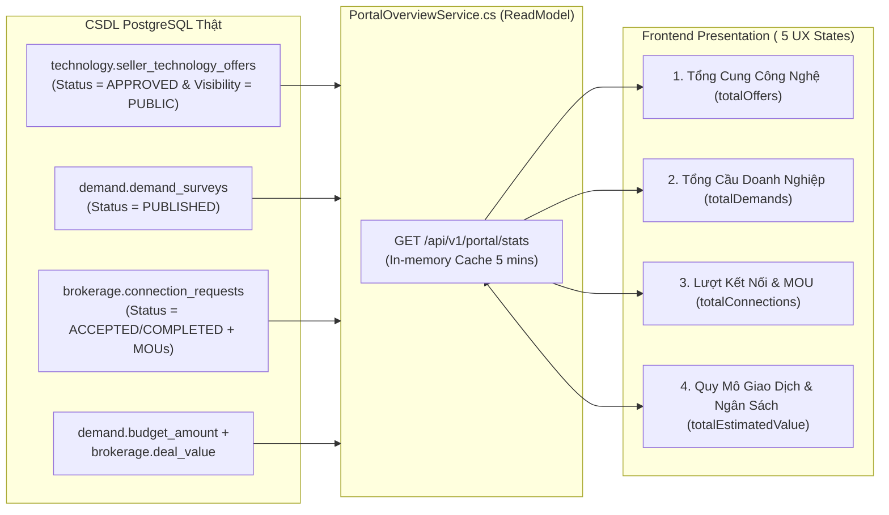

# YÊU CẦU THAY ĐỔI — CR-2026-010

| Thuộc tính | Chi tiết |
| :--- | :--- |
| **Mã Change Request** | `CR-2026-010` |
| **Tiêu đề** | Chuẩn hóa 4 Chỉ Số Đo Lường Toàn Sàn (Marketplace Metrics), Nguồn Chân Lý Taxonomy Ngành (SSOT) và Triệt Tiêu 100% Mock Số Tĩnh |
| **Người đề xuất** | Ban Quản trị Dự án (PO/PM NacenTech) & Lead BA (`nacen-ba`) |
| **Căn cứ quyết định** | Quyết định `PO-DEC-20261030-01` & Kế hoạch tổng thể chuẩn hóa Taxonomy và Zero-Mock |
| **Ngày ban hành** | 30/10/2026 |
| **Mức độ ưu tiên** | **P1 — Khẩn cấp** (Chốt chặn sinh tử chất lượng Đợt 1) |
| **Trạng thái** | 🟢 **ĐÃ DUYỆT SCOPE** — Đang thực thi Đợt 1 (Handoff SA / Dev / QC) |

---

## 1. BỐI CẢNH & HIỆN TRẠNG HỆ THỐNG (GREP-FIRST DISCOVERY)

### 1.1. Hiện Trạng Lệch Chuẩn Dữ Liệu & Mock Số Liệu Tĩnh
Qua rà soát đối soát thực tế toàn bộ mã nguồn (Grep-First Surface Discovery), hệ thống đang tồn tại 3 nhóm vi phạm nghiêm trọng về tính toàn vẹn dữ liệu:

1. **Số liệu tĩnh ảo tưởng (Static Dummy Metrics)**:
   - Trang chủ (`/`): Đang dùng fallback ảo `"1.200+"`, `"680+"` bằng sáng chế; `PortalOverviewService.cs` đang hardcode cứng con số `34` tỉnh thành thay vì đếm từ CSDL.
   - Sàn Chào Bán (`/chao-ban-cong-nghe`): Fallback cứng chữ `"1.200+"`, `"680+" bằng sáng chế` và nhãn tĩnh `"10 Ngành"`.
   - Sàn Tìm Mua Nhu Cầu (`/nhu-cau-cong-nghe`): Hero Banner hiển thị 3 khối số liệu tĩnh hardcoded `"142 bài toán"`, `"68.5 tỷ"`, `"24 giờ hỗ trợ kết nối"`.
   - *Hậu quả*: Vi phạm nguyên tắc Zero-Mock, gây hiểu lầm cho người dùng và đối tác về quy mô thật của sàn giao dịch công nghệ.

2. **Phân mảnh danh mục ngành nghề (Taxonomy Fragmentation)**:
   - CSDL PostgreSQL (`policy.taxonomy_terms` với `kind = 'SECTOR'`) đã seed chuẩn **10 Lĩnh vực TT17** (`LV01, LV05, LV07, LV08, LV11, LV12, LV14, LV15, LV16, LV17`) qua migration `AddCodeAndMetadataToTaxonomyTerms`.
   - Tuy nhiên, Frontend lại tự định nghĩa các mảng tĩnh:
     * `types/technology-offer.ts`: Khai báo mảng `TT17_SECTORS` gồm 18 ngành tự chế với các mã tiền tố lạ (`AG, FOOD, DRINK, MECH, ELEC, ENV, BUILD, LOG, HOSP, IT, SCI, TEXT, WOOD, CHEM, PHARMA, OPT, FURN, OTHER`).
     * `components/enterprise/EnterprisesDirectoryView.tsx`: Khai báo mảng `SECTORS_TT17` gán nhãn sai lệch mã `LVxx`.
   - *Hậu quả*: Bộ lọc ngành trên Sàn Chào Bán và Sàn Tìm Mua không tương thích với CSDL, dẫn đến truy vấn không trả về kết quả hoặc làm sai lệch kết quả lọc.

3. **Thiếu vắng chuẩn đo lường Marketplace Metrics**:
   - Backend chỉ mới đếm thô `totalOffers`, `totalDemands`, `totalEnterprises`, `totalExperts`; chưa có công thức phản ánh đúng sức sống của sàn giao dịch công nghệ (Tổng Cung đã kiểm duyệt, Tổng Cầu đang công khai, Lượt kết nối thành công/MOU đã ký, và Tổng quy mô giao dịch/ngân sách).

---

## 2. QUY CHUẨN GIẢI PHÁP & YÊU CẦU ĐẶC TẢ (SPECIFICATIONS)

### 2.1. Nguồn Chân Lý Taxonomy Ngành (Taxonomy SSOT)
- **Runtime API duy nhất**: `GET /api/v1/master-data/sectors?activeOnly=true`.
- **CSDL căn cứ**: Bảng `policy.taxonomy_terms` (`kind = 'SECTOR'`, `is_active = true`).
- **Danh mục 10 Lĩnh vực chuẩn Thông tư 17/2019/TT-BKHCN**:

| STT | Mã Lĩnh Vực | Tên Tiếng Việt Chính Thức | Nhóm C TT17 Ánh Xạ | Metadata Quy Tắc | Trạng Thái |
| :---: | :---: | :--- | :--- | :---: | :---: |
| 1 | `LV01` | **Nông nghiệp** | Liên ngành | `matrixPairsCount: 8` | `Active` |
| 2 | `LV05` | **Chế biến thực phẩm – đồ uống** | C.10, C.11 | `matrixPairsCount: 8` | `Active` |
| 3 | `LV07` | **Cơ khí – chế tạo – công nghiệp hỗ trợ** | C.32 | `matrixPairsCount: 6` | `Active` |
| 4 | `LV08` | **Điện – điện tử – tự động hóa** | C.26, C.27 | `matrixPairsCount: 6` | `Active` |
| 5 | `LV11` | **Nước – môi trường – chất thải** | E.38 | `matrixPairsCount: 6` | `Active` |
| 6 | `LV12` | **Xây dựng – vật liệu – hạ tầng** | C.23 | `matrixPairsCount: 3` | `Active` |
| 7 | `LV14` | **Logistics – vận tải – kho bãi** | H.52 | `matrixPairsCount: 4` | `Active` |
| 8 | `LV15` | **Du lịch – khách sạn – nhà hàng** | Dịch vụ | `matrixPairsCount: 4` | `Active` |
| 9 | `LV16` | **CNTT – viễn thông – chuyển đổi số** | Công nghệ số | `matrixPairsCount: 8` | `Active` |
| 10 | `LV17` | **Khoa học – công nghệ – đổi mới sáng tạo** | M.72 | `matrixPairsCount: 6` | `Active` |

> **CẤM TUYỆT ĐỐI**:
> - Khai báo mảng ngành cứng trong mã nguồn Frontend/Backend.
> - Sử dụng 8 mã khuyết chưa có dữ liệu trong Excel (`LV02, LV03, LV04, LV06, LV09, LV10, LV13, LV18`).
> - Tự chế các mã tiền tố `SEC-*` hoặc viết tắt tiếng Anh (`AG, FOOD, MECH...`).
> - Fallback sang danh sách giả lập khi API gặp sự cố.

### 2.2. Bốn Chỉ Số Đo Lường Toàn Sàn (Marketplace Metrics)
Thay thế toàn bộ các chỉ số rời rạc hoặc giả lập bằng 4 chỉ số cốt lõi được tính toán thời gian thực từ CSDL PostgreSQL (Zero-Mock):

1. **Chỉ số 1 · CUNG (Supply Metric — `totalOffers`)**:
   - **Tên hiển thị**: *"Công nghệ & Thiết bị chào bán"* (hoặc *"Tổng Cung Công Nghệ"*).
   - **Công thức**: Đếm tổng số bản ghi trong bảng `technology.seller_technology_offers` (hoặc `technology.technology_assets`) thỏa mãn:
     $$\text{Status} = \text{'APPROVED'} \quad \text{AND} \quad \text{IsPublic} = \text{true}$$
   - **Mục đích**: Chỉ công nghệ đã được kiểm duyệt và cho phép công khai mới được tính vào nguồn cung chính thức của sàn.

2. **Chỉ số 2 · CẦU (Demand Metric — `totalDemands`)**:
   - **Tên hiển thị**: *"Bài toán & Nhu cầu đổi mới"* (hoặc *"Tổng Cầu Doanh Nghiệp"*).
   - **Công thức**: Đếm tổng số bài toán nhu cầu trong bảng `demand.demand_surveys` (hoặc `demand.demand_items`) thỏa mãn:
     $$\text{Status} = \text{'PUBLISHED'}$$
   - **Mục đích**: Phản ánh nhu cầu thật của các doanh nghiệp đang tìm kiếm giải pháp chuyển giao hoặc đổi mới công nghệ.

3. **Chỉ số 3 · KẾT NỐI (Matching / Connection Metric — `totalConnections`)**:
   - **Tên hiển thị**: *"Lượt kết nối thành công & Thỏa thuận"* (hoặc *"Kết Nối Sàn"*).
   - **Công thức**: Đếm tổng số yêu cầu kết nối có trạng thái tiếp nhận thành công cộng với số biên bản ghi nhớ hợp tác (`MOU`) đã ký trong schema `brokerage`:
     $$\text{Count}(\text{connection\_requests WHERE Status IN ('ACCEPTED', 'COMPLETED')}) + \text{Count}(\text{deal\_mous WHERE Status = 'SIGNED'})$$
   - **Mục đích**: Minh chứng năng lực kết nối thực chất của sàn công nghệ, không chỉ dừng lại ở việc đăng tin.

4. **Chỉ số 4 · QUY MÔ GIAO DỊCH & NGÂN SÁCH (Transaction / Budget Volume Metric — `totalEstimatedValue`)**:
   - **Tên hiển thị**: *"Quy mô ngân sách & Giá trị thương vụ"* (hoặc *"Quy Mô Giao Dịch"*).
   - **Công thức**: Tổng giá trị ngân sách dự kiến của các bài toán nhu cầu công khai cộng với tổng giá trị thỏa thuận của các thương vụ trong Deal Room:
     $$\sum (\text{demand.budget\_amount}) + \sum (\text{brokerage.deals.estimated\_value})$$
   - **Định dạng hiển thị**: Rút gọn linh hoạt theo đơn vị tiền tệ Việt Nam (Ví dụ: `68.5 Tỷ VNĐ` hoặc `850 Triệu VNĐ`).

5. **Các chỉ số thống kê bổ trợ (Supporting Counts)**:
   - `totalEnterprises`: Đếm tổng số Doanh nghiệp ĐMST thật trong bảng `enterprise.enterprises`.
   - `totalExperts`: Đếm tổng số Chuyên gia KH&CN đã xác thực hồ sơ trong `brokerage.expert_profiles`.
   - `totalProvinces`: Đếm số lượng tỉnh/thành thực tế có doanh nghiệp hoặc công nghệ tham gia kết nối (tính động `COUNT(DISTINCT province_code)`, **tuyệt đối cấm số tĩnh `34` hoặc `63`**).

### 2.3. Triệt Tiêu 100% Mock Số Tĩnh & Chuẩn Hóa 5 UX States Qua `<Async>`
Mọi bề mặt hiển thị số liệu thống kê (Trang chủ, Sàn Chào Bán, Sàn Tìm Mua) bắt buộc phải bọc qua component chuẩn `<Async>` để thể hiện minh bạch 5 trạng thái UX:
1. **Loading State**: Hiển thị Skeleton pulse với kích thước tương ứng, không làm vỡ layout trang.
2. **Empty State**: Khi CSDL chưa có dữ liệu, hiển thị trung thực con số `0` hoặc thông điệp hướng dẫn *"Chưa có bài toán/công nghệ nào được niêm yết"*. Tuyệt đối cấm fallback sang số dummy (`1.200+`, `142`).
3. **Error State**: Khi API gặp lỗi mạng hoặc 500, hiển thị khối cảnh báo lỗi kèm nút `[Thử Lại]` (Retry). Tuyệt đối cấm gán cứng giá trị mock trong khối `catch`.
4. **Success State**: Hiển thị con số thật được format chuẩn số học (`Intl.NumberFormat('vi-VN')`).
5. **Updating State**: Khi revalidate dữ liệu chạy ngầm, hiển thị chỉ báo tải nhẹ nhàng không làm chớp nháy giao diện.

---

## 3. PHÂN TÍCH TÁC ĐỘNG ĐA BỀ MẶT (CROSS-SURFACE IMPACT MATRIX)

| Bề Mặt / Hệ Thống | File Path / Contract | Hiện Trạng Cần Sửa | Giải Pháp Chuẩn Hóa Theo CR-2026-010 | Trạng Thái Bàn Giao |
| :--- | :--- | :--- | :--- | :---: |
| **Basic Design TASK-01** | `Specification/02_BASIC_DESIGN/TASK-01_TONG_QUAN_VA_KIEN_TRUC_HOME/README.md` | Thiếu công thức Marketplace Metrics, còn nhắc 18 ngành | Cập nhật 4 chỉ số Cung/Cầu/Kết nối/Quy mô, Taxonomy SSOT 10 ngành TT17, ban hành `PO-DEC-20261030-01` | ✅ **ĐÃ XONG (BA)** |
| **Basic Design TASK-03** | `Specification/02_BASIC_DESIGN/TASK-03_HO_SO_TIM_MUA_BUYER/README.md` | Mục 7.3 còn ghi 18 lĩnh vực LV01..LV18 | Sửa thành 10 Lĩnh vực TT17 chuẩn SSOT; bổ sung mục 9 xóa bỏ số tĩnh 142/68.5 tỷ | ✅ **ĐÃ XONG (BA)** |
| **Basic Design TASK-04** | `Specification/02_BASIC_DESIGN/TASK-04_HO_SO_CHAO_BAN_SELLER_VA_BO_LOC/README.md` | Dùng tiền tố 18 ngành tự chế (AG, FOOD, MECH...), fallback 1.200+ | Đồng bộ 10 ngành TT17 chuẩn; quy chuẩn chỉ số Cung; bổ sung mục 9 | ✅ **ĐÃ XONG (BA)** |
| **Basic Design TASK-06** | `Specification/02_BASIC_DESIGN/TASK-06_HE_THONG_DANH_MUC_NGANH_MA_TRAN/README.md` | Khung Admin mock SEC-01..07, 18 ngành | Sửa sang 10 mã LV chuẩn; bổ sung mục 7 khẳng định SSOT duy nhất | ✅ **ĐÃ XONG (BA)** |
| **Spec Kit TASK-01** | `SourceCode/specs/TASK-01_TONG_QUAN_VA_KIEN_TRUC_HOME/spec.md` | `REQ-HOME-002` thiếu công thức chỉ số Kết nối và Quy mô ngân sách | Bổ sung Spec Delta v2 chuẩn hóa 4 Marketplace Metrics & Zero-Mock | ✅ **ĐÃ XONG (BA)** |
| **Spec Kit TASK-03** | `SourceCode/specs/TASK-03_HO_SO_TIM_MUA_BUYER/spec.md` | `FR-Delta-01` ghi số tĩnh `140+`, `68.5+ Tỷ`, `24 Giờ` | Cập nhật `FR-Delta-01` thành nạp động thời gian thực qua `<Async>` 5 UX States | ✅ **ĐÃ XONG (BA)** |
| **Spec Kit TASK-04** | `SourceCode/specs/TASK-04_HO_SO_CHAO_BAN_SELLER_VA_BO_LOC/spec.md` | Nhiều yêu cầu lọc và form ghi 18 ngành | Cập nhật Spec Delta v2 chuẩn hóa 10 ngành TT17 và chỉ số Cung dynamic | ✅ **ĐÃ XONG (BA)** |
| **Spec Kit TASK-06** | `SourceCode/specs/TASK-06_HE_THONG_DANH_MUC_NGANH_MA_TRAN/spec.md` | Chưa có quy tắc cấm mảng static | Bổ sung `BR-SEC-005` (Zero-Static-Array Enforcement) | ✅ **ĐÃ XONG (BA)** |
| **Backend ReadModel** | `SourceCode/backend/apps/api/V1Compat/PortalOverviewService.cs` | Hardcode `34` tỉnh; chưa tính `totalConnections` và `totalEstimatedValue` | Tính toán thời gian thực từ 4 bảng CSDL PostgreSQL; bỏ số cứng 34 | 🔄 **CẦN SA & DEV** |
| **Backend Contracts** | `PortalControllers.cs` & `PortalOverviewStatsDto.cs` | DTO thiếu trường kết nối và quy mô | Bổ sung `TotalConnections`, `TotalEstimatedValue` vào DTO | 🔄 **CẦN SA & DEV** |
| **Backend Taxonomy** | `SourceCode/backend/apps/api/V1Compat/MasterDataControllers.cs` | Endpoint `/api/v1/master-data/sectors` | Giữ vững SSOT từ `policy.taxonomy_terms`, cấm fallback mảng cứng | 🔄 **CẦN SA & DEV** |
| **Frontend Trang Chủ** | `SourceCode/frontend/src/app/page.tsx` | Nối trực tiếp `portalClient.getStats()` | Cập nhật UI hiển thị 4 thẻ Marketplace Metrics qua `<Async>` | 🔄 **CẦN DEV** |
| **Frontend Sàn Chào Bán** | `SourceCode/frontend/src/app/chao-ban-cong-nghe/page.tsx` | Fallback ảo `"1.200+"`, `"680+" bằng sáng chế` | Nạp động từ API thật, xóa sạch chữ cứng fallback | 🔄 **CẦN DEV** |
| **Frontend Sàn Tìm Mua** | `SourceCode/frontend/src/app/nhu-cau-cong-nghe/page.tsx` | Hero Banner hiển thị số cứng 142 bài toán, 68.5 tỷ | Chuyển sang nạp động từ API qua `<Async>` đủ 5 UX States | 🔄 **CẦN DEV** |
| **Frontend Types** | `SourceCode/frontend/src/types/technology-offer.ts` | Mảng `TT17_SECTORS` 18 ngành tự chế | Xóa bỏ mảng 18 ngành; dùng hook nạp động từ `master-data-client.ts` | 🔄 **CẦN DEV** |
| **Kiểm Thử (QC)** | `tests/integration/` & `e2e/playwright/` | Chưa kiểm tra đối soát số liệu CSDL thật | Viết test Playwright E2E so khớp số hiển thị UI với SQL PostgreSQL thật | 🔄 **CẦN QC** |

---

## 4. QUY TẮC NGHIỆP VỤ BỔ SUNG (BUSINESS RULES)

| Mã Rule | Tên Quy Tắc | Điều Kiện & Logic Xử Lý | Xử Lý Khi Vi Phạm |
| :--- | :--- | :--- | :--- |
| **`BR-METRIC-001`** | **Tính Toàn Vẹn Chỉ Số Cung Toàn Sàn** | Chỉ những công nghệ có `Status = 'APPROVED'` và `IsPublic = true` mới được tính vào `totalOffers`. Bản ghi `DRAFT`, `PENDING_REVIEW` hoặc `REJECTED` tuyệt đối không được tính. | Không hiển thị trên bộ đếm công khai |
| **`BR-METRIC-002`** | **Tính Toàn Vẹn Chỉ Số Cầu Toàn Sàn** | Chỉ những bài toán nhu cầu có `Status = 'PUBLISHED'` mới được tính vào `totalDemands`. Bản ghi `DRAFT` hoặc `CLOSED` không được tính. | Không hiển thị trên bộ đếm công khai |
| **`BR-METRIC-003`** | **Zero-Mock & Honesty Invariant** | Mọi chỉ số thống kê trên UI bắt buộc phản ánh số đếm thực từ CSDL. Tuyệt đối cấm dùng số cứng làm đẹp giao diện hoặc fallback ngầm trong khối catch. | Đánh trượt kiểm thử (FAIL Gate 4) |
| **`BR-SEC-005`** | **Zero-Static-Array Taxonomy Enforcement** | Toàn bộ giao diện và dịch vụ chỉ lấy danh mục ngành từ API `GET /api/v1/master-data/sectors?activeOnly=true`. Cấm định nghĩa mảng ngành tĩnh trong mã nguồn. | Build guard chặn commit vi phạm |

---

## 5. KẾ HOẠCH BÀN GIAO THI CÔNG TIẾP THEO (STAGE-GATE HANDOFF)

1. **Bàn giao cho Software Architect (`nacen-techlead-sa`)**:
   - Soạn thảo `plan.md` Delta cho Đợt 1.
   - Thiết kế hợp đồng DTO cho `PortalOverviewStatsDto` bổ sung `totalConnections` và `totalEstimatedValue`.
   - Rà soát Clean Architecture bảo đảm `PortalOverviewService` không rò rỉ DbContext ra ngoài tầng Application.
2. **Bàn giao cho Senior Developer (`nacen-dev-senior`)**:
   - Triển khai cập nhật backend .NET Core ReadModel và frontend Next.js Zero-Mock bám sát 1:1 theo `tasks.md`.
   - Chuẩn hóa 5 UX States qua `<Async>` trên Trang chủ, Sàn Chào Bán và Sàn Tìm Mua.
3. **Bàn giao cho QC Specialist (`nacen-qc`)**:
   - Thiết kế kịch bản Playwright E2E kiểm chứng đối soát CSDL PostgreSQL thật (Deep DB State Verification).
   - Tuyệt đối cấm mock và hardcode dữ liệu test.
4. **Bàn giao cho QA Sentinel (`nacen-qa`)**:
   - Quét độc lập mã nguồn phát hiện mọi dấu hiệu mock ngầm, fallback ảo trước khi trình PO ký duyệt Gate 5.
