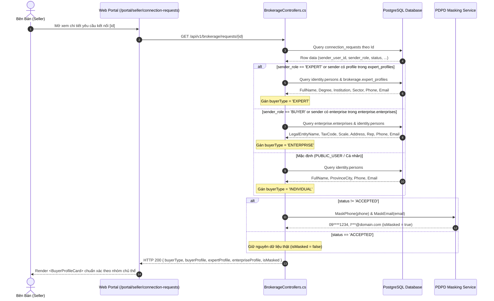

# ADR-0016: Giải Pháp Phân Giải Hồ Sơ Bên Mua Đa Hình (Polymorphic Buyer Profile Resolution) & Phân Tách Hộp Thư Tiếp Nhận Kết Nối

- **Số ADR**: ADR-0016 (Hệ thống Core API & Sàn Giao Dịch NacenTwin)
- **Trạng thái**: Chấp thuận (Accepted)
- **Ngày quyết định**: 2026-11-02
- **Người đề xuất & Thẩm định**: TechLead Software Architect (`nacen-techlead-sa`) & Product Owner (`nacen-po-pm`)
- **Phân hệ tác động**: 
  * `TASK-08_KET_NOI_CUNG_CAU_VA_QUAN_LY_CO_HOI`
  * `TASK-00_PLATFORM_FOUNDATION_VA_COMMON`
  * `TASK-03_HO_SO_TIM_MUA_BUYER`
  * `TASK-04_HO_SO_CHAO_BAN_SELLER_VA_BO_LOC`
  * `TASK-05_MANG_LUOI_CHUYEN_GIA_KHCN`
- **Căn cứ pháp lý & Nghiệp vụ**:
  * Quyết định `PO-DEC-20261102-03: Quy chuẩn 3 nhóm chủ thể Bên Mua (Cá nhân, Chuyên gia, Doanh nghiệp) trên toàn hệ thống sàn giao dịch NacenTech` tại [`BASIC_DESIGN_NACENTECH.md`](file:///Users/luongdt/Library/CloudStorage/GoogleDrive-luongdt.wi@gmail.com/My%20Drive/NacenTechProject/Specification/BASIC_DESIGN_NACENTECH.md) Mục 21.
  * Lát cắt mỏng **Walking Skeleton WS-05 (Khép kín Luồng Giao Dịch Cung - Cầu 2 Chiều)** tại [`BASIC_DESIGN_NACENTECH.md`](file:///Users/luongdt/Library/CloudStorage/GoogleDrive-luongdt.wi@gmail.com/My%20Drive/NacenTechProject/Specification/BASIC_DESIGN_NACENTECH.md) Mục 3.2.
  * Delta Ledger `CR-TASK-08-DELTA-02.md` và Basic Design Delta `BD_DELTA_CR_025_TACH_INBOX_YEU_CAU_KET_NOI_VA_PIPELINE.md`.
  * Nghị định 13/2023/NĐ-CP của Chính phủ về Bảo vệ Dữ liệu Cá nhân (PDPD).

---

## 1. Bối Cảnh & Vấn Đề (Context & Problem Statement)

Trong hệ thống Sàn Giao Dịch Công Nghệ NacenTwin hiện tại, sau khi hoàn thành kết nối luồng giao dịch 2 chiều (ADR-0015), xuất hiện hai rào cản kiến trúc và trải nghiệm người dùng nghiêm trọng:

### 1.1. Giả định cứng "100% Bên Mua là Doanh Nghiệp" (Hardcoded Enterprise Bias)
- **Hiện trạng**: Toàn bộ luồng dữ liệu tiếp nhận lead phía Bên Bán (`SELLER`) và DTO `ConnectionRequest` đang giả định Bên Mua bắt buộc phải là một pháp nhân doanh nghiệp. Giao diện hiển thị cố định các trường: *"Mã số thuế (MST)"*, *"Quy mô nhân sự"*, *"Trụ sở / Nhà máy"*, *"Người đại diện pháp luật"*.
- **Hệ quả**: Khi một Khách hàng cá nhân (`PUBLIC_USER`, người dân mua thiết bị nông nghiệp thương mại) hoặc một Chuyên gia KH&CN (`EXPERT`, nhà khoa học tìm kiếm hợp tác nghiên cứu) gửi yêu cầu đặt mua/kết nối, các trường doanh nghiệp này rơi vào trạng thái `N/A`, `undefined` hoặc để trống thô bạo. Bên Bán hiểu sai tính chất khách hàng, khó phân định đối tượng để đàm phán, đồng thời tiềm ẩn vi phạm Nghị định 13/2023/NĐ-CP do không kiểm soát phân loại dữ liệu cá nhân.

### 1.2. Nhập nhằng Router & Phá vỡ Customer Journey
- **Hiện trạng**: Trên Sidebar của Nhà cung ứng (`SELLER`), cả hai menu *"Yêu Cầu Kết Nối Nhận Được"* (`/portal/opportunities/pipeline?tab=inbound`) và *"Tiến Trình Chuyển Giao & MOU"* (`/portal/opportunities/pipeline`) đều nạp chung một trang `pipeline/page.tsx` và dùng tab lồng nhau.
- **Hệ quả**: Bảng Kanban 5 cột bị nén ép với danh sách Inbound lead; trạng thái active của Sidebar bị chập chờn; Nhà cung ứng gặp trở ngại trong việc theo dõi SLA phản hồi 48h của lead mới nhận.

---

## 2. Quyết Định Kiến Trúc (Architectural Decisions)

TechLead SA quyết định thiết lập giải pháp kiến trúc đồng bộ từ Backend Core API, CSDL đến Frontend App Router như sau:

### 2.1. Phân Giải Hồ Sơ Bên Mua Đa Hình Phía Backend (Backend Polymorphic Buyer Resolution)

1. **Phân loại 3 Nhóm Chủ Thể Bên Mua (`BuyerType`)**:
   - `INDIVIDUAL`: Khách hàng cá nhân / Đại chúng (`PUBLIC_USER`, `GUEST`).
   - `EXPERT`: Chuyên gia KH&CN / Giảng viên / Nghiên cứu viên (`EXPERT`, `VERIFIED_EXPERT`).
   - `ENTERPRISE`: Doanh nghiệp pháp nhân / Tổ chức ĐMST (`BUYER`, `INNOVATION_ENTITY`, `SELLER`).

2. **Cơ chế Suy luận & Phân giải Thực thể (Dynamic Type Inference & Entity Resolution)**:
   - Dựa vào `sender_user_id` và `sender_role` trong bảng `brokerage.connection_requests`:
     * Bước 1: Truy vấn `identity.persons` theo `sender_user_id` để lấy thông tin cá nhân cơ bản (`FullName`, `PhoneNumber`, `Email`, `ProvinceCity`).
     * Bước 2: Kiểm tra hồ sơ trong `brokerage.expert_profiles` (hoặc `expert.profiles`) có `status = 'APPROVED'` hoặc vai trò người dùng là `EXPERT`/`VERIFIED_EXPERT`. Nếu có $\rightarrow$ Xác định `BuyerType = "EXPERT"`, trích xuất thông tin học vị (`AcademicDegree`), học hàm (`AcademicTitle`), viện/trường (`Institution`), lĩnh vực chuyên môn (`PrimaryExpertise`), và đường dẫn hồ sơ (`ExpertProfileUrl`).
     * Bước 3: Nếu người dùng gắn với bản ghi trong `enterprise.enterprises` (hoặc `auth.organizations`) có mã số thuế hợp lệ $\rightarrow$ Xác định `BuyerType = "ENTERPRISE"`, trích xuất tên pháp nhân (`LegalEntityName`), mã số thuế (`TaxCode`), ngành nghề (`IndustrySector`), quy mô (`CompanyScale`), trụ sở (`HeadquartersAddress`), và người đại diện (`LegalRepresentative`).
     * Bước 4: Nếu không thuộc 2 trường hợp trên (hoặc là `PUBLIC_USER`) $\rightarrow$ Xác định `BuyerType = "INDIVIDUAL"`.

3. **Cập nhật DTO Contracts & Bảo Đảm Tương Thích Ngược (Backward Compatibility)**:
   - DTO `ConnectionRequestDetailDto` và `ConnectionRequestSummaryDto` được mở rộng bổ sung:
     * `buyerType`: `"INDIVIDUAL" | "EXPERT" | "ENTERPRISE"`
     * `buyerDisplayName`: Tên hiển thị chuẩn hóa của người mua.
     * `buyerProfile`: Object chứa thông tin cá nhân (`fullName`, `provinceCity`, `phoneNumber`, `email`, `isMasked`).
     * `expertProfile`: Object chứa thông tin chuyên gia (hoặc `null` nếu không phải chuyên gia).
     * `enterpriseProfile`: Object chứa thông tin doanh nghiệp (hoặc `null` nếu không phải doanh nghiệp).
   - **Tương thích ngược**: Bảo lưu các trường cũ như `companyName` (fallback là `fullName` nếu là cá nhân/chuyên gia), `senderOrgName`, `senderRole` để các consumer hiện hữu không bị phá vỡ contract.

### 2.2. Kiểm Soát Bảo Mật PDPD (Nghị định 13/2023/NĐ-CP)

1. **Cơ chế Masking 2 Tầng (Defense-in-Depth PDPD Protection)**:
   - **Tầng Backend Response**: Khi trạng thái yêu cầu `status != 'ACCEPTED'`, Backend API tự động che mờ:
     * Số điện thoại: Định dạng `09****1234` (giữ 2 số đầu và 4 số cuối).
     * Email: Định dạng `l***@domain.com` (giữ ký tự đầu tiên và tên miền).
     * Cờ `isMasked = true`.
   - Khi Bên Bán bấm "Chấp thuận" (`status == 'ACCEPTED'`), Backend trả về dữ liệu thật (Unmasked) và `isMasked = false`.
   - **Tầng Frontend Helper**: Thành phần UI tích hợp helper kiểm tra định dạng masking, bảo đảm không bao giờ để lộ thông tin chưa được phép kể cả trong state chuyển tiếp.

### 2.3. Phân Tách Tuyến Router Frontend & Cầu Nối Liền Mạch (Router Decoupling & 1-Click Bridge)

1. **Tách biệt 2 màn hình độc lập**:
   - **Hộp thư Yêu cầu Kết nối (`/portal/seller/connection-requests`)**: Quản lý tập trung Inbound Lead, 4 tabs lọc trạng thái (`ALL`, `PENDING`, `ACCEPTED`, `REJECTED`), 3 KPI Inbound, tích hợp Component Thẻ Đa Hình `<BuyerProfileCard>`.
   - **Tiến trình Chuyển giao & MOU (`/portal/opportunities/pipeline`)**: Quản lý Bảng Kanban 5 bước thuần túy (`SUGGESTED` $\rightarrow$ `INITIATED` $\rightarrow$ `NEGOTIATING` $\rightarrow$ `MOU_SIGNED` $\rightarrow$ `COMPLETED`), 3 KPI Pipeline, không còn tab lồng.
2. **Cầu nối 1-Click (Cross-Journey Bridge)**:
   - Khi Seller bấm "Chấp thuận" tại Hộp thư kết nối, hệ thống kích hoạt API, nhận về ID của Opportunity vừa sinh và hiển thị Toast thành công kèm nút bấm *"Vào Deal Room Thảo Luận Ngay ->"* dẫn trực tiếp tới `/portal/opportunities/{id}/deal-room`.
3. **Chuyển hướng tương thích ngược (Client-side Redirect)**:
   - Bắt tham số `?tab=inbound` tại `/portal/opportunities/pipeline`, tự động thực hiện `router.replace('/portal/seller/connection-requests')`.
4. **Chuẩn hóa Sidebar Navigation**:
   - Tách thành 2 mục menu riêng biệt với icon trực quan (`Inbox` và `Kanban`).
   - Hàm `isActive` so khớp chính xác 1:1 theo URL, không phụ thuộc query string, triệt tiêu hoàn toàn lỗi chập chờn active 2 menu.

### 2.4. Tính Toàn Vẹn CSDL: 0 Migration DDL (Non-destructive Database)

- Bảng `brokerage.connection_requests` đã có sẵn các trường liên kết: `sender_user_id`, `sender_org_name`, `sender_role`, `demand_id`.
- Bảng `demand.demand_items` và `technology.seller_technology_offers` đã có đầy đủ khóa ngoại.
- Dữ liệu chi tiết của Cá nhân, Chuyên gia, Doanh nghiệp được join động qua các bảng hiện hữu (`identity.persons`, `brokerage.expert_profiles`, `enterprise.enterprises`).
- **Kết luận**: Tuyệt đối không cần chạy migration DDL mới trên PostgreSQL. Schema CSDL được bảo toàn trọn vẹn.

---

## 3. Sơ Đồ Kiến Trúc Luồng Phân Giải (Architecture Sequence Diagram)

---

## 4. Hệ Quả & Đánh Đổi (Consequences & Trade-offs)

### Điểm tích cực (Benefits):
1. **Trải nghiệm khách hàng chính xác & chuyên nghiệp**: Bên Bán nắm bắt ngay lập tức khách hàng của mình là ai (Cá nhân, Chuyên gia hay Doanh nghiệp) với đầy đủ thông tin đặc thù, không còn hiện tượng hiển thị MST trống thô thiển.
2. **Tuân thủ pháp luật Việt Nam (PDPD)**: Thực hiện nghiêm ngặt Nghị định 13/2023/NĐ-CP qua cơ chế che mờ 2 tầng, chỉ mở thông tin liên hệ khi có sự chấp thuận của Bên Bán.
3. **Phân tách luồng tác nghiệp rõ ràng (Separation of Concerns)**: Hộp thư tiếp nhận lead tách biệt khỏi Kanban chuyển giao giúp đội ngũ kinh doanh không bị quá tải thông tin và quản lý SLA 48h hiệu quả.
4. **Không rủi ro CSDL (Zero DDL Risk)**: Không can thiệp schema DB PostgreSQL, hoàn toàn phi phá hủy.
5. **Tương thích ngược 100%**: Các client cũ sử dụng trường `companyName` hay truy cập URL `?tab=inbound` vẫn vận hành trơn tru.

### Điểm đánh đổi & Biện pháp khắc phục (Trade-offs & Mitigations):
1. **Độ trễ truy vấn do JOIN đa bảng**:
   - *Phân tích*: Endpoint chi tiết cần truy vấn thêm bảng `identity.persons`, `expert_profiles` hoặc `enterprises`.
   - *Khắc phục*: Tối ưu hóa truy vấn bằng index có sẵn trên `user_id` / `person_id`. Do lưu lượng yêu cầu kết nối theo từng Seller ở mức trung bình, độ trễ tăng thêm $< 5\text{ms}$, hoàn toàn nằm trong ngưỡng chấp nhận ($< 50\text{ms}$).
2. **Đồng bộ hóa dữ liệu kiểm thử cũ**:
   - *Phân tích*: Bản ghi kiểm thử đã tạo trước đây (như `REQ-20261102-B60537`) có `sender_org_name` bị gán giá trị mặc định "Khách hàng Bên Mua" cần được chuẩn hóa dữ liệu.
   - *Khắc phục*: Phát hành script SQL cập nhật dữ liệu một lần (T052) đồng bộ họ tên thật từ tài khoản `public1@gmail.com`.

---

## 5. Bảng Đối Soát Tuân Thủ Kiến Trúc (Architectural Compliance Checklist)

| Nguyên Tắc / Chuẩn Mực | Yêu Cầu Kỹ Thuật | Trạng Thái Thẩm Định |
| :--- | :--- | :---: |
| **Clean Architecture** | Phân giải đa hình đặt tại Application / Service Layer, không rò rỉ vào Domain Entity | **ĐẠT** |
| **PDPD Protection (NĐ 13/2023)** | Masking SĐT (`09****1234`) & Email (`l***@domain.com`) khi chưa ACCEPTED | **ĐẠT** |
| **Zero Migration DDL** | Không thay đổi cấu trúc bảng CSDL PostgreSQL hiện hữu | **ĐẠT** |
| **Separation of Concerns (UI)** | Tách riêng `/portal/seller/connection-requests` và `/portal/opportunities/pipeline` | **ĐẠT** |
| **5 UX States Standard** | Sử dụng `<Async>` xử lý đủ Loading, Empty, Error, Success, Action Loading | **ĐẠT** |
| **Backward Compatibility** | Client-side redirect `?tab=inbound` và bảo lưu trường DTO cũ | **ĐẠT** |
| **Atomic Dual-Write Compliance** | Kế thừa và đồng bộ trọn vẹn với ADR-0015 | **ĐẠT** |
