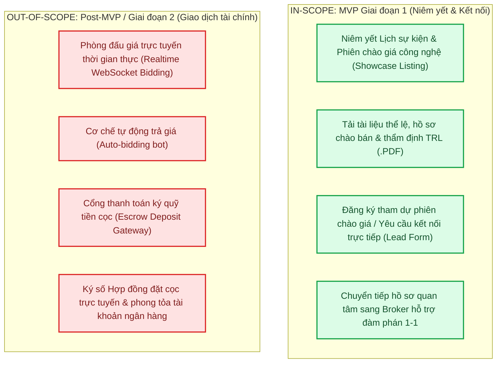

# BÁO CÁO GIẢI TRÌNH & PHÂN ĐỊNH RANH GIỚI NGHIỆP VỤ: ĐẤU GIÁ CÔNG NGHỆ & HỢP ĐỒNG ĐẶT CỌC

> **Mã tài liệu**: `PO-EXPLANATION-AUCTION-ESCROW-v1.0`  
> **Căn cứ pháp lý & kỹ thuật**: Quyết định PO `PO-DEC-20261008-06`, Luật Đấu giá tài sản 2016, Nghị định 62/2017/NĐ-CP, Luật Giao dịch điện tử 2023  
> **Áp dụng cho**: Phân hệ `TASK-01: Tổng quan hệ thống & Kiến trúc điều hướng`  
> **Trạng thái**: 🟢 APPROVED BY PO (Phê duyệt ranh giới In-Scope MVP 1 vs Out-of-Scope Post-MVP)

---

## 1. BỐI CẢNH & NGUY CƠ TRÔI DẠT PHẠM VI (SCOPE CREEP RISK)

Trong quá trình khảo sát cấu trúc sitemap tại sheet `HOME1` (dòng 8–9), có xuất hiện đề xuất về tính năng:
- *"Đấu giá công nghệ / tài sản trí tuệ trực tuyến"*
- *"Hợp đồng đặt cọc trực tuyến / Cơ chế bảo đảm thanh toán"*

Dưới góc độ quản trị sản phẩm (PO) và phân tích nghiệp vụ chuyên sâu (Lead BA), việc đưa các tính năng giao dịch tài chính - đấu giá trực tuyến vào **MVP giai đoạn 1** sẽ tạo ra rủi ro nghiêm trọng làm tê liệt tiến độ bàn giao của dự án vì các rào cản dưới đây.

---

## 2. BA TRỤ CỘT RÀO CẢN BẤT KHẢ THI TRONG GIAI ĐOẠN MVP

### 2.1. Rào cản Pháp lý & Thể chế (Regulatory Barriers)
1. **Luật Đấu giá tài sản 2016 & Nghị định 62/2017/NĐ-CP**:
   - Hoạt động đấu giá tài sản công, sáng chế thuộc ngân sách nhà nước hoặc tài sản trí tuệ bắt buộc phải do **Tổ chức đấu giá tài sản có giấy phép hành nghề** điều hành, có Đấu giá viên có thẻ hành nghề và Hội đồng đấu giá giám sát.
   - Nền tảng đấu giá trực tuyến phải được thẩm định an toàn thông tin và đăng ký chính thức với Cục Bổ trợ tư pháp - Bộ Tư pháp.
2. **Luật Phòng chống rửa tiền & Định danh điện tử (eKYC)**:
   - Các giao dịch đặt cọc giá trị lớn đòi hỏi quy trình eKYC mức độ 2 kết hợp chữ ký số công cộng (USB Token, VNPT SmartCA, Viettel-CA) và xác thực người đại diện theo pháp luật trên CSDL Quốc gia về Doanh nghiệp.

### 2.2. Rào cản Kỹ thuật Tài chính (Financial Escrow & Core Banking)
1. **Cơ chế Ký quỹ (Escrow Payment)**:
   - "Hợp đồng đặt cọc" trực tuyến đòi hỏi nền tảng phải hoạt động như một bên thứ ba trung gian (Third-Party Escrow) giữ tiền cọc của Buyer, phong tỏa tài khoản và tự động giải ngân cho Seller khi nghiệm thu hoặc bồi hoàn cho Buyer nếu vi phạm.
   - Để giữ tiền của người dùng hợp pháp tại Việt Nam, đơn vị vận hành phải có **Giấy phép Cung ứng dịch vụ Trung gian thanh toán** do Ngân hàng Nhà nước cấp.
2. **Hạ tầng bảo mật & SLA**:
   - Đòi hỏi chuẩn bảo mật dữ liệu thẻ PCI-DSS, hệ thống chống nghẽn thời gian thực (WebSocket Bidding Engine) và cơ chế chống thầu phụng/đầu cơ phức tạp.

### 2.3. Bản chất Thực tế Thị trường Chuyển giao Công nghệ & SHTT
- Tài sản công nghệ, sáng chế và giải pháp kỹ thuật có giá trị chuyển nhượng từ **vài trăm triệu đến hàng chục tỷ đồng**.
- Không có bất kỳ tổ chức, doanh nghiệp hay viện/trường nào thực hiện mua bán sáng chế chỉ qua một nút "bấm giá và đặt cọc online".
- Quy trình chuẩn hóa thực tế luôn vận hành theo chuỗi:
  $$\text{Khám phá (Discovery)} \longrightarrow \text{Ký cam kết bảo mật (NDA)} \longrightarrow \text{Mở DataRoom thẩm định công nghệ} \longrightarrow \text{Đàm phán điều khoản chuyển giao} \longrightarrow \text{Ký Hợp đồng Chuyển giao công nghệ Offline}$$

---

## 3. PHÂN ĐỊNH RANH GIỚI BẮT BUỘC: IN-SCOPE (MVP 1) VS OUT-OF-SCOPE (POST-MVP)

---

## 4. QUY TẮC BẢO VỆ MÃ NGUỒN & CƠ SỞ DỮ LIỆU (GOVERNANCE GUARDRAILS)

1. **Ranh giới CSDL Backend**:
   - Tuyệt đối **KHÔNG tạo các bảng**: `auction_bids`, `auction_rooms`, `escrow_accounts`, `deposit_contracts` trong schema `SourceCode/backend/infra/db/schema.sql`.
   - Mọi thông tin về các phiên chào giá/sự kiện công nghệ chỉ lưu trữ ở mức độ Content/Event Listing trong các bảng hiện có: `content.stories` hoặc `casework.commercialization_cases`.
2. **Ranh giới Giao diện Frontend & Wireframe**:
   - Toàn bộ menu điều hướng và tiêu đề trên giao diện Web Portal phải sử dụng thuật ngữ: **"Sự kiện & Phiên chào giá công nghệ"** thay vì "Sàn đấu giá trực tuyến".
   - Luôn hiển thị nhãn lộ trình (Roadmap Badge): *"Giai đoạn 1: Niêm yết thông tin & Tiếp nhận đăng ký. Sàn đấu giá trực tuyến ký quỹ sẽ phát triển tại Giai đoạn 2"*.

---

## 5. KẾT LUẬN & CHỮ KÝ PHÊ DUYỆT CỦA PO

Quyết định này là căn cứ pháp lý và kỹ thuật cao nhất để toàn bộ đội ngũ kỹ thuật (BA, Dev, QC) kiên định bảo vệ phạm vi sản phẩm MVP, chống hiện tượng "phình to tính năng" (Feature Creep) và tập trung 100% nguồn lực vào các giá trị cốt lõi: **Khám phá - Đánh giá nhu cầu TNI - Kết nối Cung Cầu ĐMST**.
