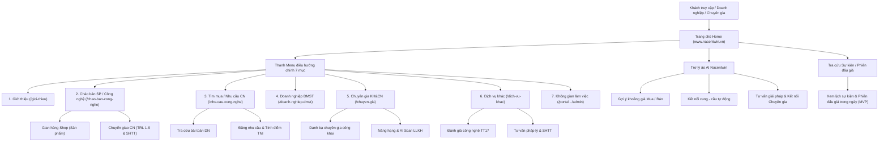

# TASK-01: Thiết Kế Cơ Sở — Tổng Quan Hệ Thống & Kiến Trúc Điều Hướng (Home)

> **Mã phân hệ**: `TASK-01`  
> **Quyết định phê duyệt tích hợp**: `PO-DEC-20261008-02` (Sitemap Menu) & `PO-DEC-20261008-06` (Ranh giới Đấu giá & Đặt cọc)  
> **Tài liệu giải trình ranh giới PO**: [`GIAI_TRINH_RANH_GIOI_DAU_GIA_VA_DAT_COC.md`](GIAI_TRINH_RANH_GIOI_DAU_GIA_VA_DAT_COC.md)  
> **Sheet nguồn**: `HOME1`, `Giới thiệu` (60 dòng dữ liệu) trong [`../DỮ_LIỆU_GỐC_MASTER/Nacentwin_20260924_bo_loc_da_sua.xlsx`](../DỮ_LIỆU_GỐC_MASTER/Nacentwin_20260924_bo_loc_da_sua.xlsx)  
> **Tài liệu trích xuất MD**: [`../DỮ_LIỆU_GỐC_MASTER/Nacentwin_20260924_bo_loc_da_sua.md#sheet-1-home1`](../DỮ_LIỆU_GỐC_MASTER/Nacentwin_20260924_bo_loc_da_sua.md#sheet-1-home1)  
> **Trạng thái**: 🟢 APPROVED BY PO (Scope Boundary Enforced & Sitemap Standardized)  
> **Quản lý tổng thể**: [`../DANH_SACH_TIEN_DO_BASIC_DESIGN.md`](../DANH_SACH_TIEN_DO_BASIC_DESIGN.md)

---

## 1. MỤC TIÊU & TẦM NHÌN SẢN PHẨM (EXECUTIVE SUMMARY)

Xây dựng nền tảng số **Đổi Mới Sáng Tạo & Kết Nối Cung Cầu Công Nghệ Nacentwin** đa nền tảng (Web Portal & Mobile App). Phân hệ `TASK-01` đóng vai trò là cửa ngõ điều hướng toàn bộ hệ sinh thái, tích hợp **Trợ lý ảo AI** và **Lịch sự kiện & Phiên chào giá công nghệ (Showcase)**.

> **Quyết định PO phê duyệt (PO-DEC-20261008-06):**  
> - **IN-SCOPE MVP 1**: Khối sự kiện/phiên đấu giá chỉ đóng vai trò **Tra cứu sự kiện & Niêm yết thông tin phiên chào giá công nghệ (Showcase Listing)**, tải hồ sơ thể lệ/TRL (.PDF) và đăng ký nhận tư vấn kết nối trực tiếp.  
> - **OUT-OF-SCOPE (Loại khỏi MVP 1 - Cảnh báo Scope Creep)**: Phòng đấu giá trực tuyến thời gian thực (Realtime Bidding Room), Tự động trả giá (Auto-bidding), Cổng thanh toán ký quỹ tiền cọc (Escrow Wallet) và Ký số hợp đồng đặt cọc trực tuyến. Các tính năng này được giữ trong Backlog Giai đoạn 2 (Post-MVP) do đòi hỏi giấy phép Đấu giá trực tuyến và giấy phép Trung gian thanh toán của NHNN. Chi tiết xem tại [`GIAI_TRINH_RANH_GIOI_DAU_GIA_VA_DAT_COC.md`](GIAI_TRINH_RANH_GIOI_DAU_GIA_VA_DAT_COC.md).

> **Quyết định PO cập nhật (30/09/2026):** Khi đã đăng nhập, người dùng chọn vùng danh tính ở Header/Home để mở **menu tài khoản** gồm `Cài đặt tài khoản` và `Đăng xuất`. Trang `Cài đặt tài khoản` cũng phải có hành động `Đăng xuất`; thao tác này cần xác nhận trước khi kết thúc phiên hiện tại.

### Trụ cột giá trị cốt lõi:
1. **Trợ lý ảo AI thông minh**:
   - Trợ lý kết nối cung - cầu công nghệ tự động.
   - Trợ lý thẩm định và đề xuất giá bán (Seller) & giá mua (Buyer).
   - Module tư vấn công nghệ tích hợp AI và gặp gỡ chuyên gia.
2. **Cơ chế xác nhận & Đấu giá công nghệ**:
   - Xác nhận đặt hàng kết nối cung cầu $\rightarrow$ Hợp đồng đặt cọc hoặc xác nhận thỏa thuận phi pháp lý HĐMB.
   - Module tạo phiên đấu giá sản phẩm/công nghệ hàng ngày kèm đặt cọc bảo đảm.
3. **Kiến trúc điều hướng đồng nhất**:
   - Sơ đồ điều hướng Menu 7 phân hệ chính trên toàn trang.

---

## 2. TÁC NHÂN & HÀNH TRÌNH NGƯỜI DÙNG (USER JOURNEY)

---

## 3. CÂY PHÂN RÃ TÍNH NĂNG & ROUTE URL (FUNCTIONAL DECOMPOSITION)

- **`HOME-01` Khung giao diện công cộng (Public Portal Header/Footer)**:
  - Header: Logo NacenTwin, Thanh tìm kiếm toàn trang, Menu điều hướng 7 mục có Mega-menu; Khách thấy nút Đăng nhập / Đăng ký; Người dùng đã đăng nhập thấy Avatar mở menu cá nhân (`/portal`, `Cài đặt tài khoản`, `Đăng xuất`).
  - Banner Hero: Khẩu hiệu Đổi mới sáng tạo & Lối tắt kích hoạt nhanh Trợ lý AI.
  - Khối Chào bán nổi bật (`/chao-ban-cong-nghe`) & Nhu cầu công nghệ mới đăng (`/nhu-cau-cong-nghe`).
  - Khối Sự kiện / Phiên đấu giá công nghệ hôm nay (`/dich-vu-khac/dau-gia`).
  - Footer: Chính sách bảo mật, Phổ cập chính sách ĐMST (`/tin-tuc-chinh-sach`), Hướng dẫn sử dụng (`/huong-dan-su-dung`), Liên hệ (`/lien-he`).
- **`HOME-02` Trợ lý ảo AI (AI Assistant Engine)**:
  - Chatbot tương tác tự nhiên đa kênh hỗ trợ tìm kiếm nguồn cung và bài toán nhu cầu.
  - Gợi ý phân loại ngành nghề theo 18 nhóm ngành và chuẩn hóa từ khóa công nghệ.
  - Hỗ trợ định giá tham khảo dựa trên dữ liệu giao dịch công nghệ.
- **`HOME-03` Module Sự kiện & Phiên đấu giá (Event & Auction Module)**:
  - MVP Scope: Tra cứu lịch mở phiên đấu giá và sự kiện trình diễn công nghệ Techmart trong ngày.
  - Post-MVP Scope: Cổng nạp tiền đặt cọc và phòng đấu giá trực tuyến kèm hợp đồng đặt cọc.

---

## 4. DỮ LIỆU ĐẶC TẢ CHI TIẾT GỐC (TRÍCH XUẤT 100% TỪ SHEET `HOME1`)

Dưới đây là toàn bộ 60 dòng dữ liệu nghiệp vụ gốc được lưu giữ nguyên bản:

| Nền tảng số ĐỔI MỚI SÁNG TẠO VÀ KẾT NỐI CUNG CẦU |  |  |  |  |
| :--- | :--- | :--- | :--- | :--- |
| I. Mục tiêu tổng thể |  |  |  |  |
| App / mobile |  |  |  |  |
| Ứng dụng trợ lý ảo AI, trợ lý kết nối cung cầu, đề xuất giá bán, đề xuất giá mua, |  |  |  |  |
| Tư vấn công nghệ, gặp gỡ chuyên gia |  |  |  |  |
| Module Tư vấn công nghệ tích hợp AI |  |  |  |  |
| Module kết nối chuyên gia |  |  |  |  |
| Xác nhận đặt hàng kết nối cung cầu --> Hợp đồng đặt cọc, hoặc xác nhận đặt hàng ko chịu pháp lý HĐMB |  |  |  |  |
| Đấu giá sản phẩm |  |  |  | Tạo phiên đấu giá hàng ngày, đặt cọc tham gia đấu giá |
| II. Bố trí giao diện |  |  |  |  |
| HOME link  www.nacentwin.vn |  |  |  |  |
| GIỚI THIỆU link www.nacentwin.vn/gioi-thieu |  |  |  |  |
| CHÀO BÁN SẢN PHẨM/ CÔNG NGHỆ link www.nacentwin.vn/chao-ban-cong-nghe |  |  |  |  |
| Chào bán sản phẩm |  |  |  |  |
|  | Gian hàng của shop |  |  |  |
|  |  | Tài khoản | Tên tài khoản, số điện thoại, địa chỉ, email, xác thực… |  |
|  |  | Sản phẩm | Hình ảnh, thông số kỹ thuật, đơn giá, mức độ TRL…) |  |
|  |  |  |  |  |
|  | Sản phẩm nổi bật |  |  |  |
|  |  | Sản phẩm | Hình ảnh, thông số kỹ thuật, đơn giá…) |  |
|  |  |  |  |  |
|  | Sản phẩm tương tự |  |  |  |
|  |  | Sản phẩm | Hình ảnh, thông số kỹ thuật, đơn giá…) |  |
| Công nghệ chuyển giao |  |  |  |  |
|  | Công nghệ ( Tên công nghệ, mô tả công nghệ, đơn giá,…) |  |  |  |
|  | Công nghệ tương tự |  |  |  |
|  |  |  |  |  |
| NHU CẦU CÔNG NGHỆ link www.nacentwin.vn/nhu-cau-cong-nghe |  |  |  |  |
|  | Nhu cầu mua công nghệ ( Theo danh mục CN01-CN 45) |  |  |  |
|  | Nhu cầu mua thiết bị ( Thiết bị cụ thể được sắp sếp theo lĩnh vực LV1-LV18) |  |  |  |
|  | Nhu cầu hỗ trợ ( Dịch vụ chuyên môn và Dịch vụ khác) |  |  |  |
|  |  |  |  |  |
| DOANH NGHIỆP ĐMST trang riêng: www.nacentwin.doanhnghiepdmst.vn |  |  |  |  |
|  | Giao diện thân thiện, đa nền tảng (Web + Mobile) |  |  |  |
|  | Hồ sơ doanh nghiệp ĐMST |  |  |  |
|  |  | Tài khoản: Tên tài khoản, số điện thoại, địa chỉ, email, xác thực… |  |  |
|  | Phần quyền theo vai trò khác nhau (cơ quan quản lý, doanh nghiệp, viện – trường...); |  |  |  |
|  | Công cụ phân tích dữ liệu theo vùng/ngành/mức độ đổi mới, hỗ trợ thống kê, xuất báo cáo |  |  |  |
| ELEARNING ( Theo mô hình Elearning open source) trang riêng www.nacentwin.elearning.vn |  |  |  |  |
|  | Học liệu số (video, tài liệu) |  |  |  |
|  | Kết nối chuyên gia tư vấn công nghệ |  |  |  |
|  | Kết nối chuyên gia đào tạo tri thức cho Agen AI |  |  |  |
| CHUYÊN GIA link www.nacentwin.vn/chuyen-gia |  |  |  |  |
|  | Hồ sơ chuyên gia |  |  |  |
|  |  |  |  |  |
| DỊCH VỤ KHÁC link www.nacentwin.vn/dich-vu-khac |  |  |  |  |
|  |  |  |  |  |
|  | Đánh giá, định giá |  |  |  |
|  |  | Phiếu khảo sát doanh nghiệp ( theo thông tư 17) |  |  |
|  |  | Phiếu đánh giá trình độ và năng lực công nghệ sản xuất của doanh nghiệp ( mẫu theo TT17) |  |  |
|  |  | Phiếu đánh giá trình độ và năng lực công nghệ sản xuất của ngành nghề, lĩnh vực ( mẫu theo TT17) |  |  |
|  | Tư vấn pháp lý: |  |  |  |
|  |  | Bảo hộ / Sở hữu trí tuệ |  |  |
|  |  | Đăng ký sáng chế |  |  |
|  |  | Đăng ký doanh nghiệp |  |  |
|  |  | Đăng ký thành doanh nghiệp KHCN |  |  |
|  |  | Đăng ký thành lập trung tâm tâm Đổi mới sáng tạo |  |  |
| PHỔ CẬP CHÍNH SÁCH |  |  |  |  |
| HƯỚNG DẪN SỬ DỤNG |  |  |  |  |
| LIÊN HỆ |  |  |  |  |

---

## 5. TIÊU CHÍ NGHIỆM THU (DEFINITION OF DONE - DoD)

- [x] Khớp 100% dữ liệu gốc từ Sheet `HOME1` (60 dòng dữ liệu).
- [x] Xác định rõ luồng điều hướng 7 phân hệ và User Journey qua Mermaid.
- [x] Phân rã tính năng Trợ lý ảo AI và Module Đấu giá công nghệ.
- [x] Xây dựng bản dựng giao diện mẫu tĩnh ([`wireframe_home.html`](./wireframe_home.html) — Sườn DauThau.Net, bản sắc NacenTech).
- [x] Xây dựng bản dựng giao diện Lịch sự kiện & Phiên chào giá Techmart ([`wireframe_techmart_events.html`](./wireframe_techmart_events.html) — Showcase niêm yết, đăng ký tham gia & gian hàng công nghệ).
- [x] Chốt hành vi cấp Basic Design cho menu tài khoản: vào Cài đặt hoặc yêu cầu Đăng xuất; Settings có lối Đăng xuất tương đương.
- [x] Đồng bộ wireframe trạng thái đã đăng nhập và SRS Identity với quyết định menu tài khoản/đăng xuất.
- [x] Ban hành `PO-DEC-20261008-06` và Báo cáo giải trình ranh giới Đấu giá & Hợp đồng đặt cọc ([`GIAI_TRINH_RANH_GIOI_DAU_GIA_VA_DAT_COC.md`](GIAI_TRINH_RANH_GIOI_DAU_GIA_VA_DAT_COC.md)).
- [x] Được PO/Lead duyệt thông qua (100% Approved) để làm cơ sở biên soạn SRS chi tiết.

