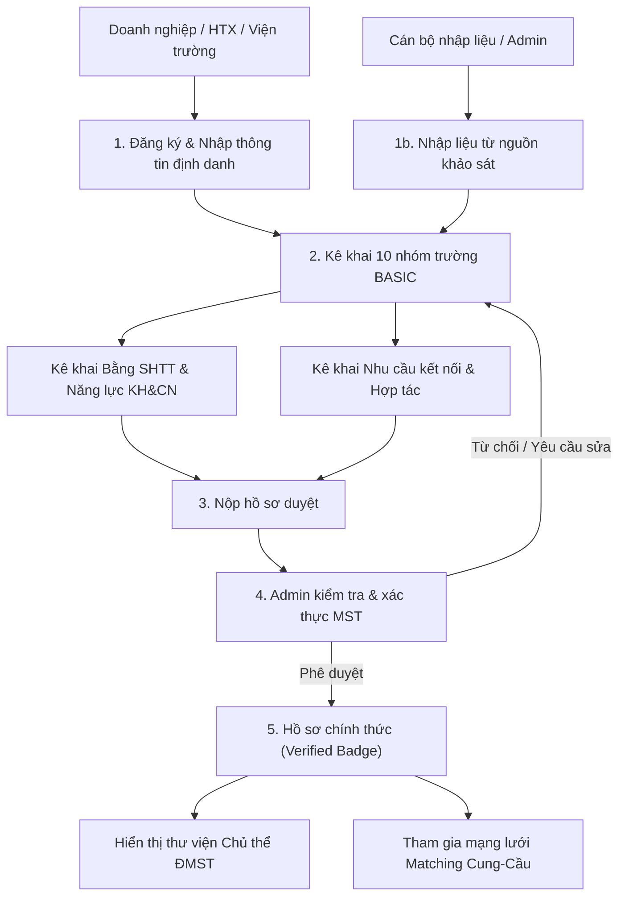

# TASK-02: Thiết Kế Cơ Sở — Hồ Sơ Chủ Thể & Doanh Nghiệp Đổi Mới Sáng Tạo

> **Mã phân hệ**: `TASK-02`  
> **Quyết định phê duyệt tích hợp**: `PO-DEC-20261008-05` (08/10/2026)  
> **Dữ liệu thực tế bổ sung (Ground Truth)**: 304 Doanh nghiệp thực tế có MST từ [`../../01_DATA_RAW/Khảo sát 304 DN-final-2408.xlsx`](../../01_DATA_RAW/Khảo%20sa%CC%81t%20304%20DN-final-2408.xlsx)  
> **Báo cáo đối soát & Mapping**: [`DATA_MAPPING_304_DN.md`](DATA_MAPPING_304_DN.md)  
> **Tệp Seed CSDL hoàn chỉnh**: [`seed_304_dn_real_data.sql`](seed_304_dn_real_data.sql) (PostgreSQL 16+ Idempotent)  
> **Bộ 5 Wireframe Tương Tác Khép Kín CRUD**:
> - Khai báo hồ sơ 10 nhóm trường (Create Wizard): [`wireframe_ho_so_dn_dmst.html`](wireframe_ho_so_dn_dmst.html)
> - Dashboard thống kê 34 tỉnh/18 ngành: [`wireframe_dashboard_304_dn.html`](wireframe_dashboard_304_dn.html)
> - Hồ sơ công khai (Public Profile): [`wireframe_public_dn_dmst.html`](wireframe_public_dn_dmst.html)
> - Danh bạ tra cứu 304 DN ĐMST toàn quốc (Directory Listing): [`wireframe_danh_ba_dn_dmst.html`](wireframe_danh_ba_dn_dmst.html)
> - Bàn làm việc tự quản trị & chỉnh sửa hồ sơ (Owner Self-Care): [`wireframe_chinh_sua_ho_so_dn.html`](wireframe_chinh_sua_ho_so_dn.html)
> **Sheet nguồn ban đầu**: `DN ĐMST` (225 dòng dữ liệu, 10 cột) trong [`../DỮ_LIỆU_GỐC_MASTER/Nacentwin_20260924_bo_loc_da_sua.xlsx`](../DỮ_LIỆU_GỐC_MASTER/Nacentwin_20260924_bo_loc_da_sua.xlsx)  
> **Trạng thái**: 🟢 APPROVED BY PO (Ground Truth CSDL 304 DN, Trọn bộ 5 Wireframe CRUD & Realtime Dashboard)  
> **Quản lý tổng thể**: [`../DANH_SACH_TIEN_DO_BASIC_DESIGN.md`](../DANH_SACH_TIEN_DO_BASIC_DESIGN.md)

---

## 1. MỤC TIÊU & PHẠM VI NGHIỆP VỤ

Phân hệ quản trị **Hồ sơ chủ thể Đổi mới sáng tạo (BASIC)**, đóng vai trò là "Căn cước số" của các tổ chức, doanh nghiệp, viện trường, hợp tác xã tham gia hệ sinh thái Nacentwin.

### 10 Nhóm Thông Tin Cốt Lõi:
1. **Nguồn dữ liệu, đối tượng & hình thức nhập**: Tự khai báo hoặc Cán bộ nhập liệu; phân loại loại hình chủ thể.
2. **Quản lý hồ sơ**: Trạng thái kiểm duyệt, cán bộ phụ trách, lịch sử thay đổi.
3. **Thông tin định danh**: Tên đăng ký, Mã số thuế/Mã định danh, ngày thành lập, địa chỉ pháp lý.
4. **Người đại diện & Đầu mối liên hệ**: Họ tên, chức vụ, số điện thoại, email, hotline.
5. **Lĩnh vực hoạt động & Ngành nghề**: Lĩnh vực theo chuẩn TT17, mô tả năng lực kinh doanh.
6. **Năng lực KH&CN & Đổi mới sáng tạo**: Phòng thí nghiệm, nhân lực R&D, chứng chỉ ISO/tiêu chuẩn, dự án KH&CN đã thực hiện.
7. **Sở hữu trí tuệ (SHTT)**: Bằng độc quyền sáng chế, giải pháp hữu ích, nhãn hiệu, kiểu dáng công nghiệp.
8. **Nhu cầu kết nối & Đề xuất hợp tác**: Cần tìm công nghệ, tìm đối tác liên kết, tìm nguồn vốn/chuyên gia.
9. **Danh mục sản phẩm / giải pháp đang cung cấp**: Liên kết tự động sang phân hệ Chào bán (Seller).
10. **Phạm vi dữ liệu trao đổi & Phân quyền**: Công khai / Nội bộ / Chỉ chia sẻ khi được duyệt.

---

## 2. TÁC NHÂN & LUỒNG NGHIỆP VỤ HỒ SƠ



---

## 3. DỮ LIỆU ĐẶC TẢ CHI TIẾT GỐC (TRÍCH XUẤT 100% TỪ SHEET `DN ĐMST`)

Dưới đây là toàn bộ 225 dòng dữ liệu nghiệp vụ gốc được lưu giữ nguyên bản:

| BASIC — HỒ SƠ CHỦ THỂ ĐỔI MỚI SÁNG TẠO |  |  |  |  |  |  |  |  |  |
| :--- | :--- | :--- | :--- | :--- | :--- | :--- | :--- | :--- | :--- |
|  |  |  |  |  |  |  |  |  |  |
| 1. Nguồn dữ liệu, đối tượng và cách nhập |  |  |  |  |  |  |  |  |  |
|  |  |  | Nguồn dữ liệu |  |  |  |  |  | Text |
|  |  |  | Ghi nhận nguồn dữ liệu sử dụng để lập hồ sơ. |  |  |  |  |  |  |
|  |  |  | Loại chủ thể |  |  |  |  |  | Chọn một |
|  |  |  | Doanh nghiệp / Hợp tác xã / Hộ kinh doanh |  |  |  |  |  |  |
|  |  |  | Phân loại và thống kê |  |  |  |  |  | Ghi chú |
|  |  |  | Quản lý, lọc và thống kê riêng từng loại chủ thể. |  |  |  |  |  |  |
|  |  |  | Hình thức nhập hồ sơ |  |  |  |  |  | Chọn một |
|  |  |  | Chủ thể tự khai / Cán bộ quản lý, khảo sát nhập hộ |  |  |  |  |  |  |
|  |  |  | Người nhập hồ sơ |  |  |  |  |  | Tài khoản |
|  |  |  | Lưu tài khoản thực hiện nhập hồ sơ. |  |  |  |  |  |  |
|  |  |  |  |  |  |  |  |  |  |
| 2. Quản lý hồ sơ |  |  |  |  |  |  |  |  |  |
|  |  |  | Đơn vị / Cán bộ quản lý hồ sơ |  |  |  |  |  | Text |
|  |  |  | Ngày cập nhật gần nhất |  |  |  |  |  | DateTime |
|  |  |  | Lịch sử thay đổi |  |  |  |  |  | Lịch sử |
|  |  |  |  |  |  |  |  |  |  |
| 3. Thông tin định danh |  |  |  |  |  |  |  |  |  |
|  |  |  | Tên đăng ký |  |  |  |  |  | Text |
|  |  |  | Mã số đăng ký / Mã số thuế tương ứng |  |  |  |  |  | Text |
|  |  |  | Ngày thành lập / Ngày đăng ký |  |  |  |  |  | Date |
|  |  |  | Địa chỉ |  |  |  |  |  | Text |
|  |  |  | Tỉnh / Thành phố |  |  |  |  |  | Chọn một |
|  |  |  | Website |  |  |  |  |  | URL |
|  |  |  | Giới thiệu |  |  |  |  |  | Text |
|  |  |  | Logo |  |  |  |  |  | Image |
|  |  |  |  |  |  |  |  |  |  |
| 4. Người liên hệ |  |  |  |  |  |  |  |  |  |
|  |  |  | Họ và tên |  |  |  |  |  | Text |
|  |  |  | Chức vụ / Vai trò |  |  |  |  |  | Text |
|  |  |  | Bộ phận |  |  |  |  |  | Text |
|  |  |  | Số điện thoại |  |  |  |  |  | Text |
|  |  |  | Email |  |  |  |  |  | Text |
|  |  |  |  |  |  |  |  |  |  |
|  |  |  | Quyền hiển thị thông tin người liên hệ |  |  |  |  |  | Ghi chú |
|  |  |  | Chỉ hiển thị cho bên gửi yêu cầu sau khi chủ thể chấp nhận |  |  |  |  |  |  |
|  |  |  | kết nối qua nền tảng. Áp dụng cho doanh nghiệp, HTX và hộ kinh doanh. |  |  |  |  |  |  |
|  |  |  |  |  |  |  |  |  |  |
| 5. Ngành nghề và quy mô |  |  |  |  |  |  |  |  |  |
|  |  |  | Ngành hoạt động chính |  |  |  |  |  | Chọn một |
|  |  |  | Ngành hoạt động khác |  |  |  |  |  | Chọn nhiều |
|  |  |  | Lĩnh vực công nghệ |  |  |  |  |  | Chọn nhiều |
|  |  |  | Nhóm công nghệ |  |  |  |  |  | Chọn nhiều |
|  |  |  | Lĩnh vực và nhóm công nghệ sử dụng danh mục chung của nền tảng. |  |  |  |  |  |  |
|  |  |  | Sản phẩm / Dịch vụ chính |  |  |  |  |  | Text |
|  |  |  | Số lao động |  |  |  |  |  | Number |
|  |  |  | Doanh thu năm (VND) |  |  |  |  |  | Number |
|  |  |  | Năm thống kê |  |  |  |  |  | Year |
|  |  |  | Thị trường hoạt động |  |  |  |  |  | Chọn nhiều |
|  |  |  | Trong nước / Quốc tế |  |  |  |  |  |  |
|  |  |  |  |  |  |  |  |  |  |
|  |  |  | Mức khai tối thiểu của nhóm ngành nghề và quy mô |  |  |  |  |  | Ghi chú |
|  |  |  | Ngành chính, sản phẩm / dịch vụ chính: bắt buộc khi gửi xác minh. |  |  |  |  |  |  |
|  |  |  | Các trường còn lại trong nhóm được bổ sung sau. |  |  |  |  |  |  |
|  |  |  | Khi nhập số lao động hoặc doanh thu năm, phải có năm thống kê. |  |  |  |  |  |  |
|  |  |  |  |  |  |  |  |  |  |
|  |  |  | Quyền xem doanh thu |  |  |  |  |  | Ghi chú |
|  |  |  | Mặc định chỉ chủ thể và cán bộ có quyền quản lý hồ sơ được xem. |  |  |  |  |  |  |
|  |  |  | Kết nối thành công không tự mở thông tin doanh thu. |  |  |  |  |  |  |
|  |  |  |  |  |  |  |  |  |  |
|  |  |  | Phân tích theo vùng và nhóm ngành ưu tiên |  |  |  |  |  |  |
|  |  |  | Vùng kinh tế - xã hội |  |  |  |  |  | Danh mục |
|  |  |  | Nhóm ngành ưu tiên |  |  |  |  |  | Danh mục |
|  |  |  | Công nghiệp chế biến - chế tạo; |  |  |  |  |  |  |
|  |  |  | Nông nghiệp công nghệ cao và nông nghiệp số; |  |  |  |  |  |  |
|  |  |  | Công nghệ thông tin, chuyển đổi số; |  |  |  |  |  |  |
|  |  |  | Năng lượng tái tạo và công nghệ môi trường. |  |  |  |  |  |  |
|  |  |  | Nguồn: Rà soát trùng lặp.xlsx, Sheet1, A2-A3 và A9. |  |  |  |  |  |  |
|  |  |  | Danh sách 3 vùng thí điểm chưa được xác định trong tài liệu nguồn. |  |  |  |  |  |  |
|  |  |  |  |  |  |  |  |  |  |
| 6. Nguồn lực đổi mới sáng tạo |  |  |  |  |  |  |  |  |  |
|  |  |  | Bộ phận / Nhân sự phụ trách ĐMST |  |  |  |  |  | Chọn một |
|  |  |  | Chuyên trách / Kiêm nhiệm / Chưa có |  |  |  |  |  |  |
|  |  |  | Số nhân sự tham gia nghiên cứu, phát triển và ĐMST |  |  |  |  |  | Number |
|  |  |  | Kế hoạch ĐMST |  |  |  |  |  | Chọn một |
|  |  |  | Đã có / Đang xây dựng / Chưa có |  |  |  |  |  |  |
|  |  |  | Kinh phí dành cho ĐMST (VND) |  |  |  |  |  | Number |
|  |  |  | Năm thống kê kinh phí ĐMST |  |  |  |  |  | Year |
|  |  |  | Cơ sở vật chất, thiết bị, phần mềm phục vụ ĐMST |  |  |  |  |  | Text |
|  |  |  |  |  |  |  |  |  |  |
|  |  |  | Mức khai báo nhóm nguồn lực ĐMST |  |  |  |  |  | Ghi chú |
|  |  |  | Cho phép bổ sung sau. Áp dụng cho doanh nghiệp, HTX và hộ kinh doanh. |  |  |  |  |  |  |
|  |  |  |  |  |  |  |  |  |  |
|  |  |  | Kỳ dữ liệu và quyền xem kinh phí ĐMST |  |  |  |  |  |  |
|  |  |  | Năm thống kê số nhân sự nghiên cứu, phát triển và ĐMST |  |  |  |  |  | Year |
|  |  |  | Kinh phí ĐMST ghi theo năm thống kê tại trường Năm thống kê kinh phí ĐMST. |  |  |  |  |  |  |
|  |  |  | Chỉ chủ thể và cán bộ có quyền quản lý hồ sơ được xem kinh phí ĐMST. |  |  |  |  |  |  |
|  |  |  | Kết nối thành công không tự mở thông tin kinh phí ĐMST. |  |  |  |  |  |  |
|  |  |  |  |  |  |  |  |  |  |
| 7. Hoạt động / Dự án đổi mới sáng tạo |  |  |  |  |  |  |  |  |  |
|  |  |  | Mỗi chủ thể được khai nhiều hoạt động / dự án ĐMST. |  |  |  |  |  |  |
|  |  |  | Các trường dưới đây được khai riêng cho từng hoạt động / dự án. |  |  |  |  |  |  |
|  |  |  |  |  |  |  |  |  |  |
|  |  |  | Tên hoạt động / Dự án |  |  |  |  |  | Text |
|  |  |  | Mục tiêu, vấn đề cần giải quyết |  |  |  |  |  | Text |
|  |  |  | Nội dung đổi mới và điểm khác biệt so với trước |  |  |  |  |  | Text |
|  |  |  | Thời gian bắt đầu |  |  |  |  |  | Date |
|  |  |  | Thời gian kết thúc dự kiến |  |  |  |  |  | Date |
|  |  |  | Thời gian kết thúc thực tế |  |  |  |  |  | Date |
|  |  |  | Trạng thái hoạt động / Dự án |  |  |  |  |  | Chọn một |
|  |  |  | Dự kiến / Đang thực hiện / Hoàn thành / Tạm dừng / Dừng |  |  |  |  |  |  |
|  |  |  | Đối tác phối hợp (nếu có) |  |  |  |  |  | Text |
|  |  |  |  |  |  |  |  |  |  |
| 8. Kết quả và minh chứng |  |  |  |  |  |  |  |  |  |
|  |  |  | Mỗi hoạt động / dự án được khai nhiều kết quả. |  |  |  |  |  |  |
|  |  |  | Các trường dưới đây được khai riêng cho từng kết quả. |  |  |  |  |  |  |
|  |  |  |  |  |  |  |  |  |  |
|  |  |  | Tên kết quả |  |  |  |  |  | Text |
|  |  |  | Mô tả kết quả |  |  |  |  |  | Text |
|  |  |  | Sản phẩm, dịch vụ hoặc quy trình tạo mới / cải tiến |  |  |  |  |  | Text |
|  |  |  | Tình trạng áp dụng |  |  |  |  |  | Chọn một |
|  |  |  | Chưa áp dụng / Thử nghiệm / Đã áp dụng |  |  |  |  |  |  |
|  |  |  | Thời điểm áp dụng thực tế (nếu có) |  |  |  |  |  | Date |
|  |  |  | Hiệu quả đạt được |  |  |  |  |  | Text |
|  |  |  | Năng suất, chi phí, chất lượng, doanh thu... kèm số liệu nếu có. |  |  |  |  |  |  |
|  |  |  | Tài liệu, hình ảnh hoặc đường dẫn minh chứng |  |  |  |  |  | File / Image / URL |
|  |  |  | Thông tin sở hữu trí tuệ liên quan (nếu có) |  |  |  |  |  | Text |
|  |  |  | Chứng nhận, giải thưởng liên quan (nếu có) |  |  |  |  |  | Text |
|  |  |  |  |  |  |  |  |  |  |
|  |  |  | Mức khai báo nhóm kết quả và minh chứng |  |  |  |  |  | Ghi chú |
|  |  |  | Cho phép bổ sung sau khi có kết quả thực tế. |  |  |  |  |  |  |
|  |  |  |  |  |  |  |  |  |  |
|  |  |  | Quyền xem minh chứng |  |  |  |  |  | Ghi chú |
|  |  |  | Mặc định chỉ chủ thể và cán bộ có quyền quản lý / đánh giá hồ sơ được xem. |  |  |  |  |  |  |
|  |  |  | Chủ thể có thể chọn công khai từng tài liệu. |  |  |  |  |  |  |
|  |  |  | Kết nối thành công không tự mở các tài liệu chưa công khai. |  |  |  |  |  |  |
|  |  |  |  |  |  |  |  |  |  |
| 9. Đánh giá, phân loại mức độ ĐMST |  |  |  |  |  |  |  |  |  |
|  |  |  | Kỳ / Năm đánh giá |  |  |  |  |  | Text / Year |
|  |  |  | Bộ tiêu chí áp dụng |  |  |  |  |  | Danh mục |
|  |  |  | Phiên bản bộ tiêu chí |  |  |  |  |  | Text |
|  |  |  | Dữ liệu theo từng tiêu chí |  |  |  |  |  | Text / Number |
|  |  |  | Điểm theo từng tiêu chí |  |  |  |  |  | Number |
|  |  |  | Minh chứng theo từng tiêu chí |  |  |  |  |  | File / Image / URL |
|  |  |  | Người / Đơn vị đánh giá |  |  |  |  |  | Text |
|  |  |  | Ngày đánh giá |  |  |  |  |  | Date |
|  |  |  | Nhận xét đánh giá |  |  |  |  |  | Text |
|  |  |  | Kết quả phân loại mức độ ĐMST |  |  |  |  |  | Chọn một |
|  |  |  | Tiềm năng / Đang phát triển / Dẫn đầu |  |  |  |  |  |  |
|  |  |  | Trạng thái đánh giá |  |  |  |  |  | Chọn một |
|  |  |  | Chưa đánh giá / Đang đánh giá / Đã duyệt |  |  |  |  |  |  |
|  |  |  |  |  |  |  |  |  |  |
|  |  |  | Nguyên tắc đánh giá và phân loại |  |  |  |  |  | Ghi chú |
|  |  |  | Chưa chốt công thức điểm và ngưỡng phân loại ở mức basic. |  |  |  |  |  |  |
|  |  |  | Hồ sơ chưa được đánh giá không tự gán mức ĐMST. |  |  |  |  |  |  |
|  |  |  | Nguồn ba mức phân loại: Rà soát trùng lặp.xlsx, Sheet1, ô A3. |  |  |  |  |  |  |
|  |  |  |  |  |  |  |  |  |  |
|  |  |  | Lưu đánh giá theo kỳ và thông tin duyệt |  |  |  |  |  |  |
|  |  |  | Mỗi kỳ đánh giá được lưu riêng cùng bộ tiêu chí và phiên bản áp dụng. |  |  |  |  |  |  |
|  |  |  | Giữ kết quả các kỳ trước, không ghi đè khi có kỳ đánh giá mới. |  |  |  |  |  |  |
|  |  |  | Người duyệt kết quả đánh giá |  |  |  |  |  | Tài khoản |
|  |  |  | Ngày duyệt kết quả đánh giá |  |  |  |  |  | Date |
|  |  |  |  |  |  |  |  |  |  |
| 10. Nhu cầu hỗ trợ đổi mới sáng tạo |  |  |  |  |  |  |  |  |  |
|  |  |  | Loại hỗ trợ |  |  |  |  |  | Text |
|  |  |  | Mô tả nhu cầu |  |  |  |  |  | Text |
|  |  |  | Thời gian cần hỗ trợ |  |  |  |  |  | Text |
|  |  |  |  |  |  |  |  |  |  |
|  |  |  | Mức khai báo nhóm nhu cầu hỗ trợ |  |  |  |  |  | Ghi chú |
|  |  |  | Cho phép bỏ trống và bổ sung sau. |  |  |  |  |  |  |
|  |  |  | Nhập mô tả loại hỗ trợ ở mức basic, chưa sử dụng danh sách chọn nhiều. |  |  |  |  |  |  |
|  |  |  |  |  |  |  |  |  |  |
| 11. Xác minh và công khai hồ sơ |  |  |  |  |  |  |  |  |  |
|  |  |  | Trạng thái xác minh thông tin |  |  |  |  |  | Chọn một |
|  |  |  | Chưa xác minh / Đang xác minh / Đã xác minh / Cần bổ sung |  |  |  |  |  |  |
|  |  |  | Người xác minh |  |  |  |  |  | Tài khoản |
|  |  |  | Ngày xác minh |  |  |  |  |  | Date |
|  |  |  |  |  |  |  |  |  |  |
|  |  |  | Nguyên tắc quản lý trạng thái |  |  |  |  |  | Ghi chú |
|  |  |  | Trạng thái xác minh thông tin được lưu riêng với kết quả đánh giá mức độ ĐMST. |  |  |  |  |  |  |
|  |  |  |  |  |  |  |  |  |  |
|  |  |  | Điều kiện công khai hồ sơ |  |  |  |  |  | Ghi chú |
|  |  |  | Hồ sơ mới khai được lưu nháp. |  |  |  |  |  |  |
|  |  |  | Chủ thể gửi hồ sơ để cán bộ xác minh. |  |  |  |  |  |  |
|  |  |  | Chỉ công khai hồ sơ sau khi xác minh đạt. |  |  |  |  |  |  |
|  |  |  | Không bắt buộc có kết quả đánh giá mức độ ĐMST để công khai hồ sơ. |  |  |  |  |  |  |
|  |  |  | Thông tin liên hệ, doanh thu và minh chứng giữ quyền xem riêng đã quy định. |  |  |  |  |  |  |
|  |  |  |  |  |  |  |  |  |  |
|  |  |  | Thông tin tối thiểu khi gửi xác minh |  |  |  |  |  | Ghi chú |
|  |  |  | Bắt buộc loại chủ thể, tên đăng ký, mã số đăng ký / mã số thuế tương ứng. |  |  |  |  |  |  |
|  |  |  | Bắt buộc địa chỉ và tỉnh / thành phố. |  |  |  |  |  |  |
|  |  |  | Bắt buộc ngành hoạt động chính và sản phẩm / dịch vụ chính. |  |  |  |  |  |  |
|  |  |  | Bắt buộc tên người liên hệ và ít nhất một kênh: số điện thoại hoặc email. |  |  |  |  |  |  |
|  |  |  |  |  |  |  |  |  |  |
|  |  |  | Lưu nháp được phép thiếu các thông tin trên. |  |  |  |  |  |  |
|  |  |  | Khi gửi xác minh, hệ thống kiểm tra đủ thông tin tối thiểu. |  |  |  |  |  |  |
|  |  |  |  |  |  |  |  |  |  |
|  |  |  | Chỉnh sửa hồ sơ đã công khai |  |  |  |  |  | Ghi chú |
|  |  |  | Chủ thể được chỉnh sửa hồ sơ và gửi bản sửa để xác minh lại. |  |  |  |  |  |  |
|  |  |  | Trong thời gian chờ, nền tảng vẫn hiển thị bản đã xác minh trước đó. |  |  |  |  |  |  |
|  |  |  | Bản sửa được công khai sau khi xác minh đạt. |  |  |  |  |  |  |
|  |  |  |  |  |  |  |  |  |  |
| 12. Khai thác dữ liệu hồ sơ ĐMST |  |  |  |  |  |  |  |  |  |
|  |  |  | Tìm kiếm hồ sơ |  |  |  |  |  | Chức năng |
|  |  |  | Tìm kiếm theo tên chủ thể, mã số đăng ký / mã số thuế. |  |  |  |  |  |  |
|  |  |  | Lọc danh sách hồ sơ |  |  |  |  |  | Chức năng |
|  |  |  | Lọc theo loại chủ thể, tỉnh / thành, vùng KT-XH, ngành và mức độ ĐMST. |  |  |  |  |  |  |
|  |  |  |  |  |  |  |  |  |  |
|  |  |  | Thống kê hồ sơ ĐMST |  |  |  |  |  | Chức năng |
|  |  |  | Thống kê theo vùng, ngành và mức độ ĐMST; phân biệt ba loại chủ thể. |  |  |  |  |  |  |
|  |  |  | Hồ sơ chưa được đánh giá được thống kê riêng, không tự gán mức ĐMST. |  |  |  |  |  |  |
|  |  |  |  |  |  |  |  |  |  |
|  |  |  | Bản đồ hồ sơ ĐMST |  |  |  |  |  | Chức năng |
|  |  |  | Hiển thị phân bố hồ sơ theo địa bàn, phục vụ khai thác dữ liệu theo vùng. |  |  |  |  |  |  |
|  |  |  |  |  |  |  |  |  |  |
|  |  |  | Xuất báo cáo |  |  |  |  |  | Chức năng |
|  |  |  | Xuất báo cáo theo phạm vi dữ liệu và quyền truy cập của người sử dụng. |  |  |  |  |  |  |
|  |  |  |  |  |  |  |  |  |  |
|  |  |  | Phân quyền khai thác dữ liệu |  |  |  |  |  | Ghi chú |
|  |  |  | Tìm kiếm, lọc, thống kê, bản đồ và xuất báo cáo đều tuân thủ quyền truy cập. |  |  |  |  |  |  |
|  |  |  | Giữ các giới hạn xem thông tin liên hệ, doanh thu, kinh phí và minh chứng. |  |  |  |  |  |  |
|  |  |  | Nguồn chức năng: Rà soát trùng lặp.xlsx, Sheet1, A2-A3 và A9. |  |  |  |  |  |  |
|  |  |  |  |  |  |  |  |  |  |
| 13. Cập nhật định kỳ và liên thông dữ liệu |  |  |  |  |  |  |  |  |  |
|  |  |  | Nhắc cập nhật hồ sơ theo kỳ |  |  |  |  |  | Chức năng |
|  |  |  | Hỗ trợ nhắc chủ thể cập nhật hồ sơ định kỳ. |  |  |  |  |  |  |
|  |  |  | Chu kỳ cập nhật sẽ được chốt sau. |  |  |  |  |  |  |
|  |  |  |  |  |  |  |  |  |  |
|  |  |  | Liên thông dữ liệu KH&CN quốc gia |  |  |  |  |  | Chức năng |
|  |  |  | Có khả năng liên thông với hệ thống dữ liệu khoa học và công nghệ quốc gia. |  |  |  |  |  |  |
|  |  |  | Phạm vi dữ liệu trao đổi và cách kết nối sẽ được chốt sau. |  |  |  |  |  |  |
|  |  |  |  |  |  |  |  |  |  |
|  |  |  | Nguồn: Rà soát trùng lặp.xlsx, Sheet1, A5 và A9. |  |  |  |  |  |  |


---

## 4. TIÊU CHÍ NGHIỆM THU (DEFINITION OF DONE - DoD)

- [x] Khớp 100% dữ liệu gốc từ Sheet `DN ĐMST` (225 dòng dữ liệu).
- [x] Phân rã đầy đủ 10 nhóm thông tin của hồ sơ chủ thể ĐMST.
- [x] Xác định rõ luồng xác thực MST và phân quyền hiển thị dữ liệu nhạy cảm.
- [x] Xây dựng trọn bộ 5 Wireframe tương tác đáp ứng khép kín vòng đời CRUD:
  * Biểu mẫu kê khai 10 nhóm trường (Create): [`wireframe_ho_so_dn_dmst.html`](wireframe_ho_so_dn_dmst.html)
  * Dashboard thống kê 304 DN theo 34 tỉnh/18 ngành: [`wireframe_dashboard_304_dn.html`](wireframe_dashboard_304_dn.html)
  * Hồ sơ công khai (Public Profile): [`wireframe_public_dn_dmst.html`](wireframe_public_dn_dmst.html)
  * Danh bạ tra cứu 304 DN ĐMST toàn quốc (Listing): [`wireframe_danh_ba_dn_dmst.html`](wireframe_danh_ba_dn_dmst.html)
  * Bàn làm việc tự quản trị & chỉnh sửa hồ sơ (Update/Edit): [`wireframe_chinh_sua_ho_so_dn.html`](wireframe_chinh_sua_ho_so_dn.html)
- [x] Được PO/Lead duyệt thông qua qua quyết định `PO-DEC-20261008-05` (100% Approved).

---

## 5. THIẾT KẾ CSDL HỒ SƠ DOANH NGHIỆP SSOT (`enterprise.profiles`)

Để tránh việc doanh nghiệp phải khai báo nhiều lần trên các phân hệ khác nhau, Hồ sơ chủ thể ĐMST đóng vai trò là **Hạt nhân dữ liệu gốc (Single Source of Truth - SSOT)** cho toàn bộ hệ thống:

```sql
CREATE SCHEMA IF NOT EXISTS enterprise;

CREATE TABLE enterprise.profiles (
    id UUID PRIMARY KEY DEFAULT gen_random_uuid(),
    tax_code VARCHAR(20) UNIQUE NOT NULL,      -- Khóa SSOT bất biến
    legal_name VARCHAR(300) NOT NULL,          -- Tên đăng ký kinh doanh
    established_date DATE,                     -- Ngày thành lập
    headquarter_address VARCHAR(500),          -- Trụ sở chính
    total_employees INT DEFAULT 0,             -- Biến M (Tổng lao động)
    production_employees INT DEFAULT 0,        -- Biến Mtt (Lao động trực tiếp)
    engineers_count INT DEFAULT 0,             -- Biến Mql, Mnv (Kỹ sư/Cán bộ)
    rd_personnel_count INT DEFAULT 0,          -- Biến Mr&d (Tiêu chí 20 TT17)
    annual_revenue NUMERIC(18,2),              -- Doanh thu năm (dùng tính Gdt 3 năm)
    total_capital NUMERIC(18,2),               -- Vốn đầu tư / Vốn điều lệ
    management_software JSONB DEFAULT '[]',    -- ["ERP", "MES", "PLM", "CRM"]
    iso_standards JSONB DEFAULT '[]',          -- ["ISO_9001", "ISO_14001", "HACCP"]
    primary_industry_code VARCHAR(10),         -- Mã ngành chuẩn C.10..C.32 theo TT17
    created_at TIMESTAMPTZ DEFAULT NOW(),
    updated_at TIMESTAMPTZ DEFAULT NOW()
);

CREATE INDEX idx_enterprise_tax_code ON enterprise.profiles (tax_code);
```

### Cơ chế chia sẻ dữ liệu liên phân hệ:
1. **Chia sẻ sang `TASK-03` (Khảo sát nhu cầu DNNVV)**: Tự động điền thông tin định danh, MST, địa chỉ, người liên hệ, quy mô vốn/lao động, danh mục phần mềm và chứng chỉ ISO.
2. **Chia sẻ sang `TASK-09` (Đánh giá công nghệ TT17)**: Tự động điền 18/26 chỉ tiêu của Thông tư 17/2019/TT-BKHCN mà không bắt buộc gõ lại.
3. **Báo cáo đối soát liên thông & Live Simulator**: Tham chiếu chi tiết tại [`../wireframe_khao_sat_va_danh_gia_cong_nghe.html`](../wireframe_khao_sat_va_danh_gia_cong_nghe.html) (Tab 3) và [`../bao_cao_doi_soat_va_giai_phap_lien_thong_du_lieu.html`](../bao_cao_doi_soat_va_giai_phap_lien_thong_du_lieu.html).

