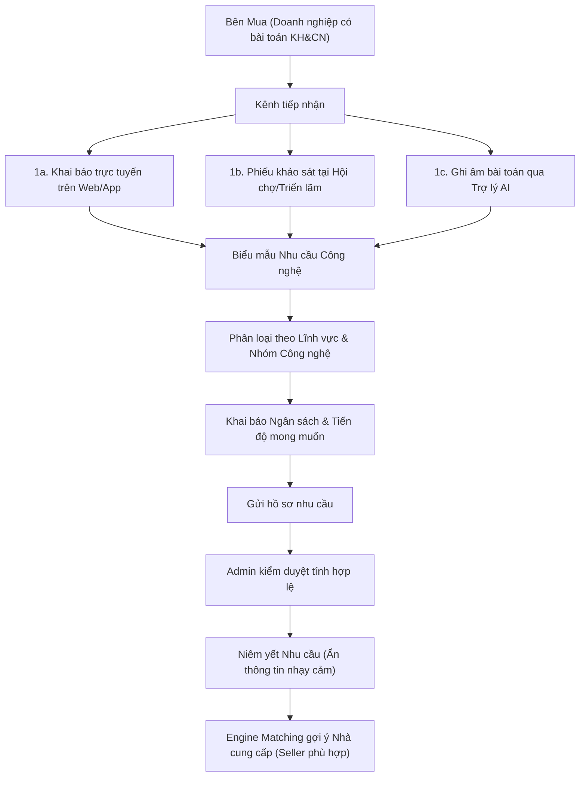

# TASK-03: Thiết Kế Cơ Sở — Hồ Sơ Tìm Mua & Nhu Cầu Chuyển Giao Công Nghệ (Buyer)

> **Mã phân hệ**: `TASK-03`  
> **Sheet nguồn**: `T.mua SP` (356 dòng dữ liệu, 10 cột) trong [`../DỮ_LIỆU_GỐC_MASTER/Nacentwin_20260924_bo_loc_da_sua.xlsx`](../DỮ_LIỆU_GỐC_MASTER/Nacentwin_20260924_bo_loc_da_sua.xlsx)  
> **Tài liệu trích xuất MD**: [`../DỮ_LIỆU_GỐC_MASTER/Nacentwin_20260924_bo_loc_da_sua.md#sheet-5-tmua-sp`](../DỮ_LIỆU_GỐC_MASTER/Nacentwin_20260924_bo_loc_da_sua.md#sheet-5-tmua-sp)  
> **Trạng thái**: 🟢 APPROVED BY PO & SHIPPED (Mã nguồn đã triển khai 100% Gate 5, Bổ sung trọn bộ 3 Wireframe CRUD Buyer)  
> **Quản lý tổng thể**: [`../DANH_SACH_TIEN_DO_BASIC_DESIGN.md`](../DANH_SACH_TIEN_DO_BASIC_DESIGN.md)
> **Report review HTML**: [`DANH_MUC_TRUONG_NHU_CAU_VA_TNI.html`](DANH_MUC_TRUONG_NHU_CAU_VA_TNI.html)  
> **Bộ 3 Wireframe Tương Tác Khép Kín CRUD Buyer**:
> - Phiếu đăng ký & khảo sát nhu cầu DNNVV (Create Ticket & TNI Calculator): [`wireframe_phieu_khao_sat_dnnvv.html`](wireframe_phieu_khao_sat_dnnvv.html)
> - Sàn niêm yết nhu cầu công nghệ công khai (Public Marketplace & PDPD Masking): [`wireframe_san_nhu_cau_cong_nghe.html`](wireframe_san_nhu_cau_cong_nghe.html)
> - Bàn làm việc quản lý nhu cầu Buyer (Workspace / Ticket Management): [`wireframe_quan_ly_nhu_cau_buyer.html`](wireframe_quan_ly_nhu_cau_buyer.html)

---

## 1. MỤC TIÊU & PHẠM VI NGHIỆP VỤ

Phân hệ tiếp nhận và quản trị **Hồ sơ Tìm Mua / Nhu Cầu Đổi Mới Công Nghệ** từ các doanh nghiệp, hợp tác xã, tổ chức có nhu cầu giải quyết bài toán kỹ thuật hoặc nâng cấp dây chuyền sản xuất.

### Trọng tâm nghiệp vụ:
1. **Mẫu phiếu khảo sát nhu cầu công nghệ DNNVV**: Thu thập bài toán thực tế của doanh nghiệp, hiện trạng thiết bị, ngân sách dự kiến, yêu cầu về TRL.
2. **Mẫu đăng ký tham quan triển lãm (ICE Cung VHLĐ Việt Xô)**:
   - Quốc gia, Đơn vị/Doanh nghiệp, Đại diện, Thông tin liên hệ, Mục đích tham quan.
3. **Cơ chế phân quyền dữ liệu nhạy cảm**:
   - Các thông tin ngân sách chi tiết và thông tin liên hệ được bảo mật theo cơ chế "Opt-in", chỉ mở cho Seller khi Buyer chấp thuận kết nối.
4. **Hỗ trợ từ Trợ lý AI**:
   - Chụp ảnh thiết bị hiện có $\rightarrow$ AI nhận diện và gợi ý công nghệ thay thế.
   - Ghi âm bài toán kỹ thuật $\rightarrow$ AI tự động chuyển thành phiếu nhu cầu chuẩn hóa.

---

## 2. TÁC NHÂN & LUỒNG TIẾP NHẬN NHU CẦU BUYER

---

## 3. DỮ LIỆU ĐẶC TẢ CHI TIẾT GỐC (TRÍCH XUẤT 100% TỪ SHEET `T.mua SP`)

Dưới đây là toàn bộ 356 dòng dữ liệu nghiệp vụ gốc được lưu giữ nguyên bản:

| Thu thập từ các nguồn |  |  |  |  |  |  |  |  |  |
| :--- | :--- | :--- | :--- | :--- | :--- | :--- | :--- | :--- | :--- |
|  |  |  |  |  |  |  |  |  |  |
|  |  |  |  |  |  |  |  |  |  |
| Lấy mẫu phiếu đăng ký tham quan triển lãm |  |  |  |  |  |  |  |  |  |
| https://web.facebook.com/groups/301043037342772/ |  |  |  |  |  |  |  |  |  |
| https://web.facebook.com/ICECungVanhoaHuuNghiVietXo/?locale=vi_VN&_rdc=1&_rdr# |  |  |  |  |  |  |  |  |  |
|  |  |  |  |  |  |  |  |  |  |
| Đăng nhập tài khoản |  |  | Số điện thoại |  |  |  |  |  | Text |
|  |  |  | Email |  |  |  |  |  | Text |
|  |  |  | Mật khẩu |  |  |  |  |  | Text |
| Admin quản trị |  |  |  |  |  |  |  |  |  |
|  |  |  | Tạo mới hồ sơ doanh nghiệp |  |  |  |  |  |  |
|  |  |  | Cập nhật/ chỉnh sửa |  |  |  |  |  |  |
| Trợ lý AI |  |  |  |  |  |  |  |  |  |
| Chụp ảnh Sản phẩm |  |  |  | AI gợi ý thông tin sản phẩm |  |  |  |  | Image --> Mô tả sản phẩm |
| Ghi âm nhu cầu |  |  |  | AI trợ lý thông minh gợi ý các sản phẩm, sản phẩm tương tự |  |  |  |  | Voice--> Mô tả sản phẩm |
| Thông báo lịch triển lãm, kết nối cung cầu |  |  |  |  |  |  |  |  |  |
| Điền phiếu Đặt hàng nhu cầu |  |  |  |  |  |  |  |  |  |
|  |  |  |  |  |  |  |  |  |  |
|  |  |  |  |  |  |  |  |  |  |
|  |  |  |  |  |  |  |  |  |  |
| Phiếu Đặt hàng nhu cầu điền tay |  |  |  |  |  |  |  |  |  |
|  |  |  | ĐĂNG KÝ THAM QUAN |  |  |  |  |  |  |
|  |  | 1 | Quốc gia / Country |  |  |  |  |  |  |
|  |  | 2 | Họ & tên / Full name * |  |  |  |  |  |  |
|  |  |  | Số điện thoại / Mobile * |  |  |  |  |  |  |
|  |  | 3 | Email / * |  |  |  |  |  |  |
|  |  | 4 | Chức danh / Position |  |  |  |  |  |  |
|  |  | 5 | Tên công ty / Company name * |  |  |  |  |  |  |
|  |  | 6 | Địa chỉ / Address |  |  |  |  |  |  |
|  |  | 7 | Website / |  |  |  |  |  |  |
|  |  | 8 | Tỉnh / thành phố |  |  |  |  |  |  |
|  |  | 9 | Lĩnh vực quan tâm Your business |  |  |  |  |  |  |
|  |  |  | Thể hình & Chăm sóc sức khoẻ Health & Fitness |  |  |  |  |  |  |
|  |  |  | Thể thao ngoài trời và giải trí Outdoor & Leisure |  |  |  |  |  |  |
|  |  |  | Cơ sở hạ tầng & sản phẩm thể thao Sporting Goods & Facilities |  |  |  |  |  |  |
|  |  |  | Thời trang thể thao Sportswear |  |  |  |  |  |  |
|  |  | 10 | Quý vị biết đến triển lãm qua phương tiện nào dưới đây? How did you know about the show? |  |  |  |  |  |  |
|  |  |  | Tạp chí, Báo in, Quảng cáo ngoài trời (áp phích, banner) / Advertisement: Trade publications, Newspapers, Outdoor advertising |  |  |  |  |  |  |
|  |  |  | Mạng xã hội (Facebook, Instagram, Youtube, etc.) / Social Media (Facebook, Instagram, Youtube, etc.) |  |  |  |  |  |  |
|  |  |  | Thư mời từ Đơn vị trưng bày / Invitation from Exhibitor |  |  |  |  |  |  |
|  |  |  | Thư mời điện tín / Post mail |  |  |  |  |  |  |
|  |  |  | Email marketing |  |  |  |  |  |  |
|  |  |  | Tin nhắn / SMS |  |  |  |  |  |  |
|  |  |  | Website |  |  |  |  |  |  |
|  |  |  | Khác / Other |  |  |  |  |  |  |
|  |  |  | Zalo |  |  |  |  |  |  |
|  |  |  | Loại hình công ty Your business |  |  |  |  |  |  |
|  |  |  | Nhà xuất khẩu / Exporters |  |  |  |  |  |  |
|  |  |  | Trung tâm thương mại / Commerce Center |  |  |  |  |  |  |
|  |  |  | Nhà nhập khẩu / Importers |  |  |  |  |  |  |
|  |  |  | Loại khác / Other |  |  |  |  |  |  |
|  |  |  | Nhà phân phối / Distributors |  |  |  |  |  |  |
|  |  | 11 | QUY ĐỊNH THAM QUAN |  |  |  |  |  |  |
|  |  |  | Mặc trang phục lịch sự (không mang quần ngắn, áo ba lỗ, dép lê) |  |  |  |  |  |  |
|  |  |  | Khách tham quan phải trên 16 tuổi |  |  |  |  |  |  |
|  |  |  | Không hút thuốc trong khu vực nhà triển lãm |  |  |  |  |  |  |
|  |  |  | Không mang theo vật nuôi vào Triển lãm |  |  |  |  |  |  |
|  |  | 12 | CHÍNH SÁCH BẢO MẬT |  |  |  |  |  |  |
|  |  |  | Thông tin được sử dụng với mục đích giao thương với các doanh nghiệp tại Hội chợ |  |  |  |  |  |  |
|  |  |  | Quý khách có nhu cầu thay đổi thông tin xin vui lòng liên hệ: |  |  |  |  |  |  |
|  |  |  | Email: tinhnh@vinexad.com.vn / Mobile: 0916863095 |  |  |  |  |  |  |
|  |  |  | Vinexad cam kết sử dụng thông tin đúng mục đích và tuyệt đối không cung cấp cho đơn vị thứ 3! |  |  |  |  |  |  |
|  |  |  |  |  |  |  |  |  |  |
|  |  |  | ĐĂNG KÝ THAM QUAN \| VISITOR REGISTRATION |  |  |  |  |  |  |
|  |  |  | Cảm ơn Quý vị đã quan tâm đến Triển lãm VIMEXPO & VIETNAM AUTOEXPO 2026. |  |  |  |  |  |  |
|  |  |  | Đăng ký tham quan MIỄN PHÍ |  |  |  |  |  |  |
|  |  |  | Thời gian: 9:00 - 17:00, ngày 11-13/06/2026 |  |  |  |  |  |  |
|  |  |  | Địa điểm: Trung tâm Triển lãm Quốc tế I.C.E Hà Nội (91 Trần Hưng Đạo, P. Cửa Nam, Hà Nội) |  |  |  |  |  |  |
|  |  |  | Quý khách vui lòng điền đầy đủ thông tin dưới đây để đăng ký tham quan. |  |  |  |  |  |  |
|  |  |  | Please complete the following information to register as a visitor. |  |  |  |  |  |  |
|  |  |  | Email đăng ký |  |  |  |  |  |  |
|  |  |  | THÔNG TIN KHÁCH THAM QUAN \| VISITOR INFORMATION |  |  |  |  |  |  |
|  |  |  | 1. Họ và tên \| Full Name * |  |  |  |  |  |  |
|  |  |  | 2. Chức vụ \| Job Title * |  |  |  |  |  |  |
|  |  |  | 3. Tên công ty/doanh nghiệp \| Company Name * |  |  |  |  |  |  |
|  |  |  | 4. Lĩnh vực hoạt động \| Business Sector * |  |  |  |  |  |  |
|  |  |  | 5. Số điện thoại \| Phone Number * |  |  |  |  |  |  |
|  |  |  | 6. Email công việc \| Business Email * |  |  |  |  |  |  |
|  |  |  | 7. Website công ty (nếu có) \| Company Website (if any) |  |  |  |  |  |  |
|  |  |  | THÔNG TIN THAM QUAN \| VISIT INFORMATION |  |  |  |  |  |  |
|  |  |  | 8. Quý khách quan tâm đến triển lãm nào? \| Which exhibition are you interested in? * |  |  |  |  |  |  |
|  |  |  | VIMEXPO 2026 |  |  |  |  |  |  |
|  |  |  | VIETNAM AUTOEXPO 2026 |  |  |  |  |  |  |
|  |  |  | Cả hai triển lãm \| Both exhibitions |  |  |  |  |  |  |
|  |  |  | 9. Nhóm sản phẩm/dịch vụ Quý khách quan tâm? \| Which product/service categories are you interested in? * |  |  |  |  |  |  |
|  |  |  | Phương tiện Giao thông, Vận tải \| Transportation Vehicles |  |  |  |  |  |  |
|  |  |  | Công nghiệp hỗ trợ \| Supporting Industries |  |  |  |  |  |  |
|  |  |  | Linh kiện & phụ tùng ô tô – xe máy \| Auto & Motorcycle Parts and Components |  |  |  |  |  |  |
|  |  |  | Máy móc & thiết bị công nghiệp \| Industrial Machinery & Equipment |  |  |  |  |  |  |
|  |  |  | Công nghệ sản xuất & tự động hóa \| Manufacturing Technology & Automation |  |  |  |  |  |  |
|  |  |  | Điện – điện tử công nghiệp \| Electrical & Industrial Electronics |  |  |  |  |  |  |
|  |  |  | Logistics & vận tải \| Logistics & Transportation |  |  |  |  |  |  |
|  |  |  | Mục khác: |  |  |  |  |  |  |
|  |  |  | 10. Mục đích tham quan của Quý khách \| What is your purpose of visiting? * |  |  |  |  |  |  |
|  |  |  | Tìm kiếm nhà cung cấp/đối tác \| Looking for suppliers/partners |  |  |  |  |  |  |
|  |  |  | Tìm hiểu sản phẩm & công nghệ mới \| Exploring new products & technologies |  |  |  |  |  |  |
|  |  |  | Kết nối giao thương B2B \| B2B networking |  |  |  |  |  |  |
|  |  |  | Khảo sát thị trường \| Market research |  |  |  |  |  |  |
|  |  |  | Tham dự hội thảo/chương trình chuyên ngành \| Joining seminars & industry programs |  |  |  |  |  |  |
|  |  |  | Mục khác: |  |  |  |  |  |  |
|  |  |  | 11. Quý vị biết đến triển lãm này qua phương tiện nào? \| How did you hear about this exhibition? |  |  |  |  |  |  |
|  |  |  | Facebook |  |  |  |  |  |  |
|  |  |  | Website của sự kiện |  |  |  |  |  |  |
|  |  |  | Báo chí, Tạp chí \| Newspapers, Magazines |  |  |  |  |  |  |
|  |  |  | Bạn bè, Người thân giới thiệu \| Friends, Family Recommendation |  |  |  |  |  |  |
|  |  |  | Áp phích, tờ rơi, biển quảng cáo \| Posters, Flyers, or Advertisements |  |  |  |  |  |  |
|  |  |  | Công cụ tìm kiếm (Google, Bing, v.v.) \| Search Engines (Google, Bing, etc.) |  |  |  |  |  |  |
|  |  |  | Đã từng tham quan trước đây \| Previous Visit |  |  |  |  |  |  |
|  |  |  | Khác (vui lòng ghi rõ) \| ☐ Other |  |  |  |  |  |  |
|  |  |  | Xin cảm ơn Quý khách đã đăng ký tham quan tại VIMEXPO & VIETNAM AUTOEXPO 2026. |  |  |  |  |  |  |
|  |  |  | Thank you for your registration! We look forward to welcoming you to VIMEXPO & VIETNAM AUTOEXPO 2026. |  |  |  |  |  |  |
|  |  |  |  |  |  |  |  |  |  |
|  |  |  |  |  |  |  |  |  |  |
|  |  |  |  |  |  |  |  |  |  |
|  |  |  |  |  |  |  |  |  |  |
|  |  |  |  |  |  |  |  |  |  |
|  |  |  |  |  |  |  |  |  |  |
|  |  |  |  |  |  |  |  |  |  |
|  |  |  |  |  |  |  |  |  |  |
|  |  |  |  |  |  |  |  |  |  |
|  |  |  |  |  |  |  |  |  |  |
|  |  |  |  |  |  |  |  |  |  |
|  |  |  |  |  |  |  |  |  |  |
|  |  |  |  |  |  |  |  |  |  |
|  |  |  |  |  |  |  |  |  |  |
|  |  |  |  |  |  |  |  |  |  |
|  |  |  |  |  |  |  |  |  |  |
|  |  |  |  |  |  |  |  |  |  |
|  |  |  |  |  |  |  |  |  |  |
|  |  |  |  |  |  |  |  |  |  |
|  |  |  |  |  |  |  |  |  |  |
|  |  |  |  |  |  |  |  |  |  |
|  |  |  |  |  |  |  |  |  |  |
|  |  |  |  |  |  |  |  |  |  |
|  |  |  |  |  |  |  |  |  |  |
|  |  |  |  |  |  |  |  |  |  |
|  |  |  |  |  |  |  |  |  |  |
|  |  |  |  |  |  |  |  |  |  |
|  |  |  |  |  |  |  |  |  |  |
|  |  |  |  |  |  |  |  |  |  |
|  |  |  |  |  |  |  |  |  |  |
|  |  |  |  |  |  |  |  |  |  |
|  |  |  |  |  |  |  |  |  |  |
|  |  |  |  |  |  |  |  |  |  |
|  |  |  |  |  |  |  |  |  |  |
|  |  |  |  |  |  |  |  |  |  |
|  |  |  |  |  |  |  |  |  |  |
|  |  |  |  |  |  |  |  |  |  |
|  |  |  |  |  |  |  |  |  |  |
|  |  |  |  |  |  |  |  |  |  |
|  |  |  |  |  |  |  |  |  |  |
|  |  |  |  |  |  |  |  |  |  |
|  |  |  |  |  |  |  |  |  |  |
|  |  |  |  |  |  |  |  |  |  |
|  |  |  |  |  |  |  |  |  |  |
|  |  |  |  |  |  |  |  |  |  |
|  |  |  |  |  |  |  |  |  |  |
|  |  |  |  |  |  |  |  |  |  |
|  |  |  |  |  |  |  |  |  |  |
|  |  |  |  |  |  |  |  |  |  |
|  |  |  |  |  |  |  |  |  |  |
|  |  |  |  |  |  |  |  |  |  |
|  |  |  |  |  |  |  |  |  |  |
|  |  |  |  |  |  |  |  |  |  |
|  |  |  |  |  |  |  |  |  |  |
|  |  |  |  |  |  |  |  |  |  |
|  |  |  |  |  |  |  |  |  |  |
|  |  |  |  |  |  |  |  |  |  |
|  |  |  |  |  |  |  |  |  |  |
|  |  |  |  |  |  |  |  |  |  |
|  |  |  |  |  |  |  |  |  |  |
|  |  |  |  |  |  |  |  |  |  |
|  |  |  |  |  |  |  |  |  |  |
|  |  |  |  |  |  |  |  |  |  |
|  |  |  |  |  |  |  |  |  |  |
|  |  |  |  |  |  |  |  |  |  |
|  |  |  |  |  |  |  |  |  |  |
|  |  |  |  |  |  |  |  |  |  |
|  |  |  |  |  |  |  |  |  |  |
|  |  |  |  |  |  |  |  |  |  |
|  |  |  |  |  |  |  |  |  |  |
|  |  |  |  |  |  |  |  |  |  |
|  |  |  |  |  |  |  |  |  |  |
| BỔ SUNG BASIC — HỒ SƠ NHU CẦU MUA / GIẢI PHÁP (DỰ KIẾN) |  |  |  |  |  |  |  |  |  |
|  |  |  | Phạm vi bản nháp |  |  |  |  |  | Ghi chú |
|  |  |  | Các trường dưới đây tổng hợp nguồn và trao đổi; mức bắt buộc một số nhóm còn chờ chốt. |  |  |  |  |  |  |
|  |  |  | Đã chốt bên có nhu cầu gồm tổ chức và cá nhân. Giữ nguyên nội dung và ảnh phía trên. |  |  |  |  |  |  |
|  |  |  |  |  |  |  |  |  |  |
|  |  |  | Nguồn KS |  |  |  |  |  | Tài liệu |
|  |  |  | Phân tích và thiết kế bộ phiếu khảo sát nhu cầu công nghệ DNNVV tại Việt Nam.docx; trọng tâm |  |  |  |  |  |  |
|  |  |  | M01, M07–M10 và Phần H phụ lục. |  |  |  |  |  |  |
|  |  |  |  |  |  |  |  |  |  |
|  |  |  | Nguồn PN |  |  |  |  |  | Tài liệu |
|  |  |  | Phân chia nhóm ngành nghề và nhu cầu công nghệ doanh nghiệp.docx; trọng tâm mục 17, 20–21. |  |  |  |  |  |  |
|  |  |  |  |  |  |  |  |  |  |
| 1. Bên có nhu cầu và người liên hệ |  |  |  |  |  |  |  |  |  |
|  |  |  | Tên tổ chức / Họ tên cá nhân |  |  |  |  |  | Text |
|  |  |  | Đã chốt: bắt buộc tên tổ chức hoặc họ tên cá nhân đăng nhu cầu. |  |  |  |  |  |  |
|  |  |  |  |  |  |  |  |  |  |
|  |  |  | Mã số doanh nghiệp |  |  |  |  |  | Text |
|  |  |  | Đã chốt: bổ sung sau; chỉ áp dụng doanh nghiệp, không áp dụng cá nhân. KS M01.02. |  |  |  |  |  |  |
|  |  |  |  |  |  |  |  |  |  |
|  |  |  | Địa chỉ / tỉnh, thành phố |  |  |  |  |  | Text / Option |
|  |  |  | Địa chỉ chi tiết bên mua: bổ sung sau. Tỉnh/thành triển khai vẫn bắt buộc tại mục địa điểm. |  |  |  |  |  |  |
|  |  |  |  |  |  |  |  |  |  |
|  |  |  | Người liên hệ |  |  |  |  |  | Text |
|  |  |  | Đã chốt: bắt buộc người phụ trách mua; cá nhân tự mua dùng lại họ tên, không nhập trùng. |  |  |  |  |  |  |
|  |  |  |  |  |  |  |  |  |  |
|  |  |  | Chức vụ |  |  |  |  |  | Text |
|  |  |  | Đã chốt: bổ sung sau. Nguồn: KS M01.06. |  |  |  |  |  |  |
|  |  |  |  |  |  |  |  |  |  |
|  |  |  | Điện thoại |  |  |  |  |  | Text |
|  |  |  | Bắt buộc; ẩn điện thoại, tự động mở cho bên cung cấp đã gửi yêu cầu kết nối qua nền tảng. |  |  |  |  |  |  |
|  |  |  |  |  |  |  |  |  |  |
|  |  |  | Email |  |  |  |  |  | Text |
|  |  |  | Bắt buộc; email mở như điện thoại, không cần bên mua duyệt. Người xem khác vẫn bị ẩn. |  |  |  |  |  |  |
|  |  |  |  |  |  |  |  |  |  |
|  |  |  | Ngành hoạt động chính |  |  |  |  |  | Option |
|  |  |  | Đã chốt: ngành hoạt động bổ sung sau. PN mục 20 phân biệt ngành đăng ký, hoạt động và nhu cầu. |  |  |  |  |  |  |
|  |  |  | ngành cần đối chiếu riêng. |  |  |  |  |  |  |
|  |  |  |  |  |  |  |  |  |  |
| 2. Thông tin chung của từng nhu cầu |  |  |  |  |  |  |  |  |  |
|  |  |  | Tên nhu cầu |  |  |  |  |  | Text |
|  |  |  | Đã chốt: bắt buộc. Tiêu đề ngắn mô tả nhu cầu; tham khảo tên CN/TB trong ảnh form gốc. |  |  |  |  |  |  |
|  |  |  |  |  |  |  |  |  |  |
|  |  |  | Đối tượng cần tìm |  |  |  |  |  | Checkbox |
|  |  |  | Đã chốt: chọn nhiều — thiết bị, dây chuyền, phần mềm, quy trình, giải pháp, dịch vụ công nghệ. |  |  |  |  |  |  |
|  |  |  | Không bắt buộc nếu người mua chưa xác định. Nguồn tham khảo: PN mục 21. |  |  |  |  |  |  |
|  |  |  |  |  |  |  |  |  |  |
|  |  |  | Lĩnh vực có nhu cầu |  |  |  |  |  | Checkbox |
|  |  |  | Đã chốt: bắt buộc chọn ít nhất 1 lĩnh vực; được chọn nhiều. Nguồn tham khảo: PN mục 20.3. |  |  |  |  |  |  |
|  |  |  | Đã chốt: tạm dùng 10 LV có nguồn trong ma trận; 8 mã thiếu tên bổ sung sau, giữ nguyên mã. |  |  |  |  |  |  |
|  |  |  |  |  |  |  |  |  |  |
|  |  |  | Nhóm công nghệ quan tâm |  |  |  |  |  | Checkbox |
|  |  |  | Đã chốt: chọn nhiều nhóm công nghệ; có lựa chọn “Chưa xác định — cần tư vấn”. |  |  |  |  |  |  |
|  |  |  |  |  |  |  |  |  |  |
|  |  |  | Vấn đề cần giải quyết |  |  |  |  |  | Text |
|  |  |  | Đã chốt: bắt buộc. Mô tả khó khăn hoặc việc cần thực hiện. Nguồn: KS M08 N01. |  |  |  |  |  |  |
|  |  |  |  |  |  |  |  |  |  |
|  |  |  | Hiện trạng / nguyên nhân nếu biết |  |  |  |  |  | Text |
|  |  |  | Đã chốt: bổ sung sau. Thiết bị, quy trình hoặc cách đang làm; không bắt tự chẩn đoán. |  |  |  |  |  |  |
|  |  |  |  |  |  |  |  |  |  |
|  |  |  | Công nghệ / giải pháp mong muốn |  |  |  |  |  | Text |
|  |  |  | Đã chốt: bổ sung sau. Nêu công nghệ/giải pháp nếu đã biết. Nguồn: KS M08 N02. |  |  |  |  |  |  |
|  |  |  |  |  |  |  |  |  |  |
|  |  |  | Mục tiêu ứng dụng / kết quả mong muốn |  |  |  |  |  | Text |
|  |  |  | Đã chốt: bắt buộc. Mô tả đầu ra cần đạt; chưa cần số liệu kỹ thuật nếu chưa biết. KS M08 N03. |  |  |  |  |  |  |
|  |  |  |  |  |  |  |  |  |  |
|  |  |  | Quy mô ứng dụng |  |  |  |  |  | Number / Text |
|  |  |  | Đã chốt: bổ sung sau. Số lượng, công suất, diện tích hoặc phạm vi, kèm đơn vị. KS M08 N04. |  |  |  |  |  |  |
|  |  |  |  |  |  |  |  |  |  |
|  |  |  | Địa điểm triển khai |  |  |  |  |  | Text / Option |
|  |  |  | Đã chốt: bắt buộc tỉnh/thành; địa chỉ chi tiết bổ sung sau. Có thể khác địa chỉ bên mua. |  |  |  |  |  |  |
|  |  |  |  |  |  |  |  |  |  |
| 3. Yêu cầu kỹ thuật và điều kiện tiếp nhận |  |  |  |  |  |  |  |  |  |
|  |  |  | Yêu cầu kỹ thuật |  |  |  |  |  | Text / File |
|  |  |  | Đã chốt: thông số mẫu theo lĩnh vực/nhóm công nghệ, được thêm dòng; xem chi tiết ở cuối sheet. |  |  |  |  |  |  |
|  |  |  |  |  |  |  |  |  |  |
|  |  |  | Nguyên liệu / dữ liệu đầu vào |  |  |  |  |  | Text |
|  |  |  | Đã chốt: không bắt buộc khi đăng; điền nếu liên quan; bổ sung sau cùng nhà cung cấp/chuyên gia. |  |  |  |  |  |  |
|  |  |  |  |  |  |  |  |  |  |
|  |  |  | Chỉ tiêu đầu ra / chất lượng |  |  |  |  |  | Text |
|  |  |  | Đã chốt: không bắt buộc khi đăng; điền nếu liên quan; bổ sung sau cùng nhà cung cấp/chuyên gia. |  |  |  |  |  |  |
|  |  |  |  |  |  |  |  |  |  |
|  |  |  | Mức tự động hóa mong muốn |  |  |  |  |  | Option / Text |
|  |  |  | Đã chốt: không bắt buộc khi đăng; điền nếu liên quan; bổ sung sau cùng nhà cung cấp/chuyên gia. |  |  |  |  |  |  |
|  |  |  |  |  |  |  |  |  |  |
|  |  |  | Tiêu chuẩn cần đáp ứng |  |  |  |  |  | Text / File |
|  |  |  | Đã chốt: không bắt buộc khi đăng; điền nếu liên quan; bổ sung sau cùng nhà cung cấp/chuyên gia. |  |  |  |  |  |  |
|  |  |  |  |  |  |  |  |  |  |
|  |  |  | Mặt bằng / hạ tầng hiện có |  |  |  |  |  | Text / Image |
|  |  |  | Đã chốt: không bắt buộc khi đăng; điền nếu liên quan; bổ sung sau cùng nhà cung cấp/chuyên gia. |  |  |  |  |  |  |
|  |  |  |  |  |  |  |  |  |  |
|  |  |  | Thiết bị / phần mềm hiện có cần tích hợp |  |  |  |  |  | Text |
|  |  |  | Đã chốt: không bắt buộc khi đăng; điền nếu liên quan; bổ sung sau cùng nhà cung cấp/chuyên gia. |  |  |  |  |  |  |
|  |  |  |  |  |  |  |  |  |  |
|  |  |  | Nhân lực tiếp nhận / vận hành |  |  |  |  |  | Text |
|  |  |  | Đã chốt: không bắt buộc khi đăng; điền nếu liên quan; bổ sung sau cùng nhà cung cấp/chuyên gia. |  |  |  |  |  |  |
|  |  |  |  |  |  |  |  |  |  |
|  |  |  | Ảnh / video / tài liệu hiện trạng |  |  |  |  |  | Image / Video / File |
|  |  |  | Đã chốt: bổ sung sau. Đính kèm ảnh, video hoặc tài liệu để làm rõ nhu cầu. |  |  |  |  |  |  |
|  |  |  |  |  |  |  |  |  |  |
| 4. Ưu tiên, thời gian và khả năng đầu tư |  |  |  |  |  |  |  |  |  |
|  |  |  | Mức độ ưu tiên |  |  |  |  |  | Option |
|  |  |  | Đã chốt: chọn 1 mức Thấp/Trung bình/Cao/Khẩn cấp; tùy chọn, không mặc định; tự khai, không là TNI. |  |  |  |  |  |  |
|  |  |  |  |  |  |  |  |  |  |
|  |  |  | Thời gian cần triển khai |  |  |  |  |  | Date / Text |
|  |  |  | Đã chốt: nhập tháng/năm dự kiến; ngày cụ thể nếu biết. Chọn “Chưa xác định” vẫn đăng được. |  |  |  |  |  |  |
|  |  |  |  |  |  |  |  |  |  |
|  |  |  | Ngân sách dự kiến |  |  |  |  |  | Number / Option |
|  |  |  | Đã chốt: nhập số tiền cụ thể hoặc khoảng từ–đến, kèm loại tiền. |  |  |  |  |  |  |
|  |  |  | Cho chọn “Chưa xác định” và vẫn đăng nhu cầu được. Nguồn tham khảo: KS M08/M09. |  |  |  |  |  |  |
|  |  |  |  |  |  |  |  |  |  |
|  |  |  | Nguồn vốn dự kiến |  |  |  |  |  | Checkbox |
|  |  |  | Đã chốt: chọn nhiều; vốn tự có, vốn vay, quỹ/chương trình hỗ trợ, đối tác đầu tư, khác; bổ sung sau. |  |  |  |  |  |  |
|  |  |  |  |  |  |  |  |  |  |
|  |  |  | Loại nhu cầu / hình thức tiếp nhận |  |  |  |  |  | Checkbox |
|  |  |  | Bắt buộc chọn ít nhất 1, được chọn nhiều: (1) Mua SP/thiết bị; (2) Mua/tiếp nhận CN chuyển giao; |  |  |  |  |  |  |
|  |  |  | (3) Thuê thiết bị, công nghệ hoặc dịch vụ công nghệ; (4) Cải tiến, nâng cấp hệ thống hiện có; |  |  |  |  |  |  |
|  |  |  | (5) Hợp tác nghiên cứu, đồng phát triển giải pháp; (6) Cần tư vấn xác định giải pháp. |  |  |  |  |  |  |
|  |  |  |  |  |  |  |  |  |  |
|  |  |  | Thời gian hoàn vốn mong muốn |  |  |  |  |  | Number / tháng, năm |
|  |  |  | Đã chốt: nhập số tháng/năm nếu có; không bắt buộc. Đây là mong muốn, không là cam kết hiệu quả. |  |  |  |  |  |  |
|  |  |  |  |  |  |  |  |  |  |
| 5. Hỗ trợ và kết nối |  |  |  |  |  |  |  |  |  |
|  |  |  | Hỗ trợ cần thiết |  |  |  |  |  | Checkbox / Text |
|  |  |  | Đã chốt: chọn nhiều; tư vấn giải pháp, tìm nhà cung cấp, đánh giá công nghệ, thử nghiệm, |  |  |  |  |  |  |
|  |  |  | tích hợp/lắp đặt, đào tạo vận hành, hỗ trợ tài chính, khác. Không bắt buộc khi đăng ban đầu. |  |  |  |  |  |  |
|  |  |  |  |  |  |  |  |  |  |
|  |  |  | Đối tác mong muốn kết nối |  |  |  |  |  | Checkbox |
|  |  |  | Đã chốt: chọn nhiều, không bắt buộc. Nhà cung cấp sản phẩm/giải pháp, viện, trường, chuyên gia, nhà đầu tư. |  |  |  |  |  |  |
|  |  |  |  |  |  |  |  |  |  |
|  |  |  |  |  |  |  |  |  |  |
|  |  |  |  |  |  |  |  |  |  |
|  |  |  |  |  |  |  |  |  |  |
|  |  |  | Quyền xem tài liệu đính kèm |  |  |  |  |  | Chỉ sau kết nối |
|  |  |  | Đã chốt: chỉ bên cung cấp đã gửi yêu cầu kết nối được xem tài liệu; không công khai. |  |  |  |  |  |  |
|  |  |  |  |  |  |  |  |  |  |
| 6. Các điểm cần thống nhất trước khi hoàn thiện |  |  |  |  |  |  |  |  |  |
|  |  |  | Đối tượng đăng nhu cầu |  |  |  |  |  | Đã chốt |
|  |  |  | Cho phép cả tổ chức và cá nhân đăng nhu cầu. Các trường riêng doanh nghiệp chỉ áp dụng khi phù hợp. |  |  |  |  |  |  |
|  |  |  |  |  |  |  |  |  |  |
|  |  |  | Phạm vi nhu cầu |  |  |  |  |  | Đã chốt |
|  |  |  | Đã chốt 6 loại, chọn ít nhất 1; chưa rõ giải pháp thì chọn Cần tư vấn. Chi tiết dòng 298–301. |  |  |  |  |  |  |
|  |  |  |  |  |  |  |  |  |  |
|  |  |  | Thông tin bắt buộc ban đầu |  |  |  |  |  | Đã chốt |
|  |  |  | Tên bên mua, người liên hệ, điện thoại, email; tên nhu cầu, vấn đề, kết quả, tỉnh/thành triển khai. |  |  |  |  |  |  |
|  |  |  | Thêm loại nhu cầu và lĩnh vực (mỗi trường ít nhất 1). Cá nhân tự mua dùng lại họ tên liên hệ. |  |  |  |  |  |  |
|  |  |  |  |  |  |  |  |  |  |
|  |  |  | Danh mục lĩnh vực |  |  |  |  |  | Đang đối chiếu |
|  |  |  | Đã chốt: basic mua/bán dùng chung 10 LV có nguồn; đối chiếu DM vẫn là đề xuất. |  |  |  |  |  |  |
|  |  |  | Xem phần bổ sung từ dòng 64 của Ma trận Lĩnh vực-Công nghệ. Các cặp ánh xạ còn là đề xuất. |  |  |  |  |  |  |
|  |  |  |  |  |  |  |  |  |  |
|  |  |  | TNI / GAP |  |  |  |  |  | Chưa áp dụng |
|  |  |  | KS mục 15 dùng C/I/E/F/R với trọng số 0,30/0,25/0,20/0,15/0,10, ngưỡng thấp 30–49; PN mục 19 |  |  |  |  |  |  |
|  |  |  | dùng Need/GAP/Impact/Urgency/Feasibility, ngưỡng thấp 35–49. Chưa thống nhất công thức, chuẩn |  |  |  |  |  |  |
|  |  |  | hóa và ngưỡng. |  |  |  |  |  |  |
|  |  |  |  |  |  |  |  |  |  |
|  |  |  | Thông tin khảo sát doanh nghiệp mở rộng |  |  |  |  |  | Để trao đổi sau |
|  |  |  | Quy mô, lao động, doanh thu, thị trường, số hóa, năng lượng và năng lực quản trị thuộc khảo sát |  |  |  |  |  |  |
|  |  |  | sâu KS M01–M06. Đề xuất không bắt nhập lại cho mỗi nhu cầu. |  |  |  |  |  |  |
|  |  |  |  |  |  |  |  |  |  |
|  |  |  | Danh mục ngành và căn cứ pháp lý |  |  |  |  |  | Chưa kiểm chứng bên ngoài |
|  |  |  | Các dẫn chiếu trong hai tài liệu là nội dung nguồn, chưa xác minh hiệu lực hay tính chính xác |  |  |  |  |  |  |
|  |  |  | của mã ngành trong phiên này. |  |  |  |  |  |  |
|  |  |  |  |  |  |  |  |  |  |
|  |  |  |  |  |  |  |  |  |  |
|  |  |  |  |  |  |  |  |  |  |
|  |  |  | Yêu cầu kỹ thuật — cách nhập đã chốt |  |  |  |  |  |  |
|  |  |  | Có bộ thông số mẫu theo lĩnh vực/nhóm công nghệ; người mua được thêm dòng. |  |  |  |  |  |  |
|  |  |  | Điền giá trị mong muốn hoặc khoảng chấp nhận được cho thông số. |  |  |  |  |  |  |
|  |  |  | Có thể nhập mô tả hoặc đính kèm tài liệu khi chưa biết cách điền thông số. |  |  |  |  |  |  |
|  |  |  | Không bắt buộc khi đăng ban đầu; được bổ sung sau hoặc nhờ chuyên gia hỗ trợ. |  |  |  |  |  |  |
|  |  |  |  |  |  |  |  |  |  |
|  |  |  | Đối tác mong muốn kết nối: để trống nghĩa là chưa xác định, không giới hạn loại đối tác. |  |  |  |  |  |  |

---

## 4. TIÊU CHÍ NGHIỆM THU (DEFINITION OF DONE - DoD)

- [x] Khớp 100% dữ liệu gốc từ Sheet `T.mua SP` (356 dòng dữ liệu).
- [x] Tách bạch luồng khảo sát tại triển lãm và luồng đăng nhu cầu trực tuyến.
- [x] Quy định rõ nguyên tắc bảo vệ thông tin liên hệ và ngân sách nhạy cảm.
- [x] PO chính thức phê duyệt chuẩn TNI 4 chiều ($35\% K + 30\% L + 20\% N + 15\% O$) và thang xếp hạng 4 mức ($\ge 80$, $65-79$, $50-64$, $< 50$) theo Quyết định PO-DEC-20261008-01 ngày 08/10/2026.
- [x] Được PO/Lead duyệt thông qua Basic Design TASK-03.

---

## 5. MÔ-ĐUN KHẢO SÁT SÂU DNNVV — BỔ SUNG TỪ NGUỒN RAW 01/10/2026

Hai nguồn mới `ĐỀ XUẤT XÂY DỰNG BỘ PHIẾU KHẢO SÁT...docx` và `BA tìm mua công nghệ.xlsx` được đối chiếu và **gộp vào TASK-03**, không tạo TASK mới: cùng chủ thể Buyer và cùng vòng đời từ hiện trạng/điểm nghẽn đến Demand Ticket, tư vấn và kết nối.

- Đặc tả Basic Design: [`SPEC_PHIEU_KHAO_SAT_NHU_CAU_CONG_NGHE_DNNVV.md`](SPEC_PHIEU_KHAO_SAT_NHU_CAU_CONG_NGHE_DNNVV.md)
- Wireframe phiếu gửi doanh nghiệp: [`wireframe_phieu_khao_sat_dnnvv.html`](wireframe_phieu_khao_sat_dnnvv.html)

Mô-đun khảo sát sâu bổ sung dữ liệu nền doanh nghiệp, hiện trạng công nghệ, điểm nghẽn, năng lực tiếp nhận, nhiều dòng nhu cầu, công nghệ mới/chuyển đổi số/công nghệ xanh và nhu cầu hỗ trợ. Phiếu đăng nhu cầu ngắn hiện hữu vẫn dùng cho luồng đăng trực tuyến nhanh; các trường trùng lặp được tái sử dụng thay vì yêu cầu nhập lại.

---

## 6. ĐỐI CHIẾU CÓ ĐIỀU KIỆN VỚI PHÂN HỆ ĐÁNH GIÁ TT17 (`TASK-09`)

Chưa xác nhận có cơ chế đồng bộ, hồ sơ SSOT hay khả năng tái sử dụng trường giữa các phân hệ. Wireframe chỉ mô phỏng việc đối chiếu nguồn và yêu cầu doanh nghiệp xác nhận/bổ sung; không thể hiện tích hợp backend đang vận hành.

- Trường chỉ được đề xuất tái sử dụng khi khớp pháp nhân, cơ sở/phạm vi, định nghĩa, kỳ, đơn vị và độ chính xác. Giá trị dạng khoảng, trường chỉ liên quan hoặc chưa có nguồn minh chứng không được tự chuyển thành số TT17.
- Ngành kinh tế và lĩnh vực công nghệ quan tâm là hai trường riêng; chuẩn ngành TT17 cần mã ngành được xác nhận. Lao động, dữ liệu tài chính, thiết bị, tiêu chuẩn/chứng chỉ và hợp tác R&D cần kiểm tra riêng theo định nghĩa/kỳ/điều kiện trong nguồn.
- Đã khai 0, chưa khai, không áp dụng có lý do, khoảng/ước lượng và cần kiểm tra là các trạng thái khác nhau; không suy diễn khoảng thành số chính xác.
- Ma trận và mô phỏng hiện hành: [`../bao_cao_doi_soat_va_giai_phap_lien_thong_du_lieu.html`](../bao_cao_doi_soat_va_giai_phap_lien_thong_du_lieu.html). Phạm vi và cross-surface hiện được ghi tại [PO Decision Record](../../../Reports/PO_quyet_dinh_scope_lien_thong_khao_sat_TT17_2026-10-05.md).
- Tên DB trong tài liệu cũ không phải schema đã xác nhận; DDL/API/migration chưa được phê duyệt. Backend audit đầy đủ và quyết định PO/SA là cổng trước khi lập thiết kế kỹ thuật.

**Cổng tiếp theo:** chốt các câu hỏi mở trong PO Decision Record, lập Cross-Surface Impact Matrix cho Basic Design, Detail Spec, API/DTO, domain validation, DB/migration, Web, Zalo/Mobile, public/owner/admin projection và test; sau đó PO duyệt phạm vi/đầu vào cho SRS. Không coi việc sửa wireframe là đồng ý triển khai.

---

## 7. QUYẾT ĐỊNH PO-DEC-20261008-03: CHUẨN HÓA THUẬT TOÁN TNI & HỒ SƠ TÌM MUA BUYER

> **Ngày ban hành**: 08/10/2026  
> **Căn cứ nguồn dữ liệu**: Sheet `tìm mua 7.10` (109 dòng dữ liệu) thuộc `Specification/01_DATA_RAW/Tài liệu BA phần mềm Nacentwin 8.10.xlsx`  
> **Người phê duyệt**: Product Owner (`nacen-po-pm`)

### 7.1. Chuẩn Hóa Công Thức Tính Điểm TNI (Technology Need Index)
- **Công thức toán học**:
  $$\text{TNI} = \text{ROUND}\left(\frac{K \times 35 + L \times 30 + N \times 20 + O \times 15}{5}, 0\right)$$
- **Bộ tứ tham số định lượng (Thang điểm 1–5)**:
  1. **$K$ — Mức độ cấp thiết (Urgency) [35%]**:
     - `1`: Rất thấp (> 36 tháng, chưa cần triển khai ngay)
     - `2`: Thấp (24–36 tháng, kế hoạch dài hạn)
     - `3`: Trung bình (12–24 tháng, triển khai trung hạn)
     - `4`: Cấp thiết (6–12 tháng, triển khai ngắn hạn)
     - `5`: Rất cấp thiết / Khẩn cấp ($\le 6$ tháng, cần giải quyết ngay)
  2. **$L$ — Tác động kỳ vọng (Impact) [30%]**:
     - `1`: Rất thấp (Cải thiện nhỏ trong vận hành)
     - `2`: Thấp (Có cải thiện nhưng chưa tạo thay đổi rõ rệt)
     - `3`: Trung bình (Tạo cải thiện đáng kể ở một số chỉ tiêu)
     - `4`: Cao (Tạo chuyển biến rõ rệt về hiệu quả SX-KD)
     - `5`: Rất cao (Tác động lớn, tạo bước chuyển về năng lực cạnh tranh)
  3. **$N$ — Khả năng đầu tư / Tài chính (Finance) [20%]**:
     - `1`: Rất thấp (Chưa có vốn, cần hỗ trợ gần như toàn bộ)
     - `2`: Thấp (Bố trí dưới 30% kinh phí, cần huy động vốn ngoài)
     - `3`: Trung bình (Bố trí 30–<50% kinh phí, kết hợp nhiều nguồn)
     - `4`: Khá (Bố trí 50–<80% kinh phí, tương đối chủ động)
     - `5`: Cao (Bố trí từ 80% trở lên, cơ bản chủ động nguồn vốn)
  4. **$O$ — TAR - Mức độ sẵn sàng tiếp nhận (Technology Adoption Readiness) [15%]**:
     - `1`: Chưa sẵn sàng (Chưa có kế hoạch hoặc nguồn lực)
     - `2`: Sẵn sàng thấp (Đang tìm hiểu khảo sát, chưa có kế hoạch cụ thể)
     - `3`: Sẵn sàng trung bình (Đã xác định giải pháp sơ bộ, cần chuẩn bị nguồn lực)
     - `4`: Sẵn sàng cao (Đã có kế hoạch, nhân sự và dự kiến kinh phí)
     - `5`: Rất sẵn sàng (Đã bố trí nguồn lực và quyết định triển khai trong thời gian gần)

### 7.2. Thang Điểm Xếp Loại Nhu Cầu & Chính Sách Phản Ứng
| Khoảng Điểm TNI | Xếp Loại Nhu Cầu | Badge UI | Chính Sách Vận Hành Của Nền Tảng |
| :---: | :---: | :---: | :--- |
| **80 – 100** | **Nhu cầu rất cao** | 🔴 Đỏ đậm (`#b42318`) | Ưu tiên đặc biệt: Đẩy ngay vào hàng chờ Matching tự động; gán chuyên gia tư vấn 1-1 trong 24h. |
| **65 – 79** | **Nhu cầu cao** | 🟠 Cam (`#b54708`) | Ưu tiên cao: Ghép nối tự động theo đợt với Seller phù hợp; gửi thông báo đẩy đến các bên chào bán. |
| **50 – 64** | **Nhu cầu trung bình** | 🟡 Vàng (`#b58500`) | Tiếp nhận bình thường: Gợi ý danh mục công nghệ trên sàn; hỗ trợ doanh nghiệp làm rõ bài toán. |
| **0 – 49** | **Nhu cầu thấp** | ⚪ Xám (`#475467`) | Lưu hồ sơ theo dõi; đề xuất tham gia các chương trình đào tạo hoặc hội thảo nâng cao nhận thức. |

### 7.3. Chuẩn Hóa Danh Mục Mã Hóa 3 Tầng & Ngân Sách Dự Kiến
1. **Mã Lĩnh Vực (`MA_LINH_VUC`)**: Chuẩn hóa 18 lĩnh vực (`LV01` $\rightarrow$ `LV18`).
2. **Mã Nhóm Công Nghệ (`MA_NHOM_CN`)**: Chuẩn hóa 48 nhóm công nghệ kỹ thuật (`CN01` $\rightarrow$ `CN48`).
3. **Mã Nhu Cầu (`MA_NHU_CAU`)**: Chuẩn hóa 25 loại hình nhu cầu (`NC01` $\rightarrow$ `NC25`).
4. **7 Khoảng Ngân Sách Chuẩn Hóa**:
   - (1) Dưới 100 triệu đồng
   - (2) 100 – 500 triệu đồng
   - (3) 500 triệu – 1 tỷ đồng
   - (4) 1 – 5 tỷ đồng
   - (5) 5 – 10 tỷ đồng
   - (6) Trên 10 tỷ đồng
   - (7) Chưa xác định / Cần báo giá từ chuyên gia

### 7.4. Ma Trận Lan Truyền Quyết Định Đa Bề Mặt (Cross-Surface Impact Matrix)
| Bề Mặt Hệ Thống | Trạng Thái | Hành Động Cụ Thể |
| :--- | :---: | :--- |
| **Basic Design / Spec** | ✅ Đã đồng bộ | Đã cập nhật vào `README.md`, `SPEC_PHIEU_KHAO_SAT_NHU_CAU_CONG_NGHE_DNNVV.md`, `BASIC_DESIGN_NACENTECH.md`. |
| **Wireframe / Report HTML** | ✅ Đã đồng bộ | Tích hợp widget Real-time TNI Calculator, thanh trượt/radio $K, L, N, O$ và badge xếp loại trong `wireframe_phieu_khao_sat_dnnvv.html` & `DANH_MUC_TRUONG_NHU_CAU_VA_TNI.html`. |
| **Database Schema (PostgreSQL)** | 🔄 Cần Delta | Thêm các cột: `urgency_score`, `impact_score`, `investment_capacity`, `adoption_readiness`, `tni_score`, `tni_classification` vào bảng `demand_items`. |
| **Backend Domain & API (.NET)** | 🔄 Cần Delta | Viết `TniCalculationEngine`, FluentValidation ($1 \le K, L, N, O \le 5$), không cho client override `TniScore` (SSOT calculated at Backend). |
| **Frontend Web Portal (React)** | 🔄 Cần Delta | Cập nhật form wizard 4 bước, dynamic TNI preview indicator, lọc/sắp xếp nhu cầu theo TNI score. |
| **Matching Engine (`TASK-08`)** | 🔄 Cần Delta | Bổ sung `TniScore` làm hệ số khuếch đại (Boost Factor) trong công thức tính Matching Score giữa Buyer và Seller. |
| **Kiểm Thử (Unit / Contract Test)** | 🔄 Cần Delta | 100% test coverage cho `BR-TNI-01` $\rightarrow$ `BR-TNI-04` với các bộ dữ liệu biên (toàn 1 $\rightarrow 20$, toàn 5 $\rightarrow 100$, mẫu sheet $\rightarrow 62$). |

