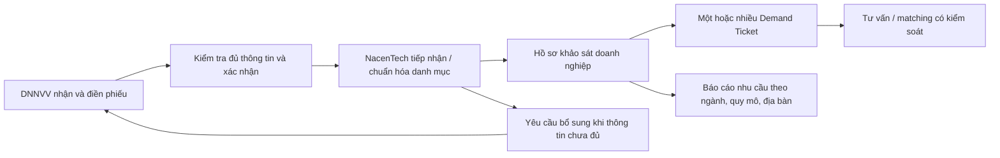

# Basic Design — Phiếu khảo sát nhu cầu công nghệ DNNVV

> **Phạm vi**: mô-đun khảo sát mở rộng của `TASK-03 — Hồ sơ Tìm mua / Nhu cầu công nghệ (Buyer)`, không phải task độc lập.  
> **Đối tượng nhận phiếu**: doanh nghiệp nhỏ và vừa tại Việt Nam.  
> **Nguồn đối chiếu**: `01_DATA_RAW/ĐỀ XUẤT XÂY DỰNG BỘ PHIẾU KHẢO SÁT NHU CẦU CÔNG NGHỆ CỦA DOANH NGHIỆP NHỎ VÀ VỪA TẠI VIỆT NAM.docx`; `01_DATA_RAW/BA tìm mua công nghệ.xlsx` (sheet `tìm mua`, 281 dòng).  
> **Trạng thái**: 🟢 Đã được PO phê duyệt theo Quyết định PO-DEC-20261008-01 và PO-DEC-20261008-03 ngày 08/10/2026.

> **Quy ước review wireframe**: `(0)` là trường/nhóm lựa chọn lấy từ workbook `BA tìm mua công nghệ`; `(1)` là trường hoặc quy tắc kế thừa từ NacenTech; `(0)(1)` là nội dung trùng, được dùng chung thay vì nhập/lưu hai lần.

## 1. Quyết định phân rã

**Không tạo TASK Basic Design mới.** Bộ phiếu tạo dữ liệu đầu vào cho cùng aggregate *Demand Survey / Demand Ticket* của TASK-03: doanh nghiệp khai báo hiện trạng → điểm nghẽn → nhu cầu → nguồn lực tiếp nhận → kết nối. Nó dùng danh mục ngành/lĩnh vực của TASK-06, được Admin quản trị tại TASK-07 và chuyển cơ hội sang TASK-08; các quan hệ này không làm thay đổi ranh giới sở hữu của TASK-03.

Khác với phiếu đăng nhu cầu ngắn đang có, đây là **phiếu khảo sát sâu, một lần theo doanh nghiệp/đợt khảo sát**. Một phiếu có thể ghi nhiều dòng nhu cầu công nghệ. Các thông tin nhận diện có thể tái sử dụng từ hồ sơ doanh nghiệp, nhưng không bắt doanh nghiệp nhập lại khi đã có dữ liệu.

## 2. Mục tiêu và phạm vi phát hành

- Thu thập có cấu trúc hiện trạng công nghệ, điểm nghẽn, nhu cầu và khả năng tiếp nhận của DNNVV.
- Tạo chuỗi dữ liệu phân tích: **doanh nghiệp → ngành/phân ngành → công đoạn → vấn đề → nhóm/công nghệ cần → ưu tiên → đầu tư → thời gian**.
- Làm đầu vào cho kết nối cung–cầu, tư vấn, đào tạo, hỗ trợ tài chính và báo cáo tổng hợp theo ngành, quy mô, địa bàn, nhóm công nghệ.
- Phiếu không là hồ sơ chào bán, không định giá giải pháp, không cam kết tài trợ hay tự động phê duyệt/kết nối.

## 3. Thành phần phiếu gửi doanh nghiệp

| Phần | Nội dung thu thập | Cách dùng kết quả |
|---|---|---|
| A. Thông tin doanh nghiệp | Nhận diện, người cung cấp tin, loại hình/quy mô, lao động, ngành, sản phẩm/dịch vụ, doanh thu theo khoảng | Phân đoạn DNNVV và liên hệ xác minh |
| B. Hiện trạng công nghệ | Công đoạn, công nghệ/thiết bị, năm đầu tư, nguồn công nghệ; tự đánh giá 8 tiêu chí | Bối cảnh của nhu cầu, không là kết luận kiểm định |
| C. Điểm nghẽn | Chọn tối đa 5 vấn đề, mức độ 1–5, công đoạn khó nhất và nguyên nhân | Dẫn xuất bài toán công nghệ ưu tiên |
| D. Năng lực tiếp nhận | Nhân lực, quản lý công nghệ, khả năng hấp thụ 1–5 | Đánh giá nhu cầu đào tạo/tư vấn, không loại trừ nhu cầu |
| E. Nhu cầu công nghệ | Một hay nhiều dòng công đoạn–vấn đề–công nghệ–mục tiêu–quy mô–ưu tiên–thời gian–ngân sách; hình thức tiếp nhận | Tạo/nuôi dưỡng Demand Ticket và matching có kiểm soát |
| F. Công nghệ mới & hỗ trợ | Tự động hóa, chuyển đổi số, công nghệ xanh; mức cần hỗ trợ; đối tác mong muốn | Phân luồng tư vấn, kết nối và báo cáo nhu cầu |
| G. Xác nhận | Người xác nhận, ngày xác nhận, quyền sử dụng/liên hệ | Điều kiện tiếp nhận khảo sát |

### Nguyên tắc trả lời

1. Câu hỏi dùng lựa chọn sẵn kết hợp ô mở; chỉ yêu cầu mô tả kỹ thuật khi doanh nghiệp biết.
2. Câu hỏi điểm dùng thang 1–5; `1 = rất thấp/chưa có/không cấp thiết`, `5 = rất cao/tốt/rất cấp thiết` theo từng nhãn của phần.
3. Ngân sách và doanh thu dùng **khoảng giá trị** hoặc “chưa xác định” để giảm nhạy cảm.
4. Mỗi phiếu có ít nhất một dòng nhu cầu tại phần E; một dòng chưa đủ thông tin vẫn có thể chuyển chuyên gia tư vấn, nhưng không tự công bố.
5. Số điện thoại, email, địa chỉ chi tiết, ngân sách chi tiết và tệp hiện trạng không hiển thị công khai. Bên cung/chuyên gia chỉ xem theo chính sách kết nối đã được phê duyệt của TASK-03/TASK-08.

## 4. Luồng giá trị khảo sát

Ngoại lệ: nếu doanh nghiệp chưa biết công nghệ, vẫn ghi *vấn đề + công đoạn + mục tiêu + mức ưu tiên*, chọn “cần tư vấn xác định giải pháp”; không buộc chọn tên công nghệ.

## 5. Bản đồ dữ liệu và danh mục dùng chung

| Nhóm dữ liệu | Sở hữu / dùng chung | Ghi chú Basic Design |
|---|---|---|
| Nhận diện và quy mô doanh nghiệp | TASK-02, tái sử dụng tại TASK-03 | Khảo sát giấy có thể thu lần đầu; hệ thống tránh tạo bản sao khi đã có hồ sơ xác thực. |
| Ngành, phân ngành, lĩnh vực, nhóm công nghệ | TASK-06 | Phiếu hiển thị danh mục đã được quản trị; không tự tạo mã tự do. |
| Hiện trạng, điểm nghẽn, năng lực tiếp nhận, nhu cầu hỗ trợ | TASK-03 | Dữ liệu khảo sát sâu theo doanh nghiệp/đợt khảo sát. |
| Dòng nhu cầu công nghệ | TASK-03 | Là nguồn tạo mới/cập nhật Demand Ticket, có liên kết về phiếu. |
| Đề nghị kết nối, cơ hội | TASK-08 | Chỉ sinh sau sàng lọc; không mở PII mặc định. |

## 6. Quyết định dữ liệu nhạy cảm

| Dữ liệu | Có lưu | Ai nhập | Ai xem | Mục đích | Ngoại lệ / xác minh |
|---|---|---|---|---|---|
| SĐT, email, người liên hệ | Có | Đại diện doanh nghiệp | Doanh nghiệp, cán bộ được phân quyền; đối tác sau kết nối được phép | Xác minh và liên hệ tư vấn | Yêu cầu chỉnh sửa/xóa được xử lý theo chính sách dữ liệu. |
| Doanh thu, ngân sách, nguồn vốn | Có, ưu tiên khoảng giá trị | Đại diện doanh nghiệp | Doanh nghiệp và cán bộ được phân quyền | Phân tích khả năng đầu tư, tư vấn hỗ trợ | Không xuất công khai, không dùng làm điều kiện tự động từ chối. |
| Ảnh/tài liệu hiện trạng | Có nếu doanh nghiệp đính kèm | Đại diện doanh nghiệp | Chủ thể, cán bộ được phân quyền, đối tác đã được phép | Làm rõ nhu cầu kỹ thuật | Không tự mở khi kết nối chưa được duyệt. |

## 7. Quyết định phê duyệt mô hình chỉ số TNI (Chốt ngày 08/10/2026)

### 7.1. Bối cảnh & Decision Record (PO-DEC-20261008-01)
- **Quyết định:** PO chính thức phê duyệt mô hình **TNI 4 chiều rút gọn** dựa trên dữ liệu chuẩn hóa mới nhất tại sheet `tìm mua 7.10` (file `Tài liệu BA phần mềm Nacentwin 8.10.xlsx`), thay thế cho mô hình 5 chiều (`30/25/20/15/10`) và mô hình GAP cũ.
- **Lý do thay thế:** Biến "Hiệu quả kỳ vọng" (E) trong mô hình 5 chiều bị trùng lắp ngữ nghĩa với "Tác động doanh nghiệp" (I). Rút gọn về 4 câu hỏi giúp tinh giản biểu mẫu khảo sát, giảm tỷ lệ bỏ dở của doanh nghiệp.
- **Hiệu đính lỗi công thức:** Bản nháp Excel ghi nhầm `(6 - O) * 15` (nghịch đảo điểm sẵn sàng); PO chốt công thức chuẩn là **`O * 15`** để đảm bảo doanh nghiệp càng sẵn sàng tiếp nhận (TAR cao) thì điểm ưu tiên TNI càng cao.

### 7.2. Công thức toán học & Trọng số
Chỉ số **TNI (Technology Need Index)** được chuẩn hóa trên thang điểm **0–100**:

$$\text{TNI} = \text{ROUND}\left(\frac{K \times 35 + L \times 30 + N \times 20 + O \times 15}{5}, 0\right)$$

Trong đó, cả 4 thành phần đều được thu thập qua câu hỏi trắc nghiệm thang điểm **1–5**:
1. **$K$ — Mức độ cấp thiết (Urgency) [Trọng số 35%]**:
   - `1` (Rất thấp): Cần sau $\ge 36$ tháng.
   - `2` (Thấp): Cần trong 24–36 tháng.
   - `3` (Trung bình): Cần trong 12–24 tháng.
   - `4` (Cao): Cần trong 6–12 tháng.
   - `5` (Rất cao / Khẩn cấp): Cần trong $\le 6$ tháng.
2. **$L$ — Tác động kỳ vọng (Impact) [Trọng số 30%]**:
   - `1` (Rất thấp): Cải thiện không đáng kể.
   - `2` (Thấp): Có cải thiện nhỏ, chưa rõ rệt.
   - `3` (Trung bình): Cải thiện đáng kể một số chỉ tiêu.
   - `4` (Cao): Tạo chuyển biến rõ rệt về sản xuất - kinh doanh.
   - `5` (Rất cao): Tác động lớn, tạo bước nhảy vọt về năng lực cạnh tranh.
3. **$N$ — Khả năng đầu tư / Tài chính (Finance) [Trọng số 20%]**:
   - `1` (Rất thấp): Chưa có vốn, cần tài trợ/hỗ trợ gần như 100%.
   - `2` (Thấp): Tự bố trí $< 30\%$ kinh phí, cần huy động vốn ngoài.
   - `3` (Trung bình): Tự bố trí $30–<50\%$ kinh phí.
   - `4` (Khá): Tự bố trí $50–<80\%$ kinh phí.
   - `5` (Cao): Tự bố trí $\ge 80\%$ kinh phí, hoàn toàn chủ động vốn.
4. **$O$ — Mức độ sẵn sàng tiếp nhận (TAR - Technology Adoption Readiness) [Trọng số 15%]**:
   - `1` (Chưa sẵn sàng): Chưa có kế hoạch hoặc nhân lực tiếp nhận.
   - `2` (Sẵn sàng thấp): Đang tìm hiểu sơ bộ, chưa có kế hoạch cụ thể.
   - `3` (Sẵn sàng trung bình): Đã xác định giải pháp sơ bộ, cần chuẩn bị nhân lực/quy trình.
   - `4` (Sẵn sàng cao): Đã có kế hoạch, nhân sự và nguồn lực dự kiến.
   - `5` (Rất sẵn sàng): Đã bố trí đầy đủ nguồn lực và quyết định triển khai ngay.

### 7.3. Thang xếp hạng & Phân loại nhu cầu
- **$\text{TNI} \ge 80$**: **Nhu cầu rất cao** (Ưu tiên kết nối ngay trong 24h, giới thiệu giải pháp cấp thiết).
- **$65 \le \text{TNI} < 80$**: **Nhu cầu cao** (Ưu tiên kết nối theo đợt, đề xuất giải pháp phù hợp).
- **$50 \le \text{TNI} < 65$**: **Nhu cầu trung bình** (Gợi ý danh mục công nghệ, gửi bản tin chuyên ngành).
- **$\text{TNI} < 50$**: **Nhu cầu thấp** (Lưu trữ theo dõi, hỗ trợ tư vấn đào tạo định hướng).

## 8. Cross-Surface Impact Matrix

| Bề mặt | Trạng thái | Hành động sau PO duyệt |
|---|---|---|
| Basic Design / wireframe | Đã đồng bộ | Đã cập nhật công thức 4 chiều vào Spec này, `wireframe_phieu_khao_sat_dnnvv.html` và `DANH_MUC_TRUONG_NHU_CAU_VA_TNI.html`. |
| Detail SRS | Cần Delta | Cập nhật `spec.md` cho TASK-03, chuyển đổi DTO trường TNI. |
| API / DTO, validation, DB | Cần Delta | Thêm `TniScore` (INT, 0-100), `TniClassification` (VARCHAR), 4 sub-scores $K, L, N, O$ (INT, 1-5). |
| Web Portal | Cần Delta | Bộ tính điểm TNI real-time trên form nhu cầu / wizard khảo sát. |
| Admin | Cần Delta | Lọc và sắp xếp danh sách nhu cầu theo điểm TNI giảm dần. |
| Matching / cơ hội | Cần Delta | Đưa điểm TNI vào trọng số ưu tiên ghép nối nguồn cung. |
| Zalo/Mobile | Ngoài phạm vi hiện tại | PO quyết định kênh khảo sát sau pilot web/phiếu gửi doanh nghiệp. |
| Test | Cần Delta | Unit test kiểm thử công thức TNI với các bộ dữ liệu biên (tất cả 1 -> điểm 20, tất cả 5 -> điểm 100). |

## 9. Điều kiện nghiệm thu Basic Design

- [x] Đối chiếu Word đề xuất và 281 dòng sheet `tìm mua`.
- [x] Quyết định gộp vào TASK-03; không tạo task Basic Design mới.
- [x] Có wireframe phiếu gửi DNNVV, hỗ trợ thêm dòng nhu cầu và kiểm tra chọn tối đa 5 điểm nghẽn.
- [x] Có ranh giới dữ liệu nhạy cảm và ma trận lan truyền quyết định.
- [x] PO phê duyệt mô hình TNI 4 chiều chuẩn hóa (Quyết định PO-DEC-20261008-01 ngày 08/10/2026).
