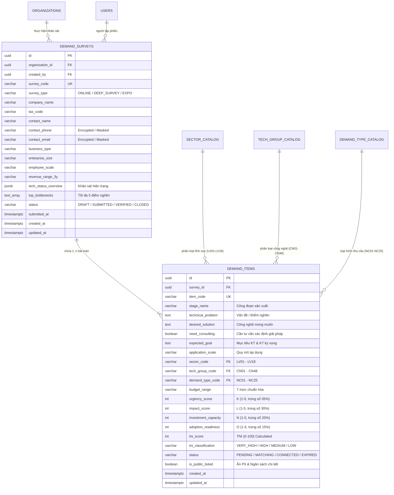

# Thiết Kế CSDL Phân Hệ Nhu Cầu Tìm Mua (Demand) & Thuật Toán TNI

> **Mã phân hệ**: `TASK-03_HO_SO_TIM_MUA_BUYER`  
> **Căn cứ pháp lý & kỹ thuật**: Quyết định PO `PO-DEC-20261008-01` & `PO-DEC-20261008-03`  
> **Hệ quản trị CSDL**: PostgreSQL 16+ / EF Core 8 (Npgsql)  
> **Trạng thái**: 🟢 Baseline Thiết Kế Cơ Sở & Detail Schema Handoff

---

## 1. SƠ ĐỒ THỰC THỂ KHÁI NIỆM (ERD)



---

## 2. ĐẶC TẢ CHI TIẾT BẢNG CSDL (DATA DICTIONARY)

### 2.1. Bảng `demand_surveys` (Phiếu Khảo Sát / Hồ Sơ Nhu Cầu Tổng Thể)

| Tên Cột | Kiểu Dữ Liệu | Ràng Buộc (Constraints) | Ý Nghĩa Nghiệp Vụ & Quy Tắc |
| :--- | :--- | :--- | :--- |
| `id` | `UUID` | `PRIMARY KEY DEFAULT gen_random_uuid()` | Định danh duy nhất của hồ sơ khảo sát. |
| `organization_id` | `UUID` | `NULLABLE, FK -> organizations(id)` | Liên kết tới hồ sơ pháp nhân doanh nghiệp ĐMST (nếu đã tạo). |
| `created_by` | `UUID` | `NOT NULL, FK -> users(id)` | Người lập phiếu / tài khoản sở hữu. |
| `survey_code` | `VARCHAR(30)` | `NOT NULL, UNIQUE` | Mã phiếu nghiệp vụ: `SUR-YYYYMMDD-XXXXX`. |
| `survey_type` | `VARCHAR(20)` | `NOT NULL DEFAULT 'ONLINE'` | `ONLINE` (Nhanh trên Web), `DEEP_SURVEY` (Khảo sát sâu), `EXPO` (Hội chợ). |
| `company_name` | `VARCHAR(255)` | `NOT NULL` | Tên doanh nghiệp khai báo. |
| `tax_code` | `VARCHAR(20)` | `NULLABLE` | Mã số thuế (dùng đối soát pháp nhân). |
| `contact_name` | `VARCHAR(100)` | `NOT NULL` | Họ tên người đại diện liên hệ. |
| `contact_phone` | `VARCHAR(255)` | `NOT NULL` | Số điện thoại liên hệ (mã hóa cột / PII Protected). |
| `contact_email` | `VARCHAR(255)` | `NOT NULL` | Email liên hệ (mã hóa cột / PII Protected). |
| `business_type` | `VARCHAR(50)` | `NULLABLE` | `TNHH`, `CO_PHAN`, `TU_NHAN`, `HOP_TAC_XA`, `KHAC`. |
| `enterprise_size` | `VARCHAR(20)` | `NULLABLE` | `MICRO` (Siêu nhỏ), `SMALL` (Nhỏ), `MEDIUM` (Vừa). |
| `employee_scale` | `VARCHAR(50)` | `NULLABLE` | `<10`, `10-49`, `50-199`, `200-300`, `>300`. |
| `revenue_range_3y` | `VARCHAR(50)` | `NULLABLE` | Doanh thu bình quân 3 năm theo khoảng (bảo mật). |
| `top_bottlenecks` | `TEXT[]` | `CHECK (cardinality(top_bottlenecks) <= 5)` | Danh sách tối đa 5 điểm nghẽn ưu tiên. |
| `status` | `VARCHAR(20)` | `NOT NULL DEFAULT 'DRAFT'` | `DRAFT`, `SUBMITTED`, `VERIFIED`, `CLOSED`. |
| `submitted_at` | `TIMESTAMPTZ` | `NULLABLE` | Thời điểm nộp phiếu chính thức. |
| `created_at` | `TIMESTAMPTZ` | `NOT NULL DEFAULT clock_timestamp()` | Thời điểm tạo bản ghi. |
| `updated_at` | `TIMESTAMPTZ` | `NOT NULL DEFAULT clock_timestamp()` | Thời điểm cập nhật cuối. |

### 2.2. Bảng `demand_items` (Bài Toán & Dòng Nhu Cầu Kỹ Thuật — Demand Ticket)

| Tên Cột | Kiểu Dữ Liệu | Ràng Buộc (Constraints) | Ý Nghĩa Nghiệp Vụ & Quy Tắc |
| :--- | :--- | :--- | :--- |
| `id` | `UUID` | `PRIMARY KEY DEFAULT gen_random_uuid()` | Định danh duy nhất của Demand Ticket. |
| `survey_id` | `UUID` | `NOT NULL, FK -> demand_surveys(id) ON DELETE CASCADE` | Thuộc phiếu khảo sát nào. |
| `item_code` | `VARCHAR(30)` | `NOT NULL, UNIQUE` | Mã bài toán: `DMD-YYYYMMDD-XXXXX`. |
| `stage_name` | `VARCHAR(255)` | `NOT NULL` | Công đoạn sản xuất gặp vấn đề. |
| `technical_problem` | `TEXT` | `NOT NULL` | Mô tả chi tiết vấn đề / sự cố kỹ thuật. |
| `desired_solution` | `TEXT` | `NULLABLE` | Tên công nghệ / thiết bị mong muốn. |
| `need_consulting` | `BOOLEAN` | `NOT NULL DEFAULT FALSE` | Cờ: Chưa rõ giải pháp, cần chuyên gia tư vấn. |
| `expected_goal` | `TEXT` | `NOT NULL` | Mục tiêu kỹ thuật & kinh tế (KPI) kỳ vọng. |
| `sector_code` | `VARCHAR(20)` | `NOT NULL` | Mã ngành: `LV01` $\rightarrow$ `LV18`. |
| `tech_group_code` | `VARCHAR(20)` | `NOT NULL` | Mã nhóm công nghệ: `CN01` $\rightarrow$ `CN48`. |
| `demand_type_code` | `VARCHAR(20)` | `NOT NULL` | Mã nhu cầu: `NC01` $\rightarrow$ `NC25`. |
| `budget_range` | `VARCHAR(50)` | `NOT NULL` | 7 khoảng ngân sách chuẩn hóa. |
| **`urgency_score`** | `INT` | `NOT NULL, CHECK (urgency_score BETWEEN 1 AND 5)` | **$K$ — Cấp thiết (Trọng số 35%)**. |
| **`impact_score`** | `INT` | `NOT NULL, CHECK (impact_score BETWEEN 1 AND 5)` | **$L$ — Tác động kỳ vọng (Trọng số 30%)**. |
| **`investment_capacity`** | `INT` | `NOT NULL, CHECK (investment_capacity BETWEEN 1 AND 5)` | **$N$ — Khả năng đầu tư (Trọng số 20%)**. |
| **`adoption_readiness`** | `INT` | `NOT NULL, CHECK (adoption_readiness BETWEEN 1 AND 5)` | **$O$ — TAR Sẵn sàng (Trọng số 15%)**. |
| **`tni_score`** | `INT` | `NOT NULL, CHECK (tni_score BETWEEN 0 AND 100)` | **$\text{TNI} = \text{ROUND}((35K + 30L + 20N + 15O)/5)$**. |
| **`tni_classification`** | `VARCHAR(20)` | `NOT NULL` | `VERY_HIGH` ($\ge 80$), `HIGH` ($65-79$), `MEDIUM` ($50-64$), `LOW` ($< 50$). |
| `status` | `VARCHAR(20)` | `NOT NULL DEFAULT 'PENDING'` | `PENDING`, `MATCHING`, `CONNECTED`, `EXPIRED`. |
| `is_public_listed` | `BOOLEAN` | `NOT NULL DEFAULT TRUE` | Niêm yết công khai (ẩn PII và liên hệ). |
| `created_at` | `TIMESTAMPTZ` | `NOT NULL DEFAULT clock_timestamp()` | Thời điểm tạo. |
| `updated_at` | `TIMESTAMPTZ` | `NOT NULL DEFAULT clock_timestamp()` | Thời điểm cập nhật. |

---

## 3. DDL SCRIPT POSTGRESQL (PRODUCTION-READY)

```sql
-- 1. BẢNG PHIẾU KHẢO SÁT TỔNG THỂ
CREATE TABLE IF NOT EXISTS demand_surveys (
    id UUID PRIMARY KEY DEFAULT gen_random_uuid(),
    organization_id UUID,
    created_by UUID NOT NULL,
    survey_code VARCHAR(30) NOT NULL UNIQUE,
    survey_type VARCHAR(20) NOT NULL DEFAULT 'ONLINE',
    company_name VARCHAR(255) NOT NULL,
    tax_code VARCHAR(20),
    contact_name VARCHAR(100) NOT NULL,
    contact_phone VARCHAR(255) NOT NULL,
    contact_email VARCHAR(255) NOT NULL,
    business_type VARCHAR(50),
    enterprise_size VARCHAR(20),
    employee_scale VARCHAR(50),
    revenue_range_3y VARCHAR(50),
    tech_status_overview JSONB,
    top_bottlenecks TEXT[],
    status VARCHAR(20) NOT NULL DEFAULT 'DRAFT',
    submitted_at TIMESTAMPTZ,
    created_at TIMESTAMPTZ NOT NULL DEFAULT clock_timestamp(),
    updated_at TIMESTAMPTZ NOT NULL DEFAULT clock_timestamp(),
    CONSTRAINT chk_survey_bottlenecks_max5 CHECK (cardinality(top_bottlenecks) <= 5),
    CONSTRAINT chk_survey_status CHECK (status IN ('DRAFT', 'SUBMITTED', 'VERIFIED', 'CLOSED'))
);

-- 2. BẢNG BÀI TOÁN NHU CẦU KỸ THUẬT (DEMAND TICKET) & CHỈ SỐ TNI
CREATE TABLE IF NOT EXISTS demand_items (
    id UUID PRIMARY KEY DEFAULT gen_random_uuid(),
    survey_id UUID NOT NULL REFERENCES demand_surveys(id) ON DELETE CASCADE,
    item_code VARCHAR(30) NOT NULL UNIQUE,
    stage_name VARCHAR(255) NOT NULL,
    technical_problem TEXT NOT NULL,
    desired_solution TEXT,
    need_consulting BOOLEAN NOT NULL DEFAULT FALSE,
    expected_goal TEXT NOT NULL,
    application_scale VARCHAR(255),
    sector_code VARCHAR(20) NOT NULL,
    tech_group_code VARCHAR(20) NOT NULL,
    demand_type_code VARCHAR(20) NOT NULL,
    budget_range VARCHAR(50) NOT NULL,
    
    -- Bộ tứ tham số định lượng TNI (1 - 5)
    urgency_score INT NOT NULL,
    impact_score INT NOT NULL,
    investment_capacity INT NOT NULL,
    adoption_readiness INT NOT NULL,
    
    -- Chỉ số tổng hợp & Xếp loại
    tni_score INT NOT NULL,
    tni_classification VARCHAR(20) NOT NULL,
    
    status VARCHAR(20) NOT NULL DEFAULT 'PENDING',
    is_public_listed BOOLEAN NOT NULL DEFAULT TRUE,
    created_at TIMESTAMPTZ NOT NULL DEFAULT clock_timestamp(),
    updated_at TIMESTAMPTZ NOT NULL DEFAULT clock_timestamp(),
    
    -- CHECK CONSTRAINTS
    CONSTRAINT chk_dim_urgency CHECK (urgency_score BETWEEN 1 AND 5),
    CONSTRAINT chk_dim_impact CHECK (impact_score BETWEEN 1 AND 5),
    CONSTRAINT chk_dim_investment CHECK (investment_capacity BETWEEN 1 AND 5),
    CONSTRAINT chk_dim_adoption CHECK (adoption_readiness BETWEEN 1 AND 5),
    CONSTRAINT chk_tni_score_range CHECK (tni_score BETWEEN 0 AND 100),
    CONSTRAINT chk_tni_classification CHECK (tni_classification IN ('VERY_HIGH', 'HIGH', 'MEDIUM', 'LOW')),
    CONSTRAINT chk_item_status CHECK (status IN ('PENDING', 'MATCHING', 'CONNECTED', 'EXPIRED'))
);

-- 3. INDEXES TỐI ƯU HÓA TRA CỨU & MATCHING
CREATE INDEX IF NOT EXISTS idx_demand_items_tni_score ON demand_items(tni_score DESC);
CREATE INDEX IF NOT EXISTS idx_demand_items_sector_tech ON demand_items(sector_code, tech_group_code);
CREATE INDEX IF NOT EXISTS idx_demand_items_status ON demand_items(status) WHERE is_public_listed = TRUE;
CREATE INDEX IF NOT EXISTS idx_demand_surveys_tax_code ON demand_surveys(tax_code);
```
