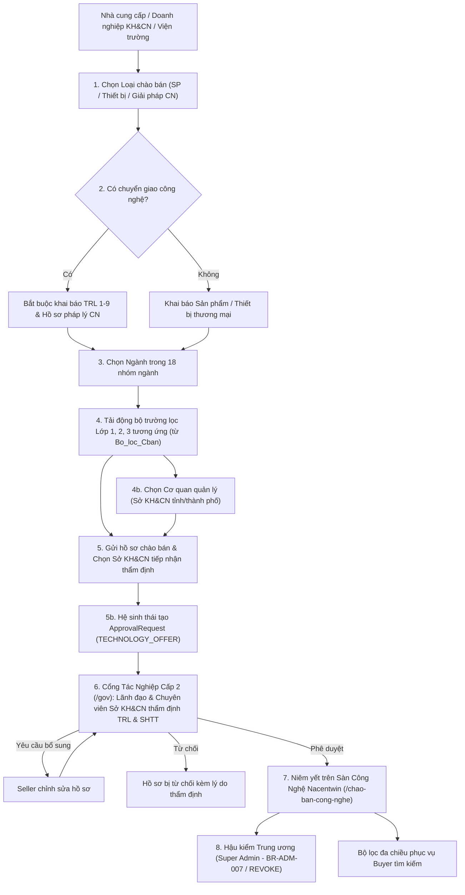

# TASK-04: Thiết Kế Cơ Sở — Hồ Sơ Chào Bán Sản Phẩm/Công Nghệ & Ma Trận Bộ Lọc 18 Ngành (Seller)

> **Mã phân hệ**: `TASK-04` *(Domain Cốt Lõi)*  
> **Sheet nguồn**: `C.bán SP` (89 dòng, 33 cột) và `Bo_loc_Cban` (1,483 dòng, 21 cột) trong [`../DỮ_LIỆU_GỐC_MASTER/Nacentwin_20260924_bo_loc_da_sua.xlsx`](../DỮ_LIỆU_GỐC_MASTER/Nacentwin_20260924_bo_loc_da_sua.xlsx)  
> **Tài liệu trích xuất MD**: [`../DỮ_LIỆU_GỐC_MASTER/Nacentwin_20260924_bo_loc_da_sua.md#sheet-4-cbn-sp`](../DỮ_LIỆU_GỐC_MASTER/Nacentwin_20260924_bo_loc_da_sua.md#sheet-4-cbn-sp)  
> **Trạng thái**: 🟢 APPROVED BY PO (Base Spec hoàn tất & Trọn bộ 5 Wireframe CRUD Seller)  
> **Quản lý tổng thể**: [`../DANH_SACH_TIEN_DO_BASIC_DESIGN.md`](../DANH_SACH_TIEN_DO_BASIC_DESIGN.md)
> **Review HTML trường cơ bản + bộ lọc ngành**: [`DANH_MUC_TRUONG_CHAO_BAN_VA_BO_LOC_18_NGANH.html`](DANH_MUC_TRUONG_CHAO_BAN_VA_BO_LOC_18_NGANH.html) *(sinh trực tiếp từ sheet `Bo_loc_Cban`)*
> **Bộ 5 Wireframe Tương Tác Khép Kín CRUD**:
> - Khởi tạo hồ sơ chào bán (Create): [`wireframe_tao_ho_so_chao_ban.html`](wireframe_tao_ho_so_chao_ban.html)
> - Chi tiết hồ sơ chào bán (Read Detail): [`wireframe_chi_tiet_ho_so_chao_ban.html`](wireframe_chi_tiet_ho_so_chao_ban.html)
> - Quản lý kho công nghệ Seller (Inventory/Listing Management): [`wireframe_quan_ly_kho_cong_nghe_seller.html`](wireframe_quan_ly_kho_cong_nghe_seller.html)
> - Sàn chào bán công nghệ công khai (Public Marketplace): [`wireframe_san_chao_ban_cong_nghe.html`](wireframe_san_chao_ban_cong_nghe.html)
> - Form chỉnh sửa hồ sơ chào bán (Update/Edit): [`wireframe_chinh_sua_ho_so_chao_ban.html`](wireframe_chinh_sua_ho_so_chao_ban.html)

---

## 1. MỤC TIÊU & TẦM QUAN TRỌNG CỐT LÕI (CORE DOMAIN)

Phân hệ **Chào bán Sản phẩm, Thiết bị và Giải pháp Công nghệ (Seller)** là trái tim của hệ sinh thái Nacentwin. Phân hệ kết hợp chặt chẽ giữa:
1. **Biểu mẫu đăng ký chào bán chuẩn hóa 4 Lớp**:
   - *Lớp 1 (Chung)*: 45 trường dùng chung cho cả 3 loại đối tượng và 18 ngành (Tên, Lĩnh vực, Nhóm công nghệ, Ưu điểm, Ảnh/Video...).
   - *Lớp 2 (Kỹ thuật)*: Thông số kỹ thuật, xuất xứ, tiêu chuẩn, mức độ hoàn thiện công nghệ (TRL 1-9).
   - *Lớp 3 (Theo ngành)*: Các trường đặc thù bám sát 18 nhóm ngành công nghiệp.
   - *Lớp 4 (Giá & Thương mại)*: Giá bán, hình thức chuyển giao, bảo hành, phương thức thanh toán.
2. **Ma trận bộ lọc 1,479 quy tắc cho 18 nhóm ngành (`Bo_loc_Cban`)**:
   - Cho phép tìm kiếm chính xác và lọc động theo từng ngành.
3. **Bảng tra cứu động 3 điều kiện (Lookup Widget tại C.bán SP cột P:AG)**:
   - Điều kiện 1: *Ngành nghề* (1 trong 18 ngành).
   - Điều kiện 2: *Loại chào bán* (Sản phẩm / Thiết bị / Giải pháp công nghệ).
   - Điều kiện 3: *Có chuyển giao công nghệ* (Có / Không).
4. **Quy tắc vàng về Chuyển giao công nghệ & Bộ tứ thuộc tính SHTT (IP & Tech Transfer Quad)**:
   - Khi chọn "Có chuyển giao công nghệ" $\rightarrow$ Bắt buộc khai báo **Cấp độ hoàn thiện công nghệ TRL (Technology Readiness Level 1–9)** và bộ 4 thuộc tính chuyển giao chuẩn quốc tế (chuẩn hóa theo danh mục công nghệ ITRI 08/10/2026):
     * **Thuộc tính 1 · Mức độ TRL (1–9)**: Thang đo chín muồi công nghệ từ nghiên cứu phòng lab (TRL 1–3), mô hình thử nghiệm pilot (TRL 4–6) đến sẵn sàng thương mại hóa (TRL 7–9).
     * **Thuộc tính 2 · Tình trạng SHTT (Intellectual Property Status)**: Đã cấp bằng độc quyền sáng chế, Bằng độc quyền giải pháp hữu ích, Bí quyết công nghệ (Trade Secret), Đang nộp đơn hợp lệ, hoặc Bản quyền phần mềm.
     * **Thuộc tính 3 · Hình thức chuyển giao (Transfer Method / Form of Transfer)**: Li-xăng độc quyền (Exclusive Licensing), Li-xăng không độc quyền (Non-exclusive Licensing), Chuyển nhượng toàn bộ quyền sở hữu (Assignment / Full Sale), Hợp tác R&D / Đồng phát triển (Joint R&D).
     * **Thuộc tính 4 · Trạng thái thương mại hóa (Commercialization Status)**: Đã ứng dụng công nghiệp quy mô lớn, Đang vận hành thử nghiệm tại hiện trường, Đang ở giai đoạn nguyên mẫu sẵn sàng demo, Tìm kiếm đối tác đầu tư sản xuất.
   - Khi chọn "Không chuyển giao" (chỉ bán sản phẩm vật lý/thiết bị tiêu chuẩn) $\rightarrow$ TRL và hồ sơ SHTT là trường tùy chọn bổ sung.

5. **Chỉ báo tương tác sau công khai**:
   - Hệ thống tự tính **số lượng kết nối thành công** và hiển thị **điểm đánh giá sản phẩm / số review đã duyệt**.
   - Hai chỉ báo không yêu cầu Seller nhập, chỉ mang tính tham khảo và không thay thế thẩm định kỹ thuật hoặc TRL.

---

## 2. TÁC NHÂN & LUỒNG QUẢN LÝ HỒ SƠ CHÀO BÁN

---

## 3. DANH MỤC 18 NGÀNH CÔNG NGHIỆP TRỌNG ĐIỂM (U1:U19 TRONG BO_LOC_CBAN)

1. **Nông nghiệp** (`AG` - 83 rules)
2. **Thực phẩm** (`FOOD` - 83 rules)
3. **Đồ uống** (`DRINK` - 81 rules)
4. **Cơ khí chế tạo** (`MECH` - 83 rules)
5. **Điện điện tử tự động hóa** (`ELEC` - 83 rules)
6. **Nước môi trường** (`ENV` - 83 rules)
7. **Xây dựng vật liệu** (`BUILD` - 83 rules)
8. **Logistics** (`LOG` - 82 rules)
9. **Du lịch khách sạn nhà hàng** (`HOSP` - 81 rules)
10. **Phần mềm và giải pháp số** (`IT` - 83 rules)
11. **Khoa học công nghệ** (`SCI` - 83 rules)
12. **Dệt** (`TEXT` - 83 rules)
13. **Gỗ và vật liệu tương tự** (`WOOD` - 82 rules)
14. **Hóa chất** (`CHEM` - 82 rules)
15. **Dược** (`PHARMA` - 82 rules)
16. **Điện tử máy tính quang học** (`OPT` - 82 rules)
17. **Nội thất** (`FURN` - 81 rules)
18. **Chế tạo khác** (`OTHER` - 79 rules)

---

## 4. DỮ LIỆU ĐẶC TẢ GỐC PHẦN 1: HỒ SƠ CHÀO BÁN BASIC (CỘT A ĐẾN N)

| Thu thập từ các nguồn |  |  |  |  |  |  |  |  |  |  |  |  |  |
| :--- | :--- | :--- | :--- | :--- | :--- | :--- | :--- | :--- | :--- | :--- | :--- | :--- | :--- |
| Kỷ yếu |  |  |  |  |  |  |  |  | Chưa có |  |  |  |  |
| Kỷ yếu techmart, triển lãm cơ khí, Kỷ yếu triểm lãm thiết bị điện tử- thiết bị thông minh, ngành may mặc, Triển lãm Quốc tế Chuyên ngành Y Dược |  |  |  |  |  |  |  |  |  |  |  |  |  |
|  |  |  |  |  |  |  |  |  |  |  |  |  |  |
| Trợ lý AI |  |  |  |  |  |  |  |  |  |  |  |  |  |
| Phiếu Đăng ký bán hàng |  |  |  | AI gợi ý thông tin sản phẩm |  |  |  |  | Image --> Mô tả sản phẩm |  |  |  |  |
| Phiếu đăng ký triển lãm |  |  |  | AI trợ lý thông minh gợi ý các sản phẩm, sản phẩm tương tự |  |  |  |  | Voice--> Mô tả sản phẩm |  |  |  |  |
| Chụp ảnh Sản phẩm cần bán |  |  |  | AI gợi ý đăng bán sản phẩm |  |  |  |  | Image --> Mô tả sản phẩm |  |  |  |  |
| Ghi âm sản phẩm cần bán |  |  |  | AI trợ lý thông minh đề xuất giá trên thị trường |  |  |  |  | Voice--> Price |  |  |  |  |
| Trang web |  |  |  |  |  |  |  |  |  |  |  |  |  |
| 1. Quản trị doanh nghiệp |  |  |  |  |  |  |  |  |  |  |  |  |  |
|  | Đăng nhập tài khoản |  |  | Số điện thoại |  | Text |  |  |  |  |  |  |  |
|  |  |  |  | Email |  | Text |  |  |  |  |  |  |  |
|  |  |  |  | Mật khẩu |  | Text |  |  |  |  |  |  |  |
|  | Admin quản trị |  |  |  |  |  |  |  |  |  |  |  |  |
|  |  |  |  | Tạo mới hồ sơ doanh nghiệp |  |  |  |  |  |  |  |  |  |
|  |  |  |  | Cập nhật/ chỉnh sửa |  |  |  |  |  |  |  |  |  |
|  |  |  |  |  |  |  |  |  |  |  |  |  |  |
| 2. Lớp 1 — Trường chung của hồ sơ chào bán |  |  |  |  |  |  |  |  |  |  |  |  |  |
|  | Phạm vi và cách đọc |  |  | Chung cho cả 3 loại và 18 nhóm ngành. Chung không đồng nghĩa bắt buộc nhập tất cả. Cột K là điều kiện hiện ô nhập; quyền xem dữ liệu nhạy cảm giữ theo mô tả. Phân loại mới là bản đề xuất để review. |  |  |  |  |  |  |  |  |  |
|  | Tên trường |  | Dạng nhập | Mô tả / ghi chú |  |  |  |  |  | Hiển thị khi nào |  | Bắt buộc khi nào |  |
| Thông tin chung |  |  |  |  |  |  |  |  |  |  |  |  |  |
|  | Loại chào bán |  | Checkbox | Đề xuất phân loại để review: Sản phẩm; Thiết bị; Giải pháp công nghệ. Cho chọn nhiều. Thiết bị tách riêng để chọn bộ trường; sản phẩm tại đây là nhóm còn lại. Việc chuyển giao được khai ở trường Có chuyển giao công nghệ. |  |  |  |  |  | Luôn có trong biểu mẫu của cả 3 loại |  | Bắt buộc ban đầu (giữ quy ước basic) |  |
|  | Có chuyển giao công nghệ |  | Chọn Có / Không | Đề xuất bổ sung để tách loại đối tượng khỏi việc chuyển giao. Chọn Có thì hiện các trường chuyển giao và bắt buộc khai TRL. Giải pháp cung cấp để sử dụng không mặc định là chuyển giao. |  |  |  |  |  | Luôn có ở cả 3 loại chào bán |  | Đề xuất bắt buộc ban đầu; anh review |  |
|  | Tên sản phẩm/thiết bị/công nghệ |  | Text | Bắt buộc ban đầu - Tên đối tượng chào bán |  |  |  |  |  | Luôn có trong biểu mẫu của cả 3 loại |  | Bắt buộc ban đầu (giữ quy ước basic) |  |
|  | Lĩnh vực ứng dụng |  | Checkbox | Bắt buộc ban đầu - Lĩnh vực có thể áp dụng |  |  |  |  |  | Luôn có trong biểu mẫu của cả 3 loại |  | Bắt buộc ban đầu (giữ quy ước basic) |  |
|  | Nhóm công nghệ |  | Checkbox | Bắt buộc ban đầu - Nhóm công nghệ liên quan |  |  |  |  |  | Luôn có trong biểu mẫu của cả 3 loại |  | Bắt buộc ban đầu (giữ quy ước basic) |  |
|  | Mô tả ngắn |  | Text | Bắt buộc ban đầu - Giới thiệu ngắn về đối tượng chào bán |  |  |  |  |  | Luôn có trong biểu mẫu của cả 3 loại |  | Bắt buộc ban đầu (giữ quy ước basic) |  |
|  | Công dụng / bài toán giải quyết |  | Text | Bắt buộc ban đầu - Dùng để làm gì; đáp ứng nhu cầu nào |  |  |  |  |  | Luôn có trong biểu mẫu của cả 3 loại |  | Bắt buộc ban đầu (giữ quy ước basic) |  |
|  | Mô tả chi tiết |  | Text | Bổ sung sau - Đặc điểm, thành phần hoặc nguyên lý |  |  |  |  |  | Luôn có trong biểu mẫu của cả 3 loại |  | Không bắt buộc ban đầu; được bổ sung sau |  |
|  | Đối tượng sử dụng |  | Text | Bổ sung sau - Nhóm khách hàng/đơn vị phù hợp |  |  |  |  |  | Luôn có trong biểu mẫu của cả 3 loại |  | Không bắt buộc ban đầu; được bổ sung sau |  |
|  | Ưu điểm nổi bật |  | Text | Bổ sung sau - Điểm khác biệt và lợi ích |  |  |  |  |  | Luôn có trong biểu mẫu của cả 3 loại |  | Không bắt buộc ban đầu; được bổ sung sau |  |
|  | Ảnh đại diện |  | Image | Bổ sung sau - Ảnh thiết bị hoặc hình/sơ đồ công nghệ |  |  |  |  |  | Luôn có trong biểu mẫu của cả 3 loại |  | Không bắt buộc ban đầu; được bổ sung sau |  |
|  | Ảnh bổ sung |  | Image | Bổ sung sau - Ảnh chi tiết hoặc ứng dụng |  |  |  |  |  | Luôn có trong biểu mẫu của cả 3 loại |  | Không bắt buộc ban đầu; được bổ sung sau |  |
|  | Video giới thiệu |  | Tải video / liên kết | Bổ sung sau - Minh họa hoạt động/kết quả |  |  |  |  |  | Luôn có trong biểu mẫu của cả 3 loại |  | Không bắt buộc ban đầu; được bổ sung sau |  |
| Kỹ thuật dùng chung |  |  |  |  |  |  |  |  |  |  |  |  |  |
|  | Bộ thông số mẫu |  | Chọn bộ mẫu | Chọn bộ mẫu chính trong 18 nhóm ngành; được bổ sung từ bộ khác khi phù hợp và thêm dòng. Không lặp thông số. Thư viện hiện có 129 thông số đề xuất, chưa duyệt chi tiết. |  |  |  |  |  | Luôn có trong biểu mẫu của cả 3 loại |  | Không bắt buộc ban đầu; được bổ sung sau |  |
|  | Bảng thông số kỹ thuật |  | Bảng thêm dòng | Bổ sung sau - Tên thông số; giá trị; đơn vị tính Bổ sung từ bộ mẫu khác hoặc thêm dòng; không lặp thông số |  |  |  |  |  | Luôn có trong biểu mẫu của cả 3 loại |  | Không bắt buộc ban đầu; được bổ sung sau |  |
|  | Tiêu chuẩn liên quan |  | Text | Bổ sung sau Tên tiêu chuẩn; tài liệu liên kết nếu có Đề xuất: chi tiết chưa chốt. |  |  |  |  |  | Luôn có trong biểu mẫu của cả 3 loại |  | Không bắt buộc ban đầu; được bổ sung sau |  |
|  | Kết quả thử nghiệm / ứng dụng |  | Text | Bổ sung sau Mô tả kết quả và dẫn tới minh chứng Đề xuất: chi tiết chưa chốt. |  |  |  |  |  | Luôn có trong biểu mẫu của cả 3 loại |  | Không bắt buộc ban đầu; được bổ sung sau |  |
| Giá và điều kiện chung |  |  |  |  |  |  |  |  |  |  |  |  |  |
|  | Hình thức công bố giá |  | Option | Bắt buộc ban đầu Cách thể hiện giá Giá cụ thể / Khoảng giá / Liên hệ báo giá |  |  |  |  |  | Luôn có trong biểu mẫu của cả 3 loại |  | Bắt buộc ban đầu (giữ quy ước basic) |  |
|  | Giá chào bán / khoảng giá |  | Number | Bắt buộc theo điều kiện Giá cụ thể hoặc giá từ–đến Bắt buộc khi chọn giá cụ thể hoặc khoảng giá |  |  |  |  |  | Hình thức công bố giá = Giá cụ thể hoặc Khoảng giá |  | Bắt buộc khi chọn Giá cụ thể hoặc Khoảng giá |  |
|  | Loại tiền |  | Option | Bắt buộc theo điều kiện Đơn vị tiền tệ Bắt buộc khi chọn giá cụ thể hoặc khoảng giá |  |  |  |  |  | Hình thức công bố giá = Giá cụ thể hoặc Khoảng giá |  | Bắt buộc khi chọn Giá cụ thể hoặc Khoảng giá |  |
|  | Đơn vị tính giá |  | Chọn/nhập | Bắt buộc theo điều kiện Chiếc, bộ, hệ thống, gói… Bắt buộc khi chọn giá cụ thể hoặc khoảng giá |  |  |  |  |  | Hình thức công bố giá = Giá cụ thể hoặc Khoảng giá |  | Bắt buộc khi chọn Giá cụ thể hoặc Khoảng giá |  |
|  | Nội dung bao gồm trong giá |  | Text | Bổ sung sau Thiết bị, vận chuyển, lắp đặt, đào tạo… Đề xuất: chi tiết chưa chốt. |  |  |  |  |  | Luôn có trong biểu mẫu của cả 3 loại |  | Không bắt buộc ban đầu; được bổ sung sau |  |
|  | Thuế và chi phí phát sinh |  | Text | Bổ sung sau Đã/chưa gồm thuế; khoản tính riêng Đề xuất: chi tiết chưa chốt. |  |  |  |  |  | Luôn có trong biểu mẫu của cả 3 loại |  | Không bắt buộc ban đầu; được bổ sung sau |  |
|  | Phạm vi cung cấp |  | Text | Bổ sung sau Tỉnh/thành, toàn quốc, thị trường khác Đề xuất: chi tiết chưa chốt. |  |  |  |  |  | Luôn có trong biểu mẫu của cả 3 loại |  | Không bắt buộc ban đầu; được bổ sung sau |  |
|  | Thời gian giao hàng / triển khai |  | Text | Bổ sung sau Thời lượng và mốc bắt đầu tính Đề xuất: chi tiết chưa chốt. |  |  |  |  |  | Luôn có trong biểu mẫu của cả 3 loại |  | Không bắt buộc ban đầu; được bổ sung sau |  |
|  | Điều kiện thanh toán |  | Text | Bổ sung sau Các đợt và điều kiện thanh toán Đề xuất: chi tiết chưa chốt. |  |  |  |  |  | Luôn có trong biểu mẫu của cả 3 loại |  | Không bắt buộc ban đầu; được bổ sung sau |  |
|  | Hiệu lực chào bán |  | Text | Bổ sung sau Ngày hết hạn nếu có Đề xuất: chi tiết chưa chốt. |  |  |  |  |  | Luôn có trong biểu mẫu của cả 3 loại |  | Không bắt buộc ban đầu; được bổ sung sau |  |
| Bên cung cấp |  |  |  |  |  |  |  |  |  |  |  |  |  |
|  | Tên tổ chức / Họ tên cá nhân |  | Text | Bắt buộc ban đầu Tên tổ chức hoặc họ tên cá nhân đứng tên cung cấp. Cho phép cả tổ chức và cá nhân chào bán. |  |  |  |  |  | Luôn có trong biểu mẫu của cả 3 loại |  | Bắt buộc ban đầu (giữ quy ước basic) |  |
|  | Mã số thuế / mã đăng ký |  | Text | Bổ sung sau Mã số thuế (nếu có); mã đăng ký tổ chức chỉ áp dụng với tổ chức. Đề xuất: chi tiết chưa chốt. |  |  |  |  |  | Mã số thuế nếu có; mã đăng ký tổ chức chỉ hiện với bên cung cấp là tổ chức |  | Không bắt buộc ban đầu; được bổ sung sau |  |
|  | Địa chỉ |  | Text | Bổ sung sau Địa chỉ bên cung cấp / địa chỉ liên hệ Đề xuất: chi tiết chưa chốt. |  |  |  |  |  | Luôn có trong biểu mẫu của cả 3 loại |  | Không bắt buộc ban đầu; được bổ sung sau |  |
|  | Website |  | Text | Bổ sung sau Liên kết website Đề xuất: chi tiết chưa chốt. |  |  |  |  |  | Luôn có trong biểu mẫu của cả 3 loại |  | Không bắt buộc ban đầu; được bổ sung sau |  |
|  | Vai trò với sản phẩm/công nghệ |  | Text | Bổ sung sau Nhà sản xuất, chủ sở hữu, nhà phân phối, bên được ủy quyền; cho chọn nhiều Đề xuất: chi tiết chưa chốt. |  |  |  |  |  | Luôn có trong biểu mẫu của cả 3 loại |  | Không bắt buộc ban đầu; được bổ sung sau |  |
|  | Người liên hệ phụ trách |  | Text | Bắt buộc ban đầu Họ tên người phụ trách hồ sơ |  |  |  |  |  | Luôn có trong biểu mẫu của cả 3 loại |  | Bắt buộc ban đầu (giữ quy ước basic) |  |
|  | Chức vụ / bộ phận |  | Text | Bổ sung sau Thông tin người phụ trách Đề xuất: chi tiết chưa chốt. |  |  |  |  |  | Khi người liên hệ có chức vụ/bộ phận |  | Không bắt buộc ban đầu; được bổ sung sau |  |
|  | Điện thoại |  | Text | Bắt buộc ban đầu Số liên hệ bên cung cấp Ẩn điện thoại/email. Ngay khi người mua gửi yêu cầu kết nối qua nền tảng, tự động mở cho chính người mua đó, không cần bên cung cấp duyệt; người xem khác vẫn chưa thấy. |  |  |  |  |  | Luôn có ô nhập. Người mua chỉ xem giá trị sau khi gửi yêu cầu kết nối |  | Bắt buộc ban đầu (giữ quy ước basic) |  |
|  | Email |  | Text | Bắt buộc ban đầu Email bên cung cấp Ẩn điện thoại/email. Ngay khi người mua gửi yêu cầu kết nối qua nền tảng, tự động mở cho chính người mua đó, không cần bên cung cấp duyệt; người xem khác vẫn chưa thấy. |  |  |  |  |  | Luôn có ô nhập. Người mua chỉ xem giá trị sau khi gửi yêu cầu kết nối |  | Bắt buộc ban đầu (giữ quy ước basic) |  |
|  | Phương thức liên hệ ưu tiên |  | Text | Bổ sung sau Qua nền tảng, điện thoại, email Đề xuất: chi tiết chưa chốt. |  |  |  |  |  | Luôn có trong biểu mẫu của cả 3 loại |  | Không bắt buộc ban đầu; được bổ sung sau |  |
| Tài liệu và minh chứng |  |  |  |  |  |  |  |  |  |  |  |  |  |
|  | Tài liệu giới thiệu / kỹ thuật |  | Thông tin + tệp | Bổ sung sau Catalogue, brochure, thông số, hướng dẫn, thuyết minh, sơ đồ Dùng lại tài liệu đã nhập; không yêu cầu tải trùng. Được bổ sung sau. Đề xuất: chi tiết chưa chốt. |  |  |  |  |  | Luôn có trong biểu mẫu của cả 3 loại |  | Không bắt buộc ban đầu; được bổ sung sau |  |
|  | Chứng nhận / kiểm định |  | Thông tin + tệp | Bổ sung sau Tên, đơn vị cấp, ngày cấp/hết hạn nếu có, tệp Dùng lại tài liệu đã nhập; không yêu cầu tải trùng. Được bổ sung sau. Đề xuất: chi tiết chưa chốt. |  |  |  |  |  | Luôn có trong biểu mẫu của cả 3 loại |  | Không bắt buộc ban đầu; được bổ sung sau |  |
|  | Thông tin sở hữu trí tuệ |  | Thông tin + tệp | Bổ sung sau Tình trạng bảo hộ, loại/số văn bằng, chủ sở hữu, tệp Dùng lại tài liệu đã nhập; không yêu cầu tải trùng. Được bổ sung sau. Đề xuất: chi tiết chưa chốt. |  |  |  |  |  | Luôn có trong biểu mẫu của cả 3 loại |  | Không bắt buộc ban đầu; được bổ sung sau |  |
|  | Minh chứng quyền cung cấp / chuyển giao |  | Thông tin + tệp | Bổ sung sau Tài liệu sở hữu, phân phối hoặc ủy quyền Dùng lại tài liệu đã nhập; không yêu cầu tải trùng. Được bổ sung sau. Đề xuất: chi tiết chưa chốt. |  |  |  |  |  | Luôn có trong biểu mẫu của cả 3 loại |  | Không bắt buộc ban đầu; được bổ sung sau |  |
|  | Hồ sơ ứng dụng thực tế |  | Thông tin + tệp | Bổ sung sau Nơi triển khai, quy mô, kết quả, ảnh/tài liệu được phép chia sẻ Dùng lại tài liệu đã nhập; không yêu cầu tải trùng. Được bổ sung sau. Đề xuất: chi tiết chưa chốt. |  |  |  |  |  | Luôn có trong biểu mẫu của cả 3 loại |  | Không bắt buộc ban đầu; được bổ sung sau |  |
|  | Phạm vi hiển thị tài liệu |  | Chọn cho từng tài liệu | Bắt buộc theo điều kiện Quyền xem từng tài liệu Khi có tài liệu: Công khai / Chỉ sau kết nối / Chỉ quản trị viên. Chưa chốt giá trị mặc định. |  |  |  |  |  | Khi có tài liệu; khai quyền xem riêng từng tài liệu |  | Bắt buộc cho từng tài liệu đã khai |  |
|  | Tình trạng minh chứng quyền cung cấp |  | Theo dõi theo hồ sơ | Bổ sung sau Đã có / Chưa có minh chứng Có minh chứng không tự động đồng nghĩa đã xác minh Đề xuất: chi tiết chưa chốt. |  |  |  |  |  | Luôn có trong biểu mẫu của cả 3 loại |  | Không bắt buộc ban đầu; được bổ sung sau |  |
| Thông tin đánh giá hiển thị |  |  |  |  |  |  |  |  |  |  |  |  |  |
|  | Đánh giá sao |  | Text | Giữ trường Đánh giá sao từ phần gốc. Dạng Text theo bản gốc; chưa chốt cách tổng hợp, quyền đánh giá và quyền sửa. |  |  |  |  |  | Trường kết quả đánh giá. Chưa chốt thời điểm hiển thị và quyền nhập/sửa |  | Chưa chốt; không coi là trường bắt buộc khi đăng bán |  |
| 3. Quy tắc dùng chung |  |  |  |  |  |  |  |  |  |  |  |  |  |
|  | Loại chào bán |  |  | Bản review: cho chọn nhiều Sản phẩm / Thiết bị / Giải pháp công nghệ; khai riêng Có chuyển giao công nghệ. Trước phân lớp: chọn sản phẩm/thiết bị, công nghệ chuyển giao hoặc cả hai. |  |  |  |  |  |  |  |  |  |
|  | Bên cung cấp |  |  | Bên cung cấp có thể là tổ chức hoặc cá nhân. Cá nhân được chào bán sản phẩm hoặc giải pháp. |  |  |  |  |  |  |  |  |  |
|  | Phân loại |  |  | Cho chọn nhiều lĩnh vực và nhiều nhóm công nghệ. |  |  |  |  |  |  |  |  |  |
|  | Thông số kỹ thuật |  |  | Chọn một bộ mẫu chính theo lĩnh vực/nhóm công nghệ; bổ sung từ bộ khác hoặc thêm dòng. Thông số trùng chỉ xuất hiện một lần. Đã có 129 thông số đề xuất trong 18 bộ mẫu, chờ review. |  |  |  |  |  |  |  |  |  |
|  | TRL |  |  | Bắt buộc nếu hồ sơ có công nghệ chuyển giao; tùy chọn nếu chỉ có sản phẩm/thiết bị. Được khai trước và bổ sung minh chứng sau; khai TRL không đồng nghĩa đã xác minh. |  |  |  |  |  |  |  |  |  |
|  | Giá |  |  | Đủ ba hình thức: giá cụ thể, khoảng giá, liên hệ báo giá. Gói gồm nhiều phần có thể báo giá riêng từng phần hoặc trọn gói. |  |  |  |  |  |  |  |  |  |
|  | Kết nối |  |  | Ẩn điện thoại/email. Ngay khi người mua gửi yêu cầu kết nối qua nền tảng, tự động mở cho chính người mua đó, không cần bên cung cấp duyệt; người xem khác vẫn chưa thấy. |  |  |  |  |  |  |  |  |  |
|  | Tài liệu |  |  | Chọn riêng từng tài liệu: Công khai / Chỉ sau kết nối / Chỉ quản trị viên. Chỉ sau kết nối áp dụng cho người mua đã gửi yêu cầu. |  |  |  |  |  |  |  |  |  |
|  | Minh chứng quyền cung cấp |  |  | Cho khai vai trò trước, bổ sung minh chứng sau; theo dõi đã/chưa có minh chứng. |  |  |  |  |  |  |  |  |  |
|  | Tối thiểu |  |  | BB: tên tổ chức/họ tên cá nhân cung cấp, người liên hệ, điện thoại, email, loại chào bán, tên, lĩnh vực, nhóm công nghệ, mô tả ngắn, công dụng, hình thức công bố giá. ĐK: TRL và thông tin giá theo lựa chọn. Còn lại BS. Đề xuất mới: khai thêm Có chuyển giao công nghệ ngay ban đầu; chờ review. |  |  |  |  |  |  |  |  |  |
| 4. Phạm vi ngành và bộ trường riêng |  |  |  |  |  |  |  |  |  |  |  |  |  |
|  | 18 nhóm ngành |  |  | Nông nghiệp; Thực phẩm; Đồ uống; Cơ khí chế tạo; Điện điện tử tự động hóa; Nước môi trường; Xây dựng vật liệu; Logistics; Du lịch khách sạn nhà hàng; Phần mềm và giải pháp số; Khoa học công nghệ; Dệt; Gỗ và vật liệu tương tự; Hóa chất; Dược; Điện tử máy tính quang học; Nội thất; Chế tạo khác |  |  |  |  |  |  |  |  |  |
|  | Danh mục trong bản review |  |  | Dùng 18 nhóm tại Thu_vien_bo_mau làm danh mục làm việc. Mã bộ AG, FOOD… được giữ để đối chiếu; không thay mã LV/C.xx trong dữ liệu gốc. Ngoài 18 nhóm: bổ sung sau. |  |  |  |  |  |  |  |  |  |
|  | Lớp 2 và lớp 3 |  |  | File Ma_tran_truong_C_ban_SP_theo_nganh_20260924.xlsx: Truong_rieng_loai chứa lớp 2; Chi_tiet_nganh chứa lớp 3. Full_theo_nganh chứa đủ cả ba lớp. |  |  |  |  |  |  |  |  |  |
|  | Chọn nhiều |  |  | Hợp nhất các trường theo ngành và loại đã chọn. Mỗi mã trường chỉ nhập một lần. Có chuyển giao thì mở thêm nhóm chuyển giao. Các thông số cùng đại lượng dùng chung giá trị khi cùng điều kiện đo. |  |  |  |  |  |  |  |  |  |
|  | Đồng bộ |  |  | 45 trường lớp 1 khớp tên, kiểu, mô tả và 2 điều kiện với Truong_chung. 30 trường lớp 2 giữ trong ma trận. 129 thông số lớp 3 là đề xuất, không mặc định bắt buộc. |  |  |  |  |  |  |  |  |  |

---

## 5. DỮ LIỆU ĐẶC TẢ GỐC PHẦN 2: BẢNG TRA CỨU ĐỘNG TẠI C.BÁN SP (CỘT P ĐẾN AG)

| TRA CỨU TRƯỜNG CHÀO BÁN |  |  |  |  |  |  |  |  |  |  |  |  |  |  |  |  |  |
| :--- | :--- | :--- | :--- | :--- | :--- | :--- | :--- | :--- | :--- | :--- | :--- | :--- | :--- | :--- | :--- | :--- | :--- |
| Chọn 3 ô màu vàng. Kết quả là các trường cần xem xét cho hồ sơ, không phải tất cả đều bắt buộc. Nội dung basic gốc vẫn ở cột A:N. |  |  |  |  |  |  |  |  |  |  |  |  |  |  |  |  |  |
| Ngành nghề |  | Nông nghiệp |  |  |  |  |  | 18 nhóm ngành trong phạm vi hiện tại; mỗi lần chọn một ngành. |  |  |  |  |  |  |  |  |  |
| Loại chào bán |  | Thiết bị |  |  |  |  |  | Sản phẩm / Thiết bị / Giải pháp công nghệ. |  |  |  |  |  |  |  |  |  |
| Có chuyển giao |  | Không |  |  |  |  |  | Không: ẩn các trường chỉ dành cho chuyển giao. Có: bổ sung nhóm chuyển giao. Tất cả: xem cả hai trường hợp. |  |  |  |  |  |  |  |  |  |
| Các điều kiện khác như có thiết bị đi kèm, công bố giá, có tài liệu vẫn đọc ở từng dòng. TRL ngoài chuyển giao là tùy chọn; không tự ẩn trường tùy chọn. |  |  |  |  |  |  |  |  |  |  |  |  |  |  |  |  |  |
| Số trường |  | 72 |  | Chỉ sửa ô chọn màu vàng. Danh sách bên dưới tự đổi; nội dung dữ liệu nằm tại Bo_loc_Cban. |  |  |  |  |  |  |  |  |  |  |  |  |  |
| Mã trường | Tên trường |  |  | Dạng nhập |  | Bắt buộc khi nào |  |  | Hiển thị khi nào |  |  | Mô tả / ghi chú |  |  |  |  | Lớp |
| CHUNG-31 | Loại chào bán |  |  | Checkbox |  | Bắt buộc ban đầu (giữ quy ước basic) |  |  | Luôn có trong biểu mẫu của cả 3 loại |  |  | Đề xuất phân loại để review: Sản phẩm; Thiết bị; Giải pháp công nghệ. Cho chọn nhiều. Thiết bị tách riêng để chọn bộ trường; sản phẩm tại đây là nhóm còn lại. Việc chuyển giao được khai ở trường Có chuyển giao công nghệ. |  |  |  |  | 1. Chung |
| CHUNG-CG | Có chuyển giao công nghệ |  |  | Chọn Có / Không |  | Đề xuất bắt buộc ban đầu; anh review |  |  | Luôn có ở cả 3 loại chào bán |  |  | Đề xuất bổ sung để tách loại đối tượng khỏi việc chuyển giao. Chọn Có thì hiện các trường chuyển giao và bắt buộc khai TRL. Giải pháp cung cấp để sử dụng không mặc định là chuyển giao. |  |  |  |  | 1. Chung |
| CHUNG-32 | Tên sản phẩm/thiết bị/công nghệ |  |  | Text |  | Bắt buộc ban đầu (giữ quy ước basic) |  |  | Luôn có trong biểu mẫu của cả 3 loại |  |  | Bắt buộc ban đầu - Tên đối tượng chào bán |  |  |  |  | 1. Chung |
| CHUNG-33 | Lĩnh vực ứng dụng |  |  | Checkbox |  | Bắt buộc ban đầu (giữ quy ước basic) |  |  | Luôn có trong biểu mẫu của cả 3 loại |  |  | Bắt buộc ban đầu - Lĩnh vực có thể áp dụng |  |  |  |  | 1. Chung |
| CHUNG-34 | Nhóm công nghệ |  |  | Checkbox |  | Bắt buộc ban đầu (giữ quy ước basic) |  |  | Luôn có trong biểu mẫu của cả 3 loại |  |  | Bắt buộc ban đầu - Nhóm công nghệ liên quan |  |  |  |  | 1. Chung |
| CHUNG-35 | Mô tả ngắn |  |  | Text |  | Bắt buộc ban đầu (giữ quy ước basic) |  |  | Luôn có trong biểu mẫu của cả 3 loại |  |  | Bắt buộc ban đầu - Giới thiệu ngắn về đối tượng chào bán |  |  |  |  | 1. Chung |
| CHUNG-36 | Công dụng / bài toán giải quyết |  |  | Text |  | Bắt buộc ban đầu (giữ quy ước basic) |  |  | Luôn có trong biểu mẫu của cả 3 loại |  |  | Bắt buộc ban đầu - Dùng để làm gì; đáp ứng nhu cầu nào |  |  |  |  | 1. Chung |
| CHUNG-37 | Mô tả chi tiết |  |  | Text |  | Không bắt buộc ban đầu; được bổ sung sau |  |  | Luôn có trong biểu mẫu của cả 3 loại |  |  | Bổ sung sau - Đặc điểm, thành phần hoặc nguyên lý |  |  |  |  | 1. Chung |
| CHUNG-38 | Đối tượng sử dụng |  |  | Text |  | Không bắt buộc ban đầu; được bổ sung sau |  |  | Luôn có trong biểu mẫu của cả 3 loại |  |  | Bổ sung sau - Nhóm khách hàng/đơn vị phù hợp |  |  |  |  | 1. Chung |
| CHUNG-39 | Ưu điểm nổi bật |  |  | Text |  | Không bắt buộc ban đầu; được bổ sung sau |  |  | Luôn có trong biểu mẫu của cả 3 loại |  |  | Bổ sung sau - Điểm khác biệt và lợi ích |  |  |  |  | 1. Chung |
| CHUNG-40 | Ảnh đại diện |  |  | Image |  | Không bắt buộc ban đầu; được bổ sung sau |  |  | Luôn có trong biểu mẫu của cả 3 loại |  |  | Bổ sung sau - Ảnh thiết bị hoặc hình/sơ đồ công nghệ |  |  |  |  | 1. Chung |
| CHUNG-41 | Ảnh bổ sung |  |  | Image |  | Không bắt buộc ban đầu; được bổ sung sau |  |  | Luôn có trong biểu mẫu của cả 3 loại |  |  | Bổ sung sau - Ảnh chi tiết hoặc ứng dụng |  |  |  |  | 1. Chung |
| CHUNG-42 | Video giới thiệu |  |  | Tải video / liên kết |  | Không bắt buộc ban đầu; được bổ sung sau |  |  | Luôn có trong biểu mẫu của cả 3 loại |  |  | Bổ sung sau - Minh họa hoạt động/kết quả |  |  |  |  | 1. Chung |
| KT-44 | Bộ thông số mẫu |  |  | Chọn bộ mẫu |  | Không bắt buộc ban đầu; được bổ sung sau |  |  | Luôn có trong biểu mẫu của cả 3 loại |  |  | Chọn bộ mẫu chính trong 18 nhóm ngành; được bổ sung từ bộ khác khi phù hợp và thêm dòng. Không lặp thông số. Thư viện hiện có 129 thông số đề xuất, chưa duyệt chi tiết. |  |  |  |  | 1. Chung |
| KT-45 | Bảng thông số kỹ thuật |  |  | Bảng thêm dòng |  | Không bắt buộc ban đầu; được bổ sung sau |  |  | Luôn có trong biểu mẫu của cả 3 loại |  |  | Bổ sung sau - Tên thông số; giá trị; đơn vị tính Bổ sung từ bộ mẫu khác hoặc thêm dòng; không lặp thông số |  |  |  |  | 1. Chung |
| KT-48 | Tiêu chuẩn liên quan |  |  | Text |  | Không bắt buộc ban đầu; được bổ sung sau |  |  | Luôn có trong biểu mẫu của cả 3 loại |  |  | Bổ sung sau Tên tiêu chuẩn; tài liệu liên kết nếu có Đề xuất: chi tiết chưa chốt. |  |  |  |  | 1. Chung |
| KT-49 | Kết quả thử nghiệm / ứng dụng |  |  | Text |  | Không bắt buộc ban đầu; được bổ sung sau |  |  | Luôn có trong biểu mẫu của cả 3 loại |  |  | Bổ sung sau Mô tả kết quả và dẫn tới minh chứng Đề xuất: chi tiết chưa chốt. |  |  |  |  | 1. Chung |
| GIA-69 | Hình thức công bố giá |  |  | Option |  | Bắt buộc ban đầu (giữ quy ước basic) |  |  | Luôn có trong biểu mẫu của cả 3 loại |  |  | Bắt buộc ban đầu Cách thể hiện giá Giá cụ thể / Khoảng giá / Liên hệ báo giá |  |  |  |  | 1. Chung |
| GIA-70 | Giá chào bán / khoảng giá |  |  | Number |  | Bắt buộc khi chọn Giá cụ thể hoặc Khoảng giá |  |  | Hình thức công bố giá = Giá cụ thể hoặc Khoảng giá |  |  | Bắt buộc theo điều kiện Giá cụ thể hoặc giá từ–đến Bắt buộc khi chọn giá cụ thể hoặc khoảng giá |  |  |  |  | 1. Chung |
| GIA-71 | Loại tiền |  |  | Option |  | Bắt buộc khi chọn Giá cụ thể hoặc Khoảng giá |  |  | Hình thức công bố giá = Giá cụ thể hoặc Khoảng giá |  |  | Bắt buộc theo điều kiện Đơn vị tiền tệ Bắt buộc khi chọn giá cụ thể hoặc khoảng giá |  |  |  |  | 1. Chung |
| GIA-72 | Đơn vị tính giá |  |  | Chọn/nhập |  | Bắt buộc khi chọn Giá cụ thể hoặc Khoảng giá |  |  | Hình thức công bố giá = Giá cụ thể hoặc Khoảng giá |  |  | Bắt buộc theo điều kiện Chiếc, bộ, hệ thống, gói… Bắt buộc khi chọn giá cụ thể hoặc khoảng giá |  |  |  |  | 1. Chung |
| GIA-74 | Nội dung bao gồm trong giá |  |  | Text |  | Không bắt buộc ban đầu; được bổ sung sau |  |  | Luôn có trong biểu mẫu của cả 3 loại |  |  | Bổ sung sau Thiết bị, vận chuyển, lắp đặt, đào tạo… Đề xuất: chi tiết chưa chốt. |  |  |  |  | 1. Chung |
| GIA-75 | Thuế và chi phí phát sinh |  |  | Text |  | Không bắt buộc ban đầu; được bổ sung sau |  |  | Luôn có trong biểu mẫu của cả 3 loại |  |  | Bổ sung sau Đã/chưa gồm thuế; khoản tính riêng Đề xuất: chi tiết chưa chốt. |  |  |  |  | 1. Chung |
| GIA-76 | Phạm vi cung cấp |  |  | Text |  | Không bắt buộc ban đầu; được bổ sung sau |  |  | Luôn có trong biểu mẫu của cả 3 loại |  |  | Bổ sung sau Tỉnh/thành, toàn quốc, thị trường khác Đề xuất: chi tiết chưa chốt. |  |  |  |  | 1. Chung |
| GIA-77 | Thời gian giao hàng / triển khai |  |  | Text |  | Không bắt buộc ban đầu; được bổ sung sau |  |  | Luôn có trong biểu mẫu của cả 3 loại |  |  | Bổ sung sau Thời lượng và mốc bắt đầu tính Đề xuất: chi tiết chưa chốt. |  |  |  |  | 1. Chung |
| GIA-78 | Điều kiện thanh toán |  |  | Text |  | Không bắt buộc ban đầu; được bổ sung sau |  |  | Luôn có trong biểu mẫu của cả 3 loại |  |  | Bổ sung sau Các đợt và điều kiện thanh toán Đề xuất: chi tiết chưa chốt. |  |  |  |  | 1. Chung |
| GIA-79 | Hiệu lực chào bán |  |  | Text |  | Không bắt buộc ban đầu; được bổ sung sau |  |  | Luôn có trong biểu mẫu của cả 3 loại |  |  | Bổ sung sau Ngày hết hạn nếu có Đề xuất: chi tiết chưa chốt. |  |  |  |  | 1. Chung |
| NCC-93 | Tên tổ chức / Họ tên cá nhân |  |  | Text |  | Bắt buộc ban đầu (giữ quy ước basic) |  |  | Luôn có trong biểu mẫu của cả 3 loại |  |  | Bắt buộc ban đầu Tên tổ chức hoặc họ tên cá nhân đứng tên cung cấp. Cho phép cả tổ chức và cá nhân chào bán. |  |  |  |  | 1. Chung |
| NCC-94 | Mã số thuế / mã đăng ký |  |  | Text |  | Không bắt buộc ban đầu; được bổ sung sau |  |  | Mã số thuế nếu có; mã đăng ký tổ chức chỉ hiện với bên cung cấp là tổ chức |  |  | Bổ sung sau Mã số thuế (nếu có); mã đăng ký tổ chức chỉ áp dụng với tổ chức. Đề xuất: chi tiết chưa chốt. |  |  |  |  | 1. Chung |
| NCC-95 | Địa chỉ |  |  | Text |  | Không bắt buộc ban đầu; được bổ sung sau |  |  | Luôn có trong biểu mẫu của cả 3 loại |  |  | Bổ sung sau Địa chỉ bên cung cấp / địa chỉ liên hệ Đề xuất: chi tiết chưa chốt. |  |  |  |  | 1. Chung |
| NCC-96 | Website |  |  | Text |  | Không bắt buộc ban đầu; được bổ sung sau |  |  | Luôn có trong biểu mẫu của cả 3 loại |  |  | Bổ sung sau Liên kết website Đề xuất: chi tiết chưa chốt. |  |  |  |  | 1. Chung |
| NCC-97 | Vai trò với sản phẩm/công nghệ |  |  | Text |  | Không bắt buộc ban đầu; được bổ sung sau |  |  | Luôn có trong biểu mẫu của cả 3 loại |  |  | Bổ sung sau Nhà sản xuất, chủ sở hữu, nhà phân phối, bên được ủy quyền; cho chọn nhiều Đề xuất: chi tiết chưa chốt. |  |  |  |  | 1. Chung |
| NCC-98 | Người liên hệ phụ trách |  |  | Text |  | Bắt buộc ban đầu (giữ quy ước basic) |  |  | Luôn có trong biểu mẫu của cả 3 loại |  |  | Bắt buộc ban đầu Họ tên người phụ trách hồ sơ |  |  |  |  | 1. Chung |
| NCC-99 | Chức vụ / bộ phận |  |  | Text |  | Không bắt buộc ban đầu; được bổ sung sau |  |  | Khi người liên hệ có chức vụ/bộ phận |  |  | Bổ sung sau Thông tin người phụ trách Đề xuất: chi tiết chưa chốt. |  |  |  |  | 1. Chung |
| NCC-100 | Điện thoại |  |  | Text |  | Bắt buộc ban đầu (giữ quy ước basic) |  |  | Luôn có ô nhập. Người mua chỉ xem giá trị sau khi gửi yêu cầu kết nối |  |  | Bắt buộc ban đầu Số liên hệ bên cung cấp Ẩn điện thoại/email. Ngay khi người mua gửi yêu cầu kết nối qua nền tảng, tự động mở cho chính người mua đó, không cần bên cung cấp duyệt; người xem khác vẫn chưa thấy. |  |  |  |  | 1. Chung |
| NCC-101 | Email |  |  | Text |  | Bắt buộc ban đầu (giữ quy ước basic) |  |  | Luôn có ô nhập. Người mua chỉ xem giá trị sau khi gửi yêu cầu kết nối |  |  | Bắt buộc ban đầu Email bên cung cấp Ẩn điện thoại/email. Ngay khi người mua gửi yêu cầu kết nối qua nền tảng, tự động mở cho chính người mua đó, không cần bên cung cấp duyệt; người xem khác vẫn chưa thấy. |  |  |  |  | 1. Chung |
| NCC-102 | Phương thức liên hệ ưu tiên |  |  | Text |  | Không bắt buộc ban đầu; được bổ sung sau |  |  | Luôn có trong biểu mẫu của cả 3 loại |  |  | Bổ sung sau Qua nền tảng, điện thoại, email Đề xuất: chi tiết chưa chốt. |  |  |  |  | 1. Chung |
| TL-104 | Tài liệu giới thiệu / kỹ thuật |  |  | Thông tin + tệp |  | Không bắt buộc ban đầu; được bổ sung sau |  |  | Luôn có trong biểu mẫu của cả 3 loại |  |  | Bổ sung sau Catalogue, brochure, thông số, hướng dẫn, thuyết minh, sơ đồ Dùng lại tài liệu đã nhập; không yêu cầu tải trùng. Được bổ sung sau. Đề xuất: chi tiết chưa chốt. |  |  |  |  | 1. Chung |
| TL-105 | Chứng nhận / kiểm định |  |  | Thông tin + tệp |  | Không bắt buộc ban đầu; được bổ sung sau |  |  | Luôn có trong biểu mẫu của cả 3 loại |  |  | Bổ sung sau Tên, đơn vị cấp, ngày cấp/hết hạn nếu có, tệp Dùng lại tài liệu đã nhập; không yêu cầu tải trùng. Được bổ sung sau. Đề xuất: chi tiết chưa chốt. |  |  |  |  | 1. Chung |
| TL-106 | Thông tin sở hữu trí tuệ |  |  | Thông tin + tệp |  | Không bắt buộc ban đầu; được bổ sung sau |  |  | Luôn có trong biểu mẫu của cả 3 loại |  |  | Bổ sung sau Tình trạng bảo hộ, loại/số văn bằng, chủ sở hữu, tệp Dùng lại tài liệu đã nhập; không yêu cầu tải trùng. Được bổ sung sau. Đề xuất: chi tiết chưa chốt. |  |  |  |  | 1. Chung |
| TL-107 | Minh chứng quyền cung cấp / chuyển giao |  |  | Thông tin + tệp |  | Không bắt buộc ban đầu; được bổ sung sau |  |  | Luôn có trong biểu mẫu của cả 3 loại |  |  | Bổ sung sau Tài liệu sở hữu, phân phối hoặc ủy quyền Dùng lại tài liệu đã nhập; không yêu cầu tải trùng. Được bổ sung sau. Đề xuất: chi tiết chưa chốt. |  |  |  |  | 1. Chung |
| TL-109 | Hồ sơ ứng dụng thực tế |  |  | Thông tin + tệp |  | Không bắt buộc ban đầu; được bổ sung sau |  |  | Luôn có trong biểu mẫu của cả 3 loại |  |  | Bổ sung sau Nơi triển khai, quy mô, kết quả, ảnh/tài liệu được phép chia sẻ Dùng lại tài liệu đã nhập; không yêu cầu tải trùng. Được bổ sung sau. Đề xuất: chi tiết chưa chốt. |  |  |  |  | 1. Chung |
| TL-110 | Phạm vi hiển thị tài liệu |  |  | Chọn cho từng tài liệu |  | Bắt buộc cho từng tài liệu đã khai |  |  | Khi có tài liệu; khai quyền xem riêng từng tài liệu |  |  | Bắt buộc theo điều kiện Quyền xem từng tài liệu Khi có tài liệu: Công khai / Chỉ sau kết nối / Chỉ quản trị viên. Chưa chốt giá trị mặc định. |  |  |  |  | 1. Chung |
| TL-111 | Tình trạng minh chứng quyền cung cấp |  |  | Theo dõi theo hồ sơ |  | Không bắt buộc ban đầu; được bổ sung sau |  |  | Luôn có trong biểu mẫu của cả 3 loại |  |  | Bổ sung sau Đã có / Chưa có minh chứng Có minh chứng không tự động đồng nghĩa đã xác minh Đề xuất: chi tiết chưa chốt. |  |  |  |  | 1. Chung |
| SYS-25 | Đánh giá sao |  |  | Text |  | Chưa chốt; không coi là trường bắt buộc khi đăng bán |  |  | Trường kết quả đánh giá. Chưa chốt thời điểm hiển thị và quyền nhập/sửa |  |  | Giữ trường Đánh giá sao từ phần gốc. Dạng Text theo bản gốc; chưa chốt cách tổng hợp, quyền đánh giá và quyền sửa. |  |  |  |  | 1. Chung |
| KT-46 | Công suất / quy mô đáp ứng |  |  | Text |  | Không bắt buộc ban đầu; được bổ sung sau |  |  | Có công suất hoặc quy mô đáp ứng cần công bố; sản phẩm vật lý chỉ hiện nếu đại lượng phù hợp |  |  | Bổ sung sau - Giá trị, đơn vị và diễn giải Đề xuất: chi tiết chưa chốt. |  |  |  |  | 2. Theo loại |
| KT-47 | Điều kiện triển khai / vận hành |  |  | Text |  | Không bắt buộc ban đầu; được bổ sung sau |  |  | Có yêu cầu triển khai/vận hành; không yêu cầu cho sản phẩm không có điều kiện sử dụng đặc thù |  |  | Bổ sung sau - Mặt bằng, điện, nước, môi trường, hạ tầng Đề xuất: chi tiết chưa chốt. |  |  |  |  | 2. Theo loại |
| KT-50 | Mức TRL |  |  | Option |  | Bắt buộc khi Có chuyển giao công nghệ = Có; trường hợp khác tùy chọn |  |  | Có chuyển giao: hiện. Không chuyển giao: mục tùy chọn nếu khai mức sẵn sàng công nghệ |  |  | Bắt buộc theo điều kiện - Mức độ sẵn sàng công nghệ Bắt buộc nếu hồ sơ có công nghệ chuyển giao; tùy chọn nếu chỉ có sản phẩm/thiết bị. Được khai trước và bổ sung minh chứng sau; khai TRL không đồng nghĩa đã xác minh. |  |  |  |  | 2. Theo loại |
| SP-52 | Model / mã sản phẩm |  |  | Text |  | Không bắt buộc ban đầu; được bổ sung sau |  |  | Có sản phẩm vật lý hoặc thiết bị; giải pháp chỉ hiện khi kèm phần này |  |  | Bổ sung sau; Có sản phẩm/thiết bị Mã nhận diện sản phẩm Đề xuất: chi tiết chưa chốt. |  |  |  |  | 2. Theo loại |
| SP-53 | Hãng sản xuất |  |  | Nhập/chọn |  | Không bắt buộc ban đầu; được bổ sung sau |  |  | Có sản phẩm vật lý hoặc thiết bị; giải pháp chỉ hiện khi kèm phần này |  |  | Bổ sung sau; Có sản phẩm/thiết bị Tên hãng sản xuất Đề xuất: chi tiết chưa chốt. |  |  |  |  | 2. Theo loại |
| SP-54 | Xuất xứ |  |  | Nhập/chọn |  | Không bắt buộc ban đầu; được bổ sung sau |  |  | Có sản phẩm vật lý hoặc thiết bị; giải pháp chỉ hiện khi kèm phần này |  |  | Bổ sung sau; Có sản phẩm/thiết bị Thông tin xuất xứ Đề xuất: chi tiết chưa chốt. |  |  |  |  | 2. Theo loại |
| SP-55 | Tình trạng thiết bị |  |  | Option |  | Không bắt buộc ban đầu; được bổ sung sau |  |  | Có thiết bị hoặc giải pháp kèm thiết bị; Tình trạng thiết bị |  |  | Bổ sung sau; Có sản phẩm/thiết bị Mới, đã qua sử dụng…; tập lựa chọn chưa chốt Đề xuất: chi tiết chưa chốt. |  |  |  |  | 2. Theo loại |
| SP-56 | Năm sản xuất |  |  | Year |  | Không bắt buộc ban đầu; được bổ sung sau |  |  | Có thiết bị hoặc giải pháp kèm thiết bị; Năm sản xuất |  |  | Bổ sung sau; Có sản phẩm/thiết bị Năm sản xuất khi phù hợp Đề xuất: chi tiết chưa chốt. |  |  |  |  | 2. Theo loại |
| SP-57 | Cấu hình / bộ phận chính |  |  | Text |  | Không bắt buộc ban đầu; được bổ sung sau |  |  | Có sản phẩm vật lý hoặc thiết bị; giải pháp chỉ hiện khi kèm phần này |  |  | Bổ sung sau; Có sản phẩm/thiết bị Cấu hình, thành phần đi kèm Đề xuất: chi tiết chưa chốt. |  |  |  |  | 2. Theo loại |
| SP-58 | Kích thước |  |  | Nhập số / đơn vị |  | Không bắt buộc ban đầu; được bổ sung sau |  |  | Có sản phẩm vật lý hoặc thiết bị; giải pháp chỉ hiện khi kèm phần này |  |  | Bổ sung sau; Có sản phẩm/thiết bị Giá trị và đơn vị Đề xuất: chi tiết chưa chốt. |  |  |  |  | 2. Theo loại |
| SP-59 | Khối lượng |  |  | Nhập số / đơn vị |  | Không bắt buộc ban đầu; được bổ sung sau |  |  | Có sản phẩm vật lý hoặc thiết bị; giải pháp chỉ hiện khi kèm phần này |  |  | Bổ sung sau; Có sản phẩm/thiết bị Giá trị và đơn vị Đề xuất: chi tiết chưa chốt. |  |  |  |  | 2. Theo loại |
| SP-60 | Tiêu thụ điện, nước, vật tư |  |  | Bảng thông tin |  | Không bắt buộc ban đầu; được bổ sung sau |  |  | Có thiết bị hoặc giải pháp kèm thiết bị; Tiêu thụ điện, nước, vật tư |  |  | Bổ sung sau; Có sản phẩm/thiết bị Mức tiêu thụ và điều kiện đo Đề xuất: chi tiết chưa chốt. |  |  |  |  | 2. Theo loại |
| GIA-73 | Cấu trúc báo giá |  |  | Option |  | Không bắt buộc ban đầu; nếu tách giá thì khai giá từng phần |  |  | Gói chào bán có nhiều phần, đặc biệt thiết bị kèm chuyển giao |  |  | Bổ sung sau; Có cả hai loại chào bán Giá riêng thiết bị/công nghệ hoặc trọn gói Nếu giá riêng: thông tin giá tương ứng từng phần |  |  |  |  | 2. Theo loại |
| DKSP-81 | Tình trạng cung ứng |  |  | Text |  | Không bắt buộc ban đầu; được bổ sung sau |  |  | Có sản phẩm vật lý hoặc thiết bị; giải pháp chỉ hiện khi kèm phần này |  |  | Bổ sung sau; Có sản phẩm/thiết bị Có sẵn / sản xuất theo đơn / liên hệ Đề xuất: chi tiết chưa chốt. |  |  |  |  | 2. Theo loại |
| DKSP-82 | Số lượng đặt tối thiểu |  |  | Text |  | Không bắt buộc ban đầu; được bổ sung sau |  |  | Có sản phẩm vật lý hoặc thiết bị; giải pháp chỉ hiện khi kèm phần này |  |  | Bổ sung sau; Có sản phẩm/thiết bị Số lượng và đơn vị Đề xuất: chi tiết chưa chốt. |  |  |  |  | 2. Theo loại |
| DKSP-83 | Lắp đặt / vận hành thử |  |  | Text |  | Không bắt buộc ban đầu; được bổ sung sau |  |  | Có thiết bị hoặc giải pháp kèm thiết bị; Lắp đặt / vận hành thử |  |  | Bổ sung sau; Có sản phẩm/thiết bị Có/không và phạm vi Đề xuất: chi tiết chưa chốt. |  |  |  |  | 2. Theo loại |
| DKSP-84 | Bảo hành |  |  | Text |  | Không bắt buộc ban đầu; được bổ sung sau |  |  | Có sản phẩm vật lý hoặc thiết bị; giải pháp chỉ hiện khi kèm phần này |  |  | Bổ sung sau; Có sản phẩm/thiết bị Thời hạn, nội dung, điều kiện Đề xuất: chi tiết chưa chốt. |  |  |  |  | 2. Theo loại |
| DKSP-85 | Bảo trì |  |  | Text |  | Không bắt buộc ban đầu; được bổ sung sau |  |  | Có sản phẩm vật lý hoặc thiết bị; giải pháp chỉ hiện khi kèm phần này |  |  | Bổ sung sau; Có sản phẩm/thiết bị Nội dung và điều kiện Đề xuất: chi tiết chưa chốt. |  |  |  |  | 2. Theo loại |
| TL-108 | Minh chứng TRL |  |  | Thông tin + tệp |  | Được bổ sung sau, kể cả khi TRL bắt buộc |  |  | Khi khai TRL hoặc có tài liệu chứng minh TRL |  |  | Bổ sung sau Báo cáo thử nghiệm, nghiệm thu, ứng dụng thực tế Dùng lại tài liệu đã nhập; không yêu cầu tải trùng. Được bổ sung sau. Đề xuất: chi tiết chưa chốt. |  |  |  |  | 2. Theo loại |
| AG-01 | Đối tượng cây trồng/vật nuôi |  |  | Text |  | Không bắt buộc ban đầu; đề xuất bổ sung theo đối tượng |  |  | Khi giải pháp hướng tới đối tượng sinh học cụ thể |  |  | Máy, hệ thống canh tác, bảo quản hoặc quy trình nông nghiệp |  |  |  |  | 3. Theo ngành |
| AG-02 | Diện tích/quy mô phục vụ |  |  | Number + đơn vị |  | Không bắt buộc ban đầu; đề xuất bổ sung theo đối tượng |  |  | Chọn đơn vị theo đối tượng |  |  | Máy, hệ thống canh tác, bảo quản hoặc quy trình nông nghiệp |  |  |  |  | 3. Theo ngành |
| AG-03 | Năng suất xử lý |  |  | Number + đơn vị |  | Không bắt buộc ban đầu; đề xuất bổ sung theo đối tượng |  |  | Khi có khâu xử lý |  |  | Máy, hệ thống canh tác, bảo quản hoặc quy trình nông nghiệp |  |  |  |  | 3. Theo ngành |
| AG-04 | Độ ẩm đầu vào/đầu ra |  |  | Khoảng số |  | Không bắt buộc ban đầu; đề xuất bổ sung theo đối tượng |  |  | Khi sấy hoặc bảo quản |  |  | Máy, hệ thống canh tác, bảo quản hoặc quy trình nông nghiệp |  |  |  |  | 3. Theo ngành |
| AG-05 | Nhiệt độ vận hành/bảo quản |  |  | Khoảng số |  | Không bắt buộc ban đầu; đề xuất bổ sung theo đối tượng |  |  | Khi có kiểm soát nhiệt |  |  | Máy, hệ thống canh tác, bảo quản hoặc quy trình nông nghiệp |  |  |  |  | 3. Theo ngành |
| AG-06 | Lượng nước tưới/cấp |  |  | Number + đơn vị |  | Không bắt buộc ban đầu; đề xuất bổ sung theo đối tượng |  |  | Khi có tưới/cấp nước |  |  | Máy, hệ thống canh tác, bảo quản hoặc quy trình nông nghiệp |  |  |  |  | 3. Theo ngành |
| AG-07 | Dải đo và độ chính xác cảm biến |  |  | Text + số |  | Không bắt buộc ban đầu; đề xuất bổ sung theo đối tượng |  |  | Giải pháp chỉ khi kèm thiết bị hoặc mô tả cấu hình thiết bị. Khi có cảm biến |  |  | Máy, hệ thống canh tác, bảo quản hoặc quy trình nông nghiệp |  |  |  |  | 3. Theo ngành |
| AG-08 | Điều kiện môi trường áp dụng |  |  | Text |  | Không bắt buộc ban đầu; đề xuất bổ sung theo đối tượng |  |  | Nêu điều kiện để đạt năng suất công bố |  |  | Máy, hệ thống canh tác, bảo quản hoặc quy trình nông nghiệp |  |  |  |  | 3. Theo ngành |

---

## 6. DỮ LIỆU ĐẶC TẢ GỐC PHẦN 3: MA TRẬN 1,479 QUY TẮC BỘ LỌC (`BO_LOC_CBAN`)

| Mã ngành | Tên ngành | Mã trường | Lớp | Tên trường | Dạng nhập | Sản phẩm | Thiết bị | Giải pháp công nghệ | Hiển thị khi nào | Bắt buộc khi nào | Mô tả | Trạng thái | Nguồn | Chỉ khi chuyển giao | Thứ tự kết quả |
| :--- | :--- | :--- | :--- | :--- | :--- | :--- | :--- | :--- | :--- | :--- | :--- | :--- | :--- | :--- | :--- |
| AG | Nông nghiệp | CHUNG-31 | 1. Chung | Loại chào bán | Checkbox | Có | Có | Có | Luôn có trong biểu mẫu của cả 3 loại | Bắt buộc ban đầu (giữ quy ước basic) | Đề xuất phân loại để review: Sản phẩm; Thiết bị; Giải pháp công nghệ. Cho chọn nhiều. Thiết bị tách riêng để chọn bộ trường; sản phẩm tại đây là nhóm còn lại. Việc chuyển giao được khai ở trường Có chuyển giao công nghệ. | Giữ nội dung basic; phân lớp/hiển thị là đề xuất review | C.bán SP!B23:N23 | Không | 1 |
| AG | Nông nghiệp | CHUNG-CG | 1. Chung | Có chuyển giao công nghệ | Chọn Có / Không | Có | Có | Có | Luôn có ở cả 3 loại chào bán | Đề xuất bắt buộc ban đầu; anh review | Đề xuất bổ sung để tách loại đối tượng khỏi việc chuyển giao. Chọn Có thì hiện các trường chuyển giao và bắt buộc khai TRL. Giải pháp cung cấp để sử dụng không mặc định là chuyển giao. | Đề xuất mới, chưa chốt chi tiết | C.bán SP!B24:N24 | Không | 2 |
| AG | Nông nghiệp | CHUNG-32 | 1. Chung | Tên sản phẩm/thiết bị/công nghệ | Text | Có | Có | Có | Luôn có trong biểu mẫu của cả 3 loại | Bắt buộc ban đầu (giữ quy ước basic) | Bắt buộc ban đầu - Tên đối tượng chào bán | Giữ nội dung basic; phân lớp/hiển thị là đề xuất review | C.bán SP!B25:N25 | Không | 3 |
| AG | Nông nghiệp | CHUNG-33 | 1. Chung | Lĩnh vực ứng dụng | Checkbox | Có | Có | Có | Luôn có trong biểu mẫu của cả 3 loại | Bắt buộc ban đầu (giữ quy ước basic) | Bắt buộc ban đầu - Lĩnh vực có thể áp dụng | Giữ nội dung basic; phân lớp/hiển thị là đề xuất review | C.bán SP!B26:N26 | Không | 4 |
| AG | Nông nghiệp | CHUNG-34 | 1. Chung | Nhóm công nghệ | Checkbox | Có | Có | Có | Luôn có trong biểu mẫu của cả 3 loại | Bắt buộc ban đầu (giữ quy ước basic) | Bắt buộc ban đầu - Nhóm công nghệ liên quan | Giữ nội dung basic; phân lớp/hiển thị là đề xuất review | C.bán SP!B27:N27 | Không | 5 |
| AG | Nông nghiệp | CHUNG-35 | 1. Chung | Mô tả ngắn | Text | Có | Có | Có | Luôn có trong biểu mẫu của cả 3 loại | Bắt buộc ban đầu (giữ quy ước basic) | Bắt buộc ban đầu - Giới thiệu ngắn về đối tượng chào bán | Giữ nội dung basic; phân lớp/hiển thị là đề xuất review | C.bán SP!B28:N28 | Không | 6 |
| AG | Nông nghiệp | CHUNG-36 | 1. Chung | Công dụng / bài toán giải quyết | Text | Có | Có | Có | Luôn có trong biểu mẫu của cả 3 loại | Bắt buộc ban đầu (giữ quy ước basic) | Bắt buộc ban đầu - Dùng để làm gì; đáp ứng nhu cầu nào | Giữ nội dung basic; phân lớp/hiển thị là đề xuất review | C.bán SP!B29:N29 | Không | 7 |
| AG | Nông nghiệp | CHUNG-37 | 1. Chung | Mô tả chi tiết | Text | Có | Có | Có | Luôn có trong biểu mẫu của cả 3 loại | Không bắt buộc ban đầu; được bổ sung sau | Bổ sung sau - Đặc điểm, thành phần hoặc nguyên lý | Giữ nội dung basic; phân lớp/hiển thị là đề xuất review | C.bán SP!B30:N30 | Không | 8 |
| AG | Nông nghiệp | CHUNG-38 | 1. Chung | Đối tượng sử dụng | Text | Có | Có | Có | Luôn có trong biểu mẫu của cả 3 loại | Không bắt buộc ban đầu; được bổ sung sau | Bổ sung sau - Nhóm khách hàng/đơn vị phù hợp | Giữ nội dung basic; phân lớp/hiển thị là đề xuất review | C.bán SP!B31:N31 | Không | 9 |
| AG | Nông nghiệp | CHUNG-39 | 1. Chung | Ưu điểm nổi bật | Text | Có | Có | Có | Luôn có trong biểu mẫu của cả 3 loại | Không bắt buộc ban đầu; được bổ sung sau | Bổ sung sau - Điểm khác biệt và lợi ích | Giữ nội dung basic; phân lớp/hiển thị là đề xuất review | C.bán SP!B32:N32 | Không | 10 |
| AG | Nông nghiệp | CHUNG-40 | 1. Chung | Ảnh đại diện | Image | Có | Có | Có | Luôn có trong biểu mẫu của cả 3 loại | Không bắt buộc ban đầu; được bổ sung sau | Bổ sung sau - Ảnh thiết bị hoặc hình/sơ đồ công nghệ | Giữ nội dung basic; phân lớp/hiển thị là đề xuất review | C.bán SP!B33:N33 | Không | 11 |
| AG | Nông nghiệp | CHUNG-41 | 1. Chung | Ảnh bổ sung | Image | Có | Có | Có | Luôn có trong biểu mẫu của cả 3 loại | Không bắt buộc ban đầu; được bổ sung sau | Bổ sung sau - Ảnh chi tiết hoặc ứng dụng | Giữ nội dung basic; phân lớp/hiển thị là đề xuất review | C.bán SP!B34:N34 | Không | 12 |
| AG | Nông nghiệp | CHUNG-42 | 1. Chung | Video giới thiệu | Tải video / liên kết | Có | Có | Có | Luôn có trong biểu mẫu của cả 3 loại | Không bắt buộc ban đầu; được bổ sung sau | Bổ sung sau - Minh họa hoạt động/kết quả | Giữ nội dung basic; phân lớp/hiển thị là đề xuất review | C.bán SP!B35:N35 | Không | 13 |
| AG | Nông nghiệp | KT-44 | 1. Chung | Bộ thông số mẫu | Chọn bộ mẫu | Có | Có | Có | Luôn có trong biểu mẫu của cả 3 loại | Không bắt buộc ban đầu; được bổ sung sau | Chọn bộ mẫu chính trong 18 nhóm ngành; được bổ sung từ bộ khác khi phù hợp và thêm dòng. Không lặp thông số. Thư viện hiện có 129 thông số đề xuất, chưa duyệt chi tiết. | Giữ nội dung basic; phân lớp/hiển thị là đề xuất review | C.bán SP!B37:N37 | Không | 14 |
| AG | Nông nghiệp | KT-45 | 1. Chung | Bảng thông số kỹ thuật | Bảng thêm dòng | Có | Có | Có | Luôn có trong biểu mẫu của cả 3 loại | Không bắt buộc ban đầu; được bổ sung sau | Bổ sung sau - Tên thông số; giá trị; đơn vị tính Bổ sung từ bộ mẫu khác hoặc thêm dòng; không lặp thông số | Giữ nội dung basic; phân lớp/hiển thị là đề xuất review | C.bán SP!B38:N38 | Không | 15 |
| AG | Nông nghiệp | KT-48 | 1. Chung | Tiêu chuẩn liên quan | Text | Có | Có | Có | Luôn có trong biểu mẫu của cả 3 loại | Không bắt buộc ban đầu; được bổ sung sau | Bổ sung sau Tên tiêu chuẩn; tài liệu liên kết nếu có Đề xuất: chi tiết chưa chốt. | Giữ nội dung basic; phân lớp/hiển thị là đề xuất review | C.bán SP!B39:N39 | Không | 16 |
| AG | Nông nghiệp | KT-49 | 1. Chung | Kết quả thử nghiệm / ứng dụng | Text | Có | Có | Có | Luôn có trong biểu mẫu của cả 3 loại | Không bắt buộc ban đầu; được bổ sung sau | Bổ sung sau Mô tả kết quả và dẫn tới minh chứng Đề xuất: chi tiết chưa chốt. | Giữ nội dung basic; phân lớp/hiển thị là đề xuất review | C.bán SP!B40:N40 | Không | 17 |
| AG | Nông nghiệp | GIA-69 | 1. Chung | Hình thức công bố giá | Option | Có | Có | Có | Luôn có trong biểu mẫu của cả 3 loại | Bắt buộc ban đầu (giữ quy ước basic) | Bắt buộc ban đầu Cách thể hiện giá Giá cụ thể / Khoảng giá / Liên hệ báo giá | Giữ nội dung basic; phân lớp/hiển thị là đề xuất review | C.bán SP!B42:N42 | Không | 18 |
| AG | Nông nghiệp | GIA-70 | 1. Chung | Giá chào bán / khoảng giá | Number | Có | Có | Có | Hình thức công bố giá = Giá cụ thể hoặc Khoảng giá | Bắt buộc khi chọn Giá cụ thể hoặc Khoảng giá | Bắt buộc theo điều kiện Giá cụ thể hoặc giá từ–đến Bắt buộc khi chọn giá cụ thể hoặc khoảng giá | Giữ nội dung basic; phân lớp/hiển thị là đề xuất review | C.bán SP!B43:N43 | Không | 19 |
| AG | Nông nghiệp | GIA-71 | 1. Chung | Loại tiền | Option | Có | Có | Có | Hình thức công bố giá = Giá cụ thể hoặc Khoảng giá | Bắt buộc khi chọn Giá cụ thể hoặc Khoảng giá | Bắt buộc theo điều kiện Đơn vị tiền tệ Bắt buộc khi chọn giá cụ thể hoặc khoảng giá | Giữ nội dung basic; phân lớp/hiển thị là đề xuất review | C.bán SP!B44:N44 | Không | 20 |
| AG | Nông nghiệp | GIA-72 | 1. Chung | Đơn vị tính giá | Chọn/nhập | Có | Có | Có | Hình thức công bố giá = Giá cụ thể hoặc Khoảng giá | Bắt buộc khi chọn Giá cụ thể hoặc Khoảng giá | Bắt buộc theo điều kiện Chiếc, bộ, hệ thống, gói… Bắt buộc khi chọn giá cụ thể hoặc khoảng giá | Giữ nội dung basic; phân lớp/hiển thị là đề xuất review | C.bán SP!B45:N45 | Không | 21 |
| AG | Nông nghiệp | GIA-74 | 1. Chung | Nội dung bao gồm trong giá | Text | Có | Có | Có | Luôn có trong biểu mẫu của cả 3 loại | Không bắt buộc ban đầu; được bổ sung sau | Bổ sung sau Thiết bị, vận chuyển, lắp đặt, đào tạo… Đề xuất: chi tiết chưa chốt. | Giữ nội dung basic; phân lớp/hiển thị là đề xuất review | C.bán SP!B46:N46 | Không | 22 |
| AG | Nông nghiệp | GIA-75 | 1. Chung | Thuế và chi phí phát sinh | Text | Có | Có | Có | Luôn có trong biểu mẫu của cả 3 loại | Không bắt buộc ban đầu; được bổ sung sau | Bổ sung sau Đã/chưa gồm thuế; khoản tính riêng Đề xuất: chi tiết chưa chốt. | Giữ nội dung basic; phân lớp/hiển thị là đề xuất review | C.bán SP!B47:N47 | Không | 23 |
| AG | Nông nghiệp | GIA-76 | 1. Chung | Phạm vi cung cấp | Text | Có | Có | Có | Luôn có trong biểu mẫu của cả 3 loại | Không bắt buộc ban đầu; được bổ sung sau | Bổ sung sau Tỉnh/thành, toàn quốc, thị trường khác Đề xuất: chi tiết chưa chốt. | Giữ nội dung basic; phân lớp/hiển thị là đề xuất review | C.bán SP!B48:N48 | Không | 24 |
| AG | Nông nghiệp | GIA-77 | 1. Chung | Thời gian giao hàng / triển khai | Text | Có | Có | Có | Luôn có trong biểu mẫu của cả 3 loại | Không bắt buộc ban đầu; được bổ sung sau | Bổ sung sau Thời lượng và mốc bắt đầu tính Đề xuất: chi tiết chưa chốt. | Giữ nội dung basic; phân lớp/hiển thị là đề xuất review | C.bán SP!B49:N49 | Không | 25 |
| AG | Nông nghiệp | GIA-78 | 1. Chung | Điều kiện thanh toán | Text | Có | Có | Có | Luôn có trong biểu mẫu của cả 3 loại | Không bắt buộc ban đầu; được bổ sung sau | Bổ sung sau Các đợt và điều kiện thanh toán Đề xuất: chi tiết chưa chốt. | Giữ nội dung basic; phân lớp/hiển thị là đề xuất review | C.bán SP!B50:N50 | Không | 26 |
| AG | Nông nghiệp | GIA-79 | 1. Chung | Hiệu lực chào bán | Text | Có | Có | Có | Luôn có trong biểu mẫu của cả 3 loại | Không bắt buộc ban đầu; được bổ sung sau | Bổ sung sau Ngày hết hạn nếu có Đề xuất: chi tiết chưa chốt. | Giữ nội dung basic; phân lớp/hiển thị là đề xuất review | C.bán SP!B51:N51 | Không | 27 |
| AG | Nông nghiệp | NCC-93 | 1. Chung | Tên tổ chức / Họ tên cá nhân | Text | Có | Có | Có | Luôn có trong biểu mẫu của cả 3 loại | Bắt buộc ban đầu (giữ quy ước basic) | Bắt buộc ban đầu Tên tổ chức hoặc họ tên cá nhân đứng tên cung cấp. Cho phép cả tổ chức và cá nhân chào bán. | Giữ nội dung basic; phân lớp/hiển thị là đề xuất review | C.bán SP!B53:N53 | Không | 28 |
| AG | Nông nghiệp | NCC-94 | 1. Chung | Mã số thuế / mã đăng ký | Text | Có | Có | Có | Mã số thuế nếu có; mã đăng ký tổ chức chỉ hiện với bên cung cấp là tổ chức | Không bắt buộc ban đầu; được bổ sung sau | Bổ sung sau Mã số thuế (nếu có); mã đăng ký tổ chức chỉ áp dụng với tổ chức. Đề xuất: chi tiết chưa chốt. | Giữ nội dung basic; phân lớp/hiển thị là đề xuất review | C.bán SP!B54:N54 | Không | 29 |
| AG | Nông nghiệp | NCC-95 | 1. Chung | Địa chỉ | Text | Có | Có | Có | Luôn có trong biểu mẫu của cả 3 loại | Không bắt buộc ban đầu; được bổ sung sau | Bổ sung sau Địa chỉ bên cung cấp / địa chỉ liên hệ Đề xuất: chi tiết chưa chốt. | Giữ nội dung basic; phân lớp/hiển thị là đề xuất review | C.bán SP!B55:N55 | Không | 30 |
| AG | Nông nghiệp | NCC-96 | 1. Chung | Website | Text | Có | Có | Có | Luôn có trong biểu mẫu của cả 3 loại | Không bắt buộc ban đầu; được bổ sung sau | Bổ sung sau Liên kết website Đề xuất: chi tiết chưa chốt. | Giữ nội dung basic; phân lớp/hiển thị là đề xuất review | C.bán SP!B56:N56 | Không | 31 |
| AG | Nông nghiệp | NCC-97 | 1. Chung | Vai trò với sản phẩm/công nghệ | Text | Có | Có | Có | Luôn có trong biểu mẫu của cả 3 loại | Không bắt buộc ban đầu; được bổ sung sau | Bổ sung sau Nhà sản xuất, chủ sở hữu, nhà phân phối, bên được ủy quyền; cho chọn nhiều Đề xuất: chi tiết chưa chốt. | Giữ nội dung basic; phân lớp/hiển thị là đề xuất review | C.bán SP!B57:N57 | Không | 32 |
| AG | Nông nghiệp | NCC-98 | 1. Chung | Người liên hệ phụ trách | Text | Có | Có | Có | Luôn có trong biểu mẫu của cả 3 loại | Bắt buộc ban đầu (giữ quy ước basic) | Bắt buộc ban đầu Họ tên người phụ trách hồ sơ | Giữ nội dung basic; phân lớp/hiển thị là đề xuất review | C.bán SP!B58:N58 | Không | 33 |
| AG | Nông nghiệp | NCC-99 | 1. Chung | Chức vụ / bộ phận | Text | Có | Có | Có | Khi người liên hệ có chức vụ/bộ phận | Không bắt buộc ban đầu; được bổ sung sau | Bổ sung sau Thông tin người phụ trách Đề xuất: chi tiết chưa chốt. | Giữ nội dung basic; phân lớp/hiển thị là đề xuất review | C.bán SP!B59:N59 | Không | 34 |
| AG | Nông nghiệp | NCC-100 | 1. Chung | Điện thoại | Text | Có | Có | Có | Luôn có ô nhập. Người mua chỉ xem giá trị sau khi gửi yêu cầu kết nối | Bắt buộc ban đầu (giữ quy ước basic) | Bắt buộc ban đầu Số liên hệ bên cung cấp Ẩn điện thoại/email. Ngay khi người mua gửi yêu cầu kết nối qua nền tảng, tự động mở cho chính người mua đó, không cần bên cung cấp duyệt; người xem khác vẫn chưa thấy. | Giữ nội dung basic; phân lớp/hiển thị là đề xuất review | C.bán SP!B60:N60 | Không | 35 |
| AG | Nông nghiệp | NCC-101 | 1. Chung | Email | Text | Có | Có | Có | Luôn có ô nhập. Người mua chỉ xem giá trị sau khi gửi yêu cầu kết nối | Bắt buộc ban đầu (giữ quy ước basic) | Bắt buộc ban đầu Email bên cung cấp Ẩn điện thoại/email. Ngay khi người mua gửi yêu cầu kết nối qua nền tảng, tự động mở cho chính người mua đó, không cần bên cung cấp duyệt; người xem khác vẫn chưa thấy. | Giữ nội dung basic; phân lớp/hiển thị là đề xuất review | C.bán SP!B61:N61 | Không | 36 |
| AG | Nông nghiệp | NCC-102 | 1. Chung | Phương thức liên hệ ưu tiên | Text | Có | Có | Có | Luôn có trong biểu mẫu của cả 3 loại | Không bắt buộc ban đầu; được bổ sung sau | Bổ sung sau Qua nền tảng, điện thoại, email Đề xuất: chi tiết chưa chốt. | Giữ nội dung basic; phân lớp/hiển thị là đề xuất review | C.bán SP!B62:N62 | Không | 37 |
| AG | Nông nghiệp | TL-104 | 1. Chung | Tài liệu giới thiệu / kỹ thuật | Thông tin + tệp | Có | Có | Có | Luôn có trong biểu mẫu của cả 3 loại | Không bắt buộc ban đầu; được bổ sung sau | Bổ sung sau Catalogue, brochure, thông số, hướng dẫn, thuyết minh, sơ đồ Dùng lại tài liệu đã nhập; không yêu cầu tải trùng. Được bổ sung sau. Đề xuất: chi tiết chưa chốt. | Giữ nội dung basic; phân lớp/hiển thị là đề xuất review | C.bán SP!B64:N64 | Không | 38 |
| AG | Nông nghiệp | TL-105 | 1. Chung | Chứng nhận / kiểm định | Thông tin + tệp | Có | Có | Có | Luôn có trong biểu mẫu của cả 3 loại | Không bắt buộc ban đầu; được bổ sung sau | Bổ sung sau Tên, đơn vị cấp, ngày cấp/hết hạn nếu có, tệp Dùng lại tài liệu đã nhập; không yêu cầu tải trùng. Được bổ sung sau. Đề xuất: chi tiết chưa chốt. | Giữ nội dung basic; phân lớp/hiển thị là đề xuất review | C.bán SP!B65:N65 | Không | 39 |
| AG | Nông nghiệp | TL-106 | 1. Chung | Thông tin sở hữu trí tuệ | Thông tin + tệp | Có | Có | Có | Luôn có trong biểu mẫu của cả 3 loại | Không bắt buộc ban đầu; được bổ sung sau | Bổ sung sau Tình trạng bảo hộ, loại/số văn bằng, chủ sở hữu, tệp Dùng lại tài liệu đã nhập; không yêu cầu tải trùng. Được bổ sung sau. Đề xuất: chi tiết chưa chốt. | Giữ nội dung basic; phân lớp/hiển thị là đề xuất review | C.bán SP!B66:N66 | Không | 40 |
| AG | Nông nghiệp | TL-107 | 1. Chung | Minh chứng quyền cung cấp / chuyển giao | Thông tin + tệp | Có | Có | Có | Luôn có trong biểu mẫu của cả 3 loại | Không bắt buộc ban đầu; được bổ sung sau | Bổ sung sau Tài liệu sở hữu, phân phối hoặc ủy quyền Dùng lại tài liệu đã nhập; không yêu cầu tải trùng. Được bổ sung sau. Đề xuất: chi tiết chưa chốt. | Giữ nội dung basic; phân lớp/hiển thị là đề xuất review | C.bán SP!B67:N67 | Không | 41 |
| AG | Nông nghiệp | TL-109 | 1. Chung | Hồ sơ ứng dụng thực tế | Thông tin + tệp | Có | Có | Có | Luôn có trong biểu mẫu của cả 3 loại | Không bắt buộc ban đầu; được bổ sung sau | Bổ sung sau Nơi triển khai, quy mô, kết quả, ảnh/tài liệu được phép chia sẻ Dùng lại tài liệu đã nhập; không yêu cầu tải trùng. Được bổ sung sau. Đề xuất: chi tiết chưa chốt. | Giữ nội dung basic; phân lớp/hiển thị là đề xuất review | C.bán SP!B68:N68 | Không | 42 |
| AG | Nông nghiệp | TL-110 | 1. Chung | Phạm vi hiển thị tài liệu | Chọn cho từng tài liệu | Có | Có | Có | Khi có tài liệu; khai quyền xem riêng từng tài liệu | Bắt buộc cho từng tài liệu đã khai | Bắt buộc theo điều kiện Quyền xem từng tài liệu Khi có tài liệu: Công khai / Chỉ sau kết nối / Chỉ quản trị viên. Chưa chốt giá trị mặc định. | Giữ nội dung basic; phân lớp/hiển thị là đề xuất review | C.bán SP!B69:N69 | Không | 43 |
| AG | Nông nghiệp | TL-111 | 1. Chung | Tình trạng minh chứng quyền cung cấp | Theo dõi theo hồ sơ | Có | Có | Có | Luôn có trong biểu mẫu của cả 3 loại | Không bắt buộc ban đầu; được bổ sung sau | Bổ sung sau Đã có / Chưa có minh chứng Có minh chứng không tự động đồng nghĩa đã xác minh Đề xuất: chi tiết chưa chốt. | Giữ nội dung basic; phân lớp/hiển thị là đề xuất review | C.bán SP!B70:N70 | Không | 44 |
| AG | Nông nghiệp | SYS-25 | 1. Chung | Đánh giá sao | Text | Có | Có | Có | Trường kết quả đánh giá. Chưa chốt thời điểm hiển thị và quyền nhập/sửa | Chưa chốt; không coi là trường bắt buộc khi đăng bán | Giữ trường Đánh giá sao từ phần gốc. Dạng Text theo bản gốc; chưa chốt cách tổng hợp, quyền đánh giá và quyền sửa. | Giữ nội dung basic; phân lớp/hiển thị là đề xuất review | C.bán SP!B72:N72 | Không | 45 |
| AG | Nông nghiệp | KT-46 | 2. Theo loại | Công suất / quy mô đáp ứng | Text | Có điều kiện | Có điều kiện | Có điều kiện | Có công suất hoặc quy mô đáp ứng cần công bố; sản phẩm vật lý chỉ hiện nếu đại lượng phù hợp | Không bắt buộc ban đầu; được bổ sung sau | Bổ sung sau - Giá trị, đơn vị và diễn giải Đề xuất: chi tiết chưa chốt. | Giữ nội dung basic; phân lớp/hiển thị là đề xuất review | Truong_rieng_loai — KT-46 | Không | 46 |
| AG | Nông nghiệp | KT-47 | 2. Theo loại | Điều kiện triển khai / vận hành | Text | Có điều kiện | Có điều kiện | Có điều kiện | Có yêu cầu triển khai/vận hành; không yêu cầu cho sản phẩm không có điều kiện sử dụng đặc thù | Không bắt buộc ban đầu; được bổ sung sau | Bổ sung sau - Mặt bằng, điện, nước, môi trường, hạ tầng Đề xuất: chi tiết chưa chốt. | Giữ nội dung basic; phân lớp/hiển thị là đề xuất review | Truong_rieng_loai — KT-47 | Không | 47 |
| AG | Nông nghiệp | KT-50 | 2. Theo loại | Mức TRL | Option | Có điều kiện | Có điều kiện | Có điều kiện | Có chuyển giao: hiện. Không chuyển giao: mục tùy chọn nếu khai mức sẵn sàng công nghệ | Bắt buộc khi Có chuyển giao công nghệ = Có; trường hợp khác tùy chọn | Bắt buộc theo điều kiện - Mức độ sẵn sàng công nghệ Bắt buộc nếu hồ sơ có công nghệ chuyển giao; tùy chọn nếu chỉ có sản phẩm/thiết bị. Được khai trước và bổ sung minh chứng sau; khai TRL không đồng nghĩa đã xác minh. | Giữ nội dung basic; phân lớp/hiển thị là đề xuất review | Truong_rieng_loai — KT-50 | Không | 48 |
| AG | Nông nghiệp | SP-52 | 2. Theo loại | Model / mã sản phẩm | Text | Có điều kiện | Có điều kiện | Có điều kiện | Có sản phẩm vật lý hoặc thiết bị; giải pháp chỉ hiện khi kèm phần này | Không bắt buộc ban đầu; được bổ sung sau | Bổ sung sau; Có sản phẩm/thiết bị Mã nhận diện sản phẩm Đề xuất: chi tiết chưa chốt. | Giữ nội dung basic; phân lớp/hiển thị là đề xuất review | Truong_rieng_loai — SP-52 | Không | 49 |
| AG | Nông nghiệp | SP-53 | 2. Theo loại | Hãng sản xuất | Nhập/chọn | Có điều kiện | Có điều kiện | Có điều kiện | Có sản phẩm vật lý hoặc thiết bị; giải pháp chỉ hiện khi kèm phần này | Không bắt buộc ban đầu; được bổ sung sau | Bổ sung sau; Có sản phẩm/thiết bị Tên hãng sản xuất Đề xuất: chi tiết chưa chốt. | Giữ nội dung basic; phân lớp/hiển thị là đề xuất review | Truong_rieng_loai — SP-53 | Không | 50 |
| AG | Nông nghiệp | SP-54 | 2. Theo loại | Xuất xứ | Nhập/chọn | Có điều kiện | Có điều kiện | Có điều kiện | Có sản phẩm vật lý hoặc thiết bị; giải pháp chỉ hiện khi kèm phần này | Không bắt buộc ban đầu; được bổ sung sau | Bổ sung sau; Có sản phẩm/thiết bị Thông tin xuất xứ Đề xuất: chi tiết chưa chốt. | Giữ nội dung basic; phân lớp/hiển thị là đề xuất review | Truong_rieng_loai — SP-54 | Không | 51 |
| AG | Nông nghiệp | SP-55 | 2. Theo loại | Tình trạng thiết bị | Option | Không | Có điều kiện | Có điều kiện | Có thiết bị hoặc giải pháp kèm thiết bị; Tình trạng thiết bị | Không bắt buộc ban đầu; được bổ sung sau | Bổ sung sau; Có sản phẩm/thiết bị Mới, đã qua sử dụng…; tập lựa chọn chưa chốt Đề xuất: chi tiết chưa chốt. | Giữ nội dung basic; phân lớp/hiển thị là đề xuất review | Truong_rieng_loai — SP-55 | Không | 52 |
| AG | Nông nghiệp | SP-56 | 2. Theo loại | Năm sản xuất | Year | Không | Có điều kiện | Có điều kiện | Có thiết bị hoặc giải pháp kèm thiết bị; Năm sản xuất | Không bắt buộc ban đầu; được bổ sung sau | Bổ sung sau; Có sản phẩm/thiết bị Năm sản xuất khi phù hợp Đề xuất: chi tiết chưa chốt. | Giữ nội dung basic; phân lớp/hiển thị là đề xuất review | Truong_rieng_loai — SP-56 | Không | 53 |
| AG | Nông nghiệp | SP-57 | 2. Theo loại | Cấu hình / bộ phận chính | Text | Có điều kiện | Có điều kiện | Có điều kiện | Có sản phẩm vật lý hoặc thiết bị; giải pháp chỉ hiện khi kèm phần này | Không bắt buộc ban đầu; được bổ sung sau | Bổ sung sau; Có sản phẩm/thiết bị Cấu hình, thành phần đi kèm Đề xuất: chi tiết chưa chốt. | Giữ nội dung basic; phân lớp/hiển thị là đề xuất review | Truong_rieng_loai — SP-57 | Không | 54 |
| AG | Nông nghiệp | SP-58 | 2. Theo loại | Kích thước | Nhập số / đơn vị | Có điều kiện | Có điều kiện | Có điều kiện | Có sản phẩm vật lý hoặc thiết bị; giải pháp chỉ hiện khi kèm phần này | Không bắt buộc ban đầu; được bổ sung sau | Bổ sung sau; Có sản phẩm/thiết bị Giá trị và đơn vị Đề xuất: chi tiết chưa chốt. | Giữ nội dung basic; phân lớp/hiển thị là đề xuất review | Truong_rieng_loai — SP-58 | Không | 55 |
| AG | Nông nghiệp | SP-59 | 2. Theo loại | Khối lượng | Nhập số / đơn vị | Có điều kiện | Có điều kiện | Có điều kiện | Có sản phẩm vật lý hoặc thiết bị; giải pháp chỉ hiện khi kèm phần này | Không bắt buộc ban đầu; được bổ sung sau | Bổ sung sau; Có sản phẩm/thiết bị Giá trị và đơn vị Đề xuất: chi tiết chưa chốt. | Giữ nội dung basic; phân lớp/hiển thị là đề xuất review | Truong_rieng_loai — SP-59 | Không | 56 |
| AG | Nông nghiệp | SP-60 | 2. Theo loại | Tiêu thụ điện, nước, vật tư | Bảng thông tin | Không | Có điều kiện | Có điều kiện | Có thiết bị hoặc giải pháp kèm thiết bị; Tiêu thụ điện, nước, vật tư | Không bắt buộc ban đầu; được bổ sung sau | Bổ sung sau; Có sản phẩm/thiết bị Mức tiêu thụ và điều kiện đo Đề xuất: chi tiết chưa chốt. | Giữ nội dung basic; phân lớp/hiển thị là đề xuất review | Truong_rieng_loai — SP-60 | Không | 57 |
| AG | Nông nghiệp | CG-62 | 2. Theo loại | Nguyên lý / quy trình | Text | Có điều kiện | Có điều kiện | Có điều kiện | Có chuyển giao công nghệ = Có; không tự hiện chỉ vì chọn giải pháp | Không bắt buộc ban đầu; được bổ sung sau | Bổ sung sau; Có công nghệ chuyển giao Mô tả và sơ đồ công nghệ Đề xuất: chi tiết chưa chốt. | Giữ nội dung basic; phân lớp/hiển thị là đề xuất review | Truong_rieng_loai — CG-62 | Có | 0 |
| AG | Nông nghiệp | CG-63 | 2. Theo loại | Nguyên liệu / đầu vào | Text | Có điều kiện | Có điều kiện | Có điều kiện | Có chuyển giao công nghệ = Có; không tự hiện chỉ vì chọn giải pháp | Không bắt buộc ban đầu; được bổ sung sau | Bổ sung sau; Có công nghệ chuyển giao Loại, chất lượng và điều kiện đầu vào Đề xuất: chi tiết chưa chốt. | Giữ nội dung basic; phân lớp/hiển thị là đề xuất review | Truong_rieng_loai — CG-63 | Có | 0 |
| AG | Nông nghiệp | CG-64 | 2. Theo loại | Sản phẩm / kết quả đầu ra | Text | Có điều kiện | Có điều kiện | Có điều kiện | Có chuyển giao công nghệ = Có; không tự hiện chỉ vì chọn giải pháp | Không bắt buộc ban đầu; được bổ sung sau | Bổ sung sau; Có công nghệ chuyển giao Đầu ra và chỉ tiêu chất lượng Đề xuất: chi tiết chưa chốt. | Giữ nội dung basic; phân lớp/hiển thị là đề xuất review | Truong_rieng_loai — CG-64 | Có | 0 |
| AG | Nông nghiệp | CG-65 | 2. Theo loại | Thành phần chuyển giao | Text | Có điều kiện | Có điều kiện | Có điều kiện | Có chuyển giao công nghệ = Có; không tự hiện chỉ vì chọn giải pháp | Không bắt buộc ban đầu; được bổ sung sau | Bổ sung sau; Có công nghệ chuyển giao Quy trình, bí quyết, tài liệu, phần mềm, thiết bị… Đề xuất: chi tiết chưa chốt. | Giữ nội dung basic; phân lớp/hiển thị là đề xuất review | Truong_rieng_loai — CG-65 | Có | 0 |
| AG | Nông nghiệp | CG-66 | 2. Theo loại | Yêu cầu nhân lực tiếp nhận | Text | Có điều kiện | Có điều kiện | Có điều kiện | Có chuyển giao công nghệ = Có; không tự hiện chỉ vì chọn giải pháp | Không bắt buộc ban đầu; được bổ sung sau | Bổ sung sau; Có công nghệ chuyển giao Chuyên môn, số lượng nếu có Đề xuất: chi tiết chưa chốt. | Giữ nội dung basic; phân lớp/hiển thị là đề xuất review | Truong_rieng_loai — CG-66 | Có | 0 |
| AG | Nông nghiệp | CG-67 | 2. Theo loại | Khả năng điều chỉnh / mở rộng | Text | Có điều kiện | Có điều kiện | Có điều kiện | Có chuyển giao công nghệ = Có; không tự hiện chỉ vì chọn giải pháp | Không bắt buộc ban đầu; được bổ sung sau | Bổ sung sau; Có công nghệ chuyển giao Phạm vi tùy chỉnh và tăng quy mô Đề xuất: chi tiết chưa chốt. | Giữ nội dung basic; phân lớp/hiển thị là đề xuất review | Truong_rieng_loai — CG-67 | Có | 0 |
| AG | Nông nghiệp | GIA-73 | 2. Theo loại | Cấu trúc báo giá | Option | Có điều kiện | Có điều kiện | Có điều kiện | Gói chào bán có nhiều phần, đặc biệt thiết bị kèm chuyển giao | Không bắt buộc ban đầu; nếu tách giá thì khai giá từng phần | Bổ sung sau; Có cả hai loại chào bán Giá riêng thiết bị/công nghệ hoặc trọn gói Nếu giá riêng: thông tin giá tương ứng từng phần | Giữ nội dung basic; phân lớp/hiển thị là đề xuất review | Truong_rieng_loai — GIA-73 | Không | 58 |
| AG | Nông nghiệp | DKSP-81 | 2. Theo loại | Tình trạng cung ứng | Text | Có điều kiện | Có điều kiện | Có điều kiện | Có sản phẩm vật lý hoặc thiết bị; giải pháp chỉ hiện khi kèm phần này | Không bắt buộc ban đầu; được bổ sung sau | Bổ sung sau; Có sản phẩm/thiết bị Có sẵn / sản xuất theo đơn / liên hệ Đề xuất: chi tiết chưa chốt. | Giữ nội dung basic; phân lớp/hiển thị là đề xuất review | Truong_rieng_loai — DKSP-81 | Không | 59 |
| AG | Nông nghiệp | DKSP-82 | 2. Theo loại | Số lượng đặt tối thiểu | Text | Có điều kiện | Có điều kiện | Có điều kiện | Có sản phẩm vật lý hoặc thiết bị; giải pháp chỉ hiện khi kèm phần này | Không bắt buộc ban đầu; được bổ sung sau | Bổ sung sau; Có sản phẩm/thiết bị Số lượng và đơn vị Đề xuất: chi tiết chưa chốt. | Giữ nội dung basic; phân lớp/hiển thị là đề xuất review | Truong_rieng_loai — DKSP-82 | Không | 60 |
| AG | Nông nghiệp | DKSP-83 | 2. Theo loại | Lắp đặt / vận hành thử | Text | Không | Có điều kiện | Có điều kiện | Có thiết bị hoặc giải pháp kèm thiết bị; Lắp đặt / vận hành thử | Không bắt buộc ban đầu; được bổ sung sau | Bổ sung sau; Có sản phẩm/thiết bị Có/không và phạm vi Đề xuất: chi tiết chưa chốt. | Giữ nội dung basic; phân lớp/hiển thị là đề xuất review | Truong_rieng_loai — DKSP-83 | Không | 61 |
| AG | Nông nghiệp | DKSP-84 | 2. Theo loại | Bảo hành | Text | Có điều kiện | Có điều kiện | Có điều kiện | Có sản phẩm vật lý hoặc thiết bị; giải pháp chỉ hiện khi kèm phần này | Không bắt buộc ban đầu; được bổ sung sau | Bổ sung sau; Có sản phẩm/thiết bị Thời hạn, nội dung, điều kiện Đề xuất: chi tiết chưa chốt. | Giữ nội dung basic; phân lớp/hiển thị là đề xuất review | Truong_rieng_loai — DKSP-84 | Không | 62 |
| AG | Nông nghiệp | DKSP-85 | 2. Theo loại | Bảo trì | Text | Có điều kiện | Có điều kiện | Có điều kiện | Có sản phẩm vật lý hoặc thiết bị; giải pháp chỉ hiện khi kèm phần này | Không bắt buộc ban đầu; được bổ sung sau | Bổ sung sau; Có sản phẩm/thiết bị Nội dung và điều kiện Đề xuất: chi tiết chưa chốt. | Giữ nội dung basic; phân lớp/hiển thị là đề xuất review | Truong_rieng_loai — DKSP-85 | Không | 63 |
| AG | Nông nghiệp | DKCG-87 | 2. Theo loại | Phạm vi công việc bàn giao | Text | Có điều kiện | Có điều kiện | Có điều kiện | Có chuyển giao công nghệ = Có; không tự hiện chỉ vì chọn giải pháp | Không bắt buộc ban đầu; được bổ sung sau | Bổ sung sau; Có công nghệ chuyển giao Phần công nghệ, tài liệu, công việc bàn giao Đề xuất: chi tiết chưa chốt. | Giữ nội dung basic; phân lớp/hiển thị là đề xuất review | Truong_rieng_loai — DKCG-87 | Có | 0 |
| AG | Nông nghiệp | DKCG-88 | 2. Theo loại | Quyền sử dụng của bên nhận | Text | Có điều kiện | Có điều kiện | Có điều kiện | Có chuyển giao công nghệ = Có; không tự hiện chỉ vì chọn giải pháp | Không bắt buộc ban đầu; được bổ sung sau | Bổ sung sau; Có công nghệ chuyển giao Phạm vi sử dụng và giới hạn dự kiến Đề xuất: chi tiết chưa chốt. | Giữ nội dung basic; phân lớp/hiển thị là đề xuất review | Truong_rieng_loai — DKCG-88 | Có | 0 |
| AG | Nông nghiệp | DKCG-89 | 2. Theo loại | Tính độc quyền | Text | Có điều kiện | Có điều kiện | Có điều kiện | Có chuyển giao công nghệ = Có; không tự hiện chỉ vì chọn giải pháp | Không bắt buộc ban đầu; được bổ sung sau | Bổ sung sau; Có công nghệ chuyển giao Độc quyền / Không độc quyền / Thỏa thuận Đề xuất: chi tiết chưa chốt. | Giữ nội dung basic; phân lớp/hiển thị là đề xuất review | Truong_rieng_loai — DKCG-89 | Có | 0 |
| AG | Nông nghiệp | DKCG-90 | 2. Theo loại | Đào tạo / hỗ trợ tiếp nhận | Text | Có điều kiện | Có điều kiện | Có điều kiện | Có chuyển giao công nghệ = Có; không tự hiện chỉ vì chọn giải pháp | Không bắt buộc ban đầu; được bổ sung sau | Bổ sung sau; Có công nghệ chuyển giao Nội dung, hình thức, thời lượng Đề xuất: chi tiết chưa chốt. | Giữ nội dung basic; phân lớp/hiển thị là đề xuất review | Truong_rieng_loai — DKCG-90 | Có | 0 |
| AG | Nông nghiệp | DKCG-91 | 2. Theo loại | Kết quả bàn giao / nghiệm thu | Text | Có điều kiện | Có điều kiện | Có điều kiện | Có chuyển giao công nghệ = Có; không tự hiện chỉ vì chọn giải pháp | Không bắt buộc ban đầu; được bổ sung sau | Bổ sung sau; Có công nghệ chuyển giao Đầu ra và tiêu chí hoàn thành dự kiến Đề xuất: chi tiết chưa chốt. | Giữ nội dung basic; phân lớp/hiển thị là đề xuất review | Truong_rieng_loai — DKCG-91 | Có | 0 |
| AG | Nông nghiệp | TL-108 | 2. Theo loại | Minh chứng TRL | Thông tin + tệp | Có điều kiện | Có điều kiện | Có điều kiện | Khi khai TRL hoặc có tài liệu chứng minh TRL | Được bổ sung sau, kể cả khi TRL bắt buộc | Bổ sung sau Báo cáo thử nghiệm, nghiệm thu, ứng dụng thực tế Dùng lại tài liệu đã nhập; không yêu cầu tải trùng. Được bổ sung sau. Đề xuất: chi tiết chưa chốt. | Giữ nội dung basic; phân lớp/hiển thị là đề xuất review | Truong_rieng_loai — TL-108 | Không | 64 |
| AG | Nông nghiệp | AG-01 | 3. Theo ngành | Đối tượng cây trồng/vật nuôi | Text | Có điều kiện | Có điều kiện | Có điều kiện | Khi giải pháp hướng tới đối tượng sinh học cụ thể | Không bắt buộc ban đầu; đề xuất bổ sung theo đối tượng | Máy, hệ thống canh tác, bảo quản hoặc quy trình nông nghiệp | Đề xuất chuyên ngành và loại áp dụng, chưa duyệt | Đề xuất BA; cần catalogue/mẫu khảo sát theo sản phẩm | Không | 65 |
| AG | Nông nghiệp | AG-02 | 3. Theo ngành | Diện tích/quy mô phục vụ | Number + đơn vị | Có điều kiện | Có điều kiện | Có điều kiện | Chọn đơn vị theo đối tượng | Không bắt buộc ban đầu; đề xuất bổ sung theo đối tượng | Máy, hệ thống canh tác, bảo quản hoặc quy trình nông nghiệp | Đề xuất chuyên ngành và loại áp dụng, chưa duyệt | Đề xuất BA; cần catalogue/mẫu khảo sát theo sản phẩm | Không | 66 |
| AG | Nông nghiệp | AG-03 | 3. Theo ngành | Năng suất xử lý | Number + đơn vị | Có điều kiện | Có điều kiện | Có điều kiện | Khi có khâu xử lý | Không bắt buộc ban đầu; đề xuất bổ sung theo đối tượng | Máy, hệ thống canh tác, bảo quản hoặc quy trình nông nghiệp | Đề xuất chuyên ngành và loại áp dụng, chưa duyệt | Đề xuất BA; cần catalogue/mẫu khảo sát theo sản phẩm | Không | 67 |
| AG | Nông nghiệp | AG-04 | 3. Theo ngành | Độ ẩm đầu vào/đầu ra | Khoảng số | Có điều kiện | Có điều kiện | Có điều kiện | Khi sấy hoặc bảo quản | Không bắt buộc ban đầu; đề xuất bổ sung theo đối tượng | Máy, hệ thống canh tác, bảo quản hoặc quy trình nông nghiệp | Đề xuất chuyên ngành và loại áp dụng, chưa duyệt | Đề xuất BA; cần catalogue/mẫu khảo sát theo sản phẩm | Không | 68 |
| AG | Nông nghiệp | AG-05 | 3. Theo ngành | Nhiệt độ vận hành/bảo quản | Khoảng số | Có điều kiện | Có điều kiện | Có điều kiện | Khi có kiểm soát nhiệt | Không bắt buộc ban đầu; đề xuất bổ sung theo đối tượng | Máy, hệ thống canh tác, bảo quản hoặc quy trình nông nghiệp | Đề xuất chuyên ngành và loại áp dụng, chưa duyệt | Đề xuất BA; cần catalogue/mẫu khảo sát theo sản phẩm | Không | 69 |
| AG | Nông nghiệp | AG-06 | 3. Theo ngành | Lượng nước tưới/cấp | Number + đơn vị | Có điều kiện | Có điều kiện | Có điều kiện | Khi có tưới/cấp nước | Không bắt buộc ban đầu; đề xuất bổ sung theo đối tượng | Máy, hệ thống canh tác, bảo quản hoặc quy trình nông nghiệp | Đề xuất chuyên ngành và loại áp dụng, chưa duyệt | Đề xuất BA; cần catalogue/mẫu khảo sát theo sản phẩm | Không | 70 |
| AG | Nông nghiệp | AG-07 | 3. Theo ngành | Dải đo và độ chính xác cảm biến | Text + số | Không | Có điều kiện | Có điều kiện | Giải pháp chỉ khi kèm thiết bị hoặc mô tả cấu hình thiết bị. Khi có cảm biến | Không bắt buộc ban đầu; đề xuất bổ sung theo đối tượng | Máy, hệ thống canh tác, bảo quản hoặc quy trình nông nghiệp | Đề xuất chuyên ngành và loại áp dụng, chưa duyệt | Đề xuất BA; cần catalogue/mẫu khảo sát theo sản phẩm | Không | 71 |
| AG | Nông nghiệp | AG-08 | 3. Theo ngành | Điều kiện môi trường áp dụng | Text | Có điều kiện | Có điều kiện | Có điều kiện | Nêu điều kiện để đạt năng suất công bố | Không bắt buộc ban đầu; đề xuất bổ sung theo đối tượng | Máy, hệ thống canh tác, bảo quản hoặc quy trình nông nghiệp | Đề xuất chuyên ngành và loại áp dụng, chưa duyệt | Đề xuất BA; cần catalogue/mẫu khảo sát theo sản phẩm | Không | 72 |
| FOOD | Thực phẩm | CHUNG-31 | 1. Chung | Loại chào bán | Checkbox | Có | Có | Có | Luôn có trong biểu mẫu của cả 3 loại | Bắt buộc ban đầu (giữ quy ước basic) | Đề xuất phân loại để review: Sản phẩm; Thiết bị; Giải pháp công nghệ. Cho chọn nhiều. Thiết bị tách riêng để chọn bộ trường; sản phẩm tại đây là nhóm còn lại. Việc chuyển giao được khai ở trường Có chuyển giao công nghệ. | Giữ nội dung basic; phân lớp/hiển thị là đề xuất review | C.bán SP!B23:N23 | Không | 0 |
| FOOD | Thực phẩm | CHUNG-CG | 1. Chung | Có chuyển giao công nghệ | Chọn Có / Không | Có | Có | Có | Luôn có ở cả 3 loại chào bán | Đề xuất bắt buộc ban đầu; anh review | Đề xuất bổ sung để tách loại đối tượng khỏi việc chuyển giao. Chọn Có thì hiện các trường chuyển giao và bắt buộc khai TRL. Giải pháp cung cấp để sử dụng không mặc định là chuyển giao. | Đề xuất mới, chưa chốt chi tiết | C.bán SP!B24:N24 | Không | 0 |
| FOOD | Thực phẩm | CHUNG-32 | 1. Chung | Tên sản phẩm/thiết bị/công nghệ | Text | Có | Có | Có | Luôn có trong biểu mẫu của cả 3 loại | Bắt buộc ban đầu (giữ quy ước basic) | Bắt buộc ban đầu - Tên đối tượng chào bán | Giữ nội dung basic; phân lớp/hiển thị là đề xuất review | C.bán SP!B25:N25 | Không | 0 |
| FOOD | Thực phẩm | CHUNG-33 | 1. Chung | Lĩnh vực ứng dụng | Checkbox | Có | Có | Có | Luôn có trong biểu mẫu của cả 3 loại | Bắt buộc ban đầu (giữ quy ước basic) | Bắt buộc ban đầu - Lĩnh vực có thể áp dụng | Giữ nội dung basic; phân lớp/hiển thị là đề xuất review | C.bán SP!B26:N26 | Không | 0 |
| FOOD | Thực phẩm | CHUNG-34 | 1. Chung | Nhóm công nghệ | Checkbox | Có | Có | Có | Luôn có trong biểu mẫu của cả 3 loại | Bắt buộc ban đầu (giữ quy ước basic) | Bắt buộc ban đầu - Nhóm công nghệ liên quan | Giữ nội dung basic; phân lớp/hiển thị là đề xuất review | C.bán SP!B27:N27 | Không | 0 |
| FOOD | Thực phẩm | CHUNG-35 | 1. Chung | Mô tả ngắn | Text | Có | Có | Có | Luôn có trong biểu mẫu của cả 3 loại | Bắt buộc ban đầu (giữ quy ước basic) | Bắt buộc ban đầu - Giới thiệu ngắn về đối tượng chào bán | Giữ nội dung basic; phân lớp/hiển thị là đề xuất review | C.bán SP!B28:N28 | Không | 0 |
| FOOD | Thực phẩm | CHUNG-36 | 1. Chung | Công dụng / bài toán giải quyết | Text | Có | Có | Có | Luôn có trong biểu mẫu của cả 3 loại | Bắt buộc ban đầu (giữ quy ước basic) | Bắt buộc ban đầu - Dùng để làm gì; đáp ứng nhu cầu nào | Giữ nội dung basic; phân lớp/hiển thị là đề xuất review | C.bán SP!B29:N29 | Không | 0 |
| FOOD | Thực phẩm | CHUNG-37 | 1. Chung | Mô tả chi tiết | Text | Có | Có | Có | Luôn có trong biểu mẫu của cả 3 loại | Không bắt buộc ban đầu; được bổ sung sau | Bổ sung sau - Đặc điểm, thành phần hoặc nguyên lý | Giữ nội dung basic; phân lớp/hiển thị là đề xuất review | C.bán SP!B30:N30 | Không | 0 |
| FOOD | Thực phẩm | CHUNG-38 | 1. Chung | Đối tượng sử dụng | Text | Có | Có | Có | Luôn có trong biểu mẫu của cả 3 loại | Không bắt buộc ban đầu; được bổ sung sau | Bổ sung sau - Nhóm khách hàng/đơn vị phù hợp | Giữ nội dung basic; phân lớp/hiển thị là đề xuất review | C.bán SP!B31:N31 | Không | 0 |
| FOOD | Thực phẩm | CHUNG-39 | 1. Chung | Ưu điểm nổi bật | Text | Có | Có | Có | Luôn có trong biểu mẫu của cả 3 loại | Không bắt buộc ban đầu; được bổ sung sau | Bổ sung sau - Điểm khác biệt và lợi ích | Giữ nội dung basic; phân lớp/hiển thị là đề xuất review | C.bán SP!B32:N32 | Không | 0 |
| FOOD | Thực phẩm | CHUNG-40 | 1. Chung | Ảnh đại diện | Image | Có | Có | Có | Luôn có trong biểu mẫu của cả 3 loại | Không bắt buộc ban đầu; được bổ sung sau | Bổ sung sau - Ảnh thiết bị hoặc hình/sơ đồ công nghệ | Giữ nội dung basic; phân lớp/hiển thị là đề xuất review | C.bán SP!B33:N33 | Không | 0 |
| FOOD | Thực phẩm | CHUNG-41 | 1. Chung | Ảnh bổ sung | Image | Có | Có | Có | Luôn có trong biểu mẫu của cả 3 loại | Không bắt buộc ban đầu; được bổ sung sau | Bổ sung sau - Ảnh chi tiết hoặc ứng dụng | Giữ nội dung basic; phân lớp/hiển thị là đề xuất review | C.bán SP!B34:N34 | Không | 0 |
| FOOD | Thực phẩm | CHUNG-42 | 1. Chung | Video giới thiệu | Tải video / liên kết | Có | Có | Có | Luôn có trong biểu mẫu của cả 3 loại | Không bắt buộc ban đầu; được bổ sung sau | Bổ sung sau - Minh họa hoạt động/kết quả | Giữ nội dung basic; phân lớp/hiển thị là đề xuất review | C.bán SP!B35:N35 | Không | 0 |
| FOOD | Thực phẩm | KT-44 | 1. Chung | Bộ thông số mẫu | Chọn bộ mẫu | Có | Có | Có | Luôn có trong biểu mẫu của cả 3 loại | Không bắt buộc ban đầu; được bổ sung sau | Chọn bộ mẫu chính trong 18 nhóm ngành; được bổ sung từ bộ khác khi phù hợp và thêm dòng. Không lặp thông số. Thư viện hiện có 129 thông số đề xuất, chưa duyệt chi tiết. | Giữ nội dung basic; phân lớp/hiển thị là đề xuất review | C.bán SP!B37:N37 | Không | 0 |
| FOOD | Thực phẩm | KT-45 | 1. Chung | Bảng thông số kỹ thuật | Bảng thêm dòng | Có | Có | Có | Luôn có trong biểu mẫu của cả 3 loại | Không bắt buộc ban đầu; được bổ sung sau | Bổ sung sau - Tên thông số; giá trị; đơn vị tính Bổ sung từ bộ mẫu khác hoặc thêm dòng; không lặp thông số | Giữ nội dung basic; phân lớp/hiển thị là đề xuất review | C.bán SP!B38:N38 | Không | 0 |
| FOOD | Thực phẩm | KT-48 | 1. Chung | Tiêu chuẩn liên quan | Text | Có | Có | Có | Luôn có trong biểu mẫu của cả 3 loại | Không bắt buộc ban đầu; được bổ sung sau | Bổ sung sau Tên tiêu chuẩn; tài liệu liên kết nếu có Đề xuất: chi tiết chưa chốt. | Giữ nội dung basic; phân lớp/hiển thị là đề xuất review | C.bán SP!B39:N39 | Không | 0 |
| FOOD | Thực phẩm | KT-49 | 1. Chung | Kết quả thử nghiệm / ứng dụng | Text | Có | Có | Có | Luôn có trong biểu mẫu của cả 3 loại | Không bắt buộc ban đầu; được bổ sung sau | Bổ sung sau Mô tả kết quả và dẫn tới minh chứng Đề xuất: chi tiết chưa chốt. | Giữ nội dung basic; phân lớp/hiển thị là đề xuất review | C.bán SP!B40:N40 | Không | 0 |
| FOOD | Thực phẩm | GIA-69 | 1. Chung | Hình thức công bố giá | Option | Có | Có | Có | Luôn có trong biểu mẫu của cả 3 loại | Bắt buộc ban đầu (giữ quy ước basic) | Bắt buộc ban đầu Cách thể hiện giá Giá cụ thể / Khoảng giá / Liên hệ báo giá | Giữ nội dung basic; phân lớp/hiển thị là đề xuất review | C.bán SP!B42:N42 | Không | 0 |
| FOOD | Thực phẩm | GIA-70 | 1. Chung | Giá chào bán / khoảng giá | Number | Có | Có | Có | Hình thức công bố giá = Giá cụ thể hoặc Khoảng giá | Bắt buộc khi chọn Giá cụ thể hoặc Khoảng giá | Bắt buộc theo điều kiện Giá cụ thể hoặc giá từ–đến Bắt buộc khi chọn giá cụ thể hoặc khoảng giá | Giữ nội dung basic; phân lớp/hiển thị là đề xuất review | C.bán SP!B43:N43 | Không | 0 |
| FOOD | Thực phẩm | GIA-71 | 1. Chung | Loại tiền | Option | Có | Có | Có | Hình thức công bố giá = Giá cụ thể hoặc Khoảng giá | Bắt buộc khi chọn Giá cụ thể hoặc Khoảng giá | Bắt buộc theo điều kiện Đơn vị tiền tệ Bắt buộc khi chọn giá cụ thể hoặc khoảng giá | Giữ nội dung basic; phân lớp/hiển thị là đề xuất review | C.bán SP!B44:N44 | Không | 0 |
| FOOD | Thực phẩm | GIA-72 | 1. Chung | Đơn vị tính giá | Chọn/nhập | Có | Có | Có | Hình thức công bố giá = Giá cụ thể hoặc Khoảng giá | Bắt buộc khi chọn Giá cụ thể hoặc Khoảng giá | Bắt buộc theo điều kiện Chiếc, bộ, hệ thống, gói… Bắt buộc khi chọn giá cụ thể hoặc khoảng giá | Giữ nội dung basic; phân lớp/hiển thị là đề xuất review | C.bán SP!B45:N45 | Không | 0 |
| FOOD | Thực phẩm | GIA-74 | 1. Chung | Nội dung bao gồm trong giá | Text | Có | Có | Có | Luôn có trong biểu mẫu của cả 3 loại | Không bắt buộc ban đầu; được bổ sung sau | Bổ sung sau Thiết bị, vận chuyển, lắp đặt, đào tạo… Đề xuất: chi tiết chưa chốt. | Giữ nội dung basic; phân lớp/hiển thị là đề xuất review | C.bán SP!B46:N46 | Không | 0 |
| FOOD | Thực phẩm | GIA-75 | 1. Chung | Thuế và chi phí phát sinh | Text | Có | Có | Có | Luôn có trong biểu mẫu của cả 3 loại | Không bắt buộc ban đầu; được bổ sung sau | Bổ sung sau Đã/chưa gồm thuế; khoản tính riêng Đề xuất: chi tiết chưa chốt. | Giữ nội dung basic; phân lớp/hiển thị là đề xuất review | C.bán SP!B47:N47 | Không | 0 |
| FOOD | Thực phẩm | GIA-76 | 1. Chung | Phạm vi cung cấp | Text | Có | Có | Có | Luôn có trong biểu mẫu của cả 3 loại | Không bắt buộc ban đầu; được bổ sung sau | Bổ sung sau Tỉnh/thành, toàn quốc, thị trường khác Đề xuất: chi tiết chưa chốt. | Giữ nội dung basic; phân lớp/hiển thị là đề xuất review | C.bán SP!B48:N48 | Không | 0 |
| FOOD | Thực phẩm | GIA-77 | 1. Chung | Thời gian giao hàng / triển khai | Text | Có | Có | Có | Luôn có trong biểu mẫu của cả 3 loại | Không bắt buộc ban đầu; được bổ sung sau | Bổ sung sau Thời lượng và mốc bắt đầu tính Đề xuất: chi tiết chưa chốt. | Giữ nội dung basic; phân lớp/hiển thị là đề xuất review | C.bán SP!B49:N49 | Không | 0 |
| FOOD | Thực phẩm | GIA-78 | 1. Chung | Điều kiện thanh toán | Text | Có | Có | Có | Luôn có trong biểu mẫu của cả 3 loại | Không bắt buộc ban đầu; được bổ sung sau | Bổ sung sau Các đợt và điều kiện thanh toán Đề xuất: chi tiết chưa chốt. | Giữ nội dung basic; phân lớp/hiển thị là đề xuất review | C.bán SP!B50:N50 | Không | 0 |
| FOOD | Thực phẩm | GIA-79 | 1. Chung | Hiệu lực chào bán | Text | Có | Có | Có | Luôn có trong biểu mẫu của cả 3 loại | Không bắt buộc ban đầu; được bổ sung sau | Bổ sung sau Ngày hết hạn nếu có Đề xuất: chi tiết chưa chốt. | Giữ nội dung basic; phân lớp/hiển thị là đề xuất review | C.bán SP!B51:N51 | Không | 0 |
| FOOD | Thực phẩm | NCC-93 | 1. Chung | Tên tổ chức / Họ tên cá nhân | Text | Có | Có | Có | Luôn có trong biểu mẫu của cả 3 loại | Bắt buộc ban đầu (giữ quy ước basic) | Bắt buộc ban đầu Tên tổ chức hoặc họ tên cá nhân đứng tên cung cấp. Cho phép cả tổ chức và cá nhân chào bán. | Giữ nội dung basic; phân lớp/hiển thị là đề xuất review | C.bán SP!B53:N53 | Không | 0 |
| FOOD | Thực phẩm | NCC-94 | 1. Chung | Mã số thuế / mã đăng ký | Text | Có | Có | Có | Mã số thuế nếu có; mã đăng ký tổ chức chỉ hiện với bên cung cấp là tổ chức | Không bắt buộc ban đầu; được bổ sung sau | Bổ sung sau Mã số thuế (nếu có); mã đăng ký tổ chức chỉ áp dụng với tổ chức. Đề xuất: chi tiết chưa chốt. | Giữ nội dung basic; phân lớp/hiển thị là đề xuất review | C.bán SP!B54:N54 | Không | 0 |
| FOOD | Thực phẩm | NCC-95 | 1. Chung | Địa chỉ | Text | Có | Có | Có | Luôn có trong biểu mẫu của cả 3 loại | Không bắt buộc ban đầu; được bổ sung sau | Bổ sung sau Địa chỉ bên cung cấp / địa chỉ liên hệ Đề xuất: chi tiết chưa chốt. | Giữ nội dung basic; phân lớp/hiển thị là đề xuất review | C.bán SP!B55:N55 | Không | 0 |
| FOOD | Thực phẩm | NCC-96 | 1. Chung | Website | Text | Có | Có | Có | Luôn có trong biểu mẫu của cả 3 loại | Không bắt buộc ban đầu; được bổ sung sau | Bổ sung sau Liên kết website Đề xuất: chi tiết chưa chốt. | Giữ nội dung basic; phân lớp/hiển thị là đề xuất review | C.bán SP!B56:N56 | Không | 0 |
| FOOD | Thực phẩm | NCC-97 | 1. Chung | Vai trò với sản phẩm/công nghệ | Text | Có | Có | Có | Luôn có trong biểu mẫu của cả 3 loại | Không bắt buộc ban đầu; được bổ sung sau | Bổ sung sau Nhà sản xuất, chủ sở hữu, nhà phân phối, bên được ủy quyền; cho chọn nhiều Đề xuất: chi tiết chưa chốt. | Giữ nội dung basic; phân lớp/hiển thị là đề xuất review | C.bán SP!B57:N57 | Không | 0 |
| FOOD | Thực phẩm | NCC-98 | 1. Chung | Người liên hệ phụ trách | Text | Có | Có | Có | Luôn có trong biểu mẫu của cả 3 loại | Bắt buộc ban đầu (giữ quy ước basic) | Bắt buộc ban đầu Họ tên người phụ trách hồ sơ | Giữ nội dung basic; phân lớp/hiển thị là đề xuất review | C.bán SP!B58:N58 | Không | 0 |
| FOOD | Thực phẩm | NCC-99 | 1. Chung | Chức vụ / bộ phận | Text | Có | Có | Có | Khi người liên hệ có chức vụ/bộ phận | Không bắt buộc ban đầu; được bổ sung sau | Bổ sung sau Thông tin người phụ trách Đề xuất: chi tiết chưa chốt. | Giữ nội dung basic; phân lớp/hiển thị là đề xuất review | C.bán SP!B59:N59 | Không | 0 |
| FOOD | Thực phẩm | NCC-100 | 1. Chung | Điện thoại | Text | Có | Có | Có | Luôn có ô nhập. Người mua chỉ xem giá trị sau khi gửi yêu cầu kết nối | Bắt buộc ban đầu (giữ quy ước basic) | Bắt buộc ban đầu Số liên hệ bên cung cấp Ẩn điện thoại/email. Ngay khi người mua gửi yêu cầu kết nối qua nền tảng, tự động mở cho chính người mua đó, không cần bên cung cấp duyệt; người xem khác vẫn chưa thấy. | Giữ nội dung basic; phân lớp/hiển thị là đề xuất review | C.bán SP!B60:N60 | Không | 0 |
| FOOD | Thực phẩm | NCC-101 | 1. Chung | Email | Text | Có | Có | Có | Luôn có ô nhập. Người mua chỉ xem giá trị sau khi gửi yêu cầu kết nối | Bắt buộc ban đầu (giữ quy ước basic) | Bắt buộc ban đầu Email bên cung cấp Ẩn điện thoại/email. Ngay khi người mua gửi yêu cầu kết nối qua nền tảng, tự động mở cho chính người mua đó, không cần bên cung cấp duyệt; người xem khác vẫn chưa thấy. | Giữ nội dung basic; phân lớp/hiển thị là đề xuất review | C.bán SP!B61:N61 | Không | 0 |
| FOOD | Thực phẩm | NCC-102 | 1. Chung | Phương thức liên hệ ưu tiên | Text | Có | Có | Có | Luôn có trong biểu mẫu của cả 3 loại | Không bắt buộc ban đầu; được bổ sung sau | Bổ sung sau Qua nền tảng, điện thoại, email Đề xuất: chi tiết chưa chốt. | Giữ nội dung basic; phân lớp/hiển thị là đề xuất review | C.bán SP!B62:N62 | Không | 0 |
| FOOD | Thực phẩm | TL-104 | 1. Chung | Tài liệu giới thiệu / kỹ thuật | Thông tin + tệp | Có | Có | Có | Luôn có trong biểu mẫu của cả 3 loại | Không bắt buộc ban đầu; được bổ sung sau | Bổ sung sau Catalogue, brochure, thông số, hướng dẫn, thuyết minh, sơ đồ Dùng lại tài liệu đã nhập; không yêu cầu tải trùng. Được bổ sung sau. Đề xuất: chi tiết chưa chốt. | Giữ nội dung basic; phân lớp/hiển thị là đề xuất review | C.bán SP!B64:N64 | Không | 0 |
| FOOD | Thực phẩm | TL-105 | 1. Chung | Chứng nhận / kiểm định | Thông tin + tệp | Có | Có | Có | Luôn có trong biểu mẫu của cả 3 loại | Không bắt buộc ban đầu; được bổ sung sau | Bổ sung sau Tên, đơn vị cấp, ngày cấp/hết hạn nếu có, tệp Dùng lại tài liệu đã nhập; không yêu cầu tải trùng. Được bổ sung sau. Đề xuất: chi tiết chưa chốt. | Giữ nội dung basic; phân lớp/hiển thị là đề xuất review | C.bán SP!B65:N65 | Không | 0 |
| FOOD | Thực phẩm | TL-106 | 1. Chung | Thông tin sở hữu trí tuệ | Thông tin + tệp | Có | Có | Có | Luôn có trong biểu mẫu của cả 3 loại | Không bắt buộc ban đầu; được bổ sung sau | Bổ sung sau Tình trạng bảo hộ, loại/số văn bằng, chủ sở hữu, tệp Dùng lại tài liệu đã nhập; không yêu cầu tải trùng. Được bổ sung sau. Đề xuất: chi tiết chưa chốt. | Giữ nội dung basic; phân lớp/hiển thị là đề xuất review | C.bán SP!B66:N66 | Không | 0 |
| FOOD | Thực phẩm | TL-107 | 1. Chung | Minh chứng quyền cung cấp / chuyển giao | Thông tin + tệp | Có | Có | Có | Luôn có trong biểu mẫu của cả 3 loại | Không bắt buộc ban đầu; được bổ sung sau | Bổ sung sau Tài liệu sở hữu, phân phối hoặc ủy quyền Dùng lại tài liệu đã nhập; không yêu cầu tải trùng. Được bổ sung sau. Đề xuất: chi tiết chưa chốt. | Giữ nội dung basic; phân lớp/hiển thị là đề xuất review | C.bán SP!B67:N67 | Không | 0 |
| FOOD | Thực phẩm | TL-109 | 1. Chung | Hồ sơ ứng dụng thực tế | Thông tin + tệp | Có | Có | Có | Luôn có trong biểu mẫu của cả 3 loại | Không bắt buộc ban đầu; được bổ sung sau | Bổ sung sau Nơi triển khai, quy mô, kết quả, ảnh/tài liệu được phép chia sẻ Dùng lại tài liệu đã nhập; không yêu cầu tải trùng. Được bổ sung sau. Đề xuất: chi tiết chưa chốt. | Giữ nội dung basic; phân lớp/hiển thị là đề xuất review | C.bán SP!B68:N68 | Không | 0 |
| FOOD | Thực phẩm | TL-110 | 1. Chung | Phạm vi hiển thị tài liệu | Chọn cho từng tài liệu | Có | Có | Có | Khi có tài liệu; khai quyền xem riêng từng tài liệu | Bắt buộc cho từng tài liệu đã khai | Bắt buộc theo điều kiện Quyền xem từng tài liệu Khi có tài liệu: Công khai / Chỉ sau kết nối / Chỉ quản trị viên. Chưa chốt giá trị mặc định. | Giữ nội dung basic; phân lớp/hiển thị là đề xuất review | C.bán SP!B69:N69 | Không | 0 |
| FOOD | Thực phẩm | TL-111 | 1. Chung | Tình trạng minh chứng quyền cung cấp | Theo dõi theo hồ sơ | Có | Có | Có | Luôn có trong biểu mẫu của cả 3 loại | Không bắt buộc ban đầu; được bổ sung sau | Bổ sung sau Đã có / Chưa có minh chứng Có minh chứng không tự động đồng nghĩa đã xác minh Đề xuất: chi tiết chưa chốt. | Giữ nội dung basic; phân lớp/hiển thị là đề xuất review | C.bán SP!B70:N70 | Không | 0 |
| FOOD | Thực phẩm | SYS-25 | 1. Chung | Đánh giá sao | Text | Có | Có | Có | Trường kết quả đánh giá. Chưa chốt thời điểm hiển thị và quyền nhập/sửa | Chưa chốt; không coi là trường bắt buộc khi đăng bán | Giữ trường Đánh giá sao từ phần gốc. Dạng Text theo bản gốc; chưa chốt cách tổng hợp, quyền đánh giá và quyền sửa. | Giữ nội dung basic; phân lớp/hiển thị là đề xuất review | C.bán SP!B72:N72 | Không | 0 |
| FOOD | Thực phẩm | KT-46 | 2. Theo loại | Công suất / quy mô đáp ứng | Text | Có điều kiện | Có điều kiện | Có điều kiện | Có công suất hoặc quy mô đáp ứng cần công bố; sản phẩm vật lý chỉ hiện nếu đại lượng phù hợp | Không bắt buộc ban đầu; được bổ sung sau | Bổ sung sau - Giá trị, đơn vị và diễn giải Đề xuất: chi tiết chưa chốt. | Giữ nội dung basic; phân lớp/hiển thị là đề xuất review | Truong_rieng_loai — KT-46 | Không | 0 |
| FOOD | Thực phẩm | KT-47 | 2. Theo loại | Điều kiện triển khai / vận hành | Text | Có điều kiện | Có điều kiện | Có điều kiện | Có yêu cầu triển khai/vận hành; không yêu cầu cho sản phẩm không có điều kiện sử dụng đặc thù | Không bắt buộc ban đầu; được bổ sung sau | Bổ sung sau - Mặt bằng, điện, nước, môi trường, hạ tầng Đề xuất: chi tiết chưa chốt. | Giữ nội dung basic; phân lớp/hiển thị là đề xuất review | Truong_rieng_loai — KT-47 | Không | 0 |
| FOOD | Thực phẩm | KT-50 | 2. Theo loại | Mức TRL | Option | Có điều kiện | Có điều kiện | Có điều kiện | Có chuyển giao: hiện. Không chuyển giao: mục tùy chọn nếu khai mức sẵn sàng công nghệ | Bắt buộc khi Có chuyển giao công nghệ = Có; trường hợp khác tùy chọn | Bắt buộc theo điều kiện - Mức độ sẵn sàng công nghệ Bắt buộc nếu hồ sơ có công nghệ chuyển giao; tùy chọn nếu chỉ có sản phẩm/thiết bị. Được khai trước và bổ sung minh chứng sau; khai TRL không đồng nghĩa đã xác minh. | Giữ nội dung basic; phân lớp/hiển thị là đề xuất review | Truong_rieng_loai — KT-50 | Không | 0 |
| FOOD | Thực phẩm | SP-52 | 2. Theo loại | Model / mã sản phẩm | Text | Có điều kiện | Có điều kiện | Có điều kiện | Có sản phẩm vật lý hoặc thiết bị; giải pháp chỉ hiện khi kèm phần này | Không bắt buộc ban đầu; được bổ sung sau | Bổ sung sau; Có sản phẩm/thiết bị Mã nhận diện sản phẩm Đề xuất: chi tiết chưa chốt. | Giữ nội dung basic; phân lớp/hiển thị là đề xuất review | Truong_rieng_loai — SP-52 | Không | 0 |
| FOOD | Thực phẩm | SP-53 | 2. Theo loại | Hãng sản xuất | Nhập/chọn | Có điều kiện | Có điều kiện | Có điều kiện | Có sản phẩm vật lý hoặc thiết bị; giải pháp chỉ hiện khi kèm phần này | Không bắt buộc ban đầu; được bổ sung sau | Bổ sung sau; Có sản phẩm/thiết bị Tên hãng sản xuất Đề xuất: chi tiết chưa chốt. | Giữ nội dung basic; phân lớp/hiển thị là đề xuất review | Truong_rieng_loai — SP-53 | Không | 0 |
| FOOD | Thực phẩm | SP-54 | 2. Theo loại | Xuất xứ | Nhập/chọn | Có điều kiện | Có điều kiện | Có điều kiện | Có sản phẩm vật lý hoặc thiết bị; giải pháp chỉ hiện khi kèm phần này | Không bắt buộc ban đầu; được bổ sung sau | Bổ sung sau; Có sản phẩm/thiết bị Thông tin xuất xứ Đề xuất: chi tiết chưa chốt. | Giữ nội dung basic; phân lớp/hiển thị là đề xuất review | Truong_rieng_loai — SP-54 | Không | 0 |
| FOOD | Thực phẩm | SP-55 | 2. Theo loại | Tình trạng thiết bị | Option | Không | Có điều kiện | Có điều kiện | Có thiết bị hoặc giải pháp kèm thiết bị; Tình trạng thiết bị | Không bắt buộc ban đầu; được bổ sung sau | Bổ sung sau; Có sản phẩm/thiết bị Mới, đã qua sử dụng…; tập lựa chọn chưa chốt Đề xuất: chi tiết chưa chốt. | Giữ nội dung basic; phân lớp/hiển thị là đề xuất review | Truong_rieng_loai — SP-55 | Không | 0 |
| FOOD | Thực phẩm | SP-56 | 2. Theo loại | Năm sản xuất | Year | Không | Có điều kiện | Có điều kiện | Có thiết bị hoặc giải pháp kèm thiết bị; Năm sản xuất | Không bắt buộc ban đầu; được bổ sung sau | Bổ sung sau; Có sản phẩm/thiết bị Năm sản xuất khi phù hợp Đề xuất: chi tiết chưa chốt. | Giữ nội dung basic; phân lớp/hiển thị là đề xuất review | Truong_rieng_loai — SP-56 | Không | 0 |
| FOOD | Thực phẩm | SP-57 | 2. Theo loại | Cấu hình / bộ phận chính | Text | Có điều kiện | Có điều kiện | Có điều kiện | Có sản phẩm vật lý hoặc thiết bị; giải pháp chỉ hiện khi kèm phần này | Không bắt buộc ban đầu; được bổ sung sau | Bổ sung sau; Có sản phẩm/thiết bị Cấu hình, thành phần đi kèm Đề xuất: chi tiết chưa chốt. | Giữ nội dung basic; phân lớp/hiển thị là đề xuất review | Truong_rieng_loai — SP-57 | Không | 0 |
| FOOD | Thực phẩm | SP-58 | 2. Theo loại | Kích thước | Nhập số / đơn vị | Có điều kiện | Có điều kiện | Có điều kiện | Có sản phẩm vật lý hoặc thiết bị; giải pháp chỉ hiện khi kèm phần này | Không bắt buộc ban đầu; được bổ sung sau | Bổ sung sau; Có sản phẩm/thiết bị Giá trị và đơn vị Đề xuất: chi tiết chưa chốt. | Giữ nội dung basic; phân lớp/hiển thị là đề xuất review | Truong_rieng_loai — SP-58 | Không | 0 |
| FOOD | Thực phẩm | SP-59 | 2. Theo loại | Khối lượng | Nhập số / đơn vị | Có điều kiện | Có điều kiện | Có điều kiện | Có sản phẩm vật lý hoặc thiết bị; giải pháp chỉ hiện khi kèm phần này | Không bắt buộc ban đầu; được bổ sung sau | Bổ sung sau; Có sản phẩm/thiết bị Giá trị và đơn vị Đề xuất: chi tiết chưa chốt. | Giữ nội dung basic; phân lớp/hiển thị là đề xuất review | Truong_rieng_loai — SP-59 | Không | 0 |
| FOOD | Thực phẩm | SP-60 | 2. Theo loại | Tiêu thụ điện, nước, vật tư | Bảng thông tin | Không | Có điều kiện | Có điều kiện | Có thiết bị hoặc giải pháp kèm thiết bị; Tiêu thụ điện, nước, vật tư | Không bắt buộc ban đầu; được bổ sung sau | Bổ sung sau; Có sản phẩm/thiết bị Mức tiêu thụ và điều kiện đo Đề xuất: chi tiết chưa chốt. | Giữ nội dung basic; phân lớp/hiển thị là đề xuất review | Truong_rieng_loai — SP-60 | Không | 0 |
| FOOD | Thực phẩm | CG-62 | 2. Theo loại | Nguyên lý / quy trình | Text | Có điều kiện | Có điều kiện | Có điều kiện | Có chuyển giao công nghệ = Có; không tự hiện chỉ vì chọn giải pháp | Không bắt buộc ban đầu; được bổ sung sau | Bổ sung sau; Có công nghệ chuyển giao Mô tả và sơ đồ công nghệ Đề xuất: chi tiết chưa chốt. | Giữ nội dung basic; phân lớp/hiển thị là đề xuất review | Truong_rieng_loai — CG-62 | Có | 0 |
| FOOD | Thực phẩm | CG-63 | 2. Theo loại | Nguyên liệu / đầu vào | Text | Có điều kiện | Có điều kiện | Có điều kiện | Có chuyển giao công nghệ = Có; không tự hiện chỉ vì chọn giải pháp | Không bắt buộc ban đầu; được bổ sung sau | Bổ sung sau; Có công nghệ chuyển giao Loại, chất lượng và điều kiện đầu vào Đề xuất: chi tiết chưa chốt. | Giữ nội dung basic; phân lớp/hiển thị là đề xuất review | Truong_rieng_loai — CG-63 | Có | 0 |
| FOOD | Thực phẩm | CG-64 | 2. Theo loại | Sản phẩm / kết quả đầu ra | Text | Có điều kiện | Có điều kiện | Có điều kiện | Có chuyển giao công nghệ = Có; không tự hiện chỉ vì chọn giải pháp | Không bắt buộc ban đầu; được bổ sung sau | Bổ sung sau; Có công nghệ chuyển giao Đầu ra và chỉ tiêu chất lượng Đề xuất: chi tiết chưa chốt. | Giữ nội dung basic; phân lớp/hiển thị là đề xuất review | Truong_rieng_loai — CG-64 | Có | 0 |
| FOOD | Thực phẩm | CG-65 | 2. Theo loại | Thành phần chuyển giao | Text | Có điều kiện | Có điều kiện | Có điều kiện | Có chuyển giao công nghệ = Có; không tự hiện chỉ vì chọn giải pháp | Không bắt buộc ban đầu; được bổ sung sau | Bổ sung sau; Có công nghệ chuyển giao Quy trình, bí quyết, tài liệu, phần mềm, thiết bị… Đề xuất: chi tiết chưa chốt. | Giữ nội dung basic; phân lớp/hiển thị là đề xuất review | Truong_rieng_loai — CG-65 | Có | 0 |
| FOOD | Thực phẩm | CG-66 | 2. Theo loại | Yêu cầu nhân lực tiếp nhận | Text | Có điều kiện | Có điều kiện | Có điều kiện | Có chuyển giao công nghệ = Có; không tự hiện chỉ vì chọn giải pháp | Không bắt buộc ban đầu; được bổ sung sau | Bổ sung sau; Có công nghệ chuyển giao Chuyên môn, số lượng nếu có Đề xuất: chi tiết chưa chốt. | Giữ nội dung basic; phân lớp/hiển thị là đề xuất review | Truong_rieng_loai — CG-66 | Có | 0 |
| FOOD | Thực phẩm | CG-67 | 2. Theo loại | Khả năng điều chỉnh / mở rộng | Text | Có điều kiện | Có điều kiện | Có điều kiện | Có chuyển giao công nghệ = Có; không tự hiện chỉ vì chọn giải pháp | Không bắt buộc ban đầu; được bổ sung sau | Bổ sung sau; Có công nghệ chuyển giao Phạm vi tùy chỉnh và tăng quy mô Đề xuất: chi tiết chưa chốt. | Giữ nội dung basic; phân lớp/hiển thị là đề xuất review | Truong_rieng_loai — CG-67 | Có | 0 |
| FOOD | Thực phẩm | GIA-73 | 2. Theo loại | Cấu trúc báo giá | Option | Có điều kiện | Có điều kiện | Có điều kiện | Gói chào bán có nhiều phần, đặc biệt thiết bị kèm chuyển giao | Không bắt buộc ban đầu; nếu tách giá thì khai giá từng phần | Bổ sung sau; Có cả hai loại chào bán Giá riêng thiết bị/công nghệ hoặc trọn gói Nếu giá riêng: thông tin giá tương ứng từng phần | Giữ nội dung basic; phân lớp/hiển thị là đề xuất review | Truong_rieng_loai — GIA-73 | Không | 0 |
| FOOD | Thực phẩm | DKSP-81 | 2. Theo loại | Tình trạng cung ứng | Text | Có điều kiện | Có điều kiện | Có điều kiện | Có sản phẩm vật lý hoặc thiết bị; giải pháp chỉ hiện khi kèm phần này | Không bắt buộc ban đầu; được bổ sung sau | Bổ sung sau; Có sản phẩm/thiết bị Có sẵn / sản xuất theo đơn / liên hệ Đề xuất: chi tiết chưa chốt. | Giữ nội dung basic; phân lớp/hiển thị là đề xuất review | Truong_rieng_loai — DKSP-81 | Không | 0 |
| FOOD | Thực phẩm | DKSP-82 | 2. Theo loại | Số lượng đặt tối thiểu | Text | Có điều kiện | Có điều kiện | Có điều kiện | Có sản phẩm vật lý hoặc thiết bị; giải pháp chỉ hiện khi kèm phần này | Không bắt buộc ban đầu; được bổ sung sau | Bổ sung sau; Có sản phẩm/thiết bị Số lượng và đơn vị Đề xuất: chi tiết chưa chốt. | Giữ nội dung basic; phân lớp/hiển thị là đề xuất review | Truong_rieng_loai — DKSP-82 | Không | 0 |
| FOOD | Thực phẩm | DKSP-83 | 2. Theo loại | Lắp đặt / vận hành thử | Text | Không | Có điều kiện | Có điều kiện | Có thiết bị hoặc giải pháp kèm thiết bị; Lắp đặt / vận hành thử | Không bắt buộc ban đầu; được bổ sung sau | Bổ sung sau; Có sản phẩm/thiết bị Có/không và phạm vi Đề xuất: chi tiết chưa chốt. | Giữ nội dung basic; phân lớp/hiển thị là đề xuất review | Truong_rieng_loai — DKSP-83 | Không | 0 |
| FOOD | Thực phẩm | DKSP-84 | 2. Theo loại | Bảo hành | Text | Có điều kiện | Có điều kiện | Có điều kiện | Có sản phẩm vật lý hoặc thiết bị; giải pháp chỉ hiện khi kèm phần này | Không bắt buộc ban đầu; được bổ sung sau | Bổ sung sau; Có sản phẩm/thiết bị Thời hạn, nội dung, điều kiện Đề xuất: chi tiết chưa chốt. | Giữ nội dung basic; phân lớp/hiển thị là đề xuất review | Truong_rieng_loai — DKSP-84 | Không | 0 |
| FOOD | Thực phẩm | DKSP-85 | 2. Theo loại | Bảo trì | Text | Có điều kiện | Có điều kiện | Có điều kiện | Có sản phẩm vật lý hoặc thiết bị; giải pháp chỉ hiện khi kèm phần này | Không bắt buộc ban đầu; được bổ sung sau | Bổ sung sau; Có sản phẩm/thiết bị Nội dung và điều kiện Đề xuất: chi tiết chưa chốt. | Giữ nội dung basic; phân lớp/hiển thị là đề xuất review | Truong_rieng_loai — DKSP-85 | Không | 0 |
| FOOD | Thực phẩm | DKCG-87 | 2. Theo loại | Phạm vi công việc bàn giao | Text | Có điều kiện | Có điều kiện | Có điều kiện | Có chuyển giao công nghệ = Có; không tự hiện chỉ vì chọn giải pháp | Không bắt buộc ban đầu; được bổ sung sau | Bổ sung sau; Có công nghệ chuyển giao Phần công nghệ, tài liệu, công việc bàn giao Đề xuất: chi tiết chưa chốt. | Giữ nội dung basic; phân lớp/hiển thị là đề xuất review | Truong_rieng_loai — DKCG-87 | Có | 0 |
| FOOD | Thực phẩm | DKCG-88 | 2. Theo loại | Quyền sử dụng của bên nhận | Text | Có điều kiện | Có điều kiện | Có điều kiện | Có chuyển giao công nghệ = Có; không tự hiện chỉ vì chọn giải pháp | Không bắt buộc ban đầu; được bổ sung sau | Bổ sung sau; Có công nghệ chuyển giao Phạm vi sử dụng và giới hạn dự kiến Đề xuất: chi tiết chưa chốt. | Giữ nội dung basic; phân lớp/hiển thị là đề xuất review | Truong_rieng_loai — DKCG-88 | Có | 0 |
| FOOD | Thực phẩm | DKCG-89 | 2. Theo loại | Tính độc quyền | Text | Có điều kiện | Có điều kiện | Có điều kiện | Có chuyển giao công nghệ = Có; không tự hiện chỉ vì chọn giải pháp | Không bắt buộc ban đầu; được bổ sung sau | Bổ sung sau; Có công nghệ chuyển giao Độc quyền / Không độc quyền / Thỏa thuận Đề xuất: chi tiết chưa chốt. | Giữ nội dung basic; phân lớp/hiển thị là đề xuất review | Truong_rieng_loai — DKCG-89 | Có | 0 |
| FOOD | Thực phẩm | DKCG-90 | 2. Theo loại | Đào tạo / hỗ trợ tiếp nhận | Text | Có điều kiện | Có điều kiện | Có điều kiện | Có chuyển giao công nghệ = Có; không tự hiện chỉ vì chọn giải pháp | Không bắt buộc ban đầu; được bổ sung sau | Bổ sung sau; Có công nghệ chuyển giao Nội dung, hình thức, thời lượng Đề xuất: chi tiết chưa chốt. | Giữ nội dung basic; phân lớp/hiển thị là đề xuất review | Truong_rieng_loai — DKCG-90 | Có | 0 |
| FOOD | Thực phẩm | DKCG-91 | 2. Theo loại | Kết quả bàn giao / nghiệm thu | Text | Có điều kiện | Có điều kiện | Có điều kiện | Có chuyển giao công nghệ = Có; không tự hiện chỉ vì chọn giải pháp | Không bắt buộc ban đầu; được bổ sung sau | Bổ sung sau; Có công nghệ chuyển giao Đầu ra và tiêu chí hoàn thành dự kiến Đề xuất: chi tiết chưa chốt. | Giữ nội dung basic; phân lớp/hiển thị là đề xuất review | Truong_rieng_loai — DKCG-91 | Có | 0 |
| FOOD | Thực phẩm | TL-108 | 2. Theo loại | Minh chứng TRL | Thông tin + tệp | Có điều kiện | Có điều kiện | Có điều kiện | Khi khai TRL hoặc có tài liệu chứng minh TRL | Được bổ sung sau, kể cả khi TRL bắt buộc | Bổ sung sau Báo cáo thử nghiệm, nghiệm thu, ứng dụng thực tế Dùng lại tài liệu đã nhập; không yêu cầu tải trùng. Được bổ sung sau. Đề xuất: chi tiết chưa chốt. | Giữ nội dung basic; phân lớp/hiển thị là đề xuất review | Truong_rieng_loai — TL-108 | Không | 0 |
| FOOD | Thực phẩm | FOOD-01 | 3. Theo ngành | Loại nguyên liệu/thực phẩm | Text | Có điều kiện | Có điều kiện | Có điều kiện | Xác định đối tượng xử lý | Không bắt buộc ban đầu; đề xuất bổ sung theo đối tượng | Thiết bị, quy trình chế biến và bảo quản | Đề xuất chuyên ngành và loại áp dụng, chưa duyệt | https://www.fao.org/4/V5030E/V5030E0b.htm | Không | 0 |
| FOOD | Thực phẩm | FOOD-02 | 3. Theo ngành | Năng suất dây chuyền | Number + đơn vị | Không | Có điều kiện | Có điều kiện | Giải pháp chỉ khi kèm thiết bị hoặc mô tả cấu hình thiết bị. Khi có dây chuyền | Không bắt buộc ban đầu; đề xuất bổ sung theo đối tượng | Thiết bị, quy trình chế biến và bảo quản | Đề xuất chuyên ngành và loại áp dụng, chưa duyệt | https://www.fao.org/4/V5030E/V5030E0b.htm | Không | 0 |
| FOOD | Thực phẩm | FOOD-03 | 3. Theo ngành | Dung tích mẻ | Number + đơn vị | Không | Có điều kiện | Có điều kiện | Giải pháp chỉ khi kèm thiết bị hoặc mô tả cấu hình thiết bị. Khi xử lý theo mẻ | Không bắt buộc ban đầu; đề xuất bổ sung theo đối tượng | Thiết bị, quy trình chế biến và bảo quản | Đề xuất chuyên ngành và loại áp dụng, chưa duyệt | https://www.fao.org/4/V5030E/V5030E0b.htm | Không | 0 |
| FOOD | Thực phẩm | FOOD-04 | 3. Theo ngành | Nhiệt độ xử lý | Khoảng số | Có điều kiện | Có điều kiện | Có điều kiện | Khi gia nhiệt/làm lạnh | Không bắt buộc ban đầu; đề xuất bổ sung theo đối tượng | Thiết bị, quy trình chế biến và bảo quản | Đề xuất chuyên ngành và loại áp dụng, chưa duyệt | https://www.fao.org/4/V5030E/V5030E0b.htm | Không | 0 |
| FOOD | Thực phẩm | FOOD-05 | 3. Theo ngành | Thời gian xử lý/lưu | Number + đơn vị | Có điều kiện | Có điều kiện | Có điều kiện | Theo công đoạn | Không bắt buộc ban đầu; đề xuất bổ sung theo đối tượng | Thiết bị, quy trình chế biến và bảo quản | Đề xuất chuyên ngành và loại áp dụng, chưa duyệt | https://www.fao.org/4/V5030E/V5030E0b.htm | Không | 0 |
| FOOD | Thực phẩm | FOOD-06 | 3. Theo ngành | Độ ẩm/hoạt độ nước mục tiêu | Text + số | Có điều kiện | Có điều kiện | Có điều kiện | Khi sấy/bảo quản; phân biệt hai đại lượng | Không bắt buộc ban đầu; đề xuất bổ sung theo đối tượng | Thiết bị, quy trình chế biến và bảo quản | Đề xuất chuyên ngành và loại áp dụng, chưa duyệt | https://www.fao.org/4/V5030E/V5030E0b.htm | Không | 0 |
| FOOD | Thực phẩm | FOOD-07 | 3. Theo ngành | Vật liệu tiếp xúc thực phẩm | Text | Không | Có điều kiện | Có điều kiện | Giải pháp chỉ khi kèm thiết bị hoặc mô tả cấu hình thiết bị. Khi có bề mặt tiếp xúc | Không bắt buộc ban đầu; đề xuất bổ sung theo đối tượng | Thiết bị, quy trình chế biến và bảo quản | Đề xuất chuyên ngành và loại áp dụng, chưa duyệt | https://www.fao.org/4/V5030E/V5030E0b.htm | Không | 0 |
| FOOD | Thực phẩm | FOOD-08 | 3. Theo ngành | Điều kiện vệ sinh và làm sạch | Text | Có điều kiện | Có điều kiện | Có điều kiện | Theo cấu hình/quy trình | Không bắt buộc ban đầu; đề xuất bổ sung theo đối tượng | Thiết bị, quy trình chế biến và bảo quản | Đề xuất chuyên ngành và loại áp dụng, chưa duyệt | https://www.fao.org/4/V5030E/V5030E0b.htm | Không | 0 |
| DRINK | Đồ uống | CHUNG-31 | 1. Chung | Loại chào bán | Checkbox | Có | Có | Có | Luôn có trong biểu mẫu của cả 3 loại | Bắt buộc ban đầu (giữ quy ước basic) | Đề xuất phân loại để review: Sản phẩm; Thiết bị; Giải pháp công nghệ. Cho chọn nhiều. Thiết bị tách riêng để chọn bộ trường; sản phẩm tại đây là nhóm còn lại. Việc chuyển giao được khai ở trường Có chuyển giao công nghệ. | Giữ nội dung basic; phân lớp/hiển thị là đề xuất review | C.bán SP!B23:N23 | Không | 0 |
| DRINK | Đồ uống | CHUNG-CG | 1. Chung | Có chuyển giao công nghệ | Chọn Có / Không | Có | Có | Có | Luôn có ở cả 3 loại chào bán | Đề xuất bắt buộc ban đầu; anh review | Đề xuất bổ sung để tách loại đối tượng khỏi việc chuyển giao. Chọn Có thì hiện các trường chuyển giao và bắt buộc khai TRL. Giải pháp cung cấp để sử dụng không mặc định là chuyển giao. | Đề xuất mới, chưa chốt chi tiết | C.bán SP!B24:N24 | Không | 0 |
| DRINK | Đồ uống | CHUNG-32 | 1. Chung | Tên sản phẩm/thiết bị/công nghệ | Text | Có | Có | Có | Luôn có trong biểu mẫu của cả 3 loại | Bắt buộc ban đầu (giữ quy ước basic) | Bắt buộc ban đầu - Tên đối tượng chào bán | Giữ nội dung basic; phân lớp/hiển thị là đề xuất review | C.bán SP!B25:N25 | Không | 0 |
| DRINK | Đồ uống | CHUNG-33 | 1. Chung | Lĩnh vực ứng dụng | Checkbox | Có | Có | Có | Luôn có trong biểu mẫu của cả 3 loại | Bắt buộc ban đầu (giữ quy ước basic) | Bắt buộc ban đầu - Lĩnh vực có thể áp dụng | Giữ nội dung basic; phân lớp/hiển thị là đề xuất review | C.bán SP!B26:N26 | Không | 0 |
| DRINK | Đồ uống | CHUNG-34 | 1. Chung | Nhóm công nghệ | Checkbox | Có | Có | Có | Luôn có trong biểu mẫu của cả 3 loại | Bắt buộc ban đầu (giữ quy ước basic) | Bắt buộc ban đầu - Nhóm công nghệ liên quan | Giữ nội dung basic; phân lớp/hiển thị là đề xuất review | C.bán SP!B27:N27 | Không | 0 |
| DRINK | Đồ uống | CHUNG-35 | 1. Chung | Mô tả ngắn | Text | Có | Có | Có | Luôn có trong biểu mẫu của cả 3 loại | Bắt buộc ban đầu (giữ quy ước basic) | Bắt buộc ban đầu - Giới thiệu ngắn về đối tượng chào bán | Giữ nội dung basic; phân lớp/hiển thị là đề xuất review | C.bán SP!B28:N28 | Không | 0 |
| DRINK | Đồ uống | CHUNG-36 | 1. Chung | Công dụng / bài toán giải quyết | Text | Có | Có | Có | Luôn có trong biểu mẫu của cả 3 loại | Bắt buộc ban đầu (giữ quy ước basic) | Bắt buộc ban đầu - Dùng để làm gì; đáp ứng nhu cầu nào | Giữ nội dung basic; phân lớp/hiển thị là đề xuất review | C.bán SP!B29:N29 | Không | 0 |
| DRINK | Đồ uống | CHUNG-37 | 1. Chung | Mô tả chi tiết | Text | Có | Có | Có | Luôn có trong biểu mẫu của cả 3 loại | Không bắt buộc ban đầu; được bổ sung sau | Bổ sung sau - Đặc điểm, thành phần hoặc nguyên lý | Giữ nội dung basic; phân lớp/hiển thị là đề xuất review | C.bán SP!B30:N30 | Không | 0 |
| DRINK | Đồ uống | CHUNG-38 | 1. Chung | Đối tượng sử dụng | Text | Có | Có | Có | Luôn có trong biểu mẫu của cả 3 loại | Không bắt buộc ban đầu; được bổ sung sau | Bổ sung sau - Nhóm khách hàng/đơn vị phù hợp | Giữ nội dung basic; phân lớp/hiển thị là đề xuất review | C.bán SP!B31:N31 | Không | 0 |
| DRINK | Đồ uống | CHUNG-39 | 1. Chung | Ưu điểm nổi bật | Text | Có | Có | Có | Luôn có trong biểu mẫu của cả 3 loại | Không bắt buộc ban đầu; được bổ sung sau | Bổ sung sau - Điểm khác biệt và lợi ích | Giữ nội dung basic; phân lớp/hiển thị là đề xuất review | C.bán SP!B32:N32 | Không | 0 |
| DRINK | Đồ uống | CHUNG-40 | 1. Chung | Ảnh đại diện | Image | Có | Có | Có | Luôn có trong biểu mẫu của cả 3 loại | Không bắt buộc ban đầu; được bổ sung sau | Bổ sung sau - Ảnh thiết bị hoặc hình/sơ đồ công nghệ | Giữ nội dung basic; phân lớp/hiển thị là đề xuất review | C.bán SP!B33:N33 | Không | 0 |
| DRINK | Đồ uống | CHUNG-41 | 1. Chung | Ảnh bổ sung | Image | Có | Có | Có | Luôn có trong biểu mẫu của cả 3 loại | Không bắt buộc ban đầu; được bổ sung sau | Bổ sung sau - Ảnh chi tiết hoặc ứng dụng | Giữ nội dung basic; phân lớp/hiển thị là đề xuất review | C.bán SP!B34:N34 | Không | 0 |
| DRINK | Đồ uống | CHUNG-42 | 1. Chung | Video giới thiệu | Tải video / liên kết | Có | Có | Có | Luôn có trong biểu mẫu của cả 3 loại | Không bắt buộc ban đầu; được bổ sung sau | Bổ sung sau - Minh họa hoạt động/kết quả | Giữ nội dung basic; phân lớp/hiển thị là đề xuất review | C.bán SP!B35:N35 | Không | 0 |
| DRINK | Đồ uống | KT-44 | 1. Chung | Bộ thông số mẫu | Chọn bộ mẫu | Có | Có | Có | Luôn có trong biểu mẫu của cả 3 loại | Không bắt buộc ban đầu; được bổ sung sau | Chọn bộ mẫu chính trong 18 nhóm ngành; được bổ sung từ bộ khác khi phù hợp và thêm dòng. Không lặp thông số. Thư viện hiện có 129 thông số đề xuất, chưa duyệt chi tiết. | Giữ nội dung basic; phân lớp/hiển thị là đề xuất review | C.bán SP!B37:N37 | Không | 0 |
| DRINK | Đồ uống | KT-45 | 1. Chung | Bảng thông số kỹ thuật | Bảng thêm dòng | Có | Có | Có | Luôn có trong biểu mẫu của cả 3 loại | Không bắt buộc ban đầu; được bổ sung sau | Bổ sung sau - Tên thông số; giá trị; đơn vị tính Bổ sung từ bộ mẫu khác hoặc thêm dòng; không lặp thông số | Giữ nội dung basic; phân lớp/hiển thị là đề xuất review | C.bán SP!B38:N38 | Không | 0 |
| DRINK | Đồ uống | KT-48 | 1. Chung | Tiêu chuẩn liên quan | Text | Có | Có | Có | Luôn có trong biểu mẫu của cả 3 loại | Không bắt buộc ban đầu; được bổ sung sau | Bổ sung sau Tên tiêu chuẩn; tài liệu liên kết nếu có Đề xuất: chi tiết chưa chốt. | Giữ nội dung basic; phân lớp/hiển thị là đề xuất review | C.bán SP!B39:N39 | Không | 0 |
| DRINK | Đồ uống | KT-49 | 1. Chung | Kết quả thử nghiệm / ứng dụng | Text | Có | Có | Có | Luôn có trong biểu mẫu của cả 3 loại | Không bắt buộc ban đầu; được bổ sung sau | Bổ sung sau Mô tả kết quả và dẫn tới minh chứng Đề xuất: chi tiết chưa chốt. | Giữ nội dung basic; phân lớp/hiển thị là đề xuất review | C.bán SP!B40:N40 | Không | 0 |
| DRINK | Đồ uống | GIA-69 | 1. Chung | Hình thức công bố giá | Option | Có | Có | Có | Luôn có trong biểu mẫu của cả 3 loại | Bắt buộc ban đầu (giữ quy ước basic) | Bắt buộc ban đầu Cách thể hiện giá Giá cụ thể / Khoảng giá / Liên hệ báo giá | Giữ nội dung basic; phân lớp/hiển thị là đề xuất review | C.bán SP!B42:N42 | Không | 0 |
| DRINK | Đồ uống | GIA-70 | 1. Chung | Giá chào bán / khoảng giá | Number | Có | Có | Có | Hình thức công bố giá = Giá cụ thể hoặc Khoảng giá | Bắt buộc khi chọn Giá cụ thể hoặc Khoảng giá | Bắt buộc theo điều kiện Giá cụ thể hoặc giá từ–đến Bắt buộc khi chọn giá cụ thể hoặc khoảng giá | Giữ nội dung basic; phân lớp/hiển thị là đề xuất review | C.bán SP!B43:N43 | Không | 0 |
| DRINK | Đồ uống | GIA-71 | 1. Chung | Loại tiền | Option | Có | Có | Có | Hình thức công bố giá = Giá cụ thể hoặc Khoảng giá | Bắt buộc khi chọn Giá cụ thể hoặc Khoảng giá | Bắt buộc theo điều kiện Đơn vị tiền tệ Bắt buộc khi chọn giá cụ thể hoặc khoảng giá | Giữ nội dung basic; phân lớp/hiển thị là đề xuất review | C.bán SP!B44:N44 | Không | 0 |
| DRINK | Đồ uống | GIA-72 | 1. Chung | Đơn vị tính giá | Chọn/nhập | Có | Có | Có | Hình thức công bố giá = Giá cụ thể hoặc Khoảng giá | Bắt buộc khi chọn Giá cụ thể hoặc Khoảng giá | Bắt buộc theo điều kiện Chiếc, bộ, hệ thống, gói… Bắt buộc khi chọn giá cụ thể hoặc khoảng giá | Giữ nội dung basic; phân lớp/hiển thị là đề xuất review | C.bán SP!B45:N45 | Không | 0 |
| DRINK | Đồ uống | GIA-74 | 1. Chung | Nội dung bao gồm trong giá | Text | Có | Có | Có | Luôn có trong biểu mẫu của cả 3 loại | Không bắt buộc ban đầu; được bổ sung sau | Bổ sung sau Thiết bị, vận chuyển, lắp đặt, đào tạo… Đề xuất: chi tiết chưa chốt. | Giữ nội dung basic; phân lớp/hiển thị là đề xuất review | C.bán SP!B46:N46 | Không | 0 |
| DRINK | Đồ uống | GIA-75 | 1. Chung | Thuế và chi phí phát sinh | Text | Có | Có | Có | Luôn có trong biểu mẫu của cả 3 loại | Không bắt buộc ban đầu; được bổ sung sau | Bổ sung sau Đã/chưa gồm thuế; khoản tính riêng Đề xuất: chi tiết chưa chốt. | Giữ nội dung basic; phân lớp/hiển thị là đề xuất review | C.bán SP!B47:N47 | Không | 0 |
| DRINK | Đồ uống | GIA-76 | 1. Chung | Phạm vi cung cấp | Text | Có | Có | Có | Luôn có trong biểu mẫu của cả 3 loại | Không bắt buộc ban đầu; được bổ sung sau | Bổ sung sau Tỉnh/thành, toàn quốc, thị trường khác Đề xuất: chi tiết chưa chốt. | Giữ nội dung basic; phân lớp/hiển thị là đề xuất review | C.bán SP!B48:N48 | Không | 0 |
| DRINK | Đồ uống | GIA-77 | 1. Chung | Thời gian giao hàng / triển khai | Text | Có | Có | Có | Luôn có trong biểu mẫu của cả 3 loại | Không bắt buộc ban đầu; được bổ sung sau | Bổ sung sau Thời lượng và mốc bắt đầu tính Đề xuất: chi tiết chưa chốt. | Giữ nội dung basic; phân lớp/hiển thị là đề xuất review | C.bán SP!B49:N49 | Không | 0 |
| DRINK | Đồ uống | GIA-78 | 1. Chung | Điều kiện thanh toán | Text | Có | Có | Có | Luôn có trong biểu mẫu của cả 3 loại | Không bắt buộc ban đầu; được bổ sung sau | Bổ sung sau Các đợt và điều kiện thanh toán Đề xuất: chi tiết chưa chốt. | Giữ nội dung basic; phân lớp/hiển thị là đề xuất review | C.bán SP!B50:N50 | Không | 0 |
| DRINK | Đồ uống | GIA-79 | 1. Chung | Hiệu lực chào bán | Text | Có | Có | Có | Luôn có trong biểu mẫu của cả 3 loại | Không bắt buộc ban đầu; được bổ sung sau | Bổ sung sau Ngày hết hạn nếu có Đề xuất: chi tiết chưa chốt. | Giữ nội dung basic; phân lớp/hiển thị là đề xuất review | C.bán SP!B51:N51 | Không | 0 |
| DRINK | Đồ uống | NCC-93 | 1. Chung | Tên tổ chức / Họ tên cá nhân | Text | Có | Có | Có | Luôn có trong biểu mẫu của cả 3 loại | Bắt buộc ban đầu (giữ quy ước basic) | Bắt buộc ban đầu Tên tổ chức hoặc họ tên cá nhân đứng tên cung cấp. Cho phép cả tổ chức và cá nhân chào bán. | Giữ nội dung basic; phân lớp/hiển thị là đề xuất review | C.bán SP!B53:N53 | Không | 0 |
| DRINK | Đồ uống | NCC-94 | 1. Chung | Mã số thuế / mã đăng ký | Text | Có | Có | Có | Mã số thuế nếu có; mã đăng ký tổ chức chỉ hiện với bên cung cấp là tổ chức | Không bắt buộc ban đầu; được bổ sung sau | Bổ sung sau Mã số thuế (nếu có); mã đăng ký tổ chức chỉ áp dụng với tổ chức. Đề xuất: chi tiết chưa chốt. | Giữ nội dung basic; phân lớp/hiển thị là đề xuất review | C.bán SP!B54:N54 | Không | 0 |
| DRINK | Đồ uống | NCC-95 | 1. Chung | Địa chỉ | Text | Có | Có | Có | Luôn có trong biểu mẫu của cả 3 loại | Không bắt buộc ban đầu; được bổ sung sau | Bổ sung sau Địa chỉ bên cung cấp / địa chỉ liên hệ Đề xuất: chi tiết chưa chốt. | Giữ nội dung basic; phân lớp/hiển thị là đề xuất review | C.bán SP!B55:N55 | Không | 0 |
| DRINK | Đồ uống | NCC-96 | 1. Chung | Website | Text | Có | Có | Có | Luôn có trong biểu mẫu của cả 3 loại | Không bắt buộc ban đầu; được bổ sung sau | Bổ sung sau Liên kết website Đề xuất: chi tiết chưa chốt. | Giữ nội dung basic; phân lớp/hiển thị là đề xuất review | C.bán SP!B56:N56 | Không | 0 |
| DRINK | Đồ uống | NCC-97 | 1. Chung | Vai trò với sản phẩm/công nghệ | Text | Có | Có | Có | Luôn có trong biểu mẫu của cả 3 loại | Không bắt buộc ban đầu; được bổ sung sau | Bổ sung sau Nhà sản xuất, chủ sở hữu, nhà phân phối, bên được ủy quyền; cho chọn nhiều Đề xuất: chi tiết chưa chốt. | Giữ nội dung basic; phân lớp/hiển thị là đề xuất review | C.bán SP!B57:N57 | Không | 0 |
| DRINK | Đồ uống | NCC-98 | 1. Chung | Người liên hệ phụ trách | Text | Có | Có | Có | Luôn có trong biểu mẫu của cả 3 loại | Bắt buộc ban đầu (giữ quy ước basic) | Bắt buộc ban đầu Họ tên người phụ trách hồ sơ | Giữ nội dung basic; phân lớp/hiển thị là đề xuất review | C.bán SP!B58:N58 | Không | 0 |
| DRINK | Đồ uống | NCC-99 | 1. Chung | Chức vụ / bộ phận | Text | Có | Có | Có | Khi người liên hệ có chức vụ/bộ phận | Không bắt buộc ban đầu; được bổ sung sau | Bổ sung sau Thông tin người phụ trách Đề xuất: chi tiết chưa chốt. | Giữ nội dung basic; phân lớp/hiển thị là đề xuất review | C.bán SP!B59:N59 | Không | 0 |
| DRINK | Đồ uống | NCC-100 | 1. Chung | Điện thoại | Text | Có | Có | Có | Luôn có ô nhập. Người mua chỉ xem giá trị sau khi gửi yêu cầu kết nối | Bắt buộc ban đầu (giữ quy ước basic) | Bắt buộc ban đầu Số liên hệ bên cung cấp Ẩn điện thoại/email. Ngay khi người mua gửi yêu cầu kết nối qua nền tảng, tự động mở cho chính người mua đó, không cần bên cung cấp duyệt; người xem khác vẫn chưa thấy. | Giữ nội dung basic; phân lớp/hiển thị là đề xuất review | C.bán SP!B60:N60 | Không | 0 |
| DRINK | Đồ uống | NCC-101 | 1. Chung | Email | Text | Có | Có | Có | Luôn có ô nhập. Người mua chỉ xem giá trị sau khi gửi yêu cầu kết nối | Bắt buộc ban đầu (giữ quy ước basic) | Bắt buộc ban đầu Email bên cung cấp Ẩn điện thoại/email. Ngay khi người mua gửi yêu cầu kết nối qua nền tảng, tự động mở cho chính người mua đó, không cần bên cung cấp duyệt; người xem khác vẫn chưa thấy. | Giữ nội dung basic; phân lớp/hiển thị là đề xuất review | C.bán SP!B61:N61 | Không | 0 |
| DRINK | Đồ uống | NCC-102 | 1. Chung | Phương thức liên hệ ưu tiên | Text | Có | Có | Có | Luôn có trong biểu mẫu của cả 3 loại | Không bắt buộc ban đầu; được bổ sung sau | Bổ sung sau Qua nền tảng, điện thoại, email Đề xuất: chi tiết chưa chốt. | Giữ nội dung basic; phân lớp/hiển thị là đề xuất review | C.bán SP!B62:N62 | Không | 0 |
| DRINK | Đồ uống | TL-104 | 1. Chung | Tài liệu giới thiệu / kỹ thuật | Thông tin + tệp | Có | Có | Có | Luôn có trong biểu mẫu của cả 3 loại | Không bắt buộc ban đầu; được bổ sung sau | Bổ sung sau Catalogue, brochure, thông số, hướng dẫn, thuyết minh, sơ đồ Dùng lại tài liệu đã nhập; không yêu cầu tải trùng. Được bổ sung sau. Đề xuất: chi tiết chưa chốt. | Giữ nội dung basic; phân lớp/hiển thị là đề xuất review | C.bán SP!B64:N64 | Không | 0 |
| DRINK | Đồ uống | TL-105 | 1. Chung | Chứng nhận / kiểm định | Thông tin + tệp | Có | Có | Có | Luôn có trong biểu mẫu của cả 3 loại | Không bắt buộc ban đầu; được bổ sung sau | Bổ sung sau Tên, đơn vị cấp, ngày cấp/hết hạn nếu có, tệp Dùng lại tài liệu đã nhập; không yêu cầu tải trùng. Được bổ sung sau. Đề xuất: chi tiết chưa chốt. | Giữ nội dung basic; phân lớp/hiển thị là đề xuất review | C.bán SP!B65:N65 | Không | 0 |
| DRINK | Đồ uống | TL-106 | 1. Chung | Thông tin sở hữu trí tuệ | Thông tin + tệp | Có | Có | Có | Luôn có trong biểu mẫu của cả 3 loại | Không bắt buộc ban đầu; được bổ sung sau | Bổ sung sau Tình trạng bảo hộ, loại/số văn bằng, chủ sở hữu, tệp Dùng lại tài liệu đã nhập; không yêu cầu tải trùng. Được bổ sung sau. Đề xuất: chi tiết chưa chốt. | Giữ nội dung basic; phân lớp/hiển thị là đề xuất review | C.bán SP!B66:N66 | Không | 0 |
| DRINK | Đồ uống | TL-107 | 1. Chung | Minh chứng quyền cung cấp / chuyển giao | Thông tin + tệp | Có | Có | Có | Luôn có trong biểu mẫu của cả 3 loại | Không bắt buộc ban đầu; được bổ sung sau | Bổ sung sau Tài liệu sở hữu, phân phối hoặc ủy quyền Dùng lại tài liệu đã nhập; không yêu cầu tải trùng. Được bổ sung sau. Đề xuất: chi tiết chưa chốt. | Giữ nội dung basic; phân lớp/hiển thị là đề xuất review | C.bán SP!B67:N67 | Không | 0 |
| DRINK | Đồ uống | TL-109 | 1. Chung | Hồ sơ ứng dụng thực tế | Thông tin + tệp | Có | Có | Có | Luôn có trong biểu mẫu của cả 3 loại | Không bắt buộc ban đầu; được bổ sung sau | Bổ sung sau Nơi triển khai, quy mô, kết quả, ảnh/tài liệu được phép chia sẻ Dùng lại tài liệu đã nhập; không yêu cầu tải trùng. Được bổ sung sau. Đề xuất: chi tiết chưa chốt. | Giữ nội dung basic; phân lớp/hiển thị là đề xuất review | C.bán SP!B68:N68 | Không | 0 |
| DRINK | Đồ uống | TL-110 | 1. Chung | Phạm vi hiển thị tài liệu | Chọn cho từng tài liệu | Có | Có | Có | Khi có tài liệu; khai quyền xem riêng từng tài liệu | Bắt buộc cho từng tài liệu đã khai | Bắt buộc theo điều kiện Quyền xem từng tài liệu Khi có tài liệu: Công khai / Chỉ sau kết nối / Chỉ quản trị viên. Chưa chốt giá trị mặc định. | Giữ nội dung basic; phân lớp/hiển thị là đề xuất review | C.bán SP!B69:N69 | Không | 0 |
| DRINK | Đồ uống | TL-111 | 1. Chung | Tình trạng minh chứng quyền cung cấp | Theo dõi theo hồ sơ | Có | Có | Có | Luôn có trong biểu mẫu của cả 3 loại | Không bắt buộc ban đầu; được bổ sung sau | Bổ sung sau Đã có / Chưa có minh chứng Có minh chứng không tự động đồng nghĩa đã xác minh Đề xuất: chi tiết chưa chốt. | Giữ nội dung basic; phân lớp/hiển thị là đề xuất review | C.bán SP!B70:N70 | Không | 0 |
| DRINK | Đồ uống | SYS-25 | 1. Chung | Đánh giá sao | Text | Có | Có | Có | Trường kết quả đánh giá. Chưa chốt thời điểm hiển thị và quyền nhập/sửa | Chưa chốt; không coi là trường bắt buộc khi đăng bán | Giữ trường Đánh giá sao từ phần gốc. Dạng Text theo bản gốc; chưa chốt cách tổng hợp, quyền đánh giá và quyền sửa. | Giữ nội dung basic; phân lớp/hiển thị là đề xuất review | C.bán SP!B72:N72 | Không | 0 |
| DRINK | Đồ uống | KT-46 | 2. Theo loại | Công suất / quy mô đáp ứng | Text | Có điều kiện | Có điều kiện | Có điều kiện | Có công suất hoặc quy mô đáp ứng cần công bố; sản phẩm vật lý chỉ hiện nếu đại lượng phù hợp | Không bắt buộc ban đầu; được bổ sung sau | Bổ sung sau - Giá trị, đơn vị và diễn giải Đề xuất: chi tiết chưa chốt. | Giữ nội dung basic; phân lớp/hiển thị là đề xuất review | Truong_rieng_loai — KT-46 | Không | 0 |
| DRINK | Đồ uống | KT-47 | 2. Theo loại | Điều kiện triển khai / vận hành | Text | Có điều kiện | Có điều kiện | Có điều kiện | Có yêu cầu triển khai/vận hành; không yêu cầu cho sản phẩm không có điều kiện sử dụng đặc thù | Không bắt buộc ban đầu; được bổ sung sau | Bổ sung sau - Mặt bằng, điện, nước, môi trường, hạ tầng Đề xuất: chi tiết chưa chốt. | Giữ nội dung basic; phân lớp/hiển thị là đề xuất review | Truong_rieng_loai — KT-47 | Không | 0 |
| DRINK | Đồ uống | KT-50 | 2. Theo loại | Mức TRL | Option | Có điều kiện | Có điều kiện | Có điều kiện | Có chuyển giao: hiện. Không chuyển giao: mục tùy chọn nếu khai mức sẵn sàng công nghệ | Bắt buộc khi Có chuyển giao công nghệ = Có; trường hợp khác tùy chọn | Bắt buộc theo điều kiện - Mức độ sẵn sàng công nghệ Bắt buộc nếu hồ sơ có công nghệ chuyển giao; tùy chọn nếu chỉ có sản phẩm/thiết bị. Được khai trước và bổ sung minh chứng sau; khai TRL không đồng nghĩa đã xác minh. | Giữ nội dung basic; phân lớp/hiển thị là đề xuất review | Truong_rieng_loai — KT-50 | Không | 0 |
| DRINK | Đồ uống | SP-52 | 2. Theo loại | Model / mã sản phẩm | Text | Có điều kiện | Có điều kiện | Có điều kiện | Có sản phẩm vật lý hoặc thiết bị; giải pháp chỉ hiện khi kèm phần này | Không bắt buộc ban đầu; được bổ sung sau | Bổ sung sau; Có sản phẩm/thiết bị Mã nhận diện sản phẩm Đề xuất: chi tiết chưa chốt. | Giữ nội dung basic; phân lớp/hiển thị là đề xuất review | Truong_rieng_loai — SP-52 | Không | 0 |
| DRINK | Đồ uống | SP-53 | 2. Theo loại | Hãng sản xuất | Nhập/chọn | Có điều kiện | Có điều kiện | Có điều kiện | Có sản phẩm vật lý hoặc thiết bị; giải pháp chỉ hiện khi kèm phần này | Không bắt buộc ban đầu; được bổ sung sau | Bổ sung sau; Có sản phẩm/thiết bị Tên hãng sản xuất Đề xuất: chi tiết chưa chốt. | Giữ nội dung basic; phân lớp/hiển thị là đề xuất review | Truong_rieng_loai — SP-53 | Không | 0 |
| DRINK | Đồ uống | SP-54 | 2. Theo loại | Xuất xứ | Nhập/chọn | Có điều kiện | Có điều kiện | Có điều kiện | Có sản phẩm vật lý hoặc thiết bị; giải pháp chỉ hiện khi kèm phần này | Không bắt buộc ban đầu; được bổ sung sau | Bổ sung sau; Có sản phẩm/thiết bị Thông tin xuất xứ Đề xuất: chi tiết chưa chốt. | Giữ nội dung basic; phân lớp/hiển thị là đề xuất review | Truong_rieng_loai — SP-54 | Không | 0 |
| DRINK | Đồ uống | SP-55 | 2. Theo loại | Tình trạng thiết bị | Option | Không | Có điều kiện | Có điều kiện | Có thiết bị hoặc giải pháp kèm thiết bị; Tình trạng thiết bị | Không bắt buộc ban đầu; được bổ sung sau | Bổ sung sau; Có sản phẩm/thiết bị Mới, đã qua sử dụng…; tập lựa chọn chưa chốt Đề xuất: chi tiết chưa chốt. | Giữ nội dung basic; phân lớp/hiển thị là đề xuất review | Truong_rieng_loai — SP-55 | Không | 0 |
| DRINK | Đồ uống | SP-56 | 2. Theo loại | Năm sản xuất | Year | Không | Có điều kiện | Có điều kiện | Có thiết bị hoặc giải pháp kèm thiết bị; Năm sản xuất | Không bắt buộc ban đầu; được bổ sung sau | Bổ sung sau; Có sản phẩm/thiết bị Năm sản xuất khi phù hợp Đề xuất: chi tiết chưa chốt. | Giữ nội dung basic; phân lớp/hiển thị là đề xuất review | Truong_rieng_loai — SP-56 | Không | 0 |
| DRINK | Đồ uống | SP-57 | 2. Theo loại | Cấu hình / bộ phận chính | Text | Có điều kiện | Có điều kiện | Có điều kiện | Có sản phẩm vật lý hoặc thiết bị; giải pháp chỉ hiện khi kèm phần này | Không bắt buộc ban đầu; được bổ sung sau | Bổ sung sau; Có sản phẩm/thiết bị Cấu hình, thành phần đi kèm Đề xuất: chi tiết chưa chốt. | Giữ nội dung basic; phân lớp/hiển thị là đề xuất review | Truong_rieng_loai — SP-57 | Không | 0 |
| DRINK | Đồ uống | SP-58 | 2. Theo loại | Kích thước | Nhập số / đơn vị | Có điều kiện | Có điều kiện | Có điều kiện | Có sản phẩm vật lý hoặc thiết bị; giải pháp chỉ hiện khi kèm phần này | Không bắt buộc ban đầu; được bổ sung sau | Bổ sung sau; Có sản phẩm/thiết bị Giá trị và đơn vị Đề xuất: chi tiết chưa chốt. | Giữ nội dung basic; phân lớp/hiển thị là đề xuất review | Truong_rieng_loai — SP-58 | Không | 0 |
| DRINK | Đồ uống | SP-59 | 2. Theo loại | Khối lượng | Nhập số / đơn vị | Có điều kiện | Có điều kiện | Có điều kiện | Có sản phẩm vật lý hoặc thiết bị; giải pháp chỉ hiện khi kèm phần này | Không bắt buộc ban đầu; được bổ sung sau | Bổ sung sau; Có sản phẩm/thiết bị Giá trị và đơn vị Đề xuất: chi tiết chưa chốt. | Giữ nội dung basic; phân lớp/hiển thị là đề xuất review | Truong_rieng_loai — SP-59 | Không | 0 |
| DRINK | Đồ uống | SP-60 | 2. Theo loại | Tiêu thụ điện, nước, vật tư | Bảng thông tin | Không | Có điều kiện | Có điều kiện | Có thiết bị hoặc giải pháp kèm thiết bị; Tiêu thụ điện, nước, vật tư | Không bắt buộc ban đầu; được bổ sung sau | Bổ sung sau; Có sản phẩm/thiết bị Mức tiêu thụ và điều kiện đo Đề xuất: chi tiết chưa chốt. | Giữ nội dung basic; phân lớp/hiển thị là đề xuất review | Truong_rieng_loai — SP-60 | Không | 0 |
| DRINK | Đồ uống | CG-62 | 2. Theo loại | Nguyên lý / quy trình | Text | Có điều kiện | Có điều kiện | Có điều kiện | Có chuyển giao công nghệ = Có; không tự hiện chỉ vì chọn giải pháp | Không bắt buộc ban đầu; được bổ sung sau | Bổ sung sau; Có công nghệ chuyển giao Mô tả và sơ đồ công nghệ Đề xuất: chi tiết chưa chốt. | Giữ nội dung basic; phân lớp/hiển thị là đề xuất review | Truong_rieng_loai — CG-62 | Có | 0 |
| DRINK | Đồ uống | CG-63 | 2. Theo loại | Nguyên liệu / đầu vào | Text | Có điều kiện | Có điều kiện | Có điều kiện | Có chuyển giao công nghệ = Có; không tự hiện chỉ vì chọn giải pháp | Không bắt buộc ban đầu; được bổ sung sau | Bổ sung sau; Có công nghệ chuyển giao Loại, chất lượng và điều kiện đầu vào Đề xuất: chi tiết chưa chốt. | Giữ nội dung basic; phân lớp/hiển thị là đề xuất review | Truong_rieng_loai — CG-63 | Có | 0 |
| DRINK | Đồ uống | CG-64 | 2. Theo loại | Sản phẩm / kết quả đầu ra | Text | Có điều kiện | Có điều kiện | Có điều kiện | Có chuyển giao công nghệ = Có; không tự hiện chỉ vì chọn giải pháp | Không bắt buộc ban đầu; được bổ sung sau | Bổ sung sau; Có công nghệ chuyển giao Đầu ra và chỉ tiêu chất lượng Đề xuất: chi tiết chưa chốt. | Giữ nội dung basic; phân lớp/hiển thị là đề xuất review | Truong_rieng_loai — CG-64 | Có | 0 |
| DRINK | Đồ uống | CG-65 | 2. Theo loại | Thành phần chuyển giao | Text | Có điều kiện | Có điều kiện | Có điều kiện | Có chuyển giao công nghệ = Có; không tự hiện chỉ vì chọn giải pháp | Không bắt buộc ban đầu; được bổ sung sau | Bổ sung sau; Có công nghệ chuyển giao Quy trình, bí quyết, tài liệu, phần mềm, thiết bị… Đề xuất: chi tiết chưa chốt. | Giữ nội dung basic; phân lớp/hiển thị là đề xuất review | Truong_rieng_loai — CG-65 | Có | 0 |
| DRINK | Đồ uống | CG-66 | 2. Theo loại | Yêu cầu nhân lực tiếp nhận | Text | Có điều kiện | Có điều kiện | Có điều kiện | Có chuyển giao công nghệ = Có; không tự hiện chỉ vì chọn giải pháp | Không bắt buộc ban đầu; được bổ sung sau | Bổ sung sau; Có công nghệ chuyển giao Chuyên môn, số lượng nếu có Đề xuất: chi tiết chưa chốt. | Giữ nội dung basic; phân lớp/hiển thị là đề xuất review | Truong_rieng_loai — CG-66 | Có | 0 |
| DRINK | Đồ uống | CG-67 | 2. Theo loại | Khả năng điều chỉnh / mở rộng | Text | Có điều kiện | Có điều kiện | Có điều kiện | Có chuyển giao công nghệ = Có; không tự hiện chỉ vì chọn giải pháp | Không bắt buộc ban đầu; được bổ sung sau | Bổ sung sau; Có công nghệ chuyển giao Phạm vi tùy chỉnh và tăng quy mô Đề xuất: chi tiết chưa chốt. | Giữ nội dung basic; phân lớp/hiển thị là đề xuất review | Truong_rieng_loai — CG-67 | Có | 0 |
| DRINK | Đồ uống | GIA-73 | 2. Theo loại | Cấu trúc báo giá | Option | Có điều kiện | Có điều kiện | Có điều kiện | Gói chào bán có nhiều phần, đặc biệt thiết bị kèm chuyển giao | Không bắt buộc ban đầu; nếu tách giá thì khai giá từng phần | Bổ sung sau; Có cả hai loại chào bán Giá riêng thiết bị/công nghệ hoặc trọn gói Nếu giá riêng: thông tin giá tương ứng từng phần | Giữ nội dung basic; phân lớp/hiển thị là đề xuất review | Truong_rieng_loai — GIA-73 | Không | 0 |
| DRINK | Đồ uống | DKSP-81 | 2. Theo loại | Tình trạng cung ứng | Text | Có điều kiện | Có điều kiện | Có điều kiện | Có sản phẩm vật lý hoặc thiết bị; giải pháp chỉ hiện khi kèm phần này | Không bắt buộc ban đầu; được bổ sung sau | Bổ sung sau; Có sản phẩm/thiết bị Có sẵn / sản xuất theo đơn / liên hệ Đề xuất: chi tiết chưa chốt. | Giữ nội dung basic; phân lớp/hiển thị là đề xuất review | Truong_rieng_loai — DKSP-81 | Không | 0 |
| DRINK | Đồ uống | DKSP-82 | 2. Theo loại | Số lượng đặt tối thiểu | Text | Có điều kiện | Có điều kiện | Có điều kiện | Có sản phẩm vật lý hoặc thiết bị; giải pháp chỉ hiện khi kèm phần này | Không bắt buộc ban đầu; được bổ sung sau | Bổ sung sau; Có sản phẩm/thiết bị Số lượng và đơn vị Đề xuất: chi tiết chưa chốt. | Giữ nội dung basic; phân lớp/hiển thị là đề xuất review | Truong_rieng_loai — DKSP-82 | Không | 0 |
| DRINK | Đồ uống | DKSP-83 | 2. Theo loại | Lắp đặt / vận hành thử | Text | Không | Có điều kiện | Có điều kiện | Có thiết bị hoặc giải pháp kèm thiết bị; Lắp đặt / vận hành thử | Không bắt buộc ban đầu; được bổ sung sau | Bổ sung sau; Có sản phẩm/thiết bị Có/không và phạm vi Đề xuất: chi tiết chưa chốt. | Giữ nội dung basic; phân lớp/hiển thị là đề xuất review | Truong_rieng_loai — DKSP-83 | Không | 0 |
| DRINK | Đồ uống | DKSP-84 | 2. Theo loại | Bảo hành | Text | Có điều kiện | Có điều kiện | Có điều kiện | Có sản phẩm vật lý hoặc thiết bị; giải pháp chỉ hiện khi kèm phần này | Không bắt buộc ban đầu; được bổ sung sau | Bổ sung sau; Có sản phẩm/thiết bị Thời hạn, nội dung, điều kiện Đề xuất: chi tiết chưa chốt. | Giữ nội dung basic; phân lớp/hiển thị là đề xuất review | Truong_rieng_loai — DKSP-84 | Không | 0 |
| DRINK | Đồ uống | DKSP-85 | 2. Theo loại | Bảo trì | Text | Có điều kiện | Có điều kiện | Có điều kiện | Có sản phẩm vật lý hoặc thiết bị; giải pháp chỉ hiện khi kèm phần này | Không bắt buộc ban đầu; được bổ sung sau | Bổ sung sau; Có sản phẩm/thiết bị Nội dung và điều kiện Đề xuất: chi tiết chưa chốt. | Giữ nội dung basic; phân lớp/hiển thị là đề xuất review | Truong_rieng_loai — DKSP-85 | Không | 0 |
| DRINK | Đồ uống | DKCG-87 | 2. Theo loại | Phạm vi công việc bàn giao | Text | Có điều kiện | Có điều kiện | Có điều kiện | Có chuyển giao công nghệ = Có; không tự hiện chỉ vì chọn giải pháp | Không bắt buộc ban đầu; được bổ sung sau | Bổ sung sau; Có công nghệ chuyển giao Phần công nghệ, tài liệu, công việc bàn giao Đề xuất: chi tiết chưa chốt. | Giữ nội dung basic; phân lớp/hiển thị là đề xuất review | Truong_rieng_loai — DKCG-87 | Có | 0 |
| DRINK | Đồ uống | DKCG-88 | 2. Theo loại | Quyền sử dụng của bên nhận | Text | Có điều kiện | Có điều kiện | Có điều kiện | Có chuyển giao công nghệ = Có; không tự hiện chỉ vì chọn giải pháp | Không bắt buộc ban đầu; được bổ sung sau | Bổ sung sau; Có công nghệ chuyển giao Phạm vi sử dụng và giới hạn dự kiến Đề xuất: chi tiết chưa chốt. | Giữ nội dung basic; phân lớp/hiển thị là đề xuất review | Truong_rieng_loai — DKCG-88 | Có | 0 |
| DRINK | Đồ uống | DKCG-89 | 2. Theo loại | Tính độc quyền | Text | Có điều kiện | Có điều kiện | Có điều kiện | Có chuyển giao công nghệ = Có; không tự hiện chỉ vì chọn giải pháp | Không bắt buộc ban đầu; được bổ sung sau | Bổ sung sau; Có công nghệ chuyển giao Độc quyền / Không độc quyền / Thỏa thuận Đề xuất: chi tiết chưa chốt. | Giữ nội dung basic; phân lớp/hiển thị là đề xuất review | Truong_rieng_loai — DKCG-89 | Có | 0 |
| DRINK | Đồ uống | DKCG-90 | 2. Theo loại | Đào tạo / hỗ trợ tiếp nhận | Text | Có điều kiện | Có điều kiện | Có điều kiện | Có chuyển giao công nghệ = Có; không tự hiện chỉ vì chọn giải pháp | Không bắt buộc ban đầu; được bổ sung sau | Bổ sung sau; Có công nghệ chuyển giao Nội dung, hình thức, thời lượng Đề xuất: chi tiết chưa chốt. | Giữ nội dung basic; phân lớp/hiển thị là đề xuất review | Truong_rieng_loai — DKCG-90 | Có | 0 |
| DRINK | Đồ uống | DKCG-91 | 2. Theo loại | Kết quả bàn giao / nghiệm thu | Text | Có điều kiện | Có điều kiện | Có điều kiện | Có chuyển giao công nghệ = Có; không tự hiện chỉ vì chọn giải pháp | Không bắt buộc ban đầu; được bổ sung sau | Bổ sung sau; Có công nghệ chuyển giao Đầu ra và tiêu chí hoàn thành dự kiến Đề xuất: chi tiết chưa chốt. | Giữ nội dung basic; phân lớp/hiển thị là đề xuất review | Truong_rieng_loai — DKCG-91 | Có | 0 |
| DRINK | Đồ uống | TL-108 | 2. Theo loại | Minh chứng TRL | Thông tin + tệp | Có điều kiện | Có điều kiện | Có điều kiện | Khi khai TRL hoặc có tài liệu chứng minh TRL | Được bổ sung sau, kể cả khi TRL bắt buộc | Bổ sung sau Báo cáo thử nghiệm, nghiệm thu, ứng dụng thực tế Dùng lại tài liệu đã nhập; không yêu cầu tải trùng. Được bổ sung sau. Đề xuất: chi tiết chưa chốt. | Giữ nội dung basic; phân lớp/hiển thị là đề xuất review | Truong_rieng_loai — TL-108 | Không | 0 |
| DRINK | Đồ uống | DRINK-01 | 3. Theo ngành | Loại đồ uống | Text | Có điều kiện | Có điều kiện | Có điều kiện | Xác định sản phẩm đầu ra | Không bắt buộc ban đầu; đề xuất bổ sung theo đối tượng | Quy trình pha chế, lên men, chiết rót | Đề xuất chuyên ngành và loại áp dụng, chưa duyệt | https://www.fao.org/4/V5030E/V5030E0b.htm | Không | 0 |
| DRINK | Đồ uống | DRINK-02 | 3. Theo ngành | Lưu lượng chiết rót | Number + đơn vị | Không | Có điều kiện | Có điều kiện | Giải pháp chỉ khi kèm thiết bị hoặc mô tả cấu hình thiết bị. Khi có chiết rót | Không bắt buộc ban đầu; đề xuất bổ sung theo đối tượng | Quy trình pha chế, lên men, chiết rót | Đề xuất chuyên ngành và loại áp dụng, chưa duyệt | https://www.fao.org/4/V5030E/V5030E0b.htm | Không | 0 |
| DRINK | Đồ uống | DRINK-03 | 3. Theo ngành | Dung tích bao bì | Number + đơn vị | Có điều kiện | Có điều kiện | Có điều kiện | Khi đóng gói | Không bắt buộc ban đầu; đề xuất bổ sung theo đối tượng | Quy trình pha chế, lên men, chiết rót | Đề xuất chuyên ngành và loại áp dụng, chưa duyệt | https://www.fao.org/4/V5030E/V5030E0b.htm | Không | 0 |
| DRINK | Đồ uống | DRINK-04 | 3. Theo ngành | Khoảng pH sản phẩm | Khoảng số | Có điều kiện | Có điều kiện | Có điều kiện | Khi chỉ tiêu này liên quan | Không bắt buộc ban đầu; đề xuất bổ sung theo đối tượng | Quy trình pha chế, lên men, chiết rót | Đề xuất chuyên ngành và loại áp dụng, chưa duyệt | https://www.fao.org/4/V5030E/V5030E0b.htm | Không | 0 |
| DRINK | Đồ uống | DRINK-05 | 3. Theo ngành | Độ Brix mục tiêu | Khoảng số | Có điều kiện | Có điều kiện | Có điều kiện | Khi đo chất rắn hòa tan | Không bắt buộc ban đầu; đề xuất bổ sung theo đối tượng | Quy trình pha chế, lên men, chiết rót | Đề xuất chuyên ngành và loại áp dụng, chưa duyệt | https://www.fao.org/4/V5030E/V5030E0b.htm | Không | 0 |
| DRINK | Đồ uống | DRINK-06 | 3. Theo ngành | Điều kiện lên men | Text + số | Không | Có điều kiện | Có điều kiện | Chỉ khi có lên men | Không bắt buộc ban đầu; đề xuất bổ sung theo đối tượng | Quy trình pha chế, lên men, chiết rót | Đề xuất chuyên ngành và loại áp dụng, chưa duyệt | https://www.fao.org/4/V5030E/V5030E0b.htm | Không | 0 |
| MECH | Cơ khí chế tạo | CHUNG-31 | 1. Chung | Loại chào bán | Checkbox | Có | Có | Có | Luôn có trong biểu mẫu của cả 3 loại | Bắt buộc ban đầu (giữ quy ước basic) | Đề xuất phân loại để review: Sản phẩm; Thiết bị; Giải pháp công nghệ. Cho chọn nhiều. Thiết bị tách riêng để chọn bộ trường; sản phẩm tại đây là nhóm còn lại. Việc chuyển giao được khai ở trường Có chuyển giao công nghệ. | Giữ nội dung basic; phân lớp/hiển thị là đề xuất review | C.bán SP!B23:N23 | Không | 0 |
| MECH | Cơ khí chế tạo | CHUNG-CG | 1. Chung | Có chuyển giao công nghệ | Chọn Có / Không | Có | Có | Có | Luôn có ở cả 3 loại chào bán | Đề xuất bắt buộc ban đầu; anh review | Đề xuất bổ sung để tách loại đối tượng khỏi việc chuyển giao. Chọn Có thì hiện các trường chuyển giao và bắt buộc khai TRL. Giải pháp cung cấp để sử dụng không mặc định là chuyển giao. | Đề xuất mới, chưa chốt chi tiết | C.bán SP!B24:N24 | Không | 0 |
| MECH | Cơ khí chế tạo | CHUNG-32 | 1. Chung | Tên sản phẩm/thiết bị/công nghệ | Text | Có | Có | Có | Luôn có trong biểu mẫu của cả 3 loại | Bắt buộc ban đầu (giữ quy ước basic) | Bắt buộc ban đầu - Tên đối tượng chào bán | Giữ nội dung basic; phân lớp/hiển thị là đề xuất review | C.bán SP!B25:N25 | Không | 0 |
| MECH | Cơ khí chế tạo | CHUNG-33 | 1. Chung | Lĩnh vực ứng dụng | Checkbox | Có | Có | Có | Luôn có trong biểu mẫu của cả 3 loại | Bắt buộc ban đầu (giữ quy ước basic) | Bắt buộc ban đầu - Lĩnh vực có thể áp dụng | Giữ nội dung basic; phân lớp/hiển thị là đề xuất review | C.bán SP!B26:N26 | Không | 0 |
| MECH | Cơ khí chế tạo | CHUNG-34 | 1. Chung | Nhóm công nghệ | Checkbox | Có | Có | Có | Luôn có trong biểu mẫu của cả 3 loại | Bắt buộc ban đầu (giữ quy ước basic) | Bắt buộc ban đầu - Nhóm công nghệ liên quan | Giữ nội dung basic; phân lớp/hiển thị là đề xuất review | C.bán SP!B27:N27 | Không | 0 |
| MECH | Cơ khí chế tạo | CHUNG-35 | 1. Chung | Mô tả ngắn | Text | Có | Có | Có | Luôn có trong biểu mẫu của cả 3 loại | Bắt buộc ban đầu (giữ quy ước basic) | Bắt buộc ban đầu - Giới thiệu ngắn về đối tượng chào bán | Giữ nội dung basic; phân lớp/hiển thị là đề xuất review | C.bán SP!B28:N28 | Không | 0 |
| MECH | Cơ khí chế tạo | CHUNG-36 | 1. Chung | Công dụng / bài toán giải quyết | Text | Có | Có | Có | Luôn có trong biểu mẫu của cả 3 loại | Bắt buộc ban đầu (giữ quy ước basic) | Bắt buộc ban đầu - Dùng để làm gì; đáp ứng nhu cầu nào | Giữ nội dung basic; phân lớp/hiển thị là đề xuất review | C.bán SP!B29:N29 | Không | 0 |
| MECH | Cơ khí chế tạo | CHUNG-37 | 1. Chung | Mô tả chi tiết | Text | Có | Có | Có | Luôn có trong biểu mẫu của cả 3 loại | Không bắt buộc ban đầu; được bổ sung sau | Bổ sung sau - Đặc điểm, thành phần hoặc nguyên lý | Giữ nội dung basic; phân lớp/hiển thị là đề xuất review | C.bán SP!B30:N30 | Không | 0 |
| MECH | Cơ khí chế tạo | CHUNG-38 | 1. Chung | Đối tượng sử dụng | Text | Có | Có | Có | Luôn có trong biểu mẫu của cả 3 loại | Không bắt buộc ban đầu; được bổ sung sau | Bổ sung sau - Nhóm khách hàng/đơn vị phù hợp | Giữ nội dung basic; phân lớp/hiển thị là đề xuất review | C.bán SP!B31:N31 | Không | 0 |
| MECH | Cơ khí chế tạo | CHUNG-39 | 1. Chung | Ưu điểm nổi bật | Text | Có | Có | Có | Luôn có trong biểu mẫu của cả 3 loại | Không bắt buộc ban đầu; được bổ sung sau | Bổ sung sau - Điểm khác biệt và lợi ích | Giữ nội dung basic; phân lớp/hiển thị là đề xuất review | C.bán SP!B32:N32 | Không | 0 |
| MECH | Cơ khí chế tạo | CHUNG-40 | 1. Chung | Ảnh đại diện | Image | Có | Có | Có | Luôn có trong biểu mẫu của cả 3 loại | Không bắt buộc ban đầu; được bổ sung sau | Bổ sung sau - Ảnh thiết bị hoặc hình/sơ đồ công nghệ | Giữ nội dung basic; phân lớp/hiển thị là đề xuất review | C.bán SP!B33:N33 | Không | 0 |
| MECH | Cơ khí chế tạo | CHUNG-41 | 1. Chung | Ảnh bổ sung | Image | Có | Có | Có | Luôn có trong biểu mẫu của cả 3 loại | Không bắt buộc ban đầu; được bổ sung sau | Bổ sung sau - Ảnh chi tiết hoặc ứng dụng | Giữ nội dung basic; phân lớp/hiển thị là đề xuất review | C.bán SP!B34:N34 | Không | 0 |
| MECH | Cơ khí chế tạo | CHUNG-42 | 1. Chung | Video giới thiệu | Tải video / liên kết | Có | Có | Có | Luôn có trong biểu mẫu của cả 3 loại | Không bắt buộc ban đầu; được bổ sung sau | Bổ sung sau - Minh họa hoạt động/kết quả | Giữ nội dung basic; phân lớp/hiển thị là đề xuất review | C.bán SP!B35:N35 | Không | 0 |
| MECH | Cơ khí chế tạo | KT-44 | 1. Chung | Bộ thông số mẫu | Chọn bộ mẫu | Có | Có | Có | Luôn có trong biểu mẫu của cả 3 loại | Không bắt buộc ban đầu; được bổ sung sau | Chọn bộ mẫu chính trong 18 nhóm ngành; được bổ sung từ bộ khác khi phù hợp và thêm dòng. Không lặp thông số. Thư viện hiện có 129 thông số đề xuất, chưa duyệt chi tiết. | Giữ nội dung basic; phân lớp/hiển thị là đề xuất review | C.bán SP!B37:N37 | Không | 0 |
| MECH | Cơ khí chế tạo | KT-45 | 1. Chung | Bảng thông số kỹ thuật | Bảng thêm dòng | Có | Có | Có | Luôn có trong biểu mẫu của cả 3 loại | Không bắt buộc ban đầu; được bổ sung sau | Bổ sung sau - Tên thông số; giá trị; đơn vị tính Bổ sung từ bộ mẫu khác hoặc thêm dòng; không lặp thông số | Giữ nội dung basic; phân lớp/hiển thị là đề xuất review | C.bán SP!B38:N38 | Không | 0 |
| MECH | Cơ khí chế tạo | KT-48 | 1. Chung | Tiêu chuẩn liên quan | Text | Có | Có | Có | Luôn có trong biểu mẫu của cả 3 loại | Không bắt buộc ban đầu; được bổ sung sau | Bổ sung sau Tên tiêu chuẩn; tài liệu liên kết nếu có Đề xuất: chi tiết chưa chốt. | Giữ nội dung basic; phân lớp/hiển thị là đề xuất review | C.bán SP!B39:N39 | Không | 0 |
| MECH | Cơ khí chế tạo | KT-49 | 1. Chung | Kết quả thử nghiệm / ứng dụng | Text | Có | Có | Có | Luôn có trong biểu mẫu của cả 3 loại | Không bắt buộc ban đầu; được bổ sung sau | Bổ sung sau Mô tả kết quả và dẫn tới minh chứng Đề xuất: chi tiết chưa chốt. | Giữ nội dung basic; phân lớp/hiển thị là đề xuất review | C.bán SP!B40:N40 | Không | 0 |
| MECH | Cơ khí chế tạo | GIA-69 | 1. Chung | Hình thức công bố giá | Option | Có | Có | Có | Luôn có trong biểu mẫu của cả 3 loại | Bắt buộc ban đầu (giữ quy ước basic) | Bắt buộc ban đầu Cách thể hiện giá Giá cụ thể / Khoảng giá / Liên hệ báo giá | Giữ nội dung basic; phân lớp/hiển thị là đề xuất review | C.bán SP!B42:N42 | Không | 0 |
| MECH | Cơ khí chế tạo | GIA-70 | 1. Chung | Giá chào bán / khoảng giá | Number | Có | Có | Có | Hình thức công bố giá = Giá cụ thể hoặc Khoảng giá | Bắt buộc khi chọn Giá cụ thể hoặc Khoảng giá | Bắt buộc theo điều kiện Giá cụ thể hoặc giá từ–đến Bắt buộc khi chọn giá cụ thể hoặc khoảng giá | Giữ nội dung basic; phân lớp/hiển thị là đề xuất review | C.bán SP!B43:N43 | Không | 0 |
| MECH | Cơ khí chế tạo | GIA-71 | 1. Chung | Loại tiền | Option | Có | Có | Có | Hình thức công bố giá = Giá cụ thể hoặc Khoảng giá | Bắt buộc khi chọn Giá cụ thể hoặc Khoảng giá | Bắt buộc theo điều kiện Đơn vị tiền tệ Bắt buộc khi chọn giá cụ thể hoặc khoảng giá | Giữ nội dung basic; phân lớp/hiển thị là đề xuất review | C.bán SP!B44:N44 | Không | 0 |
| MECH | Cơ khí chế tạo | GIA-72 | 1. Chung | Đơn vị tính giá | Chọn/nhập | Có | Có | Có | Hình thức công bố giá = Giá cụ thể hoặc Khoảng giá | Bắt buộc khi chọn Giá cụ thể hoặc Khoảng giá | Bắt buộc theo điều kiện Chiếc, bộ, hệ thống, gói… Bắt buộc khi chọn giá cụ thể hoặc khoảng giá | Giữ nội dung basic; phân lớp/hiển thị là đề xuất review | C.bán SP!B45:N45 | Không | 0 |
| MECH | Cơ khí chế tạo | GIA-74 | 1. Chung | Nội dung bao gồm trong giá | Text | Có | Có | Có | Luôn có trong biểu mẫu của cả 3 loại | Không bắt buộc ban đầu; được bổ sung sau | Bổ sung sau Thiết bị, vận chuyển, lắp đặt, đào tạo… Đề xuất: chi tiết chưa chốt. | Giữ nội dung basic; phân lớp/hiển thị là đề xuất review | C.bán SP!B46:N46 | Không | 0 |
| MECH | Cơ khí chế tạo | GIA-75 | 1. Chung | Thuế và chi phí phát sinh | Text | Có | Có | Có | Luôn có trong biểu mẫu của cả 3 loại | Không bắt buộc ban đầu; được bổ sung sau | Bổ sung sau Đã/chưa gồm thuế; khoản tính riêng Đề xuất: chi tiết chưa chốt. | Giữ nội dung basic; phân lớp/hiển thị là đề xuất review | C.bán SP!B47:N47 | Không | 0 |
| MECH | Cơ khí chế tạo | GIA-76 | 1. Chung | Phạm vi cung cấp | Text | Có | Có | Có | Luôn có trong biểu mẫu của cả 3 loại | Không bắt buộc ban đầu; được bổ sung sau | Bổ sung sau Tỉnh/thành, toàn quốc, thị trường khác Đề xuất: chi tiết chưa chốt. | Giữ nội dung basic; phân lớp/hiển thị là đề xuất review | C.bán SP!B48:N48 | Không | 0 |
| MECH | Cơ khí chế tạo | GIA-77 | 1. Chung | Thời gian giao hàng / triển khai | Text | Có | Có | Có | Luôn có trong biểu mẫu của cả 3 loại | Không bắt buộc ban đầu; được bổ sung sau | Bổ sung sau Thời lượng và mốc bắt đầu tính Đề xuất: chi tiết chưa chốt. | Giữ nội dung basic; phân lớp/hiển thị là đề xuất review | C.bán SP!B49:N49 | Không | 0 |
| MECH | Cơ khí chế tạo | GIA-78 | 1. Chung | Điều kiện thanh toán | Text | Có | Có | Có | Luôn có trong biểu mẫu của cả 3 loại | Không bắt buộc ban đầu; được bổ sung sau | Bổ sung sau Các đợt và điều kiện thanh toán Đề xuất: chi tiết chưa chốt. | Giữ nội dung basic; phân lớp/hiển thị là đề xuất review | C.bán SP!B50:N50 | Không | 0 |
| MECH | Cơ khí chế tạo | GIA-79 | 1. Chung | Hiệu lực chào bán | Text | Có | Có | Có | Luôn có trong biểu mẫu của cả 3 loại | Không bắt buộc ban đầu; được bổ sung sau | Bổ sung sau Ngày hết hạn nếu có Đề xuất: chi tiết chưa chốt. | Giữ nội dung basic; phân lớp/hiển thị là đề xuất review | C.bán SP!B51:N51 | Không | 0 |
| MECH | Cơ khí chế tạo | NCC-93 | 1. Chung | Tên tổ chức / Họ tên cá nhân | Text | Có | Có | Có | Luôn có trong biểu mẫu của cả 3 loại | Bắt buộc ban đầu (giữ quy ước basic) | Bắt buộc ban đầu Tên tổ chức hoặc họ tên cá nhân đứng tên cung cấp. Cho phép cả tổ chức và cá nhân chào bán. | Giữ nội dung basic; phân lớp/hiển thị là đề xuất review | C.bán SP!B53:N53 | Không | 0 |
| MECH | Cơ khí chế tạo | NCC-94 | 1. Chung | Mã số thuế / mã đăng ký | Text | Có | Có | Có | Mã số thuế nếu có; mã đăng ký tổ chức chỉ hiện với bên cung cấp là tổ chức | Không bắt buộc ban đầu; được bổ sung sau | Bổ sung sau Mã số thuế (nếu có); mã đăng ký tổ chức chỉ áp dụng với tổ chức. Đề xuất: chi tiết chưa chốt. | Giữ nội dung basic; phân lớp/hiển thị là đề xuất review | C.bán SP!B54:N54 | Không | 0 |
| MECH | Cơ khí chế tạo | NCC-95 | 1. Chung | Địa chỉ | Text | Có | Có | Có | Luôn có trong biểu mẫu của cả 3 loại | Không bắt buộc ban đầu; được bổ sung sau | Bổ sung sau Địa chỉ bên cung cấp / địa chỉ liên hệ Đề xuất: chi tiết chưa chốt. | Giữ nội dung basic; phân lớp/hiển thị là đề xuất review | C.bán SP!B55:N55 | Không | 0 |
| MECH | Cơ khí chế tạo | NCC-96 | 1. Chung | Website | Text | Có | Có | Có | Luôn có trong biểu mẫu của cả 3 loại | Không bắt buộc ban đầu; được bổ sung sau | Bổ sung sau Liên kết website Đề xuất: chi tiết chưa chốt. | Giữ nội dung basic; phân lớp/hiển thị là đề xuất review | C.bán SP!B56:N56 | Không | 0 |
| MECH | Cơ khí chế tạo | NCC-97 | 1. Chung | Vai trò với sản phẩm/công nghệ | Text | Có | Có | Có | Luôn có trong biểu mẫu của cả 3 loại | Không bắt buộc ban đầu; được bổ sung sau | Bổ sung sau Nhà sản xuất, chủ sở hữu, nhà phân phối, bên được ủy quyền; cho chọn nhiều Đề xuất: chi tiết chưa chốt. | Giữ nội dung basic; phân lớp/hiển thị là đề xuất review | C.bán SP!B57:N57 | Không | 0 |
| MECH | Cơ khí chế tạo | NCC-98 | 1. Chung | Người liên hệ phụ trách | Text | Có | Có | Có | Luôn có trong biểu mẫu của cả 3 loại | Bắt buộc ban đầu (giữ quy ước basic) | Bắt buộc ban đầu Họ tên người phụ trách hồ sơ | Giữ nội dung basic; phân lớp/hiển thị là đề xuất review | C.bán SP!B58:N58 | Không | 0 |
| MECH | Cơ khí chế tạo | NCC-99 | 1. Chung | Chức vụ / bộ phận | Text | Có | Có | Có | Khi người liên hệ có chức vụ/bộ phận | Không bắt buộc ban đầu; được bổ sung sau | Bổ sung sau Thông tin người phụ trách Đề xuất: chi tiết chưa chốt. | Giữ nội dung basic; phân lớp/hiển thị là đề xuất review | C.bán SP!B59:N59 | Không | 0 |
| MECH | Cơ khí chế tạo | NCC-100 | 1. Chung | Điện thoại | Text | Có | Có | Có | Luôn có ô nhập. Người mua chỉ xem giá trị sau khi gửi yêu cầu kết nối | Bắt buộc ban đầu (giữ quy ước basic) | Bắt buộc ban đầu Số liên hệ bên cung cấp Ẩn điện thoại/email. Ngay khi người mua gửi yêu cầu kết nối qua nền tảng, tự động mở cho chính người mua đó, không cần bên cung cấp duyệt; người xem khác vẫn chưa thấy. | Giữ nội dung basic; phân lớp/hiển thị là đề xuất review | C.bán SP!B60:N60 | Không | 0 |
| MECH | Cơ khí chế tạo | NCC-101 | 1. Chung | Email | Text | Có | Có | Có | Luôn có ô nhập. Người mua chỉ xem giá trị sau khi gửi yêu cầu kết nối | Bắt buộc ban đầu (giữ quy ước basic) | Bắt buộc ban đầu Email bên cung cấp Ẩn điện thoại/email. Ngay khi người mua gửi yêu cầu kết nối qua nền tảng, tự động mở cho chính người mua đó, không cần bên cung cấp duyệt; người xem khác vẫn chưa thấy. | Giữ nội dung basic; phân lớp/hiển thị là đề xuất review | C.bán SP!B61:N61 | Không | 0 |
| MECH | Cơ khí chế tạo | NCC-102 | 1. Chung | Phương thức liên hệ ưu tiên | Text | Có | Có | Có | Luôn có trong biểu mẫu của cả 3 loại | Không bắt buộc ban đầu; được bổ sung sau | Bổ sung sau Qua nền tảng, điện thoại, email Đề xuất: chi tiết chưa chốt. | Giữ nội dung basic; phân lớp/hiển thị là đề xuất review | C.bán SP!B62:N62 | Không | 0 |
| MECH | Cơ khí chế tạo | TL-104 | 1. Chung | Tài liệu giới thiệu / kỹ thuật | Thông tin + tệp | Có | Có | Có | Luôn có trong biểu mẫu của cả 3 loại | Không bắt buộc ban đầu; được bổ sung sau | Bổ sung sau Catalogue, brochure, thông số, hướng dẫn, thuyết minh, sơ đồ Dùng lại tài liệu đã nhập; không yêu cầu tải trùng. Được bổ sung sau. Đề xuất: chi tiết chưa chốt. | Giữ nội dung basic; phân lớp/hiển thị là đề xuất review | C.bán SP!B64:N64 | Không | 0 |
| MECH | Cơ khí chế tạo | TL-105 | 1. Chung | Chứng nhận / kiểm định | Thông tin + tệp | Có | Có | Có | Luôn có trong biểu mẫu của cả 3 loại | Không bắt buộc ban đầu; được bổ sung sau | Bổ sung sau Tên, đơn vị cấp, ngày cấp/hết hạn nếu có, tệp Dùng lại tài liệu đã nhập; không yêu cầu tải trùng. Được bổ sung sau. Đề xuất: chi tiết chưa chốt. | Giữ nội dung basic; phân lớp/hiển thị là đề xuất review | C.bán SP!B65:N65 | Không | 0 |
| MECH | Cơ khí chế tạo | TL-106 | 1. Chung | Thông tin sở hữu trí tuệ | Thông tin + tệp | Có | Có | Có | Luôn có trong biểu mẫu của cả 3 loại | Không bắt buộc ban đầu; được bổ sung sau | Bổ sung sau Tình trạng bảo hộ, loại/số văn bằng, chủ sở hữu, tệp Dùng lại tài liệu đã nhập; không yêu cầu tải trùng. Được bổ sung sau. Đề xuất: chi tiết chưa chốt. | Giữ nội dung basic; phân lớp/hiển thị là đề xuất review | C.bán SP!B66:N66 | Không | 0 |
| MECH | Cơ khí chế tạo | TL-107 | 1. Chung | Minh chứng quyền cung cấp / chuyển giao | Thông tin + tệp | Có | Có | Có | Luôn có trong biểu mẫu của cả 3 loại | Không bắt buộc ban đầu; được bổ sung sau | Bổ sung sau Tài liệu sở hữu, phân phối hoặc ủy quyền Dùng lại tài liệu đã nhập; không yêu cầu tải trùng. Được bổ sung sau. Đề xuất: chi tiết chưa chốt. | Giữ nội dung basic; phân lớp/hiển thị là đề xuất review | C.bán SP!B67:N67 | Không | 0 |
| MECH | Cơ khí chế tạo | TL-109 | 1. Chung | Hồ sơ ứng dụng thực tế | Thông tin + tệp | Có | Có | Có | Luôn có trong biểu mẫu của cả 3 loại | Không bắt buộc ban đầu; được bổ sung sau | Bổ sung sau Nơi triển khai, quy mô, kết quả, ảnh/tài liệu được phép chia sẻ Dùng lại tài liệu đã nhập; không yêu cầu tải trùng. Được bổ sung sau. Đề xuất: chi tiết chưa chốt. | Giữ nội dung basic; phân lớp/hiển thị là đề xuất review | C.bán SP!B68:N68 | Không | 0 |
| MECH | Cơ khí chế tạo | TL-110 | 1. Chung | Phạm vi hiển thị tài liệu | Chọn cho từng tài liệu | Có | Có | Có | Khi có tài liệu; khai quyền xem riêng từng tài liệu | Bắt buộc cho từng tài liệu đã khai | Bắt buộc theo điều kiện Quyền xem từng tài liệu Khi có tài liệu: Công khai / Chỉ sau kết nối / Chỉ quản trị viên. Chưa chốt giá trị mặc định. | Giữ nội dung basic; phân lớp/hiển thị là đề xuất review | C.bán SP!B69:N69 | Không | 0 |
| MECH | Cơ khí chế tạo | TL-111 | 1. Chung | Tình trạng minh chứng quyền cung cấp | Theo dõi theo hồ sơ | Có | Có | Có | Luôn có trong biểu mẫu của cả 3 loại | Không bắt buộc ban đầu; được bổ sung sau | Bổ sung sau Đã có / Chưa có minh chứng Có minh chứng không tự động đồng nghĩa đã xác minh Đề xuất: chi tiết chưa chốt. | Giữ nội dung basic; phân lớp/hiển thị là đề xuất review | C.bán SP!B70:N70 | Không | 0 |
| MECH | Cơ khí chế tạo | SYS-25 | 1. Chung | Đánh giá sao | Text | Có | Có | Có | Trường kết quả đánh giá. Chưa chốt thời điểm hiển thị và quyền nhập/sửa | Chưa chốt; không coi là trường bắt buộc khi đăng bán | Giữ trường Đánh giá sao từ phần gốc. Dạng Text theo bản gốc; chưa chốt cách tổng hợp, quyền đánh giá và quyền sửa. | Giữ nội dung basic; phân lớp/hiển thị là đề xuất review | C.bán SP!B72:N72 | Không | 0 |
| MECH | Cơ khí chế tạo | KT-46 | 2. Theo loại | Công suất / quy mô đáp ứng | Text | Có điều kiện | Có điều kiện | Có điều kiện | Có công suất hoặc quy mô đáp ứng cần công bố; sản phẩm vật lý chỉ hiện nếu đại lượng phù hợp | Không bắt buộc ban đầu; được bổ sung sau | Bổ sung sau - Giá trị, đơn vị và diễn giải Đề xuất: chi tiết chưa chốt. | Giữ nội dung basic; phân lớp/hiển thị là đề xuất review | Truong_rieng_loai — KT-46 | Không | 0 |
| MECH | Cơ khí chế tạo | KT-47 | 2. Theo loại | Điều kiện triển khai / vận hành | Text | Có điều kiện | Có điều kiện | Có điều kiện | Có yêu cầu triển khai/vận hành; không yêu cầu cho sản phẩm không có điều kiện sử dụng đặc thù | Không bắt buộc ban đầu; được bổ sung sau | Bổ sung sau - Mặt bằng, điện, nước, môi trường, hạ tầng Đề xuất: chi tiết chưa chốt. | Giữ nội dung basic; phân lớp/hiển thị là đề xuất review | Truong_rieng_loai — KT-47 | Không | 0 |
| MECH | Cơ khí chế tạo | KT-50 | 2. Theo loại | Mức TRL | Option | Có điều kiện | Có điều kiện | Có điều kiện | Có chuyển giao: hiện. Không chuyển giao: mục tùy chọn nếu khai mức sẵn sàng công nghệ | Bắt buộc khi Có chuyển giao công nghệ = Có; trường hợp khác tùy chọn | Bắt buộc theo điều kiện - Mức độ sẵn sàng công nghệ Bắt buộc nếu hồ sơ có công nghệ chuyển giao; tùy chọn nếu chỉ có sản phẩm/thiết bị. Được khai trước và bổ sung minh chứng sau; khai TRL không đồng nghĩa đã xác minh. | Giữ nội dung basic; phân lớp/hiển thị là đề xuất review | Truong_rieng_loai — KT-50 | Không | 0 |
| MECH | Cơ khí chế tạo | SP-52 | 2. Theo loại | Model / mã sản phẩm | Text | Có điều kiện | Có điều kiện | Có điều kiện | Có sản phẩm vật lý hoặc thiết bị; giải pháp chỉ hiện khi kèm phần này | Không bắt buộc ban đầu; được bổ sung sau | Bổ sung sau; Có sản phẩm/thiết bị Mã nhận diện sản phẩm Đề xuất: chi tiết chưa chốt. | Giữ nội dung basic; phân lớp/hiển thị là đề xuất review | Truong_rieng_loai — SP-52 | Không | 0 |
| MECH | Cơ khí chế tạo | SP-53 | 2. Theo loại | Hãng sản xuất | Nhập/chọn | Có điều kiện | Có điều kiện | Có điều kiện | Có sản phẩm vật lý hoặc thiết bị; giải pháp chỉ hiện khi kèm phần này | Không bắt buộc ban đầu; được bổ sung sau | Bổ sung sau; Có sản phẩm/thiết bị Tên hãng sản xuất Đề xuất: chi tiết chưa chốt. | Giữ nội dung basic; phân lớp/hiển thị là đề xuất review | Truong_rieng_loai — SP-53 | Không | 0 |
| MECH | Cơ khí chế tạo | SP-54 | 2. Theo loại | Xuất xứ | Nhập/chọn | Có điều kiện | Có điều kiện | Có điều kiện | Có sản phẩm vật lý hoặc thiết bị; giải pháp chỉ hiện khi kèm phần này | Không bắt buộc ban đầu; được bổ sung sau | Bổ sung sau; Có sản phẩm/thiết bị Thông tin xuất xứ Đề xuất: chi tiết chưa chốt. | Giữ nội dung basic; phân lớp/hiển thị là đề xuất review | Truong_rieng_loai — SP-54 | Không | 0 |
| MECH | Cơ khí chế tạo | SP-55 | 2. Theo loại | Tình trạng thiết bị | Option | Không | Có điều kiện | Có điều kiện | Có thiết bị hoặc giải pháp kèm thiết bị; Tình trạng thiết bị | Không bắt buộc ban đầu; được bổ sung sau | Bổ sung sau; Có sản phẩm/thiết bị Mới, đã qua sử dụng…; tập lựa chọn chưa chốt Đề xuất: chi tiết chưa chốt. | Giữ nội dung basic; phân lớp/hiển thị là đề xuất review | Truong_rieng_loai — SP-55 | Không | 0 |
| MECH | Cơ khí chế tạo | SP-56 | 2. Theo loại | Năm sản xuất | Year | Không | Có điều kiện | Có điều kiện | Có thiết bị hoặc giải pháp kèm thiết bị; Năm sản xuất | Không bắt buộc ban đầu; được bổ sung sau | Bổ sung sau; Có sản phẩm/thiết bị Năm sản xuất khi phù hợp Đề xuất: chi tiết chưa chốt. | Giữ nội dung basic; phân lớp/hiển thị là đề xuất review | Truong_rieng_loai — SP-56 | Không | 0 |
| MECH | Cơ khí chế tạo | SP-57 | 2. Theo loại | Cấu hình / bộ phận chính | Text | Có điều kiện | Có điều kiện | Có điều kiện | Có sản phẩm vật lý hoặc thiết bị; giải pháp chỉ hiện khi kèm phần này | Không bắt buộc ban đầu; được bổ sung sau | Bổ sung sau; Có sản phẩm/thiết bị Cấu hình, thành phần đi kèm Đề xuất: chi tiết chưa chốt. | Giữ nội dung basic; phân lớp/hiển thị là đề xuất review | Truong_rieng_loai — SP-57 | Không | 0 |
| MECH | Cơ khí chế tạo | SP-58 | 2. Theo loại | Kích thước | Nhập số / đơn vị | Có điều kiện | Có điều kiện | Có điều kiện | Có sản phẩm vật lý hoặc thiết bị; giải pháp chỉ hiện khi kèm phần này | Không bắt buộc ban đầu; được bổ sung sau | Bổ sung sau; Có sản phẩm/thiết bị Giá trị và đơn vị Đề xuất: chi tiết chưa chốt. | Giữ nội dung basic; phân lớp/hiển thị là đề xuất review | Truong_rieng_loai — SP-58 | Không | 0 |
| MECH | Cơ khí chế tạo | SP-59 | 2. Theo loại | Khối lượng | Nhập số / đơn vị | Có điều kiện | Có điều kiện | Có điều kiện | Có sản phẩm vật lý hoặc thiết bị; giải pháp chỉ hiện khi kèm phần này | Không bắt buộc ban đầu; được bổ sung sau | Bổ sung sau; Có sản phẩm/thiết bị Giá trị và đơn vị Đề xuất: chi tiết chưa chốt. | Giữ nội dung basic; phân lớp/hiển thị là đề xuất review | Truong_rieng_loai — SP-59 | Không | 0 |
| MECH | Cơ khí chế tạo | SP-60 | 2. Theo loại | Tiêu thụ điện, nước, vật tư | Bảng thông tin | Không | Có điều kiện | Có điều kiện | Có thiết bị hoặc giải pháp kèm thiết bị; Tiêu thụ điện, nước, vật tư | Không bắt buộc ban đầu; được bổ sung sau | Bổ sung sau; Có sản phẩm/thiết bị Mức tiêu thụ và điều kiện đo Đề xuất: chi tiết chưa chốt. | Giữ nội dung basic; phân lớp/hiển thị là đề xuất review | Truong_rieng_loai — SP-60 | Không | 0 |
| MECH | Cơ khí chế tạo | CG-62 | 2. Theo loại | Nguyên lý / quy trình | Text | Có điều kiện | Có điều kiện | Có điều kiện | Có chuyển giao công nghệ = Có; không tự hiện chỉ vì chọn giải pháp | Không bắt buộc ban đầu; được bổ sung sau | Bổ sung sau; Có công nghệ chuyển giao Mô tả và sơ đồ công nghệ Đề xuất: chi tiết chưa chốt. | Giữ nội dung basic; phân lớp/hiển thị là đề xuất review | Truong_rieng_loai — CG-62 | Có | 0 |
| MECH | Cơ khí chế tạo | CG-63 | 2. Theo loại | Nguyên liệu / đầu vào | Text | Có điều kiện | Có điều kiện | Có điều kiện | Có chuyển giao công nghệ = Có; không tự hiện chỉ vì chọn giải pháp | Không bắt buộc ban đầu; được bổ sung sau | Bổ sung sau; Có công nghệ chuyển giao Loại, chất lượng và điều kiện đầu vào Đề xuất: chi tiết chưa chốt. | Giữ nội dung basic; phân lớp/hiển thị là đề xuất review | Truong_rieng_loai — CG-63 | Có | 0 |
| MECH | Cơ khí chế tạo | CG-64 | 2. Theo loại | Sản phẩm / kết quả đầu ra | Text | Có điều kiện | Có điều kiện | Có điều kiện | Có chuyển giao công nghệ = Có; không tự hiện chỉ vì chọn giải pháp | Không bắt buộc ban đầu; được bổ sung sau | Bổ sung sau; Có công nghệ chuyển giao Đầu ra và chỉ tiêu chất lượng Đề xuất: chi tiết chưa chốt. | Giữ nội dung basic; phân lớp/hiển thị là đề xuất review | Truong_rieng_loai — CG-64 | Có | 0 |
| MECH | Cơ khí chế tạo | CG-65 | 2. Theo loại | Thành phần chuyển giao | Text | Có điều kiện | Có điều kiện | Có điều kiện | Có chuyển giao công nghệ = Có; không tự hiện chỉ vì chọn giải pháp | Không bắt buộc ban đầu; được bổ sung sau | Bổ sung sau; Có công nghệ chuyển giao Quy trình, bí quyết, tài liệu, phần mềm, thiết bị… Đề xuất: chi tiết chưa chốt. | Giữ nội dung basic; phân lớp/hiển thị là đề xuất review | Truong_rieng_loai — CG-65 | Có | 0 |
| MECH | Cơ khí chế tạo | CG-66 | 2. Theo loại | Yêu cầu nhân lực tiếp nhận | Text | Có điều kiện | Có điều kiện | Có điều kiện | Có chuyển giao công nghệ = Có; không tự hiện chỉ vì chọn giải pháp | Không bắt buộc ban đầu; được bổ sung sau | Bổ sung sau; Có công nghệ chuyển giao Chuyên môn, số lượng nếu có Đề xuất: chi tiết chưa chốt. | Giữ nội dung basic; phân lớp/hiển thị là đề xuất review | Truong_rieng_loai — CG-66 | Có | 0 |
| MECH | Cơ khí chế tạo | CG-67 | 2. Theo loại | Khả năng điều chỉnh / mở rộng | Text | Có điều kiện | Có điều kiện | Có điều kiện | Có chuyển giao công nghệ = Có; không tự hiện chỉ vì chọn giải pháp | Không bắt buộc ban đầu; được bổ sung sau | Bổ sung sau; Có công nghệ chuyển giao Phạm vi tùy chỉnh và tăng quy mô Đề xuất: chi tiết chưa chốt. | Giữ nội dung basic; phân lớp/hiển thị là đề xuất review | Truong_rieng_loai — CG-67 | Có | 0 |
| MECH | Cơ khí chế tạo | GIA-73 | 2. Theo loại | Cấu trúc báo giá | Option | Có điều kiện | Có điều kiện | Có điều kiện | Gói chào bán có nhiều phần, đặc biệt thiết bị kèm chuyển giao | Không bắt buộc ban đầu; nếu tách giá thì khai giá từng phần | Bổ sung sau; Có cả hai loại chào bán Giá riêng thiết bị/công nghệ hoặc trọn gói Nếu giá riêng: thông tin giá tương ứng từng phần | Giữ nội dung basic; phân lớp/hiển thị là đề xuất review | Truong_rieng_loai — GIA-73 | Không | 0 |
| MECH | Cơ khí chế tạo | DKSP-81 | 2. Theo loại | Tình trạng cung ứng | Text | Có điều kiện | Có điều kiện | Có điều kiện | Có sản phẩm vật lý hoặc thiết bị; giải pháp chỉ hiện khi kèm phần này | Không bắt buộc ban đầu; được bổ sung sau | Bổ sung sau; Có sản phẩm/thiết bị Có sẵn / sản xuất theo đơn / liên hệ Đề xuất: chi tiết chưa chốt. | Giữ nội dung basic; phân lớp/hiển thị là đề xuất review | Truong_rieng_loai — DKSP-81 | Không | 0 |
| MECH | Cơ khí chế tạo | DKSP-82 | 2. Theo loại | Số lượng đặt tối thiểu | Text | Có điều kiện | Có điều kiện | Có điều kiện | Có sản phẩm vật lý hoặc thiết bị; giải pháp chỉ hiện khi kèm phần này | Không bắt buộc ban đầu; được bổ sung sau | Bổ sung sau; Có sản phẩm/thiết bị Số lượng và đơn vị Đề xuất: chi tiết chưa chốt. | Giữ nội dung basic; phân lớp/hiển thị là đề xuất review | Truong_rieng_loai — DKSP-82 | Không | 0 |
| MECH | Cơ khí chế tạo | DKSP-83 | 2. Theo loại | Lắp đặt / vận hành thử | Text | Không | Có điều kiện | Có điều kiện | Có thiết bị hoặc giải pháp kèm thiết bị; Lắp đặt / vận hành thử | Không bắt buộc ban đầu; được bổ sung sau | Bổ sung sau; Có sản phẩm/thiết bị Có/không và phạm vi Đề xuất: chi tiết chưa chốt. | Giữ nội dung basic; phân lớp/hiển thị là đề xuất review | Truong_rieng_loai — DKSP-83 | Không | 0 |
| MECH | Cơ khí chế tạo | DKSP-84 | 2. Theo loại | Bảo hành | Text | Có điều kiện | Có điều kiện | Có điều kiện | Có sản phẩm vật lý hoặc thiết bị; giải pháp chỉ hiện khi kèm phần này | Không bắt buộc ban đầu; được bổ sung sau | Bổ sung sau; Có sản phẩm/thiết bị Thời hạn, nội dung, điều kiện Đề xuất: chi tiết chưa chốt. | Giữ nội dung basic; phân lớp/hiển thị là đề xuất review | Truong_rieng_loai — DKSP-84 | Không | 0 |
| MECH | Cơ khí chế tạo | DKSP-85 | 2. Theo loại | Bảo trì | Text | Có điều kiện | Có điều kiện | Có điều kiện | Có sản phẩm vật lý hoặc thiết bị; giải pháp chỉ hiện khi kèm phần này | Không bắt buộc ban đầu; được bổ sung sau | Bổ sung sau; Có sản phẩm/thiết bị Nội dung và điều kiện Đề xuất: chi tiết chưa chốt. | Giữ nội dung basic; phân lớp/hiển thị là đề xuất review | Truong_rieng_loai — DKSP-85 | Không | 0 |
| MECH | Cơ khí chế tạo | DKCG-87 | 2. Theo loại | Phạm vi công việc bàn giao | Text | Có điều kiện | Có điều kiện | Có điều kiện | Có chuyển giao công nghệ = Có; không tự hiện chỉ vì chọn giải pháp | Không bắt buộc ban đầu; được bổ sung sau | Bổ sung sau; Có công nghệ chuyển giao Phần công nghệ, tài liệu, công việc bàn giao Đề xuất: chi tiết chưa chốt. | Giữ nội dung basic; phân lớp/hiển thị là đề xuất review | Truong_rieng_loai — DKCG-87 | Có | 0 |
| MECH | Cơ khí chế tạo | DKCG-88 | 2. Theo loại | Quyền sử dụng của bên nhận | Text | Có điều kiện | Có điều kiện | Có điều kiện | Có chuyển giao công nghệ = Có; không tự hiện chỉ vì chọn giải pháp | Không bắt buộc ban đầu; được bổ sung sau | Bổ sung sau; Có công nghệ chuyển giao Phạm vi sử dụng và giới hạn dự kiến Đề xuất: chi tiết chưa chốt. | Giữ nội dung basic; phân lớp/hiển thị là đề xuất review | Truong_rieng_loai — DKCG-88 | Có | 0 |
| MECH | Cơ khí chế tạo | DKCG-89 | 2. Theo loại | Tính độc quyền | Text | Có điều kiện | Có điều kiện | Có điều kiện | Có chuyển giao công nghệ = Có; không tự hiện chỉ vì chọn giải pháp | Không bắt buộc ban đầu; được bổ sung sau | Bổ sung sau; Có công nghệ chuyển giao Độc quyền / Không độc quyền / Thỏa thuận Đề xuất: chi tiết chưa chốt. | Giữ nội dung basic; phân lớp/hiển thị là đề xuất review | Truong_rieng_loai — DKCG-89 | Có | 0 |
| MECH | Cơ khí chế tạo | DKCG-90 | 2. Theo loại | Đào tạo / hỗ trợ tiếp nhận | Text | Có điều kiện | Có điều kiện | Có điều kiện | Có chuyển giao công nghệ = Có; không tự hiện chỉ vì chọn giải pháp | Không bắt buộc ban đầu; được bổ sung sau | Bổ sung sau; Có công nghệ chuyển giao Nội dung, hình thức, thời lượng Đề xuất: chi tiết chưa chốt. | Giữ nội dung basic; phân lớp/hiển thị là đề xuất review | Truong_rieng_loai — DKCG-90 | Có | 0 |
| MECH | Cơ khí chế tạo | DKCG-91 | 2. Theo loại | Kết quả bàn giao / nghiệm thu | Text | Có điều kiện | Có điều kiện | Có điều kiện | Có chuyển giao công nghệ = Có; không tự hiện chỉ vì chọn giải pháp | Không bắt buộc ban đầu; được bổ sung sau | Bổ sung sau; Có công nghệ chuyển giao Đầu ra và tiêu chí hoàn thành dự kiến Đề xuất: chi tiết chưa chốt. | Giữ nội dung basic; phân lớp/hiển thị là đề xuất review | Truong_rieng_loai — DKCG-91 | Có | 0 |
| MECH | Cơ khí chế tạo | TL-108 | 2. Theo loại | Minh chứng TRL | Thông tin + tệp | Có điều kiện | Có điều kiện | Có điều kiện | Khi khai TRL hoặc có tài liệu chứng minh TRL | Được bổ sung sau, kể cả khi TRL bắt buộc | Bổ sung sau Báo cáo thử nghiệm, nghiệm thu, ứng dụng thực tế Dùng lại tài liệu đã nhập; không yêu cầu tải trùng. Được bổ sung sau. Đề xuất: chi tiết chưa chốt. | Giữ nội dung basic; phân lớp/hiển thị là đề xuất review | Truong_rieng_loai — TL-108 | Không | 0 |
| MECH | Cơ khí chế tạo | MECH-01 | 3. Theo ngành | Vật liệu gia công | Text | Có điều kiện | Có điều kiện | Có điều kiện | Theo khả năng máy/quy trình | Không bắt buộc ban đầu; đề xuất bổ sung theo đối tượng | Máy gia công, robot, chế tạo chi tiết | Đề xuất chuyên ngành và loại áp dụng, chưa duyệt | https://www.nist.gov/publications/additive-manufacturing-data-and-metadata-acquisition-general-practice | Không | 0 |
| MECH | Cơ khí chế tạo | MECH-02 | 3. Theo ngành | Kích thước phôi tối đa | Text + số | Có điều kiện | Có điều kiện | Có điều kiện | Khi có phôi | Không bắt buộc ban đầu; đề xuất bổ sung theo đối tượng | Máy gia công, robot, chế tạo chi tiết | Đề xuất chuyên ngành và loại áp dụng, chưa duyệt | https://www.nist.gov/publications/additive-manufacturing-data-and-metadata-acquisition-general-practice | Không | 0 |
| MECH | Cơ khí chế tạo | MECH-03 | 3. Theo ngành | Hành trình/vùng làm việc | Text + số | Không | Có điều kiện | Có điều kiện | Giải pháp chỉ khi kèm thiết bị hoặc mô tả cấu hình thiết bị. Khi máy/robot có giới hạn chuyển động | Không bắt buộc ban đầu; đề xuất bổ sung theo đối tượng | Máy gia công, robot, chế tạo chi tiết | Đề xuất chuyên ngành và loại áp dụng, chưa duyệt | https://www.nist.gov/publications/additive-manufacturing-data-and-metadata-acquisition-general-practice | Không | 0 |
| MECH | Cơ khí chế tạo | MECH-04 | 3. Theo ngành | Dung sai đạt được | Number + đơn vị | Có điều kiện | Có điều kiện | Có điều kiện | Kèm điều kiện gia công/đo | Không bắt buộc ban đầu; đề xuất bổ sung theo đối tượng | Máy gia công, robot, chế tạo chi tiết | Đề xuất chuyên ngành và loại áp dụng, chưa duyệt | https://www.nist.gov/publications/additive-manufacturing-data-and-metadata-acquisition-general-practice | Không | 0 |
| MECH | Cơ khí chế tạo | MECH-05 | 3. Theo ngành | Độ nhám bề mặt | Number + đơn vị | Có điều kiện | Có điều kiện | Có điều kiện | Khi công bố chất lượng bề mặt | Không bắt buộc ban đầu; đề xuất bổ sung theo đối tượng | Máy gia công, robot, chế tạo chi tiết | Đề xuất chuyên ngành và loại áp dụng, chưa duyệt | https://www.nist.gov/publications/additive-manufacturing-data-and-metadata-acquisition-general-practice | Không | 0 |
| MECH | Cơ khí chế tạo | MECH-06 | 3. Theo ngành | Tốc độ trục chính/chuyển động | Number + đơn vị | Không | Có điều kiện | Có điều kiện | Giải pháp chỉ khi kèm thiết bị hoặc mô tả cấu hình thiết bị. Theo loại máy | Không bắt buộc ban đầu; đề xuất bổ sung theo đối tượng | Máy gia công, robot, chế tạo chi tiết | Đề xuất chuyên ngành và loại áp dụng, chưa duyệt | https://www.nist.gov/publications/additive-manufacturing-data-and-metadata-acquisition-general-practice | Không | 0 |
| MECH | Cơ khí chế tạo | MECH-07 | 3. Theo ngành | Chu kỳ gia công | Number + đơn vị | Có điều kiện | Có điều kiện | Có điều kiện | Theo vật liệu và sản phẩm mẫu | Không bắt buộc ban đầu; đề xuất bổ sung theo đối tượng | Máy gia công, robot, chế tạo chi tiết | Đề xuất chuyên ngành và loại áp dụng, chưa duyệt | https://www.nist.gov/publications/additive-manufacturing-data-and-metadata-acquisition-general-practice | Không | 0 |
| MECH | Cơ khí chế tạo | MECH-08 | 3. Theo ngành | Giao diện điều khiển/tệp thiết kế | Text | Không | Có điều kiện | Có điều kiện | Giải pháp chỉ khi kèm thiết bị hoặc mô tả cấu hình thiết bị. Khi có CNC/robot/in 3D | Không bắt buộc ban đầu; đề xuất bổ sung theo đối tượng | Máy gia công, robot, chế tạo chi tiết | Đề xuất chuyên ngành và loại áp dụng, chưa duyệt | https://www.nist.gov/publications/additive-manufacturing-data-and-metadata-acquisition-general-practice | Không | 0 |
| ELEC | Điện điện tử tự động hóa | CHUNG-31 | 1. Chung | Loại chào bán | Checkbox | Có | Có | Có | Luôn có trong biểu mẫu của cả 3 loại | Bắt buộc ban đầu (giữ quy ước basic) | Đề xuất phân loại để review: Sản phẩm; Thiết bị; Giải pháp công nghệ. Cho chọn nhiều. Thiết bị tách riêng để chọn bộ trường; sản phẩm tại đây là nhóm còn lại. Việc chuyển giao được khai ở trường Có chuyển giao công nghệ. | Giữ nội dung basic; phân lớp/hiển thị là đề xuất review | C.bán SP!B23:N23 | Không | 0 |
| ELEC | Điện điện tử tự động hóa | CHUNG-CG | 1. Chung | Có chuyển giao công nghệ | Chọn Có / Không | Có | Có | Có | Luôn có ở cả 3 loại chào bán | Đề xuất bắt buộc ban đầu; anh review | Đề xuất bổ sung để tách loại đối tượng khỏi việc chuyển giao. Chọn Có thì hiện các trường chuyển giao và bắt buộc khai TRL. Giải pháp cung cấp để sử dụng không mặc định là chuyển giao. | Đề xuất mới, chưa chốt chi tiết | C.bán SP!B24:N24 | Không | 0 |
| ELEC | Điện điện tử tự động hóa | CHUNG-32 | 1. Chung | Tên sản phẩm/thiết bị/công nghệ | Text | Có | Có | Có | Luôn có trong biểu mẫu của cả 3 loại | Bắt buộc ban đầu (giữ quy ước basic) | Bắt buộc ban đầu - Tên đối tượng chào bán | Giữ nội dung basic; phân lớp/hiển thị là đề xuất review | C.bán SP!B25:N25 | Không | 0 |
| ELEC | Điện điện tử tự động hóa | CHUNG-33 | 1. Chung | Lĩnh vực ứng dụng | Checkbox | Có | Có | Có | Luôn có trong biểu mẫu của cả 3 loại | Bắt buộc ban đầu (giữ quy ước basic) | Bắt buộc ban đầu - Lĩnh vực có thể áp dụng | Giữ nội dung basic; phân lớp/hiển thị là đề xuất review | C.bán SP!B26:N26 | Không | 0 |
| ELEC | Điện điện tử tự động hóa | CHUNG-34 | 1. Chung | Nhóm công nghệ | Checkbox | Có | Có | Có | Luôn có trong biểu mẫu của cả 3 loại | Bắt buộc ban đầu (giữ quy ước basic) | Bắt buộc ban đầu - Nhóm công nghệ liên quan | Giữ nội dung basic; phân lớp/hiển thị là đề xuất review | C.bán SP!B27:N27 | Không | 0 |
| ELEC | Điện điện tử tự động hóa | CHUNG-35 | 1. Chung | Mô tả ngắn | Text | Có | Có | Có | Luôn có trong biểu mẫu của cả 3 loại | Bắt buộc ban đầu (giữ quy ước basic) | Bắt buộc ban đầu - Giới thiệu ngắn về đối tượng chào bán | Giữ nội dung basic; phân lớp/hiển thị là đề xuất review | C.bán SP!B28:N28 | Không | 0 |
| ELEC | Điện điện tử tự động hóa | CHUNG-36 | 1. Chung | Công dụng / bài toán giải quyết | Text | Có | Có | Có | Luôn có trong biểu mẫu của cả 3 loại | Bắt buộc ban đầu (giữ quy ước basic) | Bắt buộc ban đầu - Dùng để làm gì; đáp ứng nhu cầu nào | Giữ nội dung basic; phân lớp/hiển thị là đề xuất review | C.bán SP!B29:N29 | Không | 0 |
| ELEC | Điện điện tử tự động hóa | CHUNG-37 | 1. Chung | Mô tả chi tiết | Text | Có | Có | Có | Luôn có trong biểu mẫu của cả 3 loại | Không bắt buộc ban đầu; được bổ sung sau | Bổ sung sau - Đặc điểm, thành phần hoặc nguyên lý | Giữ nội dung basic; phân lớp/hiển thị là đề xuất review | C.bán SP!B30:N30 | Không | 0 |
| ELEC | Điện điện tử tự động hóa | CHUNG-38 | 1. Chung | Đối tượng sử dụng | Text | Có | Có | Có | Luôn có trong biểu mẫu của cả 3 loại | Không bắt buộc ban đầu; được bổ sung sau | Bổ sung sau - Nhóm khách hàng/đơn vị phù hợp | Giữ nội dung basic; phân lớp/hiển thị là đề xuất review | C.bán SP!B31:N31 | Không | 0 |
| ELEC | Điện điện tử tự động hóa | CHUNG-39 | 1. Chung | Ưu điểm nổi bật | Text | Có | Có | Có | Luôn có trong biểu mẫu của cả 3 loại | Không bắt buộc ban đầu; được bổ sung sau | Bổ sung sau - Điểm khác biệt và lợi ích | Giữ nội dung basic; phân lớp/hiển thị là đề xuất review | C.bán SP!B32:N32 | Không | 0 |
| ELEC | Điện điện tử tự động hóa | CHUNG-40 | 1. Chung | Ảnh đại diện | Image | Có | Có | Có | Luôn có trong biểu mẫu của cả 3 loại | Không bắt buộc ban đầu; được bổ sung sau | Bổ sung sau - Ảnh thiết bị hoặc hình/sơ đồ công nghệ | Giữ nội dung basic; phân lớp/hiển thị là đề xuất review | C.bán SP!B33:N33 | Không | 0 |
| ELEC | Điện điện tử tự động hóa | CHUNG-41 | 1. Chung | Ảnh bổ sung | Image | Có | Có | Có | Luôn có trong biểu mẫu của cả 3 loại | Không bắt buộc ban đầu; được bổ sung sau | Bổ sung sau - Ảnh chi tiết hoặc ứng dụng | Giữ nội dung basic; phân lớp/hiển thị là đề xuất review | C.bán SP!B34:N34 | Không | 0 |
| ELEC | Điện điện tử tự động hóa | CHUNG-42 | 1. Chung | Video giới thiệu | Tải video / liên kết | Có | Có | Có | Luôn có trong biểu mẫu của cả 3 loại | Không bắt buộc ban đầu; được bổ sung sau | Bổ sung sau - Minh họa hoạt động/kết quả | Giữ nội dung basic; phân lớp/hiển thị là đề xuất review | C.bán SP!B35:N35 | Không | 0 |
| ELEC | Điện điện tử tự động hóa | KT-44 | 1. Chung | Bộ thông số mẫu | Chọn bộ mẫu | Có | Có | Có | Luôn có trong biểu mẫu của cả 3 loại | Không bắt buộc ban đầu; được bổ sung sau | Chọn bộ mẫu chính trong 18 nhóm ngành; được bổ sung từ bộ khác khi phù hợp và thêm dòng. Không lặp thông số. Thư viện hiện có 129 thông số đề xuất, chưa duyệt chi tiết. | Giữ nội dung basic; phân lớp/hiển thị là đề xuất review | C.bán SP!B37:N37 | Không | 0 |
| ELEC | Điện điện tử tự động hóa | KT-45 | 1. Chung | Bảng thông số kỹ thuật | Bảng thêm dòng | Có | Có | Có | Luôn có trong biểu mẫu của cả 3 loại | Không bắt buộc ban đầu; được bổ sung sau | Bổ sung sau - Tên thông số; giá trị; đơn vị tính Bổ sung từ bộ mẫu khác hoặc thêm dòng; không lặp thông số | Giữ nội dung basic; phân lớp/hiển thị là đề xuất review | C.bán SP!B38:N38 | Không | 0 |
| ELEC | Điện điện tử tự động hóa | KT-48 | 1. Chung | Tiêu chuẩn liên quan | Text | Có | Có | Có | Luôn có trong biểu mẫu của cả 3 loại | Không bắt buộc ban đầu; được bổ sung sau | Bổ sung sau Tên tiêu chuẩn; tài liệu liên kết nếu có Đề xuất: chi tiết chưa chốt. | Giữ nội dung basic; phân lớp/hiển thị là đề xuất review | C.bán SP!B39:N39 | Không | 0 |
| ELEC | Điện điện tử tự động hóa | KT-49 | 1. Chung | Kết quả thử nghiệm / ứng dụng | Text | Có | Có | Có | Luôn có trong biểu mẫu của cả 3 loại | Không bắt buộc ban đầu; được bổ sung sau | Bổ sung sau Mô tả kết quả và dẫn tới minh chứng Đề xuất: chi tiết chưa chốt. | Giữ nội dung basic; phân lớp/hiển thị là đề xuất review | C.bán SP!B40:N40 | Không | 0 |
| ELEC | Điện điện tử tự động hóa | GIA-69 | 1. Chung | Hình thức công bố giá | Option | Có | Có | Có | Luôn có trong biểu mẫu của cả 3 loại | Bắt buộc ban đầu (giữ quy ước basic) | Bắt buộc ban đầu Cách thể hiện giá Giá cụ thể / Khoảng giá / Liên hệ báo giá | Giữ nội dung basic; phân lớp/hiển thị là đề xuất review | C.bán SP!B42:N42 | Không | 0 |
| ELEC | Điện điện tử tự động hóa | GIA-70 | 1. Chung | Giá chào bán / khoảng giá | Number | Có | Có | Có | Hình thức công bố giá = Giá cụ thể hoặc Khoảng giá | Bắt buộc khi chọn Giá cụ thể hoặc Khoảng giá | Bắt buộc theo điều kiện Giá cụ thể hoặc giá từ–đến Bắt buộc khi chọn giá cụ thể hoặc khoảng giá | Giữ nội dung basic; phân lớp/hiển thị là đề xuất review | C.bán SP!B43:N43 | Không | 0 |
| ELEC | Điện điện tử tự động hóa | GIA-71 | 1. Chung | Loại tiền | Option | Có | Có | Có | Hình thức công bố giá = Giá cụ thể hoặc Khoảng giá | Bắt buộc khi chọn Giá cụ thể hoặc Khoảng giá | Bắt buộc theo điều kiện Đơn vị tiền tệ Bắt buộc khi chọn giá cụ thể hoặc khoảng giá | Giữ nội dung basic; phân lớp/hiển thị là đề xuất review | C.bán SP!B44:N44 | Không | 0 |
| ELEC | Điện điện tử tự động hóa | GIA-72 | 1. Chung | Đơn vị tính giá | Chọn/nhập | Có | Có | Có | Hình thức công bố giá = Giá cụ thể hoặc Khoảng giá | Bắt buộc khi chọn Giá cụ thể hoặc Khoảng giá | Bắt buộc theo điều kiện Chiếc, bộ, hệ thống, gói… Bắt buộc khi chọn giá cụ thể hoặc khoảng giá | Giữ nội dung basic; phân lớp/hiển thị là đề xuất review | C.bán SP!B45:N45 | Không | 0 |
| ELEC | Điện điện tử tự động hóa | GIA-74 | 1. Chung | Nội dung bao gồm trong giá | Text | Có | Có | Có | Luôn có trong biểu mẫu của cả 3 loại | Không bắt buộc ban đầu; được bổ sung sau | Bổ sung sau Thiết bị, vận chuyển, lắp đặt, đào tạo… Đề xuất: chi tiết chưa chốt. | Giữ nội dung basic; phân lớp/hiển thị là đề xuất review | C.bán SP!B46:N46 | Không | 0 |
| ELEC | Điện điện tử tự động hóa | GIA-75 | 1. Chung | Thuế và chi phí phát sinh | Text | Có | Có | Có | Luôn có trong biểu mẫu của cả 3 loại | Không bắt buộc ban đầu; được bổ sung sau | Bổ sung sau Đã/chưa gồm thuế; khoản tính riêng Đề xuất: chi tiết chưa chốt. | Giữ nội dung basic; phân lớp/hiển thị là đề xuất review | C.bán SP!B47:N47 | Không | 0 |
| ELEC | Điện điện tử tự động hóa | GIA-76 | 1. Chung | Phạm vi cung cấp | Text | Có | Có | Có | Luôn có trong biểu mẫu của cả 3 loại | Không bắt buộc ban đầu; được bổ sung sau | Bổ sung sau Tỉnh/thành, toàn quốc, thị trường khác Đề xuất: chi tiết chưa chốt. | Giữ nội dung basic; phân lớp/hiển thị là đề xuất review | C.bán SP!B48:N48 | Không | 0 |
| ELEC | Điện điện tử tự động hóa | GIA-77 | 1. Chung | Thời gian giao hàng / triển khai | Text | Có | Có | Có | Luôn có trong biểu mẫu của cả 3 loại | Không bắt buộc ban đầu; được bổ sung sau | Bổ sung sau Thời lượng và mốc bắt đầu tính Đề xuất: chi tiết chưa chốt. | Giữ nội dung basic; phân lớp/hiển thị là đề xuất review | C.bán SP!B49:N49 | Không | 0 |
| ELEC | Điện điện tử tự động hóa | GIA-78 | 1. Chung | Điều kiện thanh toán | Text | Có | Có | Có | Luôn có trong biểu mẫu của cả 3 loại | Không bắt buộc ban đầu; được bổ sung sau | Bổ sung sau Các đợt và điều kiện thanh toán Đề xuất: chi tiết chưa chốt. | Giữ nội dung basic; phân lớp/hiển thị là đề xuất review | C.bán SP!B50:N50 | Không | 0 |
| ELEC | Điện điện tử tự động hóa | GIA-79 | 1. Chung | Hiệu lực chào bán | Text | Có | Có | Có | Luôn có trong biểu mẫu của cả 3 loại | Không bắt buộc ban đầu; được bổ sung sau | Bổ sung sau Ngày hết hạn nếu có Đề xuất: chi tiết chưa chốt. | Giữ nội dung basic; phân lớp/hiển thị là đề xuất review | C.bán SP!B51:N51 | Không | 0 |
| ELEC | Điện điện tử tự động hóa | NCC-93 | 1. Chung | Tên tổ chức / Họ tên cá nhân | Text | Có | Có | Có | Luôn có trong biểu mẫu của cả 3 loại | Bắt buộc ban đầu (giữ quy ước basic) | Bắt buộc ban đầu Tên tổ chức hoặc họ tên cá nhân đứng tên cung cấp. Cho phép cả tổ chức và cá nhân chào bán. | Giữ nội dung basic; phân lớp/hiển thị là đề xuất review | C.bán SP!B53:N53 | Không | 0 |
| ELEC | Điện điện tử tự động hóa | NCC-94 | 1. Chung | Mã số thuế / mã đăng ký | Text | Có | Có | Có | Mã số thuế nếu có; mã đăng ký tổ chức chỉ hiện với bên cung cấp là tổ chức | Không bắt buộc ban đầu; được bổ sung sau | Bổ sung sau Mã số thuế (nếu có); mã đăng ký tổ chức chỉ áp dụng với tổ chức. Đề xuất: chi tiết chưa chốt. | Giữ nội dung basic; phân lớp/hiển thị là đề xuất review | C.bán SP!B54:N54 | Không | 0 |
| ELEC | Điện điện tử tự động hóa | NCC-95 | 1. Chung | Địa chỉ | Text | Có | Có | Có | Luôn có trong biểu mẫu của cả 3 loại | Không bắt buộc ban đầu; được bổ sung sau | Bổ sung sau Địa chỉ bên cung cấp / địa chỉ liên hệ Đề xuất: chi tiết chưa chốt. | Giữ nội dung basic; phân lớp/hiển thị là đề xuất review | C.bán SP!B55:N55 | Không | 0 |
| ELEC | Điện điện tử tự động hóa | NCC-96 | 1. Chung | Website | Text | Có | Có | Có | Luôn có trong biểu mẫu của cả 3 loại | Không bắt buộc ban đầu; được bổ sung sau | Bổ sung sau Liên kết website Đề xuất: chi tiết chưa chốt. | Giữ nội dung basic; phân lớp/hiển thị là đề xuất review | C.bán SP!B56:N56 | Không | 0 |
| ELEC | Điện điện tử tự động hóa | NCC-97 | 1. Chung | Vai trò với sản phẩm/công nghệ | Text | Có | Có | Có | Luôn có trong biểu mẫu của cả 3 loại | Không bắt buộc ban đầu; được bổ sung sau | Bổ sung sau Nhà sản xuất, chủ sở hữu, nhà phân phối, bên được ủy quyền; cho chọn nhiều Đề xuất: chi tiết chưa chốt. | Giữ nội dung basic; phân lớp/hiển thị là đề xuất review | C.bán SP!B57:N57 | Không | 0 |
| ELEC | Điện điện tử tự động hóa | NCC-98 | 1. Chung | Người liên hệ phụ trách | Text | Có | Có | Có | Luôn có trong biểu mẫu của cả 3 loại | Bắt buộc ban đầu (giữ quy ước basic) | Bắt buộc ban đầu Họ tên người phụ trách hồ sơ | Giữ nội dung basic; phân lớp/hiển thị là đề xuất review | C.bán SP!B58:N58 | Không | 0 |
| ELEC | Điện điện tử tự động hóa | NCC-99 | 1. Chung | Chức vụ / bộ phận | Text | Có | Có | Có | Khi người liên hệ có chức vụ/bộ phận | Không bắt buộc ban đầu; được bổ sung sau | Bổ sung sau Thông tin người phụ trách Đề xuất: chi tiết chưa chốt. | Giữ nội dung basic; phân lớp/hiển thị là đề xuất review | C.bán SP!B59:N59 | Không | 0 |
| ELEC | Điện điện tử tự động hóa | NCC-100 | 1. Chung | Điện thoại | Text | Có | Có | Có | Luôn có ô nhập. Người mua chỉ xem giá trị sau khi gửi yêu cầu kết nối | Bắt buộc ban đầu (giữ quy ước basic) | Bắt buộc ban đầu Số liên hệ bên cung cấp Ẩn điện thoại/email. Ngay khi người mua gửi yêu cầu kết nối qua nền tảng, tự động mở cho chính người mua đó, không cần bên cung cấp duyệt; người xem khác vẫn chưa thấy. | Giữ nội dung basic; phân lớp/hiển thị là đề xuất review | C.bán SP!B60:N60 | Không | 0 |
| ELEC | Điện điện tử tự động hóa | NCC-101 | 1. Chung | Email | Text | Có | Có | Có | Luôn có ô nhập. Người mua chỉ xem giá trị sau khi gửi yêu cầu kết nối | Bắt buộc ban đầu (giữ quy ước basic) | Bắt buộc ban đầu Email bên cung cấp Ẩn điện thoại/email. Ngay khi người mua gửi yêu cầu kết nối qua nền tảng, tự động mở cho chính người mua đó, không cần bên cung cấp duyệt; người xem khác vẫn chưa thấy. | Giữ nội dung basic; phân lớp/hiển thị là đề xuất review | C.bán SP!B61:N61 | Không | 0 |
| ELEC | Điện điện tử tự động hóa | NCC-102 | 1. Chung | Phương thức liên hệ ưu tiên | Text | Có | Có | Có | Luôn có trong biểu mẫu của cả 3 loại | Không bắt buộc ban đầu; được bổ sung sau | Bổ sung sau Qua nền tảng, điện thoại, email Đề xuất: chi tiết chưa chốt. | Giữ nội dung basic; phân lớp/hiển thị là đề xuất review | C.bán SP!B62:N62 | Không | 0 |
| ELEC | Điện điện tử tự động hóa | TL-104 | 1. Chung | Tài liệu giới thiệu / kỹ thuật | Thông tin + tệp | Có | Có | Có | Luôn có trong biểu mẫu của cả 3 loại | Không bắt buộc ban đầu; được bổ sung sau | Bổ sung sau Catalogue, brochure, thông số, hướng dẫn, thuyết minh, sơ đồ Dùng lại tài liệu đã nhập; không yêu cầu tải trùng. Được bổ sung sau. Đề xuất: chi tiết chưa chốt. | Giữ nội dung basic; phân lớp/hiển thị là đề xuất review | C.bán SP!B64:N64 | Không | 0 |
| ELEC | Điện điện tử tự động hóa | TL-105 | 1. Chung | Chứng nhận / kiểm định | Thông tin + tệp | Có | Có | Có | Luôn có trong biểu mẫu của cả 3 loại | Không bắt buộc ban đầu; được bổ sung sau | Bổ sung sau Tên, đơn vị cấp, ngày cấp/hết hạn nếu có, tệp Dùng lại tài liệu đã nhập; không yêu cầu tải trùng. Được bổ sung sau. Đề xuất: chi tiết chưa chốt. | Giữ nội dung basic; phân lớp/hiển thị là đề xuất review | C.bán SP!B65:N65 | Không | 0 |
| ELEC | Điện điện tử tự động hóa | TL-106 | 1. Chung | Thông tin sở hữu trí tuệ | Thông tin + tệp | Có | Có | Có | Luôn có trong biểu mẫu của cả 3 loại | Không bắt buộc ban đầu; được bổ sung sau | Bổ sung sau Tình trạng bảo hộ, loại/số văn bằng, chủ sở hữu, tệp Dùng lại tài liệu đã nhập; không yêu cầu tải trùng. Được bổ sung sau. Đề xuất: chi tiết chưa chốt. | Giữ nội dung basic; phân lớp/hiển thị là đề xuất review | C.bán SP!B66:N66 | Không | 0 |
| ELEC | Điện điện tử tự động hóa | TL-107 | 1. Chung | Minh chứng quyền cung cấp / chuyển giao | Thông tin + tệp | Có | Có | Có | Luôn có trong biểu mẫu của cả 3 loại | Không bắt buộc ban đầu; được bổ sung sau | Bổ sung sau Tài liệu sở hữu, phân phối hoặc ủy quyền Dùng lại tài liệu đã nhập; không yêu cầu tải trùng. Được bổ sung sau. Đề xuất: chi tiết chưa chốt. | Giữ nội dung basic; phân lớp/hiển thị là đề xuất review | C.bán SP!B67:N67 | Không | 0 |
| ELEC | Điện điện tử tự động hóa | TL-109 | 1. Chung | Hồ sơ ứng dụng thực tế | Thông tin + tệp | Có | Có | Có | Luôn có trong biểu mẫu của cả 3 loại | Không bắt buộc ban đầu; được bổ sung sau | Bổ sung sau Nơi triển khai, quy mô, kết quả, ảnh/tài liệu được phép chia sẻ Dùng lại tài liệu đã nhập; không yêu cầu tải trùng. Được bổ sung sau. Đề xuất: chi tiết chưa chốt. | Giữ nội dung basic; phân lớp/hiển thị là đề xuất review | C.bán SP!B68:N68 | Không | 0 |
| ELEC | Điện điện tử tự động hóa | TL-110 | 1. Chung | Phạm vi hiển thị tài liệu | Chọn cho từng tài liệu | Có | Có | Có | Khi có tài liệu; khai quyền xem riêng từng tài liệu | Bắt buộc cho từng tài liệu đã khai | Bắt buộc theo điều kiện Quyền xem từng tài liệu Khi có tài liệu: Công khai / Chỉ sau kết nối / Chỉ quản trị viên. Chưa chốt giá trị mặc định. | Giữ nội dung basic; phân lớp/hiển thị là đề xuất review | C.bán SP!B69:N69 | Không | 0 |
| ELEC | Điện điện tử tự động hóa | TL-111 | 1. Chung | Tình trạng minh chứng quyền cung cấp | Theo dõi theo hồ sơ | Có | Có | Có | Luôn có trong biểu mẫu của cả 3 loại | Không bắt buộc ban đầu; được bổ sung sau | Bổ sung sau Đã có / Chưa có minh chứng Có minh chứng không tự động đồng nghĩa đã xác minh Đề xuất: chi tiết chưa chốt. | Giữ nội dung basic; phân lớp/hiển thị là đề xuất review | C.bán SP!B70:N70 | Không | 0 |
| ELEC | Điện điện tử tự động hóa | SYS-25 | 1. Chung | Đánh giá sao | Text | Có | Có | Có | Trường kết quả đánh giá. Chưa chốt thời điểm hiển thị và quyền nhập/sửa | Chưa chốt; không coi là trường bắt buộc khi đăng bán | Giữ trường Đánh giá sao từ phần gốc. Dạng Text theo bản gốc; chưa chốt cách tổng hợp, quyền đánh giá và quyền sửa. | Giữ nội dung basic; phân lớp/hiển thị là đề xuất review | C.bán SP!B72:N72 | Không | 0 |
| ELEC | Điện điện tử tự động hóa | KT-46 | 2. Theo loại | Công suất / quy mô đáp ứng | Text | Có điều kiện | Có điều kiện | Có điều kiện | Có công suất hoặc quy mô đáp ứng cần công bố; sản phẩm vật lý chỉ hiện nếu đại lượng phù hợp | Không bắt buộc ban đầu; được bổ sung sau | Bổ sung sau - Giá trị, đơn vị và diễn giải Đề xuất: chi tiết chưa chốt. | Giữ nội dung basic; phân lớp/hiển thị là đề xuất review | Truong_rieng_loai — KT-46 | Không | 0 |
| ELEC | Điện điện tử tự động hóa | KT-47 | 2. Theo loại | Điều kiện triển khai / vận hành | Text | Có điều kiện | Có điều kiện | Có điều kiện | Có yêu cầu triển khai/vận hành; không yêu cầu cho sản phẩm không có điều kiện sử dụng đặc thù | Không bắt buộc ban đầu; được bổ sung sau | Bổ sung sau - Mặt bằng, điện, nước, môi trường, hạ tầng Đề xuất: chi tiết chưa chốt. | Giữ nội dung basic; phân lớp/hiển thị là đề xuất review | Truong_rieng_loai — KT-47 | Không | 0 |
| ELEC | Điện điện tử tự động hóa | KT-50 | 2. Theo loại | Mức TRL | Option | Có điều kiện | Có điều kiện | Có điều kiện | Có chuyển giao: hiện. Không chuyển giao: mục tùy chọn nếu khai mức sẵn sàng công nghệ | Bắt buộc khi Có chuyển giao công nghệ = Có; trường hợp khác tùy chọn | Bắt buộc theo điều kiện - Mức độ sẵn sàng công nghệ Bắt buộc nếu hồ sơ có công nghệ chuyển giao; tùy chọn nếu chỉ có sản phẩm/thiết bị. Được khai trước và bổ sung minh chứng sau; khai TRL không đồng nghĩa đã xác minh. | Giữ nội dung basic; phân lớp/hiển thị là đề xuất review | Truong_rieng_loai — KT-50 | Không | 0 |
| ELEC | Điện điện tử tự động hóa | SP-52 | 2. Theo loại | Model / mã sản phẩm | Text | Có điều kiện | Có điều kiện | Có điều kiện | Có sản phẩm vật lý hoặc thiết bị; giải pháp chỉ hiện khi kèm phần này | Không bắt buộc ban đầu; được bổ sung sau | Bổ sung sau; Có sản phẩm/thiết bị Mã nhận diện sản phẩm Đề xuất: chi tiết chưa chốt. | Giữ nội dung basic; phân lớp/hiển thị là đề xuất review | Truong_rieng_loai — SP-52 | Không | 0 |
| ELEC | Điện điện tử tự động hóa | SP-53 | 2. Theo loại | Hãng sản xuất | Nhập/chọn | Có điều kiện | Có điều kiện | Có điều kiện | Có sản phẩm vật lý hoặc thiết bị; giải pháp chỉ hiện khi kèm phần này | Không bắt buộc ban đầu; được bổ sung sau | Bổ sung sau; Có sản phẩm/thiết bị Tên hãng sản xuất Đề xuất: chi tiết chưa chốt. | Giữ nội dung basic; phân lớp/hiển thị là đề xuất review | Truong_rieng_loai — SP-53 | Không | 0 |
| ELEC | Điện điện tử tự động hóa | SP-54 | 2. Theo loại | Xuất xứ | Nhập/chọn | Có điều kiện | Có điều kiện | Có điều kiện | Có sản phẩm vật lý hoặc thiết bị; giải pháp chỉ hiện khi kèm phần này | Không bắt buộc ban đầu; được bổ sung sau | Bổ sung sau; Có sản phẩm/thiết bị Thông tin xuất xứ Đề xuất: chi tiết chưa chốt. | Giữ nội dung basic; phân lớp/hiển thị là đề xuất review | Truong_rieng_loai — SP-54 | Không | 0 |
| ELEC | Điện điện tử tự động hóa | SP-55 | 2. Theo loại | Tình trạng thiết bị | Option | Không | Có điều kiện | Có điều kiện | Có thiết bị hoặc giải pháp kèm thiết bị; Tình trạng thiết bị | Không bắt buộc ban đầu; được bổ sung sau | Bổ sung sau; Có sản phẩm/thiết bị Mới, đã qua sử dụng…; tập lựa chọn chưa chốt Đề xuất: chi tiết chưa chốt. | Giữ nội dung basic; phân lớp/hiển thị là đề xuất review | Truong_rieng_loai — SP-55 | Không | 0 |
| ELEC | Điện điện tử tự động hóa | SP-56 | 2. Theo loại | Năm sản xuất | Year | Không | Có điều kiện | Có điều kiện | Có thiết bị hoặc giải pháp kèm thiết bị; Năm sản xuất | Không bắt buộc ban đầu; được bổ sung sau | Bổ sung sau; Có sản phẩm/thiết bị Năm sản xuất khi phù hợp Đề xuất: chi tiết chưa chốt. | Giữ nội dung basic; phân lớp/hiển thị là đề xuất review | Truong_rieng_loai — SP-56 | Không | 0 |
| ELEC | Điện điện tử tự động hóa | SP-57 | 2. Theo loại | Cấu hình / bộ phận chính | Text | Có điều kiện | Có điều kiện | Có điều kiện | Có sản phẩm vật lý hoặc thiết bị; giải pháp chỉ hiện khi kèm phần này | Không bắt buộc ban đầu; được bổ sung sau | Bổ sung sau; Có sản phẩm/thiết bị Cấu hình, thành phần đi kèm Đề xuất: chi tiết chưa chốt. | Giữ nội dung basic; phân lớp/hiển thị là đề xuất review | Truong_rieng_loai — SP-57 | Không | 0 |
| ELEC | Điện điện tử tự động hóa | SP-58 | 2. Theo loại | Kích thước | Nhập số / đơn vị | Có điều kiện | Có điều kiện | Có điều kiện | Có sản phẩm vật lý hoặc thiết bị; giải pháp chỉ hiện khi kèm phần này | Không bắt buộc ban đầu; được bổ sung sau | Bổ sung sau; Có sản phẩm/thiết bị Giá trị và đơn vị Đề xuất: chi tiết chưa chốt. | Giữ nội dung basic; phân lớp/hiển thị là đề xuất review | Truong_rieng_loai — SP-58 | Không | 0 |
| ELEC | Điện điện tử tự động hóa | SP-59 | 2. Theo loại | Khối lượng | Nhập số / đơn vị | Có điều kiện | Có điều kiện | Có điều kiện | Có sản phẩm vật lý hoặc thiết bị; giải pháp chỉ hiện khi kèm phần này | Không bắt buộc ban đầu; được bổ sung sau | Bổ sung sau; Có sản phẩm/thiết bị Giá trị và đơn vị Đề xuất: chi tiết chưa chốt. | Giữ nội dung basic; phân lớp/hiển thị là đề xuất review | Truong_rieng_loai — SP-59 | Không | 0 |
| ELEC | Điện điện tử tự động hóa | SP-60 | 2. Theo loại | Tiêu thụ điện, nước, vật tư | Bảng thông tin | Không | Có điều kiện | Có điều kiện | Có thiết bị hoặc giải pháp kèm thiết bị; Tiêu thụ điện, nước, vật tư | Không bắt buộc ban đầu; được bổ sung sau | Bổ sung sau; Có sản phẩm/thiết bị Mức tiêu thụ và điều kiện đo Đề xuất: chi tiết chưa chốt. | Giữ nội dung basic; phân lớp/hiển thị là đề xuất review | Truong_rieng_loai — SP-60 | Không | 0 |
| ELEC | Điện điện tử tự động hóa | CG-62 | 2. Theo loại | Nguyên lý / quy trình | Text | Có điều kiện | Có điều kiện | Có điều kiện | Có chuyển giao công nghệ = Có; không tự hiện chỉ vì chọn giải pháp | Không bắt buộc ban đầu; được bổ sung sau | Bổ sung sau; Có công nghệ chuyển giao Mô tả và sơ đồ công nghệ Đề xuất: chi tiết chưa chốt. | Giữ nội dung basic; phân lớp/hiển thị là đề xuất review | Truong_rieng_loai — CG-62 | Có | 0 |
| ELEC | Điện điện tử tự động hóa | CG-63 | 2. Theo loại | Nguyên liệu / đầu vào | Text | Có điều kiện | Có điều kiện | Có điều kiện | Có chuyển giao công nghệ = Có; không tự hiện chỉ vì chọn giải pháp | Không bắt buộc ban đầu; được bổ sung sau | Bổ sung sau; Có công nghệ chuyển giao Loại, chất lượng và điều kiện đầu vào Đề xuất: chi tiết chưa chốt. | Giữ nội dung basic; phân lớp/hiển thị là đề xuất review | Truong_rieng_loai — CG-63 | Có | 0 |
| ELEC | Điện điện tử tự động hóa | CG-64 | 2. Theo loại | Sản phẩm / kết quả đầu ra | Text | Có điều kiện | Có điều kiện | Có điều kiện | Có chuyển giao công nghệ = Có; không tự hiện chỉ vì chọn giải pháp | Không bắt buộc ban đầu; được bổ sung sau | Bổ sung sau; Có công nghệ chuyển giao Đầu ra và chỉ tiêu chất lượng Đề xuất: chi tiết chưa chốt. | Giữ nội dung basic; phân lớp/hiển thị là đề xuất review | Truong_rieng_loai — CG-64 | Có | 0 |
| ELEC | Điện điện tử tự động hóa | CG-65 | 2. Theo loại | Thành phần chuyển giao | Text | Có điều kiện | Có điều kiện | Có điều kiện | Có chuyển giao công nghệ = Có; không tự hiện chỉ vì chọn giải pháp | Không bắt buộc ban đầu; được bổ sung sau | Bổ sung sau; Có công nghệ chuyển giao Quy trình, bí quyết, tài liệu, phần mềm, thiết bị… Đề xuất: chi tiết chưa chốt. | Giữ nội dung basic; phân lớp/hiển thị là đề xuất review | Truong_rieng_loai — CG-65 | Có | 0 |
| ELEC | Điện điện tử tự động hóa | CG-66 | 2. Theo loại | Yêu cầu nhân lực tiếp nhận | Text | Có điều kiện | Có điều kiện | Có điều kiện | Có chuyển giao công nghệ = Có; không tự hiện chỉ vì chọn giải pháp | Không bắt buộc ban đầu; được bổ sung sau | Bổ sung sau; Có công nghệ chuyển giao Chuyên môn, số lượng nếu có Đề xuất: chi tiết chưa chốt. | Giữ nội dung basic; phân lớp/hiển thị là đề xuất review | Truong_rieng_loai — CG-66 | Có | 0 |
| ELEC | Điện điện tử tự động hóa | CG-67 | 2. Theo loại | Khả năng điều chỉnh / mở rộng | Text | Có điều kiện | Có điều kiện | Có điều kiện | Có chuyển giao công nghệ = Có; không tự hiện chỉ vì chọn giải pháp | Không bắt buộc ban đầu; được bổ sung sau | Bổ sung sau; Có công nghệ chuyển giao Phạm vi tùy chỉnh và tăng quy mô Đề xuất: chi tiết chưa chốt. | Giữ nội dung basic; phân lớp/hiển thị là đề xuất review | Truong_rieng_loai — CG-67 | Có | 0 |
| ELEC | Điện điện tử tự động hóa | GIA-73 | 2. Theo loại | Cấu trúc báo giá | Option | Có điều kiện | Có điều kiện | Có điều kiện | Gói chào bán có nhiều phần, đặc biệt thiết bị kèm chuyển giao | Không bắt buộc ban đầu; nếu tách giá thì khai giá từng phần | Bổ sung sau; Có cả hai loại chào bán Giá riêng thiết bị/công nghệ hoặc trọn gói Nếu giá riêng: thông tin giá tương ứng từng phần | Giữ nội dung basic; phân lớp/hiển thị là đề xuất review | Truong_rieng_loai — GIA-73 | Không | 0 |
| ELEC | Điện điện tử tự động hóa | DKSP-81 | 2. Theo loại | Tình trạng cung ứng | Text | Có điều kiện | Có điều kiện | Có điều kiện | Có sản phẩm vật lý hoặc thiết bị; giải pháp chỉ hiện khi kèm phần này | Không bắt buộc ban đầu; được bổ sung sau | Bổ sung sau; Có sản phẩm/thiết bị Có sẵn / sản xuất theo đơn / liên hệ Đề xuất: chi tiết chưa chốt. | Giữ nội dung basic; phân lớp/hiển thị là đề xuất review | Truong_rieng_loai — DKSP-81 | Không | 0 |
| ELEC | Điện điện tử tự động hóa | DKSP-82 | 2. Theo loại | Số lượng đặt tối thiểu | Text | Có điều kiện | Có điều kiện | Có điều kiện | Có sản phẩm vật lý hoặc thiết bị; giải pháp chỉ hiện khi kèm phần này | Không bắt buộc ban đầu; được bổ sung sau | Bổ sung sau; Có sản phẩm/thiết bị Số lượng và đơn vị Đề xuất: chi tiết chưa chốt. | Giữ nội dung basic; phân lớp/hiển thị là đề xuất review | Truong_rieng_loai — DKSP-82 | Không | 0 |
| ELEC | Điện điện tử tự động hóa | DKSP-83 | 2. Theo loại | Lắp đặt / vận hành thử | Text | Không | Có điều kiện | Có điều kiện | Có thiết bị hoặc giải pháp kèm thiết bị; Lắp đặt / vận hành thử | Không bắt buộc ban đầu; được bổ sung sau | Bổ sung sau; Có sản phẩm/thiết bị Có/không và phạm vi Đề xuất: chi tiết chưa chốt. | Giữ nội dung basic; phân lớp/hiển thị là đề xuất review | Truong_rieng_loai — DKSP-83 | Không | 0 |
| ELEC | Điện điện tử tự động hóa | DKSP-84 | 2. Theo loại | Bảo hành | Text | Có điều kiện | Có điều kiện | Có điều kiện | Có sản phẩm vật lý hoặc thiết bị; giải pháp chỉ hiện khi kèm phần này | Không bắt buộc ban đầu; được bổ sung sau | Bổ sung sau; Có sản phẩm/thiết bị Thời hạn, nội dung, điều kiện Đề xuất: chi tiết chưa chốt. | Giữ nội dung basic; phân lớp/hiển thị là đề xuất review | Truong_rieng_loai — DKSP-84 | Không | 0 |
| ELEC | Điện điện tử tự động hóa | DKSP-85 | 2. Theo loại | Bảo trì | Text | Có điều kiện | Có điều kiện | Có điều kiện | Có sản phẩm vật lý hoặc thiết bị; giải pháp chỉ hiện khi kèm phần này | Không bắt buộc ban đầu; được bổ sung sau | Bổ sung sau; Có sản phẩm/thiết bị Nội dung và điều kiện Đề xuất: chi tiết chưa chốt. | Giữ nội dung basic; phân lớp/hiển thị là đề xuất review | Truong_rieng_loai — DKSP-85 | Không | 0 |
| ELEC | Điện điện tử tự động hóa | DKCG-87 | 2. Theo loại | Phạm vi công việc bàn giao | Text | Có điều kiện | Có điều kiện | Có điều kiện | Có chuyển giao công nghệ = Có; không tự hiện chỉ vì chọn giải pháp | Không bắt buộc ban đầu; được bổ sung sau | Bổ sung sau; Có công nghệ chuyển giao Phần công nghệ, tài liệu, công việc bàn giao Đề xuất: chi tiết chưa chốt. | Giữ nội dung basic; phân lớp/hiển thị là đề xuất review | Truong_rieng_loai — DKCG-87 | Có | 0 |
| ELEC | Điện điện tử tự động hóa | DKCG-88 | 2. Theo loại | Quyền sử dụng của bên nhận | Text | Có điều kiện | Có điều kiện | Có điều kiện | Có chuyển giao công nghệ = Có; không tự hiện chỉ vì chọn giải pháp | Không bắt buộc ban đầu; được bổ sung sau | Bổ sung sau; Có công nghệ chuyển giao Phạm vi sử dụng và giới hạn dự kiến Đề xuất: chi tiết chưa chốt. | Giữ nội dung basic; phân lớp/hiển thị là đề xuất review | Truong_rieng_loai — DKCG-88 | Có | 0 |
| ELEC | Điện điện tử tự động hóa | DKCG-89 | 2. Theo loại | Tính độc quyền | Text | Có điều kiện | Có điều kiện | Có điều kiện | Có chuyển giao công nghệ = Có; không tự hiện chỉ vì chọn giải pháp | Không bắt buộc ban đầu; được bổ sung sau | Bổ sung sau; Có công nghệ chuyển giao Độc quyền / Không độc quyền / Thỏa thuận Đề xuất: chi tiết chưa chốt. | Giữ nội dung basic; phân lớp/hiển thị là đề xuất review | Truong_rieng_loai — DKCG-89 | Có | 0 |
| ELEC | Điện điện tử tự động hóa | DKCG-90 | 2. Theo loại | Đào tạo / hỗ trợ tiếp nhận | Text | Có điều kiện | Có điều kiện | Có điều kiện | Có chuyển giao công nghệ = Có; không tự hiện chỉ vì chọn giải pháp | Không bắt buộc ban đầu; được bổ sung sau | Bổ sung sau; Có công nghệ chuyển giao Nội dung, hình thức, thời lượng Đề xuất: chi tiết chưa chốt. | Giữ nội dung basic; phân lớp/hiển thị là đề xuất review | Truong_rieng_loai — DKCG-90 | Có | 0 |
| ELEC | Điện điện tử tự động hóa | DKCG-91 | 2. Theo loại | Kết quả bàn giao / nghiệm thu | Text | Có điều kiện | Có điều kiện | Có điều kiện | Có chuyển giao công nghệ = Có; không tự hiện chỉ vì chọn giải pháp | Không bắt buộc ban đầu; được bổ sung sau | Bổ sung sau; Có công nghệ chuyển giao Đầu ra và tiêu chí hoàn thành dự kiến Đề xuất: chi tiết chưa chốt. | Giữ nội dung basic; phân lớp/hiển thị là đề xuất review | Truong_rieng_loai — DKCG-91 | Có | 0 |
| ELEC | Điện điện tử tự động hóa | TL-108 | 2. Theo loại | Minh chứng TRL | Thông tin + tệp | Có điều kiện | Có điều kiện | Có điều kiện | Khi khai TRL hoặc có tài liệu chứng minh TRL | Được bổ sung sau, kể cả khi TRL bắt buộc | Bổ sung sau Báo cáo thử nghiệm, nghiệm thu, ứng dụng thực tế Dùng lại tài liệu đã nhập; không yêu cầu tải trùng. Được bổ sung sau. Đề xuất: chi tiết chưa chốt. | Giữ nội dung basic; phân lớp/hiển thị là đề xuất review | Truong_rieng_loai — TL-108 | Không | 0 |
| ELEC | Điện điện tử tự động hóa | ELEC-01 | 3. Theo ngành | Điện áp nguồn và loại nguồn | Text + số | Có điều kiện | Có điều kiện | Có điều kiện | Khi dùng nguồn điện | Không bắt buộc ban đầu; đề xuất bổ sung theo đối tượng | Thiết bị điện, bộ điều khiển, cảm biến | Đề xuất chuyên ngành và loại áp dụng, chưa duyệt | https://mall.industry.siemens.com/goos/catalog/Pages/mmpdata.ashx?MLFB1=6ES7222-1BH32-0XB0&lang=en | Không | 0 |
| ELEC | Điện điện tử tự động hóa | ELEC-02 | 3. Theo ngành | Dòng điện định mức | Number + đơn vị | Có điều kiện | Có điều kiện | Có điều kiện | Theo thiết bị | Không bắt buộc ban đầu; đề xuất bổ sung theo đối tượng | Thiết bị điện, bộ điều khiển, cảm biến | Đề xuất chuyên ngành và loại áp dụng, chưa duyệt | https://mall.industry.siemens.com/goos/catalog/Pages/mmpdata.ashx?MLFB1=6ES7222-1BH32-0XB0&lang=en | Không | 0 |
| ELEC | Điện điện tử tự động hóa | ELEC-03 | 3. Theo ngành | Tần số nguồn | Number + đơn vị | Có điều kiện | Có điều kiện | Có điều kiện | Khi nguồn AC | Không bắt buộc ban đầu; đề xuất bổ sung theo đối tượng | Thiết bị điện, bộ điều khiển, cảm biến | Đề xuất chuyên ngành và loại áp dụng, chưa duyệt | https://mall.industry.siemens.com/goos/catalog/Pages/mmpdata.ashx?MLFB1=6ES7222-1BH32-0XB0&lang=en | Không | 0 |
| ELEC | Điện điện tử tự động hóa | ELEC-04 | 3. Theo ngành | Số lượng và loại cổng I/O | Text + số | Có điều kiện | Có điều kiện | Có điều kiện | Khi có bộ điều khiển | Không bắt buộc ban đầu; đề xuất bổ sung theo đối tượng | Thiết bị điện, bộ điều khiển, cảm biến | Đề xuất chuyên ngành và loại áp dụng, chưa duyệt | https://mall.industry.siemens.com/goos/catalog/Pages/mmpdata.ashx?MLFB1=6ES7222-1BH32-0XB0&lang=en | Không | 0 |
| ELEC | Điện điện tử tự động hóa | ELEC-05 | 3. Theo ngành | Giao thức truyền thông | Text | Có điều kiện | Có điều kiện | Có điều kiện | Khi có kết nối | Không bắt buộc ban đầu; đề xuất bổ sung theo đối tượng | Thiết bị điện, bộ điều khiển, cảm biến | Đề xuất chuyên ngành và loại áp dụng, chưa duyệt | https://mall.industry.siemens.com/goos/catalog/Pages/mmpdata.ashx?MLFB1=6ES7222-1BH32-0XB0&lang=en | Không | 0 |
| ELEC | Điện điện tử tự động hóa | ELEC-06 | 3. Theo ngành | Cấp bảo vệ vỏ | Text | Có điều kiện | Có điều kiện | Có điều kiện | Theo tài liệu nhà sản xuất; không tự gán mức | Không bắt buộc ban đầu; đề xuất bổ sung theo đối tượng | Thiết bị điện, bộ điều khiển, cảm biến | Đề xuất chuyên ngành và loại áp dụng, chưa duyệt | https://mall.industry.siemens.com/goos/catalog/Pages/mmpdata.ashx?MLFB1=6ES7222-1BH32-0XB0&lang=en | Không | 0 |
| ELEC | Điện điện tử tự động hóa | ELEC-07 | 3. Theo ngành | Dải nhiệt độ làm việc | Khoảng số | Có điều kiện | Có điều kiện | Có điều kiện | Theo điều kiện công bố | Không bắt buộc ban đầu; đề xuất bổ sung theo đối tượng | Thiết bị điện, bộ điều khiển, cảm biến | Đề xuất chuyên ngành và loại áp dụng, chưa duyệt | https://mall.industry.siemens.com/goos/catalog/Pages/mmpdata.ashx?MLFB1=6ES7222-1BH32-0XB0&lang=en | Không | 0 |
| ELEC | Điện điện tử tự động hóa | ELEC-08 | 3. Theo ngành | Độ chính xác/thời gian đáp ứng | Text + số | Có điều kiện | Có điều kiện | Có điều kiện | Khi có cảm biến/điều khiển | Không bắt buộc ban đầu; đề xuất bổ sung theo đối tượng | Thiết bị điện, bộ điều khiển, cảm biến | Đề xuất chuyên ngành và loại áp dụng, chưa duyệt | https://mall.industry.siemens.com/goos/catalog/Pages/mmpdata.ashx?MLFB1=6ES7222-1BH32-0XB0&lang=en | Không | 0 |
| ENV | Nước môi trường | CHUNG-31 | 1. Chung | Loại chào bán | Checkbox | Có | Có | Có | Luôn có trong biểu mẫu của cả 3 loại | Bắt buộc ban đầu (giữ quy ước basic) | Đề xuất phân loại để review: Sản phẩm; Thiết bị; Giải pháp công nghệ. Cho chọn nhiều. Thiết bị tách riêng để chọn bộ trường; sản phẩm tại đây là nhóm còn lại. Việc chuyển giao được khai ở trường Có chuyển giao công nghệ. | Giữ nội dung basic; phân lớp/hiển thị là đề xuất review | C.bán SP!B23:N23 | Không | 0 |
| ENV | Nước môi trường | CHUNG-CG | 1. Chung | Có chuyển giao công nghệ | Chọn Có / Không | Có | Có | Có | Luôn có ở cả 3 loại chào bán | Đề xuất bắt buộc ban đầu; anh review | Đề xuất bổ sung để tách loại đối tượng khỏi việc chuyển giao. Chọn Có thì hiện các trường chuyển giao và bắt buộc khai TRL. Giải pháp cung cấp để sử dụng không mặc định là chuyển giao. | Đề xuất mới, chưa chốt chi tiết | C.bán SP!B24:N24 | Không | 0 |
| ENV | Nước môi trường | CHUNG-32 | 1. Chung | Tên sản phẩm/thiết bị/công nghệ | Text | Có | Có | Có | Luôn có trong biểu mẫu của cả 3 loại | Bắt buộc ban đầu (giữ quy ước basic) | Bắt buộc ban đầu - Tên đối tượng chào bán | Giữ nội dung basic; phân lớp/hiển thị là đề xuất review | C.bán SP!B25:N25 | Không | 0 |
| ENV | Nước môi trường | CHUNG-33 | 1. Chung | Lĩnh vực ứng dụng | Checkbox | Có | Có | Có | Luôn có trong biểu mẫu của cả 3 loại | Bắt buộc ban đầu (giữ quy ước basic) | Bắt buộc ban đầu - Lĩnh vực có thể áp dụng | Giữ nội dung basic; phân lớp/hiển thị là đề xuất review | C.bán SP!B26:N26 | Không | 0 |
| ENV | Nước môi trường | CHUNG-34 | 1. Chung | Nhóm công nghệ | Checkbox | Có | Có | Có | Luôn có trong biểu mẫu của cả 3 loại | Bắt buộc ban đầu (giữ quy ước basic) | Bắt buộc ban đầu - Nhóm công nghệ liên quan | Giữ nội dung basic; phân lớp/hiển thị là đề xuất review | C.bán SP!B27:N27 | Không | 0 |
| ENV | Nước môi trường | CHUNG-35 | 1. Chung | Mô tả ngắn | Text | Có | Có | Có | Luôn có trong biểu mẫu của cả 3 loại | Bắt buộc ban đầu (giữ quy ước basic) | Bắt buộc ban đầu - Giới thiệu ngắn về đối tượng chào bán | Giữ nội dung basic; phân lớp/hiển thị là đề xuất review | C.bán SP!B28:N28 | Không | 0 |
| ENV | Nước môi trường | CHUNG-36 | 1. Chung | Công dụng / bài toán giải quyết | Text | Có | Có | Có | Luôn có trong biểu mẫu của cả 3 loại | Bắt buộc ban đầu (giữ quy ước basic) | Bắt buộc ban đầu - Dùng để làm gì; đáp ứng nhu cầu nào | Giữ nội dung basic; phân lớp/hiển thị là đề xuất review | C.bán SP!B29:N29 | Không | 0 |
| ENV | Nước môi trường | CHUNG-37 | 1. Chung | Mô tả chi tiết | Text | Có | Có | Có | Luôn có trong biểu mẫu của cả 3 loại | Không bắt buộc ban đầu; được bổ sung sau | Bổ sung sau - Đặc điểm, thành phần hoặc nguyên lý | Giữ nội dung basic; phân lớp/hiển thị là đề xuất review | C.bán SP!B30:N30 | Không | 0 |
| ENV | Nước môi trường | CHUNG-38 | 1. Chung | Đối tượng sử dụng | Text | Có | Có | Có | Luôn có trong biểu mẫu của cả 3 loại | Không bắt buộc ban đầu; được bổ sung sau | Bổ sung sau - Nhóm khách hàng/đơn vị phù hợp | Giữ nội dung basic; phân lớp/hiển thị là đề xuất review | C.bán SP!B31:N31 | Không | 0 |
| ENV | Nước môi trường | CHUNG-39 | 1. Chung | Ưu điểm nổi bật | Text | Có | Có | Có | Luôn có trong biểu mẫu của cả 3 loại | Không bắt buộc ban đầu; được bổ sung sau | Bổ sung sau - Điểm khác biệt và lợi ích | Giữ nội dung basic; phân lớp/hiển thị là đề xuất review | C.bán SP!B32:N32 | Không | 0 |
| ENV | Nước môi trường | CHUNG-40 | 1. Chung | Ảnh đại diện | Image | Có | Có | Có | Luôn có trong biểu mẫu của cả 3 loại | Không bắt buộc ban đầu; được bổ sung sau | Bổ sung sau - Ảnh thiết bị hoặc hình/sơ đồ công nghệ | Giữ nội dung basic; phân lớp/hiển thị là đề xuất review | C.bán SP!B33:N33 | Không | 0 |
| ENV | Nước môi trường | CHUNG-41 | 1. Chung | Ảnh bổ sung | Image | Có | Có | Có | Luôn có trong biểu mẫu của cả 3 loại | Không bắt buộc ban đầu; được bổ sung sau | Bổ sung sau - Ảnh chi tiết hoặc ứng dụng | Giữ nội dung basic; phân lớp/hiển thị là đề xuất review | C.bán SP!B34:N34 | Không | 0 |
| ENV | Nước môi trường | CHUNG-42 | 1. Chung | Video giới thiệu | Tải video / liên kết | Có | Có | Có | Luôn có trong biểu mẫu của cả 3 loại | Không bắt buộc ban đầu; được bổ sung sau | Bổ sung sau - Minh họa hoạt động/kết quả | Giữ nội dung basic; phân lớp/hiển thị là đề xuất review | C.bán SP!B35:N35 | Không | 0 |
| ENV | Nước môi trường | KT-44 | 1. Chung | Bộ thông số mẫu | Chọn bộ mẫu | Có | Có | Có | Luôn có trong biểu mẫu của cả 3 loại | Không bắt buộc ban đầu; được bổ sung sau | Chọn bộ mẫu chính trong 18 nhóm ngành; được bổ sung từ bộ khác khi phù hợp và thêm dòng. Không lặp thông số. Thư viện hiện có 129 thông số đề xuất, chưa duyệt chi tiết. | Giữ nội dung basic; phân lớp/hiển thị là đề xuất review | C.bán SP!B37:N37 | Không | 0 |
| ENV | Nước môi trường | KT-45 | 1. Chung | Bảng thông số kỹ thuật | Bảng thêm dòng | Có | Có | Có | Luôn có trong biểu mẫu của cả 3 loại | Không bắt buộc ban đầu; được bổ sung sau | Bổ sung sau - Tên thông số; giá trị; đơn vị tính Bổ sung từ bộ mẫu khác hoặc thêm dòng; không lặp thông số | Giữ nội dung basic; phân lớp/hiển thị là đề xuất review | C.bán SP!B38:N38 | Không | 0 |
| ENV | Nước môi trường | KT-48 | 1. Chung | Tiêu chuẩn liên quan | Text | Có | Có | Có | Luôn có trong biểu mẫu của cả 3 loại | Không bắt buộc ban đầu; được bổ sung sau | Bổ sung sau Tên tiêu chuẩn; tài liệu liên kết nếu có Đề xuất: chi tiết chưa chốt. | Giữ nội dung basic; phân lớp/hiển thị là đề xuất review | C.bán SP!B39:N39 | Không | 0 |
| ENV | Nước môi trường | KT-49 | 1. Chung | Kết quả thử nghiệm / ứng dụng | Text | Có | Có | Có | Luôn có trong biểu mẫu của cả 3 loại | Không bắt buộc ban đầu; được bổ sung sau | Bổ sung sau Mô tả kết quả và dẫn tới minh chứng Đề xuất: chi tiết chưa chốt. | Giữ nội dung basic; phân lớp/hiển thị là đề xuất review | C.bán SP!B40:N40 | Không | 0 |
| ENV | Nước môi trường | GIA-69 | 1. Chung | Hình thức công bố giá | Option | Có | Có | Có | Luôn có trong biểu mẫu của cả 3 loại | Bắt buộc ban đầu (giữ quy ước basic) | Bắt buộc ban đầu Cách thể hiện giá Giá cụ thể / Khoảng giá / Liên hệ báo giá | Giữ nội dung basic; phân lớp/hiển thị là đề xuất review | C.bán SP!B42:N42 | Không | 0 |
| ENV | Nước môi trường | GIA-70 | 1. Chung | Giá chào bán / khoảng giá | Number | Có | Có | Có | Hình thức công bố giá = Giá cụ thể hoặc Khoảng giá | Bắt buộc khi chọn Giá cụ thể hoặc Khoảng giá | Bắt buộc theo điều kiện Giá cụ thể hoặc giá từ–đến Bắt buộc khi chọn giá cụ thể hoặc khoảng giá | Giữ nội dung basic; phân lớp/hiển thị là đề xuất review | C.bán SP!B43:N43 | Không | 0 |
| ENV | Nước môi trường | GIA-71 | 1. Chung | Loại tiền | Option | Có | Có | Có | Hình thức công bố giá = Giá cụ thể hoặc Khoảng giá | Bắt buộc khi chọn Giá cụ thể hoặc Khoảng giá | Bắt buộc theo điều kiện Đơn vị tiền tệ Bắt buộc khi chọn giá cụ thể hoặc khoảng giá | Giữ nội dung basic; phân lớp/hiển thị là đề xuất review | C.bán SP!B44:N44 | Không | 0 |
| ENV | Nước môi trường | GIA-72 | 1. Chung | Đơn vị tính giá | Chọn/nhập | Có | Có | Có | Hình thức công bố giá = Giá cụ thể hoặc Khoảng giá | Bắt buộc khi chọn Giá cụ thể hoặc Khoảng giá | Bắt buộc theo điều kiện Chiếc, bộ, hệ thống, gói… Bắt buộc khi chọn giá cụ thể hoặc khoảng giá | Giữ nội dung basic; phân lớp/hiển thị là đề xuất review | C.bán SP!B45:N45 | Không | 0 |
| ENV | Nước môi trường | GIA-74 | 1. Chung | Nội dung bao gồm trong giá | Text | Có | Có | Có | Luôn có trong biểu mẫu của cả 3 loại | Không bắt buộc ban đầu; được bổ sung sau | Bổ sung sau Thiết bị, vận chuyển, lắp đặt, đào tạo… Đề xuất: chi tiết chưa chốt. | Giữ nội dung basic; phân lớp/hiển thị là đề xuất review | C.bán SP!B46:N46 | Không | 0 |
| ENV | Nước môi trường | GIA-75 | 1. Chung | Thuế và chi phí phát sinh | Text | Có | Có | Có | Luôn có trong biểu mẫu của cả 3 loại | Không bắt buộc ban đầu; được bổ sung sau | Bổ sung sau Đã/chưa gồm thuế; khoản tính riêng Đề xuất: chi tiết chưa chốt. | Giữ nội dung basic; phân lớp/hiển thị là đề xuất review | C.bán SP!B47:N47 | Không | 0 |
| ENV | Nước môi trường | GIA-76 | 1. Chung | Phạm vi cung cấp | Text | Có | Có | Có | Luôn có trong biểu mẫu của cả 3 loại | Không bắt buộc ban đầu; được bổ sung sau | Bổ sung sau Tỉnh/thành, toàn quốc, thị trường khác Đề xuất: chi tiết chưa chốt. | Giữ nội dung basic; phân lớp/hiển thị là đề xuất review | C.bán SP!B48:N48 | Không | 0 |
| ENV | Nước môi trường | GIA-77 | 1. Chung | Thời gian giao hàng / triển khai | Text | Có | Có | Có | Luôn có trong biểu mẫu của cả 3 loại | Không bắt buộc ban đầu; được bổ sung sau | Bổ sung sau Thời lượng và mốc bắt đầu tính Đề xuất: chi tiết chưa chốt. | Giữ nội dung basic; phân lớp/hiển thị là đề xuất review | C.bán SP!B49:N49 | Không | 0 |
| ENV | Nước môi trường | GIA-78 | 1. Chung | Điều kiện thanh toán | Text | Có | Có | Có | Luôn có trong biểu mẫu của cả 3 loại | Không bắt buộc ban đầu; được bổ sung sau | Bổ sung sau Các đợt và điều kiện thanh toán Đề xuất: chi tiết chưa chốt. | Giữ nội dung basic; phân lớp/hiển thị là đề xuất review | C.bán SP!B50:N50 | Không | 0 |
| ENV | Nước môi trường | GIA-79 | 1. Chung | Hiệu lực chào bán | Text | Có | Có | Có | Luôn có trong biểu mẫu của cả 3 loại | Không bắt buộc ban đầu; được bổ sung sau | Bổ sung sau Ngày hết hạn nếu có Đề xuất: chi tiết chưa chốt. | Giữ nội dung basic; phân lớp/hiển thị là đề xuất review | C.bán SP!B51:N51 | Không | 0 |
| ENV | Nước môi trường | NCC-93 | 1. Chung | Tên tổ chức / Họ tên cá nhân | Text | Có | Có | Có | Luôn có trong biểu mẫu của cả 3 loại | Bắt buộc ban đầu (giữ quy ước basic) | Bắt buộc ban đầu Tên tổ chức hoặc họ tên cá nhân đứng tên cung cấp. Cho phép cả tổ chức và cá nhân chào bán. | Giữ nội dung basic; phân lớp/hiển thị là đề xuất review | C.bán SP!B53:N53 | Không | 0 |
| ENV | Nước môi trường | NCC-94 | 1. Chung | Mã số thuế / mã đăng ký | Text | Có | Có | Có | Mã số thuế nếu có; mã đăng ký tổ chức chỉ hiện với bên cung cấp là tổ chức | Không bắt buộc ban đầu; được bổ sung sau | Bổ sung sau Mã số thuế (nếu có); mã đăng ký tổ chức chỉ áp dụng với tổ chức. Đề xuất: chi tiết chưa chốt. | Giữ nội dung basic; phân lớp/hiển thị là đề xuất review | C.bán SP!B54:N54 | Không | 0 |
| ENV | Nước môi trường | NCC-95 | 1. Chung | Địa chỉ | Text | Có | Có | Có | Luôn có trong biểu mẫu của cả 3 loại | Không bắt buộc ban đầu; được bổ sung sau | Bổ sung sau Địa chỉ bên cung cấp / địa chỉ liên hệ Đề xuất: chi tiết chưa chốt. | Giữ nội dung basic; phân lớp/hiển thị là đề xuất review | C.bán SP!B55:N55 | Không | 0 |
| ENV | Nước môi trường | NCC-96 | 1. Chung | Website | Text | Có | Có | Có | Luôn có trong biểu mẫu của cả 3 loại | Không bắt buộc ban đầu; được bổ sung sau | Bổ sung sau Liên kết website Đề xuất: chi tiết chưa chốt. | Giữ nội dung basic; phân lớp/hiển thị là đề xuất review | C.bán SP!B56:N56 | Không | 0 |
| ENV | Nước môi trường | NCC-97 | 1. Chung | Vai trò với sản phẩm/công nghệ | Text | Có | Có | Có | Luôn có trong biểu mẫu của cả 3 loại | Không bắt buộc ban đầu; được bổ sung sau | Bổ sung sau Nhà sản xuất, chủ sở hữu, nhà phân phối, bên được ủy quyền; cho chọn nhiều Đề xuất: chi tiết chưa chốt. | Giữ nội dung basic; phân lớp/hiển thị là đề xuất review | C.bán SP!B57:N57 | Không | 0 |
| ENV | Nước môi trường | NCC-98 | 1. Chung | Người liên hệ phụ trách | Text | Có | Có | Có | Luôn có trong biểu mẫu của cả 3 loại | Bắt buộc ban đầu (giữ quy ước basic) | Bắt buộc ban đầu Họ tên người phụ trách hồ sơ | Giữ nội dung basic; phân lớp/hiển thị là đề xuất review | C.bán SP!B58:N58 | Không | 0 |
| ENV | Nước môi trường | NCC-99 | 1. Chung | Chức vụ / bộ phận | Text | Có | Có | Có | Khi người liên hệ có chức vụ/bộ phận | Không bắt buộc ban đầu; được bổ sung sau | Bổ sung sau Thông tin người phụ trách Đề xuất: chi tiết chưa chốt. | Giữ nội dung basic; phân lớp/hiển thị là đề xuất review | C.bán SP!B59:N59 | Không | 0 |
| ENV | Nước môi trường | NCC-100 | 1. Chung | Điện thoại | Text | Có | Có | Có | Luôn có ô nhập. Người mua chỉ xem giá trị sau khi gửi yêu cầu kết nối | Bắt buộc ban đầu (giữ quy ước basic) | Bắt buộc ban đầu Số liên hệ bên cung cấp Ẩn điện thoại/email. Ngay khi người mua gửi yêu cầu kết nối qua nền tảng, tự động mở cho chính người mua đó, không cần bên cung cấp duyệt; người xem khác vẫn chưa thấy. | Giữ nội dung basic; phân lớp/hiển thị là đề xuất review | C.bán SP!B60:N60 | Không | 0 |
| ENV | Nước môi trường | NCC-101 | 1. Chung | Email | Text | Có | Có | Có | Luôn có ô nhập. Người mua chỉ xem giá trị sau khi gửi yêu cầu kết nối | Bắt buộc ban đầu (giữ quy ước basic) | Bắt buộc ban đầu Email bên cung cấp Ẩn điện thoại/email. Ngay khi người mua gửi yêu cầu kết nối qua nền tảng, tự động mở cho chính người mua đó, không cần bên cung cấp duyệt; người xem khác vẫn chưa thấy. | Giữ nội dung basic; phân lớp/hiển thị là đề xuất review | C.bán SP!B61:N61 | Không | 0 |
| ENV | Nước môi trường | NCC-102 | 1. Chung | Phương thức liên hệ ưu tiên | Text | Có | Có | Có | Luôn có trong biểu mẫu của cả 3 loại | Không bắt buộc ban đầu; được bổ sung sau | Bổ sung sau Qua nền tảng, điện thoại, email Đề xuất: chi tiết chưa chốt. | Giữ nội dung basic; phân lớp/hiển thị là đề xuất review | C.bán SP!B62:N62 | Không | 0 |
| ENV | Nước môi trường | TL-104 | 1. Chung | Tài liệu giới thiệu / kỹ thuật | Thông tin + tệp | Có | Có | Có | Luôn có trong biểu mẫu của cả 3 loại | Không bắt buộc ban đầu; được bổ sung sau | Bổ sung sau Catalogue, brochure, thông số, hướng dẫn, thuyết minh, sơ đồ Dùng lại tài liệu đã nhập; không yêu cầu tải trùng. Được bổ sung sau. Đề xuất: chi tiết chưa chốt. | Giữ nội dung basic; phân lớp/hiển thị là đề xuất review | C.bán SP!B64:N64 | Không | 0 |
| ENV | Nước môi trường | TL-105 | 1. Chung | Chứng nhận / kiểm định | Thông tin + tệp | Có | Có | Có | Luôn có trong biểu mẫu của cả 3 loại | Không bắt buộc ban đầu; được bổ sung sau | Bổ sung sau Tên, đơn vị cấp, ngày cấp/hết hạn nếu có, tệp Dùng lại tài liệu đã nhập; không yêu cầu tải trùng. Được bổ sung sau. Đề xuất: chi tiết chưa chốt. | Giữ nội dung basic; phân lớp/hiển thị là đề xuất review | C.bán SP!B65:N65 | Không | 0 |
| ENV | Nước môi trường | TL-106 | 1. Chung | Thông tin sở hữu trí tuệ | Thông tin + tệp | Có | Có | Có | Luôn có trong biểu mẫu của cả 3 loại | Không bắt buộc ban đầu; được bổ sung sau | Bổ sung sau Tình trạng bảo hộ, loại/số văn bằng, chủ sở hữu, tệp Dùng lại tài liệu đã nhập; không yêu cầu tải trùng. Được bổ sung sau. Đề xuất: chi tiết chưa chốt. | Giữ nội dung basic; phân lớp/hiển thị là đề xuất review | C.bán SP!B66:N66 | Không | 0 |
| ENV | Nước môi trường | TL-107 | 1. Chung | Minh chứng quyền cung cấp / chuyển giao | Thông tin + tệp | Có | Có | Có | Luôn có trong biểu mẫu của cả 3 loại | Không bắt buộc ban đầu; được bổ sung sau | Bổ sung sau Tài liệu sở hữu, phân phối hoặc ủy quyền Dùng lại tài liệu đã nhập; không yêu cầu tải trùng. Được bổ sung sau. Đề xuất: chi tiết chưa chốt. | Giữ nội dung basic; phân lớp/hiển thị là đề xuất review | C.bán SP!B67:N67 | Không | 0 |
| ENV | Nước môi trường | TL-109 | 1. Chung | Hồ sơ ứng dụng thực tế | Thông tin + tệp | Có | Có | Có | Luôn có trong biểu mẫu của cả 3 loại | Không bắt buộc ban đầu; được bổ sung sau | Bổ sung sau Nơi triển khai, quy mô, kết quả, ảnh/tài liệu được phép chia sẻ Dùng lại tài liệu đã nhập; không yêu cầu tải trùng. Được bổ sung sau. Đề xuất: chi tiết chưa chốt. | Giữ nội dung basic; phân lớp/hiển thị là đề xuất review | C.bán SP!B68:N68 | Không | 0 |
| ENV | Nước môi trường | TL-110 | 1. Chung | Phạm vi hiển thị tài liệu | Chọn cho từng tài liệu | Có | Có | Có | Khi có tài liệu; khai quyền xem riêng từng tài liệu | Bắt buộc cho từng tài liệu đã khai | Bắt buộc theo điều kiện Quyền xem từng tài liệu Khi có tài liệu: Công khai / Chỉ sau kết nối / Chỉ quản trị viên. Chưa chốt giá trị mặc định. | Giữ nội dung basic; phân lớp/hiển thị là đề xuất review | C.bán SP!B69:N69 | Không | 0 |
| ENV | Nước môi trường | TL-111 | 1. Chung | Tình trạng minh chứng quyền cung cấp | Theo dõi theo hồ sơ | Có | Có | Có | Luôn có trong biểu mẫu của cả 3 loại | Không bắt buộc ban đầu; được bổ sung sau | Bổ sung sau Đã có / Chưa có minh chứng Có minh chứng không tự động đồng nghĩa đã xác minh Đề xuất: chi tiết chưa chốt. | Giữ nội dung basic; phân lớp/hiển thị là đề xuất review | C.bán SP!B70:N70 | Không | 0 |
| ENV | Nước môi trường | SYS-25 | 1. Chung | Đánh giá sao | Text | Có | Có | Có | Trường kết quả đánh giá. Chưa chốt thời điểm hiển thị và quyền nhập/sửa | Chưa chốt; không coi là trường bắt buộc khi đăng bán | Giữ trường Đánh giá sao từ phần gốc. Dạng Text theo bản gốc; chưa chốt cách tổng hợp, quyền đánh giá và quyền sửa. | Giữ nội dung basic; phân lớp/hiển thị là đề xuất review | C.bán SP!B72:N72 | Không | 0 |
| ENV | Nước môi trường | KT-46 | 2. Theo loại | Công suất / quy mô đáp ứng | Text | Có điều kiện | Có điều kiện | Có điều kiện | Có công suất hoặc quy mô đáp ứng cần công bố; sản phẩm vật lý chỉ hiện nếu đại lượng phù hợp | Không bắt buộc ban đầu; được bổ sung sau | Bổ sung sau - Giá trị, đơn vị và diễn giải Đề xuất: chi tiết chưa chốt. | Giữ nội dung basic; phân lớp/hiển thị là đề xuất review | Truong_rieng_loai — KT-46 | Không | 0 |
| ENV | Nước môi trường | KT-47 | 2. Theo loại | Điều kiện triển khai / vận hành | Text | Có điều kiện | Có điều kiện | Có điều kiện | Có yêu cầu triển khai/vận hành; không yêu cầu cho sản phẩm không có điều kiện sử dụng đặc thù | Không bắt buộc ban đầu; được bổ sung sau | Bổ sung sau - Mặt bằng, điện, nước, môi trường, hạ tầng Đề xuất: chi tiết chưa chốt. | Giữ nội dung basic; phân lớp/hiển thị là đề xuất review | Truong_rieng_loai — KT-47 | Không | 0 |
| ENV | Nước môi trường | KT-50 | 2. Theo loại | Mức TRL | Option | Có điều kiện | Có điều kiện | Có điều kiện | Có chuyển giao: hiện. Không chuyển giao: mục tùy chọn nếu khai mức sẵn sàng công nghệ | Bắt buộc khi Có chuyển giao công nghệ = Có; trường hợp khác tùy chọn | Bắt buộc theo điều kiện - Mức độ sẵn sàng công nghệ Bắt buộc nếu hồ sơ có công nghệ chuyển giao; tùy chọn nếu chỉ có sản phẩm/thiết bị. Được khai trước và bổ sung minh chứng sau; khai TRL không đồng nghĩa đã xác minh. | Giữ nội dung basic; phân lớp/hiển thị là đề xuất review | Truong_rieng_loai — KT-50 | Không | 0 |
| ENV | Nước môi trường | SP-52 | 2. Theo loại | Model / mã sản phẩm | Text | Có điều kiện | Có điều kiện | Có điều kiện | Có sản phẩm vật lý hoặc thiết bị; giải pháp chỉ hiện khi kèm phần này | Không bắt buộc ban đầu; được bổ sung sau | Bổ sung sau; Có sản phẩm/thiết bị Mã nhận diện sản phẩm Đề xuất: chi tiết chưa chốt. | Giữ nội dung basic; phân lớp/hiển thị là đề xuất review | Truong_rieng_loai — SP-52 | Không | 0 |
| ENV | Nước môi trường | SP-53 | 2. Theo loại | Hãng sản xuất | Nhập/chọn | Có điều kiện | Có điều kiện | Có điều kiện | Có sản phẩm vật lý hoặc thiết bị; giải pháp chỉ hiện khi kèm phần này | Không bắt buộc ban đầu; được bổ sung sau | Bổ sung sau; Có sản phẩm/thiết bị Tên hãng sản xuất Đề xuất: chi tiết chưa chốt. | Giữ nội dung basic; phân lớp/hiển thị là đề xuất review | Truong_rieng_loai — SP-53 | Không | 0 |
| ENV | Nước môi trường | SP-54 | 2. Theo loại | Xuất xứ | Nhập/chọn | Có điều kiện | Có điều kiện | Có điều kiện | Có sản phẩm vật lý hoặc thiết bị; giải pháp chỉ hiện khi kèm phần này | Không bắt buộc ban đầu; được bổ sung sau | Bổ sung sau; Có sản phẩm/thiết bị Thông tin xuất xứ Đề xuất: chi tiết chưa chốt. | Giữ nội dung basic; phân lớp/hiển thị là đề xuất review | Truong_rieng_loai — SP-54 | Không | 0 |
| ENV | Nước môi trường | SP-55 | 2. Theo loại | Tình trạng thiết bị | Option | Không | Có điều kiện | Có điều kiện | Có thiết bị hoặc giải pháp kèm thiết bị; Tình trạng thiết bị | Không bắt buộc ban đầu; được bổ sung sau | Bổ sung sau; Có sản phẩm/thiết bị Mới, đã qua sử dụng…; tập lựa chọn chưa chốt Đề xuất: chi tiết chưa chốt. | Giữ nội dung basic; phân lớp/hiển thị là đề xuất review | Truong_rieng_loai — SP-55 | Không | 0 |
| ENV | Nước môi trường | SP-56 | 2. Theo loại | Năm sản xuất | Year | Không | Có điều kiện | Có điều kiện | Có thiết bị hoặc giải pháp kèm thiết bị; Năm sản xuất | Không bắt buộc ban đầu; được bổ sung sau | Bổ sung sau; Có sản phẩm/thiết bị Năm sản xuất khi phù hợp Đề xuất: chi tiết chưa chốt. | Giữ nội dung basic; phân lớp/hiển thị là đề xuất review | Truong_rieng_loai — SP-56 | Không | 0 |
| ENV | Nước môi trường | SP-57 | 2. Theo loại | Cấu hình / bộ phận chính | Text | Có điều kiện | Có điều kiện | Có điều kiện | Có sản phẩm vật lý hoặc thiết bị; giải pháp chỉ hiện khi kèm phần này | Không bắt buộc ban đầu; được bổ sung sau | Bổ sung sau; Có sản phẩm/thiết bị Cấu hình, thành phần đi kèm Đề xuất: chi tiết chưa chốt. | Giữ nội dung basic; phân lớp/hiển thị là đề xuất review | Truong_rieng_loai — SP-57 | Không | 0 |
| ENV | Nước môi trường | SP-58 | 2. Theo loại | Kích thước | Nhập số / đơn vị | Có điều kiện | Có điều kiện | Có điều kiện | Có sản phẩm vật lý hoặc thiết bị; giải pháp chỉ hiện khi kèm phần này | Không bắt buộc ban đầu; được bổ sung sau | Bổ sung sau; Có sản phẩm/thiết bị Giá trị và đơn vị Đề xuất: chi tiết chưa chốt. | Giữ nội dung basic; phân lớp/hiển thị là đề xuất review | Truong_rieng_loai — SP-58 | Không | 0 |
| ENV | Nước môi trường | SP-59 | 2. Theo loại | Khối lượng | Nhập số / đơn vị | Có điều kiện | Có điều kiện | Có điều kiện | Có sản phẩm vật lý hoặc thiết bị; giải pháp chỉ hiện khi kèm phần này | Không bắt buộc ban đầu; được bổ sung sau | Bổ sung sau; Có sản phẩm/thiết bị Giá trị và đơn vị Đề xuất: chi tiết chưa chốt. | Giữ nội dung basic; phân lớp/hiển thị là đề xuất review | Truong_rieng_loai — SP-59 | Không | 0 |
| ENV | Nước môi trường | SP-60 | 2. Theo loại | Tiêu thụ điện, nước, vật tư | Bảng thông tin | Không | Có điều kiện | Có điều kiện | Có thiết bị hoặc giải pháp kèm thiết bị; Tiêu thụ điện, nước, vật tư | Không bắt buộc ban đầu; được bổ sung sau | Bổ sung sau; Có sản phẩm/thiết bị Mức tiêu thụ và điều kiện đo Đề xuất: chi tiết chưa chốt. | Giữ nội dung basic; phân lớp/hiển thị là đề xuất review | Truong_rieng_loai — SP-60 | Không | 0 |
| ENV | Nước môi trường | CG-62 | 2. Theo loại | Nguyên lý / quy trình | Text | Có điều kiện | Có điều kiện | Có điều kiện | Có chuyển giao công nghệ = Có; không tự hiện chỉ vì chọn giải pháp | Không bắt buộc ban đầu; được bổ sung sau | Bổ sung sau; Có công nghệ chuyển giao Mô tả và sơ đồ công nghệ Đề xuất: chi tiết chưa chốt. | Giữ nội dung basic; phân lớp/hiển thị là đề xuất review | Truong_rieng_loai — CG-62 | Có | 0 |
| ENV | Nước môi trường | CG-63 | 2. Theo loại | Nguyên liệu / đầu vào | Text | Có điều kiện | Có điều kiện | Có điều kiện | Có chuyển giao công nghệ = Có; không tự hiện chỉ vì chọn giải pháp | Không bắt buộc ban đầu; được bổ sung sau | Bổ sung sau; Có công nghệ chuyển giao Loại, chất lượng và điều kiện đầu vào Đề xuất: chi tiết chưa chốt. | Giữ nội dung basic; phân lớp/hiển thị là đề xuất review | Truong_rieng_loai — CG-63 | Có | 0 |
| ENV | Nước môi trường | CG-64 | 2. Theo loại | Sản phẩm / kết quả đầu ra | Text | Có điều kiện | Có điều kiện | Có điều kiện | Có chuyển giao công nghệ = Có; không tự hiện chỉ vì chọn giải pháp | Không bắt buộc ban đầu; được bổ sung sau | Bổ sung sau; Có công nghệ chuyển giao Đầu ra và chỉ tiêu chất lượng Đề xuất: chi tiết chưa chốt. | Giữ nội dung basic; phân lớp/hiển thị là đề xuất review | Truong_rieng_loai — CG-64 | Có | 0 |
| ENV | Nước môi trường | CG-65 | 2. Theo loại | Thành phần chuyển giao | Text | Có điều kiện | Có điều kiện | Có điều kiện | Có chuyển giao công nghệ = Có; không tự hiện chỉ vì chọn giải pháp | Không bắt buộc ban đầu; được bổ sung sau | Bổ sung sau; Có công nghệ chuyển giao Quy trình, bí quyết, tài liệu, phần mềm, thiết bị… Đề xuất: chi tiết chưa chốt. | Giữ nội dung basic; phân lớp/hiển thị là đề xuất review | Truong_rieng_loai — CG-65 | Có | 0 |
| ENV | Nước môi trường | CG-66 | 2. Theo loại | Yêu cầu nhân lực tiếp nhận | Text | Có điều kiện | Có điều kiện | Có điều kiện | Có chuyển giao công nghệ = Có; không tự hiện chỉ vì chọn giải pháp | Không bắt buộc ban đầu; được bổ sung sau | Bổ sung sau; Có công nghệ chuyển giao Chuyên môn, số lượng nếu có Đề xuất: chi tiết chưa chốt. | Giữ nội dung basic; phân lớp/hiển thị là đề xuất review | Truong_rieng_loai — CG-66 | Có | 0 |
| ENV | Nước môi trường | CG-67 | 2. Theo loại | Khả năng điều chỉnh / mở rộng | Text | Có điều kiện | Có điều kiện | Có điều kiện | Có chuyển giao công nghệ = Có; không tự hiện chỉ vì chọn giải pháp | Không bắt buộc ban đầu; được bổ sung sau | Bổ sung sau; Có công nghệ chuyển giao Phạm vi tùy chỉnh và tăng quy mô Đề xuất: chi tiết chưa chốt. | Giữ nội dung basic; phân lớp/hiển thị là đề xuất review | Truong_rieng_loai — CG-67 | Có | 0 |
| ENV | Nước môi trường | GIA-73 | 2. Theo loại | Cấu trúc báo giá | Option | Có điều kiện | Có điều kiện | Có điều kiện | Gói chào bán có nhiều phần, đặc biệt thiết bị kèm chuyển giao | Không bắt buộc ban đầu; nếu tách giá thì khai giá từng phần | Bổ sung sau; Có cả hai loại chào bán Giá riêng thiết bị/công nghệ hoặc trọn gói Nếu giá riêng: thông tin giá tương ứng từng phần | Giữ nội dung basic; phân lớp/hiển thị là đề xuất review | Truong_rieng_loai — GIA-73 | Không | 0 |
| ENV | Nước môi trường | DKSP-81 | 2. Theo loại | Tình trạng cung ứng | Text | Có điều kiện | Có điều kiện | Có điều kiện | Có sản phẩm vật lý hoặc thiết bị; giải pháp chỉ hiện khi kèm phần này | Không bắt buộc ban đầu; được bổ sung sau | Bổ sung sau; Có sản phẩm/thiết bị Có sẵn / sản xuất theo đơn / liên hệ Đề xuất: chi tiết chưa chốt. | Giữ nội dung basic; phân lớp/hiển thị là đề xuất review | Truong_rieng_loai — DKSP-81 | Không | 0 |
| ENV | Nước môi trường | DKSP-82 | 2. Theo loại | Số lượng đặt tối thiểu | Text | Có điều kiện | Có điều kiện | Có điều kiện | Có sản phẩm vật lý hoặc thiết bị; giải pháp chỉ hiện khi kèm phần này | Không bắt buộc ban đầu; được bổ sung sau | Bổ sung sau; Có sản phẩm/thiết bị Số lượng và đơn vị Đề xuất: chi tiết chưa chốt. | Giữ nội dung basic; phân lớp/hiển thị là đề xuất review | Truong_rieng_loai — DKSP-82 | Không | 0 |
| ENV | Nước môi trường | DKSP-83 | 2. Theo loại | Lắp đặt / vận hành thử | Text | Không | Có điều kiện | Có điều kiện | Có thiết bị hoặc giải pháp kèm thiết bị; Lắp đặt / vận hành thử | Không bắt buộc ban đầu; được bổ sung sau | Bổ sung sau; Có sản phẩm/thiết bị Có/không và phạm vi Đề xuất: chi tiết chưa chốt. | Giữ nội dung basic; phân lớp/hiển thị là đề xuất review | Truong_rieng_loai — DKSP-83 | Không | 0 |
| ENV | Nước môi trường | DKSP-84 | 2. Theo loại | Bảo hành | Text | Có điều kiện | Có điều kiện | Có điều kiện | Có sản phẩm vật lý hoặc thiết bị; giải pháp chỉ hiện khi kèm phần này | Không bắt buộc ban đầu; được bổ sung sau | Bổ sung sau; Có sản phẩm/thiết bị Thời hạn, nội dung, điều kiện Đề xuất: chi tiết chưa chốt. | Giữ nội dung basic; phân lớp/hiển thị là đề xuất review | Truong_rieng_loai — DKSP-84 | Không | 0 |
| ENV | Nước môi trường | DKSP-85 | 2. Theo loại | Bảo trì | Text | Có điều kiện | Có điều kiện | Có điều kiện | Có sản phẩm vật lý hoặc thiết bị; giải pháp chỉ hiện khi kèm phần này | Không bắt buộc ban đầu; được bổ sung sau | Bổ sung sau; Có sản phẩm/thiết bị Nội dung và điều kiện Đề xuất: chi tiết chưa chốt. | Giữ nội dung basic; phân lớp/hiển thị là đề xuất review | Truong_rieng_loai — DKSP-85 | Không | 0 |
| ENV | Nước môi trường | DKCG-87 | 2. Theo loại | Phạm vi công việc bàn giao | Text | Có điều kiện | Có điều kiện | Có điều kiện | Có chuyển giao công nghệ = Có; không tự hiện chỉ vì chọn giải pháp | Không bắt buộc ban đầu; được bổ sung sau | Bổ sung sau; Có công nghệ chuyển giao Phần công nghệ, tài liệu, công việc bàn giao Đề xuất: chi tiết chưa chốt. | Giữ nội dung basic; phân lớp/hiển thị là đề xuất review | Truong_rieng_loai — DKCG-87 | Có | 0 |
| ENV | Nước môi trường | DKCG-88 | 2. Theo loại | Quyền sử dụng của bên nhận | Text | Có điều kiện | Có điều kiện | Có điều kiện | Có chuyển giao công nghệ = Có; không tự hiện chỉ vì chọn giải pháp | Không bắt buộc ban đầu; được bổ sung sau | Bổ sung sau; Có công nghệ chuyển giao Phạm vi sử dụng và giới hạn dự kiến Đề xuất: chi tiết chưa chốt. | Giữ nội dung basic; phân lớp/hiển thị là đề xuất review | Truong_rieng_loai — DKCG-88 | Có | 0 |
| ENV | Nước môi trường | DKCG-89 | 2. Theo loại | Tính độc quyền | Text | Có điều kiện | Có điều kiện | Có điều kiện | Có chuyển giao công nghệ = Có; không tự hiện chỉ vì chọn giải pháp | Không bắt buộc ban đầu; được bổ sung sau | Bổ sung sau; Có công nghệ chuyển giao Độc quyền / Không độc quyền / Thỏa thuận Đề xuất: chi tiết chưa chốt. | Giữ nội dung basic; phân lớp/hiển thị là đề xuất review | Truong_rieng_loai — DKCG-89 | Có | 0 |
| ENV | Nước môi trường | DKCG-90 | 2. Theo loại | Đào tạo / hỗ trợ tiếp nhận | Text | Có điều kiện | Có điều kiện | Có điều kiện | Có chuyển giao công nghệ = Có; không tự hiện chỉ vì chọn giải pháp | Không bắt buộc ban đầu; được bổ sung sau | Bổ sung sau; Có công nghệ chuyển giao Nội dung, hình thức, thời lượng Đề xuất: chi tiết chưa chốt. | Giữ nội dung basic; phân lớp/hiển thị là đề xuất review | Truong_rieng_loai — DKCG-90 | Có | 0 |
| ENV | Nước môi trường | DKCG-91 | 2. Theo loại | Kết quả bàn giao / nghiệm thu | Text | Có điều kiện | Có điều kiện | Có điều kiện | Có chuyển giao công nghệ = Có; không tự hiện chỉ vì chọn giải pháp | Không bắt buộc ban đầu; được bổ sung sau | Bổ sung sau; Có công nghệ chuyển giao Đầu ra và tiêu chí hoàn thành dự kiến Đề xuất: chi tiết chưa chốt. | Giữ nội dung basic; phân lớp/hiển thị là đề xuất review | Truong_rieng_loai — DKCG-91 | Có | 0 |
| ENV | Nước môi trường | TL-108 | 2. Theo loại | Minh chứng TRL | Thông tin + tệp | Có điều kiện | Có điều kiện | Có điều kiện | Khi khai TRL hoặc có tài liệu chứng minh TRL | Được bổ sung sau, kể cả khi TRL bắt buộc | Bổ sung sau Báo cáo thử nghiệm, nghiệm thu, ứng dụng thực tế Dùng lại tài liệu đã nhập; không yêu cầu tải trùng. Được bổ sung sau. Đề xuất: chi tiết chưa chốt. | Giữ nội dung basic; phân lớp/hiển thị là đề xuất review | Truong_rieng_loai — TL-108 | Không | 0 |
| ENV | Nước môi trường | ENV-01 | 3. Theo ngành | Loại nguồn nước/chất thải | Text | Có điều kiện | Có điều kiện | Có điều kiện | Xác định dòng đầu vào | Không bắt buộc ban đầu; đề xuất bổ sung theo đối tượng | Thiết bị/quy trình xử lý, bơm và quan trắc | Đề xuất chuyên ngành và loại áp dụng, chưa duyệt | https://digital-instruction.grundfos.com/comfort-tdt/specification/ | Không | 0 |
| ENV | Nước môi trường | ENV-02 | 3. Theo ngành | Lưu lượng/công suất xử lý | Number + đơn vị | Có điều kiện | Có điều kiện | Có điều kiện | Theo chất lỏng/chất rắn | Không bắt buộc ban đầu; đề xuất bổ sung theo đối tượng | Thiết bị/quy trình xử lý, bơm và quan trắc | Đề xuất chuyên ngành và loại áp dụng, chưa duyệt | https://digital-instruction.grundfos.com/comfort-tdt/specification/ | Không | 0 |
| ENV | Nước môi trường | ENV-03 | 3. Theo ngành | Chỉ tiêu đầu vào | Bảng chỉ tiêu | Có điều kiện | Có điều kiện | Có điều kiện | Tên, giá trị, đơn vị, phương pháp đo | Không bắt buộc ban đầu; đề xuất bổ sung theo đối tượng | Thiết bị/quy trình xử lý, bơm và quan trắc | Đề xuất chuyên ngành và loại áp dụng, chưa duyệt | https://digital-instruction.grundfos.com/comfort-tdt/specification/ | Không | 0 |
| ENV | Nước môi trường | ENV-04 | 3. Theo ngành | Chỉ tiêu đầu ra | Bảng chỉ tiêu | Có điều kiện | Có điều kiện | Có điều kiện | Ghi riêng mục tiêu và kết quả đo | Không bắt buộc ban đầu; đề xuất bổ sung theo đối tượng | Thiết bị/quy trình xử lý, bơm và quan trắc | Đề xuất chuyên ngành và loại áp dụng, chưa duyệt | https://digital-instruction.grundfos.com/comfort-tdt/specification/ | Không | 0 |
| ENV | Nước môi trường | ENV-05 | 3. Theo ngành | Hóa chất/vật tư tiêu hao | Text + số | Có điều kiện | Có điều kiện | Có điều kiện | Khi có sử dụng | Không bắt buộc ban đầu; đề xuất bổ sung theo đối tượng | Thiết bị/quy trình xử lý, bơm và quan trắc | Đề xuất chuyên ngành và loại áp dụng, chưa duyệt | https://digital-instruction.grundfos.com/comfort-tdt/specification/ | Không | 0 |
| ENV | Nước môi trường | ENV-06 | 3. Theo ngành | Bùn/chất thải thứ cấp | Text + số | Có điều kiện | Có điều kiện | Có điều kiện | Khi phát sinh | Không bắt buộc ban đầu; đề xuất bổ sung theo đối tượng | Thiết bị/quy trình xử lý, bơm và quan trắc | Đề xuất chuyên ngành và loại áp dụng, chưa duyệt | https://digital-instruction.grundfos.com/comfort-tdt/specification/ | Không | 0 |
| ENV | Nước môi trường | ENV-07 | 3. Theo ngành | Cột áp bơm | Number + đơn vị | Không | Có điều kiện | Có điều kiện | Giải pháp chỉ khi kèm thiết bị hoặc mô tả cấu hình thiết bị. Chỉ khi có bơm | Không bắt buộc ban đầu; đề xuất bổ sung theo đối tượng | Thiết bị/quy trình xử lý, bơm và quan trắc | Đề xuất chuyên ngành và loại áp dụng, chưa duyệt | https://digital-instruction.grundfos.com/comfort-tdt/specification/ | Không | 0 |
| ENV | Nước môi trường | ENV-08 | 3. Theo ngành | Dải đo cảm biến quan trắc | Text + số | Không | Có điều kiện | Có điều kiện | Giải pháp chỉ khi kèm thiết bị hoặc mô tả cấu hình thiết bị. Khi có quan trắc | Không bắt buộc ban đầu; đề xuất bổ sung theo đối tượng | Thiết bị/quy trình xử lý, bơm và quan trắc | Đề xuất chuyên ngành và loại áp dụng, chưa duyệt | https://digital-instruction.grundfos.com/comfort-tdt/specification/ | Không | 0 |
| BUILD | Xây dựng vật liệu | CHUNG-31 | 1. Chung | Loại chào bán | Checkbox | Có | Có | Có | Luôn có trong biểu mẫu của cả 3 loại | Bắt buộc ban đầu (giữ quy ước basic) | Đề xuất phân loại để review: Sản phẩm; Thiết bị; Giải pháp công nghệ. Cho chọn nhiều. Thiết bị tách riêng để chọn bộ trường; sản phẩm tại đây là nhóm còn lại. Việc chuyển giao được khai ở trường Có chuyển giao công nghệ. | Giữ nội dung basic; phân lớp/hiển thị là đề xuất review | C.bán SP!B23:N23 | Không | 0 |
| BUILD | Xây dựng vật liệu | CHUNG-CG | 1. Chung | Có chuyển giao công nghệ | Chọn Có / Không | Có | Có | Có | Luôn có ở cả 3 loại chào bán | Đề xuất bắt buộc ban đầu; anh review | Đề xuất bổ sung để tách loại đối tượng khỏi việc chuyển giao. Chọn Có thì hiện các trường chuyển giao và bắt buộc khai TRL. Giải pháp cung cấp để sử dụng không mặc định là chuyển giao. | Đề xuất mới, chưa chốt chi tiết | C.bán SP!B24:N24 | Không | 0 |
| BUILD | Xây dựng vật liệu | CHUNG-32 | 1. Chung | Tên sản phẩm/thiết bị/công nghệ | Text | Có | Có | Có | Luôn có trong biểu mẫu của cả 3 loại | Bắt buộc ban đầu (giữ quy ước basic) | Bắt buộc ban đầu - Tên đối tượng chào bán | Giữ nội dung basic; phân lớp/hiển thị là đề xuất review | C.bán SP!B25:N25 | Không | 0 |
| BUILD | Xây dựng vật liệu | CHUNG-33 | 1. Chung | Lĩnh vực ứng dụng | Checkbox | Có | Có | Có | Luôn có trong biểu mẫu của cả 3 loại | Bắt buộc ban đầu (giữ quy ước basic) | Bắt buộc ban đầu - Lĩnh vực có thể áp dụng | Giữ nội dung basic; phân lớp/hiển thị là đề xuất review | C.bán SP!B26:N26 | Không | 0 |
| BUILD | Xây dựng vật liệu | CHUNG-34 | 1. Chung | Nhóm công nghệ | Checkbox | Có | Có | Có | Luôn có trong biểu mẫu của cả 3 loại | Bắt buộc ban đầu (giữ quy ước basic) | Bắt buộc ban đầu - Nhóm công nghệ liên quan | Giữ nội dung basic; phân lớp/hiển thị là đề xuất review | C.bán SP!B27:N27 | Không | 0 |
| BUILD | Xây dựng vật liệu | CHUNG-35 | 1. Chung | Mô tả ngắn | Text | Có | Có | Có | Luôn có trong biểu mẫu của cả 3 loại | Bắt buộc ban đầu (giữ quy ước basic) | Bắt buộc ban đầu - Giới thiệu ngắn về đối tượng chào bán | Giữ nội dung basic; phân lớp/hiển thị là đề xuất review | C.bán SP!B28:N28 | Không | 0 |
| BUILD | Xây dựng vật liệu | CHUNG-36 | 1. Chung | Công dụng / bài toán giải quyết | Text | Có | Có | Có | Luôn có trong biểu mẫu của cả 3 loại | Bắt buộc ban đầu (giữ quy ước basic) | Bắt buộc ban đầu - Dùng để làm gì; đáp ứng nhu cầu nào | Giữ nội dung basic; phân lớp/hiển thị là đề xuất review | C.bán SP!B29:N29 | Không | 0 |
| BUILD | Xây dựng vật liệu | CHUNG-37 | 1. Chung | Mô tả chi tiết | Text | Có | Có | Có | Luôn có trong biểu mẫu của cả 3 loại | Không bắt buộc ban đầu; được bổ sung sau | Bổ sung sau - Đặc điểm, thành phần hoặc nguyên lý | Giữ nội dung basic; phân lớp/hiển thị là đề xuất review | C.bán SP!B30:N30 | Không | 0 |
| BUILD | Xây dựng vật liệu | CHUNG-38 | 1. Chung | Đối tượng sử dụng | Text | Có | Có | Có | Luôn có trong biểu mẫu của cả 3 loại | Không bắt buộc ban đầu; được bổ sung sau | Bổ sung sau - Nhóm khách hàng/đơn vị phù hợp | Giữ nội dung basic; phân lớp/hiển thị là đề xuất review | C.bán SP!B31:N31 | Không | 0 |
| BUILD | Xây dựng vật liệu | CHUNG-39 | 1. Chung | Ưu điểm nổi bật | Text | Có | Có | Có | Luôn có trong biểu mẫu của cả 3 loại | Không bắt buộc ban đầu; được bổ sung sau | Bổ sung sau - Điểm khác biệt và lợi ích | Giữ nội dung basic; phân lớp/hiển thị là đề xuất review | C.bán SP!B32:N32 | Không | 0 |
| BUILD | Xây dựng vật liệu | CHUNG-40 | 1. Chung | Ảnh đại diện | Image | Có | Có | Có | Luôn có trong biểu mẫu của cả 3 loại | Không bắt buộc ban đầu; được bổ sung sau | Bổ sung sau - Ảnh thiết bị hoặc hình/sơ đồ công nghệ | Giữ nội dung basic; phân lớp/hiển thị là đề xuất review | C.bán SP!B33:N33 | Không | 0 |
| BUILD | Xây dựng vật liệu | CHUNG-41 | 1. Chung | Ảnh bổ sung | Image | Có | Có | Có | Luôn có trong biểu mẫu của cả 3 loại | Không bắt buộc ban đầu; được bổ sung sau | Bổ sung sau - Ảnh chi tiết hoặc ứng dụng | Giữ nội dung basic; phân lớp/hiển thị là đề xuất review | C.bán SP!B34:N34 | Không | 0 |
| BUILD | Xây dựng vật liệu | CHUNG-42 | 1. Chung | Video giới thiệu | Tải video / liên kết | Có | Có | Có | Luôn có trong biểu mẫu của cả 3 loại | Không bắt buộc ban đầu; được bổ sung sau | Bổ sung sau - Minh họa hoạt động/kết quả | Giữ nội dung basic; phân lớp/hiển thị là đề xuất review | C.bán SP!B35:N35 | Không | 0 |
| BUILD | Xây dựng vật liệu | KT-44 | 1. Chung | Bộ thông số mẫu | Chọn bộ mẫu | Có | Có | Có | Luôn có trong biểu mẫu của cả 3 loại | Không bắt buộc ban đầu; được bổ sung sau | Chọn bộ mẫu chính trong 18 nhóm ngành; được bổ sung từ bộ khác khi phù hợp và thêm dòng. Không lặp thông số. Thư viện hiện có 129 thông số đề xuất, chưa duyệt chi tiết. | Giữ nội dung basic; phân lớp/hiển thị là đề xuất review | C.bán SP!B37:N37 | Không | 0 |
| BUILD | Xây dựng vật liệu | KT-45 | 1. Chung | Bảng thông số kỹ thuật | Bảng thêm dòng | Có | Có | Có | Luôn có trong biểu mẫu của cả 3 loại | Không bắt buộc ban đầu; được bổ sung sau | Bổ sung sau - Tên thông số; giá trị; đơn vị tính Bổ sung từ bộ mẫu khác hoặc thêm dòng; không lặp thông số | Giữ nội dung basic; phân lớp/hiển thị là đề xuất review | C.bán SP!B38:N38 | Không | 0 |
| BUILD | Xây dựng vật liệu | KT-48 | 1. Chung | Tiêu chuẩn liên quan | Text | Có | Có | Có | Luôn có trong biểu mẫu của cả 3 loại | Không bắt buộc ban đầu; được bổ sung sau | Bổ sung sau Tên tiêu chuẩn; tài liệu liên kết nếu có Đề xuất: chi tiết chưa chốt. | Giữ nội dung basic; phân lớp/hiển thị là đề xuất review | C.bán SP!B39:N39 | Không | 0 |
| BUILD | Xây dựng vật liệu | KT-49 | 1. Chung | Kết quả thử nghiệm / ứng dụng | Text | Có | Có | Có | Luôn có trong biểu mẫu của cả 3 loại | Không bắt buộc ban đầu; được bổ sung sau | Bổ sung sau Mô tả kết quả và dẫn tới minh chứng Đề xuất: chi tiết chưa chốt. | Giữ nội dung basic; phân lớp/hiển thị là đề xuất review | C.bán SP!B40:N40 | Không | 0 |
| BUILD | Xây dựng vật liệu | GIA-69 | 1. Chung | Hình thức công bố giá | Option | Có | Có | Có | Luôn có trong biểu mẫu của cả 3 loại | Bắt buộc ban đầu (giữ quy ước basic) | Bắt buộc ban đầu Cách thể hiện giá Giá cụ thể / Khoảng giá / Liên hệ báo giá | Giữ nội dung basic; phân lớp/hiển thị là đề xuất review | C.bán SP!B42:N42 | Không | 0 |
| BUILD | Xây dựng vật liệu | GIA-70 | 1. Chung | Giá chào bán / khoảng giá | Number | Có | Có | Có | Hình thức công bố giá = Giá cụ thể hoặc Khoảng giá | Bắt buộc khi chọn Giá cụ thể hoặc Khoảng giá | Bắt buộc theo điều kiện Giá cụ thể hoặc giá từ–đến Bắt buộc khi chọn giá cụ thể hoặc khoảng giá | Giữ nội dung basic; phân lớp/hiển thị là đề xuất review | C.bán SP!B43:N43 | Không | 0 |
| BUILD | Xây dựng vật liệu | GIA-71 | 1. Chung | Loại tiền | Option | Có | Có | Có | Hình thức công bố giá = Giá cụ thể hoặc Khoảng giá | Bắt buộc khi chọn Giá cụ thể hoặc Khoảng giá | Bắt buộc theo điều kiện Đơn vị tiền tệ Bắt buộc khi chọn giá cụ thể hoặc khoảng giá | Giữ nội dung basic; phân lớp/hiển thị là đề xuất review | C.bán SP!B44:N44 | Không | 0 |
| BUILD | Xây dựng vật liệu | GIA-72 | 1. Chung | Đơn vị tính giá | Chọn/nhập | Có | Có | Có | Hình thức công bố giá = Giá cụ thể hoặc Khoảng giá | Bắt buộc khi chọn Giá cụ thể hoặc Khoảng giá | Bắt buộc theo điều kiện Chiếc, bộ, hệ thống, gói… Bắt buộc khi chọn giá cụ thể hoặc khoảng giá | Giữ nội dung basic; phân lớp/hiển thị là đề xuất review | C.bán SP!B45:N45 | Không | 0 |
| BUILD | Xây dựng vật liệu | GIA-74 | 1. Chung | Nội dung bao gồm trong giá | Text | Có | Có | Có | Luôn có trong biểu mẫu của cả 3 loại | Không bắt buộc ban đầu; được bổ sung sau | Bổ sung sau Thiết bị, vận chuyển, lắp đặt, đào tạo… Đề xuất: chi tiết chưa chốt. | Giữ nội dung basic; phân lớp/hiển thị là đề xuất review | C.bán SP!B46:N46 | Không | 0 |
| BUILD | Xây dựng vật liệu | GIA-75 | 1. Chung | Thuế và chi phí phát sinh | Text | Có | Có | Có | Luôn có trong biểu mẫu của cả 3 loại | Không bắt buộc ban đầu; được bổ sung sau | Bổ sung sau Đã/chưa gồm thuế; khoản tính riêng Đề xuất: chi tiết chưa chốt. | Giữ nội dung basic; phân lớp/hiển thị là đề xuất review | C.bán SP!B47:N47 | Không | 0 |
| BUILD | Xây dựng vật liệu | GIA-76 | 1. Chung | Phạm vi cung cấp | Text | Có | Có | Có | Luôn có trong biểu mẫu của cả 3 loại | Không bắt buộc ban đầu; được bổ sung sau | Bổ sung sau Tỉnh/thành, toàn quốc, thị trường khác Đề xuất: chi tiết chưa chốt. | Giữ nội dung basic; phân lớp/hiển thị là đề xuất review | C.bán SP!B48:N48 | Không | 0 |
| BUILD | Xây dựng vật liệu | GIA-77 | 1. Chung | Thời gian giao hàng / triển khai | Text | Có | Có | Có | Luôn có trong biểu mẫu của cả 3 loại | Không bắt buộc ban đầu; được bổ sung sau | Bổ sung sau Thời lượng và mốc bắt đầu tính Đề xuất: chi tiết chưa chốt. | Giữ nội dung basic; phân lớp/hiển thị là đề xuất review | C.bán SP!B49:N49 | Không | 0 |
| BUILD | Xây dựng vật liệu | GIA-78 | 1. Chung | Điều kiện thanh toán | Text | Có | Có | Có | Luôn có trong biểu mẫu của cả 3 loại | Không bắt buộc ban đầu; được bổ sung sau | Bổ sung sau Các đợt và điều kiện thanh toán Đề xuất: chi tiết chưa chốt. | Giữ nội dung basic; phân lớp/hiển thị là đề xuất review | C.bán SP!B50:N50 | Không | 0 |
| BUILD | Xây dựng vật liệu | GIA-79 | 1. Chung | Hiệu lực chào bán | Text | Có | Có | Có | Luôn có trong biểu mẫu của cả 3 loại | Không bắt buộc ban đầu; được bổ sung sau | Bổ sung sau Ngày hết hạn nếu có Đề xuất: chi tiết chưa chốt. | Giữ nội dung basic; phân lớp/hiển thị là đề xuất review | C.bán SP!B51:N51 | Không | 0 |
| BUILD | Xây dựng vật liệu | NCC-93 | 1. Chung | Tên tổ chức / Họ tên cá nhân | Text | Có | Có | Có | Luôn có trong biểu mẫu của cả 3 loại | Bắt buộc ban đầu (giữ quy ước basic) | Bắt buộc ban đầu Tên tổ chức hoặc họ tên cá nhân đứng tên cung cấp. Cho phép cả tổ chức và cá nhân chào bán. | Giữ nội dung basic; phân lớp/hiển thị là đề xuất review | C.bán SP!B53:N53 | Không | 0 |
| BUILD | Xây dựng vật liệu | NCC-94 | 1. Chung | Mã số thuế / mã đăng ký | Text | Có | Có | Có | Mã số thuế nếu có; mã đăng ký tổ chức chỉ hiện với bên cung cấp là tổ chức | Không bắt buộc ban đầu; được bổ sung sau | Bổ sung sau Mã số thuế (nếu có); mã đăng ký tổ chức chỉ áp dụng với tổ chức. Đề xuất: chi tiết chưa chốt. | Giữ nội dung basic; phân lớp/hiển thị là đề xuất review | C.bán SP!B54:N54 | Không | 0 |
| BUILD | Xây dựng vật liệu | NCC-95 | 1. Chung | Địa chỉ | Text | Có | Có | Có | Luôn có trong biểu mẫu của cả 3 loại | Không bắt buộc ban đầu; được bổ sung sau | Bổ sung sau Địa chỉ bên cung cấp / địa chỉ liên hệ Đề xuất: chi tiết chưa chốt. | Giữ nội dung basic; phân lớp/hiển thị là đề xuất review | C.bán SP!B55:N55 | Không | 0 |
| BUILD | Xây dựng vật liệu | NCC-96 | 1. Chung | Website | Text | Có | Có | Có | Luôn có trong biểu mẫu của cả 3 loại | Không bắt buộc ban đầu; được bổ sung sau | Bổ sung sau Liên kết website Đề xuất: chi tiết chưa chốt. | Giữ nội dung basic; phân lớp/hiển thị là đề xuất review | C.bán SP!B56:N56 | Không | 0 |
| BUILD | Xây dựng vật liệu | NCC-97 | 1. Chung | Vai trò với sản phẩm/công nghệ | Text | Có | Có | Có | Luôn có trong biểu mẫu của cả 3 loại | Không bắt buộc ban đầu; được bổ sung sau | Bổ sung sau Nhà sản xuất, chủ sở hữu, nhà phân phối, bên được ủy quyền; cho chọn nhiều Đề xuất: chi tiết chưa chốt. | Giữ nội dung basic; phân lớp/hiển thị là đề xuất review | C.bán SP!B57:N57 | Không | 0 |
| BUILD | Xây dựng vật liệu | NCC-98 | 1. Chung | Người liên hệ phụ trách | Text | Có | Có | Có | Luôn có trong biểu mẫu của cả 3 loại | Bắt buộc ban đầu (giữ quy ước basic) | Bắt buộc ban đầu Họ tên người phụ trách hồ sơ | Giữ nội dung basic; phân lớp/hiển thị là đề xuất review | C.bán SP!B58:N58 | Không | 0 |
| BUILD | Xây dựng vật liệu | NCC-99 | 1. Chung | Chức vụ / bộ phận | Text | Có | Có | Có | Khi người liên hệ có chức vụ/bộ phận | Không bắt buộc ban đầu; được bổ sung sau | Bổ sung sau Thông tin người phụ trách Đề xuất: chi tiết chưa chốt. | Giữ nội dung basic; phân lớp/hiển thị là đề xuất review | C.bán SP!B59:N59 | Không | 0 |
| BUILD | Xây dựng vật liệu | NCC-100 | 1. Chung | Điện thoại | Text | Có | Có | Có | Luôn có ô nhập. Người mua chỉ xem giá trị sau khi gửi yêu cầu kết nối | Bắt buộc ban đầu (giữ quy ước basic) | Bắt buộc ban đầu Số liên hệ bên cung cấp Ẩn điện thoại/email. Ngay khi người mua gửi yêu cầu kết nối qua nền tảng, tự động mở cho chính người mua đó, không cần bên cung cấp duyệt; người xem khác vẫn chưa thấy. | Giữ nội dung basic; phân lớp/hiển thị là đề xuất review | C.bán SP!B60:N60 | Không | 0 |
| BUILD | Xây dựng vật liệu | NCC-101 | 1. Chung | Email | Text | Có | Có | Có | Luôn có ô nhập. Người mua chỉ xem giá trị sau khi gửi yêu cầu kết nối | Bắt buộc ban đầu (giữ quy ước basic) | Bắt buộc ban đầu Email bên cung cấp Ẩn điện thoại/email. Ngay khi người mua gửi yêu cầu kết nối qua nền tảng, tự động mở cho chính người mua đó, không cần bên cung cấp duyệt; người xem khác vẫn chưa thấy. | Giữ nội dung basic; phân lớp/hiển thị là đề xuất review | C.bán SP!B61:N61 | Không | 0 |
| BUILD | Xây dựng vật liệu | NCC-102 | 1. Chung | Phương thức liên hệ ưu tiên | Text | Có | Có | Có | Luôn có trong biểu mẫu của cả 3 loại | Không bắt buộc ban đầu; được bổ sung sau | Bổ sung sau Qua nền tảng, điện thoại, email Đề xuất: chi tiết chưa chốt. | Giữ nội dung basic; phân lớp/hiển thị là đề xuất review | C.bán SP!B62:N62 | Không | 0 |
| BUILD | Xây dựng vật liệu | TL-104 | 1. Chung | Tài liệu giới thiệu / kỹ thuật | Thông tin + tệp | Có | Có | Có | Luôn có trong biểu mẫu của cả 3 loại | Không bắt buộc ban đầu; được bổ sung sau | Bổ sung sau Catalogue, brochure, thông số, hướng dẫn, thuyết minh, sơ đồ Dùng lại tài liệu đã nhập; không yêu cầu tải trùng. Được bổ sung sau. Đề xuất: chi tiết chưa chốt. | Giữ nội dung basic; phân lớp/hiển thị là đề xuất review | C.bán SP!B64:N64 | Không | 0 |
| BUILD | Xây dựng vật liệu | TL-105 | 1. Chung | Chứng nhận / kiểm định | Thông tin + tệp | Có | Có | Có | Luôn có trong biểu mẫu của cả 3 loại | Không bắt buộc ban đầu; được bổ sung sau | Bổ sung sau Tên, đơn vị cấp, ngày cấp/hết hạn nếu có, tệp Dùng lại tài liệu đã nhập; không yêu cầu tải trùng. Được bổ sung sau. Đề xuất: chi tiết chưa chốt. | Giữ nội dung basic; phân lớp/hiển thị là đề xuất review | C.bán SP!B65:N65 | Không | 0 |
| BUILD | Xây dựng vật liệu | TL-106 | 1. Chung | Thông tin sở hữu trí tuệ | Thông tin + tệp | Có | Có | Có | Luôn có trong biểu mẫu của cả 3 loại | Không bắt buộc ban đầu; được bổ sung sau | Bổ sung sau Tình trạng bảo hộ, loại/số văn bằng, chủ sở hữu, tệp Dùng lại tài liệu đã nhập; không yêu cầu tải trùng. Được bổ sung sau. Đề xuất: chi tiết chưa chốt. | Giữ nội dung basic; phân lớp/hiển thị là đề xuất review | C.bán SP!B66:N66 | Không | 0 |
| BUILD | Xây dựng vật liệu | TL-107 | 1. Chung | Minh chứng quyền cung cấp / chuyển giao | Thông tin + tệp | Có | Có | Có | Luôn có trong biểu mẫu của cả 3 loại | Không bắt buộc ban đầu; được bổ sung sau | Bổ sung sau Tài liệu sở hữu, phân phối hoặc ủy quyền Dùng lại tài liệu đã nhập; không yêu cầu tải trùng. Được bổ sung sau. Đề xuất: chi tiết chưa chốt. | Giữ nội dung basic; phân lớp/hiển thị là đề xuất review | C.bán SP!B67:N67 | Không | 0 |
| BUILD | Xây dựng vật liệu | TL-109 | 1. Chung | Hồ sơ ứng dụng thực tế | Thông tin + tệp | Có | Có | Có | Luôn có trong biểu mẫu của cả 3 loại | Không bắt buộc ban đầu; được bổ sung sau | Bổ sung sau Nơi triển khai, quy mô, kết quả, ảnh/tài liệu được phép chia sẻ Dùng lại tài liệu đã nhập; không yêu cầu tải trùng. Được bổ sung sau. Đề xuất: chi tiết chưa chốt. | Giữ nội dung basic; phân lớp/hiển thị là đề xuất review | C.bán SP!B68:N68 | Không | 0 |
| BUILD | Xây dựng vật liệu | TL-110 | 1. Chung | Phạm vi hiển thị tài liệu | Chọn cho từng tài liệu | Có | Có | Có | Khi có tài liệu; khai quyền xem riêng từng tài liệu | Bắt buộc cho từng tài liệu đã khai | Bắt buộc theo điều kiện Quyền xem từng tài liệu Khi có tài liệu: Công khai / Chỉ sau kết nối / Chỉ quản trị viên. Chưa chốt giá trị mặc định. | Giữ nội dung basic; phân lớp/hiển thị là đề xuất review | C.bán SP!B69:N69 | Không | 0 |
| BUILD | Xây dựng vật liệu | TL-111 | 1. Chung | Tình trạng minh chứng quyền cung cấp | Theo dõi theo hồ sơ | Có | Có | Có | Luôn có trong biểu mẫu của cả 3 loại | Không bắt buộc ban đầu; được bổ sung sau | Bổ sung sau Đã có / Chưa có minh chứng Có minh chứng không tự động đồng nghĩa đã xác minh Đề xuất: chi tiết chưa chốt. | Giữ nội dung basic; phân lớp/hiển thị là đề xuất review | C.bán SP!B70:N70 | Không | 0 |
| BUILD | Xây dựng vật liệu | SYS-25 | 1. Chung | Đánh giá sao | Text | Có | Có | Có | Trường kết quả đánh giá. Chưa chốt thời điểm hiển thị và quyền nhập/sửa | Chưa chốt; không coi là trường bắt buộc khi đăng bán | Giữ trường Đánh giá sao từ phần gốc. Dạng Text theo bản gốc; chưa chốt cách tổng hợp, quyền đánh giá và quyền sửa. | Giữ nội dung basic; phân lớp/hiển thị là đề xuất review | C.bán SP!B72:N72 | Không | 0 |
| BUILD | Xây dựng vật liệu | KT-46 | 2. Theo loại | Công suất / quy mô đáp ứng | Text | Có điều kiện | Có điều kiện | Có điều kiện | Có công suất hoặc quy mô đáp ứng cần công bố; sản phẩm vật lý chỉ hiện nếu đại lượng phù hợp | Không bắt buộc ban đầu; được bổ sung sau | Bổ sung sau - Giá trị, đơn vị và diễn giải Đề xuất: chi tiết chưa chốt. | Giữ nội dung basic; phân lớp/hiển thị là đề xuất review | Truong_rieng_loai — KT-46 | Không | 0 |
| BUILD | Xây dựng vật liệu | KT-47 | 2. Theo loại | Điều kiện triển khai / vận hành | Text | Có điều kiện | Có điều kiện | Có điều kiện | Có yêu cầu triển khai/vận hành; không yêu cầu cho sản phẩm không có điều kiện sử dụng đặc thù | Không bắt buộc ban đầu; được bổ sung sau | Bổ sung sau - Mặt bằng, điện, nước, môi trường, hạ tầng Đề xuất: chi tiết chưa chốt. | Giữ nội dung basic; phân lớp/hiển thị là đề xuất review | Truong_rieng_loai — KT-47 | Không | 0 |
| BUILD | Xây dựng vật liệu | KT-50 | 2. Theo loại | Mức TRL | Option | Có điều kiện | Có điều kiện | Có điều kiện | Có chuyển giao: hiện. Không chuyển giao: mục tùy chọn nếu khai mức sẵn sàng công nghệ | Bắt buộc khi Có chuyển giao công nghệ = Có; trường hợp khác tùy chọn | Bắt buộc theo điều kiện - Mức độ sẵn sàng công nghệ Bắt buộc nếu hồ sơ có công nghệ chuyển giao; tùy chọn nếu chỉ có sản phẩm/thiết bị. Được khai trước và bổ sung minh chứng sau; khai TRL không đồng nghĩa đã xác minh. | Giữ nội dung basic; phân lớp/hiển thị là đề xuất review | Truong_rieng_loai — KT-50 | Không | 0 |
| BUILD | Xây dựng vật liệu | SP-52 | 2. Theo loại | Model / mã sản phẩm | Text | Có điều kiện | Có điều kiện | Có điều kiện | Có sản phẩm vật lý hoặc thiết bị; giải pháp chỉ hiện khi kèm phần này | Không bắt buộc ban đầu; được bổ sung sau | Bổ sung sau; Có sản phẩm/thiết bị Mã nhận diện sản phẩm Đề xuất: chi tiết chưa chốt. | Giữ nội dung basic; phân lớp/hiển thị là đề xuất review | Truong_rieng_loai — SP-52 | Không | 0 |
| BUILD | Xây dựng vật liệu | SP-53 | 2. Theo loại | Hãng sản xuất | Nhập/chọn | Có điều kiện | Có điều kiện | Có điều kiện | Có sản phẩm vật lý hoặc thiết bị; giải pháp chỉ hiện khi kèm phần này | Không bắt buộc ban đầu; được bổ sung sau | Bổ sung sau; Có sản phẩm/thiết bị Tên hãng sản xuất Đề xuất: chi tiết chưa chốt. | Giữ nội dung basic; phân lớp/hiển thị là đề xuất review | Truong_rieng_loai — SP-53 | Không | 0 |
| BUILD | Xây dựng vật liệu | SP-54 | 2. Theo loại | Xuất xứ | Nhập/chọn | Có điều kiện | Có điều kiện | Có điều kiện | Có sản phẩm vật lý hoặc thiết bị; giải pháp chỉ hiện khi kèm phần này | Không bắt buộc ban đầu; được bổ sung sau | Bổ sung sau; Có sản phẩm/thiết bị Thông tin xuất xứ Đề xuất: chi tiết chưa chốt. | Giữ nội dung basic; phân lớp/hiển thị là đề xuất review | Truong_rieng_loai — SP-54 | Không | 0 |
| BUILD | Xây dựng vật liệu | SP-55 | 2. Theo loại | Tình trạng thiết bị | Option | Không | Có điều kiện | Có điều kiện | Có thiết bị hoặc giải pháp kèm thiết bị; Tình trạng thiết bị | Không bắt buộc ban đầu; được bổ sung sau | Bổ sung sau; Có sản phẩm/thiết bị Mới, đã qua sử dụng…; tập lựa chọn chưa chốt Đề xuất: chi tiết chưa chốt. | Giữ nội dung basic; phân lớp/hiển thị là đề xuất review | Truong_rieng_loai — SP-55 | Không | 0 |
| BUILD | Xây dựng vật liệu | SP-56 | 2. Theo loại | Năm sản xuất | Year | Không | Có điều kiện | Có điều kiện | Có thiết bị hoặc giải pháp kèm thiết bị; Năm sản xuất | Không bắt buộc ban đầu; được bổ sung sau | Bổ sung sau; Có sản phẩm/thiết bị Năm sản xuất khi phù hợp Đề xuất: chi tiết chưa chốt. | Giữ nội dung basic; phân lớp/hiển thị là đề xuất review | Truong_rieng_loai — SP-56 | Không | 0 |
| BUILD | Xây dựng vật liệu | SP-57 | 2. Theo loại | Cấu hình / bộ phận chính | Text | Có điều kiện | Có điều kiện | Có điều kiện | Có sản phẩm vật lý hoặc thiết bị; giải pháp chỉ hiện khi kèm phần này | Không bắt buộc ban đầu; được bổ sung sau | Bổ sung sau; Có sản phẩm/thiết bị Cấu hình, thành phần đi kèm Đề xuất: chi tiết chưa chốt. | Giữ nội dung basic; phân lớp/hiển thị là đề xuất review | Truong_rieng_loai — SP-57 | Không | 0 |
| BUILD | Xây dựng vật liệu | SP-58 | 2. Theo loại | Kích thước | Nhập số / đơn vị | Có điều kiện | Có điều kiện | Có điều kiện | Có sản phẩm vật lý hoặc thiết bị; giải pháp chỉ hiện khi kèm phần này | Không bắt buộc ban đầu; được bổ sung sau | Bổ sung sau; Có sản phẩm/thiết bị Giá trị và đơn vị Đề xuất: chi tiết chưa chốt. | Giữ nội dung basic; phân lớp/hiển thị là đề xuất review | Truong_rieng_loai — SP-58 | Không | 0 |
| BUILD | Xây dựng vật liệu | SP-59 | 2. Theo loại | Khối lượng | Nhập số / đơn vị | Có điều kiện | Có điều kiện | Có điều kiện | Có sản phẩm vật lý hoặc thiết bị; giải pháp chỉ hiện khi kèm phần này | Không bắt buộc ban đầu; được bổ sung sau | Bổ sung sau; Có sản phẩm/thiết bị Giá trị và đơn vị Đề xuất: chi tiết chưa chốt. | Giữ nội dung basic; phân lớp/hiển thị là đề xuất review | Truong_rieng_loai — SP-59 | Không | 0 |
| BUILD | Xây dựng vật liệu | SP-60 | 2. Theo loại | Tiêu thụ điện, nước, vật tư | Bảng thông tin | Không | Có điều kiện | Có điều kiện | Có thiết bị hoặc giải pháp kèm thiết bị; Tiêu thụ điện, nước, vật tư | Không bắt buộc ban đầu; được bổ sung sau | Bổ sung sau; Có sản phẩm/thiết bị Mức tiêu thụ và điều kiện đo Đề xuất: chi tiết chưa chốt. | Giữ nội dung basic; phân lớp/hiển thị là đề xuất review | Truong_rieng_loai — SP-60 | Không | 0 |
| BUILD | Xây dựng vật liệu | CG-62 | 2. Theo loại | Nguyên lý / quy trình | Text | Có điều kiện | Có điều kiện | Có điều kiện | Có chuyển giao công nghệ = Có; không tự hiện chỉ vì chọn giải pháp | Không bắt buộc ban đầu; được bổ sung sau | Bổ sung sau; Có công nghệ chuyển giao Mô tả và sơ đồ công nghệ Đề xuất: chi tiết chưa chốt. | Giữ nội dung basic; phân lớp/hiển thị là đề xuất review | Truong_rieng_loai — CG-62 | Có | 0 |
| BUILD | Xây dựng vật liệu | CG-63 | 2. Theo loại | Nguyên liệu / đầu vào | Text | Có điều kiện | Có điều kiện | Có điều kiện | Có chuyển giao công nghệ = Có; không tự hiện chỉ vì chọn giải pháp | Không bắt buộc ban đầu; được bổ sung sau | Bổ sung sau; Có công nghệ chuyển giao Loại, chất lượng và điều kiện đầu vào Đề xuất: chi tiết chưa chốt. | Giữ nội dung basic; phân lớp/hiển thị là đề xuất review | Truong_rieng_loai — CG-63 | Có | 0 |
| BUILD | Xây dựng vật liệu | CG-64 | 2. Theo loại | Sản phẩm / kết quả đầu ra | Text | Có điều kiện | Có điều kiện | Có điều kiện | Có chuyển giao công nghệ = Có; không tự hiện chỉ vì chọn giải pháp | Không bắt buộc ban đầu; được bổ sung sau | Bổ sung sau; Có công nghệ chuyển giao Đầu ra và chỉ tiêu chất lượng Đề xuất: chi tiết chưa chốt. | Giữ nội dung basic; phân lớp/hiển thị là đề xuất review | Truong_rieng_loai — CG-64 | Có | 0 |
| BUILD | Xây dựng vật liệu | CG-65 | 2. Theo loại | Thành phần chuyển giao | Text | Có điều kiện | Có điều kiện | Có điều kiện | Có chuyển giao công nghệ = Có; không tự hiện chỉ vì chọn giải pháp | Không bắt buộc ban đầu; được bổ sung sau | Bổ sung sau; Có công nghệ chuyển giao Quy trình, bí quyết, tài liệu, phần mềm, thiết bị… Đề xuất: chi tiết chưa chốt. | Giữ nội dung basic; phân lớp/hiển thị là đề xuất review | Truong_rieng_loai — CG-65 | Có | 0 |
| BUILD | Xây dựng vật liệu | CG-66 | 2. Theo loại | Yêu cầu nhân lực tiếp nhận | Text | Có điều kiện | Có điều kiện | Có điều kiện | Có chuyển giao công nghệ = Có; không tự hiện chỉ vì chọn giải pháp | Không bắt buộc ban đầu; được bổ sung sau | Bổ sung sau; Có công nghệ chuyển giao Chuyên môn, số lượng nếu có Đề xuất: chi tiết chưa chốt. | Giữ nội dung basic; phân lớp/hiển thị là đề xuất review | Truong_rieng_loai — CG-66 | Có | 0 |
| BUILD | Xây dựng vật liệu | CG-67 | 2. Theo loại | Khả năng điều chỉnh / mở rộng | Text | Có điều kiện | Có điều kiện | Có điều kiện | Có chuyển giao công nghệ = Có; không tự hiện chỉ vì chọn giải pháp | Không bắt buộc ban đầu; được bổ sung sau | Bổ sung sau; Có công nghệ chuyển giao Phạm vi tùy chỉnh và tăng quy mô Đề xuất: chi tiết chưa chốt. | Giữ nội dung basic; phân lớp/hiển thị là đề xuất review | Truong_rieng_loai — CG-67 | Có | 0 |
| BUILD | Xây dựng vật liệu | GIA-73 | 2. Theo loại | Cấu trúc báo giá | Option | Có điều kiện | Có điều kiện | Có điều kiện | Gói chào bán có nhiều phần, đặc biệt thiết bị kèm chuyển giao | Không bắt buộc ban đầu; nếu tách giá thì khai giá từng phần | Bổ sung sau; Có cả hai loại chào bán Giá riêng thiết bị/công nghệ hoặc trọn gói Nếu giá riêng: thông tin giá tương ứng từng phần | Giữ nội dung basic; phân lớp/hiển thị là đề xuất review | Truong_rieng_loai — GIA-73 | Không | 0 |
| BUILD | Xây dựng vật liệu | DKSP-81 | 2. Theo loại | Tình trạng cung ứng | Text | Có điều kiện | Có điều kiện | Có điều kiện | Có sản phẩm vật lý hoặc thiết bị; giải pháp chỉ hiện khi kèm phần này | Không bắt buộc ban đầu; được bổ sung sau | Bổ sung sau; Có sản phẩm/thiết bị Có sẵn / sản xuất theo đơn / liên hệ Đề xuất: chi tiết chưa chốt. | Giữ nội dung basic; phân lớp/hiển thị là đề xuất review | Truong_rieng_loai — DKSP-81 | Không | 0 |
| BUILD | Xây dựng vật liệu | DKSP-82 | 2. Theo loại | Số lượng đặt tối thiểu | Text | Có điều kiện | Có điều kiện | Có điều kiện | Có sản phẩm vật lý hoặc thiết bị; giải pháp chỉ hiện khi kèm phần này | Không bắt buộc ban đầu; được bổ sung sau | Bổ sung sau; Có sản phẩm/thiết bị Số lượng và đơn vị Đề xuất: chi tiết chưa chốt. | Giữ nội dung basic; phân lớp/hiển thị là đề xuất review | Truong_rieng_loai — DKSP-82 | Không | 0 |
| BUILD | Xây dựng vật liệu | DKSP-83 | 2. Theo loại | Lắp đặt / vận hành thử | Text | Không | Có điều kiện | Có điều kiện | Có thiết bị hoặc giải pháp kèm thiết bị; Lắp đặt / vận hành thử | Không bắt buộc ban đầu; được bổ sung sau | Bổ sung sau; Có sản phẩm/thiết bị Có/không và phạm vi Đề xuất: chi tiết chưa chốt. | Giữ nội dung basic; phân lớp/hiển thị là đề xuất review | Truong_rieng_loai — DKSP-83 | Không | 0 |
| BUILD | Xây dựng vật liệu | DKSP-84 | 2. Theo loại | Bảo hành | Text | Có điều kiện | Có điều kiện | Có điều kiện | Có sản phẩm vật lý hoặc thiết bị; giải pháp chỉ hiện khi kèm phần này | Không bắt buộc ban đầu; được bổ sung sau | Bổ sung sau; Có sản phẩm/thiết bị Thời hạn, nội dung, điều kiện Đề xuất: chi tiết chưa chốt. | Giữ nội dung basic; phân lớp/hiển thị là đề xuất review | Truong_rieng_loai — DKSP-84 | Không | 0 |
| BUILD | Xây dựng vật liệu | DKSP-85 | 2. Theo loại | Bảo trì | Text | Có điều kiện | Có điều kiện | Có điều kiện | Có sản phẩm vật lý hoặc thiết bị; giải pháp chỉ hiện khi kèm phần này | Không bắt buộc ban đầu; được bổ sung sau | Bổ sung sau; Có sản phẩm/thiết bị Nội dung và điều kiện Đề xuất: chi tiết chưa chốt. | Giữ nội dung basic; phân lớp/hiển thị là đề xuất review | Truong_rieng_loai — DKSP-85 | Không | 0 |
| BUILD | Xây dựng vật liệu | DKCG-87 | 2. Theo loại | Phạm vi công việc bàn giao | Text | Có điều kiện | Có điều kiện | Có điều kiện | Có chuyển giao công nghệ = Có; không tự hiện chỉ vì chọn giải pháp | Không bắt buộc ban đầu; được bổ sung sau | Bổ sung sau; Có công nghệ chuyển giao Phần công nghệ, tài liệu, công việc bàn giao Đề xuất: chi tiết chưa chốt. | Giữ nội dung basic; phân lớp/hiển thị là đề xuất review | Truong_rieng_loai — DKCG-87 | Có | 0 |
| BUILD | Xây dựng vật liệu | DKCG-88 | 2. Theo loại | Quyền sử dụng của bên nhận | Text | Có điều kiện | Có điều kiện | Có điều kiện | Có chuyển giao công nghệ = Có; không tự hiện chỉ vì chọn giải pháp | Không bắt buộc ban đầu; được bổ sung sau | Bổ sung sau; Có công nghệ chuyển giao Phạm vi sử dụng và giới hạn dự kiến Đề xuất: chi tiết chưa chốt. | Giữ nội dung basic; phân lớp/hiển thị là đề xuất review | Truong_rieng_loai — DKCG-88 | Có | 0 |
| BUILD | Xây dựng vật liệu | DKCG-89 | 2. Theo loại | Tính độc quyền | Text | Có điều kiện | Có điều kiện | Có điều kiện | Có chuyển giao công nghệ = Có; không tự hiện chỉ vì chọn giải pháp | Không bắt buộc ban đầu; được bổ sung sau | Bổ sung sau; Có công nghệ chuyển giao Độc quyền / Không độc quyền / Thỏa thuận Đề xuất: chi tiết chưa chốt. | Giữ nội dung basic; phân lớp/hiển thị là đề xuất review | Truong_rieng_loai — DKCG-89 | Có | 0 |
| BUILD | Xây dựng vật liệu | DKCG-90 | 2. Theo loại | Đào tạo / hỗ trợ tiếp nhận | Text | Có điều kiện | Có điều kiện | Có điều kiện | Có chuyển giao công nghệ = Có; không tự hiện chỉ vì chọn giải pháp | Không bắt buộc ban đầu; được bổ sung sau | Bổ sung sau; Có công nghệ chuyển giao Nội dung, hình thức, thời lượng Đề xuất: chi tiết chưa chốt. | Giữ nội dung basic; phân lớp/hiển thị là đề xuất review | Truong_rieng_loai — DKCG-90 | Có | 0 |
| BUILD | Xây dựng vật liệu | DKCG-91 | 2. Theo loại | Kết quả bàn giao / nghiệm thu | Text | Có điều kiện | Có điều kiện | Có điều kiện | Có chuyển giao công nghệ = Có; không tự hiện chỉ vì chọn giải pháp | Không bắt buộc ban đầu; được bổ sung sau | Bổ sung sau; Có công nghệ chuyển giao Đầu ra và tiêu chí hoàn thành dự kiến Đề xuất: chi tiết chưa chốt. | Giữ nội dung basic; phân lớp/hiển thị là đề xuất review | Truong_rieng_loai — DKCG-91 | Có | 0 |
| BUILD | Xây dựng vật liệu | TL-108 | 2. Theo loại | Minh chứng TRL | Thông tin + tệp | Có điều kiện | Có điều kiện | Có điều kiện | Khi khai TRL hoặc có tài liệu chứng minh TRL | Được bổ sung sau, kể cả khi TRL bắt buộc | Bổ sung sau Báo cáo thử nghiệm, nghiệm thu, ứng dụng thực tế Dùng lại tài liệu đã nhập; không yêu cầu tải trùng. Được bổ sung sau. Đề xuất: chi tiết chưa chốt. | Giữ nội dung basic; phân lớp/hiển thị là đề xuất review | Truong_rieng_loai — TL-108 | Không | 0 |
| BUILD | Xây dựng vật liệu | BUILD-01 | 3. Theo ngành | Loại vật liệu/cấu kiện | Text | Có điều kiện | Có điều kiện | Có điều kiện | Xác định đối tượng chào bán | Không bắt buộc ban đầu; đề xuất bổ sung theo đối tượng | Vật liệu, cấu kiện, công nghệ thi công | Đề xuất chuyên ngành và loại áp dụng, chưa duyệt | Đề xuất BA; cần catalogue/mẫu khảo sát theo sản phẩm | Không | 0 |
| BUILD | Xây dựng vật liệu | BUILD-02 | 3. Theo ngành | Thành phần vật liệu | Text | Có điều kiện | Có điều kiện | Có điều kiện | Khi công bố thành phần | Không bắt buộc ban đầu; đề xuất bổ sung theo đối tượng | Vật liệu, cấu kiện, công nghệ thi công | Đề xuất chuyên ngành và loại áp dụng, chưa duyệt | Đề xuất BA; cần catalogue/mẫu khảo sát theo sản phẩm | Không | 0 |
| BUILD | Xây dựng vật liệu | BUILD-03 | 3. Theo ngành | Khối lượng thể tích | Number + đơn vị | Có điều kiện | Có điều kiện | Có điều kiện | Khi áp dụng | Không bắt buộc ban đầu; đề xuất bổ sung theo đối tượng | Vật liệu, cấu kiện, công nghệ thi công | Đề xuất chuyên ngành và loại áp dụng, chưa duyệt | Đề xuất BA; cần catalogue/mẫu khảo sát theo sản phẩm | Không | 0 |
| BUILD | Xây dựng vật liệu | BUILD-04 | 3. Theo ngành | Cường độ nén/uốn/kéo | Text + số | Có điều kiện | Có điều kiện | Có điều kiện | Nêu loại phép thử | Không bắt buộc ban đầu; đề xuất bổ sung theo đối tượng | Vật liệu, cấu kiện, công nghệ thi công | Đề xuất chuyên ngành và loại áp dụng, chưa duyệt | Đề xuất BA; cần catalogue/mẫu khảo sát theo sản phẩm | Không | 0 |
| BUILD | Xây dựng vật liệu | BUILD-05 | 3. Theo ngành | Độ hút nước | Number + đơn vị | Có điều kiện | Có điều kiện | Có điều kiện | Khi chỉ tiêu này liên quan | Không bắt buộc ban đầu; đề xuất bổ sung theo đối tượng | Vật liệu, cấu kiện, công nghệ thi công | Đề xuất chuyên ngành và loại áp dụng, chưa duyệt | Đề xuất BA; cần catalogue/mẫu khảo sát theo sản phẩm | Không | 0 |
| BUILD | Xây dựng vật liệu | BUILD-06 | 3. Theo ngành | Hệ số dẫn nhiệt | Number + đơn vị | Có điều kiện | Có điều kiện | Có điều kiện | Khi là vật liệu cách nhiệt | Không bắt buộc ban đầu; đề xuất bổ sung theo đối tượng | Vật liệu, cấu kiện, công nghệ thi công | Đề xuất chuyên ngành và loại áp dụng, chưa duyệt | Đề xuất BA; cần catalogue/mẫu khảo sát theo sản phẩm | Không | 0 |
| BUILD | Xây dựng vật liệu | BUILD-07 | 3. Theo ngành | Khả năng chịu lửa | Text + số | Có điều kiện | Có điều kiện | Có điều kiện | Chỉ công bố cùng căn cứ thử nghiệm | Không bắt buộc ban đầu; đề xuất bổ sung theo đối tượng | Vật liệu, cấu kiện, công nghệ thi công | Đề xuất chuyên ngành và loại áp dụng, chưa duyệt | Đề xuất BA; cần catalogue/mẫu khảo sát theo sản phẩm | Không | 0 |
| BUILD | Xây dựng vật liệu | BUILD-08 | 3. Theo ngành | Điều kiện và năng suất thi công | Text + số | Không | Có điều kiện | Có điều kiện | Khi chào quy trình/thiết bị thi công | Không bắt buộc ban đầu; đề xuất bổ sung theo đối tượng | Vật liệu, cấu kiện, công nghệ thi công | Đề xuất chuyên ngành và loại áp dụng, chưa duyệt | Đề xuất BA; cần catalogue/mẫu khảo sát theo sản phẩm | Không | 0 |
| LOG | Logistics | CHUNG-31 | 1. Chung | Loại chào bán | Checkbox | Có | Có | Có | Luôn có trong biểu mẫu của cả 3 loại | Bắt buộc ban đầu (giữ quy ước basic) | Đề xuất phân loại để review: Sản phẩm; Thiết bị; Giải pháp công nghệ. Cho chọn nhiều. Thiết bị tách riêng để chọn bộ trường; sản phẩm tại đây là nhóm còn lại. Việc chuyển giao được khai ở trường Có chuyển giao công nghệ. | Giữ nội dung basic; phân lớp/hiển thị là đề xuất review | C.bán SP!B23:N23 | Không | 0 |
| LOG | Logistics | CHUNG-CG | 1. Chung | Có chuyển giao công nghệ | Chọn Có / Không | Có | Có | Có | Luôn có ở cả 3 loại chào bán | Đề xuất bắt buộc ban đầu; anh review | Đề xuất bổ sung để tách loại đối tượng khỏi việc chuyển giao. Chọn Có thì hiện các trường chuyển giao và bắt buộc khai TRL. Giải pháp cung cấp để sử dụng không mặc định là chuyển giao. | Đề xuất mới, chưa chốt chi tiết | C.bán SP!B24:N24 | Không | 0 |
| LOG | Logistics | CHUNG-32 | 1. Chung | Tên sản phẩm/thiết bị/công nghệ | Text | Có | Có | Có | Luôn có trong biểu mẫu của cả 3 loại | Bắt buộc ban đầu (giữ quy ước basic) | Bắt buộc ban đầu - Tên đối tượng chào bán | Giữ nội dung basic; phân lớp/hiển thị là đề xuất review | C.bán SP!B25:N25 | Không | 0 |
| LOG | Logistics | CHUNG-33 | 1. Chung | Lĩnh vực ứng dụng | Checkbox | Có | Có | Có | Luôn có trong biểu mẫu của cả 3 loại | Bắt buộc ban đầu (giữ quy ước basic) | Bắt buộc ban đầu - Lĩnh vực có thể áp dụng | Giữ nội dung basic; phân lớp/hiển thị là đề xuất review | C.bán SP!B26:N26 | Không | 0 |
| LOG | Logistics | CHUNG-34 | 1. Chung | Nhóm công nghệ | Checkbox | Có | Có | Có | Luôn có trong biểu mẫu của cả 3 loại | Bắt buộc ban đầu (giữ quy ước basic) | Bắt buộc ban đầu - Nhóm công nghệ liên quan | Giữ nội dung basic; phân lớp/hiển thị là đề xuất review | C.bán SP!B27:N27 | Không | 0 |
| LOG | Logistics | CHUNG-35 | 1. Chung | Mô tả ngắn | Text | Có | Có | Có | Luôn có trong biểu mẫu của cả 3 loại | Bắt buộc ban đầu (giữ quy ước basic) | Bắt buộc ban đầu - Giới thiệu ngắn về đối tượng chào bán | Giữ nội dung basic; phân lớp/hiển thị là đề xuất review | C.bán SP!B28:N28 | Không | 0 |
| LOG | Logistics | CHUNG-36 | 1. Chung | Công dụng / bài toán giải quyết | Text | Có | Có | Có | Luôn có trong biểu mẫu của cả 3 loại | Bắt buộc ban đầu (giữ quy ước basic) | Bắt buộc ban đầu - Dùng để làm gì; đáp ứng nhu cầu nào | Giữ nội dung basic; phân lớp/hiển thị là đề xuất review | C.bán SP!B29:N29 | Không | 0 |
| LOG | Logistics | CHUNG-37 | 1. Chung | Mô tả chi tiết | Text | Có | Có | Có | Luôn có trong biểu mẫu của cả 3 loại | Không bắt buộc ban đầu; được bổ sung sau | Bổ sung sau - Đặc điểm, thành phần hoặc nguyên lý | Giữ nội dung basic; phân lớp/hiển thị là đề xuất review | C.bán SP!B30:N30 | Không | 0 |
| LOG | Logistics | CHUNG-38 | 1. Chung | Đối tượng sử dụng | Text | Có | Có | Có | Luôn có trong biểu mẫu của cả 3 loại | Không bắt buộc ban đầu; được bổ sung sau | Bổ sung sau - Nhóm khách hàng/đơn vị phù hợp | Giữ nội dung basic; phân lớp/hiển thị là đề xuất review | C.bán SP!B31:N31 | Không | 0 |
| LOG | Logistics | CHUNG-39 | 1. Chung | Ưu điểm nổi bật | Text | Có | Có | Có | Luôn có trong biểu mẫu của cả 3 loại | Không bắt buộc ban đầu; được bổ sung sau | Bổ sung sau - Điểm khác biệt và lợi ích | Giữ nội dung basic; phân lớp/hiển thị là đề xuất review | C.bán SP!B32:N32 | Không | 0 |
| LOG | Logistics | CHUNG-40 | 1. Chung | Ảnh đại diện | Image | Có | Có | Có | Luôn có trong biểu mẫu của cả 3 loại | Không bắt buộc ban đầu; được bổ sung sau | Bổ sung sau - Ảnh thiết bị hoặc hình/sơ đồ công nghệ | Giữ nội dung basic; phân lớp/hiển thị là đề xuất review | C.bán SP!B33:N33 | Không | 0 |
| LOG | Logistics | CHUNG-41 | 1. Chung | Ảnh bổ sung | Image | Có | Có | Có | Luôn có trong biểu mẫu của cả 3 loại | Không bắt buộc ban đầu; được bổ sung sau | Bổ sung sau - Ảnh chi tiết hoặc ứng dụng | Giữ nội dung basic; phân lớp/hiển thị là đề xuất review | C.bán SP!B34:N34 | Không | 0 |
| LOG | Logistics | CHUNG-42 | 1. Chung | Video giới thiệu | Tải video / liên kết | Có | Có | Có | Luôn có trong biểu mẫu của cả 3 loại | Không bắt buộc ban đầu; được bổ sung sau | Bổ sung sau - Minh họa hoạt động/kết quả | Giữ nội dung basic; phân lớp/hiển thị là đề xuất review | C.bán SP!B35:N35 | Không | 0 |
| LOG | Logistics | KT-44 | 1. Chung | Bộ thông số mẫu | Chọn bộ mẫu | Có | Có | Có | Luôn có trong biểu mẫu của cả 3 loại | Không bắt buộc ban đầu; được bổ sung sau | Chọn bộ mẫu chính trong 18 nhóm ngành; được bổ sung từ bộ khác khi phù hợp và thêm dòng. Không lặp thông số. Thư viện hiện có 129 thông số đề xuất, chưa duyệt chi tiết. | Giữ nội dung basic; phân lớp/hiển thị là đề xuất review | C.bán SP!B37:N37 | Không | 0 |
| LOG | Logistics | KT-45 | 1. Chung | Bảng thông số kỹ thuật | Bảng thêm dòng | Có | Có | Có | Luôn có trong biểu mẫu của cả 3 loại | Không bắt buộc ban đầu; được bổ sung sau | Bổ sung sau - Tên thông số; giá trị; đơn vị tính Bổ sung từ bộ mẫu khác hoặc thêm dòng; không lặp thông số | Giữ nội dung basic; phân lớp/hiển thị là đề xuất review | C.bán SP!B38:N38 | Không | 0 |
| LOG | Logistics | KT-48 | 1. Chung | Tiêu chuẩn liên quan | Text | Có | Có | Có | Luôn có trong biểu mẫu của cả 3 loại | Không bắt buộc ban đầu; được bổ sung sau | Bổ sung sau Tên tiêu chuẩn; tài liệu liên kết nếu có Đề xuất: chi tiết chưa chốt. | Giữ nội dung basic; phân lớp/hiển thị là đề xuất review | C.bán SP!B39:N39 | Không | 0 |
| LOG | Logistics | KT-49 | 1. Chung | Kết quả thử nghiệm / ứng dụng | Text | Có | Có | Có | Luôn có trong biểu mẫu của cả 3 loại | Không bắt buộc ban đầu; được bổ sung sau | Bổ sung sau Mô tả kết quả và dẫn tới minh chứng Đề xuất: chi tiết chưa chốt. | Giữ nội dung basic; phân lớp/hiển thị là đề xuất review | C.bán SP!B40:N40 | Không | 0 |
| LOG | Logistics | GIA-69 | 1. Chung | Hình thức công bố giá | Option | Có | Có | Có | Luôn có trong biểu mẫu của cả 3 loại | Bắt buộc ban đầu (giữ quy ước basic) | Bắt buộc ban đầu Cách thể hiện giá Giá cụ thể / Khoảng giá / Liên hệ báo giá | Giữ nội dung basic; phân lớp/hiển thị là đề xuất review | C.bán SP!B42:N42 | Không | 0 |
| LOG | Logistics | GIA-70 | 1. Chung | Giá chào bán / khoảng giá | Number | Có | Có | Có | Hình thức công bố giá = Giá cụ thể hoặc Khoảng giá | Bắt buộc khi chọn Giá cụ thể hoặc Khoảng giá | Bắt buộc theo điều kiện Giá cụ thể hoặc giá từ–đến Bắt buộc khi chọn giá cụ thể hoặc khoảng giá | Giữ nội dung basic; phân lớp/hiển thị là đề xuất review | C.bán SP!B43:N43 | Không | 0 |
| LOG | Logistics | GIA-71 | 1. Chung | Loại tiền | Option | Có | Có | Có | Hình thức công bố giá = Giá cụ thể hoặc Khoảng giá | Bắt buộc khi chọn Giá cụ thể hoặc Khoảng giá | Bắt buộc theo điều kiện Đơn vị tiền tệ Bắt buộc khi chọn giá cụ thể hoặc khoảng giá | Giữ nội dung basic; phân lớp/hiển thị là đề xuất review | C.bán SP!B44:N44 | Không | 0 |
| LOG | Logistics | GIA-72 | 1. Chung | Đơn vị tính giá | Chọn/nhập | Có | Có | Có | Hình thức công bố giá = Giá cụ thể hoặc Khoảng giá | Bắt buộc khi chọn Giá cụ thể hoặc Khoảng giá | Bắt buộc theo điều kiện Chiếc, bộ, hệ thống, gói… Bắt buộc khi chọn giá cụ thể hoặc khoảng giá | Giữ nội dung basic; phân lớp/hiển thị là đề xuất review | C.bán SP!B45:N45 | Không | 0 |
| LOG | Logistics | GIA-74 | 1. Chung | Nội dung bao gồm trong giá | Text | Có | Có | Có | Luôn có trong biểu mẫu của cả 3 loại | Không bắt buộc ban đầu; được bổ sung sau | Bổ sung sau Thiết bị, vận chuyển, lắp đặt, đào tạo… Đề xuất: chi tiết chưa chốt. | Giữ nội dung basic; phân lớp/hiển thị là đề xuất review | C.bán SP!B46:N46 | Không | 0 |
| LOG | Logistics | GIA-75 | 1. Chung | Thuế và chi phí phát sinh | Text | Có | Có | Có | Luôn có trong biểu mẫu của cả 3 loại | Không bắt buộc ban đầu; được bổ sung sau | Bổ sung sau Đã/chưa gồm thuế; khoản tính riêng Đề xuất: chi tiết chưa chốt. | Giữ nội dung basic; phân lớp/hiển thị là đề xuất review | C.bán SP!B47:N47 | Không | 0 |
| LOG | Logistics | GIA-76 | 1. Chung | Phạm vi cung cấp | Text | Có | Có | Có | Luôn có trong biểu mẫu của cả 3 loại | Không bắt buộc ban đầu; được bổ sung sau | Bổ sung sau Tỉnh/thành, toàn quốc, thị trường khác Đề xuất: chi tiết chưa chốt. | Giữ nội dung basic; phân lớp/hiển thị là đề xuất review | C.bán SP!B48:N48 | Không | 0 |
| LOG | Logistics | GIA-77 | 1. Chung | Thời gian giao hàng / triển khai | Text | Có | Có | Có | Luôn có trong biểu mẫu của cả 3 loại | Không bắt buộc ban đầu; được bổ sung sau | Bổ sung sau Thời lượng và mốc bắt đầu tính Đề xuất: chi tiết chưa chốt. | Giữ nội dung basic; phân lớp/hiển thị là đề xuất review | C.bán SP!B49:N49 | Không | 0 |
| LOG | Logistics | GIA-78 | 1. Chung | Điều kiện thanh toán | Text | Có | Có | Có | Luôn có trong biểu mẫu của cả 3 loại | Không bắt buộc ban đầu; được bổ sung sau | Bổ sung sau Các đợt và điều kiện thanh toán Đề xuất: chi tiết chưa chốt. | Giữ nội dung basic; phân lớp/hiển thị là đề xuất review | C.bán SP!B50:N50 | Không | 0 |
| LOG | Logistics | GIA-79 | 1. Chung | Hiệu lực chào bán | Text | Có | Có | Có | Luôn có trong biểu mẫu của cả 3 loại | Không bắt buộc ban đầu; được bổ sung sau | Bổ sung sau Ngày hết hạn nếu có Đề xuất: chi tiết chưa chốt. | Giữ nội dung basic; phân lớp/hiển thị là đề xuất review | C.bán SP!B51:N51 | Không | 0 |
| LOG | Logistics | NCC-93 | 1. Chung | Tên tổ chức / Họ tên cá nhân | Text | Có | Có | Có | Luôn có trong biểu mẫu của cả 3 loại | Bắt buộc ban đầu (giữ quy ước basic) | Bắt buộc ban đầu Tên tổ chức hoặc họ tên cá nhân đứng tên cung cấp. Cho phép cả tổ chức và cá nhân chào bán. | Giữ nội dung basic; phân lớp/hiển thị là đề xuất review | C.bán SP!B53:N53 | Không | 0 |
| LOG | Logistics | NCC-94 | 1. Chung | Mã số thuế / mã đăng ký | Text | Có | Có | Có | Mã số thuế nếu có; mã đăng ký tổ chức chỉ hiện với bên cung cấp là tổ chức | Không bắt buộc ban đầu; được bổ sung sau | Bổ sung sau Mã số thuế (nếu có); mã đăng ký tổ chức chỉ áp dụng với tổ chức. Đề xuất: chi tiết chưa chốt. | Giữ nội dung basic; phân lớp/hiển thị là đề xuất review | C.bán SP!B54:N54 | Không | 0 |
| LOG | Logistics | NCC-95 | 1. Chung | Địa chỉ | Text | Có | Có | Có | Luôn có trong biểu mẫu của cả 3 loại | Không bắt buộc ban đầu; được bổ sung sau | Bổ sung sau Địa chỉ bên cung cấp / địa chỉ liên hệ Đề xuất: chi tiết chưa chốt. | Giữ nội dung basic; phân lớp/hiển thị là đề xuất review | C.bán SP!B55:N55 | Không | 0 |
| LOG | Logistics | NCC-96 | 1. Chung | Website | Text | Có | Có | Có | Luôn có trong biểu mẫu của cả 3 loại | Không bắt buộc ban đầu; được bổ sung sau | Bổ sung sau Liên kết website Đề xuất: chi tiết chưa chốt. | Giữ nội dung basic; phân lớp/hiển thị là đề xuất review | C.bán SP!B56:N56 | Không | 0 |
| LOG | Logistics | NCC-97 | 1. Chung | Vai trò với sản phẩm/công nghệ | Text | Có | Có | Có | Luôn có trong biểu mẫu của cả 3 loại | Không bắt buộc ban đầu; được bổ sung sau | Bổ sung sau Nhà sản xuất, chủ sở hữu, nhà phân phối, bên được ủy quyền; cho chọn nhiều Đề xuất: chi tiết chưa chốt. | Giữ nội dung basic; phân lớp/hiển thị là đề xuất review | C.bán SP!B57:N57 | Không | 0 |
| LOG | Logistics | NCC-98 | 1. Chung | Người liên hệ phụ trách | Text | Có | Có | Có | Luôn có trong biểu mẫu của cả 3 loại | Bắt buộc ban đầu (giữ quy ước basic) | Bắt buộc ban đầu Họ tên người phụ trách hồ sơ | Giữ nội dung basic; phân lớp/hiển thị là đề xuất review | C.bán SP!B58:N58 | Không | 0 |
| LOG | Logistics | NCC-99 | 1. Chung | Chức vụ / bộ phận | Text | Có | Có | Có | Khi người liên hệ có chức vụ/bộ phận | Không bắt buộc ban đầu; được bổ sung sau | Bổ sung sau Thông tin người phụ trách Đề xuất: chi tiết chưa chốt. | Giữ nội dung basic; phân lớp/hiển thị là đề xuất review | C.bán SP!B59:N59 | Không | 0 |
| LOG | Logistics | NCC-100 | 1. Chung | Điện thoại | Text | Có | Có | Có | Luôn có ô nhập. Người mua chỉ xem giá trị sau khi gửi yêu cầu kết nối | Bắt buộc ban đầu (giữ quy ước basic) | Bắt buộc ban đầu Số liên hệ bên cung cấp Ẩn điện thoại/email. Ngay khi người mua gửi yêu cầu kết nối qua nền tảng, tự động mở cho chính người mua đó, không cần bên cung cấp duyệt; người xem khác vẫn chưa thấy. | Giữ nội dung basic; phân lớp/hiển thị là đề xuất review | C.bán SP!B60:N60 | Không | 0 |
| LOG | Logistics | NCC-101 | 1. Chung | Email | Text | Có | Có | Có | Luôn có ô nhập. Người mua chỉ xem giá trị sau khi gửi yêu cầu kết nối | Bắt buộc ban đầu (giữ quy ước basic) | Bắt buộc ban đầu Email bên cung cấp Ẩn điện thoại/email. Ngay khi người mua gửi yêu cầu kết nối qua nền tảng, tự động mở cho chính người mua đó, không cần bên cung cấp duyệt; người xem khác vẫn chưa thấy. | Giữ nội dung basic; phân lớp/hiển thị là đề xuất review | C.bán SP!B61:N61 | Không | 0 |
| LOG | Logistics | NCC-102 | 1. Chung | Phương thức liên hệ ưu tiên | Text | Có | Có | Có | Luôn có trong biểu mẫu của cả 3 loại | Không bắt buộc ban đầu; được bổ sung sau | Bổ sung sau Qua nền tảng, điện thoại, email Đề xuất: chi tiết chưa chốt. | Giữ nội dung basic; phân lớp/hiển thị là đề xuất review | C.bán SP!B62:N62 | Không | 0 |
| LOG | Logistics | TL-104 | 1. Chung | Tài liệu giới thiệu / kỹ thuật | Thông tin + tệp | Có | Có | Có | Luôn có trong biểu mẫu của cả 3 loại | Không bắt buộc ban đầu; được bổ sung sau | Bổ sung sau Catalogue, brochure, thông số, hướng dẫn, thuyết minh, sơ đồ Dùng lại tài liệu đã nhập; không yêu cầu tải trùng. Được bổ sung sau. Đề xuất: chi tiết chưa chốt. | Giữ nội dung basic; phân lớp/hiển thị là đề xuất review | C.bán SP!B64:N64 | Không | 0 |
| LOG | Logistics | TL-105 | 1. Chung | Chứng nhận / kiểm định | Thông tin + tệp | Có | Có | Có | Luôn có trong biểu mẫu của cả 3 loại | Không bắt buộc ban đầu; được bổ sung sau | Bổ sung sau Tên, đơn vị cấp, ngày cấp/hết hạn nếu có, tệp Dùng lại tài liệu đã nhập; không yêu cầu tải trùng. Được bổ sung sau. Đề xuất: chi tiết chưa chốt. | Giữ nội dung basic; phân lớp/hiển thị là đề xuất review | C.bán SP!B65:N65 | Không | 0 |
| LOG | Logistics | TL-106 | 1. Chung | Thông tin sở hữu trí tuệ | Thông tin + tệp | Có | Có | Có | Luôn có trong biểu mẫu của cả 3 loại | Không bắt buộc ban đầu; được bổ sung sau | Bổ sung sau Tình trạng bảo hộ, loại/số văn bằng, chủ sở hữu, tệp Dùng lại tài liệu đã nhập; không yêu cầu tải trùng. Được bổ sung sau. Đề xuất: chi tiết chưa chốt. | Giữ nội dung basic; phân lớp/hiển thị là đề xuất review | C.bán SP!B66:N66 | Không | 0 |
| LOG | Logistics | TL-107 | 1. Chung | Minh chứng quyền cung cấp / chuyển giao | Thông tin + tệp | Có | Có | Có | Luôn có trong biểu mẫu của cả 3 loại | Không bắt buộc ban đầu; được bổ sung sau | Bổ sung sau Tài liệu sở hữu, phân phối hoặc ủy quyền Dùng lại tài liệu đã nhập; không yêu cầu tải trùng. Được bổ sung sau. Đề xuất: chi tiết chưa chốt. | Giữ nội dung basic; phân lớp/hiển thị là đề xuất review | C.bán SP!B67:N67 | Không | 0 |
| LOG | Logistics | TL-109 | 1. Chung | Hồ sơ ứng dụng thực tế | Thông tin + tệp | Có | Có | Có | Luôn có trong biểu mẫu của cả 3 loại | Không bắt buộc ban đầu; được bổ sung sau | Bổ sung sau Nơi triển khai, quy mô, kết quả, ảnh/tài liệu được phép chia sẻ Dùng lại tài liệu đã nhập; không yêu cầu tải trùng. Được bổ sung sau. Đề xuất: chi tiết chưa chốt. | Giữ nội dung basic; phân lớp/hiển thị là đề xuất review | C.bán SP!B68:N68 | Không | 0 |
| LOG | Logistics | TL-110 | 1. Chung | Phạm vi hiển thị tài liệu | Chọn cho từng tài liệu | Có | Có | Có | Khi có tài liệu; khai quyền xem riêng từng tài liệu | Bắt buộc cho từng tài liệu đã khai | Bắt buộc theo điều kiện Quyền xem từng tài liệu Khi có tài liệu: Công khai / Chỉ sau kết nối / Chỉ quản trị viên. Chưa chốt giá trị mặc định. | Giữ nội dung basic; phân lớp/hiển thị là đề xuất review | C.bán SP!B69:N69 | Không | 0 |
| LOG | Logistics | TL-111 | 1. Chung | Tình trạng minh chứng quyền cung cấp | Theo dõi theo hồ sơ | Có | Có | Có | Luôn có trong biểu mẫu của cả 3 loại | Không bắt buộc ban đầu; được bổ sung sau | Bổ sung sau Đã có / Chưa có minh chứng Có minh chứng không tự động đồng nghĩa đã xác minh Đề xuất: chi tiết chưa chốt. | Giữ nội dung basic; phân lớp/hiển thị là đề xuất review | C.bán SP!B70:N70 | Không | 0 |
| LOG | Logistics | SYS-25 | 1. Chung | Đánh giá sao | Text | Có | Có | Có | Trường kết quả đánh giá. Chưa chốt thời điểm hiển thị và quyền nhập/sửa | Chưa chốt; không coi là trường bắt buộc khi đăng bán | Giữ trường Đánh giá sao từ phần gốc. Dạng Text theo bản gốc; chưa chốt cách tổng hợp, quyền đánh giá và quyền sửa. | Giữ nội dung basic; phân lớp/hiển thị là đề xuất review | C.bán SP!B72:N72 | Không | 0 |
| LOG | Logistics | KT-46 | 2. Theo loại | Công suất / quy mô đáp ứng | Text | Có điều kiện | Có điều kiện | Có điều kiện | Có công suất hoặc quy mô đáp ứng cần công bố; sản phẩm vật lý chỉ hiện nếu đại lượng phù hợp | Không bắt buộc ban đầu; được bổ sung sau | Bổ sung sau - Giá trị, đơn vị và diễn giải Đề xuất: chi tiết chưa chốt. | Giữ nội dung basic; phân lớp/hiển thị là đề xuất review | Truong_rieng_loai — KT-46 | Không | 0 |
| LOG | Logistics | KT-47 | 2. Theo loại | Điều kiện triển khai / vận hành | Text | Có điều kiện | Có điều kiện | Có điều kiện | Có yêu cầu triển khai/vận hành; không yêu cầu cho sản phẩm không có điều kiện sử dụng đặc thù | Không bắt buộc ban đầu; được bổ sung sau | Bổ sung sau - Mặt bằng, điện, nước, môi trường, hạ tầng Đề xuất: chi tiết chưa chốt. | Giữ nội dung basic; phân lớp/hiển thị là đề xuất review | Truong_rieng_loai — KT-47 | Không | 0 |
| LOG | Logistics | KT-50 | 2. Theo loại | Mức TRL | Option | Có điều kiện | Có điều kiện | Có điều kiện | Có chuyển giao: hiện. Không chuyển giao: mục tùy chọn nếu khai mức sẵn sàng công nghệ | Bắt buộc khi Có chuyển giao công nghệ = Có; trường hợp khác tùy chọn | Bắt buộc theo điều kiện - Mức độ sẵn sàng công nghệ Bắt buộc nếu hồ sơ có công nghệ chuyển giao; tùy chọn nếu chỉ có sản phẩm/thiết bị. Được khai trước và bổ sung minh chứng sau; khai TRL không đồng nghĩa đã xác minh. | Giữ nội dung basic; phân lớp/hiển thị là đề xuất review | Truong_rieng_loai — KT-50 | Không | 0 |
| LOG | Logistics | SP-52 | 2. Theo loại | Model / mã sản phẩm | Text | Có điều kiện | Có điều kiện | Có điều kiện | Có sản phẩm vật lý hoặc thiết bị; giải pháp chỉ hiện khi kèm phần này | Không bắt buộc ban đầu; được bổ sung sau | Bổ sung sau; Có sản phẩm/thiết bị Mã nhận diện sản phẩm Đề xuất: chi tiết chưa chốt. | Giữ nội dung basic; phân lớp/hiển thị là đề xuất review | Truong_rieng_loai — SP-52 | Không | 0 |
| LOG | Logistics | SP-53 | 2. Theo loại | Hãng sản xuất | Nhập/chọn | Có điều kiện | Có điều kiện | Có điều kiện | Có sản phẩm vật lý hoặc thiết bị; giải pháp chỉ hiện khi kèm phần này | Không bắt buộc ban đầu; được bổ sung sau | Bổ sung sau; Có sản phẩm/thiết bị Tên hãng sản xuất Đề xuất: chi tiết chưa chốt. | Giữ nội dung basic; phân lớp/hiển thị là đề xuất review | Truong_rieng_loai — SP-53 | Không | 0 |
| LOG | Logistics | SP-54 | 2. Theo loại | Xuất xứ | Nhập/chọn | Có điều kiện | Có điều kiện | Có điều kiện | Có sản phẩm vật lý hoặc thiết bị; giải pháp chỉ hiện khi kèm phần này | Không bắt buộc ban đầu; được bổ sung sau | Bổ sung sau; Có sản phẩm/thiết bị Thông tin xuất xứ Đề xuất: chi tiết chưa chốt. | Giữ nội dung basic; phân lớp/hiển thị là đề xuất review | Truong_rieng_loai — SP-54 | Không | 0 |
| LOG | Logistics | SP-55 | 2. Theo loại | Tình trạng thiết bị | Option | Không | Có điều kiện | Có điều kiện | Có thiết bị hoặc giải pháp kèm thiết bị; Tình trạng thiết bị | Không bắt buộc ban đầu; được bổ sung sau | Bổ sung sau; Có sản phẩm/thiết bị Mới, đã qua sử dụng…; tập lựa chọn chưa chốt Đề xuất: chi tiết chưa chốt. | Giữ nội dung basic; phân lớp/hiển thị là đề xuất review | Truong_rieng_loai — SP-55 | Không | 0 |
| LOG | Logistics | SP-56 | 2. Theo loại | Năm sản xuất | Year | Không | Có điều kiện | Có điều kiện | Có thiết bị hoặc giải pháp kèm thiết bị; Năm sản xuất | Không bắt buộc ban đầu; được bổ sung sau | Bổ sung sau; Có sản phẩm/thiết bị Năm sản xuất khi phù hợp Đề xuất: chi tiết chưa chốt. | Giữ nội dung basic; phân lớp/hiển thị là đề xuất review | Truong_rieng_loai — SP-56 | Không | 0 |
| LOG | Logistics | SP-57 | 2. Theo loại | Cấu hình / bộ phận chính | Text | Có điều kiện | Có điều kiện | Có điều kiện | Có sản phẩm vật lý hoặc thiết bị; giải pháp chỉ hiện khi kèm phần này | Không bắt buộc ban đầu; được bổ sung sau | Bổ sung sau; Có sản phẩm/thiết bị Cấu hình, thành phần đi kèm Đề xuất: chi tiết chưa chốt. | Giữ nội dung basic; phân lớp/hiển thị là đề xuất review | Truong_rieng_loai — SP-57 | Không | 0 |
| LOG | Logistics | SP-58 | 2. Theo loại | Kích thước | Nhập số / đơn vị | Có điều kiện | Có điều kiện | Có điều kiện | Có sản phẩm vật lý hoặc thiết bị; giải pháp chỉ hiện khi kèm phần này | Không bắt buộc ban đầu; được bổ sung sau | Bổ sung sau; Có sản phẩm/thiết bị Giá trị và đơn vị Đề xuất: chi tiết chưa chốt. | Giữ nội dung basic; phân lớp/hiển thị là đề xuất review | Truong_rieng_loai — SP-58 | Không | 0 |
| LOG | Logistics | SP-59 | 2. Theo loại | Khối lượng | Nhập số / đơn vị | Có điều kiện | Có điều kiện | Có điều kiện | Có sản phẩm vật lý hoặc thiết bị; giải pháp chỉ hiện khi kèm phần này | Không bắt buộc ban đầu; được bổ sung sau | Bổ sung sau; Có sản phẩm/thiết bị Giá trị và đơn vị Đề xuất: chi tiết chưa chốt. | Giữ nội dung basic; phân lớp/hiển thị là đề xuất review | Truong_rieng_loai — SP-59 | Không | 0 |
| LOG | Logistics | SP-60 | 2. Theo loại | Tiêu thụ điện, nước, vật tư | Bảng thông tin | Không | Có điều kiện | Có điều kiện | Có thiết bị hoặc giải pháp kèm thiết bị; Tiêu thụ điện, nước, vật tư | Không bắt buộc ban đầu; được bổ sung sau | Bổ sung sau; Có sản phẩm/thiết bị Mức tiêu thụ và điều kiện đo Đề xuất: chi tiết chưa chốt. | Giữ nội dung basic; phân lớp/hiển thị là đề xuất review | Truong_rieng_loai — SP-60 | Không | 0 |
| LOG | Logistics | CG-62 | 2. Theo loại | Nguyên lý / quy trình | Text | Có điều kiện | Có điều kiện | Có điều kiện | Có chuyển giao công nghệ = Có; không tự hiện chỉ vì chọn giải pháp | Không bắt buộc ban đầu; được bổ sung sau | Bổ sung sau; Có công nghệ chuyển giao Mô tả và sơ đồ công nghệ Đề xuất: chi tiết chưa chốt. | Giữ nội dung basic; phân lớp/hiển thị là đề xuất review | Truong_rieng_loai — CG-62 | Có | 0 |
| LOG | Logistics | CG-63 | 2. Theo loại | Nguyên liệu / đầu vào | Text | Có điều kiện | Có điều kiện | Có điều kiện | Có chuyển giao công nghệ = Có; không tự hiện chỉ vì chọn giải pháp | Không bắt buộc ban đầu; được bổ sung sau | Bổ sung sau; Có công nghệ chuyển giao Loại, chất lượng và điều kiện đầu vào Đề xuất: chi tiết chưa chốt. | Giữ nội dung basic; phân lớp/hiển thị là đề xuất review | Truong_rieng_loai — CG-63 | Có | 0 |
| LOG | Logistics | CG-64 | 2. Theo loại | Sản phẩm / kết quả đầu ra | Text | Có điều kiện | Có điều kiện | Có điều kiện | Có chuyển giao công nghệ = Có; không tự hiện chỉ vì chọn giải pháp | Không bắt buộc ban đầu; được bổ sung sau | Bổ sung sau; Có công nghệ chuyển giao Đầu ra và chỉ tiêu chất lượng Đề xuất: chi tiết chưa chốt. | Giữ nội dung basic; phân lớp/hiển thị là đề xuất review | Truong_rieng_loai — CG-64 | Có | 0 |
| LOG | Logistics | CG-65 | 2. Theo loại | Thành phần chuyển giao | Text | Có điều kiện | Có điều kiện | Có điều kiện | Có chuyển giao công nghệ = Có; không tự hiện chỉ vì chọn giải pháp | Không bắt buộc ban đầu; được bổ sung sau | Bổ sung sau; Có công nghệ chuyển giao Quy trình, bí quyết, tài liệu, phần mềm, thiết bị… Đề xuất: chi tiết chưa chốt. | Giữ nội dung basic; phân lớp/hiển thị là đề xuất review | Truong_rieng_loai — CG-65 | Có | 0 |
| LOG | Logistics | CG-66 | 2. Theo loại | Yêu cầu nhân lực tiếp nhận | Text | Có điều kiện | Có điều kiện | Có điều kiện | Có chuyển giao công nghệ = Có; không tự hiện chỉ vì chọn giải pháp | Không bắt buộc ban đầu; được bổ sung sau | Bổ sung sau; Có công nghệ chuyển giao Chuyên môn, số lượng nếu có Đề xuất: chi tiết chưa chốt. | Giữ nội dung basic; phân lớp/hiển thị là đề xuất review | Truong_rieng_loai — CG-66 | Có | 0 |
| LOG | Logistics | CG-67 | 2. Theo loại | Khả năng điều chỉnh / mở rộng | Text | Có điều kiện | Có điều kiện | Có điều kiện | Có chuyển giao công nghệ = Có; không tự hiện chỉ vì chọn giải pháp | Không bắt buộc ban đầu; được bổ sung sau | Bổ sung sau; Có công nghệ chuyển giao Phạm vi tùy chỉnh và tăng quy mô Đề xuất: chi tiết chưa chốt. | Giữ nội dung basic; phân lớp/hiển thị là đề xuất review | Truong_rieng_loai — CG-67 | Có | 0 |
| LOG | Logistics | GIA-73 | 2. Theo loại | Cấu trúc báo giá | Option | Có điều kiện | Có điều kiện | Có điều kiện | Gói chào bán có nhiều phần, đặc biệt thiết bị kèm chuyển giao | Không bắt buộc ban đầu; nếu tách giá thì khai giá từng phần | Bổ sung sau; Có cả hai loại chào bán Giá riêng thiết bị/công nghệ hoặc trọn gói Nếu giá riêng: thông tin giá tương ứng từng phần | Giữ nội dung basic; phân lớp/hiển thị là đề xuất review | Truong_rieng_loai — GIA-73 | Không | 0 |
| LOG | Logistics | DKSP-81 | 2. Theo loại | Tình trạng cung ứng | Text | Có điều kiện | Có điều kiện | Có điều kiện | Có sản phẩm vật lý hoặc thiết bị; giải pháp chỉ hiện khi kèm phần này | Không bắt buộc ban đầu; được bổ sung sau | Bổ sung sau; Có sản phẩm/thiết bị Có sẵn / sản xuất theo đơn / liên hệ Đề xuất: chi tiết chưa chốt. | Giữ nội dung basic; phân lớp/hiển thị là đề xuất review | Truong_rieng_loai — DKSP-81 | Không | 0 |
| LOG | Logistics | DKSP-82 | 2. Theo loại | Số lượng đặt tối thiểu | Text | Có điều kiện | Có điều kiện | Có điều kiện | Có sản phẩm vật lý hoặc thiết bị; giải pháp chỉ hiện khi kèm phần này | Không bắt buộc ban đầu; được bổ sung sau | Bổ sung sau; Có sản phẩm/thiết bị Số lượng và đơn vị Đề xuất: chi tiết chưa chốt. | Giữ nội dung basic; phân lớp/hiển thị là đề xuất review | Truong_rieng_loai — DKSP-82 | Không | 0 |
| LOG | Logistics | DKSP-83 | 2. Theo loại | Lắp đặt / vận hành thử | Text | Không | Có điều kiện | Có điều kiện | Có thiết bị hoặc giải pháp kèm thiết bị; Lắp đặt / vận hành thử | Không bắt buộc ban đầu; được bổ sung sau | Bổ sung sau; Có sản phẩm/thiết bị Có/không và phạm vi Đề xuất: chi tiết chưa chốt. | Giữ nội dung basic; phân lớp/hiển thị là đề xuất review | Truong_rieng_loai — DKSP-83 | Không | 0 |
| LOG | Logistics | DKSP-84 | 2. Theo loại | Bảo hành | Text | Có điều kiện | Có điều kiện | Có điều kiện | Có sản phẩm vật lý hoặc thiết bị; giải pháp chỉ hiện khi kèm phần này | Không bắt buộc ban đầu; được bổ sung sau | Bổ sung sau; Có sản phẩm/thiết bị Thời hạn, nội dung, điều kiện Đề xuất: chi tiết chưa chốt. | Giữ nội dung basic; phân lớp/hiển thị là đề xuất review | Truong_rieng_loai — DKSP-84 | Không | 0 |
| LOG | Logistics | DKSP-85 | 2. Theo loại | Bảo trì | Text | Có điều kiện | Có điều kiện | Có điều kiện | Có sản phẩm vật lý hoặc thiết bị; giải pháp chỉ hiện khi kèm phần này | Không bắt buộc ban đầu; được bổ sung sau | Bổ sung sau; Có sản phẩm/thiết bị Nội dung và điều kiện Đề xuất: chi tiết chưa chốt. | Giữ nội dung basic; phân lớp/hiển thị là đề xuất review | Truong_rieng_loai — DKSP-85 | Không | 0 |
| LOG | Logistics | DKCG-87 | 2. Theo loại | Phạm vi công việc bàn giao | Text | Có điều kiện | Có điều kiện | Có điều kiện | Có chuyển giao công nghệ = Có; không tự hiện chỉ vì chọn giải pháp | Không bắt buộc ban đầu; được bổ sung sau | Bổ sung sau; Có công nghệ chuyển giao Phần công nghệ, tài liệu, công việc bàn giao Đề xuất: chi tiết chưa chốt. | Giữ nội dung basic; phân lớp/hiển thị là đề xuất review | Truong_rieng_loai — DKCG-87 | Có | 0 |
| LOG | Logistics | DKCG-88 | 2. Theo loại | Quyền sử dụng của bên nhận | Text | Có điều kiện | Có điều kiện | Có điều kiện | Có chuyển giao công nghệ = Có; không tự hiện chỉ vì chọn giải pháp | Không bắt buộc ban đầu; được bổ sung sau | Bổ sung sau; Có công nghệ chuyển giao Phạm vi sử dụng và giới hạn dự kiến Đề xuất: chi tiết chưa chốt. | Giữ nội dung basic; phân lớp/hiển thị là đề xuất review | Truong_rieng_loai — DKCG-88 | Có | 0 |
| LOG | Logistics | DKCG-89 | 2. Theo loại | Tính độc quyền | Text | Có điều kiện | Có điều kiện | Có điều kiện | Có chuyển giao công nghệ = Có; không tự hiện chỉ vì chọn giải pháp | Không bắt buộc ban đầu; được bổ sung sau | Bổ sung sau; Có công nghệ chuyển giao Độc quyền / Không độc quyền / Thỏa thuận Đề xuất: chi tiết chưa chốt. | Giữ nội dung basic; phân lớp/hiển thị là đề xuất review | Truong_rieng_loai — DKCG-89 | Có | 0 |
| LOG | Logistics | DKCG-90 | 2. Theo loại | Đào tạo / hỗ trợ tiếp nhận | Text | Có điều kiện | Có điều kiện | Có điều kiện | Có chuyển giao công nghệ = Có; không tự hiện chỉ vì chọn giải pháp | Không bắt buộc ban đầu; được bổ sung sau | Bổ sung sau; Có công nghệ chuyển giao Nội dung, hình thức, thời lượng Đề xuất: chi tiết chưa chốt. | Giữ nội dung basic; phân lớp/hiển thị là đề xuất review | Truong_rieng_loai — DKCG-90 | Có | 0 |
| LOG | Logistics | DKCG-91 | 2. Theo loại | Kết quả bàn giao / nghiệm thu | Text | Có điều kiện | Có điều kiện | Có điều kiện | Có chuyển giao công nghệ = Có; không tự hiện chỉ vì chọn giải pháp | Không bắt buộc ban đầu; được bổ sung sau | Bổ sung sau; Có công nghệ chuyển giao Đầu ra và tiêu chí hoàn thành dự kiến Đề xuất: chi tiết chưa chốt. | Giữ nội dung basic; phân lớp/hiển thị là đề xuất review | Truong_rieng_loai — DKCG-91 | Có | 0 |
| LOG | Logistics | TL-108 | 2. Theo loại | Minh chứng TRL | Thông tin + tệp | Có điều kiện | Có điều kiện | Có điều kiện | Khi khai TRL hoặc có tài liệu chứng minh TRL | Được bổ sung sau, kể cả khi TRL bắt buộc | Bổ sung sau Báo cáo thử nghiệm, nghiệm thu, ứng dụng thực tế Dùng lại tài liệu đã nhập; không yêu cầu tải trùng. Được bổ sung sau. Đề xuất: chi tiết chưa chốt. | Giữ nội dung basic; phân lớp/hiển thị là đề xuất review | Truong_rieng_loai — TL-108 | Không | 0 |
| LOG | Logistics | LOG-01 | 3. Theo ngành | Loại hàng hóa/đơn vị vận chuyển | Text | Có điều kiện | Có điều kiện | Có điều kiện | Theo đối tượng phục vụ | Không bắt buộc ban đầu; đề xuất bổ sung theo đối tượng | Thiết bị kho, vận tải hoặc phần mềm logistics | Đề xuất chuyên ngành và loại áp dụng, chưa duyệt | https://www.odoo.com/documentation/18.0/applications/inventory_and_mrp/barcode/setup/serial_numbers_lots.html | Không | 0 |
| LOG | Logistics | LOG-02 | 3. Theo ngành | Tải trọng định mức | Number + đơn vị | Không | Có điều kiện | Có điều kiện | Giải pháp chỉ khi kèm thiết bị hoặc mô tả cấu hình thiết bị. Khi có thiết bị nâng/vận tải | Không bắt buộc ban đầu; đề xuất bổ sung theo đối tượng | Thiết bị kho, vận tải hoặc phần mềm logistics | Đề xuất chuyên ngành và loại áp dụng, chưa duyệt | https://www.odoo.com/documentation/18.0/applications/inventory_and_mrp/barcode/setup/serial_numbers_lots.html | Không | 0 |
| LOG | Logistics | LOG-03 | 3. Theo ngành | Sức chứa kho/hệ thống | Number + đơn vị | Có điều kiện | Có điều kiện | Có điều kiện | Khi là giải pháp kho | Không bắt buộc ban đầu; đề xuất bổ sung theo đối tượng | Thiết bị kho, vận tải hoặc phần mềm logistics | Đề xuất chuyên ngành và loại áp dụng, chưa duyệt | https://www.odoo.com/documentation/18.0/applications/inventory_and_mrp/barcode/setup/serial_numbers_lots.html | Không | 0 |
| LOG | Logistics | LOG-04 | 3. Theo ngành | Năng suất xử lý đơn/hàng | Number + đơn vị | Có điều kiện | Có điều kiện | Có điều kiện | Theo điều kiện thử | Không bắt buộc ban đầu; đề xuất bổ sung theo đối tượng | Thiết bị kho, vận tải hoặc phần mềm logistics | Đề xuất chuyên ngành và loại áp dụng, chưa duyệt | https://www.odoo.com/documentation/18.0/applications/inventory_and_mrp/barcode/setup/serial_numbers_lots.html | Không | 0 |
| LOG | Logistics | LOG-05 | 3. Theo ngành | Dải nhiệt độ chuỗi lạnh | Khoảng số | Có điều kiện | Có điều kiện | Có điều kiện | Chỉ khi có bảo quản lạnh | Không bắt buộc ban đầu; đề xuất bổ sung theo đối tượng | Thiết bị kho, vận tải hoặc phần mềm logistics | Đề xuất chuyên ngành và loại áp dụng, chưa duyệt | https://www.odoo.com/documentation/18.0/applications/inventory_and_mrp/barcode/setup/serial_numbers_lots.html | Không | 0 |
| LOG | Logistics | LOG-06 | 3. Theo ngành | Hỗ trợ mã vạch/RFID/lô/serial | Text | Không | Có điều kiện | Có điều kiện | Thiết bị chỉ khi có phần mềm tích hợp; giải pháp chỉ khi có chức năng số tương ứng. Khi có quản lý nhận dạng hàng | Không bắt buộc ban đầu; đề xuất bổ sung theo đối tượng | Thiết bị kho, vận tải hoặc phần mềm logistics | Đề xuất chuyên ngành và loại áp dụng, chưa duyệt | https://www.odoo.com/documentation/18.0/applications/inventory_and_mrp/barcode/setup/serial_numbers_lots.html | Không | 0 |
| LOG | Logistics | LOG-07 | 3. Theo ngành | Tích hợp WMS/TMS/ERP | Text | Không | Có điều kiện | Có điều kiện | Thiết bị chỉ khi có phần mềm tích hợp; giải pháp chỉ khi có chức năng số tương ứng. Khi có phần mềm hoặc giao tiếp hệ thống | Không bắt buộc ban đầu; đề xuất bổ sung theo đối tượng | Thiết bị kho, vận tải hoặc phần mềm logistics | Đề xuất chuyên ngành và loại áp dụng, chưa duyệt | https://www.odoo.com/documentation/18.0/applications/inventory_and_mrp/barcode/setup/serial_numbers_lots.html | Không | 0 |
| HOSP | Du lịch khách sạn nhà hàng | CHUNG-31 | 1. Chung | Loại chào bán | Checkbox | Có | Có | Có | Luôn có trong biểu mẫu của cả 3 loại | Bắt buộc ban đầu (giữ quy ước basic) | Đề xuất phân loại để review: Sản phẩm; Thiết bị; Giải pháp công nghệ. Cho chọn nhiều. Thiết bị tách riêng để chọn bộ trường; sản phẩm tại đây là nhóm còn lại. Việc chuyển giao được khai ở trường Có chuyển giao công nghệ. | Giữ nội dung basic; phân lớp/hiển thị là đề xuất review | C.bán SP!B23:N23 | Không | 0 |
| HOSP | Du lịch khách sạn nhà hàng | CHUNG-CG | 1. Chung | Có chuyển giao công nghệ | Chọn Có / Không | Có | Có | Có | Luôn có ở cả 3 loại chào bán | Đề xuất bắt buộc ban đầu; anh review | Đề xuất bổ sung để tách loại đối tượng khỏi việc chuyển giao. Chọn Có thì hiện các trường chuyển giao và bắt buộc khai TRL. Giải pháp cung cấp để sử dụng không mặc định là chuyển giao. | Đề xuất mới, chưa chốt chi tiết | C.bán SP!B24:N24 | Không | 0 |
| HOSP | Du lịch khách sạn nhà hàng | CHUNG-32 | 1. Chung | Tên sản phẩm/thiết bị/công nghệ | Text | Có | Có | Có | Luôn có trong biểu mẫu của cả 3 loại | Bắt buộc ban đầu (giữ quy ước basic) | Bắt buộc ban đầu - Tên đối tượng chào bán | Giữ nội dung basic; phân lớp/hiển thị là đề xuất review | C.bán SP!B25:N25 | Không | 0 |
| HOSP | Du lịch khách sạn nhà hàng | CHUNG-33 | 1. Chung | Lĩnh vực ứng dụng | Checkbox | Có | Có | Có | Luôn có trong biểu mẫu của cả 3 loại | Bắt buộc ban đầu (giữ quy ước basic) | Bắt buộc ban đầu - Lĩnh vực có thể áp dụng | Giữ nội dung basic; phân lớp/hiển thị là đề xuất review | C.bán SP!B26:N26 | Không | 0 |
| HOSP | Du lịch khách sạn nhà hàng | CHUNG-34 | 1. Chung | Nhóm công nghệ | Checkbox | Có | Có | Có | Luôn có trong biểu mẫu của cả 3 loại | Bắt buộc ban đầu (giữ quy ước basic) | Bắt buộc ban đầu - Nhóm công nghệ liên quan | Giữ nội dung basic; phân lớp/hiển thị là đề xuất review | C.bán SP!B27:N27 | Không | 0 |
| HOSP | Du lịch khách sạn nhà hàng | CHUNG-35 | 1. Chung | Mô tả ngắn | Text | Có | Có | Có | Luôn có trong biểu mẫu của cả 3 loại | Bắt buộc ban đầu (giữ quy ước basic) | Bắt buộc ban đầu - Giới thiệu ngắn về đối tượng chào bán | Giữ nội dung basic; phân lớp/hiển thị là đề xuất review | C.bán SP!B28:N28 | Không | 0 |
| HOSP | Du lịch khách sạn nhà hàng | CHUNG-36 | 1. Chung | Công dụng / bài toán giải quyết | Text | Có | Có | Có | Luôn có trong biểu mẫu của cả 3 loại | Bắt buộc ban đầu (giữ quy ước basic) | Bắt buộc ban đầu - Dùng để làm gì; đáp ứng nhu cầu nào | Giữ nội dung basic; phân lớp/hiển thị là đề xuất review | C.bán SP!B29:N29 | Không | 0 |
| HOSP | Du lịch khách sạn nhà hàng | CHUNG-37 | 1. Chung | Mô tả chi tiết | Text | Có | Có | Có | Luôn có trong biểu mẫu của cả 3 loại | Không bắt buộc ban đầu; được bổ sung sau | Bổ sung sau - Đặc điểm, thành phần hoặc nguyên lý | Giữ nội dung basic; phân lớp/hiển thị là đề xuất review | C.bán SP!B30:N30 | Không | 0 |
| HOSP | Du lịch khách sạn nhà hàng | CHUNG-38 | 1. Chung | Đối tượng sử dụng | Text | Có | Có | Có | Luôn có trong biểu mẫu của cả 3 loại | Không bắt buộc ban đầu; được bổ sung sau | Bổ sung sau - Nhóm khách hàng/đơn vị phù hợp | Giữ nội dung basic; phân lớp/hiển thị là đề xuất review | C.bán SP!B31:N31 | Không | 0 |
| HOSP | Du lịch khách sạn nhà hàng | CHUNG-39 | 1. Chung | Ưu điểm nổi bật | Text | Có | Có | Có | Luôn có trong biểu mẫu của cả 3 loại | Không bắt buộc ban đầu; được bổ sung sau | Bổ sung sau - Điểm khác biệt và lợi ích | Giữ nội dung basic; phân lớp/hiển thị là đề xuất review | C.bán SP!B32:N32 | Không | 0 |
| HOSP | Du lịch khách sạn nhà hàng | CHUNG-40 | 1. Chung | Ảnh đại diện | Image | Có | Có | Có | Luôn có trong biểu mẫu của cả 3 loại | Không bắt buộc ban đầu; được bổ sung sau | Bổ sung sau - Ảnh thiết bị hoặc hình/sơ đồ công nghệ | Giữ nội dung basic; phân lớp/hiển thị là đề xuất review | C.bán SP!B33:N33 | Không | 0 |
| HOSP | Du lịch khách sạn nhà hàng | CHUNG-41 | 1. Chung | Ảnh bổ sung | Image | Có | Có | Có | Luôn có trong biểu mẫu của cả 3 loại | Không bắt buộc ban đầu; được bổ sung sau | Bổ sung sau - Ảnh chi tiết hoặc ứng dụng | Giữ nội dung basic; phân lớp/hiển thị là đề xuất review | C.bán SP!B34:N34 | Không | 0 |
| HOSP | Du lịch khách sạn nhà hàng | CHUNG-42 | 1. Chung | Video giới thiệu | Tải video / liên kết | Có | Có | Có | Luôn có trong biểu mẫu của cả 3 loại | Không bắt buộc ban đầu; được bổ sung sau | Bổ sung sau - Minh họa hoạt động/kết quả | Giữ nội dung basic; phân lớp/hiển thị là đề xuất review | C.bán SP!B35:N35 | Không | 0 |
| HOSP | Du lịch khách sạn nhà hàng | KT-44 | 1. Chung | Bộ thông số mẫu | Chọn bộ mẫu | Có | Có | Có | Luôn có trong biểu mẫu của cả 3 loại | Không bắt buộc ban đầu; được bổ sung sau | Chọn bộ mẫu chính trong 18 nhóm ngành; được bổ sung từ bộ khác khi phù hợp và thêm dòng. Không lặp thông số. Thư viện hiện có 129 thông số đề xuất, chưa duyệt chi tiết. | Giữ nội dung basic; phân lớp/hiển thị là đề xuất review | C.bán SP!B37:N37 | Không | 0 |
| HOSP | Du lịch khách sạn nhà hàng | KT-45 | 1. Chung | Bảng thông số kỹ thuật | Bảng thêm dòng | Có | Có | Có | Luôn có trong biểu mẫu của cả 3 loại | Không bắt buộc ban đầu; được bổ sung sau | Bổ sung sau - Tên thông số; giá trị; đơn vị tính Bổ sung từ bộ mẫu khác hoặc thêm dòng; không lặp thông số | Giữ nội dung basic; phân lớp/hiển thị là đề xuất review | C.bán SP!B38:N38 | Không | 0 |
| HOSP | Du lịch khách sạn nhà hàng | KT-48 | 1. Chung | Tiêu chuẩn liên quan | Text | Có | Có | Có | Luôn có trong biểu mẫu của cả 3 loại | Không bắt buộc ban đầu; được bổ sung sau | Bổ sung sau Tên tiêu chuẩn; tài liệu liên kết nếu có Đề xuất: chi tiết chưa chốt. | Giữ nội dung basic; phân lớp/hiển thị là đề xuất review | C.bán SP!B39:N39 | Không | 0 |
| HOSP | Du lịch khách sạn nhà hàng | KT-49 | 1. Chung | Kết quả thử nghiệm / ứng dụng | Text | Có | Có | Có | Luôn có trong biểu mẫu của cả 3 loại | Không bắt buộc ban đầu; được bổ sung sau | Bổ sung sau Mô tả kết quả và dẫn tới minh chứng Đề xuất: chi tiết chưa chốt. | Giữ nội dung basic; phân lớp/hiển thị là đề xuất review | C.bán SP!B40:N40 | Không | 0 |
| HOSP | Du lịch khách sạn nhà hàng | GIA-69 | 1. Chung | Hình thức công bố giá | Option | Có | Có | Có | Luôn có trong biểu mẫu của cả 3 loại | Bắt buộc ban đầu (giữ quy ước basic) | Bắt buộc ban đầu Cách thể hiện giá Giá cụ thể / Khoảng giá / Liên hệ báo giá | Giữ nội dung basic; phân lớp/hiển thị là đề xuất review | C.bán SP!B42:N42 | Không | 0 |
| HOSP | Du lịch khách sạn nhà hàng | GIA-70 | 1. Chung | Giá chào bán / khoảng giá | Number | Có | Có | Có | Hình thức công bố giá = Giá cụ thể hoặc Khoảng giá | Bắt buộc khi chọn Giá cụ thể hoặc Khoảng giá | Bắt buộc theo điều kiện Giá cụ thể hoặc giá từ–đến Bắt buộc khi chọn giá cụ thể hoặc khoảng giá | Giữ nội dung basic; phân lớp/hiển thị là đề xuất review | C.bán SP!B43:N43 | Không | 0 |
| HOSP | Du lịch khách sạn nhà hàng | GIA-71 | 1. Chung | Loại tiền | Option | Có | Có | Có | Hình thức công bố giá = Giá cụ thể hoặc Khoảng giá | Bắt buộc khi chọn Giá cụ thể hoặc Khoảng giá | Bắt buộc theo điều kiện Đơn vị tiền tệ Bắt buộc khi chọn giá cụ thể hoặc khoảng giá | Giữ nội dung basic; phân lớp/hiển thị là đề xuất review | C.bán SP!B44:N44 | Không | 0 |
| HOSP | Du lịch khách sạn nhà hàng | GIA-72 | 1. Chung | Đơn vị tính giá | Chọn/nhập | Có | Có | Có | Hình thức công bố giá = Giá cụ thể hoặc Khoảng giá | Bắt buộc khi chọn Giá cụ thể hoặc Khoảng giá | Bắt buộc theo điều kiện Chiếc, bộ, hệ thống, gói… Bắt buộc khi chọn giá cụ thể hoặc khoảng giá | Giữ nội dung basic; phân lớp/hiển thị là đề xuất review | C.bán SP!B45:N45 | Không | 0 |
| HOSP | Du lịch khách sạn nhà hàng | GIA-74 | 1. Chung | Nội dung bao gồm trong giá | Text | Có | Có | Có | Luôn có trong biểu mẫu của cả 3 loại | Không bắt buộc ban đầu; được bổ sung sau | Bổ sung sau Thiết bị, vận chuyển, lắp đặt, đào tạo… Đề xuất: chi tiết chưa chốt. | Giữ nội dung basic; phân lớp/hiển thị là đề xuất review | C.bán SP!B46:N46 | Không | 0 |
| HOSP | Du lịch khách sạn nhà hàng | GIA-75 | 1. Chung | Thuế và chi phí phát sinh | Text | Có | Có | Có | Luôn có trong biểu mẫu của cả 3 loại | Không bắt buộc ban đầu; được bổ sung sau | Bổ sung sau Đã/chưa gồm thuế; khoản tính riêng Đề xuất: chi tiết chưa chốt. | Giữ nội dung basic; phân lớp/hiển thị là đề xuất review | C.bán SP!B47:N47 | Không | 0 |
| HOSP | Du lịch khách sạn nhà hàng | GIA-76 | 1. Chung | Phạm vi cung cấp | Text | Có | Có | Có | Luôn có trong biểu mẫu của cả 3 loại | Không bắt buộc ban đầu; được bổ sung sau | Bổ sung sau Tỉnh/thành, toàn quốc, thị trường khác Đề xuất: chi tiết chưa chốt. | Giữ nội dung basic; phân lớp/hiển thị là đề xuất review | C.bán SP!B48:N48 | Không | 0 |
| HOSP | Du lịch khách sạn nhà hàng | GIA-77 | 1. Chung | Thời gian giao hàng / triển khai | Text | Có | Có | Có | Luôn có trong biểu mẫu của cả 3 loại | Không bắt buộc ban đầu; được bổ sung sau | Bổ sung sau Thời lượng và mốc bắt đầu tính Đề xuất: chi tiết chưa chốt. | Giữ nội dung basic; phân lớp/hiển thị là đề xuất review | C.bán SP!B49:N49 | Không | 0 |
| HOSP | Du lịch khách sạn nhà hàng | GIA-78 | 1. Chung | Điều kiện thanh toán | Text | Có | Có | Có | Luôn có trong biểu mẫu của cả 3 loại | Không bắt buộc ban đầu; được bổ sung sau | Bổ sung sau Các đợt và điều kiện thanh toán Đề xuất: chi tiết chưa chốt. | Giữ nội dung basic; phân lớp/hiển thị là đề xuất review | C.bán SP!B50:N50 | Không | 0 |
| HOSP | Du lịch khách sạn nhà hàng | GIA-79 | 1. Chung | Hiệu lực chào bán | Text | Có | Có | Có | Luôn có trong biểu mẫu của cả 3 loại | Không bắt buộc ban đầu; được bổ sung sau | Bổ sung sau Ngày hết hạn nếu có Đề xuất: chi tiết chưa chốt. | Giữ nội dung basic; phân lớp/hiển thị là đề xuất review | C.bán SP!B51:N51 | Không | 0 |
| HOSP | Du lịch khách sạn nhà hàng | NCC-93 | 1. Chung | Tên tổ chức / Họ tên cá nhân | Text | Có | Có | Có | Luôn có trong biểu mẫu của cả 3 loại | Bắt buộc ban đầu (giữ quy ước basic) | Bắt buộc ban đầu Tên tổ chức hoặc họ tên cá nhân đứng tên cung cấp. Cho phép cả tổ chức và cá nhân chào bán. | Giữ nội dung basic; phân lớp/hiển thị là đề xuất review | C.bán SP!B53:N53 | Không | 0 |
| HOSP | Du lịch khách sạn nhà hàng | NCC-94 | 1. Chung | Mã số thuế / mã đăng ký | Text | Có | Có | Có | Mã số thuế nếu có; mã đăng ký tổ chức chỉ hiện với bên cung cấp là tổ chức | Không bắt buộc ban đầu; được bổ sung sau | Bổ sung sau Mã số thuế (nếu có); mã đăng ký tổ chức chỉ áp dụng với tổ chức. Đề xuất: chi tiết chưa chốt. | Giữ nội dung basic; phân lớp/hiển thị là đề xuất review | C.bán SP!B54:N54 | Không | 0 |
| HOSP | Du lịch khách sạn nhà hàng | NCC-95 | 1. Chung | Địa chỉ | Text | Có | Có | Có | Luôn có trong biểu mẫu của cả 3 loại | Không bắt buộc ban đầu; được bổ sung sau | Bổ sung sau Địa chỉ bên cung cấp / địa chỉ liên hệ Đề xuất: chi tiết chưa chốt. | Giữ nội dung basic; phân lớp/hiển thị là đề xuất review | C.bán SP!B55:N55 | Không | 0 |
| HOSP | Du lịch khách sạn nhà hàng | NCC-96 | 1. Chung | Website | Text | Có | Có | Có | Luôn có trong biểu mẫu của cả 3 loại | Không bắt buộc ban đầu; được bổ sung sau | Bổ sung sau Liên kết website Đề xuất: chi tiết chưa chốt. | Giữ nội dung basic; phân lớp/hiển thị là đề xuất review | C.bán SP!B56:N56 | Không | 0 |
| HOSP | Du lịch khách sạn nhà hàng | NCC-97 | 1. Chung | Vai trò với sản phẩm/công nghệ | Text | Có | Có | Có | Luôn có trong biểu mẫu của cả 3 loại | Không bắt buộc ban đầu; được bổ sung sau | Bổ sung sau Nhà sản xuất, chủ sở hữu, nhà phân phối, bên được ủy quyền; cho chọn nhiều Đề xuất: chi tiết chưa chốt. | Giữ nội dung basic; phân lớp/hiển thị là đề xuất review | C.bán SP!B57:N57 | Không | 0 |
| HOSP | Du lịch khách sạn nhà hàng | NCC-98 | 1. Chung | Người liên hệ phụ trách | Text | Có | Có | Có | Luôn có trong biểu mẫu của cả 3 loại | Bắt buộc ban đầu (giữ quy ước basic) | Bắt buộc ban đầu Họ tên người phụ trách hồ sơ | Giữ nội dung basic; phân lớp/hiển thị là đề xuất review | C.bán SP!B58:N58 | Không | 0 |
| HOSP | Du lịch khách sạn nhà hàng | NCC-99 | 1. Chung | Chức vụ / bộ phận | Text | Có | Có | Có | Khi người liên hệ có chức vụ/bộ phận | Không bắt buộc ban đầu; được bổ sung sau | Bổ sung sau Thông tin người phụ trách Đề xuất: chi tiết chưa chốt. | Giữ nội dung basic; phân lớp/hiển thị là đề xuất review | C.bán SP!B59:N59 | Không | 0 |
| HOSP | Du lịch khách sạn nhà hàng | NCC-100 | 1. Chung | Điện thoại | Text | Có | Có | Có | Luôn có ô nhập. Người mua chỉ xem giá trị sau khi gửi yêu cầu kết nối | Bắt buộc ban đầu (giữ quy ước basic) | Bắt buộc ban đầu Số liên hệ bên cung cấp Ẩn điện thoại/email. Ngay khi người mua gửi yêu cầu kết nối qua nền tảng, tự động mở cho chính người mua đó, không cần bên cung cấp duyệt; người xem khác vẫn chưa thấy. | Giữ nội dung basic; phân lớp/hiển thị là đề xuất review | C.bán SP!B60:N60 | Không | 0 |
| HOSP | Du lịch khách sạn nhà hàng | NCC-101 | 1. Chung | Email | Text | Có | Có | Có | Luôn có ô nhập. Người mua chỉ xem giá trị sau khi gửi yêu cầu kết nối | Bắt buộc ban đầu (giữ quy ước basic) | Bắt buộc ban đầu Email bên cung cấp Ẩn điện thoại/email. Ngay khi người mua gửi yêu cầu kết nối qua nền tảng, tự động mở cho chính người mua đó, không cần bên cung cấp duyệt; người xem khác vẫn chưa thấy. | Giữ nội dung basic; phân lớp/hiển thị là đề xuất review | C.bán SP!B61:N61 | Không | 0 |
| HOSP | Du lịch khách sạn nhà hàng | NCC-102 | 1. Chung | Phương thức liên hệ ưu tiên | Text | Có | Có | Có | Luôn có trong biểu mẫu của cả 3 loại | Không bắt buộc ban đầu; được bổ sung sau | Bổ sung sau Qua nền tảng, điện thoại, email Đề xuất: chi tiết chưa chốt. | Giữ nội dung basic; phân lớp/hiển thị là đề xuất review | C.bán SP!B62:N62 | Không | 0 |
| HOSP | Du lịch khách sạn nhà hàng | TL-104 | 1. Chung | Tài liệu giới thiệu / kỹ thuật | Thông tin + tệp | Có | Có | Có | Luôn có trong biểu mẫu của cả 3 loại | Không bắt buộc ban đầu; được bổ sung sau | Bổ sung sau Catalogue, brochure, thông số, hướng dẫn, thuyết minh, sơ đồ Dùng lại tài liệu đã nhập; không yêu cầu tải trùng. Được bổ sung sau. Đề xuất: chi tiết chưa chốt. | Giữ nội dung basic; phân lớp/hiển thị là đề xuất review | C.bán SP!B64:N64 | Không | 0 |
| HOSP | Du lịch khách sạn nhà hàng | TL-105 | 1. Chung | Chứng nhận / kiểm định | Thông tin + tệp | Có | Có | Có | Luôn có trong biểu mẫu của cả 3 loại | Không bắt buộc ban đầu; được bổ sung sau | Bổ sung sau Tên, đơn vị cấp, ngày cấp/hết hạn nếu có, tệp Dùng lại tài liệu đã nhập; không yêu cầu tải trùng. Được bổ sung sau. Đề xuất: chi tiết chưa chốt. | Giữ nội dung basic; phân lớp/hiển thị là đề xuất review | C.bán SP!B65:N65 | Không | 0 |
| HOSP | Du lịch khách sạn nhà hàng | TL-106 | 1. Chung | Thông tin sở hữu trí tuệ | Thông tin + tệp | Có | Có | Có | Luôn có trong biểu mẫu của cả 3 loại | Không bắt buộc ban đầu; được bổ sung sau | Bổ sung sau Tình trạng bảo hộ, loại/số văn bằng, chủ sở hữu, tệp Dùng lại tài liệu đã nhập; không yêu cầu tải trùng. Được bổ sung sau. Đề xuất: chi tiết chưa chốt. | Giữ nội dung basic; phân lớp/hiển thị là đề xuất review | C.bán SP!B66:N66 | Không | 0 |
| HOSP | Du lịch khách sạn nhà hàng | TL-107 | 1. Chung | Minh chứng quyền cung cấp / chuyển giao | Thông tin + tệp | Có | Có | Có | Luôn có trong biểu mẫu của cả 3 loại | Không bắt buộc ban đầu; được bổ sung sau | Bổ sung sau Tài liệu sở hữu, phân phối hoặc ủy quyền Dùng lại tài liệu đã nhập; không yêu cầu tải trùng. Được bổ sung sau. Đề xuất: chi tiết chưa chốt. | Giữ nội dung basic; phân lớp/hiển thị là đề xuất review | C.bán SP!B67:N67 | Không | 0 |
| HOSP | Du lịch khách sạn nhà hàng | TL-109 | 1. Chung | Hồ sơ ứng dụng thực tế | Thông tin + tệp | Có | Có | Có | Luôn có trong biểu mẫu của cả 3 loại | Không bắt buộc ban đầu; được bổ sung sau | Bổ sung sau Nơi triển khai, quy mô, kết quả, ảnh/tài liệu được phép chia sẻ Dùng lại tài liệu đã nhập; không yêu cầu tải trùng. Được bổ sung sau. Đề xuất: chi tiết chưa chốt. | Giữ nội dung basic; phân lớp/hiển thị là đề xuất review | C.bán SP!B68:N68 | Không | 0 |
| HOSP | Du lịch khách sạn nhà hàng | TL-110 | 1. Chung | Phạm vi hiển thị tài liệu | Chọn cho từng tài liệu | Có | Có | Có | Khi có tài liệu; khai quyền xem riêng từng tài liệu | Bắt buộc cho từng tài liệu đã khai | Bắt buộc theo điều kiện Quyền xem từng tài liệu Khi có tài liệu: Công khai / Chỉ sau kết nối / Chỉ quản trị viên. Chưa chốt giá trị mặc định. | Giữ nội dung basic; phân lớp/hiển thị là đề xuất review | C.bán SP!B69:N69 | Không | 0 |
| HOSP | Du lịch khách sạn nhà hàng | TL-111 | 1. Chung | Tình trạng minh chứng quyền cung cấp | Theo dõi theo hồ sơ | Có | Có | Có | Luôn có trong biểu mẫu của cả 3 loại | Không bắt buộc ban đầu; được bổ sung sau | Bổ sung sau Đã có / Chưa có minh chứng Có minh chứng không tự động đồng nghĩa đã xác minh Đề xuất: chi tiết chưa chốt. | Giữ nội dung basic; phân lớp/hiển thị là đề xuất review | C.bán SP!B70:N70 | Không | 0 |
| HOSP | Du lịch khách sạn nhà hàng | SYS-25 | 1. Chung | Đánh giá sao | Text | Có | Có | Có | Trường kết quả đánh giá. Chưa chốt thời điểm hiển thị và quyền nhập/sửa | Chưa chốt; không coi là trường bắt buộc khi đăng bán | Giữ trường Đánh giá sao từ phần gốc. Dạng Text theo bản gốc; chưa chốt cách tổng hợp, quyền đánh giá và quyền sửa. | Giữ nội dung basic; phân lớp/hiển thị là đề xuất review | C.bán SP!B72:N72 | Không | 0 |
| HOSP | Du lịch khách sạn nhà hàng | KT-46 | 2. Theo loại | Công suất / quy mô đáp ứng | Text | Có điều kiện | Có điều kiện | Có điều kiện | Có công suất hoặc quy mô đáp ứng cần công bố; sản phẩm vật lý chỉ hiện nếu đại lượng phù hợp | Không bắt buộc ban đầu; được bổ sung sau | Bổ sung sau - Giá trị, đơn vị và diễn giải Đề xuất: chi tiết chưa chốt. | Giữ nội dung basic; phân lớp/hiển thị là đề xuất review | Truong_rieng_loai — KT-46 | Không | 0 |
| HOSP | Du lịch khách sạn nhà hàng | KT-47 | 2. Theo loại | Điều kiện triển khai / vận hành | Text | Có điều kiện | Có điều kiện | Có điều kiện | Có yêu cầu triển khai/vận hành; không yêu cầu cho sản phẩm không có điều kiện sử dụng đặc thù | Không bắt buộc ban đầu; được bổ sung sau | Bổ sung sau - Mặt bằng, điện, nước, môi trường, hạ tầng Đề xuất: chi tiết chưa chốt. | Giữ nội dung basic; phân lớp/hiển thị là đề xuất review | Truong_rieng_loai — KT-47 | Không | 0 |
| HOSP | Du lịch khách sạn nhà hàng | KT-50 | 2. Theo loại | Mức TRL | Option | Có điều kiện | Có điều kiện | Có điều kiện | Có chuyển giao: hiện. Không chuyển giao: mục tùy chọn nếu khai mức sẵn sàng công nghệ | Bắt buộc khi Có chuyển giao công nghệ = Có; trường hợp khác tùy chọn | Bắt buộc theo điều kiện - Mức độ sẵn sàng công nghệ Bắt buộc nếu hồ sơ có công nghệ chuyển giao; tùy chọn nếu chỉ có sản phẩm/thiết bị. Được khai trước và bổ sung minh chứng sau; khai TRL không đồng nghĩa đã xác minh. | Giữ nội dung basic; phân lớp/hiển thị là đề xuất review | Truong_rieng_loai — KT-50 | Không | 0 |
| HOSP | Du lịch khách sạn nhà hàng | SP-52 | 2. Theo loại | Model / mã sản phẩm | Text | Có điều kiện | Có điều kiện | Có điều kiện | Có sản phẩm vật lý hoặc thiết bị; giải pháp chỉ hiện khi kèm phần này | Không bắt buộc ban đầu; được bổ sung sau | Bổ sung sau; Có sản phẩm/thiết bị Mã nhận diện sản phẩm Đề xuất: chi tiết chưa chốt. | Giữ nội dung basic; phân lớp/hiển thị là đề xuất review | Truong_rieng_loai — SP-52 | Không | 0 |
| HOSP | Du lịch khách sạn nhà hàng | SP-53 | 2. Theo loại | Hãng sản xuất | Nhập/chọn | Có điều kiện | Có điều kiện | Có điều kiện | Có sản phẩm vật lý hoặc thiết bị; giải pháp chỉ hiện khi kèm phần này | Không bắt buộc ban đầu; được bổ sung sau | Bổ sung sau; Có sản phẩm/thiết bị Tên hãng sản xuất Đề xuất: chi tiết chưa chốt. | Giữ nội dung basic; phân lớp/hiển thị là đề xuất review | Truong_rieng_loai — SP-53 | Không | 0 |
| HOSP | Du lịch khách sạn nhà hàng | SP-54 | 2. Theo loại | Xuất xứ | Nhập/chọn | Có điều kiện | Có điều kiện | Có điều kiện | Có sản phẩm vật lý hoặc thiết bị; giải pháp chỉ hiện khi kèm phần này | Không bắt buộc ban đầu; được bổ sung sau | Bổ sung sau; Có sản phẩm/thiết bị Thông tin xuất xứ Đề xuất: chi tiết chưa chốt. | Giữ nội dung basic; phân lớp/hiển thị là đề xuất review | Truong_rieng_loai — SP-54 | Không | 0 |
| HOSP | Du lịch khách sạn nhà hàng | SP-55 | 2. Theo loại | Tình trạng thiết bị | Option | Không | Có điều kiện | Có điều kiện | Có thiết bị hoặc giải pháp kèm thiết bị; Tình trạng thiết bị | Không bắt buộc ban đầu; được bổ sung sau | Bổ sung sau; Có sản phẩm/thiết bị Mới, đã qua sử dụng…; tập lựa chọn chưa chốt Đề xuất: chi tiết chưa chốt. | Giữ nội dung basic; phân lớp/hiển thị là đề xuất review | Truong_rieng_loai — SP-55 | Không | 0 |
| HOSP | Du lịch khách sạn nhà hàng | SP-56 | 2. Theo loại | Năm sản xuất | Year | Không | Có điều kiện | Có điều kiện | Có thiết bị hoặc giải pháp kèm thiết bị; Năm sản xuất | Không bắt buộc ban đầu; được bổ sung sau | Bổ sung sau; Có sản phẩm/thiết bị Năm sản xuất khi phù hợp Đề xuất: chi tiết chưa chốt. | Giữ nội dung basic; phân lớp/hiển thị là đề xuất review | Truong_rieng_loai — SP-56 | Không | 0 |
| HOSP | Du lịch khách sạn nhà hàng | SP-57 | 2. Theo loại | Cấu hình / bộ phận chính | Text | Có điều kiện | Có điều kiện | Có điều kiện | Có sản phẩm vật lý hoặc thiết bị; giải pháp chỉ hiện khi kèm phần này | Không bắt buộc ban đầu; được bổ sung sau | Bổ sung sau; Có sản phẩm/thiết bị Cấu hình, thành phần đi kèm Đề xuất: chi tiết chưa chốt. | Giữ nội dung basic; phân lớp/hiển thị là đề xuất review | Truong_rieng_loai — SP-57 | Không | 0 |
| HOSP | Du lịch khách sạn nhà hàng | SP-58 | 2. Theo loại | Kích thước | Nhập số / đơn vị | Có điều kiện | Có điều kiện | Có điều kiện | Có sản phẩm vật lý hoặc thiết bị; giải pháp chỉ hiện khi kèm phần này | Không bắt buộc ban đầu; được bổ sung sau | Bổ sung sau; Có sản phẩm/thiết bị Giá trị và đơn vị Đề xuất: chi tiết chưa chốt. | Giữ nội dung basic; phân lớp/hiển thị là đề xuất review | Truong_rieng_loai — SP-58 | Không | 0 |
| HOSP | Du lịch khách sạn nhà hàng | SP-59 | 2. Theo loại | Khối lượng | Nhập số / đơn vị | Có điều kiện | Có điều kiện | Có điều kiện | Có sản phẩm vật lý hoặc thiết bị; giải pháp chỉ hiện khi kèm phần này | Không bắt buộc ban đầu; được bổ sung sau | Bổ sung sau; Có sản phẩm/thiết bị Giá trị và đơn vị Đề xuất: chi tiết chưa chốt. | Giữ nội dung basic; phân lớp/hiển thị là đề xuất review | Truong_rieng_loai — SP-59 | Không | 0 |
| HOSP | Du lịch khách sạn nhà hàng | SP-60 | 2. Theo loại | Tiêu thụ điện, nước, vật tư | Bảng thông tin | Không | Có điều kiện | Có điều kiện | Có thiết bị hoặc giải pháp kèm thiết bị; Tiêu thụ điện, nước, vật tư | Không bắt buộc ban đầu; được bổ sung sau | Bổ sung sau; Có sản phẩm/thiết bị Mức tiêu thụ và điều kiện đo Đề xuất: chi tiết chưa chốt. | Giữ nội dung basic; phân lớp/hiển thị là đề xuất review | Truong_rieng_loai — SP-60 | Không | 0 |
| HOSP | Du lịch khách sạn nhà hàng | CG-62 | 2. Theo loại | Nguyên lý / quy trình | Text | Có điều kiện | Có điều kiện | Có điều kiện | Có chuyển giao công nghệ = Có; không tự hiện chỉ vì chọn giải pháp | Không bắt buộc ban đầu; được bổ sung sau | Bổ sung sau; Có công nghệ chuyển giao Mô tả và sơ đồ công nghệ Đề xuất: chi tiết chưa chốt. | Giữ nội dung basic; phân lớp/hiển thị là đề xuất review | Truong_rieng_loai — CG-62 | Có | 0 |
| HOSP | Du lịch khách sạn nhà hàng | CG-63 | 2. Theo loại | Nguyên liệu / đầu vào | Text | Có điều kiện | Có điều kiện | Có điều kiện | Có chuyển giao công nghệ = Có; không tự hiện chỉ vì chọn giải pháp | Không bắt buộc ban đầu; được bổ sung sau | Bổ sung sau; Có công nghệ chuyển giao Loại, chất lượng và điều kiện đầu vào Đề xuất: chi tiết chưa chốt. | Giữ nội dung basic; phân lớp/hiển thị là đề xuất review | Truong_rieng_loai — CG-63 | Có | 0 |
| HOSP | Du lịch khách sạn nhà hàng | CG-64 | 2. Theo loại | Sản phẩm / kết quả đầu ra | Text | Có điều kiện | Có điều kiện | Có điều kiện | Có chuyển giao công nghệ = Có; không tự hiện chỉ vì chọn giải pháp | Không bắt buộc ban đầu; được bổ sung sau | Bổ sung sau; Có công nghệ chuyển giao Đầu ra và chỉ tiêu chất lượng Đề xuất: chi tiết chưa chốt. | Giữ nội dung basic; phân lớp/hiển thị là đề xuất review | Truong_rieng_loai — CG-64 | Có | 0 |
| HOSP | Du lịch khách sạn nhà hàng | CG-65 | 2. Theo loại | Thành phần chuyển giao | Text | Có điều kiện | Có điều kiện | Có điều kiện | Có chuyển giao công nghệ = Có; không tự hiện chỉ vì chọn giải pháp | Không bắt buộc ban đầu; được bổ sung sau | Bổ sung sau; Có công nghệ chuyển giao Quy trình, bí quyết, tài liệu, phần mềm, thiết bị… Đề xuất: chi tiết chưa chốt. | Giữ nội dung basic; phân lớp/hiển thị là đề xuất review | Truong_rieng_loai — CG-65 | Có | 0 |
| HOSP | Du lịch khách sạn nhà hàng | CG-66 | 2. Theo loại | Yêu cầu nhân lực tiếp nhận | Text | Có điều kiện | Có điều kiện | Có điều kiện | Có chuyển giao công nghệ = Có; không tự hiện chỉ vì chọn giải pháp | Không bắt buộc ban đầu; được bổ sung sau | Bổ sung sau; Có công nghệ chuyển giao Chuyên môn, số lượng nếu có Đề xuất: chi tiết chưa chốt. | Giữ nội dung basic; phân lớp/hiển thị là đề xuất review | Truong_rieng_loai — CG-66 | Có | 0 |
| HOSP | Du lịch khách sạn nhà hàng | CG-67 | 2. Theo loại | Khả năng điều chỉnh / mở rộng | Text | Có điều kiện | Có điều kiện | Có điều kiện | Có chuyển giao công nghệ = Có; không tự hiện chỉ vì chọn giải pháp | Không bắt buộc ban đầu; được bổ sung sau | Bổ sung sau; Có công nghệ chuyển giao Phạm vi tùy chỉnh và tăng quy mô Đề xuất: chi tiết chưa chốt. | Giữ nội dung basic; phân lớp/hiển thị là đề xuất review | Truong_rieng_loai — CG-67 | Có | 0 |
| HOSP | Du lịch khách sạn nhà hàng | GIA-73 | 2. Theo loại | Cấu trúc báo giá | Option | Có điều kiện | Có điều kiện | Có điều kiện | Gói chào bán có nhiều phần, đặc biệt thiết bị kèm chuyển giao | Không bắt buộc ban đầu; nếu tách giá thì khai giá từng phần | Bổ sung sau; Có cả hai loại chào bán Giá riêng thiết bị/công nghệ hoặc trọn gói Nếu giá riêng: thông tin giá tương ứng từng phần | Giữ nội dung basic; phân lớp/hiển thị là đề xuất review | Truong_rieng_loai — GIA-73 | Không | 0 |
| HOSP | Du lịch khách sạn nhà hàng | DKSP-81 | 2. Theo loại | Tình trạng cung ứng | Text | Có điều kiện | Có điều kiện | Có điều kiện | Có sản phẩm vật lý hoặc thiết bị; giải pháp chỉ hiện khi kèm phần này | Không bắt buộc ban đầu; được bổ sung sau | Bổ sung sau; Có sản phẩm/thiết bị Có sẵn / sản xuất theo đơn / liên hệ Đề xuất: chi tiết chưa chốt. | Giữ nội dung basic; phân lớp/hiển thị là đề xuất review | Truong_rieng_loai — DKSP-81 | Không | 0 |
| HOSP | Du lịch khách sạn nhà hàng | DKSP-82 | 2. Theo loại | Số lượng đặt tối thiểu | Text | Có điều kiện | Có điều kiện | Có điều kiện | Có sản phẩm vật lý hoặc thiết bị; giải pháp chỉ hiện khi kèm phần này | Không bắt buộc ban đầu; được bổ sung sau | Bổ sung sau; Có sản phẩm/thiết bị Số lượng và đơn vị Đề xuất: chi tiết chưa chốt. | Giữ nội dung basic; phân lớp/hiển thị là đề xuất review | Truong_rieng_loai — DKSP-82 | Không | 0 |
| HOSP | Du lịch khách sạn nhà hàng | DKSP-83 | 2. Theo loại | Lắp đặt / vận hành thử | Text | Không | Có điều kiện | Có điều kiện | Có thiết bị hoặc giải pháp kèm thiết bị; Lắp đặt / vận hành thử | Không bắt buộc ban đầu; được bổ sung sau | Bổ sung sau; Có sản phẩm/thiết bị Có/không và phạm vi Đề xuất: chi tiết chưa chốt. | Giữ nội dung basic; phân lớp/hiển thị là đề xuất review | Truong_rieng_loai — DKSP-83 | Không | 0 |
| HOSP | Du lịch khách sạn nhà hàng | DKSP-84 | 2. Theo loại | Bảo hành | Text | Có điều kiện | Có điều kiện | Có điều kiện | Có sản phẩm vật lý hoặc thiết bị; giải pháp chỉ hiện khi kèm phần này | Không bắt buộc ban đầu; được bổ sung sau | Bổ sung sau; Có sản phẩm/thiết bị Thời hạn, nội dung, điều kiện Đề xuất: chi tiết chưa chốt. | Giữ nội dung basic; phân lớp/hiển thị là đề xuất review | Truong_rieng_loai — DKSP-84 | Không | 0 |
| HOSP | Du lịch khách sạn nhà hàng | DKSP-85 | 2. Theo loại | Bảo trì | Text | Có điều kiện | Có điều kiện | Có điều kiện | Có sản phẩm vật lý hoặc thiết bị; giải pháp chỉ hiện khi kèm phần này | Không bắt buộc ban đầu; được bổ sung sau | Bổ sung sau; Có sản phẩm/thiết bị Nội dung và điều kiện Đề xuất: chi tiết chưa chốt. | Giữ nội dung basic; phân lớp/hiển thị là đề xuất review | Truong_rieng_loai — DKSP-85 | Không | 0 |
| HOSP | Du lịch khách sạn nhà hàng | DKCG-87 | 2. Theo loại | Phạm vi công việc bàn giao | Text | Có điều kiện | Có điều kiện | Có điều kiện | Có chuyển giao công nghệ = Có; không tự hiện chỉ vì chọn giải pháp | Không bắt buộc ban đầu; được bổ sung sau | Bổ sung sau; Có công nghệ chuyển giao Phần công nghệ, tài liệu, công việc bàn giao Đề xuất: chi tiết chưa chốt. | Giữ nội dung basic; phân lớp/hiển thị là đề xuất review | Truong_rieng_loai — DKCG-87 | Có | 0 |
| HOSP | Du lịch khách sạn nhà hàng | DKCG-88 | 2. Theo loại | Quyền sử dụng của bên nhận | Text | Có điều kiện | Có điều kiện | Có điều kiện | Có chuyển giao công nghệ = Có; không tự hiện chỉ vì chọn giải pháp | Không bắt buộc ban đầu; được bổ sung sau | Bổ sung sau; Có công nghệ chuyển giao Phạm vi sử dụng và giới hạn dự kiến Đề xuất: chi tiết chưa chốt. | Giữ nội dung basic; phân lớp/hiển thị là đề xuất review | Truong_rieng_loai — DKCG-88 | Có | 0 |
| HOSP | Du lịch khách sạn nhà hàng | DKCG-89 | 2. Theo loại | Tính độc quyền | Text | Có điều kiện | Có điều kiện | Có điều kiện | Có chuyển giao công nghệ = Có; không tự hiện chỉ vì chọn giải pháp | Không bắt buộc ban đầu; được bổ sung sau | Bổ sung sau; Có công nghệ chuyển giao Độc quyền / Không độc quyền / Thỏa thuận Đề xuất: chi tiết chưa chốt. | Giữ nội dung basic; phân lớp/hiển thị là đề xuất review | Truong_rieng_loai — DKCG-89 | Có | 0 |
| HOSP | Du lịch khách sạn nhà hàng | DKCG-90 | 2. Theo loại | Đào tạo / hỗ trợ tiếp nhận | Text | Có điều kiện | Có điều kiện | Có điều kiện | Có chuyển giao công nghệ = Có; không tự hiện chỉ vì chọn giải pháp | Không bắt buộc ban đầu; được bổ sung sau | Bổ sung sau; Có công nghệ chuyển giao Nội dung, hình thức, thời lượng Đề xuất: chi tiết chưa chốt. | Giữ nội dung basic; phân lớp/hiển thị là đề xuất review | Truong_rieng_loai — DKCG-90 | Có | 0 |
| HOSP | Du lịch khách sạn nhà hàng | DKCG-91 | 2. Theo loại | Kết quả bàn giao / nghiệm thu | Text | Có điều kiện | Có điều kiện | Có điều kiện | Có chuyển giao công nghệ = Có; không tự hiện chỉ vì chọn giải pháp | Không bắt buộc ban đầu; được bổ sung sau | Bổ sung sau; Có công nghệ chuyển giao Đầu ra và tiêu chí hoàn thành dự kiến Đề xuất: chi tiết chưa chốt. | Giữ nội dung basic; phân lớp/hiển thị là đề xuất review | Truong_rieng_loai — DKCG-91 | Có | 0 |
| HOSP | Du lịch khách sạn nhà hàng | TL-108 | 2. Theo loại | Minh chứng TRL | Thông tin + tệp | Có điều kiện | Có điều kiện | Có điều kiện | Khi khai TRL hoặc có tài liệu chứng minh TRL | Được bổ sung sau, kể cả khi TRL bắt buộc | Bổ sung sau Báo cáo thử nghiệm, nghiệm thu, ứng dụng thực tế Dùng lại tài liệu đã nhập; không yêu cầu tải trùng. Được bổ sung sau. Đề xuất: chi tiết chưa chốt. | Giữ nội dung basic; phân lớp/hiển thị là đề xuất review | Truong_rieng_loai — TL-108 | Không | 0 |
| HOSP | Du lịch khách sạn nhà hàng | HOSP-01 | 3. Theo ngành | Loại cơ sở áp dụng | Text | Có điều kiện | Có điều kiện | Có điều kiện | Khách sạn, nhà hàng hoặc điểm du lịch | Không bắt buộc ban đầu; đề xuất bổ sung theo đối tượng | Giải pháp vận hành cơ sở lưu trú/nhà hàng | Đề xuất chuyên ngành và loại áp dụng, chưa duyệt | Đề xuất BA; cần catalogue/mẫu khảo sát theo sản phẩm | Không | 0 |
| HOSP | Du lịch khách sạn nhà hàng | HOSP-02 | 3. Theo ngành | Quy mô phục vụ | Number + đơn vị | Có điều kiện | Có điều kiện | Có điều kiện | Chọn theo giải pháp | Không bắt buộc ban đầu; đề xuất bổ sung theo đối tượng | Giải pháp vận hành cơ sở lưu trú/nhà hàng | Đề xuất chuyên ngành và loại áp dụng, chưa duyệt | Đề xuất BA; cần catalogue/mẫu khảo sát theo sản phẩm | Không | 0 |
| HOSP | Du lịch khách sạn nhà hàng | HOSP-03 | 3. Theo ngành | Số cơ sở/chi nhánh quản lý | Number | Không | Có điều kiện | Có điều kiện | Thiết bị chỉ khi có phần mềm tích hợp; giải pháp chỉ khi có chức năng số tương ứng. Khi quản lý nhiều địa điểm | Không bắt buộc ban đầu; đề xuất bổ sung theo đối tượng | Giải pháp vận hành cơ sở lưu trú/nhà hàng | Đề xuất chuyên ngành và loại áp dụng, chưa duyệt | Đề xuất BA; cần catalogue/mẫu khảo sát theo sản phẩm | Không | 0 |
| HOSP | Du lịch khách sạn nhà hàng | HOSP-04 | 3. Theo ngành | Phân hệ nghiệp vụ hỗ trợ | Text | Không | Có điều kiện | Có điều kiện | Thiết bị chỉ khi có phần mềm tích hợp; giải pháp chỉ khi có chức năng số tương ứng. Đặt phòng, bán hàng hoặc nghiệp vụ tương ứng | Không bắt buộc ban đầu; đề xuất bổ sung theo đối tượng | Giải pháp vận hành cơ sở lưu trú/nhà hàng | Đề xuất chuyên ngành và loại áp dụng, chưa duyệt | Đề xuất BA; cần catalogue/mẫu khảo sát theo sản phẩm | Không | 0 |
| HOSP | Du lịch khách sạn nhà hàng | HOSP-05 | 3. Theo ngành | Kết nối đặt phòng/thanh toán | Text | Không | Có điều kiện | Có điều kiện | Thiết bị chỉ khi có phần mềm tích hợp; giải pháp chỉ khi có chức năng số tương ứng. Khi có tích hợp | Không bắt buộc ban đầu; đề xuất bổ sung theo đối tượng | Giải pháp vận hành cơ sở lưu trú/nhà hàng | Đề xuất chuyên ngành và loại áp dụng, chưa duyệt | Đề xuất BA; cần catalogue/mẫu khảo sát theo sản phẩm | Không | 0 |
| HOSP | Du lịch khách sạn nhà hàng | HOSP-06 | 3. Theo ngành | Ngôn ngữ hỗ trợ | Text | Không | Có điều kiện | Có điều kiện | Thiết bị chỉ khi có phần mềm tích hợp; giải pháp chỉ khi có chức năng số tương ứng. Khi có giao diện số | Không bắt buộc ban đầu; đề xuất bổ sung theo đối tượng | Giải pháp vận hành cơ sở lưu trú/nhà hàng | Đề xuất chuyên ngành và loại áp dụng, chưa duyệt | Đề xuất BA; cần catalogue/mẫu khảo sát theo sản phẩm | Không | 0 |
| IT | Phần mềm và giải pháp số | CHUNG-31 | 1. Chung | Loại chào bán | Checkbox | Có | Có | Có | Luôn có trong biểu mẫu của cả 3 loại | Bắt buộc ban đầu (giữ quy ước basic) | Đề xuất phân loại để review: Sản phẩm; Thiết bị; Giải pháp công nghệ. Cho chọn nhiều. Thiết bị tách riêng để chọn bộ trường; sản phẩm tại đây là nhóm còn lại. Việc chuyển giao được khai ở trường Có chuyển giao công nghệ. | Giữ nội dung basic; phân lớp/hiển thị là đề xuất review | C.bán SP!B23:N23 | Không | 0 |
| IT | Phần mềm và giải pháp số | CHUNG-CG | 1. Chung | Có chuyển giao công nghệ | Chọn Có / Không | Có | Có | Có | Luôn có ở cả 3 loại chào bán | Đề xuất bắt buộc ban đầu; anh review | Đề xuất bổ sung để tách loại đối tượng khỏi việc chuyển giao. Chọn Có thì hiện các trường chuyển giao và bắt buộc khai TRL. Giải pháp cung cấp để sử dụng không mặc định là chuyển giao. | Đề xuất mới, chưa chốt chi tiết | C.bán SP!B24:N24 | Không | 0 |
| IT | Phần mềm và giải pháp số | CHUNG-32 | 1. Chung | Tên sản phẩm/thiết bị/công nghệ | Text | Có | Có | Có | Luôn có trong biểu mẫu của cả 3 loại | Bắt buộc ban đầu (giữ quy ước basic) | Bắt buộc ban đầu - Tên đối tượng chào bán | Giữ nội dung basic; phân lớp/hiển thị là đề xuất review | C.bán SP!B25:N25 | Không | 0 |
| IT | Phần mềm và giải pháp số | CHUNG-33 | 1. Chung | Lĩnh vực ứng dụng | Checkbox | Có | Có | Có | Luôn có trong biểu mẫu của cả 3 loại | Bắt buộc ban đầu (giữ quy ước basic) | Bắt buộc ban đầu - Lĩnh vực có thể áp dụng | Giữ nội dung basic; phân lớp/hiển thị là đề xuất review | C.bán SP!B26:N26 | Không | 0 |
| IT | Phần mềm và giải pháp số | CHUNG-34 | 1. Chung | Nhóm công nghệ | Checkbox | Có | Có | Có | Luôn có trong biểu mẫu của cả 3 loại | Bắt buộc ban đầu (giữ quy ước basic) | Bắt buộc ban đầu - Nhóm công nghệ liên quan | Giữ nội dung basic; phân lớp/hiển thị là đề xuất review | C.bán SP!B27:N27 | Không | 0 |
| IT | Phần mềm và giải pháp số | CHUNG-35 | 1. Chung | Mô tả ngắn | Text | Có | Có | Có | Luôn có trong biểu mẫu của cả 3 loại | Bắt buộc ban đầu (giữ quy ước basic) | Bắt buộc ban đầu - Giới thiệu ngắn về đối tượng chào bán | Giữ nội dung basic; phân lớp/hiển thị là đề xuất review | C.bán SP!B28:N28 | Không | 0 |
| IT | Phần mềm và giải pháp số | CHUNG-36 | 1. Chung | Công dụng / bài toán giải quyết | Text | Có | Có | Có | Luôn có trong biểu mẫu của cả 3 loại | Bắt buộc ban đầu (giữ quy ước basic) | Bắt buộc ban đầu - Dùng để làm gì; đáp ứng nhu cầu nào | Giữ nội dung basic; phân lớp/hiển thị là đề xuất review | C.bán SP!B29:N29 | Không | 0 |
| IT | Phần mềm và giải pháp số | CHUNG-37 | 1. Chung | Mô tả chi tiết | Text | Có | Có | Có | Luôn có trong biểu mẫu của cả 3 loại | Không bắt buộc ban đầu; được bổ sung sau | Bổ sung sau - Đặc điểm, thành phần hoặc nguyên lý | Giữ nội dung basic; phân lớp/hiển thị là đề xuất review | C.bán SP!B30:N30 | Không | 0 |
| IT | Phần mềm và giải pháp số | CHUNG-38 | 1. Chung | Đối tượng sử dụng | Text | Có | Có | Có | Luôn có trong biểu mẫu của cả 3 loại | Không bắt buộc ban đầu; được bổ sung sau | Bổ sung sau - Nhóm khách hàng/đơn vị phù hợp | Giữ nội dung basic; phân lớp/hiển thị là đề xuất review | C.bán SP!B31:N31 | Không | 0 |
| IT | Phần mềm và giải pháp số | CHUNG-39 | 1. Chung | Ưu điểm nổi bật | Text | Có | Có | Có | Luôn có trong biểu mẫu của cả 3 loại | Không bắt buộc ban đầu; được bổ sung sau | Bổ sung sau - Điểm khác biệt và lợi ích | Giữ nội dung basic; phân lớp/hiển thị là đề xuất review | C.bán SP!B32:N32 | Không | 0 |
| IT | Phần mềm và giải pháp số | CHUNG-40 | 1. Chung | Ảnh đại diện | Image | Có | Có | Có | Luôn có trong biểu mẫu của cả 3 loại | Không bắt buộc ban đầu; được bổ sung sau | Bổ sung sau - Ảnh thiết bị hoặc hình/sơ đồ công nghệ | Giữ nội dung basic; phân lớp/hiển thị là đề xuất review | C.bán SP!B33:N33 | Không | 0 |
| IT | Phần mềm và giải pháp số | CHUNG-41 | 1. Chung | Ảnh bổ sung | Image | Có | Có | Có | Luôn có trong biểu mẫu của cả 3 loại | Không bắt buộc ban đầu; được bổ sung sau | Bổ sung sau - Ảnh chi tiết hoặc ứng dụng | Giữ nội dung basic; phân lớp/hiển thị là đề xuất review | C.bán SP!B34:N34 | Không | 0 |
| IT | Phần mềm và giải pháp số | CHUNG-42 | 1. Chung | Video giới thiệu | Tải video / liên kết | Có | Có | Có | Luôn có trong biểu mẫu của cả 3 loại | Không bắt buộc ban đầu; được bổ sung sau | Bổ sung sau - Minh họa hoạt động/kết quả | Giữ nội dung basic; phân lớp/hiển thị là đề xuất review | C.bán SP!B35:N35 | Không | 0 |
| IT | Phần mềm và giải pháp số | KT-44 | 1. Chung | Bộ thông số mẫu | Chọn bộ mẫu | Có | Có | Có | Luôn có trong biểu mẫu của cả 3 loại | Không bắt buộc ban đầu; được bổ sung sau | Chọn bộ mẫu chính trong 18 nhóm ngành; được bổ sung từ bộ khác khi phù hợp và thêm dòng. Không lặp thông số. Thư viện hiện có 129 thông số đề xuất, chưa duyệt chi tiết. | Giữ nội dung basic; phân lớp/hiển thị là đề xuất review | C.bán SP!B37:N37 | Không | 0 |
| IT | Phần mềm và giải pháp số | KT-45 | 1. Chung | Bảng thông số kỹ thuật | Bảng thêm dòng | Có | Có | Có | Luôn có trong biểu mẫu của cả 3 loại | Không bắt buộc ban đầu; được bổ sung sau | Bổ sung sau - Tên thông số; giá trị; đơn vị tính Bổ sung từ bộ mẫu khác hoặc thêm dòng; không lặp thông số | Giữ nội dung basic; phân lớp/hiển thị là đề xuất review | C.bán SP!B38:N38 | Không | 0 |
| IT | Phần mềm và giải pháp số | KT-48 | 1. Chung | Tiêu chuẩn liên quan | Text | Có | Có | Có | Luôn có trong biểu mẫu của cả 3 loại | Không bắt buộc ban đầu; được bổ sung sau | Bổ sung sau Tên tiêu chuẩn; tài liệu liên kết nếu có Đề xuất: chi tiết chưa chốt. | Giữ nội dung basic; phân lớp/hiển thị là đề xuất review | C.bán SP!B39:N39 | Không | 0 |
| IT | Phần mềm và giải pháp số | KT-49 | 1. Chung | Kết quả thử nghiệm / ứng dụng | Text | Có | Có | Có | Luôn có trong biểu mẫu của cả 3 loại | Không bắt buộc ban đầu; được bổ sung sau | Bổ sung sau Mô tả kết quả và dẫn tới minh chứng Đề xuất: chi tiết chưa chốt. | Giữ nội dung basic; phân lớp/hiển thị là đề xuất review | C.bán SP!B40:N40 | Không | 0 |
| IT | Phần mềm và giải pháp số | GIA-69 | 1. Chung | Hình thức công bố giá | Option | Có | Có | Có | Luôn có trong biểu mẫu của cả 3 loại | Bắt buộc ban đầu (giữ quy ước basic) | Bắt buộc ban đầu Cách thể hiện giá Giá cụ thể / Khoảng giá / Liên hệ báo giá | Giữ nội dung basic; phân lớp/hiển thị là đề xuất review | C.bán SP!B42:N42 | Không | 0 |
| IT | Phần mềm và giải pháp số | GIA-70 | 1. Chung | Giá chào bán / khoảng giá | Number | Có | Có | Có | Hình thức công bố giá = Giá cụ thể hoặc Khoảng giá | Bắt buộc khi chọn Giá cụ thể hoặc Khoảng giá | Bắt buộc theo điều kiện Giá cụ thể hoặc giá từ–đến Bắt buộc khi chọn giá cụ thể hoặc khoảng giá | Giữ nội dung basic; phân lớp/hiển thị là đề xuất review | C.bán SP!B43:N43 | Không | 0 |
| IT | Phần mềm và giải pháp số | GIA-71 | 1. Chung | Loại tiền | Option | Có | Có | Có | Hình thức công bố giá = Giá cụ thể hoặc Khoảng giá | Bắt buộc khi chọn Giá cụ thể hoặc Khoảng giá | Bắt buộc theo điều kiện Đơn vị tiền tệ Bắt buộc khi chọn giá cụ thể hoặc khoảng giá | Giữ nội dung basic; phân lớp/hiển thị là đề xuất review | C.bán SP!B44:N44 | Không | 0 |
| IT | Phần mềm và giải pháp số | GIA-72 | 1. Chung | Đơn vị tính giá | Chọn/nhập | Có | Có | Có | Hình thức công bố giá = Giá cụ thể hoặc Khoảng giá | Bắt buộc khi chọn Giá cụ thể hoặc Khoảng giá | Bắt buộc theo điều kiện Chiếc, bộ, hệ thống, gói… Bắt buộc khi chọn giá cụ thể hoặc khoảng giá | Giữ nội dung basic; phân lớp/hiển thị là đề xuất review | C.bán SP!B45:N45 | Không | 0 |
| IT | Phần mềm và giải pháp số | GIA-74 | 1. Chung | Nội dung bao gồm trong giá | Text | Có | Có | Có | Luôn có trong biểu mẫu của cả 3 loại | Không bắt buộc ban đầu; được bổ sung sau | Bổ sung sau Thiết bị, vận chuyển, lắp đặt, đào tạo… Đề xuất: chi tiết chưa chốt. | Giữ nội dung basic; phân lớp/hiển thị là đề xuất review | C.bán SP!B46:N46 | Không | 0 |
| IT | Phần mềm và giải pháp số | GIA-75 | 1. Chung | Thuế và chi phí phát sinh | Text | Có | Có | Có | Luôn có trong biểu mẫu của cả 3 loại | Không bắt buộc ban đầu; được bổ sung sau | Bổ sung sau Đã/chưa gồm thuế; khoản tính riêng Đề xuất: chi tiết chưa chốt. | Giữ nội dung basic; phân lớp/hiển thị là đề xuất review | C.bán SP!B47:N47 | Không | 0 |
| IT | Phần mềm và giải pháp số | GIA-76 | 1. Chung | Phạm vi cung cấp | Text | Có | Có | Có | Luôn có trong biểu mẫu của cả 3 loại | Không bắt buộc ban đầu; được bổ sung sau | Bổ sung sau Tỉnh/thành, toàn quốc, thị trường khác Đề xuất: chi tiết chưa chốt. | Giữ nội dung basic; phân lớp/hiển thị là đề xuất review | C.bán SP!B48:N48 | Không | 0 |
| IT | Phần mềm và giải pháp số | GIA-77 | 1. Chung | Thời gian giao hàng / triển khai | Text | Có | Có | Có | Luôn có trong biểu mẫu của cả 3 loại | Không bắt buộc ban đầu; được bổ sung sau | Bổ sung sau Thời lượng và mốc bắt đầu tính Đề xuất: chi tiết chưa chốt. | Giữ nội dung basic; phân lớp/hiển thị là đề xuất review | C.bán SP!B49:N49 | Không | 0 |
| IT | Phần mềm và giải pháp số | GIA-78 | 1. Chung | Điều kiện thanh toán | Text | Có | Có | Có | Luôn có trong biểu mẫu của cả 3 loại | Không bắt buộc ban đầu; được bổ sung sau | Bổ sung sau Các đợt và điều kiện thanh toán Đề xuất: chi tiết chưa chốt. | Giữ nội dung basic; phân lớp/hiển thị là đề xuất review | C.bán SP!B50:N50 | Không | 0 |
| IT | Phần mềm và giải pháp số | GIA-79 | 1. Chung | Hiệu lực chào bán | Text | Có | Có | Có | Luôn có trong biểu mẫu của cả 3 loại | Không bắt buộc ban đầu; được bổ sung sau | Bổ sung sau Ngày hết hạn nếu có Đề xuất: chi tiết chưa chốt. | Giữ nội dung basic; phân lớp/hiển thị là đề xuất review | C.bán SP!B51:N51 | Không | 0 |
| IT | Phần mềm và giải pháp số | NCC-93 | 1. Chung | Tên tổ chức / Họ tên cá nhân | Text | Có | Có | Có | Luôn có trong biểu mẫu của cả 3 loại | Bắt buộc ban đầu (giữ quy ước basic) | Bắt buộc ban đầu Tên tổ chức hoặc họ tên cá nhân đứng tên cung cấp. Cho phép cả tổ chức và cá nhân chào bán. | Giữ nội dung basic; phân lớp/hiển thị là đề xuất review | C.bán SP!B53:N53 | Không | 0 |
| IT | Phần mềm và giải pháp số | NCC-94 | 1. Chung | Mã số thuế / mã đăng ký | Text | Có | Có | Có | Mã số thuế nếu có; mã đăng ký tổ chức chỉ hiện với bên cung cấp là tổ chức | Không bắt buộc ban đầu; được bổ sung sau | Bổ sung sau Mã số thuế (nếu có); mã đăng ký tổ chức chỉ áp dụng với tổ chức. Đề xuất: chi tiết chưa chốt. | Giữ nội dung basic; phân lớp/hiển thị là đề xuất review | C.bán SP!B54:N54 | Không | 0 |
| IT | Phần mềm và giải pháp số | NCC-95 | 1. Chung | Địa chỉ | Text | Có | Có | Có | Luôn có trong biểu mẫu của cả 3 loại | Không bắt buộc ban đầu; được bổ sung sau | Bổ sung sau Địa chỉ bên cung cấp / địa chỉ liên hệ Đề xuất: chi tiết chưa chốt. | Giữ nội dung basic; phân lớp/hiển thị là đề xuất review | C.bán SP!B55:N55 | Không | 0 |
| IT | Phần mềm và giải pháp số | NCC-96 | 1. Chung | Website | Text | Có | Có | Có | Luôn có trong biểu mẫu của cả 3 loại | Không bắt buộc ban đầu; được bổ sung sau | Bổ sung sau Liên kết website Đề xuất: chi tiết chưa chốt. | Giữ nội dung basic; phân lớp/hiển thị là đề xuất review | C.bán SP!B56:N56 | Không | 0 |
| IT | Phần mềm và giải pháp số | NCC-97 | 1. Chung | Vai trò với sản phẩm/công nghệ | Text | Có | Có | Có | Luôn có trong biểu mẫu của cả 3 loại | Không bắt buộc ban đầu; được bổ sung sau | Bổ sung sau Nhà sản xuất, chủ sở hữu, nhà phân phối, bên được ủy quyền; cho chọn nhiều Đề xuất: chi tiết chưa chốt. | Giữ nội dung basic; phân lớp/hiển thị là đề xuất review | C.bán SP!B57:N57 | Không | 0 |
| IT | Phần mềm và giải pháp số | NCC-98 | 1. Chung | Người liên hệ phụ trách | Text | Có | Có | Có | Luôn có trong biểu mẫu của cả 3 loại | Bắt buộc ban đầu (giữ quy ước basic) | Bắt buộc ban đầu Họ tên người phụ trách hồ sơ | Giữ nội dung basic; phân lớp/hiển thị là đề xuất review | C.bán SP!B58:N58 | Không | 0 |
| IT | Phần mềm và giải pháp số | NCC-99 | 1. Chung | Chức vụ / bộ phận | Text | Có | Có | Có | Khi người liên hệ có chức vụ/bộ phận | Không bắt buộc ban đầu; được bổ sung sau | Bổ sung sau Thông tin người phụ trách Đề xuất: chi tiết chưa chốt. | Giữ nội dung basic; phân lớp/hiển thị là đề xuất review | C.bán SP!B59:N59 | Không | 0 |
| IT | Phần mềm và giải pháp số | NCC-100 | 1. Chung | Điện thoại | Text | Có | Có | Có | Luôn có ô nhập. Người mua chỉ xem giá trị sau khi gửi yêu cầu kết nối | Bắt buộc ban đầu (giữ quy ước basic) | Bắt buộc ban đầu Số liên hệ bên cung cấp Ẩn điện thoại/email. Ngay khi người mua gửi yêu cầu kết nối qua nền tảng, tự động mở cho chính người mua đó, không cần bên cung cấp duyệt; người xem khác vẫn chưa thấy. | Giữ nội dung basic; phân lớp/hiển thị là đề xuất review | C.bán SP!B60:N60 | Không | 0 |
| IT | Phần mềm và giải pháp số | NCC-101 | 1. Chung | Email | Text | Có | Có | Có | Luôn có ô nhập. Người mua chỉ xem giá trị sau khi gửi yêu cầu kết nối | Bắt buộc ban đầu (giữ quy ước basic) | Bắt buộc ban đầu Email bên cung cấp Ẩn điện thoại/email. Ngay khi người mua gửi yêu cầu kết nối qua nền tảng, tự động mở cho chính người mua đó, không cần bên cung cấp duyệt; người xem khác vẫn chưa thấy. | Giữ nội dung basic; phân lớp/hiển thị là đề xuất review | C.bán SP!B61:N61 | Không | 0 |
| IT | Phần mềm và giải pháp số | NCC-102 | 1. Chung | Phương thức liên hệ ưu tiên | Text | Có | Có | Có | Luôn có trong biểu mẫu của cả 3 loại | Không bắt buộc ban đầu; được bổ sung sau | Bổ sung sau Qua nền tảng, điện thoại, email Đề xuất: chi tiết chưa chốt. | Giữ nội dung basic; phân lớp/hiển thị là đề xuất review | C.bán SP!B62:N62 | Không | 0 |
| IT | Phần mềm và giải pháp số | TL-104 | 1. Chung | Tài liệu giới thiệu / kỹ thuật | Thông tin + tệp | Có | Có | Có | Luôn có trong biểu mẫu của cả 3 loại | Không bắt buộc ban đầu; được bổ sung sau | Bổ sung sau Catalogue, brochure, thông số, hướng dẫn, thuyết minh, sơ đồ Dùng lại tài liệu đã nhập; không yêu cầu tải trùng. Được bổ sung sau. Đề xuất: chi tiết chưa chốt. | Giữ nội dung basic; phân lớp/hiển thị là đề xuất review | C.bán SP!B64:N64 | Không | 0 |
| IT | Phần mềm và giải pháp số | TL-105 | 1. Chung | Chứng nhận / kiểm định | Thông tin + tệp | Có | Có | Có | Luôn có trong biểu mẫu của cả 3 loại | Không bắt buộc ban đầu; được bổ sung sau | Bổ sung sau Tên, đơn vị cấp, ngày cấp/hết hạn nếu có, tệp Dùng lại tài liệu đã nhập; không yêu cầu tải trùng. Được bổ sung sau. Đề xuất: chi tiết chưa chốt. | Giữ nội dung basic; phân lớp/hiển thị là đề xuất review | C.bán SP!B65:N65 | Không | 0 |
| IT | Phần mềm và giải pháp số | TL-106 | 1. Chung | Thông tin sở hữu trí tuệ | Thông tin + tệp | Có | Có | Có | Luôn có trong biểu mẫu của cả 3 loại | Không bắt buộc ban đầu; được bổ sung sau | Bổ sung sau Tình trạng bảo hộ, loại/số văn bằng, chủ sở hữu, tệp Dùng lại tài liệu đã nhập; không yêu cầu tải trùng. Được bổ sung sau. Đề xuất: chi tiết chưa chốt. | Giữ nội dung basic; phân lớp/hiển thị là đề xuất review | C.bán SP!B66:N66 | Không | 0 |
| IT | Phần mềm và giải pháp số | TL-107 | 1. Chung | Minh chứng quyền cung cấp / chuyển giao | Thông tin + tệp | Có | Có | Có | Luôn có trong biểu mẫu của cả 3 loại | Không bắt buộc ban đầu; được bổ sung sau | Bổ sung sau Tài liệu sở hữu, phân phối hoặc ủy quyền Dùng lại tài liệu đã nhập; không yêu cầu tải trùng. Được bổ sung sau. Đề xuất: chi tiết chưa chốt. | Giữ nội dung basic; phân lớp/hiển thị là đề xuất review | C.bán SP!B67:N67 | Không | 0 |
| IT | Phần mềm và giải pháp số | TL-109 | 1. Chung | Hồ sơ ứng dụng thực tế | Thông tin + tệp | Có | Có | Có | Luôn có trong biểu mẫu của cả 3 loại | Không bắt buộc ban đầu; được bổ sung sau | Bổ sung sau Nơi triển khai, quy mô, kết quả, ảnh/tài liệu được phép chia sẻ Dùng lại tài liệu đã nhập; không yêu cầu tải trùng. Được bổ sung sau. Đề xuất: chi tiết chưa chốt. | Giữ nội dung basic; phân lớp/hiển thị là đề xuất review | C.bán SP!B68:N68 | Không | 0 |
| IT | Phần mềm và giải pháp số | TL-110 | 1. Chung | Phạm vi hiển thị tài liệu | Chọn cho từng tài liệu | Có | Có | Có | Khi có tài liệu; khai quyền xem riêng từng tài liệu | Bắt buộc cho từng tài liệu đã khai | Bắt buộc theo điều kiện Quyền xem từng tài liệu Khi có tài liệu: Công khai / Chỉ sau kết nối / Chỉ quản trị viên. Chưa chốt giá trị mặc định. | Giữ nội dung basic; phân lớp/hiển thị là đề xuất review | C.bán SP!B69:N69 | Không | 0 |
| IT | Phần mềm và giải pháp số | TL-111 | 1. Chung | Tình trạng minh chứng quyền cung cấp | Theo dõi theo hồ sơ | Có | Có | Có | Luôn có trong biểu mẫu của cả 3 loại | Không bắt buộc ban đầu; được bổ sung sau | Bổ sung sau Đã có / Chưa có minh chứng Có minh chứng không tự động đồng nghĩa đã xác minh Đề xuất: chi tiết chưa chốt. | Giữ nội dung basic; phân lớp/hiển thị là đề xuất review | C.bán SP!B70:N70 | Không | 0 |
| IT | Phần mềm và giải pháp số | SYS-25 | 1. Chung | Đánh giá sao | Text | Có | Có | Có | Trường kết quả đánh giá. Chưa chốt thời điểm hiển thị và quyền nhập/sửa | Chưa chốt; không coi là trường bắt buộc khi đăng bán | Giữ trường Đánh giá sao từ phần gốc. Dạng Text theo bản gốc; chưa chốt cách tổng hợp, quyền đánh giá và quyền sửa. | Giữ nội dung basic; phân lớp/hiển thị là đề xuất review | C.bán SP!B72:N72 | Không | 0 |
| IT | Phần mềm và giải pháp số | KT-46 | 2. Theo loại | Công suất / quy mô đáp ứng | Text | Có điều kiện | Có điều kiện | Có điều kiện | Có công suất hoặc quy mô đáp ứng cần công bố; sản phẩm vật lý chỉ hiện nếu đại lượng phù hợp | Không bắt buộc ban đầu; được bổ sung sau | Bổ sung sau - Giá trị, đơn vị và diễn giải Đề xuất: chi tiết chưa chốt. | Giữ nội dung basic; phân lớp/hiển thị là đề xuất review | Truong_rieng_loai — KT-46 | Không | 0 |
| IT | Phần mềm và giải pháp số | KT-47 | 2. Theo loại | Điều kiện triển khai / vận hành | Text | Có điều kiện | Có điều kiện | Có điều kiện | Có yêu cầu triển khai/vận hành; không yêu cầu cho sản phẩm không có điều kiện sử dụng đặc thù | Không bắt buộc ban đầu; được bổ sung sau | Bổ sung sau - Mặt bằng, điện, nước, môi trường, hạ tầng Đề xuất: chi tiết chưa chốt. | Giữ nội dung basic; phân lớp/hiển thị là đề xuất review | Truong_rieng_loai — KT-47 | Không | 0 |
| IT | Phần mềm và giải pháp số | KT-50 | 2. Theo loại | Mức TRL | Option | Có điều kiện | Có điều kiện | Có điều kiện | Có chuyển giao: hiện. Không chuyển giao: mục tùy chọn nếu khai mức sẵn sàng công nghệ | Bắt buộc khi Có chuyển giao công nghệ = Có; trường hợp khác tùy chọn | Bắt buộc theo điều kiện - Mức độ sẵn sàng công nghệ Bắt buộc nếu hồ sơ có công nghệ chuyển giao; tùy chọn nếu chỉ có sản phẩm/thiết bị. Được khai trước và bổ sung minh chứng sau; khai TRL không đồng nghĩa đã xác minh. | Giữ nội dung basic; phân lớp/hiển thị là đề xuất review | Truong_rieng_loai — KT-50 | Không | 0 |
| IT | Phần mềm và giải pháp số | SP-52 | 2. Theo loại | Model / mã sản phẩm | Text | Có điều kiện | Có điều kiện | Có điều kiện | Có sản phẩm vật lý hoặc thiết bị; giải pháp chỉ hiện khi kèm phần này | Không bắt buộc ban đầu; được bổ sung sau | Bổ sung sau; Có sản phẩm/thiết bị Mã nhận diện sản phẩm Đề xuất: chi tiết chưa chốt. | Giữ nội dung basic; phân lớp/hiển thị là đề xuất review | Truong_rieng_loai — SP-52 | Không | 0 |
| IT | Phần mềm và giải pháp số | SP-53 | 2. Theo loại | Hãng sản xuất | Nhập/chọn | Có điều kiện | Có điều kiện | Có điều kiện | Có sản phẩm vật lý hoặc thiết bị; giải pháp chỉ hiện khi kèm phần này | Không bắt buộc ban đầu; được bổ sung sau | Bổ sung sau; Có sản phẩm/thiết bị Tên hãng sản xuất Đề xuất: chi tiết chưa chốt. | Giữ nội dung basic; phân lớp/hiển thị là đề xuất review | Truong_rieng_loai — SP-53 | Không | 0 |
| IT | Phần mềm và giải pháp số | SP-54 | 2. Theo loại | Xuất xứ | Nhập/chọn | Có điều kiện | Có điều kiện | Có điều kiện | Có sản phẩm vật lý hoặc thiết bị; giải pháp chỉ hiện khi kèm phần này | Không bắt buộc ban đầu; được bổ sung sau | Bổ sung sau; Có sản phẩm/thiết bị Thông tin xuất xứ Đề xuất: chi tiết chưa chốt. | Giữ nội dung basic; phân lớp/hiển thị là đề xuất review | Truong_rieng_loai — SP-54 | Không | 0 |
| IT | Phần mềm và giải pháp số | SP-55 | 2. Theo loại | Tình trạng thiết bị | Option | Không | Có điều kiện | Có điều kiện | Có thiết bị hoặc giải pháp kèm thiết bị; Tình trạng thiết bị | Không bắt buộc ban đầu; được bổ sung sau | Bổ sung sau; Có sản phẩm/thiết bị Mới, đã qua sử dụng…; tập lựa chọn chưa chốt Đề xuất: chi tiết chưa chốt. | Giữ nội dung basic; phân lớp/hiển thị là đề xuất review | Truong_rieng_loai — SP-55 | Không | 0 |
| IT | Phần mềm và giải pháp số | SP-56 | 2. Theo loại | Năm sản xuất | Year | Không | Có điều kiện | Có điều kiện | Có thiết bị hoặc giải pháp kèm thiết bị; Năm sản xuất | Không bắt buộc ban đầu; được bổ sung sau | Bổ sung sau; Có sản phẩm/thiết bị Năm sản xuất khi phù hợp Đề xuất: chi tiết chưa chốt. | Giữ nội dung basic; phân lớp/hiển thị là đề xuất review | Truong_rieng_loai — SP-56 | Không | 0 |
| IT | Phần mềm và giải pháp số | SP-57 | 2. Theo loại | Cấu hình / bộ phận chính | Text | Có điều kiện | Có điều kiện | Có điều kiện | Có sản phẩm vật lý hoặc thiết bị; giải pháp chỉ hiện khi kèm phần này | Không bắt buộc ban đầu; được bổ sung sau | Bổ sung sau; Có sản phẩm/thiết bị Cấu hình, thành phần đi kèm Đề xuất: chi tiết chưa chốt. | Giữ nội dung basic; phân lớp/hiển thị là đề xuất review | Truong_rieng_loai — SP-57 | Không | 0 |
| IT | Phần mềm và giải pháp số | SP-58 | 2. Theo loại | Kích thước | Nhập số / đơn vị | Có điều kiện | Có điều kiện | Có điều kiện | Có sản phẩm vật lý hoặc thiết bị; giải pháp chỉ hiện khi kèm phần này | Không bắt buộc ban đầu; được bổ sung sau | Bổ sung sau; Có sản phẩm/thiết bị Giá trị và đơn vị Đề xuất: chi tiết chưa chốt. | Giữ nội dung basic; phân lớp/hiển thị là đề xuất review | Truong_rieng_loai — SP-58 | Không | 0 |
| IT | Phần mềm và giải pháp số | SP-59 | 2. Theo loại | Khối lượng | Nhập số / đơn vị | Có điều kiện | Có điều kiện | Có điều kiện | Có sản phẩm vật lý hoặc thiết bị; giải pháp chỉ hiện khi kèm phần này | Không bắt buộc ban đầu; được bổ sung sau | Bổ sung sau; Có sản phẩm/thiết bị Giá trị và đơn vị Đề xuất: chi tiết chưa chốt. | Giữ nội dung basic; phân lớp/hiển thị là đề xuất review | Truong_rieng_loai — SP-59 | Không | 0 |
| IT | Phần mềm và giải pháp số | SP-60 | 2. Theo loại | Tiêu thụ điện, nước, vật tư | Bảng thông tin | Không | Có điều kiện | Có điều kiện | Có thiết bị hoặc giải pháp kèm thiết bị; Tiêu thụ điện, nước, vật tư | Không bắt buộc ban đầu; được bổ sung sau | Bổ sung sau; Có sản phẩm/thiết bị Mức tiêu thụ và điều kiện đo Đề xuất: chi tiết chưa chốt. | Giữ nội dung basic; phân lớp/hiển thị là đề xuất review | Truong_rieng_loai — SP-60 | Không | 0 |
| IT | Phần mềm và giải pháp số | CG-62 | 2. Theo loại | Nguyên lý / quy trình | Text | Có điều kiện | Có điều kiện | Có điều kiện | Có chuyển giao công nghệ = Có; không tự hiện chỉ vì chọn giải pháp | Không bắt buộc ban đầu; được bổ sung sau | Bổ sung sau; Có công nghệ chuyển giao Mô tả và sơ đồ công nghệ Đề xuất: chi tiết chưa chốt. | Giữ nội dung basic; phân lớp/hiển thị là đề xuất review | Truong_rieng_loai — CG-62 | Có | 0 |
| IT | Phần mềm và giải pháp số | CG-63 | 2. Theo loại | Nguyên liệu / đầu vào | Text | Có điều kiện | Có điều kiện | Có điều kiện | Có chuyển giao công nghệ = Có; không tự hiện chỉ vì chọn giải pháp | Không bắt buộc ban đầu; được bổ sung sau | Bổ sung sau; Có công nghệ chuyển giao Loại, chất lượng và điều kiện đầu vào Đề xuất: chi tiết chưa chốt. | Giữ nội dung basic; phân lớp/hiển thị là đề xuất review | Truong_rieng_loai — CG-63 | Có | 0 |
| IT | Phần mềm và giải pháp số | CG-64 | 2. Theo loại | Sản phẩm / kết quả đầu ra | Text | Có điều kiện | Có điều kiện | Có điều kiện | Có chuyển giao công nghệ = Có; không tự hiện chỉ vì chọn giải pháp | Không bắt buộc ban đầu; được bổ sung sau | Bổ sung sau; Có công nghệ chuyển giao Đầu ra và chỉ tiêu chất lượng Đề xuất: chi tiết chưa chốt. | Giữ nội dung basic; phân lớp/hiển thị là đề xuất review | Truong_rieng_loai — CG-64 | Có | 0 |
| IT | Phần mềm và giải pháp số | CG-65 | 2. Theo loại | Thành phần chuyển giao | Text | Có điều kiện | Có điều kiện | Có điều kiện | Có chuyển giao công nghệ = Có; không tự hiện chỉ vì chọn giải pháp | Không bắt buộc ban đầu; được bổ sung sau | Bổ sung sau; Có công nghệ chuyển giao Quy trình, bí quyết, tài liệu, phần mềm, thiết bị… Đề xuất: chi tiết chưa chốt. | Giữ nội dung basic; phân lớp/hiển thị là đề xuất review | Truong_rieng_loai — CG-65 | Có | 0 |
| IT | Phần mềm và giải pháp số | CG-66 | 2. Theo loại | Yêu cầu nhân lực tiếp nhận | Text | Có điều kiện | Có điều kiện | Có điều kiện | Có chuyển giao công nghệ = Có; không tự hiện chỉ vì chọn giải pháp | Không bắt buộc ban đầu; được bổ sung sau | Bổ sung sau; Có công nghệ chuyển giao Chuyên môn, số lượng nếu có Đề xuất: chi tiết chưa chốt. | Giữ nội dung basic; phân lớp/hiển thị là đề xuất review | Truong_rieng_loai — CG-66 | Có | 0 |
| IT | Phần mềm và giải pháp số | CG-67 | 2. Theo loại | Khả năng điều chỉnh / mở rộng | Text | Có điều kiện | Có điều kiện | Có điều kiện | Có chuyển giao công nghệ = Có; không tự hiện chỉ vì chọn giải pháp | Không bắt buộc ban đầu; được bổ sung sau | Bổ sung sau; Có công nghệ chuyển giao Phạm vi tùy chỉnh và tăng quy mô Đề xuất: chi tiết chưa chốt. | Giữ nội dung basic; phân lớp/hiển thị là đề xuất review | Truong_rieng_loai — CG-67 | Có | 0 |
| IT | Phần mềm và giải pháp số | GIA-73 | 2. Theo loại | Cấu trúc báo giá | Option | Có điều kiện | Có điều kiện | Có điều kiện | Gói chào bán có nhiều phần, đặc biệt thiết bị kèm chuyển giao | Không bắt buộc ban đầu; nếu tách giá thì khai giá từng phần | Bổ sung sau; Có cả hai loại chào bán Giá riêng thiết bị/công nghệ hoặc trọn gói Nếu giá riêng: thông tin giá tương ứng từng phần | Giữ nội dung basic; phân lớp/hiển thị là đề xuất review | Truong_rieng_loai — GIA-73 | Không | 0 |
| IT | Phần mềm và giải pháp số | DKSP-81 | 2. Theo loại | Tình trạng cung ứng | Text | Có điều kiện | Có điều kiện | Có điều kiện | Có sản phẩm vật lý hoặc thiết bị; giải pháp chỉ hiện khi kèm phần này | Không bắt buộc ban đầu; được bổ sung sau | Bổ sung sau; Có sản phẩm/thiết bị Có sẵn / sản xuất theo đơn / liên hệ Đề xuất: chi tiết chưa chốt. | Giữ nội dung basic; phân lớp/hiển thị là đề xuất review | Truong_rieng_loai — DKSP-81 | Không | 0 |
| IT | Phần mềm và giải pháp số | DKSP-82 | 2. Theo loại | Số lượng đặt tối thiểu | Text | Có điều kiện | Có điều kiện | Có điều kiện | Có sản phẩm vật lý hoặc thiết bị; giải pháp chỉ hiện khi kèm phần này | Không bắt buộc ban đầu; được bổ sung sau | Bổ sung sau; Có sản phẩm/thiết bị Số lượng và đơn vị Đề xuất: chi tiết chưa chốt. | Giữ nội dung basic; phân lớp/hiển thị là đề xuất review | Truong_rieng_loai — DKSP-82 | Không | 0 |
| IT | Phần mềm và giải pháp số | DKSP-83 | 2. Theo loại | Lắp đặt / vận hành thử | Text | Không | Có điều kiện | Có điều kiện | Có thiết bị hoặc giải pháp kèm thiết bị; Lắp đặt / vận hành thử | Không bắt buộc ban đầu; được bổ sung sau | Bổ sung sau; Có sản phẩm/thiết bị Có/không và phạm vi Đề xuất: chi tiết chưa chốt. | Giữ nội dung basic; phân lớp/hiển thị là đề xuất review | Truong_rieng_loai — DKSP-83 | Không | 0 |
| IT | Phần mềm và giải pháp số | DKSP-84 | 2. Theo loại | Bảo hành | Text | Có điều kiện | Có điều kiện | Có điều kiện | Có sản phẩm vật lý hoặc thiết bị; giải pháp chỉ hiện khi kèm phần này | Không bắt buộc ban đầu; được bổ sung sau | Bổ sung sau; Có sản phẩm/thiết bị Thời hạn, nội dung, điều kiện Đề xuất: chi tiết chưa chốt. | Giữ nội dung basic; phân lớp/hiển thị là đề xuất review | Truong_rieng_loai — DKSP-84 | Không | 0 |
| IT | Phần mềm và giải pháp số | DKSP-85 | 2. Theo loại | Bảo trì | Text | Có điều kiện | Có điều kiện | Có điều kiện | Có sản phẩm vật lý hoặc thiết bị; giải pháp chỉ hiện khi kèm phần này | Không bắt buộc ban đầu; được bổ sung sau | Bổ sung sau; Có sản phẩm/thiết bị Nội dung và điều kiện Đề xuất: chi tiết chưa chốt. | Giữ nội dung basic; phân lớp/hiển thị là đề xuất review | Truong_rieng_loai — DKSP-85 | Không | 0 |
| IT | Phần mềm và giải pháp số | DKCG-87 | 2. Theo loại | Phạm vi công việc bàn giao | Text | Có điều kiện | Có điều kiện | Có điều kiện | Có chuyển giao công nghệ = Có; không tự hiện chỉ vì chọn giải pháp | Không bắt buộc ban đầu; được bổ sung sau | Bổ sung sau; Có công nghệ chuyển giao Phần công nghệ, tài liệu, công việc bàn giao Đề xuất: chi tiết chưa chốt. | Giữ nội dung basic; phân lớp/hiển thị là đề xuất review | Truong_rieng_loai — DKCG-87 | Có | 0 |
| IT | Phần mềm và giải pháp số | DKCG-88 | 2. Theo loại | Quyền sử dụng của bên nhận | Text | Có điều kiện | Có điều kiện | Có điều kiện | Có chuyển giao công nghệ = Có; không tự hiện chỉ vì chọn giải pháp | Không bắt buộc ban đầu; được bổ sung sau | Bổ sung sau; Có công nghệ chuyển giao Phạm vi sử dụng và giới hạn dự kiến Đề xuất: chi tiết chưa chốt. | Giữ nội dung basic; phân lớp/hiển thị là đề xuất review | Truong_rieng_loai — DKCG-88 | Có | 0 |
| IT | Phần mềm và giải pháp số | DKCG-89 | 2. Theo loại | Tính độc quyền | Text | Có điều kiện | Có điều kiện | Có điều kiện | Có chuyển giao công nghệ = Có; không tự hiện chỉ vì chọn giải pháp | Không bắt buộc ban đầu; được bổ sung sau | Bổ sung sau; Có công nghệ chuyển giao Độc quyền / Không độc quyền / Thỏa thuận Đề xuất: chi tiết chưa chốt. | Giữ nội dung basic; phân lớp/hiển thị là đề xuất review | Truong_rieng_loai — DKCG-89 | Có | 0 |
| IT | Phần mềm và giải pháp số | DKCG-90 | 2. Theo loại | Đào tạo / hỗ trợ tiếp nhận | Text | Có điều kiện | Có điều kiện | Có điều kiện | Có chuyển giao công nghệ = Có; không tự hiện chỉ vì chọn giải pháp | Không bắt buộc ban đầu; được bổ sung sau | Bổ sung sau; Có công nghệ chuyển giao Nội dung, hình thức, thời lượng Đề xuất: chi tiết chưa chốt. | Giữ nội dung basic; phân lớp/hiển thị là đề xuất review | Truong_rieng_loai — DKCG-90 | Có | 0 |
| IT | Phần mềm và giải pháp số | DKCG-91 | 2. Theo loại | Kết quả bàn giao / nghiệm thu | Text | Có điều kiện | Có điều kiện | Có điều kiện | Có chuyển giao công nghệ = Có; không tự hiện chỉ vì chọn giải pháp | Không bắt buộc ban đầu; được bổ sung sau | Bổ sung sau; Có công nghệ chuyển giao Đầu ra và tiêu chí hoàn thành dự kiến Đề xuất: chi tiết chưa chốt. | Giữ nội dung basic; phân lớp/hiển thị là đề xuất review | Truong_rieng_loai — DKCG-91 | Có | 0 |
| IT | Phần mềm và giải pháp số | TL-108 | 2. Theo loại | Minh chứng TRL | Thông tin + tệp | Có điều kiện | Có điều kiện | Có điều kiện | Khi khai TRL hoặc có tài liệu chứng minh TRL | Được bổ sung sau, kể cả khi TRL bắt buộc | Bổ sung sau Báo cáo thử nghiệm, nghiệm thu, ứng dụng thực tế Dùng lại tài liệu đã nhập; không yêu cầu tải trùng. Được bổ sung sau. Đề xuất: chi tiết chưa chốt. | Giữ nội dung basic; phân lớp/hiển thị là đề xuất review | Truong_rieng_loai — TL-108 | Không | 0 |
| IT | Phần mềm và giải pháp số | IT-01 | 3. Theo ngành | Hình thức triển khai | Danh mục dự kiến | Không | Có điều kiện | Có điều kiện | Thiết bị chỉ khi có phần mềm tích hợp; giải pháp chỉ khi có chức năng số tương ứng. Cloud, tại chỗ hoặc kết hợp; cần duyệt danh mục | Không bắt buộc ban đầu; đề xuất bổ sung theo đối tượng | Phần mềm độc lập, nền tảng, phần mềm trong gói chuyển giao | Đề xuất chuyên ngành và loại áp dụng, chưa duyệt | Đề xuất BA; cần catalogue/mẫu khảo sát theo sản phẩm | Không | 0 |
| IT | Phần mềm và giải pháp số | IT-02 | 3. Theo ngành | Phân hệ/chức năng cung cấp | Text | Không | Có điều kiện | Có điều kiện | Thiết bị chỉ khi có phần mềm tích hợp; giải pháp chỉ khi có chức năng số tương ứng. Xác định phạm vi phần mềm | Không bắt buộc ban đầu; đề xuất bổ sung theo đối tượng | Phần mềm độc lập, nền tảng, phần mềm trong gói chuyển giao | Đề xuất chuyên ngành và loại áp dụng, chưa duyệt | Đề xuất BA; cần catalogue/mẫu khảo sát theo sản phẩm | Không | 0 |
| IT | Phần mềm và giải pháp số | IT-03 | 3. Theo ngành | Quy mô người dùng đồng thời | Number | Không | Có điều kiện | Có điều kiện | Thiết bị chỉ khi có phần mềm tích hợp; giải pháp chỉ khi có chức năng số tương ứng. Kèm điều kiện tải | Không bắt buộc ban đầu; đề xuất bổ sung theo đối tượng | Phần mềm độc lập, nền tảng, phần mềm trong gói chuyển giao | Đề xuất chuyên ngành và loại áp dụng, chưa duyệt | Đề xuất BA; cần catalogue/mẫu khảo sát theo sản phẩm | Không | 0 |
| IT | Phần mềm và giải pháp số | IT-04 | 3. Theo ngành | Yêu cầu hạ tầng và hệ điều hành | Text | Không | Có điều kiện | Có điều kiện | Thiết bị chỉ khi có phần mềm tích hợp; giải pháp chỉ khi có chức năng số tương ứng. Theo hình thức triển khai | Không bắt buộc ban đầu; đề xuất bổ sung theo đối tượng | Phần mềm độc lập, nền tảng, phần mềm trong gói chuyển giao | Đề xuất chuyên ngành và loại áp dụng, chưa duyệt | Đề xuất BA; cần catalogue/mẫu khảo sát theo sản phẩm | Không | 0 |
| IT | Phần mềm và giải pháp số | IT-05 | 3. Theo ngành | Giao diện API và tích hợp | Text | Không | Có điều kiện | Có điều kiện | Thiết bị chỉ khi có phần mềm tích hợp; giải pháp chỉ khi có chức năng số tương ứng. Khi có tích hợp | Không bắt buộc ban đầu; đề xuất bổ sung theo đối tượng | Phần mềm độc lập, nền tảng, phần mềm trong gói chuyển giao | Đề xuất chuyên ngành và loại áp dụng, chưa duyệt | Đề xuất BA; cần catalogue/mẫu khảo sát theo sản phẩm | Không | 0 |
| IT | Phần mềm và giải pháp số | IT-06 | 3. Theo ngành | Dung lượng và lưu trữ dữ liệu | Number + đơn vị | Không | Có điều kiện | Có điều kiện | Thiết bị chỉ khi có phần mềm tích hợp; giải pháp chỉ khi có chức năng số tương ứng. Theo gói cung cấp | Không bắt buộc ban đầu; đề xuất bổ sung theo đối tượng | Phần mềm độc lập, nền tảng, phần mềm trong gói chuyển giao | Đề xuất chuyên ngành và loại áp dụng, chưa duyệt | Đề xuất BA; cần catalogue/mẫu khảo sát theo sản phẩm | Không | 0 |
| IT | Phần mềm và giải pháp số | IT-07 | 3. Theo ngành | Phân quyền, sao lưu và bảo mật | Text | Không | Có điều kiện | Có điều kiện | Thiết bị chỉ khi có phần mềm tích hợp; giải pháp chỉ khi có chức năng số tương ứng. Mô tả tính năng; không tự tuyên bố chứng nhận | Không bắt buộc ban đầu; đề xuất bổ sung theo đối tượng | Phần mềm độc lập, nền tảng, phần mềm trong gói chuyển giao | Đề xuất chuyên ngành và loại áp dụng, chưa duyệt | Đề xuất BA; cần catalogue/mẫu khảo sát theo sản phẩm | Không | 0 |
| IT | Phần mềm và giải pháp số | IT-08 | 3. Theo ngành | Giấy phép sử dụng/cách tính phí | Text | Không | Có điều kiện | Có điều kiện | Thiết bị chỉ khi có phần mềm tích hợp; giải pháp chỉ khi có chức năng số tương ứng. Theo người dùng, thiết bị, kỳ hoặc phạm vi khác | Không bắt buộc ban đầu; đề xuất bổ sung theo đối tượng | Phần mềm độc lập, nền tảng, phần mềm trong gói chuyển giao | Đề xuất chuyên ngành và loại áp dụng, chưa duyệt | Đề xuất BA; cần catalogue/mẫu khảo sát theo sản phẩm | Không | 0 |
| SCI | Khoa học công nghệ | CHUNG-31 | 1. Chung | Loại chào bán | Checkbox | Có | Có | Có | Luôn có trong biểu mẫu của cả 3 loại | Bắt buộc ban đầu (giữ quy ước basic) | Đề xuất phân loại để review: Sản phẩm; Thiết bị; Giải pháp công nghệ. Cho chọn nhiều. Thiết bị tách riêng để chọn bộ trường; sản phẩm tại đây là nhóm còn lại. Việc chuyển giao được khai ở trường Có chuyển giao công nghệ. | Giữ nội dung basic; phân lớp/hiển thị là đề xuất review | C.bán SP!B23:N23 | Không | 0 |
| SCI | Khoa học công nghệ | CHUNG-CG | 1. Chung | Có chuyển giao công nghệ | Chọn Có / Không | Có | Có | Có | Luôn có ở cả 3 loại chào bán | Đề xuất bắt buộc ban đầu; anh review | Đề xuất bổ sung để tách loại đối tượng khỏi việc chuyển giao. Chọn Có thì hiện các trường chuyển giao và bắt buộc khai TRL. Giải pháp cung cấp để sử dụng không mặc định là chuyển giao. | Đề xuất mới, chưa chốt chi tiết | C.bán SP!B24:N24 | Không | 0 |
| SCI | Khoa học công nghệ | CHUNG-32 | 1. Chung | Tên sản phẩm/thiết bị/công nghệ | Text | Có | Có | Có | Luôn có trong biểu mẫu của cả 3 loại | Bắt buộc ban đầu (giữ quy ước basic) | Bắt buộc ban đầu - Tên đối tượng chào bán | Giữ nội dung basic; phân lớp/hiển thị là đề xuất review | C.bán SP!B25:N25 | Không | 0 |
| SCI | Khoa học công nghệ | CHUNG-33 | 1. Chung | Lĩnh vực ứng dụng | Checkbox | Có | Có | Có | Luôn có trong biểu mẫu của cả 3 loại | Bắt buộc ban đầu (giữ quy ước basic) | Bắt buộc ban đầu - Lĩnh vực có thể áp dụng | Giữ nội dung basic; phân lớp/hiển thị là đề xuất review | C.bán SP!B26:N26 | Không | 0 |
| SCI | Khoa học công nghệ | CHUNG-34 | 1. Chung | Nhóm công nghệ | Checkbox | Có | Có | Có | Luôn có trong biểu mẫu của cả 3 loại | Bắt buộc ban đầu (giữ quy ước basic) | Bắt buộc ban đầu - Nhóm công nghệ liên quan | Giữ nội dung basic; phân lớp/hiển thị là đề xuất review | C.bán SP!B27:N27 | Không | 0 |
| SCI | Khoa học công nghệ | CHUNG-35 | 1. Chung | Mô tả ngắn | Text | Có | Có | Có | Luôn có trong biểu mẫu của cả 3 loại | Bắt buộc ban đầu (giữ quy ước basic) | Bắt buộc ban đầu - Giới thiệu ngắn về đối tượng chào bán | Giữ nội dung basic; phân lớp/hiển thị là đề xuất review | C.bán SP!B28:N28 | Không | 0 |
| SCI | Khoa học công nghệ | CHUNG-36 | 1. Chung | Công dụng / bài toán giải quyết | Text | Có | Có | Có | Luôn có trong biểu mẫu của cả 3 loại | Bắt buộc ban đầu (giữ quy ước basic) | Bắt buộc ban đầu - Dùng để làm gì; đáp ứng nhu cầu nào | Giữ nội dung basic; phân lớp/hiển thị là đề xuất review | C.bán SP!B29:N29 | Không | 0 |
| SCI | Khoa học công nghệ | CHUNG-37 | 1. Chung | Mô tả chi tiết | Text | Có | Có | Có | Luôn có trong biểu mẫu của cả 3 loại | Không bắt buộc ban đầu; được bổ sung sau | Bổ sung sau - Đặc điểm, thành phần hoặc nguyên lý | Giữ nội dung basic; phân lớp/hiển thị là đề xuất review | C.bán SP!B30:N30 | Không | 0 |
| SCI | Khoa học công nghệ | CHUNG-38 | 1. Chung | Đối tượng sử dụng | Text | Có | Có | Có | Luôn có trong biểu mẫu của cả 3 loại | Không bắt buộc ban đầu; được bổ sung sau | Bổ sung sau - Nhóm khách hàng/đơn vị phù hợp | Giữ nội dung basic; phân lớp/hiển thị là đề xuất review | C.bán SP!B31:N31 | Không | 0 |
| SCI | Khoa học công nghệ | CHUNG-39 | 1. Chung | Ưu điểm nổi bật | Text | Có | Có | Có | Luôn có trong biểu mẫu của cả 3 loại | Không bắt buộc ban đầu; được bổ sung sau | Bổ sung sau - Điểm khác biệt và lợi ích | Giữ nội dung basic; phân lớp/hiển thị là đề xuất review | C.bán SP!B32:N32 | Không | 0 |
| SCI | Khoa học công nghệ | CHUNG-40 | 1. Chung | Ảnh đại diện | Image | Có | Có | Có | Luôn có trong biểu mẫu của cả 3 loại | Không bắt buộc ban đầu; được bổ sung sau | Bổ sung sau - Ảnh thiết bị hoặc hình/sơ đồ công nghệ | Giữ nội dung basic; phân lớp/hiển thị là đề xuất review | C.bán SP!B33:N33 | Không | 0 |
| SCI | Khoa học công nghệ | CHUNG-41 | 1. Chung | Ảnh bổ sung | Image | Có | Có | Có | Luôn có trong biểu mẫu của cả 3 loại | Không bắt buộc ban đầu; được bổ sung sau | Bổ sung sau - Ảnh chi tiết hoặc ứng dụng | Giữ nội dung basic; phân lớp/hiển thị là đề xuất review | C.bán SP!B34:N34 | Không | 0 |
| SCI | Khoa học công nghệ | CHUNG-42 | 1. Chung | Video giới thiệu | Tải video / liên kết | Có | Có | Có | Luôn có trong biểu mẫu của cả 3 loại | Không bắt buộc ban đầu; được bổ sung sau | Bổ sung sau - Minh họa hoạt động/kết quả | Giữ nội dung basic; phân lớp/hiển thị là đề xuất review | C.bán SP!B35:N35 | Không | 0 |
| SCI | Khoa học công nghệ | KT-44 | 1. Chung | Bộ thông số mẫu | Chọn bộ mẫu | Có | Có | Có | Luôn có trong biểu mẫu của cả 3 loại | Không bắt buộc ban đầu; được bổ sung sau | Chọn bộ mẫu chính trong 18 nhóm ngành; được bổ sung từ bộ khác khi phù hợp và thêm dòng. Không lặp thông số. Thư viện hiện có 129 thông số đề xuất, chưa duyệt chi tiết. | Giữ nội dung basic; phân lớp/hiển thị là đề xuất review | C.bán SP!B37:N37 | Không | 0 |
| SCI | Khoa học công nghệ | KT-45 | 1. Chung | Bảng thông số kỹ thuật | Bảng thêm dòng | Có | Có | Có | Luôn có trong biểu mẫu của cả 3 loại | Không bắt buộc ban đầu; được bổ sung sau | Bổ sung sau - Tên thông số; giá trị; đơn vị tính Bổ sung từ bộ mẫu khác hoặc thêm dòng; không lặp thông số | Giữ nội dung basic; phân lớp/hiển thị là đề xuất review | C.bán SP!B38:N38 | Không | 0 |
| SCI | Khoa học công nghệ | KT-48 | 1. Chung | Tiêu chuẩn liên quan | Text | Có | Có | Có | Luôn có trong biểu mẫu của cả 3 loại | Không bắt buộc ban đầu; được bổ sung sau | Bổ sung sau Tên tiêu chuẩn; tài liệu liên kết nếu có Đề xuất: chi tiết chưa chốt. | Giữ nội dung basic; phân lớp/hiển thị là đề xuất review | C.bán SP!B39:N39 | Không | 0 |
| SCI | Khoa học công nghệ | KT-49 | 1. Chung | Kết quả thử nghiệm / ứng dụng | Text | Có | Có | Có | Luôn có trong biểu mẫu của cả 3 loại | Không bắt buộc ban đầu; được bổ sung sau | Bổ sung sau Mô tả kết quả và dẫn tới minh chứng Đề xuất: chi tiết chưa chốt. | Giữ nội dung basic; phân lớp/hiển thị là đề xuất review | C.bán SP!B40:N40 | Không | 0 |
| SCI | Khoa học công nghệ | GIA-69 | 1. Chung | Hình thức công bố giá | Option | Có | Có | Có | Luôn có trong biểu mẫu của cả 3 loại | Bắt buộc ban đầu (giữ quy ước basic) | Bắt buộc ban đầu Cách thể hiện giá Giá cụ thể / Khoảng giá / Liên hệ báo giá | Giữ nội dung basic; phân lớp/hiển thị là đề xuất review | C.bán SP!B42:N42 | Không | 0 |
| SCI | Khoa học công nghệ | GIA-70 | 1. Chung | Giá chào bán / khoảng giá | Number | Có | Có | Có | Hình thức công bố giá = Giá cụ thể hoặc Khoảng giá | Bắt buộc khi chọn Giá cụ thể hoặc Khoảng giá | Bắt buộc theo điều kiện Giá cụ thể hoặc giá từ–đến Bắt buộc khi chọn giá cụ thể hoặc khoảng giá | Giữ nội dung basic; phân lớp/hiển thị là đề xuất review | C.bán SP!B43:N43 | Không | 0 |
| SCI | Khoa học công nghệ | GIA-71 | 1. Chung | Loại tiền | Option | Có | Có | Có | Hình thức công bố giá = Giá cụ thể hoặc Khoảng giá | Bắt buộc khi chọn Giá cụ thể hoặc Khoảng giá | Bắt buộc theo điều kiện Đơn vị tiền tệ Bắt buộc khi chọn giá cụ thể hoặc khoảng giá | Giữ nội dung basic; phân lớp/hiển thị là đề xuất review | C.bán SP!B44:N44 | Không | 0 |
| SCI | Khoa học công nghệ | GIA-72 | 1. Chung | Đơn vị tính giá | Chọn/nhập | Có | Có | Có | Hình thức công bố giá = Giá cụ thể hoặc Khoảng giá | Bắt buộc khi chọn Giá cụ thể hoặc Khoảng giá | Bắt buộc theo điều kiện Chiếc, bộ, hệ thống, gói… Bắt buộc khi chọn giá cụ thể hoặc khoảng giá | Giữ nội dung basic; phân lớp/hiển thị là đề xuất review | C.bán SP!B45:N45 | Không | 0 |
| SCI | Khoa học công nghệ | GIA-74 | 1. Chung | Nội dung bao gồm trong giá | Text | Có | Có | Có | Luôn có trong biểu mẫu của cả 3 loại | Không bắt buộc ban đầu; được bổ sung sau | Bổ sung sau Thiết bị, vận chuyển, lắp đặt, đào tạo… Đề xuất: chi tiết chưa chốt. | Giữ nội dung basic; phân lớp/hiển thị là đề xuất review | C.bán SP!B46:N46 | Không | 0 |
| SCI | Khoa học công nghệ | GIA-75 | 1. Chung | Thuế và chi phí phát sinh | Text | Có | Có | Có | Luôn có trong biểu mẫu của cả 3 loại | Không bắt buộc ban đầu; được bổ sung sau | Bổ sung sau Đã/chưa gồm thuế; khoản tính riêng Đề xuất: chi tiết chưa chốt. | Giữ nội dung basic; phân lớp/hiển thị là đề xuất review | C.bán SP!B47:N47 | Không | 0 |
| SCI | Khoa học công nghệ | GIA-76 | 1. Chung | Phạm vi cung cấp | Text | Có | Có | Có | Luôn có trong biểu mẫu của cả 3 loại | Không bắt buộc ban đầu; được bổ sung sau | Bổ sung sau Tỉnh/thành, toàn quốc, thị trường khác Đề xuất: chi tiết chưa chốt. | Giữ nội dung basic; phân lớp/hiển thị là đề xuất review | C.bán SP!B48:N48 | Không | 0 |
| SCI | Khoa học công nghệ | GIA-77 | 1. Chung | Thời gian giao hàng / triển khai | Text | Có | Có | Có | Luôn có trong biểu mẫu của cả 3 loại | Không bắt buộc ban đầu; được bổ sung sau | Bổ sung sau Thời lượng và mốc bắt đầu tính Đề xuất: chi tiết chưa chốt. | Giữ nội dung basic; phân lớp/hiển thị là đề xuất review | C.bán SP!B49:N49 | Không | 0 |
| SCI | Khoa học công nghệ | GIA-78 | 1. Chung | Điều kiện thanh toán | Text | Có | Có | Có | Luôn có trong biểu mẫu của cả 3 loại | Không bắt buộc ban đầu; được bổ sung sau | Bổ sung sau Các đợt và điều kiện thanh toán Đề xuất: chi tiết chưa chốt. | Giữ nội dung basic; phân lớp/hiển thị là đề xuất review | C.bán SP!B50:N50 | Không | 0 |
| SCI | Khoa học công nghệ | GIA-79 | 1. Chung | Hiệu lực chào bán | Text | Có | Có | Có | Luôn có trong biểu mẫu của cả 3 loại | Không bắt buộc ban đầu; được bổ sung sau | Bổ sung sau Ngày hết hạn nếu có Đề xuất: chi tiết chưa chốt. | Giữ nội dung basic; phân lớp/hiển thị là đề xuất review | C.bán SP!B51:N51 | Không | 0 |
| SCI | Khoa học công nghệ | NCC-93 | 1. Chung | Tên tổ chức / Họ tên cá nhân | Text | Có | Có | Có | Luôn có trong biểu mẫu của cả 3 loại | Bắt buộc ban đầu (giữ quy ước basic) | Bắt buộc ban đầu Tên tổ chức hoặc họ tên cá nhân đứng tên cung cấp. Cho phép cả tổ chức và cá nhân chào bán. | Giữ nội dung basic; phân lớp/hiển thị là đề xuất review | C.bán SP!B53:N53 | Không | 0 |
| SCI | Khoa học công nghệ | NCC-94 | 1. Chung | Mã số thuế / mã đăng ký | Text | Có | Có | Có | Mã số thuế nếu có; mã đăng ký tổ chức chỉ hiện với bên cung cấp là tổ chức | Không bắt buộc ban đầu; được bổ sung sau | Bổ sung sau Mã số thuế (nếu có); mã đăng ký tổ chức chỉ áp dụng với tổ chức. Đề xuất: chi tiết chưa chốt. | Giữ nội dung basic; phân lớp/hiển thị là đề xuất review | C.bán SP!B54:N54 | Không | 0 |
| SCI | Khoa học công nghệ | NCC-95 | 1. Chung | Địa chỉ | Text | Có | Có | Có | Luôn có trong biểu mẫu của cả 3 loại | Không bắt buộc ban đầu; được bổ sung sau | Bổ sung sau Địa chỉ bên cung cấp / địa chỉ liên hệ Đề xuất: chi tiết chưa chốt. | Giữ nội dung basic; phân lớp/hiển thị là đề xuất review | C.bán SP!B55:N55 | Không | 0 |
| SCI | Khoa học công nghệ | NCC-96 | 1. Chung | Website | Text | Có | Có | Có | Luôn có trong biểu mẫu của cả 3 loại | Không bắt buộc ban đầu; được bổ sung sau | Bổ sung sau Liên kết website Đề xuất: chi tiết chưa chốt. | Giữ nội dung basic; phân lớp/hiển thị là đề xuất review | C.bán SP!B56:N56 | Không | 0 |
| SCI | Khoa học công nghệ | NCC-97 | 1. Chung | Vai trò với sản phẩm/công nghệ | Text | Có | Có | Có | Luôn có trong biểu mẫu của cả 3 loại | Không bắt buộc ban đầu; được bổ sung sau | Bổ sung sau Nhà sản xuất, chủ sở hữu, nhà phân phối, bên được ủy quyền; cho chọn nhiều Đề xuất: chi tiết chưa chốt. | Giữ nội dung basic; phân lớp/hiển thị là đề xuất review | C.bán SP!B57:N57 | Không | 0 |
| SCI | Khoa học công nghệ | NCC-98 | 1. Chung | Người liên hệ phụ trách | Text | Có | Có | Có | Luôn có trong biểu mẫu của cả 3 loại | Bắt buộc ban đầu (giữ quy ước basic) | Bắt buộc ban đầu Họ tên người phụ trách hồ sơ | Giữ nội dung basic; phân lớp/hiển thị là đề xuất review | C.bán SP!B58:N58 | Không | 0 |
| SCI | Khoa học công nghệ | NCC-99 | 1. Chung | Chức vụ / bộ phận | Text | Có | Có | Có | Khi người liên hệ có chức vụ/bộ phận | Không bắt buộc ban đầu; được bổ sung sau | Bổ sung sau Thông tin người phụ trách Đề xuất: chi tiết chưa chốt. | Giữ nội dung basic; phân lớp/hiển thị là đề xuất review | C.bán SP!B59:N59 | Không | 0 |
| SCI | Khoa học công nghệ | NCC-100 | 1. Chung | Điện thoại | Text | Có | Có | Có | Luôn có ô nhập. Người mua chỉ xem giá trị sau khi gửi yêu cầu kết nối | Bắt buộc ban đầu (giữ quy ước basic) | Bắt buộc ban đầu Số liên hệ bên cung cấp Ẩn điện thoại/email. Ngay khi người mua gửi yêu cầu kết nối qua nền tảng, tự động mở cho chính người mua đó, không cần bên cung cấp duyệt; người xem khác vẫn chưa thấy. | Giữ nội dung basic; phân lớp/hiển thị là đề xuất review | C.bán SP!B60:N60 | Không | 0 |
| SCI | Khoa học công nghệ | NCC-101 | 1. Chung | Email | Text | Có | Có | Có | Luôn có ô nhập. Người mua chỉ xem giá trị sau khi gửi yêu cầu kết nối | Bắt buộc ban đầu (giữ quy ước basic) | Bắt buộc ban đầu Email bên cung cấp Ẩn điện thoại/email. Ngay khi người mua gửi yêu cầu kết nối qua nền tảng, tự động mở cho chính người mua đó, không cần bên cung cấp duyệt; người xem khác vẫn chưa thấy. | Giữ nội dung basic; phân lớp/hiển thị là đề xuất review | C.bán SP!B61:N61 | Không | 0 |
| SCI | Khoa học công nghệ | NCC-102 | 1. Chung | Phương thức liên hệ ưu tiên | Text | Có | Có | Có | Luôn có trong biểu mẫu của cả 3 loại | Không bắt buộc ban đầu; được bổ sung sau | Bổ sung sau Qua nền tảng, điện thoại, email Đề xuất: chi tiết chưa chốt. | Giữ nội dung basic; phân lớp/hiển thị là đề xuất review | C.bán SP!B62:N62 | Không | 0 |
| SCI | Khoa học công nghệ | TL-104 | 1. Chung | Tài liệu giới thiệu / kỹ thuật | Thông tin + tệp | Có | Có | Có | Luôn có trong biểu mẫu của cả 3 loại | Không bắt buộc ban đầu; được bổ sung sau | Bổ sung sau Catalogue, brochure, thông số, hướng dẫn, thuyết minh, sơ đồ Dùng lại tài liệu đã nhập; không yêu cầu tải trùng. Được bổ sung sau. Đề xuất: chi tiết chưa chốt. | Giữ nội dung basic; phân lớp/hiển thị là đề xuất review | C.bán SP!B64:N64 | Không | 0 |
| SCI | Khoa học công nghệ | TL-105 | 1. Chung | Chứng nhận / kiểm định | Thông tin + tệp | Có | Có | Có | Luôn có trong biểu mẫu của cả 3 loại | Không bắt buộc ban đầu; được bổ sung sau | Bổ sung sau Tên, đơn vị cấp, ngày cấp/hết hạn nếu có, tệp Dùng lại tài liệu đã nhập; không yêu cầu tải trùng. Được bổ sung sau. Đề xuất: chi tiết chưa chốt. | Giữ nội dung basic; phân lớp/hiển thị là đề xuất review | C.bán SP!B65:N65 | Không | 0 |
| SCI | Khoa học công nghệ | TL-106 | 1. Chung | Thông tin sở hữu trí tuệ | Thông tin + tệp | Có | Có | Có | Luôn có trong biểu mẫu của cả 3 loại | Không bắt buộc ban đầu; được bổ sung sau | Bổ sung sau Tình trạng bảo hộ, loại/số văn bằng, chủ sở hữu, tệp Dùng lại tài liệu đã nhập; không yêu cầu tải trùng. Được bổ sung sau. Đề xuất: chi tiết chưa chốt. | Giữ nội dung basic; phân lớp/hiển thị là đề xuất review | C.bán SP!B66:N66 | Không | 0 |
| SCI | Khoa học công nghệ | TL-107 | 1. Chung | Minh chứng quyền cung cấp / chuyển giao | Thông tin + tệp | Có | Có | Có | Luôn có trong biểu mẫu của cả 3 loại | Không bắt buộc ban đầu; được bổ sung sau | Bổ sung sau Tài liệu sở hữu, phân phối hoặc ủy quyền Dùng lại tài liệu đã nhập; không yêu cầu tải trùng. Được bổ sung sau. Đề xuất: chi tiết chưa chốt. | Giữ nội dung basic; phân lớp/hiển thị là đề xuất review | C.bán SP!B67:N67 | Không | 0 |
| SCI | Khoa học công nghệ | TL-109 | 1. Chung | Hồ sơ ứng dụng thực tế | Thông tin + tệp | Có | Có | Có | Luôn có trong biểu mẫu của cả 3 loại | Không bắt buộc ban đầu; được bổ sung sau | Bổ sung sau Nơi triển khai, quy mô, kết quả, ảnh/tài liệu được phép chia sẻ Dùng lại tài liệu đã nhập; không yêu cầu tải trùng. Được bổ sung sau. Đề xuất: chi tiết chưa chốt. | Giữ nội dung basic; phân lớp/hiển thị là đề xuất review | C.bán SP!B68:N68 | Không | 0 |
| SCI | Khoa học công nghệ | TL-110 | 1. Chung | Phạm vi hiển thị tài liệu | Chọn cho từng tài liệu | Có | Có | Có | Khi có tài liệu; khai quyền xem riêng từng tài liệu | Bắt buộc cho từng tài liệu đã khai | Bắt buộc theo điều kiện Quyền xem từng tài liệu Khi có tài liệu: Công khai / Chỉ sau kết nối / Chỉ quản trị viên. Chưa chốt giá trị mặc định. | Giữ nội dung basic; phân lớp/hiển thị là đề xuất review | C.bán SP!B69:N69 | Không | 0 |
| SCI | Khoa học công nghệ | TL-111 | 1. Chung | Tình trạng minh chứng quyền cung cấp | Theo dõi theo hồ sơ | Có | Có | Có | Luôn có trong biểu mẫu của cả 3 loại | Không bắt buộc ban đầu; được bổ sung sau | Bổ sung sau Đã có / Chưa có minh chứng Có minh chứng không tự động đồng nghĩa đã xác minh Đề xuất: chi tiết chưa chốt. | Giữ nội dung basic; phân lớp/hiển thị là đề xuất review | C.bán SP!B70:N70 | Không | 0 |
| SCI | Khoa học công nghệ | SYS-25 | 1. Chung | Đánh giá sao | Text | Có | Có | Có | Trường kết quả đánh giá. Chưa chốt thời điểm hiển thị và quyền nhập/sửa | Chưa chốt; không coi là trường bắt buộc khi đăng bán | Giữ trường Đánh giá sao từ phần gốc. Dạng Text theo bản gốc; chưa chốt cách tổng hợp, quyền đánh giá và quyền sửa. | Giữ nội dung basic; phân lớp/hiển thị là đề xuất review | C.bán SP!B72:N72 | Không | 0 |
| SCI | Khoa học công nghệ | KT-46 | 2. Theo loại | Công suất / quy mô đáp ứng | Text | Có điều kiện | Có điều kiện | Có điều kiện | Có công suất hoặc quy mô đáp ứng cần công bố; sản phẩm vật lý chỉ hiện nếu đại lượng phù hợp | Không bắt buộc ban đầu; được bổ sung sau | Bổ sung sau - Giá trị, đơn vị và diễn giải Đề xuất: chi tiết chưa chốt. | Giữ nội dung basic; phân lớp/hiển thị là đề xuất review | Truong_rieng_loai — KT-46 | Không | 0 |
| SCI | Khoa học công nghệ | KT-47 | 2. Theo loại | Điều kiện triển khai / vận hành | Text | Có điều kiện | Có điều kiện | Có điều kiện | Có yêu cầu triển khai/vận hành; không yêu cầu cho sản phẩm không có điều kiện sử dụng đặc thù | Không bắt buộc ban đầu; được bổ sung sau | Bổ sung sau - Mặt bằng, điện, nước, môi trường, hạ tầng Đề xuất: chi tiết chưa chốt. | Giữ nội dung basic; phân lớp/hiển thị là đề xuất review | Truong_rieng_loai — KT-47 | Không | 0 |
| SCI | Khoa học công nghệ | KT-50 | 2. Theo loại | Mức TRL | Option | Có điều kiện | Có điều kiện | Có điều kiện | Có chuyển giao: hiện. Không chuyển giao: mục tùy chọn nếu khai mức sẵn sàng công nghệ | Bắt buộc khi Có chuyển giao công nghệ = Có; trường hợp khác tùy chọn | Bắt buộc theo điều kiện - Mức độ sẵn sàng công nghệ Bắt buộc nếu hồ sơ có công nghệ chuyển giao; tùy chọn nếu chỉ có sản phẩm/thiết bị. Được khai trước và bổ sung minh chứng sau; khai TRL không đồng nghĩa đã xác minh. | Giữ nội dung basic; phân lớp/hiển thị là đề xuất review | Truong_rieng_loai — KT-50 | Không | 0 |
| SCI | Khoa học công nghệ | SP-52 | 2. Theo loại | Model / mã sản phẩm | Text | Có điều kiện | Có điều kiện | Có điều kiện | Có sản phẩm vật lý hoặc thiết bị; giải pháp chỉ hiện khi kèm phần này | Không bắt buộc ban đầu; được bổ sung sau | Bổ sung sau; Có sản phẩm/thiết bị Mã nhận diện sản phẩm Đề xuất: chi tiết chưa chốt. | Giữ nội dung basic; phân lớp/hiển thị là đề xuất review | Truong_rieng_loai — SP-52 | Không | 0 |
| SCI | Khoa học công nghệ | SP-53 | 2. Theo loại | Hãng sản xuất | Nhập/chọn | Có điều kiện | Có điều kiện | Có điều kiện | Có sản phẩm vật lý hoặc thiết bị; giải pháp chỉ hiện khi kèm phần này | Không bắt buộc ban đầu; được bổ sung sau | Bổ sung sau; Có sản phẩm/thiết bị Tên hãng sản xuất Đề xuất: chi tiết chưa chốt. | Giữ nội dung basic; phân lớp/hiển thị là đề xuất review | Truong_rieng_loai — SP-53 | Không | 0 |
| SCI | Khoa học công nghệ | SP-54 | 2. Theo loại | Xuất xứ | Nhập/chọn | Có điều kiện | Có điều kiện | Có điều kiện | Có sản phẩm vật lý hoặc thiết bị; giải pháp chỉ hiện khi kèm phần này | Không bắt buộc ban đầu; được bổ sung sau | Bổ sung sau; Có sản phẩm/thiết bị Thông tin xuất xứ Đề xuất: chi tiết chưa chốt. | Giữ nội dung basic; phân lớp/hiển thị là đề xuất review | Truong_rieng_loai — SP-54 | Không | 0 |
| SCI | Khoa học công nghệ | SP-55 | 2. Theo loại | Tình trạng thiết bị | Option | Không | Có điều kiện | Có điều kiện | Có thiết bị hoặc giải pháp kèm thiết bị; Tình trạng thiết bị | Không bắt buộc ban đầu; được bổ sung sau | Bổ sung sau; Có sản phẩm/thiết bị Mới, đã qua sử dụng…; tập lựa chọn chưa chốt Đề xuất: chi tiết chưa chốt. | Giữ nội dung basic; phân lớp/hiển thị là đề xuất review | Truong_rieng_loai — SP-55 | Không | 0 |
| SCI | Khoa học công nghệ | SP-56 | 2. Theo loại | Năm sản xuất | Year | Không | Có điều kiện | Có điều kiện | Có thiết bị hoặc giải pháp kèm thiết bị; Năm sản xuất | Không bắt buộc ban đầu; được bổ sung sau | Bổ sung sau; Có sản phẩm/thiết bị Năm sản xuất khi phù hợp Đề xuất: chi tiết chưa chốt. | Giữ nội dung basic; phân lớp/hiển thị là đề xuất review | Truong_rieng_loai — SP-56 | Không | 0 |
| SCI | Khoa học công nghệ | SP-57 | 2. Theo loại | Cấu hình / bộ phận chính | Text | Có điều kiện | Có điều kiện | Có điều kiện | Có sản phẩm vật lý hoặc thiết bị; giải pháp chỉ hiện khi kèm phần này | Không bắt buộc ban đầu; được bổ sung sau | Bổ sung sau; Có sản phẩm/thiết bị Cấu hình, thành phần đi kèm Đề xuất: chi tiết chưa chốt. | Giữ nội dung basic; phân lớp/hiển thị là đề xuất review | Truong_rieng_loai — SP-57 | Không | 0 |
| SCI | Khoa học công nghệ | SP-58 | 2. Theo loại | Kích thước | Nhập số / đơn vị | Có điều kiện | Có điều kiện | Có điều kiện | Có sản phẩm vật lý hoặc thiết bị; giải pháp chỉ hiện khi kèm phần này | Không bắt buộc ban đầu; được bổ sung sau | Bổ sung sau; Có sản phẩm/thiết bị Giá trị và đơn vị Đề xuất: chi tiết chưa chốt. | Giữ nội dung basic; phân lớp/hiển thị là đề xuất review | Truong_rieng_loai — SP-58 | Không | 0 |
| SCI | Khoa học công nghệ | SP-59 | 2. Theo loại | Khối lượng | Nhập số / đơn vị | Có điều kiện | Có điều kiện | Có điều kiện | Có sản phẩm vật lý hoặc thiết bị; giải pháp chỉ hiện khi kèm phần này | Không bắt buộc ban đầu; được bổ sung sau | Bổ sung sau; Có sản phẩm/thiết bị Giá trị và đơn vị Đề xuất: chi tiết chưa chốt. | Giữ nội dung basic; phân lớp/hiển thị là đề xuất review | Truong_rieng_loai — SP-59 | Không | 0 |
| SCI | Khoa học công nghệ | SP-60 | 2. Theo loại | Tiêu thụ điện, nước, vật tư | Bảng thông tin | Không | Có điều kiện | Có điều kiện | Có thiết bị hoặc giải pháp kèm thiết bị; Tiêu thụ điện, nước, vật tư | Không bắt buộc ban đầu; được bổ sung sau | Bổ sung sau; Có sản phẩm/thiết bị Mức tiêu thụ và điều kiện đo Đề xuất: chi tiết chưa chốt. | Giữ nội dung basic; phân lớp/hiển thị là đề xuất review | Truong_rieng_loai — SP-60 | Không | 0 |
| SCI | Khoa học công nghệ | CG-62 | 2. Theo loại | Nguyên lý / quy trình | Text | Có điều kiện | Có điều kiện | Có điều kiện | Có chuyển giao công nghệ = Có; không tự hiện chỉ vì chọn giải pháp | Không bắt buộc ban đầu; được bổ sung sau | Bổ sung sau; Có công nghệ chuyển giao Mô tả và sơ đồ công nghệ Đề xuất: chi tiết chưa chốt. | Giữ nội dung basic; phân lớp/hiển thị là đề xuất review | Truong_rieng_loai — CG-62 | Có | 0 |
| SCI | Khoa học công nghệ | CG-63 | 2. Theo loại | Nguyên liệu / đầu vào | Text | Có điều kiện | Có điều kiện | Có điều kiện | Có chuyển giao công nghệ = Có; không tự hiện chỉ vì chọn giải pháp | Không bắt buộc ban đầu; được bổ sung sau | Bổ sung sau; Có công nghệ chuyển giao Loại, chất lượng và điều kiện đầu vào Đề xuất: chi tiết chưa chốt. | Giữ nội dung basic; phân lớp/hiển thị là đề xuất review | Truong_rieng_loai — CG-63 | Có | 0 |
| SCI | Khoa học công nghệ | CG-64 | 2. Theo loại | Sản phẩm / kết quả đầu ra | Text | Có điều kiện | Có điều kiện | Có điều kiện | Có chuyển giao công nghệ = Có; không tự hiện chỉ vì chọn giải pháp | Không bắt buộc ban đầu; được bổ sung sau | Bổ sung sau; Có công nghệ chuyển giao Đầu ra và chỉ tiêu chất lượng Đề xuất: chi tiết chưa chốt. | Giữ nội dung basic; phân lớp/hiển thị là đề xuất review | Truong_rieng_loai — CG-64 | Có | 0 |
| SCI | Khoa học công nghệ | CG-65 | 2. Theo loại | Thành phần chuyển giao | Text | Có điều kiện | Có điều kiện | Có điều kiện | Có chuyển giao công nghệ = Có; không tự hiện chỉ vì chọn giải pháp | Không bắt buộc ban đầu; được bổ sung sau | Bổ sung sau; Có công nghệ chuyển giao Quy trình, bí quyết, tài liệu, phần mềm, thiết bị… Đề xuất: chi tiết chưa chốt. | Giữ nội dung basic; phân lớp/hiển thị là đề xuất review | Truong_rieng_loai — CG-65 | Có | 0 |
| SCI | Khoa học công nghệ | CG-66 | 2. Theo loại | Yêu cầu nhân lực tiếp nhận | Text | Có điều kiện | Có điều kiện | Có điều kiện | Có chuyển giao công nghệ = Có; không tự hiện chỉ vì chọn giải pháp | Không bắt buộc ban đầu; được bổ sung sau | Bổ sung sau; Có công nghệ chuyển giao Chuyên môn, số lượng nếu có Đề xuất: chi tiết chưa chốt. | Giữ nội dung basic; phân lớp/hiển thị là đề xuất review | Truong_rieng_loai — CG-66 | Có | 0 |
| SCI | Khoa học công nghệ | CG-67 | 2. Theo loại | Khả năng điều chỉnh / mở rộng | Text | Có điều kiện | Có điều kiện | Có điều kiện | Có chuyển giao công nghệ = Có; không tự hiện chỉ vì chọn giải pháp | Không bắt buộc ban đầu; được bổ sung sau | Bổ sung sau; Có công nghệ chuyển giao Phạm vi tùy chỉnh và tăng quy mô Đề xuất: chi tiết chưa chốt. | Giữ nội dung basic; phân lớp/hiển thị là đề xuất review | Truong_rieng_loai — CG-67 | Có | 0 |
| SCI | Khoa học công nghệ | GIA-73 | 2. Theo loại | Cấu trúc báo giá | Option | Có điều kiện | Có điều kiện | Có điều kiện | Gói chào bán có nhiều phần, đặc biệt thiết bị kèm chuyển giao | Không bắt buộc ban đầu; nếu tách giá thì khai giá từng phần | Bổ sung sau; Có cả hai loại chào bán Giá riêng thiết bị/công nghệ hoặc trọn gói Nếu giá riêng: thông tin giá tương ứng từng phần | Giữ nội dung basic; phân lớp/hiển thị là đề xuất review | Truong_rieng_loai — GIA-73 | Không | 0 |
| SCI | Khoa học công nghệ | DKSP-81 | 2. Theo loại | Tình trạng cung ứng | Text | Có điều kiện | Có điều kiện | Có điều kiện | Có sản phẩm vật lý hoặc thiết bị; giải pháp chỉ hiện khi kèm phần này | Không bắt buộc ban đầu; được bổ sung sau | Bổ sung sau; Có sản phẩm/thiết bị Có sẵn / sản xuất theo đơn / liên hệ Đề xuất: chi tiết chưa chốt. | Giữ nội dung basic; phân lớp/hiển thị là đề xuất review | Truong_rieng_loai — DKSP-81 | Không | 0 |
| SCI | Khoa học công nghệ | DKSP-82 | 2. Theo loại | Số lượng đặt tối thiểu | Text | Có điều kiện | Có điều kiện | Có điều kiện | Có sản phẩm vật lý hoặc thiết bị; giải pháp chỉ hiện khi kèm phần này | Không bắt buộc ban đầu; được bổ sung sau | Bổ sung sau; Có sản phẩm/thiết bị Số lượng và đơn vị Đề xuất: chi tiết chưa chốt. | Giữ nội dung basic; phân lớp/hiển thị là đề xuất review | Truong_rieng_loai — DKSP-82 | Không | 0 |
| SCI | Khoa học công nghệ | DKSP-83 | 2. Theo loại | Lắp đặt / vận hành thử | Text | Không | Có điều kiện | Có điều kiện | Có thiết bị hoặc giải pháp kèm thiết bị; Lắp đặt / vận hành thử | Không bắt buộc ban đầu; được bổ sung sau | Bổ sung sau; Có sản phẩm/thiết bị Có/không và phạm vi Đề xuất: chi tiết chưa chốt. | Giữ nội dung basic; phân lớp/hiển thị là đề xuất review | Truong_rieng_loai — DKSP-83 | Không | 0 |
| SCI | Khoa học công nghệ | DKSP-84 | 2. Theo loại | Bảo hành | Text | Có điều kiện | Có điều kiện | Có điều kiện | Có sản phẩm vật lý hoặc thiết bị; giải pháp chỉ hiện khi kèm phần này | Không bắt buộc ban đầu; được bổ sung sau | Bổ sung sau; Có sản phẩm/thiết bị Thời hạn, nội dung, điều kiện Đề xuất: chi tiết chưa chốt. | Giữ nội dung basic; phân lớp/hiển thị là đề xuất review | Truong_rieng_loai — DKSP-84 | Không | 0 |
| SCI | Khoa học công nghệ | DKSP-85 | 2. Theo loại | Bảo trì | Text | Có điều kiện | Có điều kiện | Có điều kiện | Có sản phẩm vật lý hoặc thiết bị; giải pháp chỉ hiện khi kèm phần này | Không bắt buộc ban đầu; được bổ sung sau | Bổ sung sau; Có sản phẩm/thiết bị Nội dung và điều kiện Đề xuất: chi tiết chưa chốt. | Giữ nội dung basic; phân lớp/hiển thị là đề xuất review | Truong_rieng_loai — DKSP-85 | Không | 0 |
| SCI | Khoa học công nghệ | DKCG-87 | 2. Theo loại | Phạm vi công việc bàn giao | Text | Có điều kiện | Có điều kiện | Có điều kiện | Có chuyển giao công nghệ = Có; không tự hiện chỉ vì chọn giải pháp | Không bắt buộc ban đầu; được bổ sung sau | Bổ sung sau; Có công nghệ chuyển giao Phần công nghệ, tài liệu, công việc bàn giao Đề xuất: chi tiết chưa chốt. | Giữ nội dung basic; phân lớp/hiển thị là đề xuất review | Truong_rieng_loai — DKCG-87 | Có | 0 |
| SCI | Khoa học công nghệ | DKCG-88 | 2. Theo loại | Quyền sử dụng của bên nhận | Text | Có điều kiện | Có điều kiện | Có điều kiện | Có chuyển giao công nghệ = Có; không tự hiện chỉ vì chọn giải pháp | Không bắt buộc ban đầu; được bổ sung sau | Bổ sung sau; Có công nghệ chuyển giao Phạm vi sử dụng và giới hạn dự kiến Đề xuất: chi tiết chưa chốt. | Giữ nội dung basic; phân lớp/hiển thị là đề xuất review | Truong_rieng_loai — DKCG-88 | Có | 0 |
| SCI | Khoa học công nghệ | DKCG-89 | 2. Theo loại | Tính độc quyền | Text | Có điều kiện | Có điều kiện | Có điều kiện | Có chuyển giao công nghệ = Có; không tự hiện chỉ vì chọn giải pháp | Không bắt buộc ban đầu; được bổ sung sau | Bổ sung sau; Có công nghệ chuyển giao Độc quyền / Không độc quyền / Thỏa thuận Đề xuất: chi tiết chưa chốt. | Giữ nội dung basic; phân lớp/hiển thị là đề xuất review | Truong_rieng_loai — DKCG-89 | Có | 0 |
| SCI | Khoa học công nghệ | DKCG-90 | 2. Theo loại | Đào tạo / hỗ trợ tiếp nhận | Text | Có điều kiện | Có điều kiện | Có điều kiện | Có chuyển giao công nghệ = Có; không tự hiện chỉ vì chọn giải pháp | Không bắt buộc ban đầu; được bổ sung sau | Bổ sung sau; Có công nghệ chuyển giao Nội dung, hình thức, thời lượng Đề xuất: chi tiết chưa chốt. | Giữ nội dung basic; phân lớp/hiển thị là đề xuất review | Truong_rieng_loai — DKCG-90 | Có | 0 |
| SCI | Khoa học công nghệ | DKCG-91 | 2. Theo loại | Kết quả bàn giao / nghiệm thu | Text | Có điều kiện | Có điều kiện | Có điều kiện | Có chuyển giao công nghệ = Có; không tự hiện chỉ vì chọn giải pháp | Không bắt buộc ban đầu; được bổ sung sau | Bổ sung sau; Có công nghệ chuyển giao Đầu ra và tiêu chí hoàn thành dự kiến Đề xuất: chi tiết chưa chốt. | Giữ nội dung basic; phân lớp/hiển thị là đề xuất review | Truong_rieng_loai — DKCG-91 | Có | 0 |
| SCI | Khoa học công nghệ | TL-108 | 2. Theo loại | Minh chứng TRL | Thông tin + tệp | Có điều kiện | Có điều kiện | Có điều kiện | Khi khai TRL hoặc có tài liệu chứng minh TRL | Được bổ sung sau, kể cả khi TRL bắt buộc | Bổ sung sau Báo cáo thử nghiệm, nghiệm thu, ứng dụng thực tế Dùng lại tài liệu đã nhập; không yêu cầu tải trùng. Được bổ sung sau. Đề xuất: chi tiết chưa chốt. | Giữ nội dung basic; phân lớp/hiển thị là đề xuất review | Truong_rieng_loai — TL-108 | Không | 0 |
| SCI | Khoa học công nghệ | SCI-01 | 3. Theo ngành | Đối tượng nghiên cứu/ứng dụng | Text | Có điều kiện | Có điều kiện | Có điều kiện | Cần chọn phân nhóm cụ thể | Không bắt buộc ban đầu; đề xuất bổ sung theo đối tượng | Thiết bị nghiên cứu, công nghệ sinh học, vật liệu mới | Đề xuất chuyên ngành và loại áp dụng, chưa duyệt | Đề xuất BA; cần catalogue/mẫu khảo sát theo sản phẩm | Không | 0 |
| SCI | Khoa học công nghệ | SCI-02 | 3. Theo ngành | Phương pháp đo/thử nghiệm | Text | Có điều kiện | Có điều kiện | Có điều kiện | Khi có phép đo/thử | Không bắt buộc ban đầu; đề xuất bổ sung theo đối tượng | Thiết bị nghiên cứu, công nghệ sinh học, vật liệu mới | Đề xuất chuyên ngành và loại áp dụng, chưa duyệt | Đề xuất BA; cần catalogue/mẫu khảo sát theo sản phẩm | Không | 0 |
| SCI | Khoa học công nghệ | SCI-03 | 3. Theo ngành | Dải đo/giới hạn phát hiện | Text + số | Có điều kiện | Có điều kiện | Có điều kiện | Khi là thiết bị/phương pháp phân tích | Không bắt buộc ban đầu; đề xuất bổ sung theo đối tượng | Thiết bị nghiên cứu, công nghệ sinh học, vật liệu mới | Đề xuất chuyên ngành và loại áp dụng, chưa duyệt | Đề xuất BA; cần catalogue/mẫu khảo sát theo sản phẩm | Không | 0 |
| SCI | Khoa học công nghệ | SCI-04 | 3. Theo ngành | Độ chính xác và độ lặp lại | Text + số | Có điều kiện | Có điều kiện | Có điều kiện | Kèm điều kiện kiểm chứng | Không bắt buộc ban đầu; đề xuất bổ sung theo đối tượng | Thiết bị nghiên cứu, công nghệ sinh học, vật liệu mới | Đề xuất chuyên ngành và loại áp dụng, chưa duyệt | Đề xuất BA; cần catalogue/mẫu khảo sát theo sản phẩm | Không | 0 |
| SCI | Khoa học công nghệ | SCI-05 | 3. Theo ngành | Loại mẫu và lượng mẫu | Text + số | Có điều kiện | Có điều kiện | Có điều kiện | Khi xử lý mẫu | Không bắt buộc ban đầu; đề xuất bổ sung theo đối tượng | Thiết bị nghiên cứu, công nghệ sinh học, vật liệu mới | Đề xuất chuyên ngành và loại áp dụng, chưa duyệt | Đề xuất BA; cần catalogue/mẫu khảo sát theo sản phẩm | Không | 0 |
| SCI | Khoa học công nghệ | SCI-06 | 3. Theo ngành | Thành phần/kích thước vật liệu | Text + số | Có điều kiện | Có điều kiện | Có điều kiện | Khi là vật liệu mới/nano | Không bắt buộc ban đầu; đề xuất bổ sung theo đối tượng | Thiết bị nghiên cứu, công nghệ sinh học, vật liệu mới | Đề xuất chuyên ngành và loại áp dụng, chưa duyệt | Đề xuất BA; cần catalogue/mẫu khảo sát theo sản phẩm | Không | 0 |
| SCI | Khoa học công nghệ | SCI-07 | 3. Theo ngành | Quy mô thử nghiệm | Text + số | Có điều kiện | Có điều kiện | Có điều kiện | Khi chuyển từ phòng thí nghiệm sang pilot | Không bắt buộc ban đầu; đề xuất bổ sung theo đối tượng | Thiết bị nghiên cứu, công nghệ sinh học, vật liệu mới | Đề xuất chuyên ngành và loại áp dụng, chưa duyệt | Đề xuất BA; cần catalogue/mẫu khảo sát theo sản phẩm | Không | 0 |
| SCI | Khoa học công nghệ | SCI-08 | 3. Theo ngành | Điều kiện an toàn và lưu giữ | Text | Có điều kiện | Có điều kiện | Có điều kiện | Theo mẫu/vật liệu/quy trình cụ thể | Không bắt buộc ban đầu; đề xuất bổ sung theo đối tượng | Thiết bị nghiên cứu, công nghệ sinh học, vật liệu mới | Đề xuất chuyên ngành và loại áp dụng, chưa duyệt | Đề xuất BA; cần catalogue/mẫu khảo sát theo sản phẩm | Không | 0 |
| TEXT | Dệt | CHUNG-31 | 1. Chung | Loại chào bán | Checkbox | Có | Có | Có | Luôn có trong biểu mẫu của cả 3 loại | Bắt buộc ban đầu (giữ quy ước basic) | Đề xuất phân loại để review: Sản phẩm; Thiết bị; Giải pháp công nghệ. Cho chọn nhiều. Thiết bị tách riêng để chọn bộ trường; sản phẩm tại đây là nhóm còn lại. Việc chuyển giao được khai ở trường Có chuyển giao công nghệ. | Giữ nội dung basic; phân lớp/hiển thị là đề xuất review | C.bán SP!B23:N23 | Không | 0 |
| TEXT | Dệt | CHUNG-CG | 1. Chung | Có chuyển giao công nghệ | Chọn Có / Không | Có | Có | Có | Luôn có ở cả 3 loại chào bán | Đề xuất bắt buộc ban đầu; anh review | Đề xuất bổ sung để tách loại đối tượng khỏi việc chuyển giao. Chọn Có thì hiện các trường chuyển giao và bắt buộc khai TRL. Giải pháp cung cấp để sử dụng không mặc định là chuyển giao. | Đề xuất mới, chưa chốt chi tiết | C.bán SP!B24:N24 | Không | 0 |
| TEXT | Dệt | CHUNG-32 | 1. Chung | Tên sản phẩm/thiết bị/công nghệ | Text | Có | Có | Có | Luôn có trong biểu mẫu của cả 3 loại | Bắt buộc ban đầu (giữ quy ước basic) | Bắt buộc ban đầu - Tên đối tượng chào bán | Giữ nội dung basic; phân lớp/hiển thị là đề xuất review | C.bán SP!B25:N25 | Không | 0 |
| TEXT | Dệt | CHUNG-33 | 1. Chung | Lĩnh vực ứng dụng | Checkbox | Có | Có | Có | Luôn có trong biểu mẫu của cả 3 loại | Bắt buộc ban đầu (giữ quy ước basic) | Bắt buộc ban đầu - Lĩnh vực có thể áp dụng | Giữ nội dung basic; phân lớp/hiển thị là đề xuất review | C.bán SP!B26:N26 | Không | 0 |
| TEXT | Dệt | CHUNG-34 | 1. Chung | Nhóm công nghệ | Checkbox | Có | Có | Có | Luôn có trong biểu mẫu của cả 3 loại | Bắt buộc ban đầu (giữ quy ước basic) | Bắt buộc ban đầu - Nhóm công nghệ liên quan | Giữ nội dung basic; phân lớp/hiển thị là đề xuất review | C.bán SP!B27:N27 | Không | 0 |
| TEXT | Dệt | CHUNG-35 | 1. Chung | Mô tả ngắn | Text | Có | Có | Có | Luôn có trong biểu mẫu của cả 3 loại | Bắt buộc ban đầu (giữ quy ước basic) | Bắt buộc ban đầu - Giới thiệu ngắn về đối tượng chào bán | Giữ nội dung basic; phân lớp/hiển thị là đề xuất review | C.bán SP!B28:N28 | Không | 0 |
| TEXT | Dệt | CHUNG-36 | 1. Chung | Công dụng / bài toán giải quyết | Text | Có | Có | Có | Luôn có trong biểu mẫu của cả 3 loại | Bắt buộc ban đầu (giữ quy ước basic) | Bắt buộc ban đầu - Dùng để làm gì; đáp ứng nhu cầu nào | Giữ nội dung basic; phân lớp/hiển thị là đề xuất review | C.bán SP!B29:N29 | Không | 0 |
| TEXT | Dệt | CHUNG-37 | 1. Chung | Mô tả chi tiết | Text | Có | Có | Có | Luôn có trong biểu mẫu của cả 3 loại | Không bắt buộc ban đầu; được bổ sung sau | Bổ sung sau - Đặc điểm, thành phần hoặc nguyên lý | Giữ nội dung basic; phân lớp/hiển thị là đề xuất review | C.bán SP!B30:N30 | Không | 0 |
| TEXT | Dệt | CHUNG-38 | 1. Chung | Đối tượng sử dụng | Text | Có | Có | Có | Luôn có trong biểu mẫu của cả 3 loại | Không bắt buộc ban đầu; được bổ sung sau | Bổ sung sau - Nhóm khách hàng/đơn vị phù hợp | Giữ nội dung basic; phân lớp/hiển thị là đề xuất review | C.bán SP!B31:N31 | Không | 0 |
| TEXT | Dệt | CHUNG-39 | 1. Chung | Ưu điểm nổi bật | Text | Có | Có | Có | Luôn có trong biểu mẫu của cả 3 loại | Không bắt buộc ban đầu; được bổ sung sau | Bổ sung sau - Điểm khác biệt và lợi ích | Giữ nội dung basic; phân lớp/hiển thị là đề xuất review | C.bán SP!B32:N32 | Không | 0 |
| TEXT | Dệt | CHUNG-40 | 1. Chung | Ảnh đại diện | Image | Có | Có | Có | Luôn có trong biểu mẫu của cả 3 loại | Không bắt buộc ban đầu; được bổ sung sau | Bổ sung sau - Ảnh thiết bị hoặc hình/sơ đồ công nghệ | Giữ nội dung basic; phân lớp/hiển thị là đề xuất review | C.bán SP!B33:N33 | Không | 0 |
| TEXT | Dệt | CHUNG-41 | 1. Chung | Ảnh bổ sung | Image | Có | Có | Có | Luôn có trong biểu mẫu của cả 3 loại | Không bắt buộc ban đầu; được bổ sung sau | Bổ sung sau - Ảnh chi tiết hoặc ứng dụng | Giữ nội dung basic; phân lớp/hiển thị là đề xuất review | C.bán SP!B34:N34 | Không | 0 |
| TEXT | Dệt | CHUNG-42 | 1. Chung | Video giới thiệu | Tải video / liên kết | Có | Có | Có | Luôn có trong biểu mẫu của cả 3 loại | Không bắt buộc ban đầu; được bổ sung sau | Bổ sung sau - Minh họa hoạt động/kết quả | Giữ nội dung basic; phân lớp/hiển thị là đề xuất review | C.bán SP!B35:N35 | Không | 0 |
| TEXT | Dệt | KT-44 | 1. Chung | Bộ thông số mẫu | Chọn bộ mẫu | Có | Có | Có | Luôn có trong biểu mẫu của cả 3 loại | Không bắt buộc ban đầu; được bổ sung sau | Chọn bộ mẫu chính trong 18 nhóm ngành; được bổ sung từ bộ khác khi phù hợp và thêm dòng. Không lặp thông số. Thư viện hiện có 129 thông số đề xuất, chưa duyệt chi tiết. | Giữ nội dung basic; phân lớp/hiển thị là đề xuất review | C.bán SP!B37:N37 | Không | 0 |
| TEXT | Dệt | KT-45 | 1. Chung | Bảng thông số kỹ thuật | Bảng thêm dòng | Có | Có | Có | Luôn có trong biểu mẫu của cả 3 loại | Không bắt buộc ban đầu; được bổ sung sau | Bổ sung sau - Tên thông số; giá trị; đơn vị tính Bổ sung từ bộ mẫu khác hoặc thêm dòng; không lặp thông số | Giữ nội dung basic; phân lớp/hiển thị là đề xuất review | C.bán SP!B38:N38 | Không | 0 |
| TEXT | Dệt | KT-48 | 1. Chung | Tiêu chuẩn liên quan | Text | Có | Có | Có | Luôn có trong biểu mẫu của cả 3 loại | Không bắt buộc ban đầu; được bổ sung sau | Bổ sung sau Tên tiêu chuẩn; tài liệu liên kết nếu có Đề xuất: chi tiết chưa chốt. | Giữ nội dung basic; phân lớp/hiển thị là đề xuất review | C.bán SP!B39:N39 | Không | 0 |
| TEXT | Dệt | KT-49 | 1. Chung | Kết quả thử nghiệm / ứng dụng | Text | Có | Có | Có | Luôn có trong biểu mẫu của cả 3 loại | Không bắt buộc ban đầu; được bổ sung sau | Bổ sung sau Mô tả kết quả và dẫn tới minh chứng Đề xuất: chi tiết chưa chốt. | Giữ nội dung basic; phân lớp/hiển thị là đề xuất review | C.bán SP!B40:N40 | Không | 0 |
| TEXT | Dệt | GIA-69 | 1. Chung | Hình thức công bố giá | Option | Có | Có | Có | Luôn có trong biểu mẫu của cả 3 loại | Bắt buộc ban đầu (giữ quy ước basic) | Bắt buộc ban đầu Cách thể hiện giá Giá cụ thể / Khoảng giá / Liên hệ báo giá | Giữ nội dung basic; phân lớp/hiển thị là đề xuất review | C.bán SP!B42:N42 | Không | 0 |
| TEXT | Dệt | GIA-70 | 1. Chung | Giá chào bán / khoảng giá | Number | Có | Có | Có | Hình thức công bố giá = Giá cụ thể hoặc Khoảng giá | Bắt buộc khi chọn Giá cụ thể hoặc Khoảng giá | Bắt buộc theo điều kiện Giá cụ thể hoặc giá từ–đến Bắt buộc khi chọn giá cụ thể hoặc khoảng giá | Giữ nội dung basic; phân lớp/hiển thị là đề xuất review | C.bán SP!B43:N43 | Không | 0 |
| TEXT | Dệt | GIA-71 | 1. Chung | Loại tiền | Option | Có | Có | Có | Hình thức công bố giá = Giá cụ thể hoặc Khoảng giá | Bắt buộc khi chọn Giá cụ thể hoặc Khoảng giá | Bắt buộc theo điều kiện Đơn vị tiền tệ Bắt buộc khi chọn giá cụ thể hoặc khoảng giá | Giữ nội dung basic; phân lớp/hiển thị là đề xuất review | C.bán SP!B44:N44 | Không | 0 |
| TEXT | Dệt | GIA-72 | 1. Chung | Đơn vị tính giá | Chọn/nhập | Có | Có | Có | Hình thức công bố giá = Giá cụ thể hoặc Khoảng giá | Bắt buộc khi chọn Giá cụ thể hoặc Khoảng giá | Bắt buộc theo điều kiện Chiếc, bộ, hệ thống, gói… Bắt buộc khi chọn giá cụ thể hoặc khoảng giá | Giữ nội dung basic; phân lớp/hiển thị là đề xuất review | C.bán SP!B45:N45 | Không | 0 |
| TEXT | Dệt | GIA-74 | 1. Chung | Nội dung bao gồm trong giá | Text | Có | Có | Có | Luôn có trong biểu mẫu của cả 3 loại | Không bắt buộc ban đầu; được bổ sung sau | Bổ sung sau Thiết bị, vận chuyển, lắp đặt, đào tạo… Đề xuất: chi tiết chưa chốt. | Giữ nội dung basic; phân lớp/hiển thị là đề xuất review | C.bán SP!B46:N46 | Không | 0 |
| TEXT | Dệt | GIA-75 | 1. Chung | Thuế và chi phí phát sinh | Text | Có | Có | Có | Luôn có trong biểu mẫu của cả 3 loại | Không bắt buộc ban đầu; được bổ sung sau | Bổ sung sau Đã/chưa gồm thuế; khoản tính riêng Đề xuất: chi tiết chưa chốt. | Giữ nội dung basic; phân lớp/hiển thị là đề xuất review | C.bán SP!B47:N47 | Không | 0 |
| TEXT | Dệt | GIA-76 | 1. Chung | Phạm vi cung cấp | Text | Có | Có | Có | Luôn có trong biểu mẫu của cả 3 loại | Không bắt buộc ban đầu; được bổ sung sau | Bổ sung sau Tỉnh/thành, toàn quốc, thị trường khác Đề xuất: chi tiết chưa chốt. | Giữ nội dung basic; phân lớp/hiển thị là đề xuất review | C.bán SP!B48:N48 | Không | 0 |
| TEXT | Dệt | GIA-77 | 1. Chung | Thời gian giao hàng / triển khai | Text | Có | Có | Có | Luôn có trong biểu mẫu của cả 3 loại | Không bắt buộc ban đầu; được bổ sung sau | Bổ sung sau Thời lượng và mốc bắt đầu tính Đề xuất: chi tiết chưa chốt. | Giữ nội dung basic; phân lớp/hiển thị là đề xuất review | C.bán SP!B49:N49 | Không | 0 |
| TEXT | Dệt | GIA-78 | 1. Chung | Điều kiện thanh toán | Text | Có | Có | Có | Luôn có trong biểu mẫu của cả 3 loại | Không bắt buộc ban đầu; được bổ sung sau | Bổ sung sau Các đợt và điều kiện thanh toán Đề xuất: chi tiết chưa chốt. | Giữ nội dung basic; phân lớp/hiển thị là đề xuất review | C.bán SP!B50:N50 | Không | 0 |
| TEXT | Dệt | GIA-79 | 1. Chung | Hiệu lực chào bán | Text | Có | Có | Có | Luôn có trong biểu mẫu của cả 3 loại | Không bắt buộc ban đầu; được bổ sung sau | Bổ sung sau Ngày hết hạn nếu có Đề xuất: chi tiết chưa chốt. | Giữ nội dung basic; phân lớp/hiển thị là đề xuất review | C.bán SP!B51:N51 | Không | 0 |
| TEXT | Dệt | NCC-93 | 1. Chung | Tên tổ chức / Họ tên cá nhân | Text | Có | Có | Có | Luôn có trong biểu mẫu của cả 3 loại | Bắt buộc ban đầu (giữ quy ước basic) | Bắt buộc ban đầu Tên tổ chức hoặc họ tên cá nhân đứng tên cung cấp. Cho phép cả tổ chức và cá nhân chào bán. | Giữ nội dung basic; phân lớp/hiển thị là đề xuất review | C.bán SP!B53:N53 | Không | 0 |
| TEXT | Dệt | NCC-94 | 1. Chung | Mã số thuế / mã đăng ký | Text | Có | Có | Có | Mã số thuế nếu có; mã đăng ký tổ chức chỉ hiện với bên cung cấp là tổ chức | Không bắt buộc ban đầu; được bổ sung sau | Bổ sung sau Mã số thuế (nếu có); mã đăng ký tổ chức chỉ áp dụng với tổ chức. Đề xuất: chi tiết chưa chốt. | Giữ nội dung basic; phân lớp/hiển thị là đề xuất review | C.bán SP!B54:N54 | Không | 0 |
| TEXT | Dệt | NCC-95 | 1. Chung | Địa chỉ | Text | Có | Có | Có | Luôn có trong biểu mẫu của cả 3 loại | Không bắt buộc ban đầu; được bổ sung sau | Bổ sung sau Địa chỉ bên cung cấp / địa chỉ liên hệ Đề xuất: chi tiết chưa chốt. | Giữ nội dung basic; phân lớp/hiển thị là đề xuất review | C.bán SP!B55:N55 | Không | 0 |
| TEXT | Dệt | NCC-96 | 1. Chung | Website | Text | Có | Có | Có | Luôn có trong biểu mẫu của cả 3 loại | Không bắt buộc ban đầu; được bổ sung sau | Bổ sung sau Liên kết website Đề xuất: chi tiết chưa chốt. | Giữ nội dung basic; phân lớp/hiển thị là đề xuất review | C.bán SP!B56:N56 | Không | 0 |
| TEXT | Dệt | NCC-97 | 1. Chung | Vai trò với sản phẩm/công nghệ | Text | Có | Có | Có | Luôn có trong biểu mẫu của cả 3 loại | Không bắt buộc ban đầu; được bổ sung sau | Bổ sung sau Nhà sản xuất, chủ sở hữu, nhà phân phối, bên được ủy quyền; cho chọn nhiều Đề xuất: chi tiết chưa chốt. | Giữ nội dung basic; phân lớp/hiển thị là đề xuất review | C.bán SP!B57:N57 | Không | 0 |
| TEXT | Dệt | NCC-98 | 1. Chung | Người liên hệ phụ trách | Text | Có | Có | Có | Luôn có trong biểu mẫu của cả 3 loại | Bắt buộc ban đầu (giữ quy ước basic) | Bắt buộc ban đầu Họ tên người phụ trách hồ sơ | Giữ nội dung basic; phân lớp/hiển thị là đề xuất review | C.bán SP!B58:N58 | Không | 0 |
| TEXT | Dệt | NCC-99 | 1. Chung | Chức vụ / bộ phận | Text | Có | Có | Có | Khi người liên hệ có chức vụ/bộ phận | Không bắt buộc ban đầu; được bổ sung sau | Bổ sung sau Thông tin người phụ trách Đề xuất: chi tiết chưa chốt. | Giữ nội dung basic; phân lớp/hiển thị là đề xuất review | C.bán SP!B59:N59 | Không | 0 |
| TEXT | Dệt | NCC-100 | 1. Chung | Điện thoại | Text | Có | Có | Có | Luôn có ô nhập. Người mua chỉ xem giá trị sau khi gửi yêu cầu kết nối | Bắt buộc ban đầu (giữ quy ước basic) | Bắt buộc ban đầu Số liên hệ bên cung cấp Ẩn điện thoại/email. Ngay khi người mua gửi yêu cầu kết nối qua nền tảng, tự động mở cho chính người mua đó, không cần bên cung cấp duyệt; người xem khác vẫn chưa thấy. | Giữ nội dung basic; phân lớp/hiển thị là đề xuất review | C.bán SP!B60:N60 | Không | 0 |
| TEXT | Dệt | NCC-101 | 1. Chung | Email | Text | Có | Có | Có | Luôn có ô nhập. Người mua chỉ xem giá trị sau khi gửi yêu cầu kết nối | Bắt buộc ban đầu (giữ quy ước basic) | Bắt buộc ban đầu Email bên cung cấp Ẩn điện thoại/email. Ngay khi người mua gửi yêu cầu kết nối qua nền tảng, tự động mở cho chính người mua đó, không cần bên cung cấp duyệt; người xem khác vẫn chưa thấy. | Giữ nội dung basic; phân lớp/hiển thị là đề xuất review | C.bán SP!B61:N61 | Không | 0 |
| TEXT | Dệt | NCC-102 | 1. Chung | Phương thức liên hệ ưu tiên | Text | Có | Có | Có | Luôn có trong biểu mẫu của cả 3 loại | Không bắt buộc ban đầu; được bổ sung sau | Bổ sung sau Qua nền tảng, điện thoại, email Đề xuất: chi tiết chưa chốt. | Giữ nội dung basic; phân lớp/hiển thị là đề xuất review | C.bán SP!B62:N62 | Không | 0 |
| TEXT | Dệt | TL-104 | 1. Chung | Tài liệu giới thiệu / kỹ thuật | Thông tin + tệp | Có | Có | Có | Luôn có trong biểu mẫu của cả 3 loại | Không bắt buộc ban đầu; được bổ sung sau | Bổ sung sau Catalogue, brochure, thông số, hướng dẫn, thuyết minh, sơ đồ Dùng lại tài liệu đã nhập; không yêu cầu tải trùng. Được bổ sung sau. Đề xuất: chi tiết chưa chốt. | Giữ nội dung basic; phân lớp/hiển thị là đề xuất review | C.bán SP!B64:N64 | Không | 0 |
| TEXT | Dệt | TL-105 | 1. Chung | Chứng nhận / kiểm định | Thông tin + tệp | Có | Có | Có | Luôn có trong biểu mẫu của cả 3 loại | Không bắt buộc ban đầu; được bổ sung sau | Bổ sung sau Tên, đơn vị cấp, ngày cấp/hết hạn nếu có, tệp Dùng lại tài liệu đã nhập; không yêu cầu tải trùng. Được bổ sung sau. Đề xuất: chi tiết chưa chốt. | Giữ nội dung basic; phân lớp/hiển thị là đề xuất review | C.bán SP!B65:N65 | Không | 0 |
| TEXT | Dệt | TL-106 | 1. Chung | Thông tin sở hữu trí tuệ | Thông tin + tệp | Có | Có | Có | Luôn có trong biểu mẫu của cả 3 loại | Không bắt buộc ban đầu; được bổ sung sau | Bổ sung sau Tình trạng bảo hộ, loại/số văn bằng, chủ sở hữu, tệp Dùng lại tài liệu đã nhập; không yêu cầu tải trùng. Được bổ sung sau. Đề xuất: chi tiết chưa chốt. | Giữ nội dung basic; phân lớp/hiển thị là đề xuất review | C.bán SP!B66:N66 | Không | 0 |
| TEXT | Dệt | TL-107 | 1. Chung | Minh chứng quyền cung cấp / chuyển giao | Thông tin + tệp | Có | Có | Có | Luôn có trong biểu mẫu của cả 3 loại | Không bắt buộc ban đầu; được bổ sung sau | Bổ sung sau Tài liệu sở hữu, phân phối hoặc ủy quyền Dùng lại tài liệu đã nhập; không yêu cầu tải trùng. Được bổ sung sau. Đề xuất: chi tiết chưa chốt. | Giữ nội dung basic; phân lớp/hiển thị là đề xuất review | C.bán SP!B67:N67 | Không | 0 |
| TEXT | Dệt | TL-109 | 1. Chung | Hồ sơ ứng dụng thực tế | Thông tin + tệp | Có | Có | Có | Luôn có trong biểu mẫu của cả 3 loại | Không bắt buộc ban đầu; được bổ sung sau | Bổ sung sau Nơi triển khai, quy mô, kết quả, ảnh/tài liệu được phép chia sẻ Dùng lại tài liệu đã nhập; không yêu cầu tải trùng. Được bổ sung sau. Đề xuất: chi tiết chưa chốt. | Giữ nội dung basic; phân lớp/hiển thị là đề xuất review | C.bán SP!B68:N68 | Không | 0 |
| TEXT | Dệt | TL-110 | 1. Chung | Phạm vi hiển thị tài liệu | Chọn cho từng tài liệu | Có | Có | Có | Khi có tài liệu; khai quyền xem riêng từng tài liệu | Bắt buộc cho từng tài liệu đã khai | Bắt buộc theo điều kiện Quyền xem từng tài liệu Khi có tài liệu: Công khai / Chỉ sau kết nối / Chỉ quản trị viên. Chưa chốt giá trị mặc định. | Giữ nội dung basic; phân lớp/hiển thị là đề xuất review | C.bán SP!B69:N69 | Không | 0 |
| TEXT | Dệt | TL-111 | 1. Chung | Tình trạng minh chứng quyền cung cấp | Theo dõi theo hồ sơ | Có | Có | Có | Luôn có trong biểu mẫu của cả 3 loại | Không bắt buộc ban đầu; được bổ sung sau | Bổ sung sau Đã có / Chưa có minh chứng Có minh chứng không tự động đồng nghĩa đã xác minh Đề xuất: chi tiết chưa chốt. | Giữ nội dung basic; phân lớp/hiển thị là đề xuất review | C.bán SP!B70:N70 | Không | 0 |
| TEXT | Dệt | SYS-25 | 1. Chung | Đánh giá sao | Text | Có | Có | Có | Trường kết quả đánh giá. Chưa chốt thời điểm hiển thị và quyền nhập/sửa | Chưa chốt; không coi là trường bắt buộc khi đăng bán | Giữ trường Đánh giá sao từ phần gốc. Dạng Text theo bản gốc; chưa chốt cách tổng hợp, quyền đánh giá và quyền sửa. | Giữ nội dung basic; phân lớp/hiển thị là đề xuất review | C.bán SP!B72:N72 | Không | 0 |
| TEXT | Dệt | KT-46 | 2. Theo loại | Công suất / quy mô đáp ứng | Text | Có điều kiện | Có điều kiện | Có điều kiện | Có công suất hoặc quy mô đáp ứng cần công bố; sản phẩm vật lý chỉ hiện nếu đại lượng phù hợp | Không bắt buộc ban đầu; được bổ sung sau | Bổ sung sau - Giá trị, đơn vị và diễn giải Đề xuất: chi tiết chưa chốt. | Giữ nội dung basic; phân lớp/hiển thị là đề xuất review | Truong_rieng_loai — KT-46 | Không | 0 |
| TEXT | Dệt | KT-47 | 2. Theo loại | Điều kiện triển khai / vận hành | Text | Có điều kiện | Có điều kiện | Có điều kiện | Có yêu cầu triển khai/vận hành; không yêu cầu cho sản phẩm không có điều kiện sử dụng đặc thù | Không bắt buộc ban đầu; được bổ sung sau | Bổ sung sau - Mặt bằng, điện, nước, môi trường, hạ tầng Đề xuất: chi tiết chưa chốt. | Giữ nội dung basic; phân lớp/hiển thị là đề xuất review | Truong_rieng_loai — KT-47 | Không | 0 |
| TEXT | Dệt | KT-50 | 2. Theo loại | Mức TRL | Option | Có điều kiện | Có điều kiện | Có điều kiện | Có chuyển giao: hiện. Không chuyển giao: mục tùy chọn nếu khai mức sẵn sàng công nghệ | Bắt buộc khi Có chuyển giao công nghệ = Có; trường hợp khác tùy chọn | Bắt buộc theo điều kiện - Mức độ sẵn sàng công nghệ Bắt buộc nếu hồ sơ có công nghệ chuyển giao; tùy chọn nếu chỉ có sản phẩm/thiết bị. Được khai trước và bổ sung minh chứng sau; khai TRL không đồng nghĩa đã xác minh. | Giữ nội dung basic; phân lớp/hiển thị là đề xuất review | Truong_rieng_loai — KT-50 | Không | 0 |
| TEXT | Dệt | SP-52 | 2. Theo loại | Model / mã sản phẩm | Text | Có điều kiện | Có điều kiện | Có điều kiện | Có sản phẩm vật lý hoặc thiết bị; giải pháp chỉ hiện khi kèm phần này | Không bắt buộc ban đầu; được bổ sung sau | Bổ sung sau; Có sản phẩm/thiết bị Mã nhận diện sản phẩm Đề xuất: chi tiết chưa chốt. | Giữ nội dung basic; phân lớp/hiển thị là đề xuất review | Truong_rieng_loai — SP-52 | Không | 0 |
| TEXT | Dệt | SP-53 | 2. Theo loại | Hãng sản xuất | Nhập/chọn | Có điều kiện | Có điều kiện | Có điều kiện | Có sản phẩm vật lý hoặc thiết bị; giải pháp chỉ hiện khi kèm phần này | Không bắt buộc ban đầu; được bổ sung sau | Bổ sung sau; Có sản phẩm/thiết bị Tên hãng sản xuất Đề xuất: chi tiết chưa chốt. | Giữ nội dung basic; phân lớp/hiển thị là đề xuất review | Truong_rieng_loai — SP-53 | Không | 0 |
| TEXT | Dệt | SP-54 | 2. Theo loại | Xuất xứ | Nhập/chọn | Có điều kiện | Có điều kiện | Có điều kiện | Có sản phẩm vật lý hoặc thiết bị; giải pháp chỉ hiện khi kèm phần này | Không bắt buộc ban đầu; được bổ sung sau | Bổ sung sau; Có sản phẩm/thiết bị Thông tin xuất xứ Đề xuất: chi tiết chưa chốt. | Giữ nội dung basic; phân lớp/hiển thị là đề xuất review | Truong_rieng_loai — SP-54 | Không | 0 |
| TEXT | Dệt | SP-55 | 2. Theo loại | Tình trạng thiết bị | Option | Không | Có điều kiện | Có điều kiện | Có thiết bị hoặc giải pháp kèm thiết bị; Tình trạng thiết bị | Không bắt buộc ban đầu; được bổ sung sau | Bổ sung sau; Có sản phẩm/thiết bị Mới, đã qua sử dụng…; tập lựa chọn chưa chốt Đề xuất: chi tiết chưa chốt. | Giữ nội dung basic; phân lớp/hiển thị là đề xuất review | Truong_rieng_loai — SP-55 | Không | 0 |
| TEXT | Dệt | SP-56 | 2. Theo loại | Năm sản xuất | Year | Không | Có điều kiện | Có điều kiện | Có thiết bị hoặc giải pháp kèm thiết bị; Năm sản xuất | Không bắt buộc ban đầu; được bổ sung sau | Bổ sung sau; Có sản phẩm/thiết bị Năm sản xuất khi phù hợp Đề xuất: chi tiết chưa chốt. | Giữ nội dung basic; phân lớp/hiển thị là đề xuất review | Truong_rieng_loai — SP-56 | Không | 0 |
| TEXT | Dệt | SP-57 | 2. Theo loại | Cấu hình / bộ phận chính | Text | Có điều kiện | Có điều kiện | Có điều kiện | Có sản phẩm vật lý hoặc thiết bị; giải pháp chỉ hiện khi kèm phần này | Không bắt buộc ban đầu; được bổ sung sau | Bổ sung sau; Có sản phẩm/thiết bị Cấu hình, thành phần đi kèm Đề xuất: chi tiết chưa chốt. | Giữ nội dung basic; phân lớp/hiển thị là đề xuất review | Truong_rieng_loai — SP-57 | Không | 0 |
| TEXT | Dệt | SP-58 | 2. Theo loại | Kích thước | Nhập số / đơn vị | Có điều kiện | Có điều kiện | Có điều kiện | Có sản phẩm vật lý hoặc thiết bị; giải pháp chỉ hiện khi kèm phần này | Không bắt buộc ban đầu; được bổ sung sau | Bổ sung sau; Có sản phẩm/thiết bị Giá trị và đơn vị Đề xuất: chi tiết chưa chốt. | Giữ nội dung basic; phân lớp/hiển thị là đề xuất review | Truong_rieng_loai — SP-58 | Không | 0 |
| TEXT | Dệt | SP-59 | 2. Theo loại | Khối lượng | Nhập số / đơn vị | Có điều kiện | Có điều kiện | Có điều kiện | Có sản phẩm vật lý hoặc thiết bị; giải pháp chỉ hiện khi kèm phần này | Không bắt buộc ban đầu; được bổ sung sau | Bổ sung sau; Có sản phẩm/thiết bị Giá trị và đơn vị Đề xuất: chi tiết chưa chốt. | Giữ nội dung basic; phân lớp/hiển thị là đề xuất review | Truong_rieng_loai — SP-59 | Không | 0 |
| TEXT | Dệt | SP-60 | 2. Theo loại | Tiêu thụ điện, nước, vật tư | Bảng thông tin | Không | Có điều kiện | Có điều kiện | Có thiết bị hoặc giải pháp kèm thiết bị; Tiêu thụ điện, nước, vật tư | Không bắt buộc ban đầu; được bổ sung sau | Bổ sung sau; Có sản phẩm/thiết bị Mức tiêu thụ và điều kiện đo Đề xuất: chi tiết chưa chốt. | Giữ nội dung basic; phân lớp/hiển thị là đề xuất review | Truong_rieng_loai — SP-60 | Không | 0 |
| TEXT | Dệt | CG-62 | 2. Theo loại | Nguyên lý / quy trình | Text | Có điều kiện | Có điều kiện | Có điều kiện | Có chuyển giao công nghệ = Có; không tự hiện chỉ vì chọn giải pháp | Không bắt buộc ban đầu; được bổ sung sau | Bổ sung sau; Có công nghệ chuyển giao Mô tả và sơ đồ công nghệ Đề xuất: chi tiết chưa chốt. | Giữ nội dung basic; phân lớp/hiển thị là đề xuất review | Truong_rieng_loai — CG-62 | Có | 0 |
| TEXT | Dệt | CG-63 | 2. Theo loại | Nguyên liệu / đầu vào | Text | Có điều kiện | Có điều kiện | Có điều kiện | Có chuyển giao công nghệ = Có; không tự hiện chỉ vì chọn giải pháp | Không bắt buộc ban đầu; được bổ sung sau | Bổ sung sau; Có công nghệ chuyển giao Loại, chất lượng và điều kiện đầu vào Đề xuất: chi tiết chưa chốt. | Giữ nội dung basic; phân lớp/hiển thị là đề xuất review | Truong_rieng_loai — CG-63 | Có | 0 |
| TEXT | Dệt | CG-64 | 2. Theo loại | Sản phẩm / kết quả đầu ra | Text | Có điều kiện | Có điều kiện | Có điều kiện | Có chuyển giao công nghệ = Có; không tự hiện chỉ vì chọn giải pháp | Không bắt buộc ban đầu; được bổ sung sau | Bổ sung sau; Có công nghệ chuyển giao Đầu ra và chỉ tiêu chất lượng Đề xuất: chi tiết chưa chốt. | Giữ nội dung basic; phân lớp/hiển thị là đề xuất review | Truong_rieng_loai — CG-64 | Có | 0 |
| TEXT | Dệt | CG-65 | 2. Theo loại | Thành phần chuyển giao | Text | Có điều kiện | Có điều kiện | Có điều kiện | Có chuyển giao công nghệ = Có; không tự hiện chỉ vì chọn giải pháp | Không bắt buộc ban đầu; được bổ sung sau | Bổ sung sau; Có công nghệ chuyển giao Quy trình, bí quyết, tài liệu, phần mềm, thiết bị… Đề xuất: chi tiết chưa chốt. | Giữ nội dung basic; phân lớp/hiển thị là đề xuất review | Truong_rieng_loai — CG-65 | Có | 0 |
| TEXT | Dệt | CG-66 | 2. Theo loại | Yêu cầu nhân lực tiếp nhận | Text | Có điều kiện | Có điều kiện | Có điều kiện | Có chuyển giao công nghệ = Có; không tự hiện chỉ vì chọn giải pháp | Không bắt buộc ban đầu; được bổ sung sau | Bổ sung sau; Có công nghệ chuyển giao Chuyên môn, số lượng nếu có Đề xuất: chi tiết chưa chốt. | Giữ nội dung basic; phân lớp/hiển thị là đề xuất review | Truong_rieng_loai — CG-66 | Có | 0 |
| TEXT | Dệt | CG-67 | 2. Theo loại | Khả năng điều chỉnh / mở rộng | Text | Có điều kiện | Có điều kiện | Có điều kiện | Có chuyển giao công nghệ = Có; không tự hiện chỉ vì chọn giải pháp | Không bắt buộc ban đầu; được bổ sung sau | Bổ sung sau; Có công nghệ chuyển giao Phạm vi tùy chỉnh và tăng quy mô Đề xuất: chi tiết chưa chốt. | Giữ nội dung basic; phân lớp/hiển thị là đề xuất review | Truong_rieng_loai — CG-67 | Có | 0 |
| TEXT | Dệt | GIA-73 | 2. Theo loại | Cấu trúc báo giá | Option | Có điều kiện | Có điều kiện | Có điều kiện | Gói chào bán có nhiều phần, đặc biệt thiết bị kèm chuyển giao | Không bắt buộc ban đầu; nếu tách giá thì khai giá từng phần | Bổ sung sau; Có cả hai loại chào bán Giá riêng thiết bị/công nghệ hoặc trọn gói Nếu giá riêng: thông tin giá tương ứng từng phần | Giữ nội dung basic; phân lớp/hiển thị là đề xuất review | Truong_rieng_loai — GIA-73 | Không | 0 |
| TEXT | Dệt | DKSP-81 | 2. Theo loại | Tình trạng cung ứng | Text | Có điều kiện | Có điều kiện | Có điều kiện | Có sản phẩm vật lý hoặc thiết bị; giải pháp chỉ hiện khi kèm phần này | Không bắt buộc ban đầu; được bổ sung sau | Bổ sung sau; Có sản phẩm/thiết bị Có sẵn / sản xuất theo đơn / liên hệ Đề xuất: chi tiết chưa chốt. | Giữ nội dung basic; phân lớp/hiển thị là đề xuất review | Truong_rieng_loai — DKSP-81 | Không | 0 |
| TEXT | Dệt | DKSP-82 | 2. Theo loại | Số lượng đặt tối thiểu | Text | Có điều kiện | Có điều kiện | Có điều kiện | Có sản phẩm vật lý hoặc thiết bị; giải pháp chỉ hiện khi kèm phần này | Không bắt buộc ban đầu; được bổ sung sau | Bổ sung sau; Có sản phẩm/thiết bị Số lượng và đơn vị Đề xuất: chi tiết chưa chốt. | Giữ nội dung basic; phân lớp/hiển thị là đề xuất review | Truong_rieng_loai — DKSP-82 | Không | 0 |
| TEXT | Dệt | DKSP-83 | 2. Theo loại | Lắp đặt / vận hành thử | Text | Không | Có điều kiện | Có điều kiện | Có thiết bị hoặc giải pháp kèm thiết bị; Lắp đặt / vận hành thử | Không bắt buộc ban đầu; được bổ sung sau | Bổ sung sau; Có sản phẩm/thiết bị Có/không và phạm vi Đề xuất: chi tiết chưa chốt. | Giữ nội dung basic; phân lớp/hiển thị là đề xuất review | Truong_rieng_loai — DKSP-83 | Không | 0 |
| TEXT | Dệt | DKSP-84 | 2. Theo loại | Bảo hành | Text | Có điều kiện | Có điều kiện | Có điều kiện | Có sản phẩm vật lý hoặc thiết bị; giải pháp chỉ hiện khi kèm phần này | Không bắt buộc ban đầu; được bổ sung sau | Bổ sung sau; Có sản phẩm/thiết bị Thời hạn, nội dung, điều kiện Đề xuất: chi tiết chưa chốt. | Giữ nội dung basic; phân lớp/hiển thị là đề xuất review | Truong_rieng_loai — DKSP-84 | Không | 0 |
| TEXT | Dệt | DKSP-85 | 2. Theo loại | Bảo trì | Text | Có điều kiện | Có điều kiện | Có điều kiện | Có sản phẩm vật lý hoặc thiết bị; giải pháp chỉ hiện khi kèm phần này | Không bắt buộc ban đầu; được bổ sung sau | Bổ sung sau; Có sản phẩm/thiết bị Nội dung và điều kiện Đề xuất: chi tiết chưa chốt. | Giữ nội dung basic; phân lớp/hiển thị là đề xuất review | Truong_rieng_loai — DKSP-85 | Không | 0 |
| TEXT | Dệt | DKCG-87 | 2. Theo loại | Phạm vi công việc bàn giao | Text | Có điều kiện | Có điều kiện | Có điều kiện | Có chuyển giao công nghệ = Có; không tự hiện chỉ vì chọn giải pháp | Không bắt buộc ban đầu; được bổ sung sau | Bổ sung sau; Có công nghệ chuyển giao Phần công nghệ, tài liệu, công việc bàn giao Đề xuất: chi tiết chưa chốt. | Giữ nội dung basic; phân lớp/hiển thị là đề xuất review | Truong_rieng_loai — DKCG-87 | Có | 0 |
| TEXT | Dệt | DKCG-88 | 2. Theo loại | Quyền sử dụng của bên nhận | Text | Có điều kiện | Có điều kiện | Có điều kiện | Có chuyển giao công nghệ = Có; không tự hiện chỉ vì chọn giải pháp | Không bắt buộc ban đầu; được bổ sung sau | Bổ sung sau; Có công nghệ chuyển giao Phạm vi sử dụng và giới hạn dự kiến Đề xuất: chi tiết chưa chốt. | Giữ nội dung basic; phân lớp/hiển thị là đề xuất review | Truong_rieng_loai — DKCG-88 | Có | 0 |
| TEXT | Dệt | DKCG-89 | 2. Theo loại | Tính độc quyền | Text | Có điều kiện | Có điều kiện | Có điều kiện | Có chuyển giao công nghệ = Có; không tự hiện chỉ vì chọn giải pháp | Không bắt buộc ban đầu; được bổ sung sau | Bổ sung sau; Có công nghệ chuyển giao Độc quyền / Không độc quyền / Thỏa thuận Đề xuất: chi tiết chưa chốt. | Giữ nội dung basic; phân lớp/hiển thị là đề xuất review | Truong_rieng_loai — DKCG-89 | Có | 0 |
| TEXT | Dệt | DKCG-90 | 2. Theo loại | Đào tạo / hỗ trợ tiếp nhận | Text | Có điều kiện | Có điều kiện | Có điều kiện | Có chuyển giao công nghệ = Có; không tự hiện chỉ vì chọn giải pháp | Không bắt buộc ban đầu; được bổ sung sau | Bổ sung sau; Có công nghệ chuyển giao Nội dung, hình thức, thời lượng Đề xuất: chi tiết chưa chốt. | Giữ nội dung basic; phân lớp/hiển thị là đề xuất review | Truong_rieng_loai — DKCG-90 | Có | 0 |
| TEXT | Dệt | DKCG-91 | 2. Theo loại | Kết quả bàn giao / nghiệm thu | Text | Có điều kiện | Có điều kiện | Có điều kiện | Có chuyển giao công nghệ = Có; không tự hiện chỉ vì chọn giải pháp | Không bắt buộc ban đầu; được bổ sung sau | Bổ sung sau; Có công nghệ chuyển giao Đầu ra và tiêu chí hoàn thành dự kiến Đề xuất: chi tiết chưa chốt. | Giữ nội dung basic; phân lớp/hiển thị là đề xuất review | Truong_rieng_loai — DKCG-91 | Có | 0 |
| TEXT | Dệt | TL-108 | 2. Theo loại | Minh chứng TRL | Thông tin + tệp | Có điều kiện | Có điều kiện | Có điều kiện | Khi khai TRL hoặc có tài liệu chứng minh TRL | Được bổ sung sau, kể cả khi TRL bắt buộc | Bổ sung sau Báo cáo thử nghiệm, nghiệm thu, ứng dụng thực tế Dùng lại tài liệu đã nhập; không yêu cầu tải trùng. Được bổ sung sau. Đề xuất: chi tiết chưa chốt. | Giữ nội dung basic; phân lớp/hiển thị là đề xuất review | Truong_rieng_loai — TL-108 | Không | 0 |
| TEXT | Dệt | TEXT-01 | 3. Theo ngành | Loại xơ/sợi/vải | Text | Có điều kiện | Có điều kiện | Có điều kiện | Theo đối tượng xử lý | Không bắt buộc ban đầu; đề xuất bổ sung theo đối tượng | Thiết bị/quy trình sợi, dệt, nhuộm, hoàn tất | Đề xuất chuyên ngành và loại áp dụng, chưa duyệt | Đề xuất BA; cần catalogue/mẫu khảo sát theo sản phẩm | Không | 0 |
| TEXT | Dệt | TEXT-02 | 3. Theo ngành | Khổ làm việc | Number + đơn vị | Có điều kiện | Có điều kiện | Có điều kiện | Khi xử lý vải | Không bắt buộc ban đầu; đề xuất bổ sung theo đối tượng | Thiết bị/quy trình sợi, dệt, nhuộm, hoàn tất | Đề xuất chuyên ngành và loại áp dụng, chưa duyệt | Đề xuất BA; cần catalogue/mẫu khảo sát theo sản phẩm | Không | 0 |
| TEXT | Dệt | TEXT-03 | 3. Theo ngành | Chi số sợi | Text + số | Có điều kiện | Có điều kiện | Có điều kiện | Phải nêu hệ đơn vị | Không bắt buộc ban đầu; đề xuất bổ sung theo đối tượng | Thiết bị/quy trình sợi, dệt, nhuộm, hoàn tất | Đề xuất chuyên ngành và loại áp dụng, chưa duyệt | Đề xuất BA; cần catalogue/mẫu khảo sát theo sản phẩm | Không | 0 |
| TEXT | Dệt | TEXT-04 | 3. Theo ngành | Định lượng vải | Number + đơn vị | Có điều kiện | Có điều kiện | Có điều kiện | Khi áp dụng | Không bắt buộc ban đầu; đề xuất bổ sung theo đối tượng | Thiết bị/quy trình sợi, dệt, nhuộm, hoàn tất | Đề xuất chuyên ngành và loại áp dụng, chưa duyệt | Đề xuất BA; cần catalogue/mẫu khảo sát theo sản phẩm | Không | 0 |
| TEXT | Dệt | TEXT-05 | 3. Theo ngành | Tốc độ xử lý | Number + đơn vị | Không | Có điều kiện | Có điều kiện | Theo công đoạn | Không bắt buộc ban đầu; đề xuất bổ sung theo đối tượng | Thiết bị/quy trình sợi, dệt, nhuộm, hoàn tất | Đề xuất chuyên ngành và loại áp dụng, chưa duyệt | Đề xuất BA; cần catalogue/mẫu khảo sát theo sản phẩm | Không | 0 |
| TEXT | Dệt | TEXT-06 | 3. Theo ngành | Tỷ lệ co/độ bền màu | Text + số | Có điều kiện | Có điều kiện | Có điều kiện | Kèm phương pháp thử | Không bắt buộc ban đầu; đề xuất bổ sung theo đối tượng | Thiết bị/quy trình sợi, dệt, nhuộm, hoàn tất | Đề xuất chuyên ngành và loại áp dụng, chưa duyệt | Đề xuất BA; cần catalogue/mẫu khảo sát theo sản phẩm | Không | 0 |
| TEXT | Dệt | TEXT-07 | 3. Theo ngành | Nhu cầu nước/hóa chất | Text + số | Không | Có điều kiện | Có điều kiện | Khi nhuộm/hoàn tất | Không bắt buộc ban đầu; đề xuất bổ sung theo đối tượng | Thiết bị/quy trình sợi, dệt, nhuộm, hoàn tất | Đề xuất chuyên ngành và loại áp dụng, chưa duyệt | Đề xuất BA; cần catalogue/mẫu khảo sát theo sản phẩm | Không | 0 |
| TEXT | Dệt | TEXT-08 | 3. Theo ngành | Nhiệt độ và thời gian xử lý | Text + số | Có điều kiện | Có điều kiện | Có điều kiện | Theo công đoạn | Không bắt buộc ban đầu; đề xuất bổ sung theo đối tượng | Thiết bị/quy trình sợi, dệt, nhuộm, hoàn tất | Đề xuất chuyên ngành và loại áp dụng, chưa duyệt | Đề xuất BA; cần catalogue/mẫu khảo sát theo sản phẩm | Không | 0 |
| WOOD | Gỗ và vật liệu tương tự | CHUNG-31 | 1. Chung | Loại chào bán | Checkbox | Có | Có | Có | Luôn có trong biểu mẫu của cả 3 loại | Bắt buộc ban đầu (giữ quy ước basic) | Đề xuất phân loại để review: Sản phẩm; Thiết bị; Giải pháp công nghệ. Cho chọn nhiều. Thiết bị tách riêng để chọn bộ trường; sản phẩm tại đây là nhóm còn lại. Việc chuyển giao được khai ở trường Có chuyển giao công nghệ. | Giữ nội dung basic; phân lớp/hiển thị là đề xuất review | C.bán SP!B23:N23 | Không | 0 |
| WOOD | Gỗ và vật liệu tương tự | CHUNG-CG | 1. Chung | Có chuyển giao công nghệ | Chọn Có / Không | Có | Có | Có | Luôn có ở cả 3 loại chào bán | Đề xuất bắt buộc ban đầu; anh review | Đề xuất bổ sung để tách loại đối tượng khỏi việc chuyển giao. Chọn Có thì hiện các trường chuyển giao và bắt buộc khai TRL. Giải pháp cung cấp để sử dụng không mặc định là chuyển giao. | Đề xuất mới, chưa chốt chi tiết | C.bán SP!B24:N24 | Không | 0 |
| WOOD | Gỗ và vật liệu tương tự | CHUNG-32 | 1. Chung | Tên sản phẩm/thiết bị/công nghệ | Text | Có | Có | Có | Luôn có trong biểu mẫu của cả 3 loại | Bắt buộc ban đầu (giữ quy ước basic) | Bắt buộc ban đầu - Tên đối tượng chào bán | Giữ nội dung basic; phân lớp/hiển thị là đề xuất review | C.bán SP!B25:N25 | Không | 0 |
| WOOD | Gỗ và vật liệu tương tự | CHUNG-33 | 1. Chung | Lĩnh vực ứng dụng | Checkbox | Có | Có | Có | Luôn có trong biểu mẫu của cả 3 loại | Bắt buộc ban đầu (giữ quy ước basic) | Bắt buộc ban đầu - Lĩnh vực có thể áp dụng | Giữ nội dung basic; phân lớp/hiển thị là đề xuất review | C.bán SP!B26:N26 | Không | 0 |
| WOOD | Gỗ và vật liệu tương tự | CHUNG-34 | 1. Chung | Nhóm công nghệ | Checkbox | Có | Có | Có | Luôn có trong biểu mẫu của cả 3 loại | Bắt buộc ban đầu (giữ quy ước basic) | Bắt buộc ban đầu - Nhóm công nghệ liên quan | Giữ nội dung basic; phân lớp/hiển thị là đề xuất review | C.bán SP!B27:N27 | Không | 0 |
| WOOD | Gỗ và vật liệu tương tự | CHUNG-35 | 1. Chung | Mô tả ngắn | Text | Có | Có | Có | Luôn có trong biểu mẫu của cả 3 loại | Bắt buộc ban đầu (giữ quy ước basic) | Bắt buộc ban đầu - Giới thiệu ngắn về đối tượng chào bán | Giữ nội dung basic; phân lớp/hiển thị là đề xuất review | C.bán SP!B28:N28 | Không | 0 |
| WOOD | Gỗ và vật liệu tương tự | CHUNG-36 | 1. Chung | Công dụng / bài toán giải quyết | Text | Có | Có | Có | Luôn có trong biểu mẫu của cả 3 loại | Bắt buộc ban đầu (giữ quy ước basic) | Bắt buộc ban đầu - Dùng để làm gì; đáp ứng nhu cầu nào | Giữ nội dung basic; phân lớp/hiển thị là đề xuất review | C.bán SP!B29:N29 | Không | 0 |
| WOOD | Gỗ và vật liệu tương tự | CHUNG-37 | 1. Chung | Mô tả chi tiết | Text | Có | Có | Có | Luôn có trong biểu mẫu của cả 3 loại | Không bắt buộc ban đầu; được bổ sung sau | Bổ sung sau - Đặc điểm, thành phần hoặc nguyên lý | Giữ nội dung basic; phân lớp/hiển thị là đề xuất review | C.bán SP!B30:N30 | Không | 0 |
| WOOD | Gỗ và vật liệu tương tự | CHUNG-38 | 1. Chung | Đối tượng sử dụng | Text | Có | Có | Có | Luôn có trong biểu mẫu của cả 3 loại | Không bắt buộc ban đầu; được bổ sung sau | Bổ sung sau - Nhóm khách hàng/đơn vị phù hợp | Giữ nội dung basic; phân lớp/hiển thị là đề xuất review | C.bán SP!B31:N31 | Không | 0 |
| WOOD | Gỗ và vật liệu tương tự | CHUNG-39 | 1. Chung | Ưu điểm nổi bật | Text | Có | Có | Có | Luôn có trong biểu mẫu của cả 3 loại | Không bắt buộc ban đầu; được bổ sung sau | Bổ sung sau - Điểm khác biệt và lợi ích | Giữ nội dung basic; phân lớp/hiển thị là đề xuất review | C.bán SP!B32:N32 | Không | 0 |
| WOOD | Gỗ và vật liệu tương tự | CHUNG-40 | 1. Chung | Ảnh đại diện | Image | Có | Có | Có | Luôn có trong biểu mẫu của cả 3 loại | Không bắt buộc ban đầu; được bổ sung sau | Bổ sung sau - Ảnh thiết bị hoặc hình/sơ đồ công nghệ | Giữ nội dung basic; phân lớp/hiển thị là đề xuất review | C.bán SP!B33:N33 | Không | 0 |
| WOOD | Gỗ và vật liệu tương tự | CHUNG-41 | 1. Chung | Ảnh bổ sung | Image | Có | Có | Có | Luôn có trong biểu mẫu của cả 3 loại | Không bắt buộc ban đầu; được bổ sung sau | Bổ sung sau - Ảnh chi tiết hoặc ứng dụng | Giữ nội dung basic; phân lớp/hiển thị là đề xuất review | C.bán SP!B34:N34 | Không | 0 |
| WOOD | Gỗ và vật liệu tương tự | CHUNG-42 | 1. Chung | Video giới thiệu | Tải video / liên kết | Có | Có | Có | Luôn có trong biểu mẫu của cả 3 loại | Không bắt buộc ban đầu; được bổ sung sau | Bổ sung sau - Minh họa hoạt động/kết quả | Giữ nội dung basic; phân lớp/hiển thị là đề xuất review | C.bán SP!B35:N35 | Không | 0 |
| WOOD | Gỗ và vật liệu tương tự | KT-44 | 1. Chung | Bộ thông số mẫu | Chọn bộ mẫu | Có | Có | Có | Luôn có trong biểu mẫu của cả 3 loại | Không bắt buộc ban đầu; được bổ sung sau | Chọn bộ mẫu chính trong 18 nhóm ngành; được bổ sung từ bộ khác khi phù hợp và thêm dòng. Không lặp thông số. Thư viện hiện có 129 thông số đề xuất, chưa duyệt chi tiết. | Giữ nội dung basic; phân lớp/hiển thị là đề xuất review | C.bán SP!B37:N37 | Không | 0 |
| WOOD | Gỗ và vật liệu tương tự | KT-45 | 1. Chung | Bảng thông số kỹ thuật | Bảng thêm dòng | Có | Có | Có | Luôn có trong biểu mẫu của cả 3 loại | Không bắt buộc ban đầu; được bổ sung sau | Bổ sung sau - Tên thông số; giá trị; đơn vị tính Bổ sung từ bộ mẫu khác hoặc thêm dòng; không lặp thông số | Giữ nội dung basic; phân lớp/hiển thị là đề xuất review | C.bán SP!B38:N38 | Không | 0 |
| WOOD | Gỗ và vật liệu tương tự | KT-48 | 1. Chung | Tiêu chuẩn liên quan | Text | Có | Có | Có | Luôn có trong biểu mẫu của cả 3 loại | Không bắt buộc ban đầu; được bổ sung sau | Bổ sung sau Tên tiêu chuẩn; tài liệu liên kết nếu có Đề xuất: chi tiết chưa chốt. | Giữ nội dung basic; phân lớp/hiển thị là đề xuất review | C.bán SP!B39:N39 | Không | 0 |
| WOOD | Gỗ và vật liệu tương tự | KT-49 | 1. Chung | Kết quả thử nghiệm / ứng dụng | Text | Có | Có | Có | Luôn có trong biểu mẫu của cả 3 loại | Không bắt buộc ban đầu; được bổ sung sau | Bổ sung sau Mô tả kết quả và dẫn tới minh chứng Đề xuất: chi tiết chưa chốt. | Giữ nội dung basic; phân lớp/hiển thị là đề xuất review | C.bán SP!B40:N40 | Không | 0 |
| WOOD | Gỗ và vật liệu tương tự | GIA-69 | 1. Chung | Hình thức công bố giá | Option | Có | Có | Có | Luôn có trong biểu mẫu của cả 3 loại | Bắt buộc ban đầu (giữ quy ước basic) | Bắt buộc ban đầu Cách thể hiện giá Giá cụ thể / Khoảng giá / Liên hệ báo giá | Giữ nội dung basic; phân lớp/hiển thị là đề xuất review | C.bán SP!B42:N42 | Không | 0 |
| WOOD | Gỗ và vật liệu tương tự | GIA-70 | 1. Chung | Giá chào bán / khoảng giá | Number | Có | Có | Có | Hình thức công bố giá = Giá cụ thể hoặc Khoảng giá | Bắt buộc khi chọn Giá cụ thể hoặc Khoảng giá | Bắt buộc theo điều kiện Giá cụ thể hoặc giá từ–đến Bắt buộc khi chọn giá cụ thể hoặc khoảng giá | Giữ nội dung basic; phân lớp/hiển thị là đề xuất review | C.bán SP!B43:N43 | Không | 0 |
| WOOD | Gỗ và vật liệu tương tự | GIA-71 | 1. Chung | Loại tiền | Option | Có | Có | Có | Hình thức công bố giá = Giá cụ thể hoặc Khoảng giá | Bắt buộc khi chọn Giá cụ thể hoặc Khoảng giá | Bắt buộc theo điều kiện Đơn vị tiền tệ Bắt buộc khi chọn giá cụ thể hoặc khoảng giá | Giữ nội dung basic; phân lớp/hiển thị là đề xuất review | C.bán SP!B44:N44 | Không | 0 |
| WOOD | Gỗ và vật liệu tương tự | GIA-72 | 1. Chung | Đơn vị tính giá | Chọn/nhập | Có | Có | Có | Hình thức công bố giá = Giá cụ thể hoặc Khoảng giá | Bắt buộc khi chọn Giá cụ thể hoặc Khoảng giá | Bắt buộc theo điều kiện Chiếc, bộ, hệ thống, gói… Bắt buộc khi chọn giá cụ thể hoặc khoảng giá | Giữ nội dung basic; phân lớp/hiển thị là đề xuất review | C.bán SP!B45:N45 | Không | 0 |
| WOOD | Gỗ và vật liệu tương tự | GIA-74 | 1. Chung | Nội dung bao gồm trong giá | Text | Có | Có | Có | Luôn có trong biểu mẫu của cả 3 loại | Không bắt buộc ban đầu; được bổ sung sau | Bổ sung sau Thiết bị, vận chuyển, lắp đặt, đào tạo… Đề xuất: chi tiết chưa chốt. | Giữ nội dung basic; phân lớp/hiển thị là đề xuất review | C.bán SP!B46:N46 | Không | 0 |
| WOOD | Gỗ và vật liệu tương tự | GIA-75 | 1. Chung | Thuế và chi phí phát sinh | Text | Có | Có | Có | Luôn có trong biểu mẫu của cả 3 loại | Không bắt buộc ban đầu; được bổ sung sau | Bổ sung sau Đã/chưa gồm thuế; khoản tính riêng Đề xuất: chi tiết chưa chốt. | Giữ nội dung basic; phân lớp/hiển thị là đề xuất review | C.bán SP!B47:N47 | Không | 0 |
| WOOD | Gỗ và vật liệu tương tự | GIA-76 | 1. Chung | Phạm vi cung cấp | Text | Có | Có | Có | Luôn có trong biểu mẫu của cả 3 loại | Không bắt buộc ban đầu; được bổ sung sau | Bổ sung sau Tỉnh/thành, toàn quốc, thị trường khác Đề xuất: chi tiết chưa chốt. | Giữ nội dung basic; phân lớp/hiển thị là đề xuất review | C.bán SP!B48:N48 | Không | 0 |
| WOOD | Gỗ và vật liệu tương tự | GIA-77 | 1. Chung | Thời gian giao hàng / triển khai | Text | Có | Có | Có | Luôn có trong biểu mẫu của cả 3 loại | Không bắt buộc ban đầu; được bổ sung sau | Bổ sung sau Thời lượng và mốc bắt đầu tính Đề xuất: chi tiết chưa chốt. | Giữ nội dung basic; phân lớp/hiển thị là đề xuất review | C.bán SP!B49:N49 | Không | 0 |
| WOOD | Gỗ và vật liệu tương tự | GIA-78 | 1. Chung | Điều kiện thanh toán | Text | Có | Có | Có | Luôn có trong biểu mẫu của cả 3 loại | Không bắt buộc ban đầu; được bổ sung sau | Bổ sung sau Các đợt và điều kiện thanh toán Đề xuất: chi tiết chưa chốt. | Giữ nội dung basic; phân lớp/hiển thị là đề xuất review | C.bán SP!B50:N50 | Không | 0 |
| WOOD | Gỗ và vật liệu tương tự | GIA-79 | 1. Chung | Hiệu lực chào bán | Text | Có | Có | Có | Luôn có trong biểu mẫu của cả 3 loại | Không bắt buộc ban đầu; được bổ sung sau | Bổ sung sau Ngày hết hạn nếu có Đề xuất: chi tiết chưa chốt. | Giữ nội dung basic; phân lớp/hiển thị là đề xuất review | C.bán SP!B51:N51 | Không | 0 |
| WOOD | Gỗ và vật liệu tương tự | NCC-93 | 1. Chung | Tên tổ chức / Họ tên cá nhân | Text | Có | Có | Có | Luôn có trong biểu mẫu của cả 3 loại | Bắt buộc ban đầu (giữ quy ước basic) | Bắt buộc ban đầu Tên tổ chức hoặc họ tên cá nhân đứng tên cung cấp. Cho phép cả tổ chức và cá nhân chào bán. | Giữ nội dung basic; phân lớp/hiển thị là đề xuất review | C.bán SP!B53:N53 | Không | 0 |
| WOOD | Gỗ và vật liệu tương tự | NCC-94 | 1. Chung | Mã số thuế / mã đăng ký | Text | Có | Có | Có | Mã số thuế nếu có; mã đăng ký tổ chức chỉ hiện với bên cung cấp là tổ chức | Không bắt buộc ban đầu; được bổ sung sau | Bổ sung sau Mã số thuế (nếu có); mã đăng ký tổ chức chỉ áp dụng với tổ chức. Đề xuất: chi tiết chưa chốt. | Giữ nội dung basic; phân lớp/hiển thị là đề xuất review | C.bán SP!B54:N54 | Không | 0 |
| WOOD | Gỗ và vật liệu tương tự | NCC-95 | 1. Chung | Địa chỉ | Text | Có | Có | Có | Luôn có trong biểu mẫu của cả 3 loại | Không bắt buộc ban đầu; được bổ sung sau | Bổ sung sau Địa chỉ bên cung cấp / địa chỉ liên hệ Đề xuất: chi tiết chưa chốt. | Giữ nội dung basic; phân lớp/hiển thị là đề xuất review | C.bán SP!B55:N55 | Không | 0 |
| WOOD | Gỗ và vật liệu tương tự | NCC-96 | 1. Chung | Website | Text | Có | Có | Có | Luôn có trong biểu mẫu của cả 3 loại | Không bắt buộc ban đầu; được bổ sung sau | Bổ sung sau Liên kết website Đề xuất: chi tiết chưa chốt. | Giữ nội dung basic; phân lớp/hiển thị là đề xuất review | C.bán SP!B56:N56 | Không | 0 |
| WOOD | Gỗ và vật liệu tương tự | NCC-97 | 1. Chung | Vai trò với sản phẩm/công nghệ | Text | Có | Có | Có | Luôn có trong biểu mẫu của cả 3 loại | Không bắt buộc ban đầu; được bổ sung sau | Bổ sung sau Nhà sản xuất, chủ sở hữu, nhà phân phối, bên được ủy quyền; cho chọn nhiều Đề xuất: chi tiết chưa chốt. | Giữ nội dung basic; phân lớp/hiển thị là đề xuất review | C.bán SP!B57:N57 | Không | 0 |
| WOOD | Gỗ và vật liệu tương tự | NCC-98 | 1. Chung | Người liên hệ phụ trách | Text | Có | Có | Có | Luôn có trong biểu mẫu của cả 3 loại | Bắt buộc ban đầu (giữ quy ước basic) | Bắt buộc ban đầu Họ tên người phụ trách hồ sơ | Giữ nội dung basic; phân lớp/hiển thị là đề xuất review | C.bán SP!B58:N58 | Không | 0 |
| WOOD | Gỗ và vật liệu tương tự | NCC-99 | 1. Chung | Chức vụ / bộ phận | Text | Có | Có | Có | Khi người liên hệ có chức vụ/bộ phận | Không bắt buộc ban đầu; được bổ sung sau | Bổ sung sau Thông tin người phụ trách Đề xuất: chi tiết chưa chốt. | Giữ nội dung basic; phân lớp/hiển thị là đề xuất review | C.bán SP!B59:N59 | Không | 0 |
| WOOD | Gỗ và vật liệu tương tự | NCC-100 | 1. Chung | Điện thoại | Text | Có | Có | Có | Luôn có ô nhập. Người mua chỉ xem giá trị sau khi gửi yêu cầu kết nối | Bắt buộc ban đầu (giữ quy ước basic) | Bắt buộc ban đầu Số liên hệ bên cung cấp Ẩn điện thoại/email. Ngay khi người mua gửi yêu cầu kết nối qua nền tảng, tự động mở cho chính người mua đó, không cần bên cung cấp duyệt; người xem khác vẫn chưa thấy. | Giữ nội dung basic; phân lớp/hiển thị là đề xuất review | C.bán SP!B60:N60 | Không | 0 |
| WOOD | Gỗ và vật liệu tương tự | NCC-101 | 1. Chung | Email | Text | Có | Có | Có | Luôn có ô nhập. Người mua chỉ xem giá trị sau khi gửi yêu cầu kết nối | Bắt buộc ban đầu (giữ quy ước basic) | Bắt buộc ban đầu Email bên cung cấp Ẩn điện thoại/email. Ngay khi người mua gửi yêu cầu kết nối qua nền tảng, tự động mở cho chính người mua đó, không cần bên cung cấp duyệt; người xem khác vẫn chưa thấy. | Giữ nội dung basic; phân lớp/hiển thị là đề xuất review | C.bán SP!B61:N61 | Không | 0 |
| WOOD | Gỗ và vật liệu tương tự | NCC-102 | 1. Chung | Phương thức liên hệ ưu tiên | Text | Có | Có | Có | Luôn có trong biểu mẫu của cả 3 loại | Không bắt buộc ban đầu; được bổ sung sau | Bổ sung sau Qua nền tảng, điện thoại, email Đề xuất: chi tiết chưa chốt. | Giữ nội dung basic; phân lớp/hiển thị là đề xuất review | C.bán SP!B62:N62 | Không | 0 |
| WOOD | Gỗ và vật liệu tương tự | TL-104 | 1. Chung | Tài liệu giới thiệu / kỹ thuật | Thông tin + tệp | Có | Có | Có | Luôn có trong biểu mẫu của cả 3 loại | Không bắt buộc ban đầu; được bổ sung sau | Bổ sung sau Catalogue, brochure, thông số, hướng dẫn, thuyết minh, sơ đồ Dùng lại tài liệu đã nhập; không yêu cầu tải trùng. Được bổ sung sau. Đề xuất: chi tiết chưa chốt. | Giữ nội dung basic; phân lớp/hiển thị là đề xuất review | C.bán SP!B64:N64 | Không | 0 |
| WOOD | Gỗ và vật liệu tương tự | TL-105 | 1. Chung | Chứng nhận / kiểm định | Thông tin + tệp | Có | Có | Có | Luôn có trong biểu mẫu của cả 3 loại | Không bắt buộc ban đầu; được bổ sung sau | Bổ sung sau Tên, đơn vị cấp, ngày cấp/hết hạn nếu có, tệp Dùng lại tài liệu đã nhập; không yêu cầu tải trùng. Được bổ sung sau. Đề xuất: chi tiết chưa chốt. | Giữ nội dung basic; phân lớp/hiển thị là đề xuất review | C.bán SP!B65:N65 | Không | 0 |
| WOOD | Gỗ và vật liệu tương tự | TL-106 | 1. Chung | Thông tin sở hữu trí tuệ | Thông tin + tệp | Có | Có | Có | Luôn có trong biểu mẫu của cả 3 loại | Không bắt buộc ban đầu; được bổ sung sau | Bổ sung sau Tình trạng bảo hộ, loại/số văn bằng, chủ sở hữu, tệp Dùng lại tài liệu đã nhập; không yêu cầu tải trùng. Được bổ sung sau. Đề xuất: chi tiết chưa chốt. | Giữ nội dung basic; phân lớp/hiển thị là đề xuất review | C.bán SP!B66:N66 | Không | 0 |
| WOOD | Gỗ và vật liệu tương tự | TL-107 | 1. Chung | Minh chứng quyền cung cấp / chuyển giao | Thông tin + tệp | Có | Có | Có | Luôn có trong biểu mẫu của cả 3 loại | Không bắt buộc ban đầu; được bổ sung sau | Bổ sung sau Tài liệu sở hữu, phân phối hoặc ủy quyền Dùng lại tài liệu đã nhập; không yêu cầu tải trùng. Được bổ sung sau. Đề xuất: chi tiết chưa chốt. | Giữ nội dung basic; phân lớp/hiển thị là đề xuất review | C.bán SP!B67:N67 | Không | 0 |
| WOOD | Gỗ và vật liệu tương tự | TL-109 | 1. Chung | Hồ sơ ứng dụng thực tế | Thông tin + tệp | Có | Có | Có | Luôn có trong biểu mẫu của cả 3 loại | Không bắt buộc ban đầu; được bổ sung sau | Bổ sung sau Nơi triển khai, quy mô, kết quả, ảnh/tài liệu được phép chia sẻ Dùng lại tài liệu đã nhập; không yêu cầu tải trùng. Được bổ sung sau. Đề xuất: chi tiết chưa chốt. | Giữ nội dung basic; phân lớp/hiển thị là đề xuất review | C.bán SP!B68:N68 | Không | 0 |
| WOOD | Gỗ và vật liệu tương tự | TL-110 | 1. Chung | Phạm vi hiển thị tài liệu | Chọn cho từng tài liệu | Có | Có | Có | Khi có tài liệu; khai quyền xem riêng từng tài liệu | Bắt buộc cho từng tài liệu đã khai | Bắt buộc theo điều kiện Quyền xem từng tài liệu Khi có tài liệu: Công khai / Chỉ sau kết nối / Chỉ quản trị viên. Chưa chốt giá trị mặc định. | Giữ nội dung basic; phân lớp/hiển thị là đề xuất review | C.bán SP!B69:N69 | Không | 0 |
| WOOD | Gỗ và vật liệu tương tự | TL-111 | 1. Chung | Tình trạng minh chứng quyền cung cấp | Theo dõi theo hồ sơ | Có | Có | Có | Luôn có trong biểu mẫu của cả 3 loại | Không bắt buộc ban đầu; được bổ sung sau | Bổ sung sau Đã có / Chưa có minh chứng Có minh chứng không tự động đồng nghĩa đã xác minh Đề xuất: chi tiết chưa chốt. | Giữ nội dung basic; phân lớp/hiển thị là đề xuất review | C.bán SP!B70:N70 | Không | 0 |
| WOOD | Gỗ và vật liệu tương tự | SYS-25 | 1. Chung | Đánh giá sao | Text | Có | Có | Có | Trường kết quả đánh giá. Chưa chốt thời điểm hiển thị và quyền nhập/sửa | Chưa chốt; không coi là trường bắt buộc khi đăng bán | Giữ trường Đánh giá sao từ phần gốc. Dạng Text theo bản gốc; chưa chốt cách tổng hợp, quyền đánh giá và quyền sửa. | Giữ nội dung basic; phân lớp/hiển thị là đề xuất review | C.bán SP!B72:N72 | Không | 0 |
| WOOD | Gỗ và vật liệu tương tự | KT-46 | 2. Theo loại | Công suất / quy mô đáp ứng | Text | Có điều kiện | Có điều kiện | Có điều kiện | Có công suất hoặc quy mô đáp ứng cần công bố; sản phẩm vật lý chỉ hiện nếu đại lượng phù hợp | Không bắt buộc ban đầu; được bổ sung sau | Bổ sung sau - Giá trị, đơn vị và diễn giải Đề xuất: chi tiết chưa chốt. | Giữ nội dung basic; phân lớp/hiển thị là đề xuất review | Truong_rieng_loai — KT-46 | Không | 0 |
| WOOD | Gỗ và vật liệu tương tự | KT-47 | 2. Theo loại | Điều kiện triển khai / vận hành | Text | Có điều kiện | Có điều kiện | Có điều kiện | Có yêu cầu triển khai/vận hành; không yêu cầu cho sản phẩm không có điều kiện sử dụng đặc thù | Không bắt buộc ban đầu; được bổ sung sau | Bổ sung sau - Mặt bằng, điện, nước, môi trường, hạ tầng Đề xuất: chi tiết chưa chốt. | Giữ nội dung basic; phân lớp/hiển thị là đề xuất review | Truong_rieng_loai — KT-47 | Không | 0 |
| WOOD | Gỗ và vật liệu tương tự | KT-50 | 2. Theo loại | Mức TRL | Option | Có điều kiện | Có điều kiện | Có điều kiện | Có chuyển giao: hiện. Không chuyển giao: mục tùy chọn nếu khai mức sẵn sàng công nghệ | Bắt buộc khi Có chuyển giao công nghệ = Có; trường hợp khác tùy chọn | Bắt buộc theo điều kiện - Mức độ sẵn sàng công nghệ Bắt buộc nếu hồ sơ có công nghệ chuyển giao; tùy chọn nếu chỉ có sản phẩm/thiết bị. Được khai trước và bổ sung minh chứng sau; khai TRL không đồng nghĩa đã xác minh. | Giữ nội dung basic; phân lớp/hiển thị là đề xuất review | Truong_rieng_loai — KT-50 | Không | 0 |
| WOOD | Gỗ và vật liệu tương tự | SP-52 | 2. Theo loại | Model / mã sản phẩm | Text | Có điều kiện | Có điều kiện | Có điều kiện | Có sản phẩm vật lý hoặc thiết bị; giải pháp chỉ hiện khi kèm phần này | Không bắt buộc ban đầu; được bổ sung sau | Bổ sung sau; Có sản phẩm/thiết bị Mã nhận diện sản phẩm Đề xuất: chi tiết chưa chốt. | Giữ nội dung basic; phân lớp/hiển thị là đề xuất review | Truong_rieng_loai — SP-52 | Không | 0 |
| WOOD | Gỗ và vật liệu tương tự | SP-53 | 2. Theo loại | Hãng sản xuất | Nhập/chọn | Có điều kiện | Có điều kiện | Có điều kiện | Có sản phẩm vật lý hoặc thiết bị; giải pháp chỉ hiện khi kèm phần này | Không bắt buộc ban đầu; được bổ sung sau | Bổ sung sau; Có sản phẩm/thiết bị Tên hãng sản xuất Đề xuất: chi tiết chưa chốt. | Giữ nội dung basic; phân lớp/hiển thị là đề xuất review | Truong_rieng_loai — SP-53 | Không | 0 |
| WOOD | Gỗ và vật liệu tương tự | SP-54 | 2. Theo loại | Xuất xứ | Nhập/chọn | Có điều kiện | Có điều kiện | Có điều kiện | Có sản phẩm vật lý hoặc thiết bị; giải pháp chỉ hiện khi kèm phần này | Không bắt buộc ban đầu; được bổ sung sau | Bổ sung sau; Có sản phẩm/thiết bị Thông tin xuất xứ Đề xuất: chi tiết chưa chốt. | Giữ nội dung basic; phân lớp/hiển thị là đề xuất review | Truong_rieng_loai — SP-54 | Không | 0 |
| WOOD | Gỗ và vật liệu tương tự | SP-55 | 2. Theo loại | Tình trạng thiết bị | Option | Không | Có điều kiện | Có điều kiện | Có thiết bị hoặc giải pháp kèm thiết bị; Tình trạng thiết bị | Không bắt buộc ban đầu; được bổ sung sau | Bổ sung sau; Có sản phẩm/thiết bị Mới, đã qua sử dụng…; tập lựa chọn chưa chốt Đề xuất: chi tiết chưa chốt. | Giữ nội dung basic; phân lớp/hiển thị là đề xuất review | Truong_rieng_loai — SP-55 | Không | 0 |
| WOOD | Gỗ và vật liệu tương tự | SP-56 | 2. Theo loại | Năm sản xuất | Year | Không | Có điều kiện | Có điều kiện | Có thiết bị hoặc giải pháp kèm thiết bị; Năm sản xuất | Không bắt buộc ban đầu; được bổ sung sau | Bổ sung sau; Có sản phẩm/thiết bị Năm sản xuất khi phù hợp Đề xuất: chi tiết chưa chốt. | Giữ nội dung basic; phân lớp/hiển thị là đề xuất review | Truong_rieng_loai — SP-56 | Không | 0 |
| WOOD | Gỗ và vật liệu tương tự | SP-57 | 2. Theo loại | Cấu hình / bộ phận chính | Text | Có điều kiện | Có điều kiện | Có điều kiện | Có sản phẩm vật lý hoặc thiết bị; giải pháp chỉ hiện khi kèm phần này | Không bắt buộc ban đầu; được bổ sung sau | Bổ sung sau; Có sản phẩm/thiết bị Cấu hình, thành phần đi kèm Đề xuất: chi tiết chưa chốt. | Giữ nội dung basic; phân lớp/hiển thị là đề xuất review | Truong_rieng_loai — SP-57 | Không | 0 |
| WOOD | Gỗ và vật liệu tương tự | SP-58 | 2. Theo loại | Kích thước | Nhập số / đơn vị | Có điều kiện | Có điều kiện | Có điều kiện | Có sản phẩm vật lý hoặc thiết bị; giải pháp chỉ hiện khi kèm phần này | Không bắt buộc ban đầu; được bổ sung sau | Bổ sung sau; Có sản phẩm/thiết bị Giá trị và đơn vị Đề xuất: chi tiết chưa chốt. | Giữ nội dung basic; phân lớp/hiển thị là đề xuất review | Truong_rieng_loai — SP-58 | Không | 0 |
| WOOD | Gỗ và vật liệu tương tự | SP-59 | 2. Theo loại | Khối lượng | Nhập số / đơn vị | Có điều kiện | Có điều kiện | Có điều kiện | Có sản phẩm vật lý hoặc thiết bị; giải pháp chỉ hiện khi kèm phần này | Không bắt buộc ban đầu; được bổ sung sau | Bổ sung sau; Có sản phẩm/thiết bị Giá trị và đơn vị Đề xuất: chi tiết chưa chốt. | Giữ nội dung basic; phân lớp/hiển thị là đề xuất review | Truong_rieng_loai — SP-59 | Không | 0 |
| WOOD | Gỗ và vật liệu tương tự | SP-60 | 2. Theo loại | Tiêu thụ điện, nước, vật tư | Bảng thông tin | Không | Có điều kiện | Có điều kiện | Có thiết bị hoặc giải pháp kèm thiết bị; Tiêu thụ điện, nước, vật tư | Không bắt buộc ban đầu; được bổ sung sau | Bổ sung sau; Có sản phẩm/thiết bị Mức tiêu thụ và điều kiện đo Đề xuất: chi tiết chưa chốt. | Giữ nội dung basic; phân lớp/hiển thị là đề xuất review | Truong_rieng_loai — SP-60 | Không | 0 |
| WOOD | Gỗ và vật liệu tương tự | CG-62 | 2. Theo loại | Nguyên lý / quy trình | Text | Có điều kiện | Có điều kiện | Có điều kiện | Có chuyển giao công nghệ = Có; không tự hiện chỉ vì chọn giải pháp | Không bắt buộc ban đầu; được bổ sung sau | Bổ sung sau; Có công nghệ chuyển giao Mô tả và sơ đồ công nghệ Đề xuất: chi tiết chưa chốt. | Giữ nội dung basic; phân lớp/hiển thị là đề xuất review | Truong_rieng_loai — CG-62 | Có | 0 |
| WOOD | Gỗ và vật liệu tương tự | CG-63 | 2. Theo loại | Nguyên liệu / đầu vào | Text | Có điều kiện | Có điều kiện | Có điều kiện | Có chuyển giao công nghệ = Có; không tự hiện chỉ vì chọn giải pháp | Không bắt buộc ban đầu; được bổ sung sau | Bổ sung sau; Có công nghệ chuyển giao Loại, chất lượng và điều kiện đầu vào Đề xuất: chi tiết chưa chốt. | Giữ nội dung basic; phân lớp/hiển thị là đề xuất review | Truong_rieng_loai — CG-63 | Có | 0 |
| WOOD | Gỗ và vật liệu tương tự | CG-64 | 2. Theo loại | Sản phẩm / kết quả đầu ra | Text | Có điều kiện | Có điều kiện | Có điều kiện | Có chuyển giao công nghệ = Có; không tự hiện chỉ vì chọn giải pháp | Không bắt buộc ban đầu; được bổ sung sau | Bổ sung sau; Có công nghệ chuyển giao Đầu ra và chỉ tiêu chất lượng Đề xuất: chi tiết chưa chốt. | Giữ nội dung basic; phân lớp/hiển thị là đề xuất review | Truong_rieng_loai — CG-64 | Có | 0 |
| WOOD | Gỗ và vật liệu tương tự | CG-65 | 2. Theo loại | Thành phần chuyển giao | Text | Có điều kiện | Có điều kiện | Có điều kiện | Có chuyển giao công nghệ = Có; không tự hiện chỉ vì chọn giải pháp | Không bắt buộc ban đầu; được bổ sung sau | Bổ sung sau; Có công nghệ chuyển giao Quy trình, bí quyết, tài liệu, phần mềm, thiết bị… Đề xuất: chi tiết chưa chốt. | Giữ nội dung basic; phân lớp/hiển thị là đề xuất review | Truong_rieng_loai — CG-65 | Có | 0 |
| WOOD | Gỗ và vật liệu tương tự | CG-66 | 2. Theo loại | Yêu cầu nhân lực tiếp nhận | Text | Có điều kiện | Có điều kiện | Có điều kiện | Có chuyển giao công nghệ = Có; không tự hiện chỉ vì chọn giải pháp | Không bắt buộc ban đầu; được bổ sung sau | Bổ sung sau; Có công nghệ chuyển giao Chuyên môn, số lượng nếu có Đề xuất: chi tiết chưa chốt. | Giữ nội dung basic; phân lớp/hiển thị là đề xuất review | Truong_rieng_loai — CG-66 | Có | 0 |
| WOOD | Gỗ và vật liệu tương tự | CG-67 | 2. Theo loại | Khả năng điều chỉnh / mở rộng | Text | Có điều kiện | Có điều kiện | Có điều kiện | Có chuyển giao công nghệ = Có; không tự hiện chỉ vì chọn giải pháp | Không bắt buộc ban đầu; được bổ sung sau | Bổ sung sau; Có công nghệ chuyển giao Phạm vi tùy chỉnh và tăng quy mô Đề xuất: chi tiết chưa chốt. | Giữ nội dung basic; phân lớp/hiển thị là đề xuất review | Truong_rieng_loai — CG-67 | Có | 0 |
| WOOD | Gỗ và vật liệu tương tự | GIA-73 | 2. Theo loại | Cấu trúc báo giá | Option | Có điều kiện | Có điều kiện | Có điều kiện | Gói chào bán có nhiều phần, đặc biệt thiết bị kèm chuyển giao | Không bắt buộc ban đầu; nếu tách giá thì khai giá từng phần | Bổ sung sau; Có cả hai loại chào bán Giá riêng thiết bị/công nghệ hoặc trọn gói Nếu giá riêng: thông tin giá tương ứng từng phần | Giữ nội dung basic; phân lớp/hiển thị là đề xuất review | Truong_rieng_loai — GIA-73 | Không | 0 |
| WOOD | Gỗ và vật liệu tương tự | DKSP-81 | 2. Theo loại | Tình trạng cung ứng | Text | Có điều kiện | Có điều kiện | Có điều kiện | Có sản phẩm vật lý hoặc thiết bị; giải pháp chỉ hiện khi kèm phần này | Không bắt buộc ban đầu; được bổ sung sau | Bổ sung sau; Có sản phẩm/thiết bị Có sẵn / sản xuất theo đơn / liên hệ Đề xuất: chi tiết chưa chốt. | Giữ nội dung basic; phân lớp/hiển thị là đề xuất review | Truong_rieng_loai — DKSP-81 | Không | 0 |
| WOOD | Gỗ và vật liệu tương tự | DKSP-82 | 2. Theo loại | Số lượng đặt tối thiểu | Text | Có điều kiện | Có điều kiện | Có điều kiện | Có sản phẩm vật lý hoặc thiết bị; giải pháp chỉ hiện khi kèm phần này | Không bắt buộc ban đầu; được bổ sung sau | Bổ sung sau; Có sản phẩm/thiết bị Số lượng và đơn vị Đề xuất: chi tiết chưa chốt. | Giữ nội dung basic; phân lớp/hiển thị là đề xuất review | Truong_rieng_loai — DKSP-82 | Không | 0 |
| WOOD | Gỗ và vật liệu tương tự | DKSP-83 | 2. Theo loại | Lắp đặt / vận hành thử | Text | Không | Có điều kiện | Có điều kiện | Có thiết bị hoặc giải pháp kèm thiết bị; Lắp đặt / vận hành thử | Không bắt buộc ban đầu; được bổ sung sau | Bổ sung sau; Có sản phẩm/thiết bị Có/không và phạm vi Đề xuất: chi tiết chưa chốt. | Giữ nội dung basic; phân lớp/hiển thị là đề xuất review | Truong_rieng_loai — DKSP-83 | Không | 0 |
| WOOD | Gỗ và vật liệu tương tự | DKSP-84 | 2. Theo loại | Bảo hành | Text | Có điều kiện | Có điều kiện | Có điều kiện | Có sản phẩm vật lý hoặc thiết bị; giải pháp chỉ hiện khi kèm phần này | Không bắt buộc ban đầu; được bổ sung sau | Bổ sung sau; Có sản phẩm/thiết bị Thời hạn, nội dung, điều kiện Đề xuất: chi tiết chưa chốt. | Giữ nội dung basic; phân lớp/hiển thị là đề xuất review | Truong_rieng_loai — DKSP-84 | Không | 0 |
| WOOD | Gỗ và vật liệu tương tự | DKSP-85 | 2. Theo loại | Bảo trì | Text | Có điều kiện | Có điều kiện | Có điều kiện | Có sản phẩm vật lý hoặc thiết bị; giải pháp chỉ hiện khi kèm phần này | Không bắt buộc ban đầu; được bổ sung sau | Bổ sung sau; Có sản phẩm/thiết bị Nội dung và điều kiện Đề xuất: chi tiết chưa chốt. | Giữ nội dung basic; phân lớp/hiển thị là đề xuất review | Truong_rieng_loai — DKSP-85 | Không | 0 |
| WOOD | Gỗ và vật liệu tương tự | DKCG-87 | 2. Theo loại | Phạm vi công việc bàn giao | Text | Có điều kiện | Có điều kiện | Có điều kiện | Có chuyển giao công nghệ = Có; không tự hiện chỉ vì chọn giải pháp | Không bắt buộc ban đầu; được bổ sung sau | Bổ sung sau; Có công nghệ chuyển giao Phần công nghệ, tài liệu, công việc bàn giao Đề xuất: chi tiết chưa chốt. | Giữ nội dung basic; phân lớp/hiển thị là đề xuất review | Truong_rieng_loai — DKCG-87 | Có | 0 |
| WOOD | Gỗ và vật liệu tương tự | DKCG-88 | 2. Theo loại | Quyền sử dụng của bên nhận | Text | Có điều kiện | Có điều kiện | Có điều kiện | Có chuyển giao công nghệ = Có; không tự hiện chỉ vì chọn giải pháp | Không bắt buộc ban đầu; được bổ sung sau | Bổ sung sau; Có công nghệ chuyển giao Phạm vi sử dụng và giới hạn dự kiến Đề xuất: chi tiết chưa chốt. | Giữ nội dung basic; phân lớp/hiển thị là đề xuất review | Truong_rieng_loai — DKCG-88 | Có | 0 |
| WOOD | Gỗ và vật liệu tương tự | DKCG-89 | 2. Theo loại | Tính độc quyền | Text | Có điều kiện | Có điều kiện | Có điều kiện | Có chuyển giao công nghệ = Có; không tự hiện chỉ vì chọn giải pháp | Không bắt buộc ban đầu; được bổ sung sau | Bổ sung sau; Có công nghệ chuyển giao Độc quyền / Không độc quyền / Thỏa thuận Đề xuất: chi tiết chưa chốt. | Giữ nội dung basic; phân lớp/hiển thị là đề xuất review | Truong_rieng_loai — DKCG-89 | Có | 0 |
| WOOD | Gỗ và vật liệu tương tự | DKCG-90 | 2. Theo loại | Đào tạo / hỗ trợ tiếp nhận | Text | Có điều kiện | Có điều kiện | Có điều kiện | Có chuyển giao công nghệ = Có; không tự hiện chỉ vì chọn giải pháp | Không bắt buộc ban đầu; được bổ sung sau | Bổ sung sau; Có công nghệ chuyển giao Nội dung, hình thức, thời lượng Đề xuất: chi tiết chưa chốt. | Giữ nội dung basic; phân lớp/hiển thị là đề xuất review | Truong_rieng_loai — DKCG-90 | Có | 0 |
| WOOD | Gỗ và vật liệu tương tự | DKCG-91 | 2. Theo loại | Kết quả bàn giao / nghiệm thu | Text | Có điều kiện | Có điều kiện | Có điều kiện | Có chuyển giao công nghệ = Có; không tự hiện chỉ vì chọn giải pháp | Không bắt buộc ban đầu; được bổ sung sau | Bổ sung sau; Có công nghệ chuyển giao Đầu ra và tiêu chí hoàn thành dự kiến Đề xuất: chi tiết chưa chốt. | Giữ nội dung basic; phân lớp/hiển thị là đề xuất review | Truong_rieng_loai — DKCG-91 | Có | 0 |
| WOOD | Gỗ và vật liệu tương tự | TL-108 | 2. Theo loại | Minh chứng TRL | Thông tin + tệp | Có điều kiện | Có điều kiện | Có điều kiện | Khi khai TRL hoặc có tài liệu chứng minh TRL | Được bổ sung sau, kể cả khi TRL bắt buộc | Bổ sung sau Báo cáo thử nghiệm, nghiệm thu, ứng dụng thực tế Dùng lại tài liệu đã nhập; không yêu cầu tải trùng. Được bổ sung sau. Đề xuất: chi tiết chưa chốt. | Giữ nội dung basic; phân lớp/hiển thị là đề xuất review | Truong_rieng_loai — TL-108 | Không | 0 |
| WOOD | Gỗ và vật liệu tương tự | WOOD-01 | 3. Theo ngành | Loài gỗ/loại nguyên liệu | Text | Có điều kiện | Có điều kiện | Có điều kiện | Theo nguyên liệu | Không bắt buộc ban đầu; đề xuất bổ sung theo đối tượng | Thiết bị, quy trình chế biến/sấy gỗ | Đề xuất chuyên ngành và loại áp dụng, chưa duyệt | https://www.fao.org/4/an800e/an800e00.pdf | Không | 0 |
| WOOD | Gỗ và vật liệu tương tự | WOOD-02 | 3. Theo ngành | Kích thước nguyên liệu | Text + số | Có điều kiện | Có điều kiện | Có điều kiện | Theo khả năng xử lý | Không bắt buộc ban đầu; đề xuất bổ sung theo đối tượng | Thiết bị, quy trình chế biến/sấy gỗ | Đề xuất chuyên ngành và loại áp dụng, chưa duyệt | https://www.fao.org/4/an800e/an800e00.pdf | Không | 0 |
| WOOD | Gỗ và vật liệu tương tự | WOOD-03 | 3. Theo ngành | Độ ẩm gỗ đầu vào/đầu ra | Khoảng số | Có điều kiện | Có điều kiện | Có điều kiện | Nêu cơ sở/phương pháp đo | Không bắt buộc ban đầu; đề xuất bổ sung theo đối tượng | Thiết bị, quy trình chế biến/sấy gỗ | Đề xuất chuyên ngành và loại áp dụng, chưa duyệt | https://www.fao.org/4/an800e/an800e00.pdf | Không | 0 |
| WOOD | Gỗ và vật liệu tương tự | WOOD-04 | 3. Theo ngành | Dung tích buồng sấy | Number + đơn vị | Không | Có điều kiện | Có điều kiện | Giải pháp chỉ khi kèm thiết bị hoặc mô tả cấu hình thiết bị. Khi có buồng sấy | Không bắt buộc ban đầu; đề xuất bổ sung theo đối tượng | Thiết bị, quy trình chế biến/sấy gỗ | Đề xuất chuyên ngành và loại áp dụng, chưa duyệt | https://www.fao.org/4/an800e/an800e00.pdf | Không | 0 |
| WOOD | Gỗ và vật liệu tương tự | WOOD-05 | 3. Theo ngành | Chu trình nhiệt độ và độ ẩm | Text + số | Không | Có điều kiện | Có điều kiện | Khi sấy | Không bắt buộc ban đầu; đề xuất bổ sung theo đối tượng | Thiết bị, quy trình chế biến/sấy gỗ | Đề xuất chuyên ngành và loại áp dụng, chưa duyệt | https://www.fao.org/4/an800e/an800e00.pdf | Không | 0 |
| WOOD | Gỗ và vật liệu tương tự | WOOD-06 | 3. Theo ngành | Tỷ lệ thu hồi vật liệu | Number + đơn vị | Có điều kiện | Có điều kiện | Có điều kiện | Kèm loại đầu vào | Không bắt buộc ban đầu; đề xuất bổ sung theo đối tượng | Thiết bị, quy trình chế biến/sấy gỗ | Đề xuất chuyên ngành và loại áp dụng, chưa duyệt | https://www.fao.org/4/an800e/an800e00.pdf | Không | 0 |
| WOOD | Gỗ và vật liệu tương tự | WOOD-07 | 3. Theo ngành | Hút bụi và xử lý khí | Text | Có điều kiện | Có điều kiện | Có điều kiện | Khi có phát sinh bụi/khí | Không bắt buộc ban đầu; đề xuất bổ sung theo đối tượng | Thiết bị, quy trình chế biến/sấy gỗ | Đề xuất chuyên ngành và loại áp dụng, chưa duyệt | https://www.fao.org/4/an800e/an800e00.pdf | Không | 0 |
| CHEM | Hóa chất | CHUNG-31 | 1. Chung | Loại chào bán | Checkbox | Có | Có | Có | Luôn có trong biểu mẫu của cả 3 loại | Bắt buộc ban đầu (giữ quy ước basic) | Đề xuất phân loại để review: Sản phẩm; Thiết bị; Giải pháp công nghệ. Cho chọn nhiều. Thiết bị tách riêng để chọn bộ trường; sản phẩm tại đây là nhóm còn lại. Việc chuyển giao được khai ở trường Có chuyển giao công nghệ. | Giữ nội dung basic; phân lớp/hiển thị là đề xuất review | C.bán SP!B23:N23 | Không | 0 |
| CHEM | Hóa chất | CHUNG-CG | 1. Chung | Có chuyển giao công nghệ | Chọn Có / Không | Có | Có | Có | Luôn có ở cả 3 loại chào bán | Đề xuất bắt buộc ban đầu; anh review | Đề xuất bổ sung để tách loại đối tượng khỏi việc chuyển giao. Chọn Có thì hiện các trường chuyển giao và bắt buộc khai TRL. Giải pháp cung cấp để sử dụng không mặc định là chuyển giao. | Đề xuất mới, chưa chốt chi tiết | C.bán SP!B24:N24 | Không | 0 |
| CHEM | Hóa chất | CHUNG-32 | 1. Chung | Tên sản phẩm/thiết bị/công nghệ | Text | Có | Có | Có | Luôn có trong biểu mẫu của cả 3 loại | Bắt buộc ban đầu (giữ quy ước basic) | Bắt buộc ban đầu - Tên đối tượng chào bán | Giữ nội dung basic; phân lớp/hiển thị là đề xuất review | C.bán SP!B25:N25 | Không | 0 |
| CHEM | Hóa chất | CHUNG-33 | 1. Chung | Lĩnh vực ứng dụng | Checkbox | Có | Có | Có | Luôn có trong biểu mẫu của cả 3 loại | Bắt buộc ban đầu (giữ quy ước basic) | Bắt buộc ban đầu - Lĩnh vực có thể áp dụng | Giữ nội dung basic; phân lớp/hiển thị là đề xuất review | C.bán SP!B26:N26 | Không | 0 |
| CHEM | Hóa chất | CHUNG-34 | 1. Chung | Nhóm công nghệ | Checkbox | Có | Có | Có | Luôn có trong biểu mẫu của cả 3 loại | Bắt buộc ban đầu (giữ quy ước basic) | Bắt buộc ban đầu - Nhóm công nghệ liên quan | Giữ nội dung basic; phân lớp/hiển thị là đề xuất review | C.bán SP!B27:N27 | Không | 0 |
| CHEM | Hóa chất | CHUNG-35 | 1. Chung | Mô tả ngắn | Text | Có | Có | Có | Luôn có trong biểu mẫu của cả 3 loại | Bắt buộc ban đầu (giữ quy ước basic) | Bắt buộc ban đầu - Giới thiệu ngắn về đối tượng chào bán | Giữ nội dung basic; phân lớp/hiển thị là đề xuất review | C.bán SP!B28:N28 | Không | 0 |
| CHEM | Hóa chất | CHUNG-36 | 1. Chung | Công dụng / bài toán giải quyết | Text | Có | Có | Có | Luôn có trong biểu mẫu của cả 3 loại | Bắt buộc ban đầu (giữ quy ước basic) | Bắt buộc ban đầu - Dùng để làm gì; đáp ứng nhu cầu nào | Giữ nội dung basic; phân lớp/hiển thị là đề xuất review | C.bán SP!B29:N29 | Không | 0 |
| CHEM | Hóa chất | CHUNG-37 | 1. Chung | Mô tả chi tiết | Text | Có | Có | Có | Luôn có trong biểu mẫu của cả 3 loại | Không bắt buộc ban đầu; được bổ sung sau | Bổ sung sau - Đặc điểm, thành phần hoặc nguyên lý | Giữ nội dung basic; phân lớp/hiển thị là đề xuất review | C.bán SP!B30:N30 | Không | 0 |
| CHEM | Hóa chất | CHUNG-38 | 1. Chung | Đối tượng sử dụng | Text | Có | Có | Có | Luôn có trong biểu mẫu của cả 3 loại | Không bắt buộc ban đầu; được bổ sung sau | Bổ sung sau - Nhóm khách hàng/đơn vị phù hợp | Giữ nội dung basic; phân lớp/hiển thị là đề xuất review | C.bán SP!B31:N31 | Không | 0 |
| CHEM | Hóa chất | CHUNG-39 | 1. Chung | Ưu điểm nổi bật | Text | Có | Có | Có | Luôn có trong biểu mẫu của cả 3 loại | Không bắt buộc ban đầu; được bổ sung sau | Bổ sung sau - Điểm khác biệt và lợi ích | Giữ nội dung basic; phân lớp/hiển thị là đề xuất review | C.bán SP!B32:N32 | Không | 0 |
| CHEM | Hóa chất | CHUNG-40 | 1. Chung | Ảnh đại diện | Image | Có | Có | Có | Luôn có trong biểu mẫu của cả 3 loại | Không bắt buộc ban đầu; được bổ sung sau | Bổ sung sau - Ảnh thiết bị hoặc hình/sơ đồ công nghệ | Giữ nội dung basic; phân lớp/hiển thị là đề xuất review | C.bán SP!B33:N33 | Không | 0 |
| CHEM | Hóa chất | CHUNG-41 | 1. Chung | Ảnh bổ sung | Image | Có | Có | Có | Luôn có trong biểu mẫu của cả 3 loại | Không bắt buộc ban đầu; được bổ sung sau | Bổ sung sau - Ảnh chi tiết hoặc ứng dụng | Giữ nội dung basic; phân lớp/hiển thị là đề xuất review | C.bán SP!B34:N34 | Không | 0 |
| CHEM | Hóa chất | CHUNG-42 | 1. Chung | Video giới thiệu | Tải video / liên kết | Có | Có | Có | Luôn có trong biểu mẫu của cả 3 loại | Không bắt buộc ban đầu; được bổ sung sau | Bổ sung sau - Minh họa hoạt động/kết quả | Giữ nội dung basic; phân lớp/hiển thị là đề xuất review | C.bán SP!B35:N35 | Không | 0 |
| CHEM | Hóa chất | KT-44 | 1. Chung | Bộ thông số mẫu | Chọn bộ mẫu | Có | Có | Có | Luôn có trong biểu mẫu của cả 3 loại | Không bắt buộc ban đầu; được bổ sung sau | Chọn bộ mẫu chính trong 18 nhóm ngành; được bổ sung từ bộ khác khi phù hợp và thêm dòng. Không lặp thông số. Thư viện hiện có 129 thông số đề xuất, chưa duyệt chi tiết. | Giữ nội dung basic; phân lớp/hiển thị là đề xuất review | C.bán SP!B37:N37 | Không | 0 |
| CHEM | Hóa chất | KT-45 | 1. Chung | Bảng thông số kỹ thuật | Bảng thêm dòng | Có | Có | Có | Luôn có trong biểu mẫu của cả 3 loại | Không bắt buộc ban đầu; được bổ sung sau | Bổ sung sau - Tên thông số; giá trị; đơn vị tính Bổ sung từ bộ mẫu khác hoặc thêm dòng; không lặp thông số | Giữ nội dung basic; phân lớp/hiển thị là đề xuất review | C.bán SP!B38:N38 | Không | 0 |
| CHEM | Hóa chất | KT-48 | 1. Chung | Tiêu chuẩn liên quan | Text | Có | Có | Có | Luôn có trong biểu mẫu của cả 3 loại | Không bắt buộc ban đầu; được bổ sung sau | Bổ sung sau Tên tiêu chuẩn; tài liệu liên kết nếu có Đề xuất: chi tiết chưa chốt. | Giữ nội dung basic; phân lớp/hiển thị là đề xuất review | C.bán SP!B39:N39 | Không | 0 |
| CHEM | Hóa chất | KT-49 | 1. Chung | Kết quả thử nghiệm / ứng dụng | Text | Có | Có | Có | Luôn có trong biểu mẫu của cả 3 loại | Không bắt buộc ban đầu; được bổ sung sau | Bổ sung sau Mô tả kết quả và dẫn tới minh chứng Đề xuất: chi tiết chưa chốt. | Giữ nội dung basic; phân lớp/hiển thị là đề xuất review | C.bán SP!B40:N40 | Không | 0 |
| CHEM | Hóa chất | GIA-69 | 1. Chung | Hình thức công bố giá | Option | Có | Có | Có | Luôn có trong biểu mẫu của cả 3 loại | Bắt buộc ban đầu (giữ quy ước basic) | Bắt buộc ban đầu Cách thể hiện giá Giá cụ thể / Khoảng giá / Liên hệ báo giá | Giữ nội dung basic; phân lớp/hiển thị là đề xuất review | C.bán SP!B42:N42 | Không | 0 |
| CHEM | Hóa chất | GIA-70 | 1. Chung | Giá chào bán / khoảng giá | Number | Có | Có | Có | Hình thức công bố giá = Giá cụ thể hoặc Khoảng giá | Bắt buộc khi chọn Giá cụ thể hoặc Khoảng giá | Bắt buộc theo điều kiện Giá cụ thể hoặc giá từ–đến Bắt buộc khi chọn giá cụ thể hoặc khoảng giá | Giữ nội dung basic; phân lớp/hiển thị là đề xuất review | C.bán SP!B43:N43 | Không | 0 |
| CHEM | Hóa chất | GIA-71 | 1. Chung | Loại tiền | Option | Có | Có | Có | Hình thức công bố giá = Giá cụ thể hoặc Khoảng giá | Bắt buộc khi chọn Giá cụ thể hoặc Khoảng giá | Bắt buộc theo điều kiện Đơn vị tiền tệ Bắt buộc khi chọn giá cụ thể hoặc khoảng giá | Giữ nội dung basic; phân lớp/hiển thị là đề xuất review | C.bán SP!B44:N44 | Không | 0 |
| CHEM | Hóa chất | GIA-72 | 1. Chung | Đơn vị tính giá | Chọn/nhập | Có | Có | Có | Hình thức công bố giá = Giá cụ thể hoặc Khoảng giá | Bắt buộc khi chọn Giá cụ thể hoặc Khoảng giá | Bắt buộc theo điều kiện Chiếc, bộ, hệ thống, gói… Bắt buộc khi chọn giá cụ thể hoặc khoảng giá | Giữ nội dung basic; phân lớp/hiển thị là đề xuất review | C.bán SP!B45:N45 | Không | 0 |
| CHEM | Hóa chất | GIA-74 | 1. Chung | Nội dung bao gồm trong giá | Text | Có | Có | Có | Luôn có trong biểu mẫu của cả 3 loại | Không bắt buộc ban đầu; được bổ sung sau | Bổ sung sau Thiết bị, vận chuyển, lắp đặt, đào tạo… Đề xuất: chi tiết chưa chốt. | Giữ nội dung basic; phân lớp/hiển thị là đề xuất review | C.bán SP!B46:N46 | Không | 0 |
| CHEM | Hóa chất | GIA-75 | 1. Chung | Thuế và chi phí phát sinh | Text | Có | Có | Có | Luôn có trong biểu mẫu của cả 3 loại | Không bắt buộc ban đầu; được bổ sung sau | Bổ sung sau Đã/chưa gồm thuế; khoản tính riêng Đề xuất: chi tiết chưa chốt. | Giữ nội dung basic; phân lớp/hiển thị là đề xuất review | C.bán SP!B47:N47 | Không | 0 |
| CHEM | Hóa chất | GIA-76 | 1. Chung | Phạm vi cung cấp | Text | Có | Có | Có | Luôn có trong biểu mẫu của cả 3 loại | Không bắt buộc ban đầu; được bổ sung sau | Bổ sung sau Tỉnh/thành, toàn quốc, thị trường khác Đề xuất: chi tiết chưa chốt. | Giữ nội dung basic; phân lớp/hiển thị là đề xuất review | C.bán SP!B48:N48 | Không | 0 |
| CHEM | Hóa chất | GIA-77 | 1. Chung | Thời gian giao hàng / triển khai | Text | Có | Có | Có | Luôn có trong biểu mẫu của cả 3 loại | Không bắt buộc ban đầu; được bổ sung sau | Bổ sung sau Thời lượng và mốc bắt đầu tính Đề xuất: chi tiết chưa chốt. | Giữ nội dung basic; phân lớp/hiển thị là đề xuất review | C.bán SP!B49:N49 | Không | 0 |
| CHEM | Hóa chất | GIA-78 | 1. Chung | Điều kiện thanh toán | Text | Có | Có | Có | Luôn có trong biểu mẫu của cả 3 loại | Không bắt buộc ban đầu; được bổ sung sau | Bổ sung sau Các đợt và điều kiện thanh toán Đề xuất: chi tiết chưa chốt. | Giữ nội dung basic; phân lớp/hiển thị là đề xuất review | C.bán SP!B50:N50 | Không | 0 |
| CHEM | Hóa chất | GIA-79 | 1. Chung | Hiệu lực chào bán | Text | Có | Có | Có | Luôn có trong biểu mẫu của cả 3 loại | Không bắt buộc ban đầu; được bổ sung sau | Bổ sung sau Ngày hết hạn nếu có Đề xuất: chi tiết chưa chốt. | Giữ nội dung basic; phân lớp/hiển thị là đề xuất review | C.bán SP!B51:N51 | Không | 0 |
| CHEM | Hóa chất | NCC-93 | 1. Chung | Tên tổ chức / Họ tên cá nhân | Text | Có | Có | Có | Luôn có trong biểu mẫu của cả 3 loại | Bắt buộc ban đầu (giữ quy ước basic) | Bắt buộc ban đầu Tên tổ chức hoặc họ tên cá nhân đứng tên cung cấp. Cho phép cả tổ chức và cá nhân chào bán. | Giữ nội dung basic; phân lớp/hiển thị là đề xuất review | C.bán SP!B53:N53 | Không | 0 |
| CHEM | Hóa chất | NCC-94 | 1. Chung | Mã số thuế / mã đăng ký | Text | Có | Có | Có | Mã số thuế nếu có; mã đăng ký tổ chức chỉ hiện với bên cung cấp là tổ chức | Không bắt buộc ban đầu; được bổ sung sau | Bổ sung sau Mã số thuế (nếu có); mã đăng ký tổ chức chỉ áp dụng với tổ chức. Đề xuất: chi tiết chưa chốt. | Giữ nội dung basic; phân lớp/hiển thị là đề xuất review | C.bán SP!B54:N54 | Không | 0 |
| CHEM | Hóa chất | NCC-95 | 1. Chung | Địa chỉ | Text | Có | Có | Có | Luôn có trong biểu mẫu của cả 3 loại | Không bắt buộc ban đầu; được bổ sung sau | Bổ sung sau Địa chỉ bên cung cấp / địa chỉ liên hệ Đề xuất: chi tiết chưa chốt. | Giữ nội dung basic; phân lớp/hiển thị là đề xuất review | C.bán SP!B55:N55 | Không | 0 |
| CHEM | Hóa chất | NCC-96 | 1. Chung | Website | Text | Có | Có | Có | Luôn có trong biểu mẫu của cả 3 loại | Không bắt buộc ban đầu; được bổ sung sau | Bổ sung sau Liên kết website Đề xuất: chi tiết chưa chốt. | Giữ nội dung basic; phân lớp/hiển thị là đề xuất review | C.bán SP!B56:N56 | Không | 0 |
| CHEM | Hóa chất | NCC-97 | 1. Chung | Vai trò với sản phẩm/công nghệ | Text | Có | Có | Có | Luôn có trong biểu mẫu của cả 3 loại | Không bắt buộc ban đầu; được bổ sung sau | Bổ sung sau Nhà sản xuất, chủ sở hữu, nhà phân phối, bên được ủy quyền; cho chọn nhiều Đề xuất: chi tiết chưa chốt. | Giữ nội dung basic; phân lớp/hiển thị là đề xuất review | C.bán SP!B57:N57 | Không | 0 |
| CHEM | Hóa chất | NCC-98 | 1. Chung | Người liên hệ phụ trách | Text | Có | Có | Có | Luôn có trong biểu mẫu của cả 3 loại | Bắt buộc ban đầu (giữ quy ước basic) | Bắt buộc ban đầu Họ tên người phụ trách hồ sơ | Giữ nội dung basic; phân lớp/hiển thị là đề xuất review | C.bán SP!B58:N58 | Không | 0 |
| CHEM | Hóa chất | NCC-99 | 1. Chung | Chức vụ / bộ phận | Text | Có | Có | Có | Khi người liên hệ có chức vụ/bộ phận | Không bắt buộc ban đầu; được bổ sung sau | Bổ sung sau Thông tin người phụ trách Đề xuất: chi tiết chưa chốt. | Giữ nội dung basic; phân lớp/hiển thị là đề xuất review | C.bán SP!B59:N59 | Không | 0 |
| CHEM | Hóa chất | NCC-100 | 1. Chung | Điện thoại | Text | Có | Có | Có | Luôn có ô nhập. Người mua chỉ xem giá trị sau khi gửi yêu cầu kết nối | Bắt buộc ban đầu (giữ quy ước basic) | Bắt buộc ban đầu Số liên hệ bên cung cấp Ẩn điện thoại/email. Ngay khi người mua gửi yêu cầu kết nối qua nền tảng, tự động mở cho chính người mua đó, không cần bên cung cấp duyệt; người xem khác vẫn chưa thấy. | Giữ nội dung basic; phân lớp/hiển thị là đề xuất review | C.bán SP!B60:N60 | Không | 0 |
| CHEM | Hóa chất | NCC-101 | 1. Chung | Email | Text | Có | Có | Có | Luôn có ô nhập. Người mua chỉ xem giá trị sau khi gửi yêu cầu kết nối | Bắt buộc ban đầu (giữ quy ước basic) | Bắt buộc ban đầu Email bên cung cấp Ẩn điện thoại/email. Ngay khi người mua gửi yêu cầu kết nối qua nền tảng, tự động mở cho chính người mua đó, không cần bên cung cấp duyệt; người xem khác vẫn chưa thấy. | Giữ nội dung basic; phân lớp/hiển thị là đề xuất review | C.bán SP!B61:N61 | Không | 0 |
| CHEM | Hóa chất | NCC-102 | 1. Chung | Phương thức liên hệ ưu tiên | Text | Có | Có | Có | Luôn có trong biểu mẫu của cả 3 loại | Không bắt buộc ban đầu; được bổ sung sau | Bổ sung sau Qua nền tảng, điện thoại, email Đề xuất: chi tiết chưa chốt. | Giữ nội dung basic; phân lớp/hiển thị là đề xuất review | C.bán SP!B62:N62 | Không | 0 |
| CHEM | Hóa chất | TL-104 | 1. Chung | Tài liệu giới thiệu / kỹ thuật | Thông tin + tệp | Có | Có | Có | Luôn có trong biểu mẫu của cả 3 loại | Không bắt buộc ban đầu; được bổ sung sau | Bổ sung sau Catalogue, brochure, thông số, hướng dẫn, thuyết minh, sơ đồ Dùng lại tài liệu đã nhập; không yêu cầu tải trùng. Được bổ sung sau. Đề xuất: chi tiết chưa chốt. | Giữ nội dung basic; phân lớp/hiển thị là đề xuất review | C.bán SP!B64:N64 | Không | 0 |
| CHEM | Hóa chất | TL-105 | 1. Chung | Chứng nhận / kiểm định | Thông tin + tệp | Có | Có | Có | Luôn có trong biểu mẫu của cả 3 loại | Không bắt buộc ban đầu; được bổ sung sau | Bổ sung sau Tên, đơn vị cấp, ngày cấp/hết hạn nếu có, tệp Dùng lại tài liệu đã nhập; không yêu cầu tải trùng. Được bổ sung sau. Đề xuất: chi tiết chưa chốt. | Giữ nội dung basic; phân lớp/hiển thị là đề xuất review | C.bán SP!B65:N65 | Không | 0 |
| CHEM | Hóa chất | TL-106 | 1. Chung | Thông tin sở hữu trí tuệ | Thông tin + tệp | Có | Có | Có | Luôn có trong biểu mẫu của cả 3 loại | Không bắt buộc ban đầu; được bổ sung sau | Bổ sung sau Tình trạng bảo hộ, loại/số văn bằng, chủ sở hữu, tệp Dùng lại tài liệu đã nhập; không yêu cầu tải trùng. Được bổ sung sau. Đề xuất: chi tiết chưa chốt. | Giữ nội dung basic; phân lớp/hiển thị là đề xuất review | C.bán SP!B66:N66 | Không | 0 |
| CHEM | Hóa chất | TL-107 | 1. Chung | Minh chứng quyền cung cấp / chuyển giao | Thông tin + tệp | Có | Có | Có | Luôn có trong biểu mẫu của cả 3 loại | Không bắt buộc ban đầu; được bổ sung sau | Bổ sung sau Tài liệu sở hữu, phân phối hoặc ủy quyền Dùng lại tài liệu đã nhập; không yêu cầu tải trùng. Được bổ sung sau. Đề xuất: chi tiết chưa chốt. | Giữ nội dung basic; phân lớp/hiển thị là đề xuất review | C.bán SP!B67:N67 | Không | 0 |
| CHEM | Hóa chất | TL-109 | 1. Chung | Hồ sơ ứng dụng thực tế | Thông tin + tệp | Có | Có | Có | Luôn có trong biểu mẫu của cả 3 loại | Không bắt buộc ban đầu; được bổ sung sau | Bổ sung sau Nơi triển khai, quy mô, kết quả, ảnh/tài liệu được phép chia sẻ Dùng lại tài liệu đã nhập; không yêu cầu tải trùng. Được bổ sung sau. Đề xuất: chi tiết chưa chốt. | Giữ nội dung basic; phân lớp/hiển thị là đề xuất review | C.bán SP!B68:N68 | Không | 0 |
| CHEM | Hóa chất | TL-110 | 1. Chung | Phạm vi hiển thị tài liệu | Chọn cho từng tài liệu | Có | Có | Có | Khi có tài liệu; khai quyền xem riêng từng tài liệu | Bắt buộc cho từng tài liệu đã khai | Bắt buộc theo điều kiện Quyền xem từng tài liệu Khi có tài liệu: Công khai / Chỉ sau kết nối / Chỉ quản trị viên. Chưa chốt giá trị mặc định. | Giữ nội dung basic; phân lớp/hiển thị là đề xuất review | C.bán SP!B69:N69 | Không | 0 |
| CHEM | Hóa chất | TL-111 | 1. Chung | Tình trạng minh chứng quyền cung cấp | Theo dõi theo hồ sơ | Có | Có | Có | Luôn có trong biểu mẫu của cả 3 loại | Không bắt buộc ban đầu; được bổ sung sau | Bổ sung sau Đã có / Chưa có minh chứng Có minh chứng không tự động đồng nghĩa đã xác minh Đề xuất: chi tiết chưa chốt. | Giữ nội dung basic; phân lớp/hiển thị là đề xuất review | C.bán SP!B70:N70 | Không | 0 |
| CHEM | Hóa chất | SYS-25 | 1. Chung | Đánh giá sao | Text | Có | Có | Có | Trường kết quả đánh giá. Chưa chốt thời điểm hiển thị và quyền nhập/sửa | Chưa chốt; không coi là trường bắt buộc khi đăng bán | Giữ trường Đánh giá sao từ phần gốc. Dạng Text theo bản gốc; chưa chốt cách tổng hợp, quyền đánh giá và quyền sửa. | Giữ nội dung basic; phân lớp/hiển thị là đề xuất review | C.bán SP!B72:N72 | Không | 0 |
| CHEM | Hóa chất | KT-46 | 2. Theo loại | Công suất / quy mô đáp ứng | Text | Có điều kiện | Có điều kiện | Có điều kiện | Có công suất hoặc quy mô đáp ứng cần công bố; sản phẩm vật lý chỉ hiện nếu đại lượng phù hợp | Không bắt buộc ban đầu; được bổ sung sau | Bổ sung sau - Giá trị, đơn vị và diễn giải Đề xuất: chi tiết chưa chốt. | Giữ nội dung basic; phân lớp/hiển thị là đề xuất review | Truong_rieng_loai — KT-46 | Không | 0 |
| CHEM | Hóa chất | KT-47 | 2. Theo loại | Điều kiện triển khai / vận hành | Text | Có điều kiện | Có điều kiện | Có điều kiện | Có yêu cầu triển khai/vận hành; không yêu cầu cho sản phẩm không có điều kiện sử dụng đặc thù | Không bắt buộc ban đầu; được bổ sung sau | Bổ sung sau - Mặt bằng, điện, nước, môi trường, hạ tầng Đề xuất: chi tiết chưa chốt. | Giữ nội dung basic; phân lớp/hiển thị là đề xuất review | Truong_rieng_loai — KT-47 | Không | 0 |
| CHEM | Hóa chất | KT-50 | 2. Theo loại | Mức TRL | Option | Có điều kiện | Có điều kiện | Có điều kiện | Có chuyển giao: hiện. Không chuyển giao: mục tùy chọn nếu khai mức sẵn sàng công nghệ | Bắt buộc khi Có chuyển giao công nghệ = Có; trường hợp khác tùy chọn | Bắt buộc theo điều kiện - Mức độ sẵn sàng công nghệ Bắt buộc nếu hồ sơ có công nghệ chuyển giao; tùy chọn nếu chỉ có sản phẩm/thiết bị. Được khai trước và bổ sung minh chứng sau; khai TRL không đồng nghĩa đã xác minh. | Giữ nội dung basic; phân lớp/hiển thị là đề xuất review | Truong_rieng_loai — KT-50 | Không | 0 |
| CHEM | Hóa chất | SP-52 | 2. Theo loại | Model / mã sản phẩm | Text | Có điều kiện | Có điều kiện | Có điều kiện | Có sản phẩm vật lý hoặc thiết bị; giải pháp chỉ hiện khi kèm phần này | Không bắt buộc ban đầu; được bổ sung sau | Bổ sung sau; Có sản phẩm/thiết bị Mã nhận diện sản phẩm Đề xuất: chi tiết chưa chốt. | Giữ nội dung basic; phân lớp/hiển thị là đề xuất review | Truong_rieng_loai — SP-52 | Không | 0 |
| CHEM | Hóa chất | SP-53 | 2. Theo loại | Hãng sản xuất | Nhập/chọn | Có điều kiện | Có điều kiện | Có điều kiện | Có sản phẩm vật lý hoặc thiết bị; giải pháp chỉ hiện khi kèm phần này | Không bắt buộc ban đầu; được bổ sung sau | Bổ sung sau; Có sản phẩm/thiết bị Tên hãng sản xuất Đề xuất: chi tiết chưa chốt. | Giữ nội dung basic; phân lớp/hiển thị là đề xuất review | Truong_rieng_loai — SP-53 | Không | 0 |
| CHEM | Hóa chất | SP-54 | 2. Theo loại | Xuất xứ | Nhập/chọn | Có điều kiện | Có điều kiện | Có điều kiện | Có sản phẩm vật lý hoặc thiết bị; giải pháp chỉ hiện khi kèm phần này | Không bắt buộc ban đầu; được bổ sung sau | Bổ sung sau; Có sản phẩm/thiết bị Thông tin xuất xứ Đề xuất: chi tiết chưa chốt. | Giữ nội dung basic; phân lớp/hiển thị là đề xuất review | Truong_rieng_loai — SP-54 | Không | 0 |
| CHEM | Hóa chất | SP-55 | 2. Theo loại | Tình trạng thiết bị | Option | Không | Có điều kiện | Có điều kiện | Có thiết bị hoặc giải pháp kèm thiết bị; Tình trạng thiết bị | Không bắt buộc ban đầu; được bổ sung sau | Bổ sung sau; Có sản phẩm/thiết bị Mới, đã qua sử dụng…; tập lựa chọn chưa chốt Đề xuất: chi tiết chưa chốt. | Giữ nội dung basic; phân lớp/hiển thị là đề xuất review | Truong_rieng_loai — SP-55 | Không | 0 |
| CHEM | Hóa chất | SP-56 | 2. Theo loại | Năm sản xuất | Year | Không | Có điều kiện | Có điều kiện | Có thiết bị hoặc giải pháp kèm thiết bị; Năm sản xuất | Không bắt buộc ban đầu; được bổ sung sau | Bổ sung sau; Có sản phẩm/thiết bị Năm sản xuất khi phù hợp Đề xuất: chi tiết chưa chốt. | Giữ nội dung basic; phân lớp/hiển thị là đề xuất review | Truong_rieng_loai — SP-56 | Không | 0 |
| CHEM | Hóa chất | SP-57 | 2. Theo loại | Cấu hình / bộ phận chính | Text | Có điều kiện | Có điều kiện | Có điều kiện | Có sản phẩm vật lý hoặc thiết bị; giải pháp chỉ hiện khi kèm phần này | Không bắt buộc ban đầu; được bổ sung sau | Bổ sung sau; Có sản phẩm/thiết bị Cấu hình, thành phần đi kèm Đề xuất: chi tiết chưa chốt. | Giữ nội dung basic; phân lớp/hiển thị là đề xuất review | Truong_rieng_loai — SP-57 | Không | 0 |
| CHEM | Hóa chất | SP-58 | 2. Theo loại | Kích thước | Nhập số / đơn vị | Có điều kiện | Có điều kiện | Có điều kiện | Có sản phẩm vật lý hoặc thiết bị; giải pháp chỉ hiện khi kèm phần này | Không bắt buộc ban đầu; được bổ sung sau | Bổ sung sau; Có sản phẩm/thiết bị Giá trị và đơn vị Đề xuất: chi tiết chưa chốt. | Giữ nội dung basic; phân lớp/hiển thị là đề xuất review | Truong_rieng_loai — SP-58 | Không | 0 |
| CHEM | Hóa chất | SP-59 | 2. Theo loại | Khối lượng | Nhập số / đơn vị | Có điều kiện | Có điều kiện | Có điều kiện | Có sản phẩm vật lý hoặc thiết bị; giải pháp chỉ hiện khi kèm phần này | Không bắt buộc ban đầu; được bổ sung sau | Bổ sung sau; Có sản phẩm/thiết bị Giá trị và đơn vị Đề xuất: chi tiết chưa chốt. | Giữ nội dung basic; phân lớp/hiển thị là đề xuất review | Truong_rieng_loai — SP-59 | Không | 0 |
| CHEM | Hóa chất | SP-60 | 2. Theo loại | Tiêu thụ điện, nước, vật tư | Bảng thông tin | Không | Có điều kiện | Có điều kiện | Có thiết bị hoặc giải pháp kèm thiết bị; Tiêu thụ điện, nước, vật tư | Không bắt buộc ban đầu; được bổ sung sau | Bổ sung sau; Có sản phẩm/thiết bị Mức tiêu thụ và điều kiện đo Đề xuất: chi tiết chưa chốt. | Giữ nội dung basic; phân lớp/hiển thị là đề xuất review | Truong_rieng_loai — SP-60 | Không | 0 |
| CHEM | Hóa chất | CG-62 | 2. Theo loại | Nguyên lý / quy trình | Text | Có điều kiện | Có điều kiện | Có điều kiện | Có chuyển giao công nghệ = Có; không tự hiện chỉ vì chọn giải pháp | Không bắt buộc ban đầu; được bổ sung sau | Bổ sung sau; Có công nghệ chuyển giao Mô tả và sơ đồ công nghệ Đề xuất: chi tiết chưa chốt. | Giữ nội dung basic; phân lớp/hiển thị là đề xuất review | Truong_rieng_loai — CG-62 | Có | 0 |
| CHEM | Hóa chất | CG-63 | 2. Theo loại | Nguyên liệu / đầu vào | Text | Có điều kiện | Có điều kiện | Có điều kiện | Có chuyển giao công nghệ = Có; không tự hiện chỉ vì chọn giải pháp | Không bắt buộc ban đầu; được bổ sung sau | Bổ sung sau; Có công nghệ chuyển giao Loại, chất lượng và điều kiện đầu vào Đề xuất: chi tiết chưa chốt. | Giữ nội dung basic; phân lớp/hiển thị là đề xuất review | Truong_rieng_loai — CG-63 | Có | 0 |
| CHEM | Hóa chất | CG-64 | 2. Theo loại | Sản phẩm / kết quả đầu ra | Text | Có điều kiện | Có điều kiện | Có điều kiện | Có chuyển giao công nghệ = Có; không tự hiện chỉ vì chọn giải pháp | Không bắt buộc ban đầu; được bổ sung sau | Bổ sung sau; Có công nghệ chuyển giao Đầu ra và chỉ tiêu chất lượng Đề xuất: chi tiết chưa chốt. | Giữ nội dung basic; phân lớp/hiển thị là đề xuất review | Truong_rieng_loai — CG-64 | Có | 0 |
| CHEM | Hóa chất | CG-65 | 2. Theo loại | Thành phần chuyển giao | Text | Có điều kiện | Có điều kiện | Có điều kiện | Có chuyển giao công nghệ = Có; không tự hiện chỉ vì chọn giải pháp | Không bắt buộc ban đầu; được bổ sung sau | Bổ sung sau; Có công nghệ chuyển giao Quy trình, bí quyết, tài liệu, phần mềm, thiết bị… Đề xuất: chi tiết chưa chốt. | Giữ nội dung basic; phân lớp/hiển thị là đề xuất review | Truong_rieng_loai — CG-65 | Có | 0 |
| CHEM | Hóa chất | CG-66 | 2. Theo loại | Yêu cầu nhân lực tiếp nhận | Text | Có điều kiện | Có điều kiện | Có điều kiện | Có chuyển giao công nghệ = Có; không tự hiện chỉ vì chọn giải pháp | Không bắt buộc ban đầu; được bổ sung sau | Bổ sung sau; Có công nghệ chuyển giao Chuyên môn, số lượng nếu có Đề xuất: chi tiết chưa chốt. | Giữ nội dung basic; phân lớp/hiển thị là đề xuất review | Truong_rieng_loai — CG-66 | Có | 0 |
| CHEM | Hóa chất | CG-67 | 2. Theo loại | Khả năng điều chỉnh / mở rộng | Text | Có điều kiện | Có điều kiện | Có điều kiện | Có chuyển giao công nghệ = Có; không tự hiện chỉ vì chọn giải pháp | Không bắt buộc ban đầu; được bổ sung sau | Bổ sung sau; Có công nghệ chuyển giao Phạm vi tùy chỉnh và tăng quy mô Đề xuất: chi tiết chưa chốt. | Giữ nội dung basic; phân lớp/hiển thị là đề xuất review | Truong_rieng_loai — CG-67 | Có | 0 |
| CHEM | Hóa chất | GIA-73 | 2. Theo loại | Cấu trúc báo giá | Option | Có điều kiện | Có điều kiện | Có điều kiện | Gói chào bán có nhiều phần, đặc biệt thiết bị kèm chuyển giao | Không bắt buộc ban đầu; nếu tách giá thì khai giá từng phần | Bổ sung sau; Có cả hai loại chào bán Giá riêng thiết bị/công nghệ hoặc trọn gói Nếu giá riêng: thông tin giá tương ứng từng phần | Giữ nội dung basic; phân lớp/hiển thị là đề xuất review | Truong_rieng_loai — GIA-73 | Không | 0 |
| CHEM | Hóa chất | DKSP-81 | 2. Theo loại | Tình trạng cung ứng | Text | Có điều kiện | Có điều kiện | Có điều kiện | Có sản phẩm vật lý hoặc thiết bị; giải pháp chỉ hiện khi kèm phần này | Không bắt buộc ban đầu; được bổ sung sau | Bổ sung sau; Có sản phẩm/thiết bị Có sẵn / sản xuất theo đơn / liên hệ Đề xuất: chi tiết chưa chốt. | Giữ nội dung basic; phân lớp/hiển thị là đề xuất review | Truong_rieng_loai — DKSP-81 | Không | 0 |
| CHEM | Hóa chất | DKSP-82 | 2. Theo loại | Số lượng đặt tối thiểu | Text | Có điều kiện | Có điều kiện | Có điều kiện | Có sản phẩm vật lý hoặc thiết bị; giải pháp chỉ hiện khi kèm phần này | Không bắt buộc ban đầu; được bổ sung sau | Bổ sung sau; Có sản phẩm/thiết bị Số lượng và đơn vị Đề xuất: chi tiết chưa chốt. | Giữ nội dung basic; phân lớp/hiển thị là đề xuất review | Truong_rieng_loai — DKSP-82 | Không | 0 |
| CHEM | Hóa chất | DKSP-83 | 2. Theo loại | Lắp đặt / vận hành thử | Text | Không | Có điều kiện | Có điều kiện | Có thiết bị hoặc giải pháp kèm thiết bị; Lắp đặt / vận hành thử | Không bắt buộc ban đầu; được bổ sung sau | Bổ sung sau; Có sản phẩm/thiết bị Có/không và phạm vi Đề xuất: chi tiết chưa chốt. | Giữ nội dung basic; phân lớp/hiển thị là đề xuất review | Truong_rieng_loai — DKSP-83 | Không | 0 |
| CHEM | Hóa chất | DKSP-84 | 2. Theo loại | Bảo hành | Text | Có điều kiện | Có điều kiện | Có điều kiện | Có sản phẩm vật lý hoặc thiết bị; giải pháp chỉ hiện khi kèm phần này | Không bắt buộc ban đầu; được bổ sung sau | Bổ sung sau; Có sản phẩm/thiết bị Thời hạn, nội dung, điều kiện Đề xuất: chi tiết chưa chốt. | Giữ nội dung basic; phân lớp/hiển thị là đề xuất review | Truong_rieng_loai — DKSP-84 | Không | 0 |
| CHEM | Hóa chất | DKSP-85 | 2. Theo loại | Bảo trì | Text | Có điều kiện | Có điều kiện | Có điều kiện | Có sản phẩm vật lý hoặc thiết bị; giải pháp chỉ hiện khi kèm phần này | Không bắt buộc ban đầu; được bổ sung sau | Bổ sung sau; Có sản phẩm/thiết bị Nội dung và điều kiện Đề xuất: chi tiết chưa chốt. | Giữ nội dung basic; phân lớp/hiển thị là đề xuất review | Truong_rieng_loai — DKSP-85 | Không | 0 |
| CHEM | Hóa chất | DKCG-87 | 2. Theo loại | Phạm vi công việc bàn giao | Text | Có điều kiện | Có điều kiện | Có điều kiện | Có chuyển giao công nghệ = Có; không tự hiện chỉ vì chọn giải pháp | Không bắt buộc ban đầu; được bổ sung sau | Bổ sung sau; Có công nghệ chuyển giao Phần công nghệ, tài liệu, công việc bàn giao Đề xuất: chi tiết chưa chốt. | Giữ nội dung basic; phân lớp/hiển thị là đề xuất review | Truong_rieng_loai — DKCG-87 | Có | 0 |
| CHEM | Hóa chất | DKCG-88 | 2. Theo loại | Quyền sử dụng của bên nhận | Text | Có điều kiện | Có điều kiện | Có điều kiện | Có chuyển giao công nghệ = Có; không tự hiện chỉ vì chọn giải pháp | Không bắt buộc ban đầu; được bổ sung sau | Bổ sung sau; Có công nghệ chuyển giao Phạm vi sử dụng và giới hạn dự kiến Đề xuất: chi tiết chưa chốt. | Giữ nội dung basic; phân lớp/hiển thị là đề xuất review | Truong_rieng_loai — DKCG-88 | Có | 0 |
| CHEM | Hóa chất | DKCG-89 | 2. Theo loại | Tính độc quyền | Text | Có điều kiện | Có điều kiện | Có điều kiện | Có chuyển giao công nghệ = Có; không tự hiện chỉ vì chọn giải pháp | Không bắt buộc ban đầu; được bổ sung sau | Bổ sung sau; Có công nghệ chuyển giao Độc quyền / Không độc quyền / Thỏa thuận Đề xuất: chi tiết chưa chốt. | Giữ nội dung basic; phân lớp/hiển thị là đề xuất review | Truong_rieng_loai — DKCG-89 | Có | 0 |
| CHEM | Hóa chất | DKCG-90 | 2. Theo loại | Đào tạo / hỗ trợ tiếp nhận | Text | Có điều kiện | Có điều kiện | Có điều kiện | Có chuyển giao công nghệ = Có; không tự hiện chỉ vì chọn giải pháp | Không bắt buộc ban đầu; được bổ sung sau | Bổ sung sau; Có công nghệ chuyển giao Nội dung, hình thức, thời lượng Đề xuất: chi tiết chưa chốt. | Giữ nội dung basic; phân lớp/hiển thị là đề xuất review | Truong_rieng_loai — DKCG-90 | Có | 0 |
| CHEM | Hóa chất | DKCG-91 | 2. Theo loại | Kết quả bàn giao / nghiệm thu | Text | Có điều kiện | Có điều kiện | Có điều kiện | Có chuyển giao công nghệ = Có; không tự hiện chỉ vì chọn giải pháp | Không bắt buộc ban đầu; được bổ sung sau | Bổ sung sau; Có công nghệ chuyển giao Đầu ra và tiêu chí hoàn thành dự kiến Đề xuất: chi tiết chưa chốt. | Giữ nội dung basic; phân lớp/hiển thị là đề xuất review | Truong_rieng_loai — DKCG-91 | Có | 0 |
| CHEM | Hóa chất | TL-108 | 2. Theo loại | Minh chứng TRL | Thông tin + tệp | Có điều kiện | Có điều kiện | Có điều kiện | Khi khai TRL hoặc có tài liệu chứng minh TRL | Được bổ sung sau, kể cả khi TRL bắt buộc | Bổ sung sau Báo cáo thử nghiệm, nghiệm thu, ứng dụng thực tế Dùng lại tài liệu đã nhập; không yêu cầu tải trùng. Được bổ sung sau. Đề xuất: chi tiết chưa chốt. | Giữ nội dung basic; phân lớp/hiển thị là đề xuất review | Truong_rieng_loai — TL-108 | Không | 0 |
| CHEM | Hóa chất | CHEM-01 | 3. Theo ngành | Tên/thành phần hóa chất | Text | Có điều kiện | Có điều kiện | Có điều kiện | Theo đối tượng chào bán | Không bắt buộc ban đầu; đề xuất bổ sung theo đối tượng | Sản phẩm hóa chất, thiết bị và quy trình hóa học | Đề xuất chuyên ngành và loại áp dụng, chưa duyệt | Đề xuất BA; cần catalogue/mẫu khảo sát theo sản phẩm | Không | 0 |
| CHEM | Hóa chất | CHEM-02 | 3. Theo ngành | Độ tinh khiết/nồng độ | Text + số | Có điều kiện | Có điều kiện | Có điều kiện | Nêu cách biểu thị | Không bắt buộc ban đầu; đề xuất bổ sung theo đối tượng | Sản phẩm hóa chất, thiết bị và quy trình hóa học | Đề xuất chuyên ngành và loại áp dụng, chưa duyệt | Đề xuất BA; cần catalogue/mẫu khảo sát theo sản phẩm | Không | 0 |
| CHEM | Hóa chất | CHEM-03 | 3. Theo ngành | Trạng thái vật lý | Text | Có điều kiện | Có điều kiện | Có điều kiện | Rắn, lỏng, khí hoặc dạng khác | Không bắt buộc ban đầu; đề xuất bổ sung theo đối tượng | Sản phẩm hóa chất, thiết bị và quy trình hóa học | Đề xuất chuyên ngành và loại áp dụng, chưa duyệt | Đề xuất BA; cần catalogue/mẫu khảo sát theo sản phẩm | Không | 0 |
| CHEM | Hóa chất | CHEM-04 | 3. Theo ngành | Nhiệt độ/áp suất phản ứng | Text + số | Không | Có điều kiện | Có điều kiện | Chỉ khi chào quy trình/thiết bị | Không bắt buộc ban đầu; đề xuất bổ sung theo đối tượng | Sản phẩm hóa chất, thiết bị và quy trình hóa học | Đề xuất chuyên ngành và loại áp dụng, chưa duyệt | Đề xuất BA; cần catalogue/mẫu khảo sát theo sản phẩm | Không | 0 |
| CHEM | Hóa chất | CHEM-05 | 3. Theo ngành | Vật liệu tương thích | Text | Có điều kiện | Có điều kiện | Có điều kiện | Khi liên quan ăn mòn/tiếp xúc | Không bắt buộc ban đầu; đề xuất bổ sung theo đối tượng | Sản phẩm hóa chất, thiết bị và quy trình hóa học | Đề xuất chuyên ngành và loại áp dụng, chưa duyệt | Đề xuất BA; cần catalogue/mẫu khảo sát theo sản phẩm | Không | 0 |
| CHEM | Hóa chất | CHEM-06 | 3. Theo ngành | Điều kiện bảo quản | Text | Có điều kiện | Có điều kiện | Có điều kiện | Theo tài liệu sản phẩm | Không bắt buộc ban đầu; đề xuất bổ sung theo đối tượng | Sản phẩm hóa chất, thiết bị và quy trình hóa học | Đề xuất chuyên ngành và loại áp dụng, chưa duyệt | Đề xuất BA; cần catalogue/mẫu khảo sát theo sản phẩm | Không | 0 |
| CHEM | Hóa chất | CHEM-07 | 3. Theo ngành | Phiếu dữ liệu an toàn | File / URL | Có điều kiện | Có điều kiện | Có điều kiện | Khi có; không suy ra nghĩa vụ pháp lý từ ma trận | Không bắt buộc ban đầu; đề xuất bổ sung theo đối tượng | Sản phẩm hóa chất, thiết bị và quy trình hóa học | Đề xuất chuyên ngành và loại áp dụng, chưa duyệt | Đề xuất BA; cần catalogue/mẫu khảo sát theo sản phẩm | Không | 0 |
| PHARMA | Dược | CHUNG-31 | 1. Chung | Loại chào bán | Checkbox | Có | Có | Có | Luôn có trong biểu mẫu của cả 3 loại | Bắt buộc ban đầu (giữ quy ước basic) | Đề xuất phân loại để review: Sản phẩm; Thiết bị; Giải pháp công nghệ. Cho chọn nhiều. Thiết bị tách riêng để chọn bộ trường; sản phẩm tại đây là nhóm còn lại. Việc chuyển giao được khai ở trường Có chuyển giao công nghệ. | Giữ nội dung basic; phân lớp/hiển thị là đề xuất review | C.bán SP!B23:N23 | Không | 0 |
| PHARMA | Dược | CHUNG-CG | 1. Chung | Có chuyển giao công nghệ | Chọn Có / Không | Có | Có | Có | Luôn có ở cả 3 loại chào bán | Đề xuất bắt buộc ban đầu; anh review | Đề xuất bổ sung để tách loại đối tượng khỏi việc chuyển giao. Chọn Có thì hiện các trường chuyển giao và bắt buộc khai TRL. Giải pháp cung cấp để sử dụng không mặc định là chuyển giao. | Đề xuất mới, chưa chốt chi tiết | C.bán SP!B24:N24 | Không | 0 |
| PHARMA | Dược | CHUNG-32 | 1. Chung | Tên sản phẩm/thiết bị/công nghệ | Text | Có | Có | Có | Luôn có trong biểu mẫu của cả 3 loại | Bắt buộc ban đầu (giữ quy ước basic) | Bắt buộc ban đầu - Tên đối tượng chào bán | Giữ nội dung basic; phân lớp/hiển thị là đề xuất review | C.bán SP!B25:N25 | Không | 0 |
| PHARMA | Dược | CHUNG-33 | 1. Chung | Lĩnh vực ứng dụng | Checkbox | Có | Có | Có | Luôn có trong biểu mẫu của cả 3 loại | Bắt buộc ban đầu (giữ quy ước basic) | Bắt buộc ban đầu - Lĩnh vực có thể áp dụng | Giữ nội dung basic; phân lớp/hiển thị là đề xuất review | C.bán SP!B26:N26 | Không | 0 |
| PHARMA | Dược | CHUNG-34 | 1. Chung | Nhóm công nghệ | Checkbox | Có | Có | Có | Luôn có trong biểu mẫu của cả 3 loại | Bắt buộc ban đầu (giữ quy ước basic) | Bắt buộc ban đầu - Nhóm công nghệ liên quan | Giữ nội dung basic; phân lớp/hiển thị là đề xuất review | C.bán SP!B27:N27 | Không | 0 |
| PHARMA | Dược | CHUNG-35 | 1. Chung | Mô tả ngắn | Text | Có | Có | Có | Luôn có trong biểu mẫu của cả 3 loại | Bắt buộc ban đầu (giữ quy ước basic) | Bắt buộc ban đầu - Giới thiệu ngắn về đối tượng chào bán | Giữ nội dung basic; phân lớp/hiển thị là đề xuất review | C.bán SP!B28:N28 | Không | 0 |
| PHARMA | Dược | CHUNG-36 | 1. Chung | Công dụng / bài toán giải quyết | Text | Có | Có | Có | Luôn có trong biểu mẫu của cả 3 loại | Bắt buộc ban đầu (giữ quy ước basic) | Bắt buộc ban đầu - Dùng để làm gì; đáp ứng nhu cầu nào | Giữ nội dung basic; phân lớp/hiển thị là đề xuất review | C.bán SP!B29:N29 | Không | 0 |
| PHARMA | Dược | CHUNG-37 | 1. Chung | Mô tả chi tiết | Text | Có | Có | Có | Luôn có trong biểu mẫu của cả 3 loại | Không bắt buộc ban đầu; được bổ sung sau | Bổ sung sau - Đặc điểm, thành phần hoặc nguyên lý | Giữ nội dung basic; phân lớp/hiển thị là đề xuất review | C.bán SP!B30:N30 | Không | 0 |
| PHARMA | Dược | CHUNG-38 | 1. Chung | Đối tượng sử dụng | Text | Có | Có | Có | Luôn có trong biểu mẫu của cả 3 loại | Không bắt buộc ban đầu; được bổ sung sau | Bổ sung sau - Nhóm khách hàng/đơn vị phù hợp | Giữ nội dung basic; phân lớp/hiển thị là đề xuất review | C.bán SP!B31:N31 | Không | 0 |
| PHARMA | Dược | CHUNG-39 | 1. Chung | Ưu điểm nổi bật | Text | Có | Có | Có | Luôn có trong biểu mẫu của cả 3 loại | Không bắt buộc ban đầu; được bổ sung sau | Bổ sung sau - Điểm khác biệt và lợi ích | Giữ nội dung basic; phân lớp/hiển thị là đề xuất review | C.bán SP!B32:N32 | Không | 0 |
| PHARMA | Dược | CHUNG-40 | 1. Chung | Ảnh đại diện | Image | Có | Có | Có | Luôn có trong biểu mẫu của cả 3 loại | Không bắt buộc ban đầu; được bổ sung sau | Bổ sung sau - Ảnh thiết bị hoặc hình/sơ đồ công nghệ | Giữ nội dung basic; phân lớp/hiển thị là đề xuất review | C.bán SP!B33:N33 | Không | 0 |
| PHARMA | Dược | CHUNG-41 | 1. Chung | Ảnh bổ sung | Image | Có | Có | Có | Luôn có trong biểu mẫu của cả 3 loại | Không bắt buộc ban đầu; được bổ sung sau | Bổ sung sau - Ảnh chi tiết hoặc ứng dụng | Giữ nội dung basic; phân lớp/hiển thị là đề xuất review | C.bán SP!B34:N34 | Không | 0 |
| PHARMA | Dược | CHUNG-42 | 1. Chung | Video giới thiệu | Tải video / liên kết | Có | Có | Có | Luôn có trong biểu mẫu của cả 3 loại | Không bắt buộc ban đầu; được bổ sung sau | Bổ sung sau - Minh họa hoạt động/kết quả | Giữ nội dung basic; phân lớp/hiển thị là đề xuất review | C.bán SP!B35:N35 | Không | 0 |
| PHARMA | Dược | KT-44 | 1. Chung | Bộ thông số mẫu | Chọn bộ mẫu | Có | Có | Có | Luôn có trong biểu mẫu của cả 3 loại | Không bắt buộc ban đầu; được bổ sung sau | Chọn bộ mẫu chính trong 18 nhóm ngành; được bổ sung từ bộ khác khi phù hợp và thêm dòng. Không lặp thông số. Thư viện hiện có 129 thông số đề xuất, chưa duyệt chi tiết. | Giữ nội dung basic; phân lớp/hiển thị là đề xuất review | C.bán SP!B37:N37 | Không | 0 |
| PHARMA | Dược | KT-45 | 1. Chung | Bảng thông số kỹ thuật | Bảng thêm dòng | Có | Có | Có | Luôn có trong biểu mẫu của cả 3 loại | Không bắt buộc ban đầu; được bổ sung sau | Bổ sung sau - Tên thông số; giá trị; đơn vị tính Bổ sung từ bộ mẫu khác hoặc thêm dòng; không lặp thông số | Giữ nội dung basic; phân lớp/hiển thị là đề xuất review | C.bán SP!B38:N38 | Không | 0 |
| PHARMA | Dược | KT-48 | 1. Chung | Tiêu chuẩn liên quan | Text | Có | Có | Có | Luôn có trong biểu mẫu của cả 3 loại | Không bắt buộc ban đầu; được bổ sung sau | Bổ sung sau Tên tiêu chuẩn; tài liệu liên kết nếu có Đề xuất: chi tiết chưa chốt. | Giữ nội dung basic; phân lớp/hiển thị là đề xuất review | C.bán SP!B39:N39 | Không | 0 |
| PHARMA | Dược | KT-49 | 1. Chung | Kết quả thử nghiệm / ứng dụng | Text | Có | Có | Có | Luôn có trong biểu mẫu của cả 3 loại | Không bắt buộc ban đầu; được bổ sung sau | Bổ sung sau Mô tả kết quả và dẫn tới minh chứng Đề xuất: chi tiết chưa chốt. | Giữ nội dung basic; phân lớp/hiển thị là đề xuất review | C.bán SP!B40:N40 | Không | 0 |
| PHARMA | Dược | GIA-69 | 1. Chung | Hình thức công bố giá | Option | Có | Có | Có | Luôn có trong biểu mẫu của cả 3 loại | Bắt buộc ban đầu (giữ quy ước basic) | Bắt buộc ban đầu Cách thể hiện giá Giá cụ thể / Khoảng giá / Liên hệ báo giá | Giữ nội dung basic; phân lớp/hiển thị là đề xuất review | C.bán SP!B42:N42 | Không | 0 |
| PHARMA | Dược | GIA-70 | 1. Chung | Giá chào bán / khoảng giá | Number | Có | Có | Có | Hình thức công bố giá = Giá cụ thể hoặc Khoảng giá | Bắt buộc khi chọn Giá cụ thể hoặc Khoảng giá | Bắt buộc theo điều kiện Giá cụ thể hoặc giá từ–đến Bắt buộc khi chọn giá cụ thể hoặc khoảng giá | Giữ nội dung basic; phân lớp/hiển thị là đề xuất review | C.bán SP!B43:N43 | Không | 0 |
| PHARMA | Dược | GIA-71 | 1. Chung | Loại tiền | Option | Có | Có | Có | Hình thức công bố giá = Giá cụ thể hoặc Khoảng giá | Bắt buộc khi chọn Giá cụ thể hoặc Khoảng giá | Bắt buộc theo điều kiện Đơn vị tiền tệ Bắt buộc khi chọn giá cụ thể hoặc khoảng giá | Giữ nội dung basic; phân lớp/hiển thị là đề xuất review | C.bán SP!B44:N44 | Không | 0 |
| PHARMA | Dược | GIA-72 | 1. Chung | Đơn vị tính giá | Chọn/nhập | Có | Có | Có | Hình thức công bố giá = Giá cụ thể hoặc Khoảng giá | Bắt buộc khi chọn Giá cụ thể hoặc Khoảng giá | Bắt buộc theo điều kiện Chiếc, bộ, hệ thống, gói… Bắt buộc khi chọn giá cụ thể hoặc khoảng giá | Giữ nội dung basic; phân lớp/hiển thị là đề xuất review | C.bán SP!B45:N45 | Không | 0 |
| PHARMA | Dược | GIA-74 | 1. Chung | Nội dung bao gồm trong giá | Text | Có | Có | Có | Luôn có trong biểu mẫu của cả 3 loại | Không bắt buộc ban đầu; được bổ sung sau | Bổ sung sau Thiết bị, vận chuyển, lắp đặt, đào tạo… Đề xuất: chi tiết chưa chốt. | Giữ nội dung basic; phân lớp/hiển thị là đề xuất review | C.bán SP!B46:N46 | Không | 0 |
| PHARMA | Dược | GIA-75 | 1. Chung | Thuế và chi phí phát sinh | Text | Có | Có | Có | Luôn có trong biểu mẫu của cả 3 loại | Không bắt buộc ban đầu; được bổ sung sau | Bổ sung sau Đã/chưa gồm thuế; khoản tính riêng Đề xuất: chi tiết chưa chốt. | Giữ nội dung basic; phân lớp/hiển thị là đề xuất review | C.bán SP!B47:N47 | Không | 0 |
| PHARMA | Dược | GIA-76 | 1. Chung | Phạm vi cung cấp | Text | Có | Có | Có | Luôn có trong biểu mẫu của cả 3 loại | Không bắt buộc ban đầu; được bổ sung sau | Bổ sung sau Tỉnh/thành, toàn quốc, thị trường khác Đề xuất: chi tiết chưa chốt. | Giữ nội dung basic; phân lớp/hiển thị là đề xuất review | C.bán SP!B48:N48 | Không | 0 |
| PHARMA | Dược | GIA-77 | 1. Chung | Thời gian giao hàng / triển khai | Text | Có | Có | Có | Luôn có trong biểu mẫu của cả 3 loại | Không bắt buộc ban đầu; được bổ sung sau | Bổ sung sau Thời lượng và mốc bắt đầu tính Đề xuất: chi tiết chưa chốt. | Giữ nội dung basic; phân lớp/hiển thị là đề xuất review | C.bán SP!B49:N49 | Không | 0 |
| PHARMA | Dược | GIA-78 | 1. Chung | Điều kiện thanh toán | Text | Có | Có | Có | Luôn có trong biểu mẫu của cả 3 loại | Không bắt buộc ban đầu; được bổ sung sau | Bổ sung sau Các đợt và điều kiện thanh toán Đề xuất: chi tiết chưa chốt. | Giữ nội dung basic; phân lớp/hiển thị là đề xuất review | C.bán SP!B50:N50 | Không | 0 |
| PHARMA | Dược | GIA-79 | 1. Chung | Hiệu lực chào bán | Text | Có | Có | Có | Luôn có trong biểu mẫu của cả 3 loại | Không bắt buộc ban đầu; được bổ sung sau | Bổ sung sau Ngày hết hạn nếu có Đề xuất: chi tiết chưa chốt. | Giữ nội dung basic; phân lớp/hiển thị là đề xuất review | C.bán SP!B51:N51 | Không | 0 |
| PHARMA | Dược | NCC-93 | 1. Chung | Tên tổ chức / Họ tên cá nhân | Text | Có | Có | Có | Luôn có trong biểu mẫu của cả 3 loại | Bắt buộc ban đầu (giữ quy ước basic) | Bắt buộc ban đầu Tên tổ chức hoặc họ tên cá nhân đứng tên cung cấp. Cho phép cả tổ chức và cá nhân chào bán. | Giữ nội dung basic; phân lớp/hiển thị là đề xuất review | C.bán SP!B53:N53 | Không | 0 |
| PHARMA | Dược | NCC-94 | 1. Chung | Mã số thuế / mã đăng ký | Text | Có | Có | Có | Mã số thuế nếu có; mã đăng ký tổ chức chỉ hiện với bên cung cấp là tổ chức | Không bắt buộc ban đầu; được bổ sung sau | Bổ sung sau Mã số thuế (nếu có); mã đăng ký tổ chức chỉ áp dụng với tổ chức. Đề xuất: chi tiết chưa chốt. | Giữ nội dung basic; phân lớp/hiển thị là đề xuất review | C.bán SP!B54:N54 | Không | 0 |
| PHARMA | Dược | NCC-95 | 1. Chung | Địa chỉ | Text | Có | Có | Có | Luôn có trong biểu mẫu của cả 3 loại | Không bắt buộc ban đầu; được bổ sung sau | Bổ sung sau Địa chỉ bên cung cấp / địa chỉ liên hệ Đề xuất: chi tiết chưa chốt. | Giữ nội dung basic; phân lớp/hiển thị là đề xuất review | C.bán SP!B55:N55 | Không | 0 |
| PHARMA | Dược | NCC-96 | 1. Chung | Website | Text | Có | Có | Có | Luôn có trong biểu mẫu của cả 3 loại | Không bắt buộc ban đầu; được bổ sung sau | Bổ sung sau Liên kết website Đề xuất: chi tiết chưa chốt. | Giữ nội dung basic; phân lớp/hiển thị là đề xuất review | C.bán SP!B56:N56 | Không | 0 |
| PHARMA | Dược | NCC-97 | 1. Chung | Vai trò với sản phẩm/công nghệ | Text | Có | Có | Có | Luôn có trong biểu mẫu của cả 3 loại | Không bắt buộc ban đầu; được bổ sung sau | Bổ sung sau Nhà sản xuất, chủ sở hữu, nhà phân phối, bên được ủy quyền; cho chọn nhiều Đề xuất: chi tiết chưa chốt. | Giữ nội dung basic; phân lớp/hiển thị là đề xuất review | C.bán SP!B57:N57 | Không | 0 |
| PHARMA | Dược | NCC-98 | 1. Chung | Người liên hệ phụ trách | Text | Có | Có | Có | Luôn có trong biểu mẫu của cả 3 loại | Bắt buộc ban đầu (giữ quy ước basic) | Bắt buộc ban đầu Họ tên người phụ trách hồ sơ | Giữ nội dung basic; phân lớp/hiển thị là đề xuất review | C.bán SP!B58:N58 | Không | 0 |
| PHARMA | Dược | NCC-99 | 1. Chung | Chức vụ / bộ phận | Text | Có | Có | Có | Khi người liên hệ có chức vụ/bộ phận | Không bắt buộc ban đầu; được bổ sung sau | Bổ sung sau Thông tin người phụ trách Đề xuất: chi tiết chưa chốt. | Giữ nội dung basic; phân lớp/hiển thị là đề xuất review | C.bán SP!B59:N59 | Không | 0 |
| PHARMA | Dược | NCC-100 | 1. Chung | Điện thoại | Text | Có | Có | Có | Luôn có ô nhập. Người mua chỉ xem giá trị sau khi gửi yêu cầu kết nối | Bắt buộc ban đầu (giữ quy ước basic) | Bắt buộc ban đầu Số liên hệ bên cung cấp Ẩn điện thoại/email. Ngay khi người mua gửi yêu cầu kết nối qua nền tảng, tự động mở cho chính người mua đó, không cần bên cung cấp duyệt; người xem khác vẫn chưa thấy. | Giữ nội dung basic; phân lớp/hiển thị là đề xuất review | C.bán SP!B60:N60 | Không | 0 |
| PHARMA | Dược | NCC-101 | 1. Chung | Email | Text | Có | Có | Có | Luôn có ô nhập. Người mua chỉ xem giá trị sau khi gửi yêu cầu kết nối | Bắt buộc ban đầu (giữ quy ước basic) | Bắt buộc ban đầu Email bên cung cấp Ẩn điện thoại/email. Ngay khi người mua gửi yêu cầu kết nối qua nền tảng, tự động mở cho chính người mua đó, không cần bên cung cấp duyệt; người xem khác vẫn chưa thấy. | Giữ nội dung basic; phân lớp/hiển thị là đề xuất review | C.bán SP!B61:N61 | Không | 0 |
| PHARMA | Dược | NCC-102 | 1. Chung | Phương thức liên hệ ưu tiên | Text | Có | Có | Có | Luôn có trong biểu mẫu của cả 3 loại | Không bắt buộc ban đầu; được bổ sung sau | Bổ sung sau Qua nền tảng, điện thoại, email Đề xuất: chi tiết chưa chốt. | Giữ nội dung basic; phân lớp/hiển thị là đề xuất review | C.bán SP!B62:N62 | Không | 0 |
| PHARMA | Dược | TL-104 | 1. Chung | Tài liệu giới thiệu / kỹ thuật | Thông tin + tệp | Có | Có | Có | Luôn có trong biểu mẫu của cả 3 loại | Không bắt buộc ban đầu; được bổ sung sau | Bổ sung sau Catalogue, brochure, thông số, hướng dẫn, thuyết minh, sơ đồ Dùng lại tài liệu đã nhập; không yêu cầu tải trùng. Được bổ sung sau. Đề xuất: chi tiết chưa chốt. | Giữ nội dung basic; phân lớp/hiển thị là đề xuất review | C.bán SP!B64:N64 | Không | 0 |
| PHARMA | Dược | TL-105 | 1. Chung | Chứng nhận / kiểm định | Thông tin + tệp | Có | Có | Có | Luôn có trong biểu mẫu của cả 3 loại | Không bắt buộc ban đầu; được bổ sung sau | Bổ sung sau Tên, đơn vị cấp, ngày cấp/hết hạn nếu có, tệp Dùng lại tài liệu đã nhập; không yêu cầu tải trùng. Được bổ sung sau. Đề xuất: chi tiết chưa chốt. | Giữ nội dung basic; phân lớp/hiển thị là đề xuất review | C.bán SP!B65:N65 | Không | 0 |
| PHARMA | Dược | TL-106 | 1. Chung | Thông tin sở hữu trí tuệ | Thông tin + tệp | Có | Có | Có | Luôn có trong biểu mẫu của cả 3 loại | Không bắt buộc ban đầu; được bổ sung sau | Bổ sung sau Tình trạng bảo hộ, loại/số văn bằng, chủ sở hữu, tệp Dùng lại tài liệu đã nhập; không yêu cầu tải trùng. Được bổ sung sau. Đề xuất: chi tiết chưa chốt. | Giữ nội dung basic; phân lớp/hiển thị là đề xuất review | C.bán SP!B66:N66 | Không | 0 |
| PHARMA | Dược | TL-107 | 1. Chung | Minh chứng quyền cung cấp / chuyển giao | Thông tin + tệp | Có | Có | Có | Luôn có trong biểu mẫu của cả 3 loại | Không bắt buộc ban đầu; được bổ sung sau | Bổ sung sau Tài liệu sở hữu, phân phối hoặc ủy quyền Dùng lại tài liệu đã nhập; không yêu cầu tải trùng. Được bổ sung sau. Đề xuất: chi tiết chưa chốt. | Giữ nội dung basic; phân lớp/hiển thị là đề xuất review | C.bán SP!B67:N67 | Không | 0 |
| PHARMA | Dược | TL-109 | 1. Chung | Hồ sơ ứng dụng thực tế | Thông tin + tệp | Có | Có | Có | Luôn có trong biểu mẫu của cả 3 loại | Không bắt buộc ban đầu; được bổ sung sau | Bổ sung sau Nơi triển khai, quy mô, kết quả, ảnh/tài liệu được phép chia sẻ Dùng lại tài liệu đã nhập; không yêu cầu tải trùng. Được bổ sung sau. Đề xuất: chi tiết chưa chốt. | Giữ nội dung basic; phân lớp/hiển thị là đề xuất review | C.bán SP!B68:N68 | Không | 0 |
| PHARMA | Dược | TL-110 | 1. Chung | Phạm vi hiển thị tài liệu | Chọn cho từng tài liệu | Có | Có | Có | Khi có tài liệu; khai quyền xem riêng từng tài liệu | Bắt buộc cho từng tài liệu đã khai | Bắt buộc theo điều kiện Quyền xem từng tài liệu Khi có tài liệu: Công khai / Chỉ sau kết nối / Chỉ quản trị viên. Chưa chốt giá trị mặc định. | Giữ nội dung basic; phân lớp/hiển thị là đề xuất review | C.bán SP!B69:N69 | Không | 0 |
| PHARMA | Dược | TL-111 | 1. Chung | Tình trạng minh chứng quyền cung cấp | Theo dõi theo hồ sơ | Có | Có | Có | Luôn có trong biểu mẫu của cả 3 loại | Không bắt buộc ban đầu; được bổ sung sau | Bổ sung sau Đã có / Chưa có minh chứng Có minh chứng không tự động đồng nghĩa đã xác minh Đề xuất: chi tiết chưa chốt. | Giữ nội dung basic; phân lớp/hiển thị là đề xuất review | C.bán SP!B70:N70 | Không | 0 |
| PHARMA | Dược | SYS-25 | 1. Chung | Đánh giá sao | Text | Có | Có | Có | Trường kết quả đánh giá. Chưa chốt thời điểm hiển thị và quyền nhập/sửa | Chưa chốt; không coi là trường bắt buộc khi đăng bán | Giữ trường Đánh giá sao từ phần gốc. Dạng Text theo bản gốc; chưa chốt cách tổng hợp, quyền đánh giá và quyền sửa. | Giữ nội dung basic; phân lớp/hiển thị là đề xuất review | C.bán SP!B72:N72 | Không | 0 |
| PHARMA | Dược | KT-46 | 2. Theo loại | Công suất / quy mô đáp ứng | Text | Có điều kiện | Có điều kiện | Có điều kiện | Có công suất hoặc quy mô đáp ứng cần công bố; sản phẩm vật lý chỉ hiện nếu đại lượng phù hợp | Không bắt buộc ban đầu; được bổ sung sau | Bổ sung sau - Giá trị, đơn vị và diễn giải Đề xuất: chi tiết chưa chốt. | Giữ nội dung basic; phân lớp/hiển thị là đề xuất review | Truong_rieng_loai — KT-46 | Không | 0 |
| PHARMA | Dược | KT-47 | 2. Theo loại | Điều kiện triển khai / vận hành | Text | Có điều kiện | Có điều kiện | Có điều kiện | Có yêu cầu triển khai/vận hành; không yêu cầu cho sản phẩm không có điều kiện sử dụng đặc thù | Không bắt buộc ban đầu; được bổ sung sau | Bổ sung sau - Mặt bằng, điện, nước, môi trường, hạ tầng Đề xuất: chi tiết chưa chốt. | Giữ nội dung basic; phân lớp/hiển thị là đề xuất review | Truong_rieng_loai — KT-47 | Không | 0 |
| PHARMA | Dược | KT-50 | 2. Theo loại | Mức TRL | Option | Có điều kiện | Có điều kiện | Có điều kiện | Có chuyển giao: hiện. Không chuyển giao: mục tùy chọn nếu khai mức sẵn sàng công nghệ | Bắt buộc khi Có chuyển giao công nghệ = Có; trường hợp khác tùy chọn | Bắt buộc theo điều kiện - Mức độ sẵn sàng công nghệ Bắt buộc nếu hồ sơ có công nghệ chuyển giao; tùy chọn nếu chỉ có sản phẩm/thiết bị. Được khai trước và bổ sung minh chứng sau; khai TRL không đồng nghĩa đã xác minh. | Giữ nội dung basic; phân lớp/hiển thị là đề xuất review | Truong_rieng_loai — KT-50 | Không | 0 |
| PHARMA | Dược | SP-52 | 2. Theo loại | Model / mã sản phẩm | Text | Có điều kiện | Có điều kiện | Có điều kiện | Có sản phẩm vật lý hoặc thiết bị; giải pháp chỉ hiện khi kèm phần này | Không bắt buộc ban đầu; được bổ sung sau | Bổ sung sau; Có sản phẩm/thiết bị Mã nhận diện sản phẩm Đề xuất: chi tiết chưa chốt. | Giữ nội dung basic; phân lớp/hiển thị là đề xuất review | Truong_rieng_loai — SP-52 | Không | 0 |
| PHARMA | Dược | SP-53 | 2. Theo loại | Hãng sản xuất | Nhập/chọn | Có điều kiện | Có điều kiện | Có điều kiện | Có sản phẩm vật lý hoặc thiết bị; giải pháp chỉ hiện khi kèm phần này | Không bắt buộc ban đầu; được bổ sung sau | Bổ sung sau; Có sản phẩm/thiết bị Tên hãng sản xuất Đề xuất: chi tiết chưa chốt. | Giữ nội dung basic; phân lớp/hiển thị là đề xuất review | Truong_rieng_loai — SP-53 | Không | 0 |
| PHARMA | Dược | SP-54 | 2. Theo loại | Xuất xứ | Nhập/chọn | Có điều kiện | Có điều kiện | Có điều kiện | Có sản phẩm vật lý hoặc thiết bị; giải pháp chỉ hiện khi kèm phần này | Không bắt buộc ban đầu; được bổ sung sau | Bổ sung sau; Có sản phẩm/thiết bị Thông tin xuất xứ Đề xuất: chi tiết chưa chốt. | Giữ nội dung basic; phân lớp/hiển thị là đề xuất review | Truong_rieng_loai — SP-54 | Không | 0 |
| PHARMA | Dược | SP-55 | 2. Theo loại | Tình trạng thiết bị | Option | Không | Có điều kiện | Có điều kiện | Có thiết bị hoặc giải pháp kèm thiết bị; Tình trạng thiết bị | Không bắt buộc ban đầu; được bổ sung sau | Bổ sung sau; Có sản phẩm/thiết bị Mới, đã qua sử dụng…; tập lựa chọn chưa chốt Đề xuất: chi tiết chưa chốt. | Giữ nội dung basic; phân lớp/hiển thị là đề xuất review | Truong_rieng_loai — SP-55 | Không | 0 |
| PHARMA | Dược | SP-56 | 2. Theo loại | Năm sản xuất | Year | Không | Có điều kiện | Có điều kiện | Có thiết bị hoặc giải pháp kèm thiết bị; Năm sản xuất | Không bắt buộc ban đầu; được bổ sung sau | Bổ sung sau; Có sản phẩm/thiết bị Năm sản xuất khi phù hợp Đề xuất: chi tiết chưa chốt. | Giữ nội dung basic; phân lớp/hiển thị là đề xuất review | Truong_rieng_loai — SP-56 | Không | 0 |
| PHARMA | Dược | SP-57 | 2. Theo loại | Cấu hình / bộ phận chính | Text | Có điều kiện | Có điều kiện | Có điều kiện | Có sản phẩm vật lý hoặc thiết bị; giải pháp chỉ hiện khi kèm phần này | Không bắt buộc ban đầu; được bổ sung sau | Bổ sung sau; Có sản phẩm/thiết bị Cấu hình, thành phần đi kèm Đề xuất: chi tiết chưa chốt. | Giữ nội dung basic; phân lớp/hiển thị là đề xuất review | Truong_rieng_loai — SP-57 | Không | 0 |
| PHARMA | Dược | SP-58 | 2. Theo loại | Kích thước | Nhập số / đơn vị | Có điều kiện | Có điều kiện | Có điều kiện | Có sản phẩm vật lý hoặc thiết bị; giải pháp chỉ hiện khi kèm phần này | Không bắt buộc ban đầu; được bổ sung sau | Bổ sung sau; Có sản phẩm/thiết bị Giá trị và đơn vị Đề xuất: chi tiết chưa chốt. | Giữ nội dung basic; phân lớp/hiển thị là đề xuất review | Truong_rieng_loai — SP-58 | Không | 0 |
| PHARMA | Dược | SP-59 | 2. Theo loại | Khối lượng | Nhập số / đơn vị | Có điều kiện | Có điều kiện | Có điều kiện | Có sản phẩm vật lý hoặc thiết bị; giải pháp chỉ hiện khi kèm phần này | Không bắt buộc ban đầu; được bổ sung sau | Bổ sung sau; Có sản phẩm/thiết bị Giá trị và đơn vị Đề xuất: chi tiết chưa chốt. | Giữ nội dung basic; phân lớp/hiển thị là đề xuất review | Truong_rieng_loai — SP-59 | Không | 0 |
| PHARMA | Dược | SP-60 | 2. Theo loại | Tiêu thụ điện, nước, vật tư | Bảng thông tin | Không | Có điều kiện | Có điều kiện | Có thiết bị hoặc giải pháp kèm thiết bị; Tiêu thụ điện, nước, vật tư | Không bắt buộc ban đầu; được bổ sung sau | Bổ sung sau; Có sản phẩm/thiết bị Mức tiêu thụ và điều kiện đo Đề xuất: chi tiết chưa chốt. | Giữ nội dung basic; phân lớp/hiển thị là đề xuất review | Truong_rieng_loai — SP-60 | Không | 0 |
| PHARMA | Dược | CG-62 | 2. Theo loại | Nguyên lý / quy trình | Text | Có điều kiện | Có điều kiện | Có điều kiện | Có chuyển giao công nghệ = Có; không tự hiện chỉ vì chọn giải pháp | Không bắt buộc ban đầu; được bổ sung sau | Bổ sung sau; Có công nghệ chuyển giao Mô tả và sơ đồ công nghệ Đề xuất: chi tiết chưa chốt. | Giữ nội dung basic; phân lớp/hiển thị là đề xuất review | Truong_rieng_loai — CG-62 | Có | 0 |
| PHARMA | Dược | CG-63 | 2. Theo loại | Nguyên liệu / đầu vào | Text | Có điều kiện | Có điều kiện | Có điều kiện | Có chuyển giao công nghệ = Có; không tự hiện chỉ vì chọn giải pháp | Không bắt buộc ban đầu; được bổ sung sau | Bổ sung sau; Có công nghệ chuyển giao Loại, chất lượng và điều kiện đầu vào Đề xuất: chi tiết chưa chốt. | Giữ nội dung basic; phân lớp/hiển thị là đề xuất review | Truong_rieng_loai — CG-63 | Có | 0 |
| PHARMA | Dược | CG-64 | 2. Theo loại | Sản phẩm / kết quả đầu ra | Text | Có điều kiện | Có điều kiện | Có điều kiện | Có chuyển giao công nghệ = Có; không tự hiện chỉ vì chọn giải pháp | Không bắt buộc ban đầu; được bổ sung sau | Bổ sung sau; Có công nghệ chuyển giao Đầu ra và chỉ tiêu chất lượng Đề xuất: chi tiết chưa chốt. | Giữ nội dung basic; phân lớp/hiển thị là đề xuất review | Truong_rieng_loai — CG-64 | Có | 0 |
| PHARMA | Dược | CG-65 | 2. Theo loại | Thành phần chuyển giao | Text | Có điều kiện | Có điều kiện | Có điều kiện | Có chuyển giao công nghệ = Có; không tự hiện chỉ vì chọn giải pháp | Không bắt buộc ban đầu; được bổ sung sau | Bổ sung sau; Có công nghệ chuyển giao Quy trình, bí quyết, tài liệu, phần mềm, thiết bị… Đề xuất: chi tiết chưa chốt. | Giữ nội dung basic; phân lớp/hiển thị là đề xuất review | Truong_rieng_loai — CG-65 | Có | 0 |
| PHARMA | Dược | CG-66 | 2. Theo loại | Yêu cầu nhân lực tiếp nhận | Text | Có điều kiện | Có điều kiện | Có điều kiện | Có chuyển giao công nghệ = Có; không tự hiện chỉ vì chọn giải pháp | Không bắt buộc ban đầu; được bổ sung sau | Bổ sung sau; Có công nghệ chuyển giao Chuyên môn, số lượng nếu có Đề xuất: chi tiết chưa chốt. | Giữ nội dung basic; phân lớp/hiển thị là đề xuất review | Truong_rieng_loai — CG-66 | Có | 0 |
| PHARMA | Dược | CG-67 | 2. Theo loại | Khả năng điều chỉnh / mở rộng | Text | Có điều kiện | Có điều kiện | Có điều kiện | Có chuyển giao công nghệ = Có; không tự hiện chỉ vì chọn giải pháp | Không bắt buộc ban đầu; được bổ sung sau | Bổ sung sau; Có công nghệ chuyển giao Phạm vi tùy chỉnh và tăng quy mô Đề xuất: chi tiết chưa chốt. | Giữ nội dung basic; phân lớp/hiển thị là đề xuất review | Truong_rieng_loai — CG-67 | Có | 0 |
| PHARMA | Dược | GIA-73 | 2. Theo loại | Cấu trúc báo giá | Option | Có điều kiện | Có điều kiện | Có điều kiện | Gói chào bán có nhiều phần, đặc biệt thiết bị kèm chuyển giao | Không bắt buộc ban đầu; nếu tách giá thì khai giá từng phần | Bổ sung sau; Có cả hai loại chào bán Giá riêng thiết bị/công nghệ hoặc trọn gói Nếu giá riêng: thông tin giá tương ứng từng phần | Giữ nội dung basic; phân lớp/hiển thị là đề xuất review | Truong_rieng_loai — GIA-73 | Không | 0 |
| PHARMA | Dược | DKSP-81 | 2. Theo loại | Tình trạng cung ứng | Text | Có điều kiện | Có điều kiện | Có điều kiện | Có sản phẩm vật lý hoặc thiết bị; giải pháp chỉ hiện khi kèm phần này | Không bắt buộc ban đầu; được bổ sung sau | Bổ sung sau; Có sản phẩm/thiết bị Có sẵn / sản xuất theo đơn / liên hệ Đề xuất: chi tiết chưa chốt. | Giữ nội dung basic; phân lớp/hiển thị là đề xuất review | Truong_rieng_loai — DKSP-81 | Không | 0 |
| PHARMA | Dược | DKSP-82 | 2. Theo loại | Số lượng đặt tối thiểu | Text | Có điều kiện | Có điều kiện | Có điều kiện | Có sản phẩm vật lý hoặc thiết bị; giải pháp chỉ hiện khi kèm phần này | Không bắt buộc ban đầu; được bổ sung sau | Bổ sung sau; Có sản phẩm/thiết bị Số lượng và đơn vị Đề xuất: chi tiết chưa chốt. | Giữ nội dung basic; phân lớp/hiển thị là đề xuất review | Truong_rieng_loai — DKSP-82 | Không | 0 |
| PHARMA | Dược | DKSP-83 | 2. Theo loại | Lắp đặt / vận hành thử | Text | Không | Có điều kiện | Có điều kiện | Có thiết bị hoặc giải pháp kèm thiết bị; Lắp đặt / vận hành thử | Không bắt buộc ban đầu; được bổ sung sau | Bổ sung sau; Có sản phẩm/thiết bị Có/không và phạm vi Đề xuất: chi tiết chưa chốt. | Giữ nội dung basic; phân lớp/hiển thị là đề xuất review | Truong_rieng_loai — DKSP-83 | Không | 0 |
| PHARMA | Dược | DKSP-84 | 2. Theo loại | Bảo hành | Text | Có điều kiện | Có điều kiện | Có điều kiện | Có sản phẩm vật lý hoặc thiết bị; giải pháp chỉ hiện khi kèm phần này | Không bắt buộc ban đầu; được bổ sung sau | Bổ sung sau; Có sản phẩm/thiết bị Thời hạn, nội dung, điều kiện Đề xuất: chi tiết chưa chốt. | Giữ nội dung basic; phân lớp/hiển thị là đề xuất review | Truong_rieng_loai — DKSP-84 | Không | 0 |
| PHARMA | Dược | DKSP-85 | 2. Theo loại | Bảo trì | Text | Có điều kiện | Có điều kiện | Có điều kiện | Có sản phẩm vật lý hoặc thiết bị; giải pháp chỉ hiện khi kèm phần này | Không bắt buộc ban đầu; được bổ sung sau | Bổ sung sau; Có sản phẩm/thiết bị Nội dung và điều kiện Đề xuất: chi tiết chưa chốt. | Giữ nội dung basic; phân lớp/hiển thị là đề xuất review | Truong_rieng_loai — DKSP-85 | Không | 0 |
| PHARMA | Dược | DKCG-87 | 2. Theo loại | Phạm vi công việc bàn giao | Text | Có điều kiện | Có điều kiện | Có điều kiện | Có chuyển giao công nghệ = Có; không tự hiện chỉ vì chọn giải pháp | Không bắt buộc ban đầu; được bổ sung sau | Bổ sung sau; Có công nghệ chuyển giao Phần công nghệ, tài liệu, công việc bàn giao Đề xuất: chi tiết chưa chốt. | Giữ nội dung basic; phân lớp/hiển thị là đề xuất review | Truong_rieng_loai — DKCG-87 | Có | 0 |
| PHARMA | Dược | DKCG-88 | 2. Theo loại | Quyền sử dụng của bên nhận | Text | Có điều kiện | Có điều kiện | Có điều kiện | Có chuyển giao công nghệ = Có; không tự hiện chỉ vì chọn giải pháp | Không bắt buộc ban đầu; được bổ sung sau | Bổ sung sau; Có công nghệ chuyển giao Phạm vi sử dụng và giới hạn dự kiến Đề xuất: chi tiết chưa chốt. | Giữ nội dung basic; phân lớp/hiển thị là đề xuất review | Truong_rieng_loai — DKCG-88 | Có | 0 |
| PHARMA | Dược | DKCG-89 | 2. Theo loại | Tính độc quyền | Text | Có điều kiện | Có điều kiện | Có điều kiện | Có chuyển giao công nghệ = Có; không tự hiện chỉ vì chọn giải pháp | Không bắt buộc ban đầu; được bổ sung sau | Bổ sung sau; Có công nghệ chuyển giao Độc quyền / Không độc quyền / Thỏa thuận Đề xuất: chi tiết chưa chốt. | Giữ nội dung basic; phân lớp/hiển thị là đề xuất review | Truong_rieng_loai — DKCG-89 | Có | 0 |
| PHARMA | Dược | DKCG-90 | 2. Theo loại | Đào tạo / hỗ trợ tiếp nhận | Text | Có điều kiện | Có điều kiện | Có điều kiện | Có chuyển giao công nghệ = Có; không tự hiện chỉ vì chọn giải pháp | Không bắt buộc ban đầu; được bổ sung sau | Bổ sung sau; Có công nghệ chuyển giao Nội dung, hình thức, thời lượng Đề xuất: chi tiết chưa chốt. | Giữ nội dung basic; phân lớp/hiển thị là đề xuất review | Truong_rieng_loai — DKCG-90 | Có | 0 |
| PHARMA | Dược | DKCG-91 | 2. Theo loại | Kết quả bàn giao / nghiệm thu | Text | Có điều kiện | Có điều kiện | Có điều kiện | Có chuyển giao công nghệ = Có; không tự hiện chỉ vì chọn giải pháp | Không bắt buộc ban đầu; được bổ sung sau | Bổ sung sau; Có công nghệ chuyển giao Đầu ra và tiêu chí hoàn thành dự kiến Đề xuất: chi tiết chưa chốt. | Giữ nội dung basic; phân lớp/hiển thị là đề xuất review | Truong_rieng_loai — DKCG-91 | Có | 0 |
| PHARMA | Dược | TL-108 | 2. Theo loại | Minh chứng TRL | Thông tin + tệp | Có điều kiện | Có điều kiện | Có điều kiện | Khi khai TRL hoặc có tài liệu chứng minh TRL | Được bổ sung sau, kể cả khi TRL bắt buộc | Bổ sung sau Báo cáo thử nghiệm, nghiệm thu, ứng dụng thực tế Dùng lại tài liệu đã nhập; không yêu cầu tải trùng. Được bổ sung sau. Đề xuất: chi tiết chưa chốt. | Giữ nội dung basic; phân lớp/hiển thị là đề xuất review | Truong_rieng_loai — TL-108 | Không | 0 |
| PHARMA | Dược | PHARMA-01 | 3. Theo ngành | Dạng sản phẩm/quy trình áp dụng | Text | Có điều kiện | Có điều kiện | Có điều kiện | Viên, dịch, cao chiết hoặc đối tượng khác | Không bắt buộc ban đầu; đề xuất bổ sung theo đối tượng | Thiết bị/quy trình phục vụ sản xuất thuốc và dược liệu | Đề xuất chuyên ngành và loại áp dụng, chưa duyệt | Đề xuất BA; cần catalogue/mẫu khảo sát theo sản phẩm | Không | 0 |
| PHARMA | Dược | PHARMA-02 | 3. Theo ngành | Nguyên liệu/hoạt chất xử lý | Text | Có điều kiện | Có điều kiện | Có điều kiện | Theo quy trình | Không bắt buộc ban đầu; đề xuất bổ sung theo đối tượng | Thiết bị/quy trình phục vụ sản xuất thuốc và dược liệu | Đề xuất chuyên ngành và loại áp dụng, chưa duyệt | Đề xuất BA; cần catalogue/mẫu khảo sát theo sản phẩm | Không | 0 |
| PHARMA | Dược | PHARMA-03 | 3. Theo ngành | Quy mô lô sản xuất | Number + đơn vị | Có điều kiện | Có điều kiện | Có điều kiện | Theo dạng sản phẩm | Không bắt buộc ban đầu; đề xuất bổ sung theo đối tượng | Thiết bị/quy trình phục vụ sản xuất thuốc và dược liệu | Đề xuất chuyên ngành và loại áp dụng, chưa duyệt | Đề xuất BA; cần catalogue/mẫu khảo sát theo sản phẩm | Không | 0 |
| PHARMA | Dược | PHARMA-04 | 3. Theo ngành | Độ đồng đều/độ tinh khiết mục tiêu | Text + số | Có điều kiện | Có điều kiện | Có điều kiện | Kèm phương pháp thử | Không bắt buộc ban đầu; đề xuất bổ sung theo đối tượng | Thiết bị/quy trình phục vụ sản xuất thuốc và dược liệu | Đề xuất chuyên ngành và loại áp dụng, chưa duyệt | Đề xuất BA; cần catalogue/mẫu khảo sát theo sản phẩm | Không | 0 |
| PHARMA | Dược | PHARMA-05 | 3. Theo ngành | Điều kiện môi trường sản xuất | Text | Không | Có điều kiện | Có điều kiện | Theo yêu cầu của quy trình | Không bắt buộc ban đầu; đề xuất bổ sung theo đối tượng | Thiết bị/quy trình phục vụ sản xuất thuốc và dược liệu | Đề xuất chuyên ngành và loại áp dụng, chưa duyệt | Đề xuất BA; cần catalogue/mẫu khảo sát theo sản phẩm | Không | 0 |
| PHARMA | Dược | PHARMA-06 | 3. Theo ngành | Làm sạch/tiệt trùng | Text | Không | Có điều kiện | Có điều kiện | Chỉ khi áp dụng | Không bắt buộc ban đầu; đề xuất bổ sung theo đối tượng | Thiết bị/quy trình phục vụ sản xuất thuốc và dược liệu | Đề xuất chuyên ngành và loại áp dụng, chưa duyệt | Đề xuất BA; cần catalogue/mẫu khảo sát theo sản phẩm | Không | 0 |
| PHARMA | Dược | PHARMA-07 | 3. Theo ngành | Hồ sơ kiểm chứng quá trình | File / URL | Không | Có điều kiện | Có điều kiện | Chỉ mô tả hồ sơ có sẵn; không mặc định chứng nhận | Không bắt buộc ban đầu; đề xuất bổ sung theo đối tượng | Thiết bị/quy trình phục vụ sản xuất thuốc và dược liệu | Đề xuất chuyên ngành và loại áp dụng, chưa duyệt | Đề xuất BA; cần catalogue/mẫu khảo sát theo sản phẩm | Không | 0 |
| OPT | Điện tử máy tính quang học | CHUNG-31 | 1. Chung | Loại chào bán | Checkbox | Có | Có | Có | Luôn có trong biểu mẫu của cả 3 loại | Bắt buộc ban đầu (giữ quy ước basic) | Đề xuất phân loại để review: Sản phẩm; Thiết bị; Giải pháp công nghệ. Cho chọn nhiều. Thiết bị tách riêng để chọn bộ trường; sản phẩm tại đây là nhóm còn lại. Việc chuyển giao được khai ở trường Có chuyển giao công nghệ. | Giữ nội dung basic; phân lớp/hiển thị là đề xuất review | C.bán SP!B23:N23 | Không | 0 |
| OPT | Điện tử máy tính quang học | CHUNG-CG | 1. Chung | Có chuyển giao công nghệ | Chọn Có / Không | Có | Có | Có | Luôn có ở cả 3 loại chào bán | Đề xuất bắt buộc ban đầu; anh review | Đề xuất bổ sung để tách loại đối tượng khỏi việc chuyển giao. Chọn Có thì hiện các trường chuyển giao và bắt buộc khai TRL. Giải pháp cung cấp để sử dụng không mặc định là chuyển giao. | Đề xuất mới, chưa chốt chi tiết | C.bán SP!B24:N24 | Không | 0 |
| OPT | Điện tử máy tính quang học | CHUNG-32 | 1. Chung | Tên sản phẩm/thiết bị/công nghệ | Text | Có | Có | Có | Luôn có trong biểu mẫu của cả 3 loại | Bắt buộc ban đầu (giữ quy ước basic) | Bắt buộc ban đầu - Tên đối tượng chào bán | Giữ nội dung basic; phân lớp/hiển thị là đề xuất review | C.bán SP!B25:N25 | Không | 0 |
| OPT | Điện tử máy tính quang học | CHUNG-33 | 1. Chung | Lĩnh vực ứng dụng | Checkbox | Có | Có | Có | Luôn có trong biểu mẫu của cả 3 loại | Bắt buộc ban đầu (giữ quy ước basic) | Bắt buộc ban đầu - Lĩnh vực có thể áp dụng | Giữ nội dung basic; phân lớp/hiển thị là đề xuất review | C.bán SP!B26:N26 | Không | 0 |
| OPT | Điện tử máy tính quang học | CHUNG-34 | 1. Chung | Nhóm công nghệ | Checkbox | Có | Có | Có | Luôn có trong biểu mẫu của cả 3 loại | Bắt buộc ban đầu (giữ quy ước basic) | Bắt buộc ban đầu - Nhóm công nghệ liên quan | Giữ nội dung basic; phân lớp/hiển thị là đề xuất review | C.bán SP!B27:N27 | Không | 0 |
| OPT | Điện tử máy tính quang học | CHUNG-35 | 1. Chung | Mô tả ngắn | Text | Có | Có | Có | Luôn có trong biểu mẫu của cả 3 loại | Bắt buộc ban đầu (giữ quy ước basic) | Bắt buộc ban đầu - Giới thiệu ngắn về đối tượng chào bán | Giữ nội dung basic; phân lớp/hiển thị là đề xuất review | C.bán SP!B28:N28 | Không | 0 |
| OPT | Điện tử máy tính quang học | CHUNG-36 | 1. Chung | Công dụng / bài toán giải quyết | Text | Có | Có | Có | Luôn có trong biểu mẫu của cả 3 loại | Bắt buộc ban đầu (giữ quy ước basic) | Bắt buộc ban đầu - Dùng để làm gì; đáp ứng nhu cầu nào | Giữ nội dung basic; phân lớp/hiển thị là đề xuất review | C.bán SP!B29:N29 | Không | 0 |
| OPT | Điện tử máy tính quang học | CHUNG-37 | 1. Chung | Mô tả chi tiết | Text | Có | Có | Có | Luôn có trong biểu mẫu của cả 3 loại | Không bắt buộc ban đầu; được bổ sung sau | Bổ sung sau - Đặc điểm, thành phần hoặc nguyên lý | Giữ nội dung basic; phân lớp/hiển thị là đề xuất review | C.bán SP!B30:N30 | Không | 0 |
| OPT | Điện tử máy tính quang học | CHUNG-38 | 1. Chung | Đối tượng sử dụng | Text | Có | Có | Có | Luôn có trong biểu mẫu của cả 3 loại | Không bắt buộc ban đầu; được bổ sung sau | Bổ sung sau - Nhóm khách hàng/đơn vị phù hợp | Giữ nội dung basic; phân lớp/hiển thị là đề xuất review | C.bán SP!B31:N31 | Không | 0 |
| OPT | Điện tử máy tính quang học | CHUNG-39 | 1. Chung | Ưu điểm nổi bật | Text | Có | Có | Có | Luôn có trong biểu mẫu của cả 3 loại | Không bắt buộc ban đầu; được bổ sung sau | Bổ sung sau - Điểm khác biệt và lợi ích | Giữ nội dung basic; phân lớp/hiển thị là đề xuất review | C.bán SP!B32:N32 | Không | 0 |
| OPT | Điện tử máy tính quang học | CHUNG-40 | 1. Chung | Ảnh đại diện | Image | Có | Có | Có | Luôn có trong biểu mẫu của cả 3 loại | Không bắt buộc ban đầu; được bổ sung sau | Bổ sung sau - Ảnh thiết bị hoặc hình/sơ đồ công nghệ | Giữ nội dung basic; phân lớp/hiển thị là đề xuất review | C.bán SP!B33:N33 | Không | 0 |
| OPT | Điện tử máy tính quang học | CHUNG-41 | 1. Chung | Ảnh bổ sung | Image | Có | Có | Có | Luôn có trong biểu mẫu của cả 3 loại | Không bắt buộc ban đầu; được bổ sung sau | Bổ sung sau - Ảnh chi tiết hoặc ứng dụng | Giữ nội dung basic; phân lớp/hiển thị là đề xuất review | C.bán SP!B34:N34 | Không | 0 |
| OPT | Điện tử máy tính quang học | CHUNG-42 | 1. Chung | Video giới thiệu | Tải video / liên kết | Có | Có | Có | Luôn có trong biểu mẫu của cả 3 loại | Không bắt buộc ban đầu; được bổ sung sau | Bổ sung sau - Minh họa hoạt động/kết quả | Giữ nội dung basic; phân lớp/hiển thị là đề xuất review | C.bán SP!B35:N35 | Không | 0 |
| OPT | Điện tử máy tính quang học | KT-44 | 1. Chung | Bộ thông số mẫu | Chọn bộ mẫu | Có | Có | Có | Luôn có trong biểu mẫu của cả 3 loại | Không bắt buộc ban đầu; được bổ sung sau | Chọn bộ mẫu chính trong 18 nhóm ngành; được bổ sung từ bộ khác khi phù hợp và thêm dòng. Không lặp thông số. Thư viện hiện có 129 thông số đề xuất, chưa duyệt chi tiết. | Giữ nội dung basic; phân lớp/hiển thị là đề xuất review | C.bán SP!B37:N37 | Không | 0 |
| OPT | Điện tử máy tính quang học | KT-45 | 1. Chung | Bảng thông số kỹ thuật | Bảng thêm dòng | Có | Có | Có | Luôn có trong biểu mẫu của cả 3 loại | Không bắt buộc ban đầu; được bổ sung sau | Bổ sung sau - Tên thông số; giá trị; đơn vị tính Bổ sung từ bộ mẫu khác hoặc thêm dòng; không lặp thông số | Giữ nội dung basic; phân lớp/hiển thị là đề xuất review | C.bán SP!B38:N38 | Không | 0 |
| OPT | Điện tử máy tính quang học | KT-48 | 1. Chung | Tiêu chuẩn liên quan | Text | Có | Có | Có | Luôn có trong biểu mẫu của cả 3 loại | Không bắt buộc ban đầu; được bổ sung sau | Bổ sung sau Tên tiêu chuẩn; tài liệu liên kết nếu có Đề xuất: chi tiết chưa chốt. | Giữ nội dung basic; phân lớp/hiển thị là đề xuất review | C.bán SP!B39:N39 | Không | 0 |
| OPT | Điện tử máy tính quang học | KT-49 | 1. Chung | Kết quả thử nghiệm / ứng dụng | Text | Có | Có | Có | Luôn có trong biểu mẫu của cả 3 loại | Không bắt buộc ban đầu; được bổ sung sau | Bổ sung sau Mô tả kết quả và dẫn tới minh chứng Đề xuất: chi tiết chưa chốt. | Giữ nội dung basic; phân lớp/hiển thị là đề xuất review | C.bán SP!B40:N40 | Không | 0 |
| OPT | Điện tử máy tính quang học | GIA-69 | 1. Chung | Hình thức công bố giá | Option | Có | Có | Có | Luôn có trong biểu mẫu của cả 3 loại | Bắt buộc ban đầu (giữ quy ước basic) | Bắt buộc ban đầu Cách thể hiện giá Giá cụ thể / Khoảng giá / Liên hệ báo giá | Giữ nội dung basic; phân lớp/hiển thị là đề xuất review | C.bán SP!B42:N42 | Không | 0 |
| OPT | Điện tử máy tính quang học | GIA-70 | 1. Chung | Giá chào bán / khoảng giá | Number | Có | Có | Có | Hình thức công bố giá = Giá cụ thể hoặc Khoảng giá | Bắt buộc khi chọn Giá cụ thể hoặc Khoảng giá | Bắt buộc theo điều kiện Giá cụ thể hoặc giá từ–đến Bắt buộc khi chọn giá cụ thể hoặc khoảng giá | Giữ nội dung basic; phân lớp/hiển thị là đề xuất review | C.bán SP!B43:N43 | Không | 0 |
| OPT | Điện tử máy tính quang học | GIA-71 | 1. Chung | Loại tiền | Option | Có | Có | Có | Hình thức công bố giá = Giá cụ thể hoặc Khoảng giá | Bắt buộc khi chọn Giá cụ thể hoặc Khoảng giá | Bắt buộc theo điều kiện Đơn vị tiền tệ Bắt buộc khi chọn giá cụ thể hoặc khoảng giá | Giữ nội dung basic; phân lớp/hiển thị là đề xuất review | C.bán SP!B44:N44 | Không | 0 |
| OPT | Điện tử máy tính quang học | GIA-72 | 1. Chung | Đơn vị tính giá | Chọn/nhập | Có | Có | Có | Hình thức công bố giá = Giá cụ thể hoặc Khoảng giá | Bắt buộc khi chọn Giá cụ thể hoặc Khoảng giá | Bắt buộc theo điều kiện Chiếc, bộ, hệ thống, gói… Bắt buộc khi chọn giá cụ thể hoặc khoảng giá | Giữ nội dung basic; phân lớp/hiển thị là đề xuất review | C.bán SP!B45:N45 | Không | 0 |
| OPT | Điện tử máy tính quang học | GIA-74 | 1. Chung | Nội dung bao gồm trong giá | Text | Có | Có | Có | Luôn có trong biểu mẫu của cả 3 loại | Không bắt buộc ban đầu; được bổ sung sau | Bổ sung sau Thiết bị, vận chuyển, lắp đặt, đào tạo… Đề xuất: chi tiết chưa chốt. | Giữ nội dung basic; phân lớp/hiển thị là đề xuất review | C.bán SP!B46:N46 | Không | 0 |
| OPT | Điện tử máy tính quang học | GIA-75 | 1. Chung | Thuế và chi phí phát sinh | Text | Có | Có | Có | Luôn có trong biểu mẫu của cả 3 loại | Không bắt buộc ban đầu; được bổ sung sau | Bổ sung sau Đã/chưa gồm thuế; khoản tính riêng Đề xuất: chi tiết chưa chốt. | Giữ nội dung basic; phân lớp/hiển thị là đề xuất review | C.bán SP!B47:N47 | Không | 0 |
| OPT | Điện tử máy tính quang học | GIA-76 | 1. Chung | Phạm vi cung cấp | Text | Có | Có | Có | Luôn có trong biểu mẫu của cả 3 loại | Không bắt buộc ban đầu; được bổ sung sau | Bổ sung sau Tỉnh/thành, toàn quốc, thị trường khác Đề xuất: chi tiết chưa chốt. | Giữ nội dung basic; phân lớp/hiển thị là đề xuất review | C.bán SP!B48:N48 | Không | 0 |
| OPT | Điện tử máy tính quang học | GIA-77 | 1. Chung | Thời gian giao hàng / triển khai | Text | Có | Có | Có | Luôn có trong biểu mẫu của cả 3 loại | Không bắt buộc ban đầu; được bổ sung sau | Bổ sung sau Thời lượng và mốc bắt đầu tính Đề xuất: chi tiết chưa chốt. | Giữ nội dung basic; phân lớp/hiển thị là đề xuất review | C.bán SP!B49:N49 | Không | 0 |
| OPT | Điện tử máy tính quang học | GIA-78 | 1. Chung | Điều kiện thanh toán | Text | Có | Có | Có | Luôn có trong biểu mẫu của cả 3 loại | Không bắt buộc ban đầu; được bổ sung sau | Bổ sung sau Các đợt và điều kiện thanh toán Đề xuất: chi tiết chưa chốt. | Giữ nội dung basic; phân lớp/hiển thị là đề xuất review | C.bán SP!B50:N50 | Không | 0 |
| OPT | Điện tử máy tính quang học | GIA-79 | 1. Chung | Hiệu lực chào bán | Text | Có | Có | Có | Luôn có trong biểu mẫu của cả 3 loại | Không bắt buộc ban đầu; được bổ sung sau | Bổ sung sau Ngày hết hạn nếu có Đề xuất: chi tiết chưa chốt. | Giữ nội dung basic; phân lớp/hiển thị là đề xuất review | C.bán SP!B51:N51 | Không | 0 |
| OPT | Điện tử máy tính quang học | NCC-93 | 1. Chung | Tên tổ chức / Họ tên cá nhân | Text | Có | Có | Có | Luôn có trong biểu mẫu của cả 3 loại | Bắt buộc ban đầu (giữ quy ước basic) | Bắt buộc ban đầu Tên tổ chức hoặc họ tên cá nhân đứng tên cung cấp. Cho phép cả tổ chức và cá nhân chào bán. | Giữ nội dung basic; phân lớp/hiển thị là đề xuất review | C.bán SP!B53:N53 | Không | 0 |
| OPT | Điện tử máy tính quang học | NCC-94 | 1. Chung | Mã số thuế / mã đăng ký | Text | Có | Có | Có | Mã số thuế nếu có; mã đăng ký tổ chức chỉ hiện với bên cung cấp là tổ chức | Không bắt buộc ban đầu; được bổ sung sau | Bổ sung sau Mã số thuế (nếu có); mã đăng ký tổ chức chỉ áp dụng với tổ chức. Đề xuất: chi tiết chưa chốt. | Giữ nội dung basic; phân lớp/hiển thị là đề xuất review | C.bán SP!B54:N54 | Không | 0 |
| OPT | Điện tử máy tính quang học | NCC-95 | 1. Chung | Địa chỉ | Text | Có | Có | Có | Luôn có trong biểu mẫu của cả 3 loại | Không bắt buộc ban đầu; được bổ sung sau | Bổ sung sau Địa chỉ bên cung cấp / địa chỉ liên hệ Đề xuất: chi tiết chưa chốt. | Giữ nội dung basic; phân lớp/hiển thị là đề xuất review | C.bán SP!B55:N55 | Không | 0 |
| OPT | Điện tử máy tính quang học | NCC-96 | 1. Chung | Website | Text | Có | Có | Có | Luôn có trong biểu mẫu của cả 3 loại | Không bắt buộc ban đầu; được bổ sung sau | Bổ sung sau Liên kết website Đề xuất: chi tiết chưa chốt. | Giữ nội dung basic; phân lớp/hiển thị là đề xuất review | C.bán SP!B56:N56 | Không | 0 |
| OPT | Điện tử máy tính quang học | NCC-97 | 1. Chung | Vai trò với sản phẩm/công nghệ | Text | Có | Có | Có | Luôn có trong biểu mẫu của cả 3 loại | Không bắt buộc ban đầu; được bổ sung sau | Bổ sung sau Nhà sản xuất, chủ sở hữu, nhà phân phối, bên được ủy quyền; cho chọn nhiều Đề xuất: chi tiết chưa chốt. | Giữ nội dung basic; phân lớp/hiển thị là đề xuất review | C.bán SP!B57:N57 | Không | 0 |
| OPT | Điện tử máy tính quang học | NCC-98 | 1. Chung | Người liên hệ phụ trách | Text | Có | Có | Có | Luôn có trong biểu mẫu của cả 3 loại | Bắt buộc ban đầu (giữ quy ước basic) | Bắt buộc ban đầu Họ tên người phụ trách hồ sơ | Giữ nội dung basic; phân lớp/hiển thị là đề xuất review | C.bán SP!B58:N58 | Không | 0 |
| OPT | Điện tử máy tính quang học | NCC-99 | 1. Chung | Chức vụ / bộ phận | Text | Có | Có | Có | Khi người liên hệ có chức vụ/bộ phận | Không bắt buộc ban đầu; được bổ sung sau | Bổ sung sau Thông tin người phụ trách Đề xuất: chi tiết chưa chốt. | Giữ nội dung basic; phân lớp/hiển thị là đề xuất review | C.bán SP!B59:N59 | Không | 0 |
| OPT | Điện tử máy tính quang học | NCC-100 | 1. Chung | Điện thoại | Text | Có | Có | Có | Luôn có ô nhập. Người mua chỉ xem giá trị sau khi gửi yêu cầu kết nối | Bắt buộc ban đầu (giữ quy ước basic) | Bắt buộc ban đầu Số liên hệ bên cung cấp Ẩn điện thoại/email. Ngay khi người mua gửi yêu cầu kết nối qua nền tảng, tự động mở cho chính người mua đó, không cần bên cung cấp duyệt; người xem khác vẫn chưa thấy. | Giữ nội dung basic; phân lớp/hiển thị là đề xuất review | C.bán SP!B60:N60 | Không | 0 |
| OPT | Điện tử máy tính quang học | NCC-101 | 1. Chung | Email | Text | Có | Có | Có | Luôn có ô nhập. Người mua chỉ xem giá trị sau khi gửi yêu cầu kết nối | Bắt buộc ban đầu (giữ quy ước basic) | Bắt buộc ban đầu Email bên cung cấp Ẩn điện thoại/email. Ngay khi người mua gửi yêu cầu kết nối qua nền tảng, tự động mở cho chính người mua đó, không cần bên cung cấp duyệt; người xem khác vẫn chưa thấy. | Giữ nội dung basic; phân lớp/hiển thị là đề xuất review | C.bán SP!B61:N61 | Không | 0 |
| OPT | Điện tử máy tính quang học | NCC-102 | 1. Chung | Phương thức liên hệ ưu tiên | Text | Có | Có | Có | Luôn có trong biểu mẫu của cả 3 loại | Không bắt buộc ban đầu; được bổ sung sau | Bổ sung sau Qua nền tảng, điện thoại, email Đề xuất: chi tiết chưa chốt. | Giữ nội dung basic; phân lớp/hiển thị là đề xuất review | C.bán SP!B62:N62 | Không | 0 |
| OPT | Điện tử máy tính quang học | TL-104 | 1. Chung | Tài liệu giới thiệu / kỹ thuật | Thông tin + tệp | Có | Có | Có | Luôn có trong biểu mẫu của cả 3 loại | Không bắt buộc ban đầu; được bổ sung sau | Bổ sung sau Catalogue, brochure, thông số, hướng dẫn, thuyết minh, sơ đồ Dùng lại tài liệu đã nhập; không yêu cầu tải trùng. Được bổ sung sau. Đề xuất: chi tiết chưa chốt. | Giữ nội dung basic; phân lớp/hiển thị là đề xuất review | C.bán SP!B64:N64 | Không | 0 |
| OPT | Điện tử máy tính quang học | TL-105 | 1. Chung | Chứng nhận / kiểm định | Thông tin + tệp | Có | Có | Có | Luôn có trong biểu mẫu của cả 3 loại | Không bắt buộc ban đầu; được bổ sung sau | Bổ sung sau Tên, đơn vị cấp, ngày cấp/hết hạn nếu có, tệp Dùng lại tài liệu đã nhập; không yêu cầu tải trùng. Được bổ sung sau. Đề xuất: chi tiết chưa chốt. | Giữ nội dung basic; phân lớp/hiển thị là đề xuất review | C.bán SP!B65:N65 | Không | 0 |
| OPT | Điện tử máy tính quang học | TL-106 | 1. Chung | Thông tin sở hữu trí tuệ | Thông tin + tệp | Có | Có | Có | Luôn có trong biểu mẫu của cả 3 loại | Không bắt buộc ban đầu; được bổ sung sau | Bổ sung sau Tình trạng bảo hộ, loại/số văn bằng, chủ sở hữu, tệp Dùng lại tài liệu đã nhập; không yêu cầu tải trùng. Được bổ sung sau. Đề xuất: chi tiết chưa chốt. | Giữ nội dung basic; phân lớp/hiển thị là đề xuất review | C.bán SP!B66:N66 | Không | 0 |
| OPT | Điện tử máy tính quang học | TL-107 | 1. Chung | Minh chứng quyền cung cấp / chuyển giao | Thông tin + tệp | Có | Có | Có | Luôn có trong biểu mẫu của cả 3 loại | Không bắt buộc ban đầu; được bổ sung sau | Bổ sung sau Tài liệu sở hữu, phân phối hoặc ủy quyền Dùng lại tài liệu đã nhập; không yêu cầu tải trùng. Được bổ sung sau. Đề xuất: chi tiết chưa chốt. | Giữ nội dung basic; phân lớp/hiển thị là đề xuất review | C.bán SP!B67:N67 | Không | 0 |
| OPT | Điện tử máy tính quang học | TL-109 | 1. Chung | Hồ sơ ứng dụng thực tế | Thông tin + tệp | Có | Có | Có | Luôn có trong biểu mẫu của cả 3 loại | Không bắt buộc ban đầu; được bổ sung sau | Bổ sung sau Nơi triển khai, quy mô, kết quả, ảnh/tài liệu được phép chia sẻ Dùng lại tài liệu đã nhập; không yêu cầu tải trùng. Được bổ sung sau. Đề xuất: chi tiết chưa chốt. | Giữ nội dung basic; phân lớp/hiển thị là đề xuất review | C.bán SP!B68:N68 | Không | 0 |
| OPT | Điện tử máy tính quang học | TL-110 | 1. Chung | Phạm vi hiển thị tài liệu | Chọn cho từng tài liệu | Có | Có | Có | Khi có tài liệu; khai quyền xem riêng từng tài liệu | Bắt buộc cho từng tài liệu đã khai | Bắt buộc theo điều kiện Quyền xem từng tài liệu Khi có tài liệu: Công khai / Chỉ sau kết nối / Chỉ quản trị viên. Chưa chốt giá trị mặc định. | Giữ nội dung basic; phân lớp/hiển thị là đề xuất review | C.bán SP!B69:N69 | Không | 0 |
| OPT | Điện tử máy tính quang học | TL-111 | 1. Chung | Tình trạng minh chứng quyền cung cấp | Theo dõi theo hồ sơ | Có | Có | Có | Luôn có trong biểu mẫu của cả 3 loại | Không bắt buộc ban đầu; được bổ sung sau | Bổ sung sau Đã có / Chưa có minh chứng Có minh chứng không tự động đồng nghĩa đã xác minh Đề xuất: chi tiết chưa chốt. | Giữ nội dung basic; phân lớp/hiển thị là đề xuất review | C.bán SP!B70:N70 | Không | 0 |
| OPT | Điện tử máy tính quang học | SYS-25 | 1. Chung | Đánh giá sao | Text | Có | Có | Có | Trường kết quả đánh giá. Chưa chốt thời điểm hiển thị và quyền nhập/sửa | Chưa chốt; không coi là trường bắt buộc khi đăng bán | Giữ trường Đánh giá sao từ phần gốc. Dạng Text theo bản gốc; chưa chốt cách tổng hợp, quyền đánh giá và quyền sửa. | Giữ nội dung basic; phân lớp/hiển thị là đề xuất review | C.bán SP!B72:N72 | Không | 0 |
| OPT | Điện tử máy tính quang học | KT-46 | 2. Theo loại | Công suất / quy mô đáp ứng | Text | Có điều kiện | Có điều kiện | Có điều kiện | Có công suất hoặc quy mô đáp ứng cần công bố; sản phẩm vật lý chỉ hiện nếu đại lượng phù hợp | Không bắt buộc ban đầu; được bổ sung sau | Bổ sung sau - Giá trị, đơn vị và diễn giải Đề xuất: chi tiết chưa chốt. | Giữ nội dung basic; phân lớp/hiển thị là đề xuất review | Truong_rieng_loai — KT-46 | Không | 0 |
| OPT | Điện tử máy tính quang học | KT-47 | 2. Theo loại | Điều kiện triển khai / vận hành | Text | Có điều kiện | Có điều kiện | Có điều kiện | Có yêu cầu triển khai/vận hành; không yêu cầu cho sản phẩm không có điều kiện sử dụng đặc thù | Không bắt buộc ban đầu; được bổ sung sau | Bổ sung sau - Mặt bằng, điện, nước, môi trường, hạ tầng Đề xuất: chi tiết chưa chốt. | Giữ nội dung basic; phân lớp/hiển thị là đề xuất review | Truong_rieng_loai — KT-47 | Không | 0 |
| OPT | Điện tử máy tính quang học | KT-50 | 2. Theo loại | Mức TRL | Option | Có điều kiện | Có điều kiện | Có điều kiện | Có chuyển giao: hiện. Không chuyển giao: mục tùy chọn nếu khai mức sẵn sàng công nghệ | Bắt buộc khi Có chuyển giao công nghệ = Có; trường hợp khác tùy chọn | Bắt buộc theo điều kiện - Mức độ sẵn sàng công nghệ Bắt buộc nếu hồ sơ có công nghệ chuyển giao; tùy chọn nếu chỉ có sản phẩm/thiết bị. Được khai trước và bổ sung minh chứng sau; khai TRL không đồng nghĩa đã xác minh. | Giữ nội dung basic; phân lớp/hiển thị là đề xuất review | Truong_rieng_loai — KT-50 | Không | 0 |
| OPT | Điện tử máy tính quang học | SP-52 | 2. Theo loại | Model / mã sản phẩm | Text | Có điều kiện | Có điều kiện | Có điều kiện | Có sản phẩm vật lý hoặc thiết bị; giải pháp chỉ hiện khi kèm phần này | Không bắt buộc ban đầu; được bổ sung sau | Bổ sung sau; Có sản phẩm/thiết bị Mã nhận diện sản phẩm Đề xuất: chi tiết chưa chốt. | Giữ nội dung basic; phân lớp/hiển thị là đề xuất review | Truong_rieng_loai — SP-52 | Không | 0 |
| OPT | Điện tử máy tính quang học | SP-53 | 2. Theo loại | Hãng sản xuất | Nhập/chọn | Có điều kiện | Có điều kiện | Có điều kiện | Có sản phẩm vật lý hoặc thiết bị; giải pháp chỉ hiện khi kèm phần này | Không bắt buộc ban đầu; được bổ sung sau | Bổ sung sau; Có sản phẩm/thiết bị Tên hãng sản xuất Đề xuất: chi tiết chưa chốt. | Giữ nội dung basic; phân lớp/hiển thị là đề xuất review | Truong_rieng_loai — SP-53 | Không | 0 |
| OPT | Điện tử máy tính quang học | SP-54 | 2. Theo loại | Xuất xứ | Nhập/chọn | Có điều kiện | Có điều kiện | Có điều kiện | Có sản phẩm vật lý hoặc thiết bị; giải pháp chỉ hiện khi kèm phần này | Không bắt buộc ban đầu; được bổ sung sau | Bổ sung sau; Có sản phẩm/thiết bị Thông tin xuất xứ Đề xuất: chi tiết chưa chốt. | Giữ nội dung basic; phân lớp/hiển thị là đề xuất review | Truong_rieng_loai — SP-54 | Không | 0 |
| OPT | Điện tử máy tính quang học | SP-55 | 2. Theo loại | Tình trạng thiết bị | Option | Không | Có điều kiện | Có điều kiện | Có thiết bị hoặc giải pháp kèm thiết bị; Tình trạng thiết bị | Không bắt buộc ban đầu; được bổ sung sau | Bổ sung sau; Có sản phẩm/thiết bị Mới, đã qua sử dụng…; tập lựa chọn chưa chốt Đề xuất: chi tiết chưa chốt. | Giữ nội dung basic; phân lớp/hiển thị là đề xuất review | Truong_rieng_loai — SP-55 | Không | 0 |
| OPT | Điện tử máy tính quang học | SP-56 | 2. Theo loại | Năm sản xuất | Year | Không | Có điều kiện | Có điều kiện | Có thiết bị hoặc giải pháp kèm thiết bị; Năm sản xuất | Không bắt buộc ban đầu; được bổ sung sau | Bổ sung sau; Có sản phẩm/thiết bị Năm sản xuất khi phù hợp Đề xuất: chi tiết chưa chốt. | Giữ nội dung basic; phân lớp/hiển thị là đề xuất review | Truong_rieng_loai — SP-56 | Không | 0 |
| OPT | Điện tử máy tính quang học | SP-57 | 2. Theo loại | Cấu hình / bộ phận chính | Text | Có điều kiện | Có điều kiện | Có điều kiện | Có sản phẩm vật lý hoặc thiết bị; giải pháp chỉ hiện khi kèm phần này | Không bắt buộc ban đầu; được bổ sung sau | Bổ sung sau; Có sản phẩm/thiết bị Cấu hình, thành phần đi kèm Đề xuất: chi tiết chưa chốt. | Giữ nội dung basic; phân lớp/hiển thị là đề xuất review | Truong_rieng_loai — SP-57 | Không | 0 |
| OPT | Điện tử máy tính quang học | SP-58 | 2. Theo loại | Kích thước | Nhập số / đơn vị | Có điều kiện | Có điều kiện | Có điều kiện | Có sản phẩm vật lý hoặc thiết bị; giải pháp chỉ hiện khi kèm phần này | Không bắt buộc ban đầu; được bổ sung sau | Bổ sung sau; Có sản phẩm/thiết bị Giá trị và đơn vị Đề xuất: chi tiết chưa chốt. | Giữ nội dung basic; phân lớp/hiển thị là đề xuất review | Truong_rieng_loai — SP-58 | Không | 0 |
| OPT | Điện tử máy tính quang học | SP-59 | 2. Theo loại | Khối lượng | Nhập số / đơn vị | Có điều kiện | Có điều kiện | Có điều kiện | Có sản phẩm vật lý hoặc thiết bị; giải pháp chỉ hiện khi kèm phần này | Không bắt buộc ban đầu; được bổ sung sau | Bổ sung sau; Có sản phẩm/thiết bị Giá trị và đơn vị Đề xuất: chi tiết chưa chốt. | Giữ nội dung basic; phân lớp/hiển thị là đề xuất review | Truong_rieng_loai — SP-59 | Không | 0 |
| OPT | Điện tử máy tính quang học | SP-60 | 2. Theo loại | Tiêu thụ điện, nước, vật tư | Bảng thông tin | Không | Có điều kiện | Có điều kiện | Có thiết bị hoặc giải pháp kèm thiết bị; Tiêu thụ điện, nước, vật tư | Không bắt buộc ban đầu; được bổ sung sau | Bổ sung sau; Có sản phẩm/thiết bị Mức tiêu thụ và điều kiện đo Đề xuất: chi tiết chưa chốt. | Giữ nội dung basic; phân lớp/hiển thị là đề xuất review | Truong_rieng_loai — SP-60 | Không | 0 |
| OPT | Điện tử máy tính quang học | CG-62 | 2. Theo loại | Nguyên lý / quy trình | Text | Có điều kiện | Có điều kiện | Có điều kiện | Có chuyển giao công nghệ = Có; không tự hiện chỉ vì chọn giải pháp | Không bắt buộc ban đầu; được bổ sung sau | Bổ sung sau; Có công nghệ chuyển giao Mô tả và sơ đồ công nghệ Đề xuất: chi tiết chưa chốt. | Giữ nội dung basic; phân lớp/hiển thị là đề xuất review | Truong_rieng_loai — CG-62 | Có | 0 |
| OPT | Điện tử máy tính quang học | CG-63 | 2. Theo loại | Nguyên liệu / đầu vào | Text | Có điều kiện | Có điều kiện | Có điều kiện | Có chuyển giao công nghệ = Có; không tự hiện chỉ vì chọn giải pháp | Không bắt buộc ban đầu; được bổ sung sau | Bổ sung sau; Có công nghệ chuyển giao Loại, chất lượng và điều kiện đầu vào Đề xuất: chi tiết chưa chốt. | Giữ nội dung basic; phân lớp/hiển thị là đề xuất review | Truong_rieng_loai — CG-63 | Có | 0 |
| OPT | Điện tử máy tính quang học | CG-64 | 2. Theo loại | Sản phẩm / kết quả đầu ra | Text | Có điều kiện | Có điều kiện | Có điều kiện | Có chuyển giao công nghệ = Có; không tự hiện chỉ vì chọn giải pháp | Không bắt buộc ban đầu; được bổ sung sau | Bổ sung sau; Có công nghệ chuyển giao Đầu ra và chỉ tiêu chất lượng Đề xuất: chi tiết chưa chốt. | Giữ nội dung basic; phân lớp/hiển thị là đề xuất review | Truong_rieng_loai — CG-64 | Có | 0 |
| OPT | Điện tử máy tính quang học | CG-65 | 2. Theo loại | Thành phần chuyển giao | Text | Có điều kiện | Có điều kiện | Có điều kiện | Có chuyển giao công nghệ = Có; không tự hiện chỉ vì chọn giải pháp | Không bắt buộc ban đầu; được bổ sung sau | Bổ sung sau; Có công nghệ chuyển giao Quy trình, bí quyết, tài liệu, phần mềm, thiết bị… Đề xuất: chi tiết chưa chốt. | Giữ nội dung basic; phân lớp/hiển thị là đề xuất review | Truong_rieng_loai — CG-65 | Có | 0 |
| OPT | Điện tử máy tính quang học | CG-66 | 2. Theo loại | Yêu cầu nhân lực tiếp nhận | Text | Có điều kiện | Có điều kiện | Có điều kiện | Có chuyển giao công nghệ = Có; không tự hiện chỉ vì chọn giải pháp | Không bắt buộc ban đầu; được bổ sung sau | Bổ sung sau; Có công nghệ chuyển giao Chuyên môn, số lượng nếu có Đề xuất: chi tiết chưa chốt. | Giữ nội dung basic; phân lớp/hiển thị là đề xuất review | Truong_rieng_loai — CG-66 | Có | 0 |
| OPT | Điện tử máy tính quang học | CG-67 | 2. Theo loại | Khả năng điều chỉnh / mở rộng | Text | Có điều kiện | Có điều kiện | Có điều kiện | Có chuyển giao công nghệ = Có; không tự hiện chỉ vì chọn giải pháp | Không bắt buộc ban đầu; được bổ sung sau | Bổ sung sau; Có công nghệ chuyển giao Phạm vi tùy chỉnh và tăng quy mô Đề xuất: chi tiết chưa chốt. | Giữ nội dung basic; phân lớp/hiển thị là đề xuất review | Truong_rieng_loai — CG-67 | Có | 0 |
| OPT | Điện tử máy tính quang học | GIA-73 | 2. Theo loại | Cấu trúc báo giá | Option | Có điều kiện | Có điều kiện | Có điều kiện | Gói chào bán có nhiều phần, đặc biệt thiết bị kèm chuyển giao | Không bắt buộc ban đầu; nếu tách giá thì khai giá từng phần | Bổ sung sau; Có cả hai loại chào bán Giá riêng thiết bị/công nghệ hoặc trọn gói Nếu giá riêng: thông tin giá tương ứng từng phần | Giữ nội dung basic; phân lớp/hiển thị là đề xuất review | Truong_rieng_loai — GIA-73 | Không | 0 |
| OPT | Điện tử máy tính quang học | DKSP-81 | 2. Theo loại | Tình trạng cung ứng | Text | Có điều kiện | Có điều kiện | Có điều kiện | Có sản phẩm vật lý hoặc thiết bị; giải pháp chỉ hiện khi kèm phần này | Không bắt buộc ban đầu; được bổ sung sau | Bổ sung sau; Có sản phẩm/thiết bị Có sẵn / sản xuất theo đơn / liên hệ Đề xuất: chi tiết chưa chốt. | Giữ nội dung basic; phân lớp/hiển thị là đề xuất review | Truong_rieng_loai — DKSP-81 | Không | 0 |
| OPT | Điện tử máy tính quang học | DKSP-82 | 2. Theo loại | Số lượng đặt tối thiểu | Text | Có điều kiện | Có điều kiện | Có điều kiện | Có sản phẩm vật lý hoặc thiết bị; giải pháp chỉ hiện khi kèm phần này | Không bắt buộc ban đầu; được bổ sung sau | Bổ sung sau; Có sản phẩm/thiết bị Số lượng và đơn vị Đề xuất: chi tiết chưa chốt. | Giữ nội dung basic; phân lớp/hiển thị là đề xuất review | Truong_rieng_loai — DKSP-82 | Không | 0 |
| OPT | Điện tử máy tính quang học | DKSP-83 | 2. Theo loại | Lắp đặt / vận hành thử | Text | Không | Có điều kiện | Có điều kiện | Có thiết bị hoặc giải pháp kèm thiết bị; Lắp đặt / vận hành thử | Không bắt buộc ban đầu; được bổ sung sau | Bổ sung sau; Có sản phẩm/thiết bị Có/không và phạm vi Đề xuất: chi tiết chưa chốt. | Giữ nội dung basic; phân lớp/hiển thị là đề xuất review | Truong_rieng_loai — DKSP-83 | Không | 0 |
| OPT | Điện tử máy tính quang học | DKSP-84 | 2. Theo loại | Bảo hành | Text | Có điều kiện | Có điều kiện | Có điều kiện | Có sản phẩm vật lý hoặc thiết bị; giải pháp chỉ hiện khi kèm phần này | Không bắt buộc ban đầu; được bổ sung sau | Bổ sung sau; Có sản phẩm/thiết bị Thời hạn, nội dung, điều kiện Đề xuất: chi tiết chưa chốt. | Giữ nội dung basic; phân lớp/hiển thị là đề xuất review | Truong_rieng_loai — DKSP-84 | Không | 0 |
| OPT | Điện tử máy tính quang học | DKSP-85 | 2. Theo loại | Bảo trì | Text | Có điều kiện | Có điều kiện | Có điều kiện | Có sản phẩm vật lý hoặc thiết bị; giải pháp chỉ hiện khi kèm phần này | Không bắt buộc ban đầu; được bổ sung sau | Bổ sung sau; Có sản phẩm/thiết bị Nội dung và điều kiện Đề xuất: chi tiết chưa chốt. | Giữ nội dung basic; phân lớp/hiển thị là đề xuất review | Truong_rieng_loai — DKSP-85 | Không | 0 |
| OPT | Điện tử máy tính quang học | DKCG-87 | 2. Theo loại | Phạm vi công việc bàn giao | Text | Có điều kiện | Có điều kiện | Có điều kiện | Có chuyển giao công nghệ = Có; không tự hiện chỉ vì chọn giải pháp | Không bắt buộc ban đầu; được bổ sung sau | Bổ sung sau; Có công nghệ chuyển giao Phần công nghệ, tài liệu, công việc bàn giao Đề xuất: chi tiết chưa chốt. | Giữ nội dung basic; phân lớp/hiển thị là đề xuất review | Truong_rieng_loai — DKCG-87 | Có | 0 |
| OPT | Điện tử máy tính quang học | DKCG-88 | 2. Theo loại | Quyền sử dụng của bên nhận | Text | Có điều kiện | Có điều kiện | Có điều kiện | Có chuyển giao công nghệ = Có; không tự hiện chỉ vì chọn giải pháp | Không bắt buộc ban đầu; được bổ sung sau | Bổ sung sau; Có công nghệ chuyển giao Phạm vi sử dụng và giới hạn dự kiến Đề xuất: chi tiết chưa chốt. | Giữ nội dung basic; phân lớp/hiển thị là đề xuất review | Truong_rieng_loai — DKCG-88 | Có | 0 |
| OPT | Điện tử máy tính quang học | DKCG-89 | 2. Theo loại | Tính độc quyền | Text | Có điều kiện | Có điều kiện | Có điều kiện | Có chuyển giao công nghệ = Có; không tự hiện chỉ vì chọn giải pháp | Không bắt buộc ban đầu; được bổ sung sau | Bổ sung sau; Có công nghệ chuyển giao Độc quyền / Không độc quyền / Thỏa thuận Đề xuất: chi tiết chưa chốt. | Giữ nội dung basic; phân lớp/hiển thị là đề xuất review | Truong_rieng_loai — DKCG-89 | Có | 0 |
| OPT | Điện tử máy tính quang học | DKCG-90 | 2. Theo loại | Đào tạo / hỗ trợ tiếp nhận | Text | Có điều kiện | Có điều kiện | Có điều kiện | Có chuyển giao công nghệ = Có; không tự hiện chỉ vì chọn giải pháp | Không bắt buộc ban đầu; được bổ sung sau | Bổ sung sau; Có công nghệ chuyển giao Nội dung, hình thức, thời lượng Đề xuất: chi tiết chưa chốt. | Giữ nội dung basic; phân lớp/hiển thị là đề xuất review | Truong_rieng_loai — DKCG-90 | Có | 0 |
| OPT | Điện tử máy tính quang học | DKCG-91 | 2. Theo loại | Kết quả bàn giao / nghiệm thu | Text | Có điều kiện | Có điều kiện | Có điều kiện | Có chuyển giao công nghệ = Có; không tự hiện chỉ vì chọn giải pháp | Không bắt buộc ban đầu; được bổ sung sau | Bổ sung sau; Có công nghệ chuyển giao Đầu ra và tiêu chí hoàn thành dự kiến Đề xuất: chi tiết chưa chốt. | Giữ nội dung basic; phân lớp/hiển thị là đề xuất review | Truong_rieng_loai — DKCG-91 | Có | 0 |
| OPT | Điện tử máy tính quang học | TL-108 | 2. Theo loại | Minh chứng TRL | Thông tin + tệp | Có điều kiện | Có điều kiện | Có điều kiện | Khi khai TRL hoặc có tài liệu chứng minh TRL | Được bổ sung sau, kể cả khi TRL bắt buộc | Bổ sung sau Báo cáo thử nghiệm, nghiệm thu, ứng dụng thực tế Dùng lại tài liệu đã nhập; không yêu cầu tải trùng. Được bổ sung sau. Đề xuất: chi tiết chưa chốt. | Giữ nội dung basic; phân lớp/hiển thị là đề xuất review | Truong_rieng_loai — TL-108 | Không | 0 |
| OPT | Điện tử máy tính quang học | OPT-01 | 3. Theo ngành | Bộ xử lý/bộ nhớ | Text + số | Không | Có điều kiện | Có điều kiện | Giải pháp chỉ khi kèm thiết bị hoặc mô tả cấu hình thiết bị. Khi là thiết bị tính toán | Không bắt buộc ban đầu; đề xuất bổ sung theo đối tượng | Sản phẩm điện tử, máy tính, thiết bị quang học | Đề xuất chuyên ngành và loại áp dụng, chưa duyệt | Đề xuất BA; cần catalogue/mẫu khảo sát theo sản phẩm | Không | 0 |
| OPT | Điện tử máy tính quang học | OPT-02 | 3. Theo ngành | Giao diện kết nối | Text | Có điều kiện | Có điều kiện | Có điều kiện | Theo sản phẩm | Không bắt buộc ban đầu; đề xuất bổ sung theo đối tượng | Sản phẩm điện tử, máy tính, thiết bị quang học | Đề xuất chuyên ngành và loại áp dụng, chưa duyệt | Đề xuất BA; cần catalogue/mẫu khảo sát theo sản phẩm | Không | 0 |
| OPT | Điện tử máy tính quang học | OPT-03 | 3. Theo ngành | Độ phân giải | Text + số | Có điều kiện | Có điều kiện | Có điều kiện | Khi có hình ảnh/đo quang | Không bắt buộc ban đầu; đề xuất bổ sung theo đối tượng | Sản phẩm điện tử, máy tính, thiết bị quang học | Đề xuất chuyên ngành và loại áp dụng, chưa duyệt | Đề xuất BA; cần catalogue/mẫu khảo sát theo sản phẩm | Không | 0 |
| OPT | Điện tử máy tính quang học | OPT-04 | 3. Theo ngành | Dải bước sóng | Khoảng số | Không | Có điều kiện | Có điều kiện | Giải pháp chỉ khi kèm thiết bị hoặc mô tả cấu hình thiết bị. Khi là thiết bị quang học | Không bắt buộc ban đầu; đề xuất bổ sung theo đối tượng | Sản phẩm điện tử, máy tính, thiết bị quang học | Đề xuất chuyên ngành và loại áp dụng, chưa duyệt | Đề xuất BA; cần catalogue/mẫu khảo sát theo sản phẩm | Không | 0 |
| OPT | Điện tử máy tính quang học | OPT-05 | 3. Theo ngành | Tốc độ lấy mẫu/khung hình | Number + đơn vị | Không | Có điều kiện | Có điều kiện | Giải pháp chỉ khi kèm thiết bị hoặc mô tả cấu hình thiết bị. Khi có thu nhận tín hiệu | Không bắt buộc ban đầu; đề xuất bổ sung theo đối tượng | Sản phẩm điện tử, máy tính, thiết bị quang học | Đề xuất chuyên ngành và loại áp dụng, chưa duyệt | Đề xuất BA; cần catalogue/mẫu khảo sát theo sản phẩm | Không | 0 |
| OPT | Điện tử máy tính quang học | OPT-06 | 3. Theo ngành | Độ nhạy/sai số đo | Text + số | Có điều kiện | Có điều kiện | Có điều kiện | Theo cấu hình đo | Không bắt buộc ban đầu; đề xuất bổ sung theo đối tượng | Sản phẩm điện tử, máy tính, thiết bị quang học | Đề xuất chuyên ngành và loại áp dụng, chưa duyệt | Đề xuất BA; cần catalogue/mẫu khảo sát theo sản phẩm | Không | 0 |
| OPT | Điện tử máy tính quang học | OPT-07 | 3. Theo ngành | Khả năng tương thích hệ thống | Text | Có điều kiện | Có điều kiện | Có điều kiện | Theo môi trường tích hợp | Không bắt buộc ban đầu; đề xuất bổ sung theo đối tượng | Sản phẩm điện tử, máy tính, thiết bị quang học | Đề xuất chuyên ngành và loại áp dụng, chưa duyệt | Đề xuất BA; cần catalogue/mẫu khảo sát theo sản phẩm | Không | 0 |
| FURN | Nội thất | CHUNG-31 | 1. Chung | Loại chào bán | Checkbox | Có | Có | Có | Luôn có trong biểu mẫu của cả 3 loại | Bắt buộc ban đầu (giữ quy ước basic) | Đề xuất phân loại để review: Sản phẩm; Thiết bị; Giải pháp công nghệ. Cho chọn nhiều. Thiết bị tách riêng để chọn bộ trường; sản phẩm tại đây là nhóm còn lại. Việc chuyển giao được khai ở trường Có chuyển giao công nghệ. | Giữ nội dung basic; phân lớp/hiển thị là đề xuất review | C.bán SP!B23:N23 | Không | 0 |
| FURN | Nội thất | CHUNG-CG | 1. Chung | Có chuyển giao công nghệ | Chọn Có / Không | Có | Có | Có | Luôn có ở cả 3 loại chào bán | Đề xuất bắt buộc ban đầu; anh review | Đề xuất bổ sung để tách loại đối tượng khỏi việc chuyển giao. Chọn Có thì hiện các trường chuyển giao và bắt buộc khai TRL. Giải pháp cung cấp để sử dụng không mặc định là chuyển giao. | Đề xuất mới, chưa chốt chi tiết | C.bán SP!B24:N24 | Không | 0 |
| FURN | Nội thất | CHUNG-32 | 1. Chung | Tên sản phẩm/thiết bị/công nghệ | Text | Có | Có | Có | Luôn có trong biểu mẫu của cả 3 loại | Bắt buộc ban đầu (giữ quy ước basic) | Bắt buộc ban đầu - Tên đối tượng chào bán | Giữ nội dung basic; phân lớp/hiển thị là đề xuất review | C.bán SP!B25:N25 | Không | 0 |
| FURN | Nội thất | CHUNG-33 | 1. Chung | Lĩnh vực ứng dụng | Checkbox | Có | Có | Có | Luôn có trong biểu mẫu của cả 3 loại | Bắt buộc ban đầu (giữ quy ước basic) | Bắt buộc ban đầu - Lĩnh vực có thể áp dụng | Giữ nội dung basic; phân lớp/hiển thị là đề xuất review | C.bán SP!B26:N26 | Không | 0 |
| FURN | Nội thất | CHUNG-34 | 1. Chung | Nhóm công nghệ | Checkbox | Có | Có | Có | Luôn có trong biểu mẫu của cả 3 loại | Bắt buộc ban đầu (giữ quy ước basic) | Bắt buộc ban đầu - Nhóm công nghệ liên quan | Giữ nội dung basic; phân lớp/hiển thị là đề xuất review | C.bán SP!B27:N27 | Không | 0 |
| FURN | Nội thất | CHUNG-35 | 1. Chung | Mô tả ngắn | Text | Có | Có | Có | Luôn có trong biểu mẫu của cả 3 loại | Bắt buộc ban đầu (giữ quy ước basic) | Bắt buộc ban đầu - Giới thiệu ngắn về đối tượng chào bán | Giữ nội dung basic; phân lớp/hiển thị là đề xuất review | C.bán SP!B28:N28 | Không | 0 |
| FURN | Nội thất | CHUNG-36 | 1. Chung | Công dụng / bài toán giải quyết | Text | Có | Có | Có | Luôn có trong biểu mẫu của cả 3 loại | Bắt buộc ban đầu (giữ quy ước basic) | Bắt buộc ban đầu - Dùng để làm gì; đáp ứng nhu cầu nào | Giữ nội dung basic; phân lớp/hiển thị là đề xuất review | C.bán SP!B29:N29 | Không | 0 |
| FURN | Nội thất | CHUNG-37 | 1. Chung | Mô tả chi tiết | Text | Có | Có | Có | Luôn có trong biểu mẫu của cả 3 loại | Không bắt buộc ban đầu; được bổ sung sau | Bổ sung sau - Đặc điểm, thành phần hoặc nguyên lý | Giữ nội dung basic; phân lớp/hiển thị là đề xuất review | C.bán SP!B30:N30 | Không | 0 |
| FURN | Nội thất | CHUNG-38 | 1. Chung | Đối tượng sử dụng | Text | Có | Có | Có | Luôn có trong biểu mẫu của cả 3 loại | Không bắt buộc ban đầu; được bổ sung sau | Bổ sung sau - Nhóm khách hàng/đơn vị phù hợp | Giữ nội dung basic; phân lớp/hiển thị là đề xuất review | C.bán SP!B31:N31 | Không | 0 |
| FURN | Nội thất | CHUNG-39 | 1. Chung | Ưu điểm nổi bật | Text | Có | Có | Có | Luôn có trong biểu mẫu của cả 3 loại | Không bắt buộc ban đầu; được bổ sung sau | Bổ sung sau - Điểm khác biệt và lợi ích | Giữ nội dung basic; phân lớp/hiển thị là đề xuất review | C.bán SP!B32:N32 | Không | 0 |
| FURN | Nội thất | CHUNG-40 | 1. Chung | Ảnh đại diện | Image | Có | Có | Có | Luôn có trong biểu mẫu của cả 3 loại | Không bắt buộc ban đầu; được bổ sung sau | Bổ sung sau - Ảnh thiết bị hoặc hình/sơ đồ công nghệ | Giữ nội dung basic; phân lớp/hiển thị là đề xuất review | C.bán SP!B33:N33 | Không | 0 |
| FURN | Nội thất | CHUNG-41 | 1. Chung | Ảnh bổ sung | Image | Có | Có | Có | Luôn có trong biểu mẫu của cả 3 loại | Không bắt buộc ban đầu; được bổ sung sau | Bổ sung sau - Ảnh chi tiết hoặc ứng dụng | Giữ nội dung basic; phân lớp/hiển thị là đề xuất review | C.bán SP!B34:N34 | Không | 0 |
| FURN | Nội thất | CHUNG-42 | 1. Chung | Video giới thiệu | Tải video / liên kết | Có | Có | Có | Luôn có trong biểu mẫu của cả 3 loại | Không bắt buộc ban đầu; được bổ sung sau | Bổ sung sau - Minh họa hoạt động/kết quả | Giữ nội dung basic; phân lớp/hiển thị là đề xuất review | C.bán SP!B35:N35 | Không | 0 |
| FURN | Nội thất | KT-44 | 1. Chung | Bộ thông số mẫu | Chọn bộ mẫu | Có | Có | Có | Luôn có trong biểu mẫu của cả 3 loại | Không bắt buộc ban đầu; được bổ sung sau | Chọn bộ mẫu chính trong 18 nhóm ngành; được bổ sung từ bộ khác khi phù hợp và thêm dòng. Không lặp thông số. Thư viện hiện có 129 thông số đề xuất, chưa duyệt chi tiết. | Giữ nội dung basic; phân lớp/hiển thị là đề xuất review | C.bán SP!B37:N37 | Không | 0 |
| FURN | Nội thất | KT-45 | 1. Chung | Bảng thông số kỹ thuật | Bảng thêm dòng | Có | Có | Có | Luôn có trong biểu mẫu của cả 3 loại | Không bắt buộc ban đầu; được bổ sung sau | Bổ sung sau - Tên thông số; giá trị; đơn vị tính Bổ sung từ bộ mẫu khác hoặc thêm dòng; không lặp thông số | Giữ nội dung basic; phân lớp/hiển thị là đề xuất review | C.bán SP!B38:N38 | Không | 0 |
| FURN | Nội thất | KT-48 | 1. Chung | Tiêu chuẩn liên quan | Text | Có | Có | Có | Luôn có trong biểu mẫu của cả 3 loại | Không bắt buộc ban đầu; được bổ sung sau | Bổ sung sau Tên tiêu chuẩn; tài liệu liên kết nếu có Đề xuất: chi tiết chưa chốt. | Giữ nội dung basic; phân lớp/hiển thị là đề xuất review | C.bán SP!B39:N39 | Không | 0 |
| FURN | Nội thất | KT-49 | 1. Chung | Kết quả thử nghiệm / ứng dụng | Text | Có | Có | Có | Luôn có trong biểu mẫu của cả 3 loại | Không bắt buộc ban đầu; được bổ sung sau | Bổ sung sau Mô tả kết quả và dẫn tới minh chứng Đề xuất: chi tiết chưa chốt. | Giữ nội dung basic; phân lớp/hiển thị là đề xuất review | C.bán SP!B40:N40 | Không | 0 |
| FURN | Nội thất | GIA-69 | 1. Chung | Hình thức công bố giá | Option | Có | Có | Có | Luôn có trong biểu mẫu của cả 3 loại | Bắt buộc ban đầu (giữ quy ước basic) | Bắt buộc ban đầu Cách thể hiện giá Giá cụ thể / Khoảng giá / Liên hệ báo giá | Giữ nội dung basic; phân lớp/hiển thị là đề xuất review | C.bán SP!B42:N42 | Không | 0 |
| FURN | Nội thất | GIA-70 | 1. Chung | Giá chào bán / khoảng giá | Number | Có | Có | Có | Hình thức công bố giá = Giá cụ thể hoặc Khoảng giá | Bắt buộc khi chọn Giá cụ thể hoặc Khoảng giá | Bắt buộc theo điều kiện Giá cụ thể hoặc giá từ–đến Bắt buộc khi chọn giá cụ thể hoặc khoảng giá | Giữ nội dung basic; phân lớp/hiển thị là đề xuất review | C.bán SP!B43:N43 | Không | 0 |
| FURN | Nội thất | GIA-71 | 1. Chung | Loại tiền | Option | Có | Có | Có | Hình thức công bố giá = Giá cụ thể hoặc Khoảng giá | Bắt buộc khi chọn Giá cụ thể hoặc Khoảng giá | Bắt buộc theo điều kiện Đơn vị tiền tệ Bắt buộc khi chọn giá cụ thể hoặc khoảng giá | Giữ nội dung basic; phân lớp/hiển thị là đề xuất review | C.bán SP!B44:N44 | Không | 0 |
| FURN | Nội thất | GIA-72 | 1. Chung | Đơn vị tính giá | Chọn/nhập | Có | Có | Có | Hình thức công bố giá = Giá cụ thể hoặc Khoảng giá | Bắt buộc khi chọn Giá cụ thể hoặc Khoảng giá | Bắt buộc theo điều kiện Chiếc, bộ, hệ thống, gói… Bắt buộc khi chọn giá cụ thể hoặc khoảng giá | Giữ nội dung basic; phân lớp/hiển thị là đề xuất review | C.bán SP!B45:N45 | Không | 0 |
| FURN | Nội thất | GIA-74 | 1. Chung | Nội dung bao gồm trong giá | Text | Có | Có | Có | Luôn có trong biểu mẫu của cả 3 loại | Không bắt buộc ban đầu; được bổ sung sau | Bổ sung sau Thiết bị, vận chuyển, lắp đặt, đào tạo… Đề xuất: chi tiết chưa chốt. | Giữ nội dung basic; phân lớp/hiển thị là đề xuất review | C.bán SP!B46:N46 | Không | 0 |
| FURN | Nội thất | GIA-75 | 1. Chung | Thuế và chi phí phát sinh | Text | Có | Có | Có | Luôn có trong biểu mẫu của cả 3 loại | Không bắt buộc ban đầu; được bổ sung sau | Bổ sung sau Đã/chưa gồm thuế; khoản tính riêng Đề xuất: chi tiết chưa chốt. | Giữ nội dung basic; phân lớp/hiển thị là đề xuất review | C.bán SP!B47:N47 | Không | 0 |
| FURN | Nội thất | GIA-76 | 1. Chung | Phạm vi cung cấp | Text | Có | Có | Có | Luôn có trong biểu mẫu của cả 3 loại | Không bắt buộc ban đầu; được bổ sung sau | Bổ sung sau Tỉnh/thành, toàn quốc, thị trường khác Đề xuất: chi tiết chưa chốt. | Giữ nội dung basic; phân lớp/hiển thị là đề xuất review | C.bán SP!B48:N48 | Không | 0 |
| FURN | Nội thất | GIA-77 | 1. Chung | Thời gian giao hàng / triển khai | Text | Có | Có | Có | Luôn có trong biểu mẫu của cả 3 loại | Không bắt buộc ban đầu; được bổ sung sau | Bổ sung sau Thời lượng và mốc bắt đầu tính Đề xuất: chi tiết chưa chốt. | Giữ nội dung basic; phân lớp/hiển thị là đề xuất review | C.bán SP!B49:N49 | Không | 0 |
| FURN | Nội thất | GIA-78 | 1. Chung | Điều kiện thanh toán | Text | Có | Có | Có | Luôn có trong biểu mẫu của cả 3 loại | Không bắt buộc ban đầu; được bổ sung sau | Bổ sung sau Các đợt và điều kiện thanh toán Đề xuất: chi tiết chưa chốt. | Giữ nội dung basic; phân lớp/hiển thị là đề xuất review | C.bán SP!B50:N50 | Không | 0 |
| FURN | Nội thất | GIA-79 | 1. Chung | Hiệu lực chào bán | Text | Có | Có | Có | Luôn có trong biểu mẫu của cả 3 loại | Không bắt buộc ban đầu; được bổ sung sau | Bổ sung sau Ngày hết hạn nếu có Đề xuất: chi tiết chưa chốt. | Giữ nội dung basic; phân lớp/hiển thị là đề xuất review | C.bán SP!B51:N51 | Không | 0 |
| FURN | Nội thất | NCC-93 | 1. Chung | Tên tổ chức / Họ tên cá nhân | Text | Có | Có | Có | Luôn có trong biểu mẫu của cả 3 loại | Bắt buộc ban đầu (giữ quy ước basic) | Bắt buộc ban đầu Tên tổ chức hoặc họ tên cá nhân đứng tên cung cấp. Cho phép cả tổ chức và cá nhân chào bán. | Giữ nội dung basic; phân lớp/hiển thị là đề xuất review | C.bán SP!B53:N53 | Không | 0 |
| FURN | Nội thất | NCC-94 | 1. Chung | Mã số thuế / mã đăng ký | Text | Có | Có | Có | Mã số thuế nếu có; mã đăng ký tổ chức chỉ hiện với bên cung cấp là tổ chức | Không bắt buộc ban đầu; được bổ sung sau | Bổ sung sau Mã số thuế (nếu có); mã đăng ký tổ chức chỉ áp dụng với tổ chức. Đề xuất: chi tiết chưa chốt. | Giữ nội dung basic; phân lớp/hiển thị là đề xuất review | C.bán SP!B54:N54 | Không | 0 |
| FURN | Nội thất | NCC-95 | 1. Chung | Địa chỉ | Text | Có | Có | Có | Luôn có trong biểu mẫu của cả 3 loại | Không bắt buộc ban đầu; được bổ sung sau | Bổ sung sau Địa chỉ bên cung cấp / địa chỉ liên hệ Đề xuất: chi tiết chưa chốt. | Giữ nội dung basic; phân lớp/hiển thị là đề xuất review | C.bán SP!B55:N55 | Không | 0 |
| FURN | Nội thất | NCC-96 | 1. Chung | Website | Text | Có | Có | Có | Luôn có trong biểu mẫu của cả 3 loại | Không bắt buộc ban đầu; được bổ sung sau | Bổ sung sau Liên kết website Đề xuất: chi tiết chưa chốt. | Giữ nội dung basic; phân lớp/hiển thị là đề xuất review | C.bán SP!B56:N56 | Không | 0 |
| FURN | Nội thất | NCC-97 | 1. Chung | Vai trò với sản phẩm/công nghệ | Text | Có | Có | Có | Luôn có trong biểu mẫu của cả 3 loại | Không bắt buộc ban đầu; được bổ sung sau | Bổ sung sau Nhà sản xuất, chủ sở hữu, nhà phân phối, bên được ủy quyền; cho chọn nhiều Đề xuất: chi tiết chưa chốt. | Giữ nội dung basic; phân lớp/hiển thị là đề xuất review | C.bán SP!B57:N57 | Không | 0 |
| FURN | Nội thất | NCC-98 | 1. Chung | Người liên hệ phụ trách | Text | Có | Có | Có | Luôn có trong biểu mẫu của cả 3 loại | Bắt buộc ban đầu (giữ quy ước basic) | Bắt buộc ban đầu Họ tên người phụ trách hồ sơ | Giữ nội dung basic; phân lớp/hiển thị là đề xuất review | C.bán SP!B58:N58 | Không | 0 |
| FURN | Nội thất | NCC-99 | 1. Chung | Chức vụ / bộ phận | Text | Có | Có | Có | Khi người liên hệ có chức vụ/bộ phận | Không bắt buộc ban đầu; được bổ sung sau | Bổ sung sau Thông tin người phụ trách Đề xuất: chi tiết chưa chốt. | Giữ nội dung basic; phân lớp/hiển thị là đề xuất review | C.bán SP!B59:N59 | Không | 0 |
| FURN | Nội thất | NCC-100 | 1. Chung | Điện thoại | Text | Có | Có | Có | Luôn có ô nhập. Người mua chỉ xem giá trị sau khi gửi yêu cầu kết nối | Bắt buộc ban đầu (giữ quy ước basic) | Bắt buộc ban đầu Số liên hệ bên cung cấp Ẩn điện thoại/email. Ngay khi người mua gửi yêu cầu kết nối qua nền tảng, tự động mở cho chính người mua đó, không cần bên cung cấp duyệt; người xem khác vẫn chưa thấy. | Giữ nội dung basic; phân lớp/hiển thị là đề xuất review | C.bán SP!B60:N60 | Không | 0 |
| FURN | Nội thất | NCC-101 | 1. Chung | Email | Text | Có | Có | Có | Luôn có ô nhập. Người mua chỉ xem giá trị sau khi gửi yêu cầu kết nối | Bắt buộc ban đầu (giữ quy ước basic) | Bắt buộc ban đầu Email bên cung cấp Ẩn điện thoại/email. Ngay khi người mua gửi yêu cầu kết nối qua nền tảng, tự động mở cho chính người mua đó, không cần bên cung cấp duyệt; người xem khác vẫn chưa thấy. | Giữ nội dung basic; phân lớp/hiển thị là đề xuất review | C.bán SP!B61:N61 | Không | 0 |
| FURN | Nội thất | NCC-102 | 1. Chung | Phương thức liên hệ ưu tiên | Text | Có | Có | Có | Luôn có trong biểu mẫu của cả 3 loại | Không bắt buộc ban đầu; được bổ sung sau | Bổ sung sau Qua nền tảng, điện thoại, email Đề xuất: chi tiết chưa chốt. | Giữ nội dung basic; phân lớp/hiển thị là đề xuất review | C.bán SP!B62:N62 | Không | 0 |
| FURN | Nội thất | TL-104 | 1. Chung | Tài liệu giới thiệu / kỹ thuật | Thông tin + tệp | Có | Có | Có | Luôn có trong biểu mẫu của cả 3 loại | Không bắt buộc ban đầu; được bổ sung sau | Bổ sung sau Catalogue, brochure, thông số, hướng dẫn, thuyết minh, sơ đồ Dùng lại tài liệu đã nhập; không yêu cầu tải trùng. Được bổ sung sau. Đề xuất: chi tiết chưa chốt. | Giữ nội dung basic; phân lớp/hiển thị là đề xuất review | C.bán SP!B64:N64 | Không | 0 |
| FURN | Nội thất | TL-105 | 1. Chung | Chứng nhận / kiểm định | Thông tin + tệp | Có | Có | Có | Luôn có trong biểu mẫu của cả 3 loại | Không bắt buộc ban đầu; được bổ sung sau | Bổ sung sau Tên, đơn vị cấp, ngày cấp/hết hạn nếu có, tệp Dùng lại tài liệu đã nhập; không yêu cầu tải trùng. Được bổ sung sau. Đề xuất: chi tiết chưa chốt. | Giữ nội dung basic; phân lớp/hiển thị là đề xuất review | C.bán SP!B65:N65 | Không | 0 |
| FURN | Nội thất | TL-106 | 1. Chung | Thông tin sở hữu trí tuệ | Thông tin + tệp | Có | Có | Có | Luôn có trong biểu mẫu của cả 3 loại | Không bắt buộc ban đầu; được bổ sung sau | Bổ sung sau Tình trạng bảo hộ, loại/số văn bằng, chủ sở hữu, tệp Dùng lại tài liệu đã nhập; không yêu cầu tải trùng. Được bổ sung sau. Đề xuất: chi tiết chưa chốt. | Giữ nội dung basic; phân lớp/hiển thị là đề xuất review | C.bán SP!B66:N66 | Không | 0 |
| FURN | Nội thất | TL-107 | 1. Chung | Minh chứng quyền cung cấp / chuyển giao | Thông tin + tệp | Có | Có | Có | Luôn có trong biểu mẫu của cả 3 loại | Không bắt buộc ban đầu; được bổ sung sau | Bổ sung sau Tài liệu sở hữu, phân phối hoặc ủy quyền Dùng lại tài liệu đã nhập; không yêu cầu tải trùng. Được bổ sung sau. Đề xuất: chi tiết chưa chốt. | Giữ nội dung basic; phân lớp/hiển thị là đề xuất review | C.bán SP!B67:N67 | Không | 0 |
| FURN | Nội thất | TL-109 | 1. Chung | Hồ sơ ứng dụng thực tế | Thông tin + tệp | Có | Có | Có | Luôn có trong biểu mẫu của cả 3 loại | Không bắt buộc ban đầu; được bổ sung sau | Bổ sung sau Nơi triển khai, quy mô, kết quả, ảnh/tài liệu được phép chia sẻ Dùng lại tài liệu đã nhập; không yêu cầu tải trùng. Được bổ sung sau. Đề xuất: chi tiết chưa chốt. | Giữ nội dung basic; phân lớp/hiển thị là đề xuất review | C.bán SP!B68:N68 | Không | 0 |
| FURN | Nội thất | TL-110 | 1. Chung | Phạm vi hiển thị tài liệu | Chọn cho từng tài liệu | Có | Có | Có | Khi có tài liệu; khai quyền xem riêng từng tài liệu | Bắt buộc cho từng tài liệu đã khai | Bắt buộc theo điều kiện Quyền xem từng tài liệu Khi có tài liệu: Công khai / Chỉ sau kết nối / Chỉ quản trị viên. Chưa chốt giá trị mặc định. | Giữ nội dung basic; phân lớp/hiển thị là đề xuất review | C.bán SP!B69:N69 | Không | 0 |
| FURN | Nội thất | TL-111 | 1. Chung | Tình trạng minh chứng quyền cung cấp | Theo dõi theo hồ sơ | Có | Có | Có | Luôn có trong biểu mẫu của cả 3 loại | Không bắt buộc ban đầu; được bổ sung sau | Bổ sung sau Đã có / Chưa có minh chứng Có minh chứng không tự động đồng nghĩa đã xác minh Đề xuất: chi tiết chưa chốt. | Giữ nội dung basic; phân lớp/hiển thị là đề xuất review | C.bán SP!B70:N70 | Không | 0 |
| FURN | Nội thất | SYS-25 | 1. Chung | Đánh giá sao | Text | Có | Có | Có | Trường kết quả đánh giá. Chưa chốt thời điểm hiển thị và quyền nhập/sửa | Chưa chốt; không coi là trường bắt buộc khi đăng bán | Giữ trường Đánh giá sao từ phần gốc. Dạng Text theo bản gốc; chưa chốt cách tổng hợp, quyền đánh giá và quyền sửa. | Giữ nội dung basic; phân lớp/hiển thị là đề xuất review | C.bán SP!B72:N72 | Không | 0 |
| FURN | Nội thất | KT-46 | 2. Theo loại | Công suất / quy mô đáp ứng | Text | Có điều kiện | Có điều kiện | Có điều kiện | Có công suất hoặc quy mô đáp ứng cần công bố; sản phẩm vật lý chỉ hiện nếu đại lượng phù hợp | Không bắt buộc ban đầu; được bổ sung sau | Bổ sung sau - Giá trị, đơn vị và diễn giải Đề xuất: chi tiết chưa chốt. | Giữ nội dung basic; phân lớp/hiển thị là đề xuất review | Truong_rieng_loai — KT-46 | Không | 0 |
| FURN | Nội thất | KT-47 | 2. Theo loại | Điều kiện triển khai / vận hành | Text | Có điều kiện | Có điều kiện | Có điều kiện | Có yêu cầu triển khai/vận hành; không yêu cầu cho sản phẩm không có điều kiện sử dụng đặc thù | Không bắt buộc ban đầu; được bổ sung sau | Bổ sung sau - Mặt bằng, điện, nước, môi trường, hạ tầng Đề xuất: chi tiết chưa chốt. | Giữ nội dung basic; phân lớp/hiển thị là đề xuất review | Truong_rieng_loai — KT-47 | Không | 0 |
| FURN | Nội thất | KT-50 | 2. Theo loại | Mức TRL | Option | Có điều kiện | Có điều kiện | Có điều kiện | Có chuyển giao: hiện. Không chuyển giao: mục tùy chọn nếu khai mức sẵn sàng công nghệ | Bắt buộc khi Có chuyển giao công nghệ = Có; trường hợp khác tùy chọn | Bắt buộc theo điều kiện - Mức độ sẵn sàng công nghệ Bắt buộc nếu hồ sơ có công nghệ chuyển giao; tùy chọn nếu chỉ có sản phẩm/thiết bị. Được khai trước và bổ sung minh chứng sau; khai TRL không đồng nghĩa đã xác minh. | Giữ nội dung basic; phân lớp/hiển thị là đề xuất review | Truong_rieng_loai — KT-50 | Không | 0 |
| FURN | Nội thất | SP-52 | 2. Theo loại | Model / mã sản phẩm | Text | Có điều kiện | Có điều kiện | Có điều kiện | Có sản phẩm vật lý hoặc thiết bị; giải pháp chỉ hiện khi kèm phần này | Không bắt buộc ban đầu; được bổ sung sau | Bổ sung sau; Có sản phẩm/thiết bị Mã nhận diện sản phẩm Đề xuất: chi tiết chưa chốt. | Giữ nội dung basic; phân lớp/hiển thị là đề xuất review | Truong_rieng_loai — SP-52 | Không | 0 |
| FURN | Nội thất | SP-53 | 2. Theo loại | Hãng sản xuất | Nhập/chọn | Có điều kiện | Có điều kiện | Có điều kiện | Có sản phẩm vật lý hoặc thiết bị; giải pháp chỉ hiện khi kèm phần này | Không bắt buộc ban đầu; được bổ sung sau | Bổ sung sau; Có sản phẩm/thiết bị Tên hãng sản xuất Đề xuất: chi tiết chưa chốt. | Giữ nội dung basic; phân lớp/hiển thị là đề xuất review | Truong_rieng_loai — SP-53 | Không | 0 |
| FURN | Nội thất | SP-54 | 2. Theo loại | Xuất xứ | Nhập/chọn | Có điều kiện | Có điều kiện | Có điều kiện | Có sản phẩm vật lý hoặc thiết bị; giải pháp chỉ hiện khi kèm phần này | Không bắt buộc ban đầu; được bổ sung sau | Bổ sung sau; Có sản phẩm/thiết bị Thông tin xuất xứ Đề xuất: chi tiết chưa chốt. | Giữ nội dung basic; phân lớp/hiển thị là đề xuất review | Truong_rieng_loai — SP-54 | Không | 0 |
| FURN | Nội thất | SP-55 | 2. Theo loại | Tình trạng thiết bị | Option | Không | Có điều kiện | Có điều kiện | Có thiết bị hoặc giải pháp kèm thiết bị; Tình trạng thiết bị | Không bắt buộc ban đầu; được bổ sung sau | Bổ sung sau; Có sản phẩm/thiết bị Mới, đã qua sử dụng…; tập lựa chọn chưa chốt Đề xuất: chi tiết chưa chốt. | Giữ nội dung basic; phân lớp/hiển thị là đề xuất review | Truong_rieng_loai — SP-55 | Không | 0 |
| FURN | Nội thất | SP-56 | 2. Theo loại | Năm sản xuất | Year | Không | Có điều kiện | Có điều kiện | Có thiết bị hoặc giải pháp kèm thiết bị; Năm sản xuất | Không bắt buộc ban đầu; được bổ sung sau | Bổ sung sau; Có sản phẩm/thiết bị Năm sản xuất khi phù hợp Đề xuất: chi tiết chưa chốt. | Giữ nội dung basic; phân lớp/hiển thị là đề xuất review | Truong_rieng_loai — SP-56 | Không | 0 |
| FURN | Nội thất | SP-57 | 2. Theo loại | Cấu hình / bộ phận chính | Text | Có điều kiện | Có điều kiện | Có điều kiện | Có sản phẩm vật lý hoặc thiết bị; giải pháp chỉ hiện khi kèm phần này | Không bắt buộc ban đầu; được bổ sung sau | Bổ sung sau; Có sản phẩm/thiết bị Cấu hình, thành phần đi kèm Đề xuất: chi tiết chưa chốt. | Giữ nội dung basic; phân lớp/hiển thị là đề xuất review | Truong_rieng_loai — SP-57 | Không | 0 |
| FURN | Nội thất | SP-58 | 2. Theo loại | Kích thước | Nhập số / đơn vị | Có điều kiện | Có điều kiện | Có điều kiện | Có sản phẩm vật lý hoặc thiết bị; giải pháp chỉ hiện khi kèm phần này | Không bắt buộc ban đầu; được bổ sung sau | Bổ sung sau; Có sản phẩm/thiết bị Giá trị và đơn vị Đề xuất: chi tiết chưa chốt. | Giữ nội dung basic; phân lớp/hiển thị là đề xuất review | Truong_rieng_loai — SP-58 | Không | 0 |
| FURN | Nội thất | SP-59 | 2. Theo loại | Khối lượng | Nhập số / đơn vị | Có điều kiện | Có điều kiện | Có điều kiện | Có sản phẩm vật lý hoặc thiết bị; giải pháp chỉ hiện khi kèm phần này | Không bắt buộc ban đầu; được bổ sung sau | Bổ sung sau; Có sản phẩm/thiết bị Giá trị và đơn vị Đề xuất: chi tiết chưa chốt. | Giữ nội dung basic; phân lớp/hiển thị là đề xuất review | Truong_rieng_loai — SP-59 | Không | 0 |
| FURN | Nội thất | SP-60 | 2. Theo loại | Tiêu thụ điện, nước, vật tư | Bảng thông tin | Không | Có điều kiện | Có điều kiện | Có thiết bị hoặc giải pháp kèm thiết bị; Tiêu thụ điện, nước, vật tư | Không bắt buộc ban đầu; được bổ sung sau | Bổ sung sau; Có sản phẩm/thiết bị Mức tiêu thụ và điều kiện đo Đề xuất: chi tiết chưa chốt. | Giữ nội dung basic; phân lớp/hiển thị là đề xuất review | Truong_rieng_loai — SP-60 | Không | 0 |
| FURN | Nội thất | CG-62 | 2. Theo loại | Nguyên lý / quy trình | Text | Có điều kiện | Có điều kiện | Có điều kiện | Có chuyển giao công nghệ = Có; không tự hiện chỉ vì chọn giải pháp | Không bắt buộc ban đầu; được bổ sung sau | Bổ sung sau; Có công nghệ chuyển giao Mô tả và sơ đồ công nghệ Đề xuất: chi tiết chưa chốt. | Giữ nội dung basic; phân lớp/hiển thị là đề xuất review | Truong_rieng_loai — CG-62 | Có | 0 |
| FURN | Nội thất | CG-63 | 2. Theo loại | Nguyên liệu / đầu vào | Text | Có điều kiện | Có điều kiện | Có điều kiện | Có chuyển giao công nghệ = Có; không tự hiện chỉ vì chọn giải pháp | Không bắt buộc ban đầu; được bổ sung sau | Bổ sung sau; Có công nghệ chuyển giao Loại, chất lượng và điều kiện đầu vào Đề xuất: chi tiết chưa chốt. | Giữ nội dung basic; phân lớp/hiển thị là đề xuất review | Truong_rieng_loai — CG-63 | Có | 0 |
| FURN | Nội thất | CG-64 | 2. Theo loại | Sản phẩm / kết quả đầu ra | Text | Có điều kiện | Có điều kiện | Có điều kiện | Có chuyển giao công nghệ = Có; không tự hiện chỉ vì chọn giải pháp | Không bắt buộc ban đầu; được bổ sung sau | Bổ sung sau; Có công nghệ chuyển giao Đầu ra và chỉ tiêu chất lượng Đề xuất: chi tiết chưa chốt. | Giữ nội dung basic; phân lớp/hiển thị là đề xuất review | Truong_rieng_loai — CG-64 | Có | 0 |
| FURN | Nội thất | CG-65 | 2. Theo loại | Thành phần chuyển giao | Text | Có điều kiện | Có điều kiện | Có điều kiện | Có chuyển giao công nghệ = Có; không tự hiện chỉ vì chọn giải pháp | Không bắt buộc ban đầu; được bổ sung sau | Bổ sung sau; Có công nghệ chuyển giao Quy trình, bí quyết, tài liệu, phần mềm, thiết bị… Đề xuất: chi tiết chưa chốt. | Giữ nội dung basic; phân lớp/hiển thị là đề xuất review | Truong_rieng_loai — CG-65 | Có | 0 |
| FURN | Nội thất | CG-66 | 2. Theo loại | Yêu cầu nhân lực tiếp nhận | Text | Có điều kiện | Có điều kiện | Có điều kiện | Có chuyển giao công nghệ = Có; không tự hiện chỉ vì chọn giải pháp | Không bắt buộc ban đầu; được bổ sung sau | Bổ sung sau; Có công nghệ chuyển giao Chuyên môn, số lượng nếu có Đề xuất: chi tiết chưa chốt. | Giữ nội dung basic; phân lớp/hiển thị là đề xuất review | Truong_rieng_loai — CG-66 | Có | 0 |
| FURN | Nội thất | CG-67 | 2. Theo loại | Khả năng điều chỉnh / mở rộng | Text | Có điều kiện | Có điều kiện | Có điều kiện | Có chuyển giao công nghệ = Có; không tự hiện chỉ vì chọn giải pháp | Không bắt buộc ban đầu; được bổ sung sau | Bổ sung sau; Có công nghệ chuyển giao Phạm vi tùy chỉnh và tăng quy mô Đề xuất: chi tiết chưa chốt. | Giữ nội dung basic; phân lớp/hiển thị là đề xuất review | Truong_rieng_loai — CG-67 | Có | 0 |
| FURN | Nội thất | GIA-73 | 2. Theo loại | Cấu trúc báo giá | Option | Có điều kiện | Có điều kiện | Có điều kiện | Gói chào bán có nhiều phần, đặc biệt thiết bị kèm chuyển giao | Không bắt buộc ban đầu; nếu tách giá thì khai giá từng phần | Bổ sung sau; Có cả hai loại chào bán Giá riêng thiết bị/công nghệ hoặc trọn gói Nếu giá riêng: thông tin giá tương ứng từng phần | Giữ nội dung basic; phân lớp/hiển thị là đề xuất review | Truong_rieng_loai — GIA-73 | Không | 0 |
| FURN | Nội thất | DKSP-81 | 2. Theo loại | Tình trạng cung ứng | Text | Có điều kiện | Có điều kiện | Có điều kiện | Có sản phẩm vật lý hoặc thiết bị; giải pháp chỉ hiện khi kèm phần này | Không bắt buộc ban đầu; được bổ sung sau | Bổ sung sau; Có sản phẩm/thiết bị Có sẵn / sản xuất theo đơn / liên hệ Đề xuất: chi tiết chưa chốt. | Giữ nội dung basic; phân lớp/hiển thị là đề xuất review | Truong_rieng_loai — DKSP-81 | Không | 0 |
| FURN | Nội thất | DKSP-82 | 2. Theo loại | Số lượng đặt tối thiểu | Text | Có điều kiện | Có điều kiện | Có điều kiện | Có sản phẩm vật lý hoặc thiết bị; giải pháp chỉ hiện khi kèm phần này | Không bắt buộc ban đầu; được bổ sung sau | Bổ sung sau; Có sản phẩm/thiết bị Số lượng và đơn vị Đề xuất: chi tiết chưa chốt. | Giữ nội dung basic; phân lớp/hiển thị là đề xuất review | Truong_rieng_loai — DKSP-82 | Không | 0 |
| FURN | Nội thất | DKSP-83 | 2. Theo loại | Lắp đặt / vận hành thử | Text | Không | Có điều kiện | Có điều kiện | Có thiết bị hoặc giải pháp kèm thiết bị; Lắp đặt / vận hành thử | Không bắt buộc ban đầu; được bổ sung sau | Bổ sung sau; Có sản phẩm/thiết bị Có/không và phạm vi Đề xuất: chi tiết chưa chốt. | Giữ nội dung basic; phân lớp/hiển thị là đề xuất review | Truong_rieng_loai — DKSP-83 | Không | 0 |
| FURN | Nội thất | DKSP-84 | 2. Theo loại | Bảo hành | Text | Có điều kiện | Có điều kiện | Có điều kiện | Có sản phẩm vật lý hoặc thiết bị; giải pháp chỉ hiện khi kèm phần này | Không bắt buộc ban đầu; được bổ sung sau | Bổ sung sau; Có sản phẩm/thiết bị Thời hạn, nội dung, điều kiện Đề xuất: chi tiết chưa chốt. | Giữ nội dung basic; phân lớp/hiển thị là đề xuất review | Truong_rieng_loai — DKSP-84 | Không | 0 |
| FURN | Nội thất | DKSP-85 | 2. Theo loại | Bảo trì | Text | Có điều kiện | Có điều kiện | Có điều kiện | Có sản phẩm vật lý hoặc thiết bị; giải pháp chỉ hiện khi kèm phần này | Không bắt buộc ban đầu; được bổ sung sau | Bổ sung sau; Có sản phẩm/thiết bị Nội dung và điều kiện Đề xuất: chi tiết chưa chốt. | Giữ nội dung basic; phân lớp/hiển thị là đề xuất review | Truong_rieng_loai — DKSP-85 | Không | 0 |
| FURN | Nội thất | DKCG-87 | 2. Theo loại | Phạm vi công việc bàn giao | Text | Có điều kiện | Có điều kiện | Có điều kiện | Có chuyển giao công nghệ = Có; không tự hiện chỉ vì chọn giải pháp | Không bắt buộc ban đầu; được bổ sung sau | Bổ sung sau; Có công nghệ chuyển giao Phần công nghệ, tài liệu, công việc bàn giao Đề xuất: chi tiết chưa chốt. | Giữ nội dung basic; phân lớp/hiển thị là đề xuất review | Truong_rieng_loai — DKCG-87 | Có | 0 |
| FURN | Nội thất | DKCG-88 | 2. Theo loại | Quyền sử dụng của bên nhận | Text | Có điều kiện | Có điều kiện | Có điều kiện | Có chuyển giao công nghệ = Có; không tự hiện chỉ vì chọn giải pháp | Không bắt buộc ban đầu; được bổ sung sau | Bổ sung sau; Có công nghệ chuyển giao Phạm vi sử dụng và giới hạn dự kiến Đề xuất: chi tiết chưa chốt. | Giữ nội dung basic; phân lớp/hiển thị là đề xuất review | Truong_rieng_loai — DKCG-88 | Có | 0 |
| FURN | Nội thất | DKCG-89 | 2. Theo loại | Tính độc quyền | Text | Có điều kiện | Có điều kiện | Có điều kiện | Có chuyển giao công nghệ = Có; không tự hiện chỉ vì chọn giải pháp | Không bắt buộc ban đầu; được bổ sung sau | Bổ sung sau; Có công nghệ chuyển giao Độc quyền / Không độc quyền / Thỏa thuận Đề xuất: chi tiết chưa chốt. | Giữ nội dung basic; phân lớp/hiển thị là đề xuất review | Truong_rieng_loai — DKCG-89 | Có | 0 |
| FURN | Nội thất | DKCG-90 | 2. Theo loại | Đào tạo / hỗ trợ tiếp nhận | Text | Có điều kiện | Có điều kiện | Có điều kiện | Có chuyển giao công nghệ = Có; không tự hiện chỉ vì chọn giải pháp | Không bắt buộc ban đầu; được bổ sung sau | Bổ sung sau; Có công nghệ chuyển giao Nội dung, hình thức, thời lượng Đề xuất: chi tiết chưa chốt. | Giữ nội dung basic; phân lớp/hiển thị là đề xuất review | Truong_rieng_loai — DKCG-90 | Có | 0 |
| FURN | Nội thất | DKCG-91 | 2. Theo loại | Kết quả bàn giao / nghiệm thu | Text | Có điều kiện | Có điều kiện | Có điều kiện | Có chuyển giao công nghệ = Có; không tự hiện chỉ vì chọn giải pháp | Không bắt buộc ban đầu; được bổ sung sau | Bổ sung sau; Có công nghệ chuyển giao Đầu ra và tiêu chí hoàn thành dự kiến Đề xuất: chi tiết chưa chốt. | Giữ nội dung basic; phân lớp/hiển thị là đề xuất review | Truong_rieng_loai — DKCG-91 | Có | 0 |
| FURN | Nội thất | TL-108 | 2. Theo loại | Minh chứng TRL | Thông tin + tệp | Có điều kiện | Có điều kiện | Có điều kiện | Khi khai TRL hoặc có tài liệu chứng minh TRL | Được bổ sung sau, kể cả khi TRL bắt buộc | Bổ sung sau Báo cáo thử nghiệm, nghiệm thu, ứng dụng thực tế Dùng lại tài liệu đã nhập; không yêu cầu tải trùng. Được bổ sung sau. Đề xuất: chi tiết chưa chốt. | Giữ nội dung basic; phân lớp/hiển thị là đề xuất review | Truong_rieng_loai — TL-108 | Không | 0 |
| FURN | Nội thất | FURN-01 | 3. Theo ngành | Loại sản phẩm nội thất | Text | Có điều kiện | Có điều kiện | Có điều kiện | Theo đối tượng chào bán | Không bắt buộc ban đầu; đề xuất bổ sung theo đối tượng | Sản phẩm và quy trình sản xuất giường, tủ, bàn, ghế | Đề xuất chuyên ngành và loại áp dụng, chưa duyệt | Đề xuất BA; cần catalogue/mẫu khảo sát theo sản phẩm | Không | 0 |
| FURN | Nội thất | FURN-02 | 3. Theo ngành | Vật liệu và lớp hoàn thiện | Text | Có điều kiện | Có điều kiện | Có điều kiện | Theo cấu tạo | Không bắt buộc ban đầu; đề xuất bổ sung theo đối tượng | Sản phẩm và quy trình sản xuất giường, tủ, bàn, ghế | Đề xuất chuyên ngành và loại áp dụng, chưa duyệt | Đề xuất BA; cần catalogue/mẫu khảo sát theo sản phẩm | Không | 0 |
| FURN | Nội thất | FURN-03 | 3. Theo ngành | Tải trọng sử dụng | Number + đơn vị | Có điều kiện | Có điều kiện | Có điều kiện | Khi có công bố | Không bắt buộc ban đầu; đề xuất bổ sung theo đối tượng | Sản phẩm và quy trình sản xuất giường, tủ, bàn, ghế | Đề xuất chuyên ngành và loại áp dụng, chưa duyệt | Đề xuất BA; cần catalogue/mẫu khảo sát theo sản phẩm | Không | 0 |
| FURN | Nội thất | FURN-04 | 3. Theo ngành | Kích thước sử dụng/lắp đặt | Text + số | Có điều kiện | Có điều kiện | Có điều kiện | Theo model | Không bắt buộc ban đầu; đề xuất bổ sung theo đối tượng | Sản phẩm và quy trình sản xuất giường, tủ, bàn, ghế | Đề xuất chuyên ngành và loại áp dụng, chưa duyệt | Đề xuất BA; cần catalogue/mẫu khảo sát theo sản phẩm | Không | 0 |
| FURN | Nội thất | FURN-05 | 3. Theo ngành | Khả năng tháo lắp/tùy chỉnh | Text | Có điều kiện | Có điều kiện | Có điều kiện | Khi có | Không bắt buộc ban đầu; đề xuất bổ sung theo đối tượng | Sản phẩm và quy trình sản xuất giường, tủ, bàn, ghế | Đề xuất chuyên ngành và loại áp dụng, chưa duyệt | Đề xuất BA; cần catalogue/mẫu khảo sát theo sản phẩm | Không | 0 |
| FURN | Nội thất | FURN-06 | 3. Theo ngành | Độ bền/chỉ tiêu thử nghiệm | Text + số | Có điều kiện | Có điều kiện | Có điều kiện | Kèm phương pháp thử | Không bắt buộc ban đầu; đề xuất bổ sung theo đối tượng | Sản phẩm và quy trình sản xuất giường, tủ, bàn, ghế | Đề xuất chuyên ngành và loại áp dụng, chưa duyệt | Đề xuất BA; cần catalogue/mẫu khảo sát theo sản phẩm | Không | 0 |
| OTHER | Chế tạo khác | CHUNG-31 | 1. Chung | Loại chào bán | Checkbox | Có | Có | Có | Luôn có trong biểu mẫu của cả 3 loại | Bắt buộc ban đầu (giữ quy ước basic) | Đề xuất phân loại để review: Sản phẩm; Thiết bị; Giải pháp công nghệ. Cho chọn nhiều. Thiết bị tách riêng để chọn bộ trường; sản phẩm tại đây là nhóm còn lại. Việc chuyển giao được khai ở trường Có chuyển giao công nghệ. | Giữ nội dung basic; phân lớp/hiển thị là đề xuất review | C.bán SP!B23:N23 | Không | 0 |
| OTHER | Chế tạo khác | CHUNG-CG | 1. Chung | Có chuyển giao công nghệ | Chọn Có / Không | Có | Có | Có | Luôn có ở cả 3 loại chào bán | Đề xuất bắt buộc ban đầu; anh review | Đề xuất bổ sung để tách loại đối tượng khỏi việc chuyển giao. Chọn Có thì hiện các trường chuyển giao và bắt buộc khai TRL. Giải pháp cung cấp để sử dụng không mặc định là chuyển giao. | Đề xuất mới, chưa chốt chi tiết | C.bán SP!B24:N24 | Không | 0 |
| OTHER | Chế tạo khác | CHUNG-32 | 1. Chung | Tên sản phẩm/thiết bị/công nghệ | Text | Có | Có | Có | Luôn có trong biểu mẫu của cả 3 loại | Bắt buộc ban đầu (giữ quy ước basic) | Bắt buộc ban đầu - Tên đối tượng chào bán | Giữ nội dung basic; phân lớp/hiển thị là đề xuất review | C.bán SP!B25:N25 | Không | 0 |
| OTHER | Chế tạo khác | CHUNG-33 | 1. Chung | Lĩnh vực ứng dụng | Checkbox | Có | Có | Có | Luôn có trong biểu mẫu của cả 3 loại | Bắt buộc ban đầu (giữ quy ước basic) | Bắt buộc ban đầu - Lĩnh vực có thể áp dụng | Giữ nội dung basic; phân lớp/hiển thị là đề xuất review | C.bán SP!B26:N26 | Không | 0 |
| OTHER | Chế tạo khác | CHUNG-34 | 1. Chung | Nhóm công nghệ | Checkbox | Có | Có | Có | Luôn có trong biểu mẫu của cả 3 loại | Bắt buộc ban đầu (giữ quy ước basic) | Bắt buộc ban đầu - Nhóm công nghệ liên quan | Giữ nội dung basic; phân lớp/hiển thị là đề xuất review | C.bán SP!B27:N27 | Không | 0 |
| OTHER | Chế tạo khác | CHUNG-35 | 1. Chung | Mô tả ngắn | Text | Có | Có | Có | Luôn có trong biểu mẫu của cả 3 loại | Bắt buộc ban đầu (giữ quy ước basic) | Bắt buộc ban đầu - Giới thiệu ngắn về đối tượng chào bán | Giữ nội dung basic; phân lớp/hiển thị là đề xuất review | C.bán SP!B28:N28 | Không | 0 |
| OTHER | Chế tạo khác | CHUNG-36 | 1. Chung | Công dụng / bài toán giải quyết | Text | Có | Có | Có | Luôn có trong biểu mẫu của cả 3 loại | Bắt buộc ban đầu (giữ quy ước basic) | Bắt buộc ban đầu - Dùng để làm gì; đáp ứng nhu cầu nào | Giữ nội dung basic; phân lớp/hiển thị là đề xuất review | C.bán SP!B29:N29 | Không | 0 |
| OTHER | Chế tạo khác | CHUNG-37 | 1. Chung | Mô tả chi tiết | Text | Có | Có | Có | Luôn có trong biểu mẫu của cả 3 loại | Không bắt buộc ban đầu; được bổ sung sau | Bổ sung sau - Đặc điểm, thành phần hoặc nguyên lý | Giữ nội dung basic; phân lớp/hiển thị là đề xuất review | C.bán SP!B30:N30 | Không | 0 |
| OTHER | Chế tạo khác | CHUNG-38 | 1. Chung | Đối tượng sử dụng | Text | Có | Có | Có | Luôn có trong biểu mẫu của cả 3 loại | Không bắt buộc ban đầu; được bổ sung sau | Bổ sung sau - Nhóm khách hàng/đơn vị phù hợp | Giữ nội dung basic; phân lớp/hiển thị là đề xuất review | C.bán SP!B31:N31 | Không | 0 |
| OTHER | Chế tạo khác | CHUNG-39 | 1. Chung | Ưu điểm nổi bật | Text | Có | Có | Có | Luôn có trong biểu mẫu của cả 3 loại | Không bắt buộc ban đầu; được bổ sung sau | Bổ sung sau - Điểm khác biệt và lợi ích | Giữ nội dung basic; phân lớp/hiển thị là đề xuất review | C.bán SP!B32:N32 | Không | 0 |
| OTHER | Chế tạo khác | CHUNG-40 | 1. Chung | Ảnh đại diện | Image | Có | Có | Có | Luôn có trong biểu mẫu của cả 3 loại | Không bắt buộc ban đầu; được bổ sung sau | Bổ sung sau - Ảnh thiết bị hoặc hình/sơ đồ công nghệ | Giữ nội dung basic; phân lớp/hiển thị là đề xuất review | C.bán SP!B33:N33 | Không | 0 |
| OTHER | Chế tạo khác | CHUNG-41 | 1. Chung | Ảnh bổ sung | Image | Có | Có | Có | Luôn có trong biểu mẫu của cả 3 loại | Không bắt buộc ban đầu; được bổ sung sau | Bổ sung sau - Ảnh chi tiết hoặc ứng dụng | Giữ nội dung basic; phân lớp/hiển thị là đề xuất review | C.bán SP!B34:N34 | Không | 0 |
| OTHER | Chế tạo khác | CHUNG-42 | 1. Chung | Video giới thiệu | Tải video / liên kết | Có | Có | Có | Luôn có trong biểu mẫu của cả 3 loại | Không bắt buộc ban đầu; được bổ sung sau | Bổ sung sau - Minh họa hoạt động/kết quả | Giữ nội dung basic; phân lớp/hiển thị là đề xuất review | C.bán SP!B35:N35 | Không | 0 |
| OTHER | Chế tạo khác | KT-44 | 1. Chung | Bộ thông số mẫu | Chọn bộ mẫu | Có | Có | Có | Luôn có trong biểu mẫu của cả 3 loại | Không bắt buộc ban đầu; được bổ sung sau | Chọn bộ mẫu chính trong 18 nhóm ngành; được bổ sung từ bộ khác khi phù hợp và thêm dòng. Không lặp thông số. Thư viện hiện có 129 thông số đề xuất, chưa duyệt chi tiết. | Giữ nội dung basic; phân lớp/hiển thị là đề xuất review | C.bán SP!B37:N37 | Không | 0 |
| OTHER | Chế tạo khác | KT-45 | 1. Chung | Bảng thông số kỹ thuật | Bảng thêm dòng | Có | Có | Có | Luôn có trong biểu mẫu của cả 3 loại | Không bắt buộc ban đầu; được bổ sung sau | Bổ sung sau - Tên thông số; giá trị; đơn vị tính Bổ sung từ bộ mẫu khác hoặc thêm dòng; không lặp thông số | Giữ nội dung basic; phân lớp/hiển thị là đề xuất review | C.bán SP!B38:N38 | Không | 0 |
| OTHER | Chế tạo khác | KT-48 | 1. Chung | Tiêu chuẩn liên quan | Text | Có | Có | Có | Luôn có trong biểu mẫu của cả 3 loại | Không bắt buộc ban đầu; được bổ sung sau | Bổ sung sau Tên tiêu chuẩn; tài liệu liên kết nếu có Đề xuất: chi tiết chưa chốt. | Giữ nội dung basic; phân lớp/hiển thị là đề xuất review | C.bán SP!B39:N39 | Không | 0 |
| OTHER | Chế tạo khác | KT-49 | 1. Chung | Kết quả thử nghiệm / ứng dụng | Text | Có | Có | Có | Luôn có trong biểu mẫu của cả 3 loại | Không bắt buộc ban đầu; được bổ sung sau | Bổ sung sau Mô tả kết quả và dẫn tới minh chứng Đề xuất: chi tiết chưa chốt. | Giữ nội dung basic; phân lớp/hiển thị là đề xuất review | C.bán SP!B40:N40 | Không | 0 |
| OTHER | Chế tạo khác | GIA-69 | 1. Chung | Hình thức công bố giá | Option | Có | Có | Có | Luôn có trong biểu mẫu của cả 3 loại | Bắt buộc ban đầu (giữ quy ước basic) | Bắt buộc ban đầu Cách thể hiện giá Giá cụ thể / Khoảng giá / Liên hệ báo giá | Giữ nội dung basic; phân lớp/hiển thị là đề xuất review | C.bán SP!B42:N42 | Không | 0 |
| OTHER | Chế tạo khác | GIA-70 | 1. Chung | Giá chào bán / khoảng giá | Number | Có | Có | Có | Hình thức công bố giá = Giá cụ thể hoặc Khoảng giá | Bắt buộc khi chọn Giá cụ thể hoặc Khoảng giá | Bắt buộc theo điều kiện Giá cụ thể hoặc giá từ–đến Bắt buộc khi chọn giá cụ thể hoặc khoảng giá | Giữ nội dung basic; phân lớp/hiển thị là đề xuất review | C.bán SP!B43:N43 | Không | 0 |
| OTHER | Chế tạo khác | GIA-71 | 1. Chung | Loại tiền | Option | Có | Có | Có | Hình thức công bố giá = Giá cụ thể hoặc Khoảng giá | Bắt buộc khi chọn Giá cụ thể hoặc Khoảng giá | Bắt buộc theo điều kiện Đơn vị tiền tệ Bắt buộc khi chọn giá cụ thể hoặc khoảng giá | Giữ nội dung basic; phân lớp/hiển thị là đề xuất review | C.bán SP!B44:N44 | Không | 0 |
| OTHER | Chế tạo khác | GIA-72 | 1. Chung | Đơn vị tính giá | Chọn/nhập | Có | Có | Có | Hình thức công bố giá = Giá cụ thể hoặc Khoảng giá | Bắt buộc khi chọn Giá cụ thể hoặc Khoảng giá | Bắt buộc theo điều kiện Chiếc, bộ, hệ thống, gói… Bắt buộc khi chọn giá cụ thể hoặc khoảng giá | Giữ nội dung basic; phân lớp/hiển thị là đề xuất review | C.bán SP!B45:N45 | Không | 0 |
| OTHER | Chế tạo khác | GIA-74 | 1. Chung | Nội dung bao gồm trong giá | Text | Có | Có | Có | Luôn có trong biểu mẫu của cả 3 loại | Không bắt buộc ban đầu; được bổ sung sau | Bổ sung sau Thiết bị, vận chuyển, lắp đặt, đào tạo… Đề xuất: chi tiết chưa chốt. | Giữ nội dung basic; phân lớp/hiển thị là đề xuất review | C.bán SP!B46:N46 | Không | 0 |
| OTHER | Chế tạo khác | GIA-75 | 1. Chung | Thuế và chi phí phát sinh | Text | Có | Có | Có | Luôn có trong biểu mẫu của cả 3 loại | Không bắt buộc ban đầu; được bổ sung sau | Bổ sung sau Đã/chưa gồm thuế; khoản tính riêng Đề xuất: chi tiết chưa chốt. | Giữ nội dung basic; phân lớp/hiển thị là đề xuất review | C.bán SP!B47:N47 | Không | 0 |
| OTHER | Chế tạo khác | GIA-76 | 1. Chung | Phạm vi cung cấp | Text | Có | Có | Có | Luôn có trong biểu mẫu của cả 3 loại | Không bắt buộc ban đầu; được bổ sung sau | Bổ sung sau Tỉnh/thành, toàn quốc, thị trường khác Đề xuất: chi tiết chưa chốt. | Giữ nội dung basic; phân lớp/hiển thị là đề xuất review | C.bán SP!B48:N48 | Không | 0 |
| OTHER | Chế tạo khác | GIA-77 | 1. Chung | Thời gian giao hàng / triển khai | Text | Có | Có | Có | Luôn có trong biểu mẫu của cả 3 loại | Không bắt buộc ban đầu; được bổ sung sau | Bổ sung sau Thời lượng và mốc bắt đầu tính Đề xuất: chi tiết chưa chốt. | Giữ nội dung basic; phân lớp/hiển thị là đề xuất review | C.bán SP!B49:N49 | Không | 0 |
| OTHER | Chế tạo khác | GIA-78 | 1. Chung | Điều kiện thanh toán | Text | Có | Có | Có | Luôn có trong biểu mẫu của cả 3 loại | Không bắt buộc ban đầu; được bổ sung sau | Bổ sung sau Các đợt và điều kiện thanh toán Đề xuất: chi tiết chưa chốt. | Giữ nội dung basic; phân lớp/hiển thị là đề xuất review | C.bán SP!B50:N50 | Không | 0 |
| OTHER | Chế tạo khác | GIA-79 | 1. Chung | Hiệu lực chào bán | Text | Có | Có | Có | Luôn có trong biểu mẫu của cả 3 loại | Không bắt buộc ban đầu; được bổ sung sau | Bổ sung sau Ngày hết hạn nếu có Đề xuất: chi tiết chưa chốt. | Giữ nội dung basic; phân lớp/hiển thị là đề xuất review | C.bán SP!B51:N51 | Không | 0 |
| OTHER | Chế tạo khác | NCC-93 | 1. Chung | Tên tổ chức / Họ tên cá nhân | Text | Có | Có | Có | Luôn có trong biểu mẫu của cả 3 loại | Bắt buộc ban đầu (giữ quy ước basic) | Bắt buộc ban đầu Tên tổ chức hoặc họ tên cá nhân đứng tên cung cấp. Cho phép cả tổ chức và cá nhân chào bán. | Giữ nội dung basic; phân lớp/hiển thị là đề xuất review | C.bán SP!B53:N53 | Không | 0 |
| OTHER | Chế tạo khác | NCC-94 | 1. Chung | Mã số thuế / mã đăng ký | Text | Có | Có | Có | Mã số thuế nếu có; mã đăng ký tổ chức chỉ hiện với bên cung cấp là tổ chức | Không bắt buộc ban đầu; được bổ sung sau | Bổ sung sau Mã số thuế (nếu có); mã đăng ký tổ chức chỉ áp dụng với tổ chức. Đề xuất: chi tiết chưa chốt. | Giữ nội dung basic; phân lớp/hiển thị là đề xuất review | C.bán SP!B54:N54 | Không | 0 |
| OTHER | Chế tạo khác | NCC-95 | 1. Chung | Địa chỉ | Text | Có | Có | Có | Luôn có trong biểu mẫu của cả 3 loại | Không bắt buộc ban đầu; được bổ sung sau | Bổ sung sau Địa chỉ bên cung cấp / địa chỉ liên hệ Đề xuất: chi tiết chưa chốt. | Giữ nội dung basic; phân lớp/hiển thị là đề xuất review | C.bán SP!B55:N55 | Không | 0 |
| OTHER | Chế tạo khác | NCC-96 | 1. Chung | Website | Text | Có | Có | Có | Luôn có trong biểu mẫu của cả 3 loại | Không bắt buộc ban đầu; được bổ sung sau | Bổ sung sau Liên kết website Đề xuất: chi tiết chưa chốt. | Giữ nội dung basic; phân lớp/hiển thị là đề xuất review | C.bán SP!B56:N56 | Không | 0 |
| OTHER | Chế tạo khác | NCC-97 | 1. Chung | Vai trò với sản phẩm/công nghệ | Text | Có | Có | Có | Luôn có trong biểu mẫu của cả 3 loại | Không bắt buộc ban đầu; được bổ sung sau | Bổ sung sau Nhà sản xuất, chủ sở hữu, nhà phân phối, bên được ủy quyền; cho chọn nhiều Đề xuất: chi tiết chưa chốt. | Giữ nội dung basic; phân lớp/hiển thị là đề xuất review | C.bán SP!B57:N57 | Không | 0 |
| OTHER | Chế tạo khác | NCC-98 | 1. Chung | Người liên hệ phụ trách | Text | Có | Có | Có | Luôn có trong biểu mẫu của cả 3 loại | Bắt buộc ban đầu (giữ quy ước basic) | Bắt buộc ban đầu Họ tên người phụ trách hồ sơ | Giữ nội dung basic; phân lớp/hiển thị là đề xuất review | C.bán SP!B58:N58 | Không | 0 |
| OTHER | Chế tạo khác | NCC-99 | 1. Chung | Chức vụ / bộ phận | Text | Có | Có | Có | Khi người liên hệ có chức vụ/bộ phận | Không bắt buộc ban đầu; được bổ sung sau | Bổ sung sau Thông tin người phụ trách Đề xuất: chi tiết chưa chốt. | Giữ nội dung basic; phân lớp/hiển thị là đề xuất review | C.bán SP!B59:N59 | Không | 0 |
| OTHER | Chế tạo khác | NCC-100 | 1. Chung | Điện thoại | Text | Có | Có | Có | Luôn có ô nhập. Người mua chỉ xem giá trị sau khi gửi yêu cầu kết nối | Bắt buộc ban đầu (giữ quy ước basic) | Bắt buộc ban đầu Số liên hệ bên cung cấp Ẩn điện thoại/email. Ngay khi người mua gửi yêu cầu kết nối qua nền tảng, tự động mở cho chính người mua đó, không cần bên cung cấp duyệt; người xem khác vẫn chưa thấy. | Giữ nội dung basic; phân lớp/hiển thị là đề xuất review | C.bán SP!B60:N60 | Không | 0 |
| OTHER | Chế tạo khác | NCC-101 | 1. Chung | Email | Text | Có | Có | Có | Luôn có ô nhập. Người mua chỉ xem giá trị sau khi gửi yêu cầu kết nối | Bắt buộc ban đầu (giữ quy ước basic) | Bắt buộc ban đầu Email bên cung cấp Ẩn điện thoại/email. Ngay khi người mua gửi yêu cầu kết nối qua nền tảng, tự động mở cho chính người mua đó, không cần bên cung cấp duyệt; người xem khác vẫn chưa thấy. | Giữ nội dung basic; phân lớp/hiển thị là đề xuất review | C.bán SP!B61:N61 | Không | 0 |
| OTHER | Chế tạo khác | NCC-102 | 1. Chung | Phương thức liên hệ ưu tiên | Text | Có | Có | Có | Luôn có trong biểu mẫu của cả 3 loại | Không bắt buộc ban đầu; được bổ sung sau | Bổ sung sau Qua nền tảng, điện thoại, email Đề xuất: chi tiết chưa chốt. | Giữ nội dung basic; phân lớp/hiển thị là đề xuất review | C.bán SP!B62:N62 | Không | 0 |
| OTHER | Chế tạo khác | TL-104 | 1. Chung | Tài liệu giới thiệu / kỹ thuật | Thông tin + tệp | Có | Có | Có | Luôn có trong biểu mẫu của cả 3 loại | Không bắt buộc ban đầu; được bổ sung sau | Bổ sung sau Catalogue, brochure, thông số, hướng dẫn, thuyết minh, sơ đồ Dùng lại tài liệu đã nhập; không yêu cầu tải trùng. Được bổ sung sau. Đề xuất: chi tiết chưa chốt. | Giữ nội dung basic; phân lớp/hiển thị là đề xuất review | C.bán SP!B64:N64 | Không | 0 |
| OTHER | Chế tạo khác | TL-105 | 1. Chung | Chứng nhận / kiểm định | Thông tin + tệp | Có | Có | Có | Luôn có trong biểu mẫu của cả 3 loại | Không bắt buộc ban đầu; được bổ sung sau | Bổ sung sau Tên, đơn vị cấp, ngày cấp/hết hạn nếu có, tệp Dùng lại tài liệu đã nhập; không yêu cầu tải trùng. Được bổ sung sau. Đề xuất: chi tiết chưa chốt. | Giữ nội dung basic; phân lớp/hiển thị là đề xuất review | C.bán SP!B65:N65 | Không | 0 |
| OTHER | Chế tạo khác | TL-106 | 1. Chung | Thông tin sở hữu trí tuệ | Thông tin + tệp | Có | Có | Có | Luôn có trong biểu mẫu của cả 3 loại | Không bắt buộc ban đầu; được bổ sung sau | Bổ sung sau Tình trạng bảo hộ, loại/số văn bằng, chủ sở hữu, tệp Dùng lại tài liệu đã nhập; không yêu cầu tải trùng. Được bổ sung sau. Đề xuất: chi tiết chưa chốt. | Giữ nội dung basic; phân lớp/hiển thị là đề xuất review | C.bán SP!B66:N66 | Không | 0 |
| OTHER | Chế tạo khác | TL-107 | 1. Chung | Minh chứng quyền cung cấp / chuyển giao | Thông tin + tệp | Có | Có | Có | Luôn có trong biểu mẫu của cả 3 loại | Không bắt buộc ban đầu; được bổ sung sau | Bổ sung sau Tài liệu sở hữu, phân phối hoặc ủy quyền Dùng lại tài liệu đã nhập; không yêu cầu tải trùng. Được bổ sung sau. Đề xuất: chi tiết chưa chốt. | Giữ nội dung basic; phân lớp/hiển thị là đề xuất review | C.bán SP!B67:N67 | Không | 0 |
| OTHER | Chế tạo khác | TL-109 | 1. Chung | Hồ sơ ứng dụng thực tế | Thông tin + tệp | Có | Có | Có | Luôn có trong biểu mẫu của cả 3 loại | Không bắt buộc ban đầu; được bổ sung sau | Bổ sung sau Nơi triển khai, quy mô, kết quả, ảnh/tài liệu được phép chia sẻ Dùng lại tài liệu đã nhập; không yêu cầu tải trùng. Được bổ sung sau. Đề xuất: chi tiết chưa chốt. | Giữ nội dung basic; phân lớp/hiển thị là đề xuất review | C.bán SP!B68:N68 | Không | 0 |
| OTHER | Chế tạo khác | TL-110 | 1. Chung | Phạm vi hiển thị tài liệu | Chọn cho từng tài liệu | Có | Có | Có | Khi có tài liệu; khai quyền xem riêng từng tài liệu | Bắt buộc cho từng tài liệu đã khai | Bắt buộc theo điều kiện Quyền xem từng tài liệu Khi có tài liệu: Công khai / Chỉ sau kết nối / Chỉ quản trị viên. Chưa chốt giá trị mặc định. | Giữ nội dung basic; phân lớp/hiển thị là đề xuất review | C.bán SP!B69:N69 | Không | 0 |
| OTHER | Chế tạo khác | TL-111 | 1. Chung | Tình trạng minh chứng quyền cung cấp | Theo dõi theo hồ sơ | Có | Có | Có | Luôn có trong biểu mẫu của cả 3 loại | Không bắt buộc ban đầu; được bổ sung sau | Bổ sung sau Đã có / Chưa có minh chứng Có minh chứng không tự động đồng nghĩa đã xác minh Đề xuất: chi tiết chưa chốt. | Giữ nội dung basic; phân lớp/hiển thị là đề xuất review | C.bán SP!B70:N70 | Không | 0 |
| OTHER | Chế tạo khác | SYS-25 | 1. Chung | Đánh giá sao | Text | Có | Có | Có | Trường kết quả đánh giá. Chưa chốt thời điểm hiển thị và quyền nhập/sửa | Chưa chốt; không coi là trường bắt buộc khi đăng bán | Giữ trường Đánh giá sao từ phần gốc. Dạng Text theo bản gốc; chưa chốt cách tổng hợp, quyền đánh giá và quyền sửa. | Giữ nội dung basic; phân lớp/hiển thị là đề xuất review | C.bán SP!B72:N72 | Không | 0 |
| OTHER | Chế tạo khác | KT-46 | 2. Theo loại | Công suất / quy mô đáp ứng | Text | Có điều kiện | Có điều kiện | Có điều kiện | Có công suất hoặc quy mô đáp ứng cần công bố; sản phẩm vật lý chỉ hiện nếu đại lượng phù hợp | Không bắt buộc ban đầu; được bổ sung sau | Bổ sung sau - Giá trị, đơn vị và diễn giải Đề xuất: chi tiết chưa chốt. | Giữ nội dung basic; phân lớp/hiển thị là đề xuất review | Truong_rieng_loai — KT-46 | Không | 0 |
| OTHER | Chế tạo khác | KT-47 | 2. Theo loại | Điều kiện triển khai / vận hành | Text | Có điều kiện | Có điều kiện | Có điều kiện | Có yêu cầu triển khai/vận hành; không yêu cầu cho sản phẩm không có điều kiện sử dụng đặc thù | Không bắt buộc ban đầu; được bổ sung sau | Bổ sung sau - Mặt bằng, điện, nước, môi trường, hạ tầng Đề xuất: chi tiết chưa chốt. | Giữ nội dung basic; phân lớp/hiển thị là đề xuất review | Truong_rieng_loai — KT-47 | Không | 0 |
| OTHER | Chế tạo khác | KT-50 | 2. Theo loại | Mức TRL | Option | Có điều kiện | Có điều kiện | Có điều kiện | Có chuyển giao: hiện. Không chuyển giao: mục tùy chọn nếu khai mức sẵn sàng công nghệ | Bắt buộc khi Có chuyển giao công nghệ = Có; trường hợp khác tùy chọn | Bắt buộc theo điều kiện - Mức độ sẵn sàng công nghệ Bắt buộc nếu hồ sơ có công nghệ chuyển giao; tùy chọn nếu chỉ có sản phẩm/thiết bị. Được khai trước và bổ sung minh chứng sau; khai TRL không đồng nghĩa đã xác minh. | Giữ nội dung basic; phân lớp/hiển thị là đề xuất review | Truong_rieng_loai — KT-50 | Không | 0 |
| OTHER | Chế tạo khác | SP-52 | 2. Theo loại | Model / mã sản phẩm | Text | Có điều kiện | Có điều kiện | Có điều kiện | Có sản phẩm vật lý hoặc thiết bị; giải pháp chỉ hiện khi kèm phần này | Không bắt buộc ban đầu; được bổ sung sau | Bổ sung sau; Có sản phẩm/thiết bị Mã nhận diện sản phẩm Đề xuất: chi tiết chưa chốt. | Giữ nội dung basic; phân lớp/hiển thị là đề xuất review | Truong_rieng_loai — SP-52 | Không | 0 |
| OTHER | Chế tạo khác | SP-53 | 2. Theo loại | Hãng sản xuất | Nhập/chọn | Có điều kiện | Có điều kiện | Có điều kiện | Có sản phẩm vật lý hoặc thiết bị; giải pháp chỉ hiện khi kèm phần này | Không bắt buộc ban đầu; được bổ sung sau | Bổ sung sau; Có sản phẩm/thiết bị Tên hãng sản xuất Đề xuất: chi tiết chưa chốt. | Giữ nội dung basic; phân lớp/hiển thị là đề xuất review | Truong_rieng_loai — SP-53 | Không | 0 |
| OTHER | Chế tạo khác | SP-54 | 2. Theo loại | Xuất xứ | Nhập/chọn | Có điều kiện | Có điều kiện | Có điều kiện | Có sản phẩm vật lý hoặc thiết bị; giải pháp chỉ hiện khi kèm phần này | Không bắt buộc ban đầu; được bổ sung sau | Bổ sung sau; Có sản phẩm/thiết bị Thông tin xuất xứ Đề xuất: chi tiết chưa chốt. | Giữ nội dung basic; phân lớp/hiển thị là đề xuất review | Truong_rieng_loai — SP-54 | Không | 0 |
| OTHER | Chế tạo khác | SP-55 | 2. Theo loại | Tình trạng thiết bị | Option | Không | Có điều kiện | Có điều kiện | Có thiết bị hoặc giải pháp kèm thiết bị; Tình trạng thiết bị | Không bắt buộc ban đầu; được bổ sung sau | Bổ sung sau; Có sản phẩm/thiết bị Mới, đã qua sử dụng…; tập lựa chọn chưa chốt Đề xuất: chi tiết chưa chốt. | Giữ nội dung basic; phân lớp/hiển thị là đề xuất review | Truong_rieng_loai — SP-55 | Không | 0 |
| OTHER | Chế tạo khác | SP-56 | 2. Theo loại | Năm sản xuất | Year | Không | Có điều kiện | Có điều kiện | Có thiết bị hoặc giải pháp kèm thiết bị; Năm sản xuất | Không bắt buộc ban đầu; được bổ sung sau | Bổ sung sau; Có sản phẩm/thiết bị Năm sản xuất khi phù hợp Đề xuất: chi tiết chưa chốt. | Giữ nội dung basic; phân lớp/hiển thị là đề xuất review | Truong_rieng_loai — SP-56 | Không | 0 |
| OTHER | Chế tạo khác | SP-57 | 2. Theo loại | Cấu hình / bộ phận chính | Text | Có điều kiện | Có điều kiện | Có điều kiện | Có sản phẩm vật lý hoặc thiết bị; giải pháp chỉ hiện khi kèm phần này | Không bắt buộc ban đầu; được bổ sung sau | Bổ sung sau; Có sản phẩm/thiết bị Cấu hình, thành phần đi kèm Đề xuất: chi tiết chưa chốt. | Giữ nội dung basic; phân lớp/hiển thị là đề xuất review | Truong_rieng_loai — SP-57 | Không | 0 |
| OTHER | Chế tạo khác | SP-58 | 2. Theo loại | Kích thước | Nhập số / đơn vị | Có điều kiện | Có điều kiện | Có điều kiện | Có sản phẩm vật lý hoặc thiết bị; giải pháp chỉ hiện khi kèm phần này | Không bắt buộc ban đầu; được bổ sung sau | Bổ sung sau; Có sản phẩm/thiết bị Giá trị và đơn vị Đề xuất: chi tiết chưa chốt. | Giữ nội dung basic; phân lớp/hiển thị là đề xuất review | Truong_rieng_loai — SP-58 | Không | 0 |
| OTHER | Chế tạo khác | SP-59 | 2. Theo loại | Khối lượng | Nhập số / đơn vị | Có điều kiện | Có điều kiện | Có điều kiện | Có sản phẩm vật lý hoặc thiết bị; giải pháp chỉ hiện khi kèm phần này | Không bắt buộc ban đầu; được bổ sung sau | Bổ sung sau; Có sản phẩm/thiết bị Giá trị và đơn vị Đề xuất: chi tiết chưa chốt. | Giữ nội dung basic; phân lớp/hiển thị là đề xuất review | Truong_rieng_loai — SP-59 | Không | 0 |
| OTHER | Chế tạo khác | SP-60 | 2. Theo loại | Tiêu thụ điện, nước, vật tư | Bảng thông tin | Không | Có điều kiện | Có điều kiện | Có thiết bị hoặc giải pháp kèm thiết bị; Tiêu thụ điện, nước, vật tư | Không bắt buộc ban đầu; được bổ sung sau | Bổ sung sau; Có sản phẩm/thiết bị Mức tiêu thụ và điều kiện đo Đề xuất: chi tiết chưa chốt. | Giữ nội dung basic; phân lớp/hiển thị là đề xuất review | Truong_rieng_loai — SP-60 | Không | 0 |
| OTHER | Chế tạo khác | CG-62 | 2. Theo loại | Nguyên lý / quy trình | Text | Có điều kiện | Có điều kiện | Có điều kiện | Có chuyển giao công nghệ = Có; không tự hiện chỉ vì chọn giải pháp | Không bắt buộc ban đầu; được bổ sung sau | Bổ sung sau; Có công nghệ chuyển giao Mô tả và sơ đồ công nghệ Đề xuất: chi tiết chưa chốt. | Giữ nội dung basic; phân lớp/hiển thị là đề xuất review | Truong_rieng_loai — CG-62 | Có | 0 |
| OTHER | Chế tạo khác | CG-63 | 2. Theo loại | Nguyên liệu / đầu vào | Text | Có điều kiện | Có điều kiện | Có điều kiện | Có chuyển giao công nghệ = Có; không tự hiện chỉ vì chọn giải pháp | Không bắt buộc ban đầu; được bổ sung sau | Bổ sung sau; Có công nghệ chuyển giao Loại, chất lượng và điều kiện đầu vào Đề xuất: chi tiết chưa chốt. | Giữ nội dung basic; phân lớp/hiển thị là đề xuất review | Truong_rieng_loai — CG-63 | Có | 0 |
| OTHER | Chế tạo khác | CG-64 | 2. Theo loại | Sản phẩm / kết quả đầu ra | Text | Có điều kiện | Có điều kiện | Có điều kiện | Có chuyển giao công nghệ = Có; không tự hiện chỉ vì chọn giải pháp | Không bắt buộc ban đầu; được bổ sung sau | Bổ sung sau; Có công nghệ chuyển giao Đầu ra và chỉ tiêu chất lượng Đề xuất: chi tiết chưa chốt. | Giữ nội dung basic; phân lớp/hiển thị là đề xuất review | Truong_rieng_loai — CG-64 | Có | 0 |
| OTHER | Chế tạo khác | CG-65 | 2. Theo loại | Thành phần chuyển giao | Text | Có điều kiện | Có điều kiện | Có điều kiện | Có chuyển giao công nghệ = Có; không tự hiện chỉ vì chọn giải pháp | Không bắt buộc ban đầu; được bổ sung sau | Bổ sung sau; Có công nghệ chuyển giao Quy trình, bí quyết, tài liệu, phần mềm, thiết bị… Đề xuất: chi tiết chưa chốt. | Giữ nội dung basic; phân lớp/hiển thị là đề xuất review | Truong_rieng_loai — CG-65 | Có | 0 |
| OTHER | Chế tạo khác | CG-66 | 2. Theo loại | Yêu cầu nhân lực tiếp nhận | Text | Có điều kiện | Có điều kiện | Có điều kiện | Có chuyển giao công nghệ = Có; không tự hiện chỉ vì chọn giải pháp | Không bắt buộc ban đầu; được bổ sung sau | Bổ sung sau; Có công nghệ chuyển giao Chuyên môn, số lượng nếu có Đề xuất: chi tiết chưa chốt. | Giữ nội dung basic; phân lớp/hiển thị là đề xuất review | Truong_rieng_loai — CG-66 | Có | 0 |
| OTHER | Chế tạo khác | CG-67 | 2. Theo loại | Khả năng điều chỉnh / mở rộng | Text | Có điều kiện | Có điều kiện | Có điều kiện | Có chuyển giao công nghệ = Có; không tự hiện chỉ vì chọn giải pháp | Không bắt buộc ban đầu; được bổ sung sau | Bổ sung sau; Có công nghệ chuyển giao Phạm vi tùy chỉnh và tăng quy mô Đề xuất: chi tiết chưa chốt. | Giữ nội dung basic; phân lớp/hiển thị là đề xuất review | Truong_rieng_loai — CG-67 | Có | 0 |
| OTHER | Chế tạo khác | GIA-73 | 2. Theo loại | Cấu trúc báo giá | Option | Có điều kiện | Có điều kiện | Có điều kiện | Gói chào bán có nhiều phần, đặc biệt thiết bị kèm chuyển giao | Không bắt buộc ban đầu; nếu tách giá thì khai giá từng phần | Bổ sung sau; Có cả hai loại chào bán Giá riêng thiết bị/công nghệ hoặc trọn gói Nếu giá riêng: thông tin giá tương ứng từng phần | Giữ nội dung basic; phân lớp/hiển thị là đề xuất review | Truong_rieng_loai — GIA-73 | Không | 0 |
| OTHER | Chế tạo khác | DKSP-81 | 2. Theo loại | Tình trạng cung ứng | Text | Có điều kiện | Có điều kiện | Có điều kiện | Có sản phẩm vật lý hoặc thiết bị; giải pháp chỉ hiện khi kèm phần này | Không bắt buộc ban đầu; được bổ sung sau | Bổ sung sau; Có sản phẩm/thiết bị Có sẵn / sản xuất theo đơn / liên hệ Đề xuất: chi tiết chưa chốt. | Giữ nội dung basic; phân lớp/hiển thị là đề xuất review | Truong_rieng_loai — DKSP-81 | Không | 0 |
| OTHER | Chế tạo khác | DKSP-82 | 2. Theo loại | Số lượng đặt tối thiểu | Text | Có điều kiện | Có điều kiện | Có điều kiện | Có sản phẩm vật lý hoặc thiết bị; giải pháp chỉ hiện khi kèm phần này | Không bắt buộc ban đầu; được bổ sung sau | Bổ sung sau; Có sản phẩm/thiết bị Số lượng và đơn vị Đề xuất: chi tiết chưa chốt. | Giữ nội dung basic; phân lớp/hiển thị là đề xuất review | Truong_rieng_loai — DKSP-82 | Không | 0 |
| OTHER | Chế tạo khác | DKSP-83 | 2. Theo loại | Lắp đặt / vận hành thử | Text | Không | Có điều kiện | Có điều kiện | Có thiết bị hoặc giải pháp kèm thiết bị; Lắp đặt / vận hành thử | Không bắt buộc ban đầu; được bổ sung sau | Bổ sung sau; Có sản phẩm/thiết bị Có/không và phạm vi Đề xuất: chi tiết chưa chốt. | Giữ nội dung basic; phân lớp/hiển thị là đề xuất review | Truong_rieng_loai — DKSP-83 | Không | 0 |
| OTHER | Chế tạo khác | DKSP-84 | 2. Theo loại | Bảo hành | Text | Có điều kiện | Có điều kiện | Có điều kiện | Có sản phẩm vật lý hoặc thiết bị; giải pháp chỉ hiện khi kèm phần này | Không bắt buộc ban đầu; được bổ sung sau | Bổ sung sau; Có sản phẩm/thiết bị Thời hạn, nội dung, điều kiện Đề xuất: chi tiết chưa chốt. | Giữ nội dung basic; phân lớp/hiển thị là đề xuất review | Truong_rieng_loai — DKSP-84 | Không | 0 |
| OTHER | Chế tạo khác | DKSP-85 | 2. Theo loại | Bảo trì | Text | Có điều kiện | Có điều kiện | Có điều kiện | Có sản phẩm vật lý hoặc thiết bị; giải pháp chỉ hiện khi kèm phần này | Không bắt buộc ban đầu; được bổ sung sau | Bổ sung sau; Có sản phẩm/thiết bị Nội dung và điều kiện Đề xuất: chi tiết chưa chốt. | Giữ nội dung basic; phân lớp/hiển thị là đề xuất review | Truong_rieng_loai — DKSP-85 | Không | 0 |
| OTHER | Chế tạo khác | DKCG-87 | 2. Theo loại | Phạm vi công việc bàn giao | Text | Có điều kiện | Có điều kiện | Có điều kiện | Có chuyển giao công nghệ = Có; không tự hiện chỉ vì chọn giải pháp | Không bắt buộc ban đầu; được bổ sung sau | Bổ sung sau; Có công nghệ chuyển giao Phần công nghệ, tài liệu, công việc bàn giao Đề xuất: chi tiết chưa chốt. | Giữ nội dung basic; phân lớp/hiển thị là đề xuất review | Truong_rieng_loai — DKCG-87 | Có | 0 |
| OTHER | Chế tạo khác | DKCG-88 | 2. Theo loại | Quyền sử dụng của bên nhận | Text | Có điều kiện | Có điều kiện | Có điều kiện | Có chuyển giao công nghệ = Có; không tự hiện chỉ vì chọn giải pháp | Không bắt buộc ban đầu; được bổ sung sau | Bổ sung sau; Có công nghệ chuyển giao Phạm vi sử dụng và giới hạn dự kiến Đề xuất: chi tiết chưa chốt. | Giữ nội dung basic; phân lớp/hiển thị là đề xuất review | Truong_rieng_loai — DKCG-88 | Có | 0 |
| OTHER | Chế tạo khác | DKCG-89 | 2. Theo loại | Tính độc quyền | Text | Có điều kiện | Có điều kiện | Có điều kiện | Có chuyển giao công nghệ = Có; không tự hiện chỉ vì chọn giải pháp | Không bắt buộc ban đầu; được bổ sung sau | Bổ sung sau; Có công nghệ chuyển giao Độc quyền / Không độc quyền / Thỏa thuận Đề xuất: chi tiết chưa chốt. | Giữ nội dung basic; phân lớp/hiển thị là đề xuất review | Truong_rieng_loai — DKCG-89 | Có | 0 |
| OTHER | Chế tạo khác | DKCG-90 | 2. Theo loại | Đào tạo / hỗ trợ tiếp nhận | Text | Có điều kiện | Có điều kiện | Có điều kiện | Có chuyển giao công nghệ = Có; không tự hiện chỉ vì chọn giải pháp | Không bắt buộc ban đầu; được bổ sung sau | Bổ sung sau; Có công nghệ chuyển giao Nội dung, hình thức, thời lượng Đề xuất: chi tiết chưa chốt. | Giữ nội dung basic; phân lớp/hiển thị là đề xuất review | Truong_rieng_loai — DKCG-90 | Có | 0 |
| OTHER | Chế tạo khác | DKCG-91 | 2. Theo loại | Kết quả bàn giao / nghiệm thu | Text | Có điều kiện | Có điều kiện | Có điều kiện | Có chuyển giao công nghệ = Có; không tự hiện chỉ vì chọn giải pháp | Không bắt buộc ban đầu; được bổ sung sau | Bổ sung sau; Có công nghệ chuyển giao Đầu ra và tiêu chí hoàn thành dự kiến Đề xuất: chi tiết chưa chốt. | Giữ nội dung basic; phân lớp/hiển thị là đề xuất review | Truong_rieng_loai — DKCG-91 | Có | 0 |
| OTHER | Chế tạo khác | TL-108 | 2. Theo loại | Minh chứng TRL | Thông tin + tệp | Có điều kiện | Có điều kiện | Có điều kiện | Khi khai TRL hoặc có tài liệu chứng minh TRL | Được bổ sung sau, kể cả khi TRL bắt buộc | Bổ sung sau Báo cáo thử nghiệm, nghiệm thu, ứng dụng thực tế Dùng lại tài liệu đã nhập; không yêu cầu tải trùng. Được bổ sung sau. Đề xuất: chi tiết chưa chốt. | Giữ nội dung basic; phân lớp/hiển thị là đề xuất review | Truong_rieng_loai — TL-108 | Không | 0 |
| OTHER | Chế tạo khác | OTHER-01 | 3. Theo ngành | Phân nhóm sản phẩm cụ thể | Text | Có điều kiện | Có điều kiện | Có điều kiện | Cần xác định trước khi chọn bộ mẫu | Không bắt buộc ban đầu; đề xuất bổ sung theo đối tượng | Nhóm chưa đủ chi tiết để chọn một bộ thông số | Đề xuất chuyên ngành và loại áp dụng, chưa duyệt | Đề xuất BA; cần catalogue/mẫu khảo sát theo sản phẩm | Không | 0 |
| OTHER | Chế tạo khác | OTHER-02 | 3. Theo ngành | Đặc tính kỹ thuật quyết định | Bảng thêm dòng | Có điều kiện | Có điều kiện | Có điều kiện | Chọn theo sản phẩm cụ thể | Không bắt buộc ban đầu; đề xuất bổ sung theo đối tượng | Nhóm chưa đủ chi tiết để chọn một bộ thông số | Đề xuất chuyên ngành và loại áp dụng, chưa duyệt | Đề xuất BA; cần catalogue/mẫu khảo sát theo sản phẩm | Không | 0 |
| OTHER | Chế tạo khác | OTHER-03 | 3. Theo ngành | Điều kiện thử/đánh giá | Text | Có điều kiện | Có điều kiện | Có điều kiện | Gắn với đặc tính công bố | Không bắt buộc ban đầu; đề xuất bổ sung theo đối tượng | Nhóm chưa đủ chi tiết để chọn một bộ thông số | Đề xuất chuyên ngành và loại áp dụng, chưa duyệt | Đề xuất BA; cần catalogue/mẫu khảo sát theo sản phẩm | Không | 0 |
| OTHER | Chế tạo khác | OTHER-04 | 3. Theo ngành | Bộ mẫu chuyên biệt cần bổ sung | Text | Có điều kiện | Có điều kiện | Có điều kiện | Không dùng một bộ chung cho toàn bộ C.32 | Không bắt buộc ban đầu; đề xuất bổ sung theo đối tượng | Nhóm chưa đủ chi tiết để chọn một bộ thông số | Đề xuất chuyên ngành và loại áp dụng, chưa duyệt | Đề xuất BA; cần catalogue/mẫu khảo sát theo sản phẩm | Không | 0 |

---

## 7. TIÊU CHÍ NGHIỆM THU (DEFINITION OF DONE - DoD)

- [x] Được PO/Lead duyệt thông qua (Quyết định PO-DEC-20261008-04 ngày 08/10/2026).

---

## 8. QUYẾT ĐỊNH PO-DEC-20261008-04: CHUẨN HÓA HỒ SƠ CHÀO BÁN CÔNG NGHỆ / SHTT & MÔ HÌNH KÉP SELLER

> **Ngày ban hành**: 08/10/2026  
> **Căn cứ nguồn dữ liệu**: Sheet `IP List Example` (1,001 dòng dữ liệu) thuộc `GoogleSheet_Export_TaiLieu.xlsx` (Công nghệ Viện ITRI)  
> **Người phê duyệt**: Product Owner (`nacen-po-pm`)

### 8.1. Phê Duyệt Mô Hình Kép (Dual-Offering Architecture)
Hệ thống chào bán Seller vận hành tách bạch 2 phân luồng nghiệp vụ:
1. **Luồng A · Gian hàng Sản phẩm & Thiết bị thương mại (Commercial Equipment / Products)**: Dành cho sản phẩm hoàn chỉnh, vật tư thiết bị tiêu chuẩn, mua đứt bán đoạn.
2. **Luồng B · Danh mục Chuyển giao Công nghệ & SHTT (Tech Transfer & IP Catalog)**: Bắt buộc khai báo **Bộ tứ thuộc tính (IP & Tech Transfer Quad)** và nguồn gốc phát triển (Origin/Developer).

### 8.2. Chuẩn Hóa Bộ Tứ Thuộc Tính SHTT & Chuyển Giao (IP Quad)
Khi chào bán có yếu tố Chuyển giao công nghệ (`has_tech_transfer = true`), hồ sơ bắt buộc phải khai báo 4 thuộc tính chuẩn hóa:
1. **Mức độ hoàn thiện TRL (`trl_level`)**: Thang đo chín muồi công nghệ từ TRL 1–9 theo chuẩn Bộ KH&CN và quốc tế.
2. **Tình trạng bảo hộ SHTT (`ip_status`)**:
   - `PATENT_GRANTED`: Đã cấp Bằng độc quyền sáng chế.
   - `UTILITY_MODEL`: Đã cấp Bằng độc quyền giải pháp hữu ích.
   - `TRADE_SECRET`: Bí quyết công nghệ / Know-how (bảo mật).
   - `PATENT_PENDING`: Đang nộp đơn hợp lệ, chờ cấp bằng.
   - `SOFTWARE_COPYRIGHT`: Giấy chứng nhận bản quyền phần mềm.
   - `NONE`: Chưa đăng ký bảo hộ SHTT.
3. **Hình thức chuyển giao (`transfer_method`)**:
   - `EXCLUSIVE_LICENSE`: Li-xăng độc quyền (chuyển giao độc quyền khai thác).
   - `NON_EXCLUSIVE_LICENSE`: Li-xăng không độc quyền.
   - `ASSIGNMENT_SALE`: Chuyển nhượng toàn bộ quyền sở hữu (bán đứt tài sản SHTT).
   - `JOINT_RD`: Hợp tác nghiên cứu, hoàn thiện công nghệ (Đồng phát triển).
   - `CAPITAL_CONTRIBUTION`: Góp vốn bằng tài sản trí tuệ / công nghệ.
4. **Trạng thái thương mại hóa (`commercial_status`)**:
   - `LAB_PROTOTYPE`: Nguyên mẫu phòng thí nghiệm (demo khả năng hoạt động).
   - `PILOT_TESTING`: Đang vận hành thử nghiệm tại hiện trường / Pilot plant.
   - `COMMERCIALLY_READY`: Đã sẵn sàng ứng dụng công nghiệp quy mô lớn.
   - `SEEKING_MANUFACTURER`: Tìm kiếm đối tác sản xuất / chế tạo thương mại.
5. **Nguồn gốc / Đơn vị phát triển (`developer_origin`)**: Ghi rõ Viện nghiên cứu, Trường Đại học, Nhóm tác giả hoặc Doanh nghiệp ĐMST (VD: *The Industrial Technology Research Institute - ITRI*, *Viện Ứng dụng Công nghệ - NacenTech*...).

### 8.3. Ma Trận Lan Truyền Quyết Định Đa Bề Mặt (Cross-Surface Impact Matrix)
| Bề Mặt Hệ Thống | Trạng Thái | Hành Động Cụ Thể |
| :--- | :---: | :--- |
| **Basic Design / Spec** | ✅ Đã đồng bộ | Đã cập nhật vào `README.md`, `BASIC_DESIGN_NACENTECH.md`, `DANH_SACH_TIEN_DO_BASIC_DESIGN.md`. |
| **Wireframe / Report HTML** | ✅ Đã đồng bộ | Nâng cấp `wireframe_tao_ho_so_chao_ban.html` và `wireframe_chi_tiet_ho_so_chao_ban.html` với Selector TRL 1–9, Card SHTT và nút gửi yêu cầu li-xăng. |
| **Database Schema (PostgreSQL)** | 🔄 Cần Delta | Tạo bảng `tech_transfer_offers` với các trường SHTT và ràng buộc điều kiện `chk_tech_transfer_quad`. |
| **Backend Domain & API (.NET)** | 🔄 Cần Delta | Thiết kế Entity `TechTransferOffer`, Value Object `IntellectualPropertyDetails`, và FluentValidation rules. |
| **Matching Engine (`TASK-08`)** | 🔄 Cần Delta | Khớp nối mức TRL của Seller với nhu cầu Buyer; cộng điểm uy tín (Trust Score +20%) cho sáng chế có bằng bảo hộ độc quyền. |
| **Kiểm Thử (Unit / Contract Test)** | 🔄 Cần Delta | Kiểm thử 100% các ca: tạo chào bán có/không có chuyển giao, kiểm tra ràng buộc không được để trống TRL và SHTT khi chuyển giao. |

