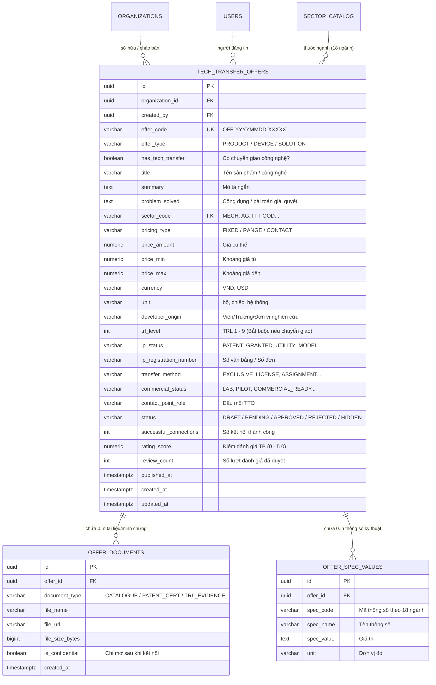

# Thiết Kế CSDL Hồ Sơ Chào Bán & Chuyển Giao Công Nghệ / SHTT (Seller)

> **Mã phân hệ**: `TASK-04_HO_SO_CHAO_BAN_SELLER_VA_BO_LOC`  
> **Căn cứ pháp lý & kỹ thuật**: Quyết định PO `PO-DEC-20261008-01` & `PO-DEC-20261008-04`  
> **Hệ quản trị CSDL**: PostgreSQL 16+ / EF Core 8 (Npgsql)  
> **Trạng thái**: 🟢 Baseline Thiết Kế Cơ Sở & Detail Schema Handoff

---

## 1. SƠ ĐỒ THỰC THỂ KHÁI NIỆM (ERD)



---

## 2. DATA DICTIONARY BẢNG `tech_transfer_offers`

| Tên Cột | Kiểu Dữ Liệu | Ràng Buộc (Constraints) | Ý Nghĩa Nghiệp Vụ & Quy Tắc |
| :--- | :--- | :--- | :--- |
| `id` | `UUID` | `PRIMARY KEY DEFAULT gen_random_uuid()` | Định danh duy nhất của hồ sơ chào bán. |
| `organization_id` | `UUID` | `NOT NULL, FK -> organizations(id)` | Chủ thể sở hữu (Doanh nghiệp ĐMST, Viện, Trường). |
| `created_by` | `UUID` | `NOT NULL, FK -> users(id)` | Tài khoản đăng tin. |
| `offer_code` | `VARCHAR(30)` | `NOT NULL, UNIQUE` | Mã hồ sơ chào bán: `OFF-YYYYMMDD-XXXXX`. |
| `offer_type` | `VARCHAR(20)` | `NOT NULL` | `PRODUCT` (Sản phẩm), `DEVICE` (Thiết bị), `SOLUTION` (Giải pháp). |
| `has_tech_transfer` | `BOOLEAN` | `NOT NULL DEFAULT FALSE` | Cờ: Có chuyển giao công nghệ hay chỉ bán thương mại đơn thuần. |
| `title` | `VARCHAR(255)` | `NOT NULL` | Tên sản phẩm / thiết bị / công nghệ. |
| `summary` | `TEXT` | `NOT NULL` | Mô tả tóm tắt đặc điểm công nghệ. |
| `problem_solved` | `TEXT` | `NOT NULL` | Bài toán kỹ thuật giải quyết cho bên mua. |
| `sector_code` | `VARCHAR(20)` | `NOT NULL` | Mã ngành trong 18 nhóm ngành (`MECH`, `AG`, `IT`, `FOOD`...). |
| `pricing_type` | `VARCHAR(20)` | `NOT NULL` | `FIXED` (Giá cụ thể), `RANGE` (Khoảng giá), `CONTACT` (Liên hệ báo giá). |
| `price_amount` | `NUMERIC(18,2)`| `NULLABLE` | Giá cụ thể (nếu `pricing_type = 'FIXED'`). |
| `price_min` | `NUMERIC(18,2)`| `NULLABLE` | Giá tối thiểu (nếu `pricing_type = 'RANGE'`). |
| `price_max` | `NUMERIC(18,2)`| `NULLABLE` | Giá tối đa (nếu `pricing_type = 'RANGE'`). |
| `currency` | `VARCHAR(10)` | `NOT NULL DEFAULT 'VND'` | Đơn vị tiền tệ (`VND`, `USD`). |
| `unit` | `VARCHAR(50)` | `NULLABLE` | Đơn vị tính (`chiếc`, `bộ`, `dây chuyền`, `li-xăng`). |
| **`developer_origin`** | `VARCHAR(255)` | `NULLABLE` | Nguồn gốc / Viện / Trường nghiên cứu phát triển. |
| **`trl_level`** | `INT` | `CHECK (trl_level BETWEEN 1 AND 9)` | Mức độ TRL từ 1 đến 9 (Bắt buộc nếu `has_tech_transfer = TRUE`). |
| **`ip_status`** | `VARCHAR(50)` | `NULLABLE` | `PATENT_GRANTED`, `UTILITY_MODEL`, `TRADE_SECRET`, `PATENT_PENDING`, `SOFTWARE_COPYRIGHT`, `NONE`. |
| **`ip_registration_number`** | `VARCHAR(100)` | `NULLABLE` | Số bằng độc quyền sáng chế / Số đơn đăng ký SHTT. |
| **`transfer_method`** | `VARCHAR(50)` | `NULLABLE` | `EXCLUSIVE_LICENSE`, `NON_EXCLUSIVE_LICENSE`, `ASSIGNMENT_SALE`, `JOINT_RD`, `CAPITAL_CONTRIBUTION`. |
| **`commercial_status`** | `VARCHAR(50)` | `NULLABLE` | `LAB_PROTOTYPE`, `PILOT_TESTING`, `COMMERCIALLY_READY`, `SEEKING_MANUFACTURER`. |
| `status` | `VARCHAR(20)` | `NOT NULL DEFAULT 'PENDING'` | `DRAFT`, `PENDING`, `APPROVED`, `REJECTED`, `HIDDEN`. |
| `successful_connections` | `INT` | `NOT NULL DEFAULT 0` | Số lượng kết nối thành công với Buyer. |
| `rating_score` | `NUMERIC(3,2)` | `NOT NULL DEFAULT 0.00` | Điểm đánh giá trung bình từ Buyer đã kết nối (thang 0.0 - 5.0). |
| `review_count` | `INT` | `NOT NULL DEFAULT 0` | Số lượt đánh giá đã được kiểm duyệt. |
| `published_at` | `TIMESTAMPTZ` | `NULLABLE` | Thời điểm niêm yết công khai. |
| `created_at` | `TIMESTAMPTZ` | `NOT NULL DEFAULT clock_timestamp()` | Thời điểm tạo. |
| `updated_at` | `TIMESTAMPTZ` | `NOT NULL DEFAULT clock_timestamp()` | Thời điểm cập nhật cuối. |

---

## 3. DDL SCRIPT POSTGRESQL (PRODUCTION-READY)

```sql
-- 1. TẠO BẢNG CHÀO BÁN CÔNG NGHỆ & SHTT
CREATE TABLE IF NOT EXISTS tech_transfer_offers (
    id UUID PRIMARY KEY DEFAULT gen_random_uuid(),
    organization_id UUID NOT NULL,
    created_by UUID NOT NULL,
    offer_code VARCHAR(30) NOT NULL UNIQUE,
    offer_type VARCHAR(20) NOT NULL,
    has_tech_transfer BOOLEAN NOT NULL DEFAULT FALSE,
    title VARCHAR(255) NOT NULL,
    summary TEXT NOT NULL,
    problem_solved TEXT NOT NULL,
    sector_code VARCHAR(20) NOT NULL,
    
    -- Thương mại & Giá
    pricing_type VARCHAR(20) NOT NULL DEFAULT 'CONTACT',
    price_amount NUMERIC(18,2),
    price_min NUMERIC(18,2),
    price_max NUMERIC(18,2),
    currency VARCHAR(10) NOT NULL DEFAULT 'VND',
    unit VARCHAR(50),
    
    -- BỘ TỨ THUỘC TÍNH SHTT & CHUYỂN GIAO (IP QUAD)
    developer_origin VARCHAR(255),
    trl_level INT,
    ip_status VARCHAR(50),
    ip_registration_number VARCHAR(100),
    transfer_method VARCHAR(50),
    commercial_status VARCHAR(50),
    contact_point_role VARCHAR(100),
    
    -- Trạng thái & Thống kê
    status VARCHAR(20) NOT NULL DEFAULT 'PENDING',
    successful_connections INT NOT NULL DEFAULT 0,
    rating_score NUMERIC(3,2) NOT NULL DEFAULT 0.00,
    review_count INT NOT NULL DEFAULT 0,
    published_at TIMESTAMPTZ,
    created_at TIMESTAMPTZ NOT NULL DEFAULT clock_timestamp(),
    updated_at TIMESTAMPTZ NOT NULL DEFAULT clock_timestamp(),
    
    -- RÀNG BUỘC KIỂM TRA (CHECK CONSTRAINTS)
    CONSTRAINT chk_offer_type CHECK (offer_type IN ('PRODUCT', 'DEVICE', 'SOLUTION')),
    CONSTRAINT chk_pricing_type CHECK (pricing_type IN ('FIXED', 'RANGE', 'CONTACT')),
    CONSTRAINT chk_offer_status CHECK (status IN ('DRAFT', 'PENDING', 'APPROVED', 'REJECTED', 'HIDDEN')),
    CONSTRAINT chk_trl_range CHECK (trl_level IS NULL OR (trl_level BETWEEN 1 AND 9)),
    CONSTRAINT chk_ip_status CHECK (ip_status IS NULL OR ip_status IN ('PATENT_GRANTED', 'UTILITY_MODEL', 'TRADE_SECRET', 'PATENT_PENDING', 'SOFTWARE_COPYRIGHT', 'NONE')),
    CONSTRAINT chk_transfer_method CHECK (transfer_method IS NULL OR transfer_method IN ('EXCLUSIVE_LICENSE', 'NON_EXCLUSIVE_LICENSE', 'ASSIGNMENT_SALE', 'JOINT_RD', 'CAPITAL_CONTRIBUTION')),
    CONSTRAINT chk_commercial_status CHECK (commercial_status IS NULL OR commercial_status IN ('LAB_PROTOTYPE', 'PILOT_TESTING', 'COMMERCIALLY_READY', 'SEEKING_MANUFACTURER')),
    
    -- CONDITIONAL CONSTRAINT: BẮT BUỘC BỘ TỨ SHTT KHI CÓ CHUYỂN GIAO CÔNG NGHỆ
    CONSTRAINT chk_tech_transfer_quad CHECK (
        has_tech_transfer = FALSE OR (
            trl_level IS NOT NULL AND
            ip_status IS NOT NULL AND
            transfer_method IS NOT NULL AND
            commercial_status IS NOT NULL AND
            developer_origin IS NOT NULL
        )
    )
);

-- 2. BẢNG TÀI LIỆU & MINH CHỨNG SHTT
CREATE TABLE IF NOT EXISTS offer_documents (
    id UUID PRIMARY KEY DEFAULT gen_random_uuid(),
    offer_id UUID NOT NULL REFERENCES tech_transfer_offers(id) ON DELETE CASCADE,
    document_type VARCHAR(50) NOT NULL,
    file_name VARCHAR(255) NOT NULL,
    file_url TEXT NOT NULL,
    file_size_bytes BIGINT NOT NULL,
    is_confidential BOOLEAN NOT NULL DEFAULT TRUE,
    created_at TIMESTAMPTZ NOT NULL DEFAULT clock_timestamp(),
    CONSTRAINT chk_doc_type CHECK (document_type IN ('CATALOGUE', 'PATENT_CERT', 'TRL_EVIDENCE', 'DESIGN_DRAWING', 'OTHER'))
);

-- 3. BẢNG THÔNG SỐ KỸ THUẬT THEO MA TRẬN 18 NGÀNH
CREATE TABLE IF NOT EXISTS offer_spec_values (
    id UUID PRIMARY KEY DEFAULT gen_random_uuid(),
    offer_id UUID NOT NULL REFERENCES tech_transfer_offers(id) ON DELETE CASCADE,
    spec_code VARCHAR(50) NOT NULL,
    spec_name VARCHAR(255) NOT NULL,
    spec_value TEXT NOT NULL,
    unit VARCHAR(50),
    created_at TIMESTAMPTZ NOT NULL DEFAULT clock_timestamp()
);

-- 4. INDEXES TỐI ƯU TRA CỨU & BỘ LỌC
CREATE INDEX IF NOT EXISTS idx_offers_sector_type ON tech_transfer_offers(sector_code, offer_type);
CREATE INDEX IF NOT EXISTS idx_offers_trl_level ON tech_transfer_offers(trl_level) WHERE has_tech_transfer = TRUE;
CREATE INDEX IF NOT EXISTS idx_offers_ip_status ON tech_transfer_offers(ip_status) WHERE has_tech_transfer = TRUE;
CREATE INDEX IF NOT EXISTS idx_offers_published_active ON tech_transfer_offers(status, published_at DESC) WHERE status = 'APPROVED';
```
